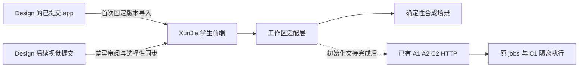

# I0-UI：前端导入与 I0-A 接入准备

日期：2026-10-11（Asia/Shanghai）。父任务：[I0 #30](https://github.com/paher-din/XunJie/issues/30)。主责：前端接入成员 Robert；A/C 继续负责业务宿主、权限、作品及执行服务。

**当前交付为整改后的规格、客户端约束与十张本地 tickets，没有编码、导入前端、安装依赖或修改远程 Issue。** 本批目标是让主仓库具备可运行、可验证的 I0-A 前端，并完成已知 HTTP 契约的客户端准备；真实 I0-A 联调仍等待第 5 节交接条件。

## 1. 使用入口与授权状态

- [接入规格](I0_UI_SPEC.md)：用户行为、实现决策、测试边界和不做事项。
- [任务用语](I0_UI_GLOSSARY.md)：避免将设计任务 ID、分配、尝试、草稿和快照混称。
- [双仓库接入决定](I0_UI_ADR_0001_DESIGN_IMPORT.md)：导入固定版本，业务开发留在主仓库，设计变更选择性同步。
- [客户端约束](I0_UI_CLIENT_CONTRACT.md)：准确执行前置、可交互准备运行、异步接纳、原文/ACK 事务、公开 Run 字段和 UI 差异。
- [审查与整改闭环](I0_UI_ADVERSARIAL_REVIEW.md#6-整改与复核记录)：原 8 项发现的处理位置与验证边界。
- 第 6 节是一张 ticket 一个文件的依赖索引；执行 Agent 从已满足阻塞项的任务开始。

已确认：规划阶段不编码；tickets 使用本地文档，不创建远程 Issue；实际前端要接入 XunJie 主仓库；本批聚焦 I0-A，保留数字逻辑演示，真实辅导与新增课程另行接入；采用 Monaco 专业代码编辑器；Design 固定提交的 `app/` 导入 `apps/student/`，业务在主仓库维护，后续视觉变化按差异选择性同步。

2026-10-11，前端接入成员将粒度/依赖判断委托规划 Agent，随后要求整改全部 8 项审查发现。目录、同步与 Monaco 不再待选择。本次将原 04/06 缩到独立行为，补 04A、06A、06B，共十张；拆分不改变产品范围和团队排程。测试方法选定为 Playwright 与同一可交互准备路径；依赖安装仍按具体实施授权，未答复不记同意。

规划状态为 `document-revised`，执行状态按真实条件分别记录。现在各票 `blocked`：没有编码指令，前置任务未交付，另有依赖/新库/实际 UI 项。P-01～P-04 的具体范围与影响见客户端约束 §1；文档整改完成不解除实施前置，不能再把“文档可阅读”叫 `ready-for-agent`。已确认事项不重复询问。

本次可写范围：本文及同前缀的规格、术语、决策提案与 tickets。只读：全部源码/测试/配置、既有任务记录、README、AGENTS、product/planning/reference，以及 Design 工作副本。本次不暂存、提交或推送文件。

## 2. 依据与可复核现状

### 2.1 正式依据

已按需求、范围、契约顺序读取与本批有关的正文：

- [PRD](../product/PRD.md) §1、3～6、8：C-02/C-05/C-06/C-07、PRD-02/03/09/10，学生控制作品、Web 应用与模型故障不阻断保存。
- [MVP_SPEC](../product/MVP_SPEC.md) §1.3、2、M-02/03/09/10、§4～8：C/TextScope、50 文件/1 MiB、保存/版本/恢复及 AC-02/03/04/06/10/12/15、NFR-01/03/04/05。
- [TECH_DESIGN](../product/TECH_DESIGN.md) §2、3.3、4.1/4.3、5/5.1、7.1/7.4/7.5、8/11：对象引用、HTTP 信封、CAS/幂等、IndexedDB 草稿、运行与代际。
- [TEAM_WORK_PLAN](../planning/TEAM_WORK_PLAN.md) §2、5、9；[I0 提案](I0_STUDENT_VERTICAL_SLICE.md) §2、4、5；[C2 交付](C2_WORKSPACE_JOBS.md) §10.4/11；[C0 用语](C0_GLOSSARY.md)及[工程衔接](../reference/ENGINEERING_HANDOFF.md)的版本、确认、运行语义。
- #30 完整正文及评论：核查时 Open、评论 0；正文明确 I0-A 不等待 B2/C3，实际实施与基线排程补丁仍待相应确认。

被引用的《前端任务解读》聊天已读取可访问的五轮文字。后续明确决定是“总体架构不变、C 保留、新增数字逻辑”；此前替换 C、桌面宿主和缩减正式验收的建议不进入本批。聊天中的下载附件未读取；本方案不声称复核过该附件，也不以它代替正式基线。

### 2.2 核查快照

| 对象 | 可复核来源 | 当前结论 |
| --- | --- | --- |
| XunJie | HEAD `0afd008c91373f82bde707aaeb26bc6b3dfd74e4`；[主入口](../../apps/teaching/server/main.ts) | 默认启动仍只用健康应用，没有组装正常业务宿主 |
| Design 前端 | [固定提交](https://github.com/wubq511/XunJie_Design/tree/1f0a71ad89856a3eaa2883f81c9cff4bcb56a8f6/app) | React 19、TypeScript、Vite、hash 路由、TanStack Query、Radix、Vitest；已有独立 lockfile |
| 工作区 | [WorkspacePage](https://github.com/wubq511/XunJie_Design/blob/1f0a71ad89856a3eaa2883f81c9cff4bcb56a8f6/app/src/pages/WorkspacePage.tsx)、[CenterToolArea](https://github.com/wubq511/XunJie_Design/blob/1f0a71ad89856a3eaa2883f81c9cff4bcb56a8f6/app/src/components/workspace/CenterToolArea.tsx) | 现有胶囊、IP、标签和分屏可沿用；代码是 VERILOG 常量静态行，波形是示意，构建/板卡装载是模拟 |
| 前端数据 | [LearningApi](https://github.com/wubq511/XunJie_Design/blob/1f0a71ad89856a3eaa2883f81c9cff4bcb56a8f6/app/src/bridge/learningApi.ts)、[模拟任务](https://github.com/wubq511/XunJie_Design/blob/1f0a71ad89856a3eaa2883f81c9cff4bcb56a8f6/app/src/bridge/mockData.ts) | 没有作品同步/快照/运行接口；程序设计样例为图书/记账等，不能当作 TextScope 正式活动 |
| A1/A2 | [会话](../../apps/teaching/server/access/app.ts)、[活动应用](../../apps/teaching/server/design/application.ts) | 有登录/当前会话/退出、按 ID 读取本人分配/固定活动/资料；未见本人分配列表发现入口 |
| C2 | [应用工厂](../../apps/teaching/server/workspace/application.ts)、[输入](../../apps/teaching/server/workspace/inputs.ts)、[命令](../../apps/teaching/server/workspace/commands.ts) | 已有 Attempt、sync、snapshot、run、cancel 及 GET 工厂；宿主/原 jobs 消费仍需 A/C 交接 |
| 版本差异 | [文件同步](../../apps/teaching/server/workspace/files.ts)、[C2 §10.4](C2_WORKSPACE_JOBS.md#104-准确批准与实施起点) | TECH §4.3 说文件编辑不推进 attemptRevision；当前实现及任务记录会同时推进。保留差异，读权威 Attempt，不由前端自行裁决 |
| 供应商入口 | [连接测试](https://github.com/wubq511/XunJie_Design/blob/1f0a71ad89856a3eaa2883f81c9cff4bcb56a8f6/app/src/lib/connectionTest.ts) | 自定义配置按钮能从浏览器实际 GET /models，并非全部模拟；I0 准备模式须禁止该实际调用，现有学校测试仍只表示模拟 |

Design 处于并发迭代：核查中 AppShell、Composer、图标样式、设置入口、主样式、首页/对话设计文档有在途改动，另有未跟踪浏览器 harness；早期还有 staged 设计改动，随后状态发生变化。本方案只认上述固定提交的来源，**不认工作副本为干净交付包**。执行 01 时必须重新记录 Git 状态、明确选中已提交版本；若采用较新版本，更新来源清单并重新检查差异。

## 3. 怎么把前端接入主仓库

执行 Agent 将 Design 的固定提交 `app/` 已跟踪内容导入 XunJie 的 `apps/student/`。这是本批已确定的工程落点，当前没有实际新增目录；不更改 `apps/teaching` 的职责、服务和精确依赖。

1. 固定来源仓库、commit 和 `app/` 子树，保留代码、public 资产、依赖锁文件、必要测试和来源/许可说明。不要导入 `.git`、node_modules、dist、未跟踪 harness、参考工程或整包研究材料。
2. 前端和后端各保留 package/lock、启动/构建范围。先用前端已有 Vite 启动，不引入 monorepo 工具、不合并 TypeScript 版本、不改后端启动或 CI。现有独立工程已经足够。
3. 将前端 README 及其资产导航中的失效相对链接改为主仓库实际入口或固定来源公开链接；业务规则只指向主仓库基线。可独立构建和运行，不要求团队有 Design 的本地 checkout。
4. 固定提交附带的 DESIGN/交互说明作为“UI 来源参考”，用公开固定链接查阅；其中桌面、匿名本地使用、自动引导或能力百分比等与主仓库相冲突的业务描述不继承为正式契约。开发不借导入改写 AGENTS 或产品基线。
5. 从首次导入起，XunJie 是业务接入代码的维护位置。Design 继续提供视觉迭代，维护来源版本和目标映射，用“上次已接收来源 → 新来源”的差异选择性更新；混有界面和业务的提交逐项合并，不从新包覆盖整个目标目录。源码 hash 有助审阅，不能替代冲突核对。
6. UI 外观同步与业务接入分开提交/记录。共享组件冲突保留两侧改动后人工处理；不使用 reset、删除或整文件覆盖解决。导入后设计方无需回写主仓库业务适配器。

业务数据经过前端工作区适配层进入现有界面。适配层消费 A/C 已有 HTTP；编辑器不直接拥有保存/运行权限或构造服务端身份。保留原界面结构；缺少的文件/保存/比较/运行操作先按[UI 能力差异](I0_UI_CLIENT_CONTRACT.md#7-现有-ui-能力差异与接入责任)逐项交接组件/槽位，未落实时不能让 Agent 自行设计页面。01 交 C 可用容器，02/03/后续交对应业务交互，不将占位误报为完整编辑器。

开发准备模式由 `npm run dev:prep` 显式启动 Vite fixture middleware，窄客户端使用 `/__i0prep/api`；真实 `npm run dev` 使用同源 `/api`，失败不回退。准备 authority 在开发进程中，写后刷新 GET 一致，重启换 epoch/代际并提示重读；正式 build 不含 fixture。Playwright 也走同一路径，故障控制不另造成功业务。具体状态归属和脚本规则见[客户端约束 §2](I0_UI_CLIENT_CONTRACT.md#2-准备模式必须能独立启动)。

## 4. 编辑器决定与验证建议

| 维度 | CodeMirror 6 | Monaco | 本批判断 |
| --- | --- | --- | --- |
| 状态/视图 | 不可变 EditorState 与 EditorView；可按扩展组合 | 文件 model 与 editor view 分离；model 带文本/历史与 URI | 两者都能保留跨视图编辑状态 |
| 编辑能力 | 按需配置行号、快捷键、搜索、历史和语言支持 | 现成代码编辑器 API、语言 tokenization 和编辑操作 | 本批要求专业编辑，均满足基础方向 |
| 多版本比较 | 官方 merge/diff 扩展可用，需组合 | 官方提供 createDiffEditor | 本批冲突与版本比较优先用 Monaco 现成功能 |
| Vite 接入 | ESM 模块/扩展；需要正确组合 | ESM + 本地 worker，官方有 Vite 集成说明 | 两者兼容性都须在实际 lock/构建上验证 |
| C 语言范围 | 单独选 C 语言支持；不能把 C++ 包当 C17 验证器 | 选择 C tokenization；不自动获得 C 编译/LSP 语义诊断 | 语法高亮与 C1 编译判断分开 |
| 主题与布局 | 可定制主题和嵌入现有容器 | 可配置主题、布局和 view state | 沿用 UI 令牌；不更换页面骨架 |

**采用 Monaco**：多文件历史、只读快照、冲突和版本比较都属于本批实际需求。选择依据是集成功能与 API，未测 bundle、内存和响应时间，不声称 Monaco 或 CodeMirror 更快。编辑器替换只影响窄的展示接口，保存/运行状态与它解耦。

前端运行依赖使用 `monaco-editor`；本次测试方法选定开发依赖 `@playwright/test`，不加入第三方 React editor wrapper、CodeMirror、LSP、后端工具链或新状态库。执行时先核兼容并锁实际版本，记录依赖差异；当前未安装。实际依赖授权未落实前对应任务 blocked。Playwright 用现有 Vite 的 dev:prep 作为 webServer，以实际页面/同一 fixture 和传输故障为主边界；现有 Vitest 保留，用于已有规则及必要的正文/引用转换反例。

新增浏览器 IndexedDB 属于新本机草稿存储提案：只使用全新、分模式/账号/Attempt 命名空间，不迁移、删除既有浏览器数据或改变服务端 schema；写入失败不能显示“草稿已保护”。正式实施前仍须按项目边界确认该具体范围。P-02 已列新库名称/版本/数据范围；原文权威、LF 显示映射、BOM/逐段 EOL 和可逆 undo 详见[客户端约束 §4](I0_UI_CLIENT_CONTRACT.md#4-原文本权威与-monaco-适配)，不能直接序列化 Monaco 文本模型来过关。

官方依据（2026-10-11 检索；方案适配结论为本任务判断）：[CodeMirror 系统指南](https://codemirror.net/docs/guide/)、[UTF-16 定位](https://codemirror.net/docs/migration/)、[扩展参考](https://codemirror.net/docs/ref/)、[Monaco 模型/视图](https://github.com/microsoft/monaco-editor/blob/main/README.md)、[Monaco ESM/Vite](https://github.com/microsoft/monaco-editor/blob/main/docs/integrate-esm.md)、[diff editor API](https://microsoft.github.io/monaco-editor/typedoc/functions/editor_editor_api.editor.createDiffEditor.html)、[Playwright webServer](https://playwright.dev/docs/test-webserver)、[HTTP Mock](https://playwright.dev/docs/mock)。CodeMirror 部分页面直接打开失败，使用其官方搜索索引可见正文；不宣称读取了未返回的内容。

## 5. 已知契约与真实联调缺口

### 5.1 可以现在实现、以 HTTP 替身验证的客户端行为

| 能力 | 已有 HTTP/源码契约 | 客户端关键要求 |
| --- | --- | --- |
| 初始化后读取 | GET `/api/session`、`/api/assignments/:id`、`/api/activities/:id?audience=student`、`/api/attempts/:id` | Session 决定身份；分配、活动、Attempt 各自保留 ID/版本；GET 不启动学习；不把 profile/资料/进度缺项编造成业务值 |
| 创建/恢复 Attempt | POST `/api/assignments/:id/attempts` | 受信 recoveryGeneration、原 Idempotency-Key；响应是命令回执，不是直接 Attempt；未知时核原请求 |
| 保存 | POST `/api/attempts/:id/sync` | expectedWorkspaceRevision/clientId/clientSeq、create clientFileKey 或 update/recycle/restore 的 fileId/baseVersion；正文按原 UTF-8，路径和限额不变 |
| 保存 ACK | `requestId → data(命令回执) → result` | result 含 workspaceRevision/files 元数据/created/process；外层有 receiptId/commandId/serverSeq，C2 再附 replayed。ACK 不含完整正文；用本次冻结发送的正文建立确认基线，不能用 ACK 到达时的最新草稿 |
| 不可变快照 | POST `/api/attempts/:id/snapshots`，GET 对应 snapshot | POST 结果是 snapshotId/snapshotHash/workspaceRevision；GET 核完整文件清单，不能把 result 误当整份快照 |
| 运行 | POST `/api/attempts/:id/runs` | expectedAttemptRevision/snapshotId/runtimeProfileVersion/entryFileId/input/mode；snapshot 文件 ID 与课程参数绑定，不接受 shell |
| 结果/取消 | GET `/api/jobs/:id`、GET `/api/attempts/:id/runs/:runId` 及 `/files`；POST `/api/jobs/:id/cancel` | 核原 runId/jobId/snapshot；Job 状态、执行诊断、可信检查和报告产物分开；cancelling 不冒充 cancelled；未知不自动新建运行 |

SDK/服务端模块不直接导入浏览器；只使用可序列化的契约投影及 HTTP。前端解包与输入样例对照已有 integration 测试，不仅让 Mock 和自己写的类型互相印证。当前 C2 已有结果读取，不能把缺正常宿主误写为缺结果路由。

保留命令的原完整输入、业务键、clientId/clientSeq/代际及其提交正文，在重试期间不可改。requestId 可变化；重试同业务请求不得换键或把新草稿挂到旧请求。成功重放返回旧 ACK 不等于当前草稿全量同步，也不等于服务端当前 head 仍是旧版本；必要时重读。

同步后从获准 GET 重读 Attempt/阶段版本，再发新 run/control。当前 C2 不在 sync result 返回 attemptRevision，前端不得用 workspaceRevision 替代；该读回办法可兼容实际版本推进，并保留基线差异待 A/C 维护者汇总。

I0-A 可暂用已有 GET Job/Run 做有界轮询，不承诺 SSE 已交付；断线/隐藏时管理轮询，恢复核原 ID。迟到响应还必须核当前 loadEpoch、受信代际、读取轮次与 run/job/快照归属；同账号同 Attempt 的旧加载也失效。g2 已重读后 g1 ACK 不能建立新确认头，旧 poll 不能覆盖终态，见客户端约束 §3。

原命令先持久化；clientId/seq 不复用，ACK 的确认头/创建映射/最新草稿关联/outbox 状态同事务提交。中断后仍按原命令核对，见客户端约束 §5。GET Run 不含 entryFileId/input/inputHash，参数只显示经原回执关联的本机请求记录；无记录明确不可回取。check 和产物裁剪必须保持，见客户端约束 §6。

### 5.2 对 A/C 的交接请求（不派遣后台编码）

| 编号 | 归属 | 缺口/需要交清 | 哪项受阻 |
| --- | --- | --- | --- |
| H-01 | A | 正常业务宿主、同源 HTTPS 开发入口、真实 Session/CSRF、已批准合成账号与使用方式 | 真实身份/所有浏览器写命令；Vite 5180 不能绕过 Secure cookie/Origin |
| H-02 | A | 本人获准 Assignment 的入口/引用；可为列表或授权深链，相应响应/空状态 | 正常真实分配入口；不预定新增列表 API，不硬编码 ID/遍历猜测 |
| H-03 | A/C | 空 Attempt 首次请求前如何取得当前受信 recoveryGeneration，以及恢复重读交接 | 创建 Attempt 和首次写入；不从本地随机值、旧 Job 或源码常量推导 |
| H-04 | A/C | 宿主持续消费原 jobs、C1 当前 readiness/profile/validation/代际与合成运行样例 | 真实运行；不让学生/维护者手动 processJob，不在应用机启动 GCC |
| H-05 | A/C | sync 造成 attemptRevision 推进的基线差异、当前权威返回/重读办法；暂停分配读取样例 | 真实版本/状态联调；本批不修改共享规则，明确使用获准重读 |
| H-06 | A/C | 按读取、保存、运行、停止、产物分别交实际公开样例/错误/重放与裁剪状态 | 只阻塞缺对应样例的能力；不要求完整样例包齐备 |

这些 H 条件按能力阻塞真实联调，不作为准备实现的统一门禁。真实读取由 01 负责，已有 Attempt 读取/创建/保存由 03 负责，Core run 由 06 负责，06A/06B 分别增强停止/历史。每项必需条件见[逐能力交接表](I0_UI_CLIENT_CONTRACT.md#8-按能力交接真实服务)；不等全部 H 或 07 综合收口才接某项。具体编码/新库/UI 前置仍须落实。本次不派后台任务、不修改远程 Issue。

I0-B：B1 实际 provider、B2 help/上下文和 C3 原文/Action/回执/停止另行交付。现有前端 stop/resume/stream/主动引导不直接成为服务端语义，尤其不能未经政策校验先流式展示答案。数字逻辑：保留原模拟板/波形，不接 Icarus/VPI，不以扩展名或课程名称判定存在执行能力。

## 6. 本地 tickets 与交付顺序

| 编号/标题 | Blocked by（tickets） | 独立交付结果 |
| --- | --- | --- |
| [01 固定导入、C 容器与初始化](I0_UI_01_IMPORT_C_ENTRY.md) | 无 | 独立 dev:prep、C 可用容器、Session/固定活动/可见资料客户端与 harness |
| [02 编辑器与本机草稿](I0_UI_02_EDITOR_DRAFTS.md) | 01 | 保真多文件编辑、刷新恢复及草稿/确认分离 |
| [03 确认保存与快照](I0_UI_03_CONFIRM_SNAPSHOT.md) | 02 | Attempt 客户端、原请求/ACK 事务、隔离旧响应与不可变快照 |
| [04 网络恢复](I0_UI_04_RECOVERY_CONFLICTS.md) | 03 | 断线编辑、刷新与原保存请求核对/重放 |
| [04A 本机/服务冲突选择](I0_UI_04A_LOCAL_CONFLICTS.md) | 03 | 双方正文保护、只读比较、明确选择后的新保存 |
| [05 文件历史](I0_UI_05_FILE_HISTORY.md) | 03 | 实例回收/恢复、同名冲突与只读版本比较 |
| [06 一次 Core 运行](I0_UI_06_RUN_RESULTS.md) | 03 | 固定快照请求、公开 Job/Run 与基础诊断 |
| [06A 取消与未知核对](I0_UI_06A_RUN_CONTROL.md) | 06 | 准确停止进度、原请求未知核对且不自动重跑 |
| [06B 历史/公开产物](I0_UI_06B_RUN_HISTORY.md) | 06 | 来源明确的运行比较、检查裁剪与合法结果文件 |
| [07 全批浏览器收口](I0_UI_07_BROWSER_HANDOFF.md) | 04、04A、05、06A、06B | 全部准备行为回放与按能力交接证据 |

编号沿用原链接，A/B 后缀标独立分拆；上表按 blocker 在前排列，每票一个文件。最小路径 **01→02→03→06**；后续增强独立交付，07 不成为真实读取/保存/运行的前置。所有票还须满足客户端约束 P-01～P-04 的对应条件，不能只看 ticket 图就开工。

03 输出共同的带上下文读取、原文/draftRevision、实例映射、冻结 outbox/原回执、确认头、快照与权威 Attempt 重读边界；后续不另建状态。03 后 04/04A/05/06 行为可并行，06 后 06A/06B 可并行；只有实际写集独立才派并行工作，共享文件由前端集成人协调顺序合入。没有为了并行另造框架。

本次拆分保留已有业务范围，把多条可独立演示的增强从原 04/06 分开；不改 TEAM_WORK_PLAN 或替 A/C 接受新任务。每票都有视图/客户端/数据/验证的完整行为，不按“所有存储、所有 UI”横切。

## 7. 主要测试边界与完成口径

选定的主边界是**实际工作区的浏览器用户操作**：启动独立 dev:prep，消费同一进程 fixture，仅注入有来源的传输/场景故障，操作 Monaco、文件入口、保存和运行栏；断言页面正文、状态、归属和实际发出的请求。Playwright 负责实际 IndexedDB、刷新、多标签、可见文本和键盘路径，不能用 Node 内存存储替身宣称浏览器持久化通过。

已读前端既有 Vitest 的任务/回合/会话测试及 C2 integration 测试；这些提供规则和 wire 样例，**不是已有 I0 浏览器验收**。字节/UTF-16/摘要等边界转换可补最少纯函数反例，不测试每个内部 hook 或复制实现步骤。

| 层次 | 本批能交付 | 当前状态 |
| --- | --- | --- |
| 规划文档 | spec、来源/差异、术语、接入决定、客户端约束、十张 tickets 与闭环 | 已整改；执行条件单列，未实施 |
| 工程与客户端 | 前端导入、typecheck/test/build、基于确定性响应的浏览器准备验收 | 未执行 |
| 真实 I0-A | Session/分配/作品/原 jobs/C1 整链及浏览器故障验证 | 未执行；各能力按相应 H/UI/P 条件推进 |
| I0-B、数字逻辑新增 | 真实教学消息/回执/取消、实际 HDL/板卡/波形 | 不在本批；未执行 |
| 正式产品 | 全部 M/AC/NFR、I1/I2/I3、G1～G4、真人与教学效果 | 不由本批声明完成 |

准备检查沿用前端 `npm run typecheck`、`npm test`、`npm run build`；选定新增独立 `npm run test:e2e`。执行时在学生前端工程目录使用获准 Node/lock，记录命令、版本和结果，不为本批修改后端/CI。不以 Mock 保存或模拟运行通过记整项 AC/NFR，通过数按层和本次组合单列。

## 8. 交付记录

本批始终只写 I0_UI 任务文档。代码迁入、编辑器/测试依赖、IndexedDB、业务适配、工程/浏览器/节点/模型/真人检查均未执行。只读产品基线、既有 I0 任务稿及 Design 改动保留；基线排程与 §4.3 差异仍为**待授权维护者汇总**。

最初交付的历史文档检查（整改前）：11 份本批 Markdown、七张 tickets、34 条用户故事、52 个本地链接；模板字段、末尾换行、尾随空白、个人绝对路径及依赖图检查通过，阻塞图无环。`git diff --check` 通过；另直接扫描本批未跟踪文件，避免 Git 检查遗漏新增文档。未修改现有 tracked 文件；主仓库原 `.zcodeignore` 和 Design 在途改动保留。Design 状态继续变化，实施 01 必须重新选定已提交来源。

2026-10-11 最初补充：按前端接入成员要求把目录/同步/Monaco 写入执行任务；当时将七票都称可领取。后续对抗性审查发现这混淆文档与执行状态，本次已纠正，原表述不能再作为实施授权。

2026-10-11 整改交付：直接修 SPEC/原七票/本文/ADR/术语，新增客户端约束与 04A/06A/06B。8 项审查反例已落实为方案/验收；规划状态 document-revised，编码/依赖/新库/UI 与真实交接状态准确保留。详细闭环、文档验证和未执行项见[审查记录 §6](I0_UI_ADVERSARIAL_REVIEW.md#6-整改与复核记录)。后续执行任务须追加真实代码、依赖、验证事实和剩余项，不能把文档要求记作实测通过。
