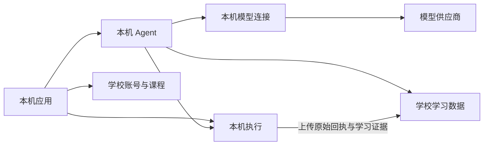

# 可组合部署与课程执行位置

供学校技术负责人和部署维护者选择模块、接入设备，以及教师侧开发者与编码 Agent 接入课程设计、部署准备和发布接口。当前开发学校的实际入口和启停方法见 [开发环境](../skills/xunjie-development/references/product-development.md)。

学校始终提供学校身份／账号与课程。学习数据、教学 Agent、模型连接与执行分别有自己的 owner；安装配置决定启用哪些模块，教师发布的课程方案决定每项操作在哪里执行。

## 模块与调用方向

| 模块 | 保存与负责的内容 | 可用组合 |
| --- | --- | --- |
| `space-course` | 学校账号、成员权限、课程、不可变发布与部署准备回执 | 学校必需；本机保留独立个人身份 |
| `learning-data` | 活动、作品、提问草稿、提交意图和可引用学习证据 | 学校或已授权本机数据 owner |
| `teaching-agent` | Agent Run、步骤、模型上下文与工具决策 | 本机、学校或独立 Agent 环境 |
| `model-connection` | 模型配置、个人凭据、调用记录 | Agent 同机直连；也保留显式学校／独立模型组合 |
| `tool-execution` | 执行命令、进程、原始回执与结果资源 | 教师指定的学生本机或学校节点；浏览器任务由学生浏览器执行 |

本轮开发采用：



学校数据端只校验自己的身份、成员关系、课程权限和写入范围。Agent 的派发检查由 Agent owner 完成；本机执行的派发检查由执行 owner 完成。学校不主动连接学生 loopback、不轮询学生 Run，也不接收个人模型请求正文。保留的独立学校 Agent、学校模型和旧设备领取模型任务机制只供显式选择这些 owner 的部署使用；本机 Agent 绑定后跳过旧模型任务领取链路。

小型活动／课程／数据只读查询通过一次已授权请求返回；超过 512 KiB 的回复使用原分块传输。只读查询每次检查当前权限；模型、执行和数据写入继续使用各自的正式派发与持久回执，不进入此只读路径。

本机执行端主动上传原始命令、原始接受回执、状态和结果资源。学校保存的是事实与资源副本，不把上传事件变成自己的执行队列；引用、提问与证据核验直接读取学校已保存的事实。上传失败保留原执行与未确认上传，恢复后重试，不能因此重新运行。未同步证据保持不可用，不能伪造完成状态。

## 安装与模块切换

新环境的 `install --config` 可以提供 `deployment`；已有环境使用 `configure-deployment`。配置只改变启用集合，保留已有 owner 身份、数据库与历史事实。停用模块仍参与维护与恢复验证，停用不等于清空数据。

学校数据部署文件：

```json
{"formatVersion":1,"modules":["space-course","learning-data"],"dependencies":{}}
```

本机开发部署文件：

```json
{"formatVersion":1,"modules":["space-course","learning-data","teaching-agent","model-connection","tool-execution"],"dependencies":{}}
```

本机 `learning-data` 负责个人空间；学校空间仍指向学校的数据 owner。需要学校身份、课程而学习数据在本机时，通过已有 `learning-binding` 明确绑定，不复制学校账号库。学校执行部署需要同时启用 `space-course`、`learning-data`、`tool-execution`。独立 Agent 保留 `profile=agent` 与显式 `dependencies.learning-data={kind:"connection",connectionId}`；它的远端依赖不能误当作本机模型直连。

```sh
xunjie configure-deployment --root <环境目录> --file <部署文件> --dry-run
xunjie stop --root <环境目录>
xunjie configure-deployment --root <环境目录> --file <部署文件>
xunjie start --root <环境目录>
xunjie status --root <环境目录>
```

`status.deployment.configuration.modules` 是实际启用集合；`modules[].retained` 表示保留的停用 owner。学校数据部署不报告原生执行隔离缺失为运行故障，因为该部署没有提供执行模块。

## 连接本机 Agent 与学校数据

先在本机设置连接学校，通过学校登录批准该设备并完成配对；已有有效连接继续使用。后续管理操作由部署者或其自动化工具完成，学生学习时无需选择 owner 或手动派发。

1. 从两端 `status.environment` 取得真实服务描述与 `installationId`。学校成员的数据 target 必须是学校 `learning-data` 服务。
2. 在学校学习数据服务分别授权本机 Agent 与本机执行服务，两个 grant 均使用 `teaching.dependencies`，来源绑定各自 serviceId 和本机 installationId。使用 `authorize --service-id <学校数据serviceId> --file ... --out ...`；授权文件和 token 保留在私有目录。
3. 在本机分别 `connect --file ...` 登记两条单向连接。target 使用学校给出的服务描述和可达地址；本机地址无需向学校公开。
4. 在学校调用 `agent-binding --file ...`，输入包含 `requestId, identity, connectionId, target, installationId, delivery:"client", grantId, executionGrantId, deviceModules`。`connectionId` 是已批准学校成员连接，`target` 是本机 Agent 服务，两个 grant 对应上一步，`deviceModules` 来自实际本机安装。
5. 在本机调用 `client-agent-binding --file ...`，输入 `{connectionId, dependencyConnectionId, executionConnectionId, target}`。两条 connectionId 分别指向 Agent 读写学校数据、执行端上传证据的连接；target 采用本机 Agent 的 `{environmentId,serviceId,version:1}`。
6. 在本机设置中选用个人模型，并授权给当前学校空间。本机模型配置／密钥与学校学习数据分别保存；这不会启用学校统一模型。

既有活动保留首次固定的 Agent owner；更改成员绑定仅决定尚未固定 owner 的活动。遇到历史 owner 不可用时应恢复原 owner 或做明确迁移，不能静默重派已有 Run。权限撤销、学校断连或维护关闭使新派发失败；恢复查询使用原 requestId、inputDigest 和执行引用，不生成第二次付费调用。

## 教师设计、部署与发布接口

教师侧 UI 尚未开始。本轮提供可由后续教师 Agent 使用的公共契约与接口：

```ts
createCourseExecutionDesign(storage, { authorize, prepareSchoolRuntime })
  .compileExecutionDesign(identity, input)
  .prepareCourseDeployment(identity, { requestId, ...input })
  .readCourseDeployment(identity, requestId)
```

`input={courseId,taskId,releaseId,components,plan}`。V2 `plan` 对每个 `componentKey + operationId` 固定 `target`：`student-browser`、`student-runtime` 或 `school-runtime`，同时固定组件／配置摘要、资源摘要与预算。编译输入可省略 planDigest，由课程 owner 生成；不可超过组件和实际 adapter 的上限。

管理 HTTP 入口分别为 `/api/learning/manage/course-execution-compile`、`course-deployment-prepare`、`course-deployment-read`，沿用环境管理授权。前两项输入 `{identity,input}`，读取输入 `{identity,requestId}`。CLI 同名命令通过 `--file` 读取上述对象。

教师 Agent 使用课程服务的 `courses.execution-design` 能力，输入 `{operation:"compile"|"prepare"|"read",request:上述对象}`。部署者为它独立授予课程设计权限；普通学生成员资格不足以调用管理入口。业务模块的 `authorize` 由教师侧宿主注入课程设计权。

执行顺序为 `compile → prepare → course-import`。准备操作验证并保留不可变课程资源；学校目标还核验本部署的执行模块、受限运行入口、adapter 和 HTTPS 条件，返回 `ready` 或 `blocked`。发布必须对应同一 courseId、taskId、releaseId、planDigest 的 ready 回执，并再次核验学校目标。学校不提供执行时，学校目标保持 blocked；不会修改为学生本机。

本轮学校执行位置支持课程学校所在的执行 owner，并要求该活动的数据在学校。本机数据的混合组合使用本机执行；学校执行所需的数据绑定由部署者安排，既有活动不自动迁移。额外独立执行集群的安装／调度尚未提供。资源由课程 owner 保留，执行时仅取得固定命令需要的资源；不部署整个学校空间到执行机。

## 学生自动执行与恢复

客户端读取发布方案和各目标的实际 adapter 能力，自动把浏览器操作交给浏览器，把本机操作交给本机执行 owner，把学校操作交给课程学校执行 owner。学生和本机 Agent 共用相同目标／预算校验；不会因另一个目标可用而改变教师的决定。

本机目标缺安装、授权或运行资源时显示对应缺项；学校目标未准备或断连时等待学校恢复。重复提交使用原执行实例；控制、停止、回执查询和结果读取继续访问原 owner。学校访问只用于权限、课程／资源读取、学习数据同步以及教师明确指定的学校执行。

执行 owner 与数据 owner 都纳入现有维护、备份和恢复：先停止新派发，再结束／确认未决进程，保留未知状态；恢复的隔离实例在接管前只读。新增执行记录可在学校独立验证，不要求原学生电脑在线。跨机恢复仍使用已有安装级 fencing、重新授权和 namespace 握手；模块切换不能代替 owner 迁移。

## 排障与验证边界

- `models/*` 或 `agent/*` 不可用：核对本机启用模块、学校成员授权和 client Agent 绑定；不要恢复学校代理作为隐式回退。
- `execution.record` 被拒绝：核对执行端独立 grant、installationId 和学校批准的 deviceModules；不要拿 Agent 的 grant 上传执行证据。
- 教师方案 `blocked`：修复明确目标的运行资源并用新 requestId 重新准备，原准备回执不可改写。
- 模型返回 404：核对协议、Base URL 与 path；Messages 使用 DeepSeek 时 Base URL 为 `https://api.deepseek.com/anthropic`、path 为 `/v1/messages`。地址变更沿用凭据重新绑定要求。
- 本机／服务器停止保留数据。清理只针对明确选定的环境或本次临时产物，正在被环境引用的 Node、PostgreSQL、PDF 与 Web 运行资源继续保留。

新拓扑工程回归见 `packages/product-runtime/test/device-agent-school-data.runtime.test.mjs`；教师设计与发布、执行事实原件校验分别由 `apps/server/tests/course-execution-design.runtime.test.mjs`、`execution-records.runtime.test.mjs` 覆盖。实际开发部署及真实模型／Chrome 的验收结果记录在开发环境说明；工程通过不能替代未运行的平台验收或教学效果评估。
