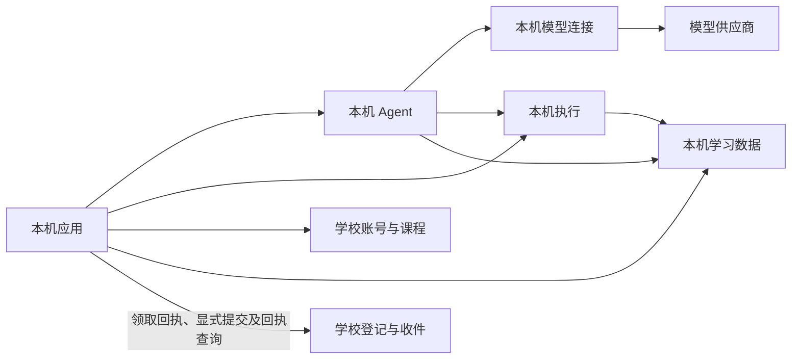

# 可组合部署与课程执行位置

本文描述当前源码的部署职责与接口，不代表本轮安装、重启、真实模型或 UI 验收已完成。

供学校技术负责人和部署维护者选择模块、接入设备，以及教师侧开发者与编码 Agent 接入课程设计、部署准备和发布接口。当前开发学校的实际入口和启停方法见 [开发环境](../skills/xunjie-development/references/product-development.md)。

学校始终提供学校身份／账号与课程。学习数据、教学 Agent、模型连接与执行分别有自己的 owner；安装配置决定启用哪些模块，教师发布的课程方案决定每项操作在哪里执行。

## 模块与调用方向

| 模块 | 保存与负责的内容 | 可用组合 |
| --- | --- | --- |
| `space-course` | 学校账号、成员权限、课程、不可变发布与部署准备回执 | 学校必需；本机保留独立个人身份 |
| `learning-data` | 学习活动、作品、草稿、会话目录、个人项目、session/workspace 资料与 Skills；学校活动登记、领取回执、正式提交及收件回执 | 默认本机与学校按上述边界分工；保留显式数据 owner 绑定 |
| `teaching-agent` | 通用 session/Run/步骤/许可/等待/恢复；装配普通助手与工作区助手场景 | 本机、学校或独立 Agent 环境 |
| `model-connection` | 模型配置、个人凭据、调用记录 | Agent 同机直连；也保留显式学校／独立模型组合 |
| `tool-execution` | 执行命令、进程、原始回执与结果资源 | 教师指定的学生本机或学校节点；浏览器任务由学生浏览器执行 |

模块 ID 是安装、服务、凭据、资源根与维护 owner 的持久标识。源码分别位于 [learning-space](../packages/learning-space/README.md)、[agent-runtime](../packages/agent-runtime/README.md)、[agents](../packages/agents/README.md)、[model-gateway](../packages/model-gateway/README.md) 和 [product-runtime](../packages/product-runtime/README.md)；`agent-runtime` 与 `agents` 共同服务于 `teaching-agent`，`model-gateway` 服务于 `model-connection`，不新增同名部署模块。

默认开发组合为本机五模块、学校两模块，数据调用方向如下；实际部署按下文的状态查询核实：



学校保存账号、课程、活动登记、领取回执、明确提交的固定版本与收件回执；草稿、提问与引用、作品编辑、个人材料／PDF、生成内容、完整会话、模型与执行过程保存在本机。学校数据端校验自己的身份、成员关系、课程权限和收件范围。Agent 的派发检查由 Agent owner 完成；本机执行的派发检查由执行 owner 完成。学校不主动连接学生 loopback、不轮询学生 Run，也不接收个人模型请求正文。保留的独立学校 Agent、学校模型和旧设备领取模型任务机制只供显式选择这些 owner 的部署使用；本机 Agent 绑定后跳过旧模型任务领取链路。

小型活动／课程／数据只读查询通过一次已授权请求返回；超过 512 KiB 的回复使用原分块传输。只读查询每次检查当前权限；模型、执行和数据写入继续使用各自的正式派发与持久回执，不进入此只读路径。

默认 `school-client` 在具备本机 `studyCopies`、学校授权元数据允许本机学习、且连接未配置 `localBinding`／`modelBinding` 时使用 `localStudy`。学校按实际启用模块及成员／活动的固定 owner 判定；显式学校或独立 Agent／模型组合沿原 owner 访问。Web 继续使用原 `/api/learning/*` 路径，默认学习过程由客户端转入本机数据、Agent、模型及执行服务；无需另选本机数据入口。执行过程不持续上传学校，学生可在明确提交中选择附带原执行依据；收件不等于学校重新运行或认定实验结果。

显式学校数据部署仍支持执行端主动上传命令、接受回执、状态和结果资源，学校保存事实副本而非重建执行队列。该路径不是默认 `localStudy`；上传丢包按原执行身份查询／重试，不重新运行。

## Session v2 的归属与调用

普通首页创建本机 personal identity 下的 `student-assistant` session，首问不创建 activity。只有明确的个人项目创建授权才通过领域 port 创建真实 activity、计划和独立工作区 session；计划属于 learning-data owner。学校 workspace 可使用经连接核对的 school identity，其目录、学习数据、Agent 和模型 owner 可以分别位于允许的环境。

会话目录固定原 Agent owner；切页、归档读取、重试和安装恢复都不按当前可用节点改绑。workspace 入口固定真实 `activityId + target`，Agent 输入保留完整 `context.action`，由领域 factory 校验 scope、作品原字节和固定引用。

浏览器调用 `/api/learning/agent-sessions` 必须带 `x-xj-agent-contract: 2`；可信 HTTP 宿主从当前本机主体或已核对连接生成身份，校验 expected subject、namespace，再路由原 owner。`agent.sessions.v2` 与 `agent.dependencies.v2` 的 RPC 均显式 `version: 2`；旧 `/agent/:activityId/*`、旧 capability 和不支持的 operation 返回 incompatible，不静默重派。

普通呈现使用 conversation 投影；snapshot 是独立调试接口。输入/编辑/移除/move、停止/继续、提问回应沿原 input/run/wait 和 requestId，丢回包先核对原结果。initialize 只由受认证宿主授权，resolveWait 只接收可信 Node 服务的实际结果，浏览器不能用自报结果解锁执行等待。

附件统一使用 `agent-sessions/:sessionId/materials/*` 与 `pdf/*`。全局 `/skills` 是个人库，会话目录使用 `agent-sessions/:sessionId/skills`，选择提交 `{requestId, skills:[{skillId,version}]}`，不携带 range 或自选 owner。课程资料、个人资料及模型图像仍分别保存于实际 owner。

## 安装与模块切换

新环境的 `install --config` 可以提供 `deployment`；已有环境使用 `configure-deployment`。配置只改变启用集合，保留已有 owner 身份、数据库与历史事实。停用模块仍参与维护与恢复验证，停用不等于清空数据。

默认学校部署文件：

```json
{"formatVersion":1,"modules":["space-course","learning-data"],"dependencies":{}}
```

本机开发部署文件：

```json
{"formatVersion":1,"modules":["space-course","learning-data","teaching-agent","model-connection","tool-execution"],"dependencies":{}}
```

默认本机 `learning-data` 同时保存个人活动与已受领学校课程的学习副本，学校账号与课程登记仍归学校。旧的显式 `learning-binding`／客户端 `localBinding`、`modelBinding` 混合组合继续保留，不复制学校账号库，也不将这些绑定要求作为默认接入步骤。学校执行部署需要同时启用 `space-course`、`learning-data`、`tool-execution`。独立 Agent 保留 `profile=agent` 与显式 `dependencies.learning-data={kind:"connection",connectionId}`；它的远端依赖不能误当作本机模型直连。

```sh
xunjie configure-deployment --root <环境目录> --file <部署文件> --dry-run
xunjie stop --root <环境目录>
xunjie configure-deployment --root <环境目录> --file <部署文件>
xunjie start --root <环境目录>
xunjie status --root <环境目录>
```

`status.deployment.configuration.modules` 是实际启用集合；`modules[].retained` 表示保留的停用 owner。学校数据部署不报告原生执行隔离缺失为运行故障，因为该部署没有提供执行模块。

## 默认连接、受领、迁接与提交

客户端只保留一个当前学校账号，经设置认证并完成绑定；换绑须先解绑。解绑只撤销连接、隐藏该学校内容，保留本机数据；同一 `environmentId + spaceId + principalId` 重绑后恢复，重新受领不会覆盖本机已修改的作品（dirty）。学校离线时保留账号显示及已下载内容。

受领保留固定课程版本，并在本机缓存材料、组件包、算法、依赖及运行资源，校验材料／组件摘要后供本机课程 authority 使用。已完整下载的课程可离线继续学习；未缓存资源、新课程领取与学校提交仍需要学校连接，外部模型或远端执行也仍依赖各自服务。

迁移 29 `local-school-study-copies` 按当前学校主体执行 `freeze → 导出 → 本机校验并持久化 → ack → 学校定向清理`。导入保留原活动、请求、历史引用和未知结果，完整课程资源就绪并持久保存 ready 记录后才确认；历史 outbox／执行原件不重新入队。冻结同时约束已进入旧接口的过程写入。ack 按原 digest 幂等续接，学校仅清理该主体的冗余过程记录与引用，再以明确 `resourceIds` 做定向 GC；官方课程及活动登记、正式提交、备份仍引用的资源和其他主体的数据保留。校验不完整不确认，ack 或 GC 丢包继续原迁接，不扩大为全 owner 清扫。

既有本机执行通过本机数据 owner 保存的原活动来源核实目标迁接，执行 owner 的迁移 3 记录旧目标与新目标，保留原命令、回执和结果。学校旧浏览器执行命令／结果在导入清单中只读保留，供原查询、原件回读及固定引用校验使用；不能以归档请求重新创建执行。

迁移 30 增加学校领取与提交收件。领取使用 `activity-receipts/<activityId>`；显式提交使用 `submissions/<activityId>`，固定作品、产物版本及可选 `evidence`。客户端先持久保存原输入与 `requestId`，丢包先通过 `submissions/<activityId>/receipts/<requestId>` 查询，未确认时用原请求重试，不能换内容复用身份；学校保存完整资源后返回收件回执。列表及 `submissions/<activityId>/<submissionId>` 可回读原提交版本；继续编辑只改变本机作品，再次交付使用新的提交身份。

## 连接本机 Agent 与学校数据

以下步骤仅用于显式选择“学校保存学习过程、本机 Agent／执行”的部署，以及保留的独立或混合接线；默认 `localStudy` 不要求登记这组学校过程依赖／执行上传连接。`localBinding` 与 `modelBinding` 的原接口仍按各自目标授权，不能用模块开关代替绑定。

先在本机设置连接学校并完成配对；后续管理操作由部署者或自动化工具完成，学生学习时无需选择 owner 或手动派发。

1. 从两端 `status.environment` 取得真实服务描述与 `installationId`。学校成员的数据 target 必须是学校 `learning-data` 服务。
2. 在学校学习数据服务分别授权本机 Agent 与本机执行服务，两个 grant 均使用 `agent.dependencies.v2`，来源绑定各自 serviceId 和本机 installationId。使用 `authorize --service-id <学校数据serviceId> --file ... --out ...`；授权文件和 token 保留在私有目录。
3. 在本机分别 `connect --file ...` 登记两条单向连接。target 使用学校给出的服务描述和可达地址；本机地址无需向学校公开。
4. 在学校调用 `agent-binding --file ...`，输入包含 `requestId, identity, connectionId, target, installationId, delivery:"client", grantId, executionGrantId, deviceModules`。`connectionId` 是已批准学校成员连接，`target` 是本机 Agent 服务，两个 grant 对应上一步，`deviceModules` 来自实际本机安装。
5. 在本机调用 `client-agent-binding --file ...`，输入 `{connectionId, dependencyConnectionId, executionConnectionId, target}`。两条 connectionId 分别指向 Agent 读写学校数据、执行端上传证据的连接；target 采用本机 Agent 的 `{environmentId,serviceId,version:1}`。
6. 在本机设置中为当前空间确认模型选择；选择与原调用固定路由分别保存。本机模型配置／密钥与学校学习数据分别保存；这不会启用学校统一模型，也不为新选择创建旧式模型 grant。

学校调用 Agent 需要其实际发布的 `agent.sessions.v2` 授权；Agent 调用学校依赖需要 `agent.dependencies.v2`。服务描述的 `version:1` 是安装服务格式，不是 RPC version。旧教学 capability 不可替换这两条 v2 授权。

既有 session 保留目录中首次固定的 Agent owner；更改成员绑定仅影响后续新建或尚未绑定的入口。遇到历史 owner 不可用时应恢复原 owner 或做明确迁移，不能静默重派已有 Run。这组显式远端依赖在权限撤销、学校断连或维护关闭时拒绝新派发；默认已下载本机副本可在学校暂时断连时继续本机学习。恢复查询使用原 requestId、inputDigest 和执行引用，不生成第二次付费调用。

## 教师设计、部署与发布接口

教师侧 UI 尚未开始。本轮提供可由后续教师 Agent 使用的公共契约与接口：

```ts
createCourseExecutionDesign(storage, { authorize, prepareSchoolRuntime })
  .compileExecutionDesign(identity, input)
  .prepareCourseDeployment(identity, { requestId, ...input })
  .readCourseDeployment(identity, requestId)
```

`input={courseId,taskId,releaseId,components,plan}`。V2 `plan` 对每个 `componentKey + operationId` 固定 `target`：`student-browser`、`student-runtime` 或 `school-runtime`，同时固定组件／配置摘要、资源摘要与预算。编译输入可省略 planDigest，由课程 owner 生成；不可超过组件和实际 adapter 的上限。

管理 HTTP 入口分别为 `/api/learning/manage/course-execution-compile`、`course-deployment-prepare`、`course-deployment-read`，沿用环境管理授权。前两项输入 `{identity,input}`，读取输入 `{identity,requestId}`。CLI 同名命令通过 `--file` 读取上述对象。

教师 Agent 使用课程服务的 `courses.execution-design` 能力，输入 `{operation:"compile"|"prepare"|"read",request:上述对象}`。部署者为它独立授予课程设计权限；普通学生成员资格不足以调用管理入口。业务模块的 `authorize` 由教师侧宿主注入课程设计权。

执行顺序为 `compile → prepare → course-import`。准备操作验证并保留不可变课程资源；学校目标还核验本部署的执行模块、受限运行入口、adapter 和 HTTPS 条件，返回 `ready` 或 `blocked`。发布必须对应同一 courseId、taskId、releaseId、planDigest 的 ready 回执，并再次核验学校目标。学校不提供执行时，学校目标保持 blocked；不会修改为学生本机。

显式学校执行组合支持课程学校所在的执行 owner，并要求该活动的数据在学校。默认本机副本及本机数据混合组合使用本机执行；学校执行所需的数据绑定由部署者安排，既有活动不自动迁移。额外独立执行集群的安装／调度尚未提供。资源由课程 owner 保留，执行时仅取得固定命令需要的资源；不部署整个学校空间到执行机。

## 学生自动执行与恢复

客户端读取发布方案和各目标的实际 adapter 能力，自动把浏览器操作交给浏览器，把本机操作交给本机执行 owner，把学校操作交给课程学校执行 owner。学生和本机 Agent 共用相同目标／预算校验；不会因另一个目标可用而改变教师的决定。

本机目标缺安装、授权或运行资源时显示对应缺项；学校目标未准备或断连时等待学校恢复。重复执行请求使用原执行实例；控制、停止、回执查询和结果读取继续访问原 owner。默认学校访问用于账号／课程与活动登记、领取回执及显式提交；学校过程数据同步和教师指定的学校执行仅属于相应显式部署。

执行 owner 与数据 owner 都纳入现有维护、备份和恢复：先停止新派发，再结束／确认未决进程，保留未知状态；恢复的隔离实例在接管前只读。显式学校数据部署可独立核验已上传执行记录；默认学校只读取已提交的选定依据，不访问未提交的本机过程。跨机恢复仍使用已有安装级 fencing、重新授权和 namespace 握手；模块切换不能代替 owner 迁移。

## 旧开发 Agent 数据的显式重置

旧开发版本未发布，本轮直接采用 session v2，不保留旧教学运行引擎或 v1 API 双写兼容。旧 teaching 表不能通过改名、重编号 migration 或换一个构造器视为新 core 数据。启动、构建和模块切换不自动清理旧数据；源码迁包也不重置模型配置、vault 或凭据。

当前离线工具为 [reset-agent-development-data.mjs](../scripts/reset-agent-development-data.mjs)。它面向**明确选定、已停止、loopback 的 local/school 开发环境**，要求 teaching-agent、learning-data、model-connection 三个真实 owner 共用目标数据库并且连接已排空；不支持把独立远端 owner 当成共库环境清理。先查看计划，再在获准重置该环境后显式应用：

```sh
node scripts/reset-agent-development-data.mjs --root <已停止的开发环境> --dry-run
node scripts/reset-agent-development-data.mjs --root <已停止的开发环境> --apply
```

使用 Node 24.21.0 及已统一准备的 workspace 产物。脚本按安装记录解析私有 binding 和资源，托管 PG 仅按需要临时启动并在退出时还原；输出计数与阻塞项，不输出凭据。dry-run 不改业务数据，`--apply` 在存在未知 Agent 表、Skills 原件冲突、迁移前缀冲突或未能分类的传输时拒绝继续。

应用会重建旧 Agent 运行 schema 为 core + chunk，清除属于旧协议的目录标签/路由、意图、派发/模型 learning 残留和私有传输，保留空间、课程、活动、作品、资料及模型配置/凭据；全局 Skills 原包、固定版本、选择与库操作回执迁到学习数据 owner。它不会把旧对话或未知效果转成新 session、重新运行模型或伪造执行回执。旧活动后续可通过新的 workspace session 继续学习。

旧教学引擎备份与 session v2 明确不兼容，不提供旧备份导入或自动升级路径；原旧备份恢复 probe 已退休。该工具不是备份升级或生产数据迁移流程。未来已发布数据的隔离恢复与接管仍按所属 owner 的公开契约执行。旧开发数据原件或备份的保留由该环境维护者决定；本文只提供操作边界，不表示已对任何现有环境执行重置。

## 排障与验证边界

- `models/*` 或 `agent-sessions/*` 不可用：默认核对本机模块、当前绑定与本地副本／模型资源；显式组合另核对成员授权和 client Agent 绑定，不恢复学校代理作为隐式回退。
- 显式执行上传部署的 `execution.record` 被拒绝：核对执行端独立 grant、installationId 和学校批准的 deviceModules；不要拿 Agent 的 grant 上传执行证据。
- 教师方案 `blocked`：修复明确目标的运行资源并用新 requestId 重新准备，原准备回执不可改写。
- 模型返回 404：核对协议、Base URL 与 path；Messages 使用 DeepSeek 时 Base URL 为 `https://api.deepseek.com/anthropic`、path 为 `/v1/messages`。地址变更沿用凭据重新绑定要求。
- 本机／服务器停止保留数据。清理只针对明确选定的环境或本次临时产物，正在被环境引用的 Node、PostgreSQL、PDF 与 Web 运行资源继续保留。

默认本机学习与迁接、学校收件的工程用例见 `packages/product-runtime/test/local-school-study.runtime.test.mjs`、`apps/server/tests/study-copies.runtime.test.mjs` 和 `school-deliveries.runtime.test.mjs`；显式学校数据拓扑用例保留在 `packages/product-runtime/test/device-agent-school-data.runtime.test.mjs`。教师设计与发布、执行事实原件校验分别由 `apps/server/tests/course-execution-design.runtime.test.mjs`、`execution-records.runtime.test.mjs` 覆盖。实际部署版本和模块从安装元数据及实时状态核实；工程测试、真实模型与 Chrome 验收分别按本次运行结果报告，工程通过不能替代未运行的平台验收或教学效果评估。
