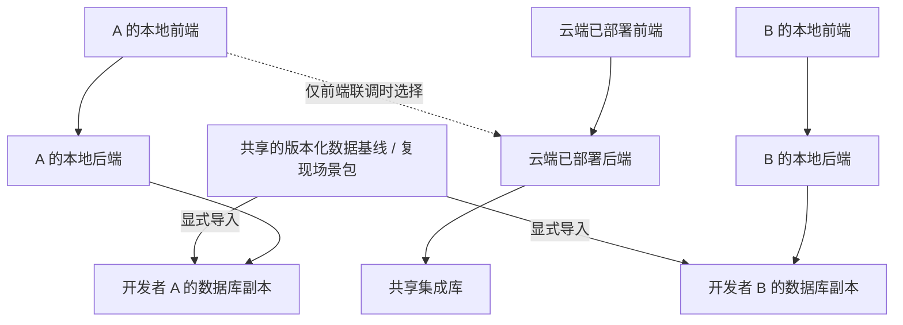

# 开发协作环境：本地全栈与共享数据基线

更新：2026-10-24。状态：本地全栈、独立可写副本、三模式切换、版本化基线/复现包及邀请接入/OSS 直传已交付；#133 正在完成新设备、容量、恢复与产品隔离的独立验收。本议题只决定开发协作方式，不决定学生最终使用产品时的部署位置。当前入口与已测边界见[工具说明](development-tooling.md)。

## 已明确的目标

Robert 上云的出发点是让开发者能对齐开发数据、沟通问题并合作开发，不希望每次修改页面都必须先推送和部署。2026-10-23 进一步明确：前端和后端都需要各自在本地修改，也要方便复现同一份数据；具体共享范围由工程结合实际场景判断。

“本地前端 + 云端后端”满足前端专项开发，但不能满足修改本地后端后立刻验证。已确认以本地全栈为默认，保留云端集成环境及前端专项接线。

开发者均借助开发 Agent 工作，因此环境建立、场景采集与交接由 Agent 调用稳定工具完成。普通用户的本地安装不依赖这些开发设施。复现包格式、传递方式、工具接口与交付边界见[开发协作工具说明](development-tooling.md)；尚未验收的能力在相应条目明确保留。

## 已确认的三种工作方式

| 工作方式 | 前端 | 后端与可写数据 | 用途 |
| --- | --- | --- | --- |
| 日常全栈开发，默认 | 本地 Vite 与当前分支 | 本地后端 + 当前环境自己的数据库副本 | 改页面、接口、业务逻辑和数据结构；随时调试和重置自己的环境 |
| 前端专项联调，可选 | 本地 Vite 与当前分支 | 云端已部署后端 + 共享集成库 | 只改前端，查看真实后端行为；写操作会影响共享环境 |
| 团队集成与演示 | 云端已部署前端 | 同一部署的云端后端 + 共享集成库 | 对合并后的固定版本进行共同验收、演示和联合排查 |

前端通过后端 API 操作数据，不直接连接数据库文件。各人的本地修改不会自动回灌共享集成库，也不在数据库之间做通用双向合并。代码仍通过 Git 协作；有价值的数据场景经过明确发布成为新版本，其他人按需导入。

模式由开发 Agent 调用统一工具切换；选择云端模式只打开已部署版本，不等于部署本地代码。切换基线另有入口，默认建立新副本并保留旧现场。具体行为见[模式切换与基线操作](development-tooling.md#切换本地与云端)。首次接入和 2–5 人的服务器约束见[成员接入与云端运行](development-access-operations.md)。

云端保留前端有价值：它给团队一个不用启动本地工程就能查看的固定版本。需要补齐的是本地开发入口，不是删除这份前端。

## 如何共享数据

这里区分三个项目内的协作对象：

- **开发数据基线**：具有明确版本的起始数据和兼容条件，用于建立彼此可比较的开发环境。不是持续变化的共享数据库。
- **问题复现场景包**：重现某个具体问题所需的数据、输入、操作步骤与版本记录。可以基于某个基线，也可以包含必要的专项状态。
- **共享集成环境**：团队通过同一套已部署应用读写数据的环境，用于联合验收和演示。

| 数据类别 | 建议共享方式 | 本地修改如何处理 |
| --- | --- | --- |
| 课程定义、材料、范例、角色关系、固定任务配置 | 版本化种子数据或基线包，包含依赖资源 | 各自副本中可修改；认可的改动再发布为新基线 |
| 学生作品、提交、反馈、学习过程 | 默认属于各自测试环境；复现需要时打包相关对象及其依赖 | 不自动影响其他开发者；联合验收时可使用明确的共享测试记录 |
| 运行任务、节点绑定、HDL 会话、恢复代际 | 作为场景的显式依赖；可重新创建的任务在本地重新发起 | 不把旧运行队列直接导入后启动消费者；专测恢复时用隔离场景 |
| AI 对话与模型响应 | 可发布经整理的输入、响应样例和版本记录 | 日常测试可使用明确标注的替身；真实调用与实际效果另验 |
| 登录会话、签名材料、API Key、SSH 身份 | 不作为共享数据包；各环境单独配置或生成 | 新建本地会话，个人凭据保存在各自环境 |
| 浏览器草稿与未确认请求 | 仅在问题涉及它们时导出必要现场，或给出重建步骤 | 与数据库包分别处理；导入数据库不能自动恢复浏览器现场 |

种子数据优先表达可重复构造的稳定业务对象；复杂问题可用经过整理的一致数据库副本。短期不必建设通用数据管理平台，也不需要为共享开发数据先更换数据库产品。小型种子与场景定义可随代码版本管理；大文件或数据库包存放在团队可访问的受控位置，用版本和摘要引用。

每个基线/场景记录数据包版本与摘要、兼容的源码/数据结构、依赖锁文件与工具链版本、角色与对象入口、必要资源、输入步骤和预期/实际结果。涉及编译、仿真或 AI 时另补相应运行时、镜像/工具版本与模型条件。当前本地格式为 `xj-repro/1`，团队交接使用稳定 `xjp_…` 编号；B12/R7 等仍只是说明用的示例编号。

**具体协作例子：** A 用基线 B12 在“提交后修改反馈”场景发现问题，发布场景 R7、触发步骤及代码提交。B 在自己的新环境导入 B12 + R7 后排查。A 后续继续修改数据，不改变 B 手里的 R7。修复合并后，再到云端集成环境共同验收。若两人必须实时观察同一个记录，则在共享集成环境操作该记录，而不是让两份未合并后端共同写库。

## 当前源码说明了哪些约束

| 已核对事实 | 对方案的影响 | 依据 |
| --- | --- | --- |
| Vite 没有 API 代理；真实前端走同源 `/api` | 现有 SSH 连接不会自动形成“本地前端 + 云端后端” | [vite.config.ts](../apps/web/vite.config.ts)、[mode.ts](../apps/web/src/workspace/mode.ts) |
| 后端要求精确 HTTPS Origin，使用 Secure、HttpOnly 的 `__Host-xunjie` Cookie 与 CSRF 校验；前端使用 `credentials: same-origin` | 本地入口要统一处理页面、API 与登录，不能只改一个后端 URL | [access/app.ts](../apps/server/server/access/app.ts)、[http.ts](../apps/web/src/workspace/http.ts) |
| 运行和 HDL 使用 `/health/ready`；页面开发需要 Vite HMR | 代理范围包括 API 与健康接口，页面、开发模块与 HMR 保留本地；不是只转发 `/api` | [app.ts](../apps/server/server/app.ts)、[useHdlWorkspace.ts](../apps/web/src/workspace/useHdlWorkspace.ts) |
| 当前数据库为本地文件 SQLite，WAL 与事务锁已启用，宿主核对精确表集合与恢复代际 | 保留 SQLite 可以建立独立副本；不能把跨机器共享文件当作数据库接入方案，也不能假定不同分支兼容同一数据结构 | [transaction.ts](../apps/server/server/db/transaction.ts)、[cloud-host.mjs](../tools/i0-cloud/cloud-host.mjs) |
| 消费者扫描库中的待处理任务，宿主关闭会取消相关未结束任务；HDL 关闭处理未终止会话 | 多个分支后端共用一份可写课程库，生命周期会互相影响；分测试账号不足以隔离它们 | [worker.ts](../apps/server/server/workspace/worker.ts)、[original-job-host.ts](../apps/server/server/app/original-job-host.ts)、[digital-logic.ts](../apps/server/server/app/digital-logic.ts) |
| 个人模型存储是另一份 SQLite 和加密密钥；启动时处理库中所有遗留运行中回合 | 只复制课程库不等于完整复现；不同本地后端也不能共用同一个人模型存储目录 | [store.ts](../apps/server/server/personal-agent/store.ts)、[service.ts](../apps/server/server/personal-agent/service.ts) |
| 备份与部署脚本已有 SQLite 一致备份、完整性与外键检查，加密归档可恢复到隔离目标 | 能复用备份方式；服务器例行部署备份与例行加密备份由 systemd 单元承担 | [backup-retained.mjs](../tools/i0-cloud/backup-retained.mjs)、[deploy-artifact.py](../tools/i0-cloud/deploy-artifact.py) |
| 旧本机宿主已退役并删除；新开发入口 `tools/xj-dev` 已交付（本地全栈 + 独立数据基线）。隔离工厂与浏览器服务测试仍在 | 开发环境一律从 xj-dev 进入；不要恢复旧命令，测试 fixture 也不等于完整开发环境 | [xj-dev README](../tools/xj-dev/README.md)、[initialize.ts](../apps/server/server/app/initialize.ts)、[i0-browser-fixture.ts](../apps/server/server/app/i0-browser-fixture.ts) |

SQLite 官方建议让数据库引擎与文件位于同一机器；跨网络共享数据库文件与通过 API 访问服务是不同路径。[SQLite 网络访问说明](https://www.sqlite.org/useovernet.html)。备份应使用一致复制机制，现有实现使用 Backup API，不能把运行中的 `.sqlite` 文件随手复制就当作完整场景。[SQLite Backup API](https://www.sqlite.org/backup.html)。

## 接线与运行能力

本地受管网关对浏览器呈现一个 HTTPS 来源：页面和开发模块由本地 Vite 提供，业务 API、健康检查转到所选后端，Vite 热更新连接仍到本地。默认选择本地后端；前端专项模式才选择云端后端。它由 `xj-dev up/use/down` 管理，不要求成员另开隧道或手改 Vite 代理。

开发组合已分离浏览器来源与内部监听端口，保留精确来源、Cookie 与 CSRF 校验；云端专项模式将获准来源映射为后端认可的 canonical Origin。各环境/模式使用不同 Cookie 名与浏览器 profile，不能仅靠更换端口推断隔离。具体实现和状态以[模式说明](development-tooling.md#切换本地与云端)为准。

默认开发应能启动真实本地业务后端与独立数据副本，完成登录、课程、作品、提交与反馈，不把安装 C/HDL VM 和配置付费模型变成所有页面开发的前置。暂未连接的外部能力明确显示不可用；需要覆盖特定状态时显式使用开发替身。节点就绪、真实编译/仿真、真实模型调用分别验证，不能由替身结果代替。

真实执行节点继续按现有独立执行边界接入。每个环境使用自己的任务与节点运行状态；不能把多个本地后端直接绑定到同一份未隔离的 runner 账本。只有验证节点支持相应隔离后才能共享执行资源。模型调用使用各自凭据或专门配置的测试服务，不从共享基线复制其他人的 Key。

## 实施与验收

负责人已确认的 Agent 调试与评估方案沿用本地独立副本和固定场景：各人按需运行本机 Phoenix + SQLite，团队按稳定编号交接含报告与结构化材料的 ZIP 调试包、案例与实验结果，并关联代码 commit、基线和实际 Agent 配置，不新增常驻共享观测服务。集成代码、评估程序和合成案例可同仓；真实内容、平台数据库和秘密配置保存在仓库外，观测默认关闭，启用后默认只到本机。既有 xj-repro/1 只支持业务复现包；纯 Agent 调试包仍需补采集/导入和受限包类型适配，不能声称现有 share 命令已经支持。该部分尚未接入，具体范围与后续验证见[本机调试评估设计](student-agent-implementation/references/2026-10-27-agent-evaluation-integration.md)。

工作项划分、阶段顺序与开工条件统一见[工具实施计划](development-tooling.md#工作项与实施时机)：本地开发可现在开始，不等待学生实验运行设计结束；后续执行适配消费产品契约。每个替换阶段包括[旧连接实现、配置与说明的清理](development-tooling.md#旧连接实现配置与说明的替换清理)。

验收以两位开发者的实际工作流为准：同一基线和步骤能在两份环境中复现；A 的数据重置、后端重启和数据结构实验不改变 B 的环境；本地修改页面可立即看到，本地修改 API 可直接调试；导入场景不会自动重发旧运行或模型请求。跨系统安装、浏览器来源与登录、真实节点/模型能力分别记录验证结果。团队联合验收还需记录所用云端代码与数据版本，不能把持续变化的云端库作为唯一复现依据。

上述开发入口、数据包与代理已实现；旧本机宿主和连接脚本按替换清单删除，保留仍在用的业务宿主、发布/备份与节点准备能力。工程、浏览器、真实节点/模型及教学效果分别报告，不用工具实现或局部测试代替 #133 的实际交付验收。
