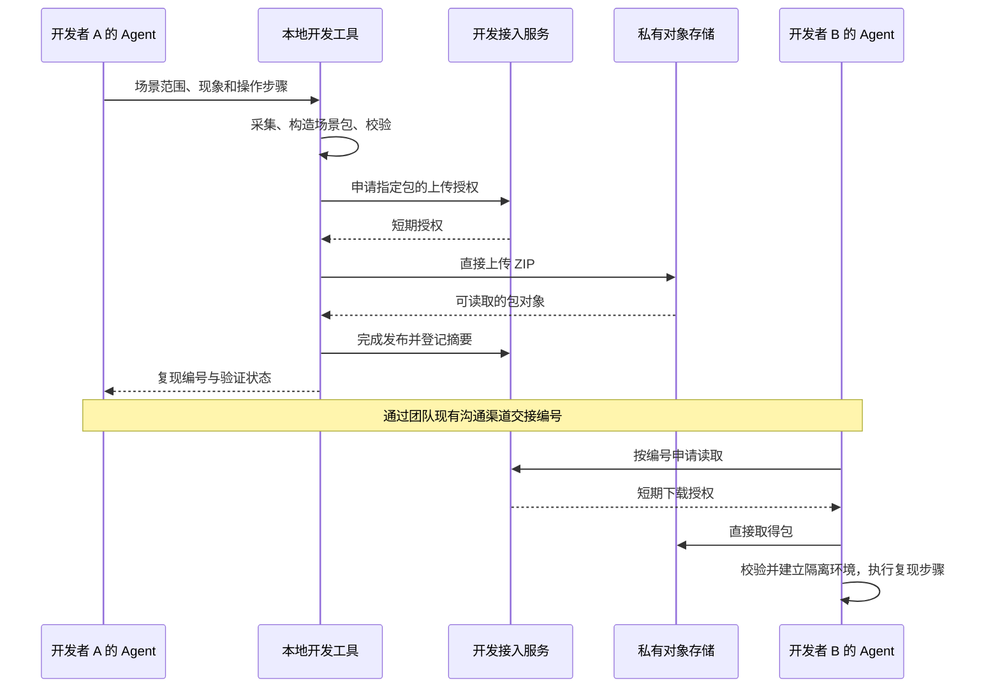

# 开发协作工具：Agent 操作、复现包与产品隔离

更新：2026-10-24。状态：`tools/xj-dev` 提供本地全栈、三模式切换、受管页面/登记节点连接、显式环境删除，以及复现包/基线、join/refresh/access 与私有 OSS 直传。#133已独立完成e03五人容量、普通产品隔离、Mac正常浏览器/业务和Windows未推送/dirty源码跨机Testing6，固定公开verify严格校验受管CA；临时身份/环境精确清理及final 90文件/6库双端恢复均完成，真实日备覆盖24份helper和9个dropin。历史失败、平台限制及未测项见[交付核查](references/2026-10-24-development-delivery-closeout.md)。开发者通过Agent使用这些工具；普通用户产品安装不依赖它们。上层说明见[开发协作环境](development-collaboration.md)。

## 新 Agent 的工具入口

项目统一入口为 [xunjie-development Skill](../skills/xunjie-development/SKILL.md)。新成员只需调用 `$xunjie-development`，Agent 先检查已有配置、依赖和本人身份，再补齐接入并介绍一次；后续按当前任务直接执行。只读咨询不初始化。Skill 主文只做判断，首次流程和日常操作分别按需进入 references，不要求成员预读文档或找命令。本节及对应工具 README 维护工具事实，参数以当前源码和命令帮助为准。

| 当前工具 | 如何找到用法与前置条件 | 能做什么、不能据此声称什么 |
| --- | --- | --- |
| 前端准备预览：`npm run dev:prep` | 在 `apps/student/` 按锁文件安装依赖；使用项目要求的 Node 24。见 [package.json](../apps/student/package.json)、[运行说明](../apps/student/README.md) | 使用合成数据预览页面；不是完整本地业务后端，不连接真实执行节点或模型 |
| 真实前端开发：`npm run dev` | 同一工程；核对 [Vite 配置](../apps/student/vite.config.ts) 的来源与 API 接线 | 当前只启动前端，源码尚无 API 代理；单独启动此命令不能宣称已经连上本地或云端后端 |
| 后端构建/启动：`npm run build`、`npm start` | 在 `apps/teaching/` 使用 [package.json](../apps/teaching/package.json) 声明的精确 Node 版本及锁文件；核对[启动入口](../apps/teaching/server/main.ts)的业务配置条件 | 普通无业务配置启动仅提供基础健康服务；完整课程服务需要明确的配置与初始化数据，不能把进程启动或健康响应当作本地课程环境已准备好 |
| 云端页面与 API：`xj-dev use cloud/cloud-api` | [模式与连接](../tools/xj-dev/README.md#模式与受管连接)；需要获准的配置、SSH 私钥、主机 pin 与 HTTPS CA | 受管连接恢复、固定入口与 Cookie 隔离；不上传代码、创建成员或部署 |
| 已登记节点：`xj-dev node connect/status/disconnect` | 同一 README；另需已准备并登记的节点、端口与身份 | 迁移原回连能力；不安装 VM、初始化节点、重发或改派任务，隧道成功与执行业务验收分开报告 |
| `xj-dev` 开发 CLI | [tools/xj-dev README](../tools/xj-dev/README.md)；`node tools/xj-dev/xj-dev.mjs --help` | doctor/up/status/down/delete、use、node、join/refresh/access、repro、baseline；本地独立数据与固定基线；所选模式、前后端来源、共享数据目标和连接状态见 JSON |

未来工具每次交付都要同时更新 `--help`、此处可用状态及工具 README，至少覆盖：准确入口与工作目录、支持平台及版本、所需权限/配置从何取得、参数及一条完整示例、数据与进程副作用、输出与成功判据、常见失败及恢复方式、停止/卸载与清理边界。秘密只说明取得方式，不放实际值。

工具 README 随实现放在 `tools/xj-dev/README.md`，按已交付能力逐项更新；现阶段不创建空目录或假入口。让未参与设计的 Agent 通过根规范和 Skill，能回答“现在能用什么、命令怎么调用、数据在哪里、失败怎么办”，并完成一条已实现流程，才算说明交付完成。

## Agent 调试包的操作入口

负责人于 2026-10-27 要求将选定调用、案例与评估结果的分享过程加入 Skill。沿用 [xunjie-development](../skills/xunjie-development/SKILL.md)，在[Agent 调试包参考](../skills/xunjie-development/references/agent-debugging.md)维护发送、接收、导入和重跑流程；这是既有开发交接的一个分支，复用成员身份、文件权限和稳定编号，因此不另建独立 Skill。后续 Agent 开发与案例回归会持续使用该分支，关键是避免把平台查看、文件下载与真实复现混为完成。

当前工具事实：`xj-repro/1` 业务复现与团队直传已经实现；纯 Agent 调试包的采集、受限包类型扩展和 Phoenix 导入仍待实现。Skill 先核对当前能力，缺口存在时交付可读材料和明确状态，不生成不可执行命令。包内容与共享设计只在[接入设计](student-agent-implementation/references/2026-10-27-agent-evaluation-integration.md#分享的具体形式与交接步骤)维护。

本次维护验证：Skill 格式校验、12 个相关 Markdown 的 208 个本地目标、50 个标题锚点与代码围栏检查通过。独立 Agent 只读演练了“上传两组 Agent 实验”“仅查看同事的 Phoenix JSON”“只检查/下载业务复现包”三个请求：前两者准确识别未实现的采集/导入阶段、继续可读材料处理，第三者保留已有 inspect/fetch 路径；未生成虚假编号或把下载当作复现。此为指令行为走查，未做新旧 Skill 效率对照、宿主自动触发测试或真实云端/平台交付验收。

## 安装与发现

Skill 的 Git 源码在 `skills/xunjie-development/`。这不是 Codex 文档列出的仓库发现路径；Codex 从当前目录向上到仓库根扫描 `.agents/skills`，支持跟随 Skill 目录软链。团队在每个 checkout 的 `.agents/skills/xunjie-development` 建立指向真实源目录的发现入口；当前 `.gitignore` 忽略 `/.agents/skills/`，因此 clone 或新建工作树后需由 Agent 检查安装，不能假定链接随 Git 自动出现。上述扫描与软链支持已核对 [OpenAI 官方技能文档](https://learn.chatgpt.com/docs/build-skills)。

由 Agent 在确认的仓库根操作，先检查入口是否存在以及目标是否正确，保留未知文件和其他 Skill；仅入口缺失时创建：

```sh
# macOS / POSIX：目录软链的相对目标以 .agents/skills/ 为基准
mkdir -p .agents/skills
ln -s ../../skills/xunjie-development .agents/skills/xunjie-development
```

```powershell
# Windows：本机目录 junction，目标取实际绝对路径；已有入口不覆盖
New-Item -ItemType Directory -Path .agents\skills -Force | Out-Null
$skillTarget = (Resolve-Path skills\xunjie-development).Path
New-Item -ItemType Junction -Path .agents\skills\xunjie-development -Target $skillTarget
```

PowerShell 的 `Junction` 用法见 [Microsoft New-Item 文档](https://learn.microsoft.com/en-us/powershell/module/microsoft.powershell.management/new-item?view=powershell-5.1)。junction 是本项目的 Windows 安装方案，不能仅凭文件可读就声称当前 Codex 版本已发现；必须在该宿主的技能列表/选择器确认 `xunjie-development` 并实际调用。若链接受系统限制，由 Agent 按该宿主支持的方式安装完整 Skill 目录并维护同步；不是让成员复制主文。官方说明变更可自动发现，未出现时重启 Codex；重启本身不算发现验收。

安装后核对 `SKILL.md`、references 可读，且入口的真实路径等于源目录。仓库文档链接从真实 `skills/xunjie-development/` 解析，references 中的仓库链接多上一层；不能从发现别名或进程 cwd 解算。采用安装副本的宿主，应定位当前项目源码后再读取仓库文档，不能按用户级安装路径的 `../..` 猜仓库。其他 Agent、远程电脑、容器及新工作树都需重新检查各自的发现机制；本页不承诺跨宿主自动发现。

2026-10-24 本机核查：Codex CLI 0.163.0 的 `skills/list` 在临时目录通过上述相对软链发现该 Skill，返回真实源码路径、`scope: repo`、`enabled: true`。集成工作树随后由主 Agent 安装同目标入口，并保持 ignored；新 checkout 仍按上面的检查处理。该结果不代替其他宿主的发现或 Windows junction 实测。

## 首引导状态

环境、依赖和连接优先复用 `doctor`、`status` 与本人已登记设备；它们决定要补什么，不证明成员听过介绍。Skill 的[极小状态脚本](../skills/xunjie-development/scripts/intro-state.mjs)只补充工具没有记录的“说明已展示”事实，在新会话也能查询：

```sh
node skills/xunjie-development/scripts/intro-state.mjs status --worktree <项目根>
node skills/xunjie-development/scripts/intro-state.mjs mark-shown --worktree <项目根>
```

`status` 只读，不创建目录。`mark-shown` **只在 Agent 已向成员实际展示一次功能、场景、数据归属和能力缺口后调用**，不能在准备好文案、运行 `join --no-start` 或启动命令成功时自动标记。初始化或云接入失败且尚未介绍时保持 `introShown: false`；若已实际解释可用部分与失败缺口，可标记“已展示”，后续只续缺失步骤。

脚本不提供“接入完成”字段，始终返回 `readiness: not-checked`；就绪、权限、版本和数据目标每次从真实工具核实。标记为真但环境没启动时照常准备/恢复，不重讲；缺失标记但已有注册/环境时复用它们，完成首次介绍后再标记。只读询问不初始化、不登记、不写标记；用户明确要求重听时才再介绍。

标记位于工具 home 的 `onboarding/<Git common directory 真实路径的 SHA-256>.json`，默认在 `~/.xunjie/xj-dev` 下，遵守 `XJ_DEV_HOME`。同仓库各工作树及新进程共享，只存 schema 与展示时间；不存成员 ID、凭据、环境成功状态或业务数据。复用工具既有私有文件 API 原子写入，Unix 目录/文件为 0700/0600、Windows 使用当前用户受限 DACL，拒绝将标记放入 Git 工作树或 Git 元数据目录。损坏或不可信标记报错并保留，不擅自重置。换宿主仍先核对该宿主真实登记及环境，标记不代表连接已经恢复。

## 预期体验

人负责说明任务和现象，开发 Agent 负责选择操作、补齐上下文与检查结果，固定程序负责环境、数据和文件操作。这里的开发 Agent 指协助团队开发的编码 Agent，与产品里的学生端 Agent 无关。

| 开发者对 Agent 说 | Agent 调用工具完成 | 交付给开发者 |
| --- | --- | --- |
| “在这个分支启动开发环境” | 检查依赖；建立或复用当前工作树的独立环境；准备基线；启动前后端与本地 HTTPS 入口 | 可打开的页面、当前环境和可用能力 |
| “把这个反馈异常打包，放到团队共享位置” | 整理现象与步骤；采集指定场景和代码状态；校验包；上传 | 一个复现编号、简短交接说明、已验证到哪一步 |
| “打开这个复现编号，排查原因” | 下载校验；还原对应代码到隔离工作树；建立独立数据与浏览器环境；按步骤复现 | 环境入口、复现结果和下一步排查依据 |

日常无需手动复制数据库、编辑环境文件或操作压缩包。首次 Agent 自行检查和复用仓库、工具链与成员配置，首次以GitHub网页确认自动登记；未批准时只需维护者补入成员GitHub用户名。操作系统要求的开发证书信任由本人确认，Agent 处理具体步骤。准备后主动解释功能、场景、数据归属与未就绪项，后续不重复首引导。模型凭据和真实执行节点只在任务确实需要时配置。

GitHub批准名单、首次登记、连接恢复和 2–5 人的服务器资源策略见[成员接入与云端运行](development-access-operations.md)。下面的命令统一由开发 Agent 调用，普通产品界面不增加开发模式切换入口。

## 切换本地与云端

用 `use` 选择模式；新工作树默认 `local`，已经使用的工作树保留上次选择。`up` 启动或恢复所选模式；`down` 停止该工作树登记的各模式进程，保留所有数据。首次云端切换传 `--connection <获准配置文件>`，之后复用已记录路径。

| 对 Agent 说 | 建议接口 | 页面和数据的实际去向 |
| --- | --- | --- |
| “切回本地开发” | `xj-dev use local --json` | 当前工作树的本地前端、本地后端、此前保留的本地数据副本 |
| “本地页面连云端后端” | `xj-dev use cloud-api --json` | 本地前端热更新；API 及健康检查经受控连接进入云端已部署后端，写入共享集成库 |
| “打开团队云端版本” | `xj-dev use cloud --json` | 打开云端已部署页面，使用云端后端和共享集成库；不上传本地代码、不触发部署 |

每次切换由工具检查目标权限、必要连接、服务健康和已知接口兼容条件，准备完成后才切换工具记录的当前入口。Agent 返回模式、前端代码来源、后端部署版本、数据归属和可用能力，不能只回复“已连接”。本地前端新增了云端尚无的接口时，应使用本地全栈；健康接口成功不能证明业务接口兼容。

切换配置不复制或合并数据库，也不自动更新数据基线。回到本地后继续使用原本地副本；云端模式中的修改仍留在共享集成库。开启 `cloud` 与将代码部署到云端是两个独立动作。

运行配置绑定明确的浏览器身份、HTTPS 来源和数据目标。不能在旧页面仍可发请求时，将同一个入口的后端从本地库悄悄改到云端库。工具返回目标入口，旧页面及未保存状态留在原来源；不自动把草稿发到另一环境。已有后台任务不因切换自动取消，停止服务另行管理。

各模式和连接目标分配固定入口，旧页面保持原目标，可同时打开。所有本地网关对 Cookie 使用环境/模式专属 `__Host-` 名称，转发时仅接受本入口的会话；不能用端口代替 Cookie 隔离。独立浏览器 profile 路径也会输出，供 Agent 显式打开。

网关对浏览器保持同源：`cloud-api` 的开发模块与 HMR 到本地 Vite，API 和健康检查经 SSH 到云端 HTTPS；`cloud` 全部页面/API 到云端。网关先精确核对浏览器 Host/Origin，才把通过校验的 Origin 映射至获准配置的 canonical Origin；云端仍精确校验该 Origin 与 CSRF。SSH pin 与 HTTPS CA 均严格校验。运行版本从业务健康响应的 `x-xunjie-version` 读取，不信任连接配置里的版本值；旧部署未公开时明确报告 `not-exposed`。

监督进程正常时每 10 秒做只读业务探活；连接失败后最多六轮、上限 16 秒退避恢复。权限撤销、主机/TLS 身份变化和接口不兼容停止重试，云端失败不改数据目标。恢复不重放业务请求。节点回连仍绑定原登记 ID，`node status` 只报告传输状态，真实执行与未知结果仍由原业务契约处理。

## 获取与更新数据基线

`baseline list/publish/use` 提供本地固定版本；`--team` 查询经设备身份认证的团队目录，并按名称与明确版本恢复。本地 CLI 已接入团队目录协议，实际服务是否支持、目录是否有条目须在线核实，不能据此声称云端新接口已发布或已选定团队基线。首次 `up` 使用代码内置 `local-baseline-1`，后续启动复用本工作树数据。发布基线不会改变其他环境；团队目录与本地版本目录独立。

| 操作 | 已实现接口 | 结果 |
| --- | --- | --- |
| 查看固定起点 | `xj-dev baseline list --json` | 已发布版本、完整摘要、schema 与体积；另报告内置起点 |
| 显式采用版本 | `xj-dev baseline use <version> [--target <new-dir>] --json` | 验证兼容后新建工作树与独立数据，返回继续开发路径；旧环境保留 |
| 发布新起点 | `xj-dev baseline publish --context <file> --version <version> --json` | 从明确选定的课程/成员/任务构造允许共享的包；本地同名版本不可覆盖 |
| 查看团队目录 | `xj-dev baseline list --team [--device-file FILE] --json` | 使用本人已登记设备及 `file:read` 权限，返回当前可用的固定名称、版本、稳定编号与完整摘要；旧服务或空目录按真实结果报告 |
| 采用团队固定版本 | `xj-dev baseline use NAME --team --version VERSION [--target <new-dir>] [--device-file FILE] --json` | 重新认证并校验目录、编号和摘要，通过既有 fetch/restore 建立隔离副本；只按负责人/成员明确选择的固定版本采用，旧环境保留 |
| 首次导入当前工作树 | `xj-dev baseline use NAME --team --version VERSION --here [--device-file FILE] --json` | 只对所选 local 模式尚无数据库、基线、凭据或环境状态的工作树导入首次数据；不新建工作树、不改源码、不启动。与 `--target` 互斥，已有环境明确拒绝且保留 |

不维护可变 `latest` 指向，版本不符直接失败，不暗中迁移 schema 或切换原分支。A 发布 B13 后，B 继续使用 B12；只有 B 显式 `use B13` 才新建副本。发布不改变场景验证状态。完整 context、命令及失败处理见 [xj-dev 复现与基线示例](../tools/xj-dev/README.md#复现包与基线)。

团队目录条目由维护者将已共享的包登记为固定 name/version；普通成员查询和采用不需要管理凭据。目录查询失败或不存在目标版本时停止该操作，保留本地环境，不猜测 `latest`、替代版本或自动发布。首次上手不强制导入团队数据；只有任务需要一致起点且已有明确版本选择时采用。

首次要用团队数据时，先 `join ... --no-start` 或复用已登记设备，准备好锁文件依赖，再查询并 `use ... --here`，最后启动本地环境。不要先 `up` 播种内置起点，再以 `--here` 覆盖；依赖缺失先单独安装，已有环境也不通过 delete 伪装成首次导入。普通不带 `--here` 的采用/复现恢复仍另建隔离副本；`--here` 只导入数据，当前源码与包内来源分开报告，不能算问题已复现。

### 本轮推荐起点

团队已选定固定起点 `name: team-demo`、`version: 2026-10-24-v1`；对应本地发布版本名为 `team-demo-20261024-v1`。Agent 通过 `baseline list --team` 核对实际发布条目、稳定 ID 与完整摘要；目录中不存在时报告尚未发布，不自动换版本。当前工作树首次导入用 `baseline use team-demo --team --version 2026-10-24-v1 --here`，已有环境保持原样，需要该版本时采用隔离副本，不改成可变 `latest`。

便携范围为 4 门课程、11 个重新生成本地凭据的账号、全部 27 个 assignment、9 个 attempt、14 份 snapshot、3 个 submission 和 4 个 feedback。本轮通过显式 `includeUnstartedAssignments` 选项保留其中 18 个尚未开始的任务，不再截断为已开启的 9 个任务。包不携带原口令、会话、模型配置或机器连接；恢复账号仅供新本地副本使用，实际执行与模型能力须另行核实。

## 复现包的形态

`repro capture/inspect/restore/verify` 已交付本地文件闭环。格式为普通 ZIP `xj-repro/1`，不依赖编码 Agent 的私有会话或外部服务：

```text
manifest.json       # 格式/工具、来源、源码清单、schema/基线、工具条件、采集边界与生成状态
scenario.json       # before-trigger / after-incident、输入、步骤、预期与现象
code/source.bundle  # 自包含 Git 源码快照，包括明确选中的未提交/未跟踪文件
data/shared.sqlite # 从一致 SQLite 视图重建的新业务库
assets/             # 明确选中的必要资源（可选）
evidence/           # 经筛选的证据（可选）
checksums.json      # 除自身之外的逐文件 SHA-256；整个 ZIP 另有完整摘要
```

代码默认携带两个工程及开发工具的已提交源码，`code.roots` 可缩小范围，`code.paths` 指定必要的本地差异。未选的 dirty/untracked 工作不进入包。未推送提交的所选源码通过 bundle 转移；原提交号只作来源，不要求接收端取得该 SHA，也不分发整段历史、作者身份或无关路径。ZIP、bundle、源码与资源按原字节校验；依赖条件单独声明 `sha256:utf8-lf/v1`，仅归一 CRLF→LF 以兼容 Windows checkout，真实依赖变更仍拒绝。

`data.scope.courseIds/userIds/attemptIds` 为必须的非空范围。工具先取得单库一致读取视图，再用当前可信 schema 按白名单、业务引用与 JSON 成员归属校验构造新库；不直接分发原库删行后的文件。原密码、会话、模型 Key、个人模型数据、SSH 私钥、机器身份、其他成员记录与旧执行/模型队列排除。角色的登录名和密码在恢复环境重建，秘密只在仓库外受限文件。无法表达的引用或疑似秘密阻止采集。

SQLite 事务、源码与附件分别记录边界；清单明确 `crossStorageAtomic: false` 和未采集的个人模型、浏览器、节点及外部服务，不声称全系统原子快照。缺附件、摘要错误、版本不匹配或危险路径均准确失败。ZIP 和 bundle 内路径均在建立工作树前检查，跨平台大小写冲突、文件/目录冲突、越界和特殊文件会拒绝。

默认 `restore` 建立新的 detached Git 工作树和新的数据/身份环境，保护原分支与业务库；恢复不执行包内脚本、Git hook/filter、安装、迁移或启动。Agent 审阅源码后单独 `up`。`verify` 是显式的同源业务 HTTP 步骤执行，使用恢复后的登录身份，登录与每一步均以该 home 的受管 CA 严格认证网关；通过可信 CLI 指定 `--worktree <新恢复target>` 并保持同一 `XJ_DEV_HOME`。缺失、无效或不匹配 CA 时拒绝，不改全局信任、不关闭 TLS 校验或写入新的成功验证回执；结果写在环境回执中，不执行任意 shell/JS。

**生成、恢复与复现分别报告。** 不可变 ZIP 的清单始终保存生成时的未验证状态；只有实际执行了声明步骤并观察到预期状态/错误码，恢复回执才记录 `verified`。事后现场、外部响应不确定或执行/模型条件缺失保持 `unverified`。已有 ZIP 的同请求重试只校验复用，不重新抓取变化中的现场。完整示例与常见失败见 [工具 README](../tools/xj-dev/README.md#复现包与基线)。

## 传递方式

根据[服务器实测](references/2026-10-23-development-server-assessment.md)，公网出口只有 3 Mbps。现使用 **ECS 管权限与包目录，私有 OSS 直接收发文件**：客户端通过设备 proof 申请指定分片或 Range 的短期授权，大文件不经过共享应用进程或 ECS 出口。入口是 `repro share ZIP`、`resume ID`、`fetch ID` 和 `restore ID`；完整步骤、配额及失败恢复见[团队复现编号与直传](../tools/xj-dev/README.md#团队复现编号与直传)。



file-only冷下载无需先安装业务SQLite依赖：`fetch`保留授权、完整性、ZIP/清单/资源与不依赖业务模块的Node/工具/锁条件校验，结果仅为downloaded，schema/dependencies尚未检查。`restore`发布目标前仍完整检查runtime/lock/schema及包内条件；缺依赖按`DEPENDENCIES_NOT_READY`的公开recovery，在当前可信checkout显式`doctor`、`use local`准备依赖和本地服务，健康后切换本地入口，原云端数据/页面/未保存草稿保留原目标。普通`up`沿用已选模式，不替代这一本地准备动作；不从包内执行安装。完整partial/ready缓存仍重新授权再复用，细节见[工具README](../tools/xj-dev/README.md#团队复现编号与直传)。

稳定 `xjp_` 编号绑定不可变目录记录中的发布者、摘要声明、格式和工具版本；短期 URL 不作为交接编号。对象路径由工具规则构造，不由包内任意 URL 指定。每人仅发布自己的包，团队成员可读取获授权对象。ListParts/Complete/HEAD 核对 size 和 CRC64/XZ 后才发布；SHA256 为发布者声明，消费方完整复算。同幂等请求复用同一编号，内容变化得到新编号。接收端校验摘要，不能把上传中断后的文件视为可用包。

内容摘要保证接收方能检测到内容变化，不等于无限存储。按成员、单包与团队设置配额，达到上限时停止新增并报告；保留仍被引用的基线与场景。清理失败上传和可重新取得的本地缓存，与删除已发布协作证据分开处理。已发布内容不得被工具覆盖；需要变更时发布新包。当前传输单个已冻结复现 ZIP，包内资源边界仍由采集清单决定。

上传和给同事发消息是两个动作。默认工具返回可直接复制的编号与交接文本；开发者明确指定发往某个 Issue 或沟通渠道时，Agent 再通过对应工具发送。ZIP 是备用交接方式，不要求团队每天手动收发文件。当前只实现北京私有 OSS 路径；标准产品不加载其 SDK 或凭据。

## 工具结构与 Agent 接口

建议建立独立的仓库开发工具包 `tools/xj-dev/`，复用项目固定的 Node 工具链，独立管理工具依赖。配套一个轻量项目 Skill，教开发 Agent 发现环境、调用命令和报告结果。Skill 只描述使用方式；数据库处理、文件传输、进程管理和错误恢复写在可测试的程序里。

这样不同编码 Agent 可以调用同一套 CLI，不需要各自在对话中临时拼装启动脚本。GitHub设备授权、兼容邀请、自动登记与文件授权由一个轻量开发接入服务完成，不运行编码Agent。OAuth仅验证开发成员身份，课程应用账号仍由现有受管流程生成；沿用原权限、撤销及加密存储，不引入另一套产品账号体系。

下表逐项标明本地已实现能力；未标注已实现的接口仍为建议，调用前核对当前帮助：

| 建议接口 | 职责 |
| --- | --- |
| `xj-dev login [--wait-seconds 0–60] [--no-start]`（工程已实现） | GitHub网页确认后自动登记，已有设备复用；待授权状态和已登记明确分开 |
| `xj-dev join --invitation-file <file> [--mode local|cloud-api|cloud] --json`（工程已实现） | 从受限邀请材料完成设备登记、配置取得和连通检查；邀请不放在命令参数或日志正文，必要时完成系统证书确认 |
| `xj-dev doctor --json` | 返回依赖、配置、网络与所需能力的检查结果及可执行的恢复动作 |
| `xj-dev up --json` | 启动或恢复当前工作树所选模式；新工作树默认本地全栈，首次准备固定基线 |
| `xj-dev use <local|cloud-api|cloud> --json` | 检查并切换运行配置，返回代码来源、数据归属和入口；不迁移数据或部署 |
| `xj-dev baseline list/use/publish ... --json`、`list --team` / `use NAME --team --version VERSION` | 本地固定版本和经本人设备认证的团队目录；采用后新建工作树保留旧环境。云端接口与目录可用性另按在线结果核实 |
| `xj-dev access invite/inspect/revoke-invitation/revoke-device/revoke-member/snapshot --admin-config FILE ...`（工程已实现） | 复用 owner SSH 管理独立服务；invite 必须私有 out-file，撤销与备份可重试 |
| `xj-dev refresh [--device-file FILE]`（工程已实现） | 以原设备 proof 更新私有配置，保留失败前的已用 generation |
| `xj-dev status --json` / `xj-dev down --json` | 查询环境，或停止本工具管理的进程；停止不等于删除数据 |
| `xj-dev delete --json` | 显式删除当前工作树/实例所选模式的已登记环境数据；整体预检归属，持原锁删除载荷并保留永久锁守卫，其他环境、源码及全局接入材料/缓存/包保留 |
| `xj-dev node connect/status/disconnect ... --json` | 按需管理现有已登记执行节点的受管回连；不安装执行器或决定产品运行方案 |
| `xj-dev repro capture --context <file> --out <zip> --json`（已实现） | 采集并校验本地包；`inspect <zip>` 检查包与完整摘要 |
| `xj-dev repro share <zip> [--digest SHA256]` / `resume ID` / `fetch ID` | 冻结后直传、原编号断点恢复、按编号下载并校验；失败保留 transfer 回执与原 ZIP |
| `xj-dev repro restore <zip或ID> [--target <new-dir>]` | 稳定编号先授权下载并校验，再恢复隔离环境；显式 `up` 后 `repro verify <zip或ID>` 记录实际 HTTP 步骤结果 |

`access github-approve` 明确指定GitHub用户及 developer/maintainer、应用teacher/student、课程和page/node/file范围；服务从官方解析固定用户ID，登记后生成本人设备和应用身份。`github-deny`沿原撤销链路阻止访问并关闭已有连接。邀请方式保持兼容；具体字段与重试规则见[当前接入入口](development-access-operations.md#当前工具入口)。

每个命令返回带版本的 JSON：成功状态、环境 ID、产物或页面地址、能力状态、检查结果和下一步；失败返回稳定错误码、失败阶段与可重试方式。日志与最终结果分开，凭据不出现在输出中。`share` 失败后保留已经完成的本地包，重试上传无需重新抓取变化中的现场。

环境以仓库与工作树身份区分，拥有独立的数据、个人模型目录、浏览器身份和服务进程。反复 `up` 不重置数据；并行 Agent 操作同一环境时，由工具协调锁与进程归属。端口冲突、服务异常退出和版本不符都返回明确状态，不能靠 Agent 猜一个成功日志。只有显式清理操作才删除环境，且只删除工具登记的资源。

停止用 `down`；重建已登记环境用 `delete` 后 `up`，不手工删除环境根或锁。`delete` 拒绝无有效登记的陌生目录、符号链接、未知子项和外来 PID；不存在/已删除有明确幂等结果。永久 SQLite 锁 inode 保留，使 Windows 删除与并发 `up` 继续使用同一把锁。具体范围、结果字段和中断恢复见 [停止与显式删除](../tools/xj-dev/README.md#停止与显式删除)。

`restore` 默认新建环境，不覆盖接收者正在开发的分支或数据库。先核对包版本、源码与 schema，再恢复；不能悄悄迁到最新版本。解包限制在目标目录内，包内说明作为数据读取，不自动执行携带的任意脚本。需要运行的启动、迁移与场景动作来自当前已审查的工具实现及匹配版本的仓库。

Agent 的收尾需区分“包已生成”“包已上传”“环境已恢复”“问题已复现”。恢复成功不自动等于问题重现；步骤可由浏览器/API 自动化执行，也可以是需人工配合的硬件动作。工具提供事实，Agent 据此报告和继续排查。

## 与普通用户本地安装的边界

开发工具与产品可以共享业务构造接口，但依赖方向是开发工具调用产品代码；产品启动、安装和正常业务不得反向依赖开发工具、团队文件存储或开发者身份。

| 内容 | 放置与依赖边界 | 普通用户安装 |
| --- | --- | --- |
| 环境编排、复现采集/恢复、传输适配器、工具依赖 | 独立 `tools/xj-dev/` 包 | 不纳入产品运行包、不在安装时拉取 |
| 成员接入、开发权限与包目录 | 独立开发服务及独立数据目录 | 产品不调用、不随产品安装 |
| 开发 Agent Skill 与操作说明 | 项目开发文档及 Skill | 产品运行不加载 |
| 本地环境、下载缓存、开发证书与成员配置 | 工具专属目录，按环境分开；凭据位于仓库外 | 不打包；产品使用自己的配置与数据目录 |
| 场景基线、测试账号、开发替身 | 开发工具或测试资源目录，由显式开发入口装配 | 不自动创建或注册 |
| 业务服务、数据访问与必要的启动参数边界 | 正常产品源码，可由产品与开发入口复用 | 按产品实际需要交付 |

这并不意味着产品源码绝对零修改。例如当前宿主把浏览器 Origin 端口与监听端口绑定，可能需要拆清配置和启动组合接口。此类修改应是正常运行能力的整理；包传输、种子数据和开发身份留在开发工具中。不要只依赖 `NODE_ENV` 分支把整套开发设施隐藏在产品进程里。

云端运行产物由 [CI 构建器](../tools/i0-cloud/build-runtime-artifact.mjs)按固定白名单装配（`apps/student/dist`、教学端运行目录与云宿主脚本），新根目录工具包不会自动被该路径带入；[教学后端构建配置](../apps/teaching/tsconfig.build.json)目前编译 `server` 与 `contracts`。这些是可利用的边界，不能替代未来普通用户本地安装包的验证。开发专用入口不能为方便而放进会整体发布的 `server` 目录。

交付时要验证依赖方向与实际打包清单，并从干净的产品安装产物启动：没有开发工具目录、团队凭据和共享存储网络连接，正常功能仍可使用。源码仓库包含开发工具，与用户安装必须使用它们，是两个不同条件。

## 工作项与实施时机

[本地优先执行：设备支持、课程运行方案与实验生命周期](https://github.com/paher-din/XunJie/issues/114)决定学生实验如何运行；本工具决定开发者怎样修改、连接与复现系统。二者可复用最终执行契约，但使用者、交付物和验收不同，不能因为都出现“本地/云端”就合成一张实现票。

现有[重构迁移与验收：数据存储、兼容范围和实施路线](https://github.com/paher-din/XunJie/issues/120)已经包含最小开发复现基线、seed/reset、环境隔离和另一位成员复现的要求；[总体架构与复用取舍](https://github.com/paher-din/XunJie/issues/119)也要求区分开发环境与产品拓扑。因此不再为这些原则另开重复设计议题。

按 Robert 指定并确认的 `to-spec` / `to-tickets` 流程，已发布[开发协作工具规范](https://github.com/paher-din/XunJie/issues/126)及七张实施子票，关联上述设计议题；不为每个命令再拆一张票。规范母票的原生子议题及阻塞关系是实施入口，按实际开放阻塞选择子票；本地不再保留发布稿或另一份实时任务清单。

**第一阶段现在即可实施，无需等待学生实验运行议题关闭。** 后续成员接入与复现也按已明确的开发需求推进；只有适配未来学生实验的编译、仿真和生命周期，才消费产品执行契约。关联设计票不等于把整张开发实施票设置为被这些设计票阻塞。工具调用现有业务组合接口，未来产品变化时调整这一处适配，不复制另一套教学业务实现。

| 阶段 | 可开始条件与交付 | 完成判据 |
| --- | --- | --- |
| 1. 本地开发闭环 | 现在可开始：`doctor/up/status/down`、独立数据与最小基线、本地前后端热更新及隔离来源 | 两份环境能分别修改前后端、登录和保存；一方重启/重置不影响另一方；不要求所有开发者先装 VM 或配置模型 |
| 2. 运行模式 | 基于阶段 1：`use local/cloud-api/cloud`，复用已有成员获准的私有配置与当前云端共享应用 | 页面、API、登录/CSRF 和 HMR 走正确目标；切换不搬数据或部署代码；返回本地保留原现场 |
| 3. 成员与团队复现 | 本地隔离可用后接入一次性邀请、登记/撤销、连接监督和包交接；服务器 HTTPS 与对象存储配置是本阶段工作 | 新设备无需手填连接参数；两位成员按编号复现同一问题，验证断线恢复、撤销和传输失败恢复 |
| 4. 完成交付 | 汇总已实现能力、服务器资源验收与替换清单 | Windows/macOS、五人目标工作流、产品安装隔离和旧入口删除分别有结果；未通过项明确保留为未完成 |

每个阶段随功能交付说明和必要 Skill 更新，并清掉本阶段已经替代的入口；不是把全部旧物留到最后再泛泛“整理”。上表是能力交付顺序，实际实施票把独立的本地复现和云端发布工作展开并行；原生阻塞关系只记录真实前置。第 4 阶段核对遗漏及整体验收，不构成前面开始实施的额外审批。

阶段 3 的复现能力先完成一个真实问题在另一工作树恢复的本地闭环，再接远程交接。先支持清晰的业务对象范围，不承诺一次覆盖所有历史数据与故障类型；上传失败保留已完成包，接收方能区分版本不符、能力缺失和复现未成立。

工程检查覆盖工具的状态隔离、包恢复、兼容校验及发布依赖边界；macOS 与 Windows 的命令、路径和进程行为分别验证。浏览器验收覆盖登录、页面更新、场景恢复和双环境隔离。真实执行节点、模型调用及教学效果另行记录，不能由开发工具或替身测试代替。

## 旧连接实现、配置与说明的替换清理

Robert 明确要求：新工具接管后，删除代码库中用不上的旧连接实现、说明、配置及其残留。清理属于对应实施阶段的完成条件，不能只给旧 README 加“已停用”后继续保留整套过时入口。本轮将要求写入设计，不提前删除仍在使用的连接能力。

| 已核对的范围 | 当前事实 | 实施时的处理 |
| --- | --- | --- |
| 原 PowerShell 页面/节点入口与公共 SSH 解析器 | 已迁入 `xj-dev use` / `node` / `src/connection.mjs` 并删除（#128） | 单一跨平台连接路径，旧获准配置仅由新解析器只读适配 |
| 原连接 JSON 示例 | #129 以 join 自动生成配置，已删除手填 connection 示例；既有已批准 connection-v1 继续兼容 | 新成员由固定 helper 配置受限 SSH；`sshd-members.example.conf` 只供既有预发身份维护，不作为新成员加入步骤 |
| `tools/i0-hdl/xunjie-local.ps1`、`local-application-host.mjs`、旧业务初始化/证据脚本及对应测试 | 已由 `tools/xj-dev` 替代并删除（#127） | 执行 VM 准备（`local-node-setup.*`）、冻结镜像接收、`fixtures/hdl-reference.json` 与 `seed-local-courses.mjs` 仍被引用，保留在 [i0-hdl README](../tools/i0-hdl/README.md) 说明；`seed-local-courses.mjs` 指向退役宿主的独立 CLI 和无调用场景逻辑已删除（#130），仅保留 `i0-cloud/publish-demo-projects.mjs` 复用的 `verifyCompletionReceipt` |
| `tools/i0-hdl/README.md`、`tools/teacher-workflow/`、`tools/a0-review/` 及相关调用；`tools/i0-ui55/README.md`、`tools/i0-shared/README.md` | 旧操作步骤、占位说明与受控验证工具已删除（#127；a0-review 的检查对象文档已不存在且无引用），i0-hdl README 改写为保留范围说明 | 活跃源码、Skill、README 与当前设计文档中的旧命令、路径和链接已同步清零；`apps/teaching/tests/evidence/` 下的历史验收证据是当时的事实快照，保留旧文件名，不作为当前用法；历史事实留在 Git 历史与归档 |
| 仓库外旧连接文件、SSH 配置片段、专属证书、登记密钥、启动记录与受管进程 | 可能仍由成员或当前运行环境使用 | 迁移时生成本工具拥有资源的清单，完成目标切换再移除失效项；仅处理明确归属的旧资源，不扫描删除通用 SSH 配置、其他项目或业务数据 |
| `cloud-host.mjs`、在用 systemd 服务和执行节点 | `sync-main.py` 及其同步单元已被 CI 产物发布链路（构建器、GitHub Release、`deploy-artifact.py` 与新部署单元）替代并删除；其余仍承担当前业务或执行职责 | 复用或按明确替代方案迁移；不能因为目录带旧阶段名就判断无用。对应替代完成时再删除失效实现和配置 |

删除前完成四件事：列出“旧对象 → 新入口或删除理由”；确认源码/测试/脚本的调用与实际运行依赖；迁移必要配置与数据并验收新入口；保留可用回退产物及恢复办法。随后在同一阶段清除被替代代码、配置、命令与说明；无需在当前源码树再复制一套 legacy 目录，Git 历史承担代码追溯。

清理验收同时看文件删除和引用消失：活跃代码与当前说明不再引导使用旧命令；配置没有只由旧入口消费的字段；正常启动、停止、连接与节点能力按保留范围仍可用；干净 checkout 能从统一入口完成已交付流程。历史事实报告若保留旧文件名，应明确是当时事实，不能保留断裂的“当前用法”链接。`docs/archive/` 继续遵守仓库归档隔离规则，不因清理任务恢复为当前操作依据。

本轮已交付本地 CLI、三模式/受管连接、成员接入、复现/基线与团队直传，并删除替代的旧本机宿主与占位说明。`down` 保留数据，`delete` 只删除所选已登记环境载荷且保留永久锁，详见工具 README。既有平台验证与 #133 fresh 验收分别记录；当前入口不以旧验证替代新设备实际系统信任、跨机复现、容量或普通产品隔离结果。
