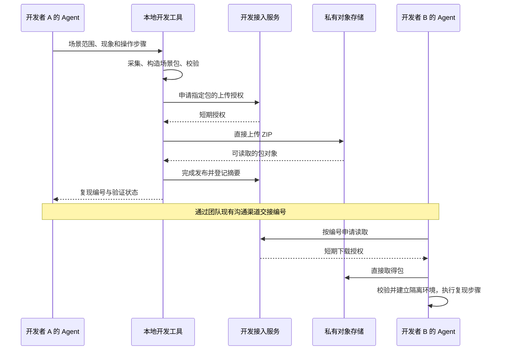

# 开发协作工具：Agent 操作、复现包与产品隔离

更新：2026-10-23。状态：本地全栈闭环已由 `tools/xj-dev` 交付（诊断/启动/状态/停止，HTTPS 单一入口 + 独立数据基线）；成员接入、复现包与 `use` 切换仍未实现。已确认的要求是：开发者使用 Agent，尽量简化中间操作，工具只服务开发阶段，普通用户本地安装不依赖它们。上层方案见[开发协作环境](development-collaboration.md)。

## 新 Agent 的工具入口

项目统一入口为 [xunjie-development Skill](../skills/xunjie-development/SKILL.md)。Skill 决定何时读什么、如何选择操作和核对结果；本节及对应工具 README 维护工具事实，参数以当前源码和命令帮助为准。仓库根 `AGENTS.md` 提供条件入口，不要求开发者记住 Skill 名称。

| 当前工具 | 如何找到用法与前置条件 | 能做什么、不能据此声称什么 |
| --- | --- | --- |
| 前端准备预览：`npm run dev:prep` | 在 `apps/student/` 按锁文件安装依赖；使用项目要求的 Node 24。见 [package.json](../apps/student/package.json)、[运行说明](../apps/student/README.md) | 使用合成数据预览页面；不是完整本地业务后端，不连接真实执行节点或模型 |
| 真实前端开发：`npm run dev` | 同一工程；核对 [Vite 配置](../apps/student/vite.config.ts) 的来源与 API 接线 | 当前只启动前端，源码尚无 API 代理；单独启动此命令不能宣称已经连上本地或云端后端 |
| 后端构建/启动：`npm run build`、`npm start` | 在 `apps/teaching/` 使用 [package.json](../apps/teaching/package.json) 声明的精确 Node 版本及锁文件；核对[启动入口](../apps/teaching/server/main.ts)的业务配置条件 | 普通无业务配置启动仅提供基础健康服务；完整课程服务需要明确的配置与初始化数据，不能把进程启动或健康响应当作本地课程环境已准备好 |
| 云端页面转发：`connect.ps1` | [云工具 README](../tools/i0-cloud/README.md)；`-Help` 查看帮助。连接需要获准的 `IdentityFile`、`ConnectionFile` 和主机信任材料 | 接入现有云端页面/API；不上传本地代码、不创建成员、不自动重连。脚本使用 Windows 网络命令，不能仅因安装了 PowerShell 就宣称 macOS 可用 |
| 已登记执行节点回连：`connect-node.ps1` | 同一 README 和 `-Help`；另需已准备并登记的节点、端口与身份 | 连接既有执行节点，不负责安装 VM、初始化节点或决定未来产品执行方案 |
| `xj-dev` 本地全栈 CLI | [tools/xj-dev README](../tools/xj-dev/README.md)；`node tools/xj-dev/xj-dev.mjs --help` | 已实现 doctor/up/status/down：本工作树独立环境的 Vite 热更新 + 真实后端 + HTTPS 网关 + 固定最小基线；不提供执行节点与模型调用，成员接入、复现包与 `use` 切换仍待实现 |

未来工具每次交付都要同时更新 `--help`、此处可用状态及工具 README，至少覆盖：准确入口与工作目录、支持平台及版本、所需权限/配置从何取得、参数及一条完整示例、数据与进程副作用、输出与成功判据、常见失败及恢复方式、停止/卸载与清理边界。秘密只说明取得方式，不放实际值。

工具 README 随实现放在 `tools/xj-dev/README.md`，按已交付能力逐项更新；现阶段不创建空目录或假入口。让未参与设计的 Agent 通过根规范和 Skill，能回答“现在能用什么、命令怎么调用、数据在哪里、失败怎么办”，并完成一条已实现流程，才算说明交付完成。

## 预期体验

人负责说明任务和现象，开发 Agent 负责选择操作、补齐上下文与检查结果，固定程序负责环境、数据和文件操作。这里的开发 Agent 指协助团队开发的编码 Agent，与产品里的学生端 Agent 无关。

| 开发者对 Agent 说 | Agent 调用工具完成 | 交付给开发者 |
| --- | --- | --- |
| “在这个分支启动开发环境” | 检查依赖；建立或复用当前工作树的独立环境；准备基线；启动前后端与本地 HTTPS 入口 | 可打开的页面、当前环境和可用能力 |
| “把这个反馈异常打包，放到团队共享位置” | 整理现象与步骤；采集指定场景和代码状态；校验包；上传 | 一个复现编号、简短交接说明、已验证到哪一步 |
| “打开这个复现编号，排查原因” | 下载校验；还原对应代码到隔离工作树；建立独立数据与浏览器环境；按步骤复现 | 环境入口、复现结果和下一步排查依据 |

日常无需手动复制数据库、编辑环境文件或操作压缩包。首次使用仍需完成仓库与工具链准备、成员访问配置，以及操作系统要求的开发证书信任；工具检测并引导这些一次性步骤。模型凭据和真实执行节点只在任务确实需要时配置。

成员邀请、首次登记、连接恢复和 2–5 人的服务器资源策略见[成员接入与云端运行](development-access-operations.md)。下面的命令统一由开发 Agent 调用，普通产品界面不增加开发模式切换入口。

## 切换本地与云端

用一个 `use` 入口选择运行配置；新工作树默认 `local`，已经使用的工作树保留上次选择。`up` 启动或恢复所选配置。以下均是待实现接口。

| 对 Agent 说 | 建议接口 | 页面和数据的实际去向 |
| --- | --- | --- |
| “切回本地开发” | `xj-dev use local --json` | 当前工作树的本地前端、本地后端、此前保留的本地数据副本 |
| “本地页面连云端后端” | `xj-dev use cloud-api --json` | 本地前端热更新；API 及健康检查经受控连接进入云端已部署后端，写入共享集成库 |
| “打开团队云端版本” | `xj-dev use cloud --json` | 打开云端已部署页面，使用云端后端和共享集成库；不上传本地代码、不触发部署 |

每次切换由工具检查目标权限、必要连接、服务健康和已知接口兼容条件，准备完成后才切换工具记录的当前入口。Agent 返回模式、前端代码来源、后端部署版本、数据归属和可用能力，不能只回复“已连接”。本地前端新增了云端尚无的接口时，应使用本地全栈；健康接口成功不能证明业务接口兼容。

切换配置不复制或合并数据库，也不自动更新数据基线。回到本地后继续使用原本地副本；云端模式中的修改仍留在共享集成库。开启 `cloud` 与将代码部署到云端是两个独立动作。

运行配置绑定明确的浏览器身份、HTTPS 来源和数据目标。不能在旧页面仍可发请求时，将同一个入口的后端从本地库悄悄改到云端库。工具对自己管理的页面核对待保存状态后重新打开对应入口；保存未完成时保留现场并报告，不自动把草稿发到另一环境。已有后台任务不因切换自动取消，停止服务另行管理。

当前云端只认可配置中的精确 Origin，且云宿主限制回环主机名；不能任意换个端口就宣称云端联调可用。首版让云端两种视图复用被认可的入口，并管理本工具拥有的隧道/页面代理；它们可按入口资源互斥切换，不承诺任意并行。本地全栈使用独立来源与浏览器身份。只更换端口不足以隔离 Cookie。

网关对浏览器保持同源：本地开发资源和 HMR 到 Vite，`/api/*`、`/health/live`、`/health/ready` 到选定后端。实现时保留 Origin、Cookie 和 CSRF 校验；多入口支持需在明确来源配置及登录测试后扩展，不能靠取消校验实现切换。

## 获取与更新数据基线

首次 `up` 读取该代码版本声明的推荐基线，把它解析成固定版本与摘要，自动下载、校验并建立独立可写副本。后续启动复用该副本，不随团队最新基线变化而自动重置。

| 操作 | 建议接口 | 结果 |
| --- | --- | --- |
| 查看可用起点 | `xj-dev baseline list --json` | 显示版本、说明、兼容代码/结构和资源体积 |
| 改用某个基线 | `xj-dev baseline use <ref> --json` | 保留旧环境，新建匹配当前代码的副本并切入；不覆盖已有工作 |
| 让团队采用新起点 | `xj-dev baseline publish --context <file> --json` | 维护者把经过整理和验证的场景发布为新的不可变基线 |

“用最新基线”只在该次操作时解析最新指向，完成后固定版本。若新基线与当前分支不兼容，返回条件和匹配版本，不暗中迁移或切代码。仅需分享问题时发布复现包即可，无需提升为所有人的默认基线。

例如 A、B 都从 B12 建立副本；A 发布新基线 B13 后，B 仍在 B12 上继续工作。B 让 Agent 使用 B13 时，工具创建新副本，同时保留 B12 的现场。课程和资源靠版本与摘要对齐，各自的可写数据继续独立。

## 复现包的形态

采用普通 ZIP，示意文件名为 `xj-repro-<id>.zip`。开发者通常传递复现编号；文件可独立下载和检查，也能在离线时直接交接。包格式用显式版本控制，不依赖某种编码 Agent 的私有会话格式。

```text
xj-repro-<id>.zip
  manifest.json      # 格式版本、来源、代码/数据兼容条件、依赖与能力要求
  scenario.json      # 起始状态、入口、输入、步骤、预期和实际结果
  code/              # 基准提交引用、必要代码补丁及选中的未跟踪源码
  data/              # 新建的场景数据库或可重复导入的业务记录
  assets/            # 场景确实依赖的课程资源和作品文件
  evidence/          # 经筛选的日志、截图或响应样例
  checksums.json     # 除摘要表自身外的文件摘要；整个 ZIP 的摘要另用于定位和传输校验
```

`manifest.json` 至少包含 `formatVersion`、创建工具版本、Git 来源与提交、源码摘要、数据/schema/基线版本、锁文件摘要、必要运行时版本、采集范围、缺失能力，以及包处于“仅保留现场”还是“已验证复现”的状态。外部依赖必须固定版本和摘要，并能由接收方取得；首版优先完整携带小型场景数据与必要资源，避免手动凑齐多个包。

代码引用必须在接收端可取得。未提交改动可用补丁携带；仅存在于发送方的本地提交，需补充相对可取得基准的源码差异或必要的 Git bundle。不能只写一个对方无法取得的 commit，也不要求为了交接问题而先合并代码。

数据库先做一致采集，再从允许共享的业务对象及依赖构造新的场景库；不把原始运行库删掉几行后直接分发。课程库、个人模型数据、附件和浏览器现场分别记录采集边界，不能把单个 SQLite 的一致备份说成整个系统的原子快照。涉及跨存储状态的场景，需暂停该开发环境的相关写入并核对引用，或明确记录无法保证一致的部分。基础备份机制见 [SQLite Backup API](https://www.sqlite.org/backup.html)。

登录会话、密码、模型 Key、SSH 私钥、个人模型加密密钥和机器身份不进包；本地角色与登录凭据在恢复时重新建立。运行队列、节点绑定与模型待执行请求不直接作为可消费任务导入；需要测试这些机制时，用明确的隔离场景重新构造。浏览器问题只导出必要状态，不能把整个浏览器配置目录作为附件。

**故障发生后的数据库未必是复现起点。** Agent 要记录触发前的基线或检查点和后续操作；若只拿到事后状态，包可以用于排查，但标为“现场已保存、复现未验证”。模型响应、并发时序和外部服务故障也可能无法逐次重现，应分别记录真实条件和可重复播放的样例。

## 传递方式

根据[服务器实测](references/2026-10-23-development-server-assessment.md)，公网出口只有 3 Mbps。当前建议采用 **ECS 管权限与包目录，私有对象存储直接收发文件**：客户端向独立开发接入服务申请短期授权后直传对象存储，大文件不经过共享应用进程或 ECS 出口。SFTP 保留为小包过渡方式，不作为全部课程材料的长期传输路径。对象存储尚未开通。



编号包含存储标识、发布者命名空间与完整内容摘要；界面可显示短编号，实际交接使用完整引用。对象路径由工具规则构造，不由包内任意 URL 指定。每人仅发布自己的包，团队成员可读取获授权对象。上传完成并核对对象及摘要后才将目录条目标为已发布；同内容可复用，内容变化得到新编号。接收端校验摘要，不能把上传中断后的文件视为可用包。

内容摘要保证接收方能检测到内容变化，不等于无限存储。按成员、单包与团队设置配额，达到上限时停止新增并报告；保留仍被引用的基线与场景。清理失败上传和可重新取得的本地缓存，与删除已发布协作证据分开处理。已发布内容不得被工具覆盖；需要变更时发布新包。大且稳定的课程资源可独立按摘要保存，由工具自动补齐缺失资源，避免每个场景重复上传。

如使用 SFTP 过渡，仓库现有[成员 SSH 配置](../tools/i0-cloud/sshd-members.example.conf)中的 `MaxSessions 0` 会禁止 SFTP，会需要独立受限身份与目录。[OpenSSH 配置说明](https://man.openbsd.org/sshd_config#MaxSessions)。对象存储方案可采用[短期上传授权](https://www.alibabacloud.com/help/en/oss/user-guide/upload-files-using-presigned-urls)和[短期下载授权](https://www.alibabacloud.com/help/en/oss/developer-reference/python-download-using-a-presigned-url)，长期云端凭据不下发成员。本轮未修改服务器或成员权限。

上传和给同事发消息是两个动作。默认工具返回可直接复制的编号与交接文本；开发者明确指定发往某个 Issue 或沟通渠道时，Agent 再通过对应工具发送。ZIP 是备用交接方式，不要求团队每天手动收发文件。存储适配器可以替换，包格式和 Agent 操作入口保持独立。

## 工具结构与 Agent 接口

建议建立独立的仓库开发工具包 `tools/xj-dev/`，复用项目固定的 Node 工具链，独立管理工具依赖。配套一个轻量项目 Skill，教开发 Agent 发现环境、调用命令和报告结果。Skill 只描述使用方式；数据库处理、文件传输、进程管理和错误恢复写在可测试的程序里。

这样不同编码 Agent 可以调用同一套 CLI，不需要各自在对话中临时拼装启动脚本。一次性邀请、自动登记与文件授权由一个轻量开发接入服务完成，不运行编码 Agent。保留这些直接减少成员操作的能力；首版不额外建设独立账号密码体系、OAuth 登录、管理后台、通用权限框架或 MCP 服务。只有实际接入条件要求时才增加对应适配。

以下是建议接口，**目前不可直接执行，`xj-dev` 只是仓库内 CLI 的示意名称**：

| 建议接口 | 职责 |
| --- | --- |
| `xj-dev join --invitation-file <file> --json` | 从受限邀请材料完成设备登记、配置取得和连通检查；邀请不放在命令参数或日志正文，必要时完成系统证书确认 |
| `xj-dev doctor --json` | 返回依赖、配置、网络与所需能力的检查结果及可执行的恢复动作 |
| `xj-dev up --json` | 启动或恢复当前工作树所选模式；新工作树默认本地全栈，首次准备固定基线 |
| `xj-dev use <local|cloud-api|cloud> --json` | 检查并切换运行配置，返回代码来源、数据归属和入口；不迁移数据或部署 |
| `xj-dev baseline list/use/publish ... --json` | 管理版本化起点；切换创建新副本，发布受维护者权限约束 |
| `xj-dev member invite/revoke ... --json` | 维护者管理团队加入与撤销，设备可独立管理 |
| `xj-dev status --json` / `xj-dev down --json` | 查询环境，或停止本工具管理的进程；停止不等于删除数据 |
| `xj-dev node connect/status/disconnect ... --json` | 按需管理现有已登记执行节点的受管回连；不安装执行器或决定产品运行方案 |
| `xj-dev repro pack --context <file> --json` | 根据 Agent 提供的结构化场景说明，采集并校验本地包 |
| `xj-dev repro share --context <file> --json` | 一次完成采集、校验和上传；也支持上传已经生成的包 |
| `xj-dev repro open <ref-or-zip> --json` | 下载、校验、恢复到新的隔离工作树与数据环境，返回复现入口与未满足条件 |

`member invite` 默认准备普通开发权限，由维护者通过已有管理通道生成限时、单设备邀请；具体字段与重试规则见[首次接入](development-access-operations.md#首次使用的目标流程)。邀请交接后由成员 Agent 继续，不要求成员手工编辑 SSH 配置、复制公钥到服务器或每天重新建立隧道。

每个命令返回带版本的 JSON：成功状态、环境 ID、产物或页面地址、能力状态、检查结果和下一步；失败返回稳定错误码、失败阶段与可重试方式。日志与最终结果分开，凭据不出现在输出中。`share` 失败后保留已经完成的本地包，重试上传无需重新抓取变化中的现场。

环境以仓库与工作树身份区分，拥有独立的数据、个人模型目录、浏览器身份和服务进程。反复 `up` 不重置数据；并行 Agent 操作同一环境时，由工具协调锁与进程归属。端口冲突、服务异常退出和版本不符都返回明确状态，不能靠 Agent 猜一个成功日志。只有显式清理操作才删除环境，且只删除工具登记的资源。

`open` 默认新建环境，不覆盖接收者正在开发的分支或数据库。先核对包版本、源码与 schema，再恢复；不能悄悄迁到最新版本。解包限制在目标目录内，包内说明作为数据读取，不自动执行携带的任意脚本。需要运行的启动、迁移与场景动作来自当前已审查的工具实现及匹配版本的仓库。

Agent 的收尾需区分“包已生成”“包已上传”“环境已恢复”“问题已复现”。恢复成功不自动等于问题重现；步骤可由浏览器/API 自动化执行，也可以是需人工配合的硬件动作。工具提供事实，Agent 据此报告和继续排查。

## 与普通用户本地安装的边界

开发工具与产品可以共享业务构造接口，但依赖方向是开发工具调用产品代码；产品启动、安装和正常业务不得反向依赖开发工具、团队文件存储或开发者身份。

| 内容 | 放置与依赖边界 | 普通用户安装 |
| --- | --- | --- |
| 环境编排、复现采集/恢复、传输适配器、工具依赖 | 独立 `tools/xj-dev/` 包 | 不纳入产品运行包、不在安装时拉取 |
| 成员接入、开发权限与包目录 | 独立开发服务及独立数据目录 | 产品不调用、不随产品安装 |
| 开发 Agent Skill 与操作说明 | 项目开发文档及 Skill | 产品运行不加载 |
| 本地环境、下载缓存、开发证书与成员配置 | 工具专属目录，按环境分开；凭据位于仓库外 | 不打包；产品使用自己的配置与数据目录 |
| 场景基线、测试账号、开发替身 | 开发工具或测试资源目录，由显式开发入口装配 | 不自动创建或注册 |
| 业务服务、数据访问与必要的启动参数边界 | 正常产品源码，可由产品与开发入口复用 | 按产品实际需要交付 |

这并不意味着产品源码绝对零修改。例如当前宿主把浏览器 Origin 端口与监听端口绑定，可能需要拆清配置和启动组合接口。此类修改应是正常运行能力的整理；包传输、种子数据和开发身份留在开发工具中。不要只依赖 `NODE_ENV` 分支把整套开发设施隐藏在产品进程里。

现有[云端发布脚本](../tools/i0-cloud/sync-main.py)按目录白名单提取和装配运行文件，新根目录工具包不会自动被该路径带入；[教学后端构建配置](../apps/teaching/tsconfig.build.json)目前编译 `server` 与 `contracts`。这些是可利用的边界，不能替代未来普通用户本地安装包的验证。开发专用入口不能为方便而放进会整体发布的 `server` 目录。

交付时要验证依赖方向与实际打包清单，并从干净的产品安装产物启动：没有开发工具目录、团队凭据和共享存储网络连接，正常功能仍可使用。源码仓库包含开发工具，与用户安装必须使用它们，是两个不同条件。

## 工作项与实施时机

[本地优先执行：设备支持、课程运行方案与实验生命周期](https://github.com/paher-din/XunJie/issues/114)决定学生实验如何运行；本工具决定开发者怎样修改、连接与复现系统。二者可复用最终执行契约，但使用者、交付物和验收不同，不能因为都出现“本地/云端”就合成一张实现票。

现有[重构迁移与验收：数据存储、兼容范围和实施路线](https://github.com/paher-din/XunJie/issues/120)已经包含最小开发复现基线、seed/reset、环境隔离和另一位成员复现的要求；[总体架构与复用取舍](https://github.com/paher-din/XunJie/issues/119)也要求区分开发环境与产品拓扑。因此不再为这些原则另开重复设计议题。

按 Robert 指定并确认的 `to-spec` / `to-tickets` 流程，已发布[开发协作工具规范](https://github.com/paher-din/XunJie/issues/126)及七张实施子票，关联上述设计议题；不为每个命令再拆一张票。规范母票的原生子议题及阻塞关系是实施入口，按实际开放阻塞选择子票；本地不再保留发布稿或另一份实时任务清单。

**第一阶段现在即可实施，无需等待学生实验运行议题关闭。** 后续成员接入与复现也按已明确的开发需求推进；只有适配未来学生实验的编译、仿真和生命周期，才消费产品执行契约。关联设计票不等于把整张开发实施票设置为被这些设计票阻塞。工具调用现有业务组合接口，未来产品变化时调整这一处适配，不复制另一套教学业务实现。

| 阶段 | 可开始条件与交付 | 完成判据 |
| --- | --- | --- |
| 1. 本地开发闭环 | 现在可开始：`doctor/up/status/down`、独立数据与最小基线、本地前后端热更新及隔离来源 | 两份环境能分别修改前后端、登录和保存；一方重启/重置不影响另一方；不要求所有开发者先装 VM 或配置模型 |
| 2. 运行模式 | 基于阶段 1：`use local/cloud-api/cloud`，复用已有成员获准的私有配置与当前云端共享应用 | 页面、API、登录/CSRF 和 HMR 走正确目标；切换不搬数据或部署代码；返回本地保留原现场 |
| 3. 成员与团队复现 | 本地隔离可用后接入一次性邀请、登记/撤销、连接监督和包交接；服务器 HTTPS 与对象存储配置是本阶段工作 | 新设备无需手填连接参数；两位成员按编号复现同一问题，验证断线恢复、撤销和传输失败恢复 |
| 4. 完成交付 | 汇总已实现能力、服务器资源验收与替换清单 | Windows/macOS、五人目标工作流、产品安装隔离和旧入口删除分别有结果；未通过项明确保留为未完成 |

每个阶段随功能交付说明和必要 Skill 更新，并清掉本阶段已经替代的入口；不是把全部旧物留到最后再泛泛“整理”。上表是能力交付顺序，实际实施票把独立的本地复现和云端发布工作展开并行；原生阻塞关系只记录真实前置。第 4 阶段核对遗漏及整体验收，不构成前面开始实施的额外审批。

阶段 3 的复现能力先完成一个真实问题在另一工作树恢复的本地闭环，再接远程交接。先支持清晰的业务对象范围，不承诺一次覆盖所有历史数据与故障类型；上传失败保留已完成包，接收方能区分版本不符、能力缺失和复现未成立。

工程检查覆盖工具的状态隔离、包恢复、兼容校验及发布依赖边界；macOS 与 Windows 的命令、路径和进程行为分别验证。浏览器验收覆盖登录、页面更新、场景恢复和双环境隔离。真实执行节点、模型调用及教学效果另行记录，不能由开发工具或替身测试代替。

## 旧连接实现、配置与说明的替换清理

Robert 明确要求：新工具接管后，删除代码库中用不上的旧连接实现、说明、配置及其残留。清理属于对应实施阶段的完成条件，不能只给旧 README 加“已停用”后继续保留整套过时入口。本轮将要求写入设计，不提前删除仍在使用的连接能力。

| 已核对的范围 | 当前事实 | 实施时的处理 |
| --- | --- | --- |
| `tools/i0-cloud/connect.ps1`、`connect-node.ps1`、`ssh-common.ps1` | 当前连接实现，分别涉及页面转发、节点回连与配置校验 | 新工具接管相应能力后删除旧入口；仍有用的校验逻辑移入同一工具实现，不长期维护两套命令。节点适配未替换前，不能连带删除在用的回连能力 |
| `tools/i0-cloud/connection.example.json`、`sshd-members.example.conf` | 现用配置字段与权限模板 | 配置生成由新工具负责后删除旧模板与旧字段；必要部署模板只在新工具中保留一份，实测主机校验和转发权限继续成立 |
| `tools/i0-hdl/xunjie-local.ps1`、`local-application-host.mjs`、旧业务初始化/证据脚本及对应测试 | 已由 `tools/xj-dev` 替代并删除（#127） | 执行 VM 准备（`local-node-setup.*`）、冻结镜像接收、`fixtures/hdl-reference.json` 与 `seed-local-courses.mjs` 仍被引用，保留在 [i0-hdl README](../tools/i0-hdl/README.md) 说明；`seed-local-courses.mjs` 的独立 `--apply` 流程默认指向退役宿主 3444 不再可用，保留是因 `i0-cloud/publish-demo-projects.mjs` 复用其 `verifyCompletionReceipt` |
| `tools/i0-hdl/README.md`、`tools/teacher-workflow/`、`tools/a0-review/` 及相关调用；`tools/i0-ui55/README.md`、`tools/i0-shared/README.md` | 旧操作步骤、占位说明与受控验证工具已删除（#127；a0-review 的检查对象文档已不存在且无引用），i0-hdl README 改写为保留范围说明 | 活跃源码、Skill、README 与当前设计文档中的旧命令、路径和链接已同步清零；`apps/teaching/tests/evidence/` 下的历史验收证据是当时的事实快照，保留旧文件名，不作为当前用法；历史事实留在 Git 历史与归档 |
| 仓库外旧连接文件、SSH 配置片段、专属证书、登记密钥、启动记录与受管进程 | 可能仍由成员或当前运行环境使用 | 迁移时生成本工具拥有资源的清单，完成目标切换再移除失效项；仅处理明确归属的旧资源，不扫描删除通用 SSH 配置、其他项目或业务数据 |
| `cloud-host.mjs`、`sync-main.py`、在用 systemd 服务和执行节点 | 承担当前业务、部署或执行职责 | 复用或按明确替代方案迁移；不能因为目录带旧阶段名就判断无用。对应替代完成时再删除失效实现和配置 |

删除前完成四件事：列出“旧对象 → 新入口或删除理由”；确认源码/测试/脚本的调用与实际运行依赖；迁移必要配置与数据并验收新入口；保留可用回退产物及恢复办法。随后在同一阶段清除被替代代码、配置、命令与说明；无需在当前源码树再复制一套 legacy 目录，Git 历史承担代码追溯。

清理验收同时看文件删除和引用消失：活跃代码与当前说明不再引导使用旧命令；配置没有只由旧入口消费的字段；正常启动、停止、连接与节点能力按保留范围仍可用；干净 checkout 能从统一入口完成已交付流程。历史事实报告若保留旧文件名，应明确是当时事实，不能保留断裂的“当前用法”链接。`docs/archive/` 继续遵守仓库归档隔离规则，不因清理任务恢复为当前操作依据。

本轮已交付 `tools/xj-dev` CLI（macOS 实测通过 doctor/up/status/down、双环境隔离、幂等启动、端口冲突诊断与浏览器全链路验收），并删除其替代的旧本机宿主实现与占位说明；成员接入、复现包、`use` 切换与普通用户安装流程仍未改变。
