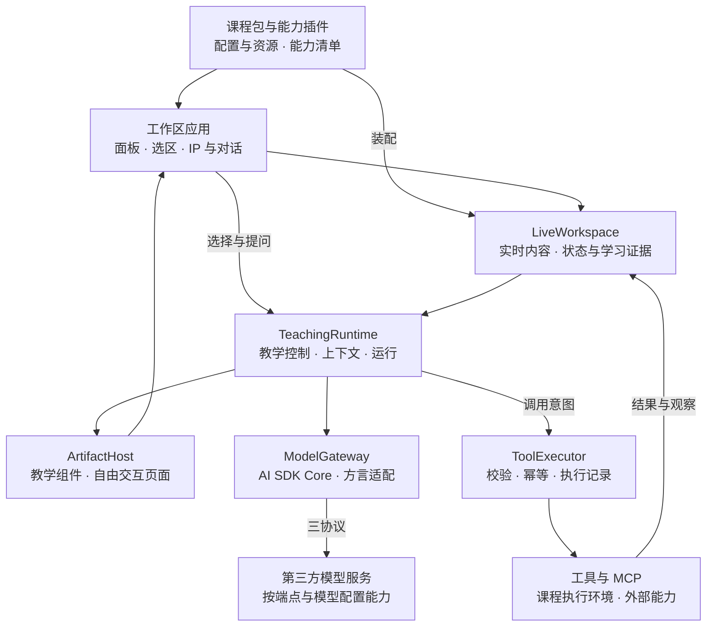

# 循阶学生端 Agent 架构方案

> 术语映射（2026-10-27）：本文保留原始来源措辞；其中课程装配层的“课程工具 / Course Tool”在当前设计中称为“课程组件 / Course Component”，“教师工具库”称为“教师组件库”。模型可调用操作称为“Agent 工具 / Agent Tool”。

*实时工作区 · 课程插件 · 教学运行时 · 三协议模型接入 · 交互式生成 UI*

**方案基线：** 2026 年 10 月 18 日 · **范围：** 学生端

---

## 1 总体方案

采用自有 TeachingRuntime 管理教学过程，使用 AI SDK Core 完成模型调用与结构化生成。工作区负责实时内容、通用选区和课程插件；模型通过自有 ModelGateway 接入第三方服务；交互内容采用受控组件与隔离生成页面两条路径。

前端采用 React 与 TypeScript，应用服务采用 Node.js 与 TypeScript，首版按模块化单体部署。应用服务可运行在本机或服务器，耗时工具放入独立执行进程。本机演示使用 SQLite 与文件存储；多人部署使用 PostgreSQL 与对象存储，业务契约保持一致。

架构关系图 课程能力由宿主装配，状态与工具结果驱动教学，模型与界面通过明确边界接入。

工作区宿主指装载课程面板、管理生命周期并提供公共能力的应用底座。Gateway 指后端的模型调用入口，负责选择端点、协议适配、凭据、能力校验、超时和用量；它先作为代码模块存在，无需单独部署一个服务。

| **选型** | **采用方式与理由** |
| --- | --- |
| AI SDK Core | 作为默认调用层，复用流式响应、工具参数处理、结构化输出和端点适配。教学调度与关键执行顺序由循阶控制。[1][2] |
| Pi core 与 pi-ai | 具备现成 Agent 状态、steer/followUp 队列及工具前处理屏障，适合少写内层循环。循阶仍需自己的教学状态、引用和发布规则，因此不作为默认依赖。[4] |
| DeepSeek Harness | 可复用会话日志、持久收件箱、工具流水线和插件生命周期；采用它需接受 Cordis、SessionEvent 和 profile 体系。当前先保持较窄的自研范围，避免接入完整应用框架。[5] |
| OpenIntelligentUI | 抽取并改造流式渲染器、主题和 iframe 生命周期，接入循阶 ArtifactHost。其演示后端和会话状态不随渲染器一起引入。[11][12] |

这一选择不依赖现有项目已经安装 AI SDK。AI SDK 的 ToolLoopAgent 同样支持逐步更新上下文、工具循环和取消，实时交互并非 Pi 的独有优势。主 Agent 采用 Core 单步驱动，需要自行维护步骤调度、运行记录和恢复；范围限定在循阶需要的能力。[3]

## 2 工作区与实时状态

### 自动保存是基础行为

学生编辑后立即更新界面和本地待同步队列，再连续写入应用服务；短时合并网络请求，但不能等到停止输入才保存。未同步操作进入 IndexedDB 持久队列，服务端确认后清理，断线恢复后按操作 ID 去重补传。学生无需手动保存、创建版本或冻结草稿。

发送问题、运行实验或装载代码时，客户端自动带上此前编辑的顺序标记。服务端确认这些编辑已应用后再读取上下文或启动任务。这个顺序协调发生在内部；Agent 不能以“最新状态”名义读取尚未同步的旧内容。

实验任务自动绑定启动时的输入，学生随后仍可继续修改。运行结果关联实际执行的输入，较旧任务不能覆盖较新的装载结果。前端只展示“修改尚未应用”“更新运行”等必要信息；内部依据标记不进入学生页面。

### 工作区事实与学习判断分别保存

| **数据** | **内容与使用方式** |
| --- | --- |
| 实时工作区 | 代码、文档、表格、对象、当前选区、面板状态和生成内容交互状态。保存为可读取的对象与增量。 |
| 运行与任务状态 | 实验输入、执行进度、结果、错误、当前课程任务和完成证据。派生结果注明其依据。 |
| 学习证据 | 学生预测、提交答案、实验操作、修改过程、接受提示及独立完成情况。关联课程目标和来源。 |
| 学生画像 | 依据证据形成的薄弱点、偏好和阶段性判断，允许更新或撤回。任务完成不直接等同知识掌握。 |

LiveWorkspace 是当前事实的权威来源。ContextBuilder 在每次模型调用前按需读取：学生问题与引用、关注对象、相关工作区内容、任务要求、近期证据和教学进展。大文件与完整波形保留引用，先提供相关片段与摘要，再按需调用读取工具。

工作区持续接收变化，模型只在需要判断时运行。每一步记录读取了哪些对象；相关内容变化时重新取证，发出工具动作和展示指导前再检查依据。无关文件修改、光标移动或布局变化不应让全部回答失效。

## 3 通用选区与上下文引用

移除面板上的固定“求助”按钮。选区工具条、自动引用和输入框由工作区统一提供。课程包直接使用这些能力；能力插件上报其视图中选区的语义，不重复实现提问交互。

| **场景** | **统一交互** |
| --- | --- |
| Agent 对话关闭 | 学生选中工作区内容后，显示轻量工具条，提供“询问 Agent”。点击后打开对话、附带引用并聚焦输入框。 |
| Agent 对话打开 | 学生完成选择后，内容自动进入输入框旁的引用区，保留已输入的问题。选择本身不发送消息、不调用模型。 |
| 重新选择与多处引用 | 默认更新一个临时选区引用，避免拖选过程堆积。需要同时引用多处时，可保留已有引用或使用工具原生多选。 |
| 发送问题 | 提交学生文字和引用，自动协调此前编辑同步。引用显示为可移除标签，可预览或回到来源。 |

切换焦点到输入框不会删除引用；删除引用后，不因选区失焦事件自动加回。只自动捕获已注册的学习内容区域，排除输入框、引用标签和普通对话文本；教学卡片和生成产物即使展示在对话中，也按学习内容接入统一选区服务。

### 课程插件接入同一个 SelectionProvider

| **内容类型** | **适配器上报的语义** |
| --- | --- |
| 正文与代码 | 文档或文件身份、文本范围、选中原文；编辑器使用自身选区 API。 |
| 表格与数据 | 稳定行列身份、选中单元格和值；排序后仍能定位原数据。 |
| 波形与实验结果 | 结果身份、信号、时间范围和单位；引用明确属于哪次实验。 |
| 电路 画布 三维对象 | 对象身份、属性、关联数据；必要时附图像。 |
| 生成页面与 iframe | 内部通过受控桥接上报选区，再使用宿主的统一工具条和引用区。 |

Workspace SDK 内置常用 DOM、编辑器和表格适配器。新类型插件实现订阅选区、读取内容、解析定位和回到来源；可选择的课程视图必须通过这项接入验收。浏览器原生选区无法自动覆盖嵌套文档和任意画布，外部黑盒 iframe 不能被承诺为零接入的完整课程工具。[16]

引用保存学生当时选中的内容，同时保留可解析的来源定位。Agent 能区分“你引用的内容”和“它当前的状态”；已发送引用不被后续编辑静默改写。工作区照常自动保存，学生不承担版本管理。

## 4 课程包 插件与 MCP

### 课程通过配置装配工作区

CoursePack 是课程配置与资源包，包含课程任务、学习目标、学生可见材料、初始内容、默认布局、所需能力版本及教学策略。CapabilityPlugin 是能力实现包，提供面板、运行工具、状态观察和交互组件。教师组装已有能力即可形成不同课程；全新工具类型由开发者实现一个插件，随后各课程复用。

| **契约** | **必须描述的内容** |
| --- | --- |
| CoursePack | id、schemaVersion、能力依赖、初始工作区、课程资源与任务、教学策略、允许使用的工具与 Skills。 |
| CapabilityPlugin | id、apiVersion、界面与运行入口、状态 schema、迁移规则、权限，以及 views、commands、tools、observations、selections、anchors、components。 |
| Workspace SDK | 状态读写、命令执行、选区引用、语义锚点、受控事件、资源读取和插件生命周期。 |

宿主按配置加载面板和默认布局，前端不再编写“数字逻辑显示设计、虚拟板、波形”的课程分支。布局后续可由学生调整并自动保存。插件装载时注册贡献，卸载时取消任务和订阅、撤销工具与锚点；学生数据保留。活动工作区锁定插件版本，升级时执行状态迁移。

内置可信界面可直接使用 React。第三方界面与生成代码放入隔离 iframe，通过 Workspace SDK 的受限桥接访问当前课程能力；不向它们开放数据库、密钥或任意宿主对象。执行不可信代码的工具使用具备实际权限隔离的沙箱，普通 Worker 或子进程本身不等于安全沙箱。

### MCP 接入统一能力目录

使用 MCP 官方 SDK 接入外部 tools、resources 和 prompts；MCP 工具转换成内部 ToolSpec，仍经过 ToolExecutor。MCP 连接配置、凭据与进程生命周期由后端管理。MCP Apps 的交互页面进入同一隔离 UI 宿主，并按其支持的桥接能力接入状态和引用。[14]

MCP 负责连接外部能力，课程包负责选择哪些能力可在本课使用。Skills 提供操作方法和教学规范，不自动获得执行权限。有效权限取平台允许、课程允许与当前操作范围的交集；教师私有答案和评分材料不得因加载课程包而整体发送到学生前端。

## 5 教学运行时与工具执行

### 保持一个连续的学生 Agent

TeachingController 管理教学目标、主动介入、帮助强度、等待学生回应和任务切换；RunDriver 管理一次短运行中的模型与工具步骤。TeachingEpisode 记录一段持续教学过程，例如“先预测，再实验，再解释”，它可以跨越多次短运行。

主动感知先用规则合并事件、去重和判断时机，例如实验失败、重复无效尝试、学生提交预测或任务完成。需要理解时再调用模型。输入中的学生优先，提示设冷却与频率限制，允许判断后保持安静。后台生成或画像更新作为任务运行，不产生多个竞争着对学生发言的 Agent。

### 主运行采用单步模型驱动

1. 控制器确定本次目的、优先级、预算和可用工具。

2. ContextBuilder 读取当前状态与引用，记录读取依据。

3. RunDriver 调用 AI SDK Core；本步工具只声明 schema，不挂自动 execute。

4. 收齐本步响应，先保存完整助手消息、工具请求和协议回放数据，再交给 ToolExecutor。

5. ToolExecutor 校验参数、权限、当前依据和幂等记录，执行后保存结果。下一步重新读取相关状态并装配工具。

6. 模型产出 TeachingActionDraft，或决定继续取证、等待任务、结束而不提示。

7. 控制器校验教学策略与内容时效，再交付 IP、锚点提示、对话或交互内容。

AI SDK 允许省略工具 execute，因此该顺序可在公开接口上实现。[1] 同一步同时出现工具请求和教学内容时，内容先视为候选，相关工具结果入库后再由后续步骤确认；提交动作与修改工具混在同一批时不直接发布。普通后台生成可直接调用 generateText 或 streamText，RunDriver 只维护循阶需要的步骤、回放和恢复。

### 工具执行与界面发布分别把关

工具按读取、计算和修改分类；安全的独立读取可并行，有依赖或修改同一对象的操作顺序执行。长任务返回 jobId，完成事件再唤醒控制器，避免让一次模型连接一直等待。学生点击运行与 Agent 调用运行都进入同一个命令入口。

每个执行意图使用稳定 commandId；重试先查结果，执行中断且结果未知时先核实。工作区修改的依据检查与写入在同一事务或条件命令中完成，条件失效则拒绝修改并重新读取。取消生成、停止工具、撤销已完成操作分别实现。运行记录持久化请求依据、调用意图、结果和终态；重启后未知结果先对账。

TeachingAction 描述“提示、提问、建议实验、反馈”等教学意图；UIIntent 描述展示位置、语义锚点和交互方式。IP 的后续互动由这些动作驱动，不再依赖预置开场脚本。前端解析语义锚点并定位，目标不在视野时采用就近或普通气泡，避免抢焦点。

生成、已展示、学生回应、忽略、关闭和失效分别记录。模型完成一条引导后即可结束运行，TeachingEpisode 等待真实学生行为再继续；学生忽略提示不直接解释为没有掌握。

## 6 模型网关与三协议适配

三种协议全部支持：Chat Completions、Responses、Anthropic Messages。实际调用只使用项目配置的第三方端点，不默认访问 OpenAI 或 Anthropic 官方地址。厂商名称和模型名称不决定协议，同一服务、同一模型可配置多条协议路线。

| **配置对象** | **职责** |
| --- | --- |
| EndpointProfile | 服务身份与连接列表；每条连接明确 protocol、请求地址、认证引用、adapterId、方言配置和附加请求头。 |
| ModelRoute | 逻辑路线名、端点、连接、实际 modelId 和 capabilityProfile；模型标识原样交给所选服务。 |
| CapabilityProfile | 按端点 × 模型 × 协议记录文本/图像/文件、工具、结构化输出、reasoning、回放及流传输能力。 |
| ModelGateway | 解析路线、校验必需能力、注入后端凭据、设置取消与超时、记录用量；对业务返回统一事件和原生回放记录。 |

| **协议** | **默认适配方式** |
| --- | --- |
| Chat Completions | 优先 @ai-sdk/openai-compatible；端点有专用方言时使用经验证的专用或自定义 adapter。[6] |
| Responses | 符合 Open Responses 规范的端点优先 @ai-sdk/open-responses；其他 Responses 方言用明确配置的适配器。[7] |
| Messages | 使用 @ai-sdk/anthropic 的自定义地址、认证和 headers；对不匹配的模型规则、thinking 和内容块格式补方言适配。[8] |

协议兼容不能只理解为更换 baseURL。方言层处理 reasoning 参数及历史回传、system/developer 角色、工具格式、图像/文件输入、流事件、错误结构和 usage。兼容地址也不证明支持该协议的所有高级功能；例如 DeepSeek 的 Responses 文档列出了与原版不同的参数和续接限制。[9]

保留两类模型记录：一类是可移植的学生问题、引用和已完成结果；另一类是绑定路线的原生回放数据，包括 reasoning_content、Responses items、thinking/signature、工具调用 ID 等。原生字段不展示给学生，也不当普通文本跨模型传递。

切协议或端点时，默认在未完成工具请求已结清的步骤边界开始新的模型续接段，用当前状态和可移植历史重建上下文。旧端点的 response ID、签名等不直接带给新端点。学生对话保持连续，底层续接关系明确。

结构化教学动作优先使用原生 schema 输出；不支持时可按事先配置采用工具提交或 JSON 校验模式。缺少必需能力时选择已配置且满足要求的路线，或明确报错，不临时删参数、静默换协议。原生流中断不代表已执行工具被撤销；重试与备用路线共用整次运行预算。

## 7 交互式生成式 UI

### 采用表现形式选择与两条渲染路径

OpenAI 的 Intelligent UI 展示了三个值得采用的方向：根据问题选择表现形式、使用一致的组件基础、边生成边呈现。官方说明将原生可流式组件库、生成中处理界面的编译器和模型训练结合起来。[10] 循阶复用公开实现中的技术资产，界面质量仍需通过所选第三方模型与教学案例验证。

| **路径** | **用途与实现** |
| --- | --- |
| 受控教学组件 | 提示卡、选择题、预测卡、比较表、实验参数面板、学习卡片。采用 React 组件目录，按需要提供 A2UI 适配；组件参数与事件有 schema，支持稳定保存和恢复。[15] |
| 自由交互产物 | 复杂交互解释、动态图示、计算器、轻量模拟。抽取 OpenIntelligentUI 的 HTML/SVG/CSS/JS 渲染能力，放入自有 ArtifactHost 与隔离 iframe。[11][12] |

PresentationPlanner 根据教学动作、学生需求、数据、已加载组件和展示空间选择文本、组件或自由产物。明确类型直接映射；需要判断时通过同一个 ModelGateway 请求模型。选型不固定绑定 TypeSafe/Jev，避免把表现形式判断做成单独外部服务的必需依赖。

### OpenIntelligentUI 具体复用边界

已检查 OpenIntelligentUI 提交 8391a94。它采用 CSS 先完成、HTML 逐步预览、最终 iframe 执行 JS 的路径；原生组件与自由生成 UI 共存。其当前会话检查点在进程内存，跟进通常形成新回答快照，任意控件状态不会自动同步给 Agent。[11][12]

| **代码或能力** | **循阶中的处理** |
| --- | --- |
| renderer 与 frame-content | 抽取流式预览、主题注入、高度调整、最终页面生命周期；替换 CopilotKit 绑定。 |
| process-partial-html | 复用分阶段预览思路，补正式的内容限制；正则移除 script 不视为完整安全处理。 |
| design-system 与设计 Skills | 改为循阶视觉规范和教学内容规范，支持课程能力提供组件与样例。 |
| prompt-bridge 与 sandbox-functions | 将普通字符串 sendPrompt 扩展为选区、状态、教学事件和明确提问四类受控消息。[13] |
| Python Agent 与 Jev router | 由自有 TeachingRuntime 和 PresentationPlanner 接替；不随前端渲染器一起引入。[13] |

### 生成内容也是工作区的一部分

ArtifactStore 保存 artifactId、生成内容、资源依赖、来源证据、交互状态 schema 和学生当前状态。普通滑块、筛选和计算即时在本地响应，并自动同步状态；是否再次调用模型由教学控制器决定。关键预测、答案提交与实验结果记录为学习证据。

统一桥接提供 publishSelection、commitState、emitInteraction、requestAgent。宿主绑定学生、课程、工作区和 artifact 身份，再校验消息。生成产物必须声明持久状态，并通过 Workspace SDK 更新状态、上报交互和可引用对象；文本选择使用内置适配，画布提供语义映射。契约校验通过后，产物才作为可恢复交互内容发布。

展示意图和当前依据通过初步检查后，可显示“生成中”的静态草稿预览；预览不执行生成脚本或课程命令。完整产物通过内容、依据和策略检查后正式发布并启用获准交互。生成途中依据失效时撤下或更新草稿。稳定 artifactId、生成批次和单一执行队列负责增量、重复片段、取消与 iframe 重建。

iframe 不获得宿主同源访问权；资源通过允许列表与受控资源入口加载，桥接校验具体 iframe 实例、消息格式和当前权限。页面重建时恢复已保存状态；中断时停止生成和待执行队列，必要时销毁 iframe。外部命令仍由 ToolExecutor 做幂等与校验。

实际实验结论来自课程工具和数据，生成图形负责呈现；用于讲解的模拟明确属于示意。正式教学动作只在校验后发布，预览不记为已完成指导。卡片收藏引用同一个 artifact，避免出现多份不同步的副本。

## 8 核心接口与落地验收

| **接口** | **核心内容** |
| --- | --- |
| WorkspaceReference | 来源对象、选区语义、当时内容、当前定位及内部依据。 |
| ContextSnapshot | 本次相关事实、引用、任务要求、学习证据和读取依赖。自动产生，不是学生手动快照。 |
| TeachingAction | 教学目的、内容、证据引用、目标对象、期望回应和有效条件。 |
| UIIntent | 展示载体、内容引用、语义锚点和注意力级别。 |
| StudentInteraction | 动作类型、对象引用、输入数据及宿主绑定的身份。 |
| ToolSpec 与 ModelPort | 前者定义工具 schema、作用范围与执行策略；后者定义调用输入、事件流、能力要求和回放数据。 |

工作区实时变化走可确认和补传的领域事件通道；生成流走独立的运行与产物事件。内部契约不绑定某家模型消息类型。抽取的 renderer 接收 ArtifactEvent；需要复用 CopilotKit 组件时，在边缘转换 AG-UI 事件，不让 UI 传输格式成为工作区数据的权威来源。

### 按依赖顺序落地

1. 先实现 Workspace SDK、LiveWorkspace、自动保存和通用选区引用；分别用代码视图和非代码视图验证。

2. 接入 CoursePack 与插件注册，替换固定面板；让课程命令、观察与 MCP 工具进入统一能力目录。

3. 实现 ModelGateway 的三类适配和 RunDriver、ToolExecutor；先跑通学生带引用的问题与工具往返。

4. 加入 TeachingController、教学过程记录和 IP 动态引导，处理主动触发、等待回应与过时建议。

5. 接入受控教学组件和改造后的 OpenIntelligentUI renderer，补齐状态恢复、选区桥接和学习证据。

| **验收场景** | **通过标准** |
| --- | --- |
| 编辑后立即提问或运行 | Agent 与任务包含之前的修改；学生无需手动保存。断线补传不重复应用。 |
| 换课程与换工具面板 | 相同划选、引用、自动保存和 Agent 入口正常工作，核心页面无课程特判。 |
| 运行中继续编辑 | 已运行结果保持正确归属，前端只提示修改尚未应用；旧建议不直接操作新内容。 |
| 三协议实际端点 | 文本与流、工具往返、多回合 reasoning、结构化动作、原生回放和取消均通过；按实际使用验证图像与文件。 |
| 取消 重试 与恢复 | 半截工具参数不执行；已完成副作用不重复；重启后未知结果先核实。 |
| 生成页面交互 | 控件状态自动保存、重建后恢复，选区可引用；交互可形成证据，不能越权调用课程工具。 |
| 完整教学闭环 | 选中波形并提问，Agent 读取代码与实验依据，给出预测卡；学生调整参数、重新实验，Agent 根据新证据继续引导。 |

最终依赖固定版本与上游提交，适配改动集中在边界模块，保留第三方代码的许可证。端点互操作、延迟和生成 UI 质量以实际接入验收为准；文档中的技术选型不代替这些测试。

## 参考资料

官方文档与源码核查截至 2026年10月18日。下列仓库链接固定至本次检查的提交；运行与端点测试按正文验收项实施。

**[1] AI SDK 工具调用与手动执行**  
[Tool Calling](https://ai-sdk.dev/docs/ai-sdk-core/tools-and-tool-calling) · [Loop Control](https://ai-sdk.dev/docs/agents/loop-control)

**[2] AI SDK 结构化生成**  
[Generating Structured Data](https://ai-sdk.dev/docs/ai-sdk-core/generating-structured-data)

**[3] AI SDK Agent 与运行上下文**  
[ToolLoopAgent](https://ai-sdk.dev/docs/reference/ai-sdk-core/tool-loop-agent) · [Runtime and Tool Context](https://ai-sdk.dev/docs/ai-sdk-core/runtime-and-tool-context)

**[4] Pi Agent 与模型调用层**  
[Agent README](https://github.com/earendil-works/pi/blob/8efd314fa3d3232ce197d8d7a6a5660530b9d83e/packages/agent/README.md) · [pi-ai README](https://github.com/earendil-works/pi/blob/8efd314fa3d3232ce197d8d7a6a5660530b9d83e/packages/ai/README.md)

**[5] DeepSeek Harness 运行框架**  
[Architecture](https://github.com/deepseek-ai/deepseek-harness/blob/687f282e8625c6b8d11ff58211a90524be2e4317/docs/architecture.md) · [Agent Core](https://github.com/deepseek-ai/deepseek-harness/blob/687f282e8625c6b8d11ff58211a90524be2e4317/docs/subsystems/core.md)

**[6] 第三方 Chat Completions 接入**  
[OpenAI Compatible Providers](https://ai-sdk.dev/providers/openai-compatible-providers)

**[7] 第三方 Responses 接入**  
[Open Responses Provider](https://ai-sdk.dev/providers/ai-sdk-providers/open-responses)

**[8] 自定义 Messages 端点**  
[Anthropic Provider](https://ai-sdk.dev/providers/ai-sdk-providers/anthropic)

**[9] 协议方言与 reasoning 回放实例**  
[DeepSeek Responses API](https://api-docs.deepseek.com/guides/responses_api/) · [DeepSeek Thinking Mode](https://api-docs.deepseek.com/guides/thinking_mode/)

**[10] OpenAI Intelligent UI 官方说明**  
[GPT-6 and Intelligent UI for everyone](https://openai.com/index/gpt-6-for-everyone/)

**[11] OpenIntelligentUI 总体设计与许可**  
[Architecture](https://github.com/CopilotKit/OpenIntelligentUI/blob/8391a94c1c3939c679e40ddd7bfc08a9ef690e70/docs/architecture.md) · [MIT License](https://github.com/CopilotKit/OpenIntelligentUI/blob/8391a94c1c3939c679e40ddd7bfc08a9ef690e70/LICENSE)

**[12] OpenIntelligentUI 渲染实现**  
[Renderer](https://github.com/CopilotKit/OpenIntelligentUI/blob/8391a94c1c3939c679e40ddd7bfc08a9ef690e70/apps/app/src/components/generative-ui/open-generative-ui/renderer.tsx) · [Preview Processing](https://github.com/CopilotKit/OpenIntelligentUI/blob/8391a94c1c3939c679e40ddd7bfc08a9ef690e70/apps/app/src/components/generative-ui/open-generative-ui/process-partial-html.ts)

**[13] OpenIntelligentUI 交互桥接与表现形式选择**  
[Prompt Bridge](https://github.com/CopilotKit/OpenIntelligentUI/blob/8391a94c1c3939c679e40ddd7bfc08a9ef690e70/apps/app/src/lib/sandbox/prompt-bridge.tsx) · [Visualization Router](https://github.com/CopilotKit/OpenIntelligentUI/blob/8391a94c1c3939c679e40ddd7bfc08a9ef690e70/apps/agent/src/visualization_router.py)

**[14] MCP 与 MCP Apps**  
[MCP Specification](https://modelcontextprotocol.io/specification/2026-07-28) · [MCP Apps](https://modelcontextprotocol.io/extensions/apps/overview)

**[15] A2UI 自定义组件目录**  
[Custom Catalog](https://a2ui.org/guides/defining-your-own-catalog/)

**[16] 原生选区与编辑器选区**  
[W3C Selection API](https://www.w3.org/TR/selection-api/) · [Monaco ICodeEditor](https://microsoft.github.io/monaco-editor/typedoc/interfaces/editor_editor_api.editor.ICodeEditor.html)
