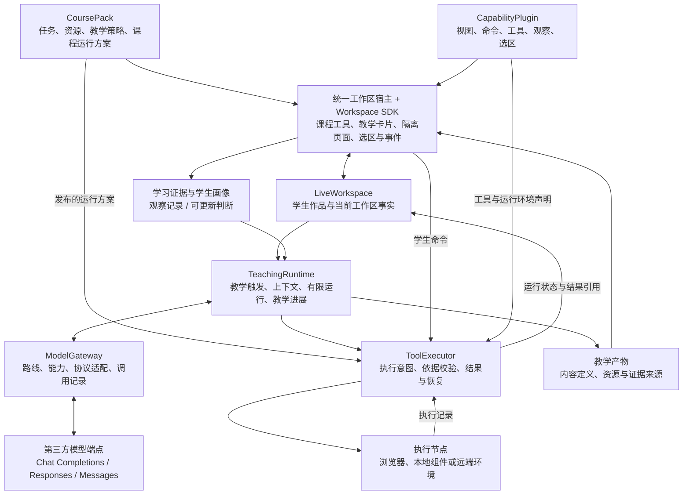

# 循阶学生端 Agent 架构

更新：2026-10-23。状态：重构研究的初步架构候选，并按已形成的议题决议同步相关边界。产品要求由 Robert 明确，工程取舍记录本轮已作出的判断；来源、决定与待验证项见[需求与决策记录](student-agent-decisions.md)。后续通过 Wayfinder 重新审视设计，允许替换或推翻尚未确定的工程方案，不限于补齐细节。这份文档不表示代码已经实现。

后续入口：[学生端 Agent 与工作区重新设计：数字逻辑与部件设计先行](https://github.com/paher-din/XunJie/issues/112)。本文件保留总体架构候选，局部决议以对应议题为准。执行方向及教师易用性依据[本地优先执行决议](https://github.com/paher-din/XunJie/issues/114#issuecomment-6363162710)，不由首条 ALU 反推所有课程只能采用同一种运行方式。

## 要解决的问题

循阶要把 Agent 放进学生实际动手的学习过程：它能读取正在变化的工作区，利用课程能力观察、验证和引导，并通过 IP、对话及交互内容持续与学生协作。学生无需管理保存版本；教师更换课程时通过课程配置和插件装配工具。

本轮聚焦学生端。教师如何交付课程、哪些材料只供教师使用，以及学生过程如何留下证据，属于必须保留的接口；教师端 Agent 与教学分析系统暂不展开。

当前实现仍要求手动确认作品与冻结快照，学生辅导是一次有限动作，课程面板包含固定分支。已有运行输入绑定、执行记录和沙箱生命周期可以复用。源码依据及技术前提见[事实核对](references/2026-10-18-architecture-checks.md)；重构切换时还需处理教师端共享的提交和模型接口。

已确认重构以新模型为目标，保留旧数据并迁移实际需要的对象，全部旧接口和流程不作为设计限制。具体迁移对象在实施前盘点，文档中的重构方向不授权删除旧数据。

## 从问题出发的架构判断

总体方向合适，但不应把模块名称都建设成独立框架。真正需要解决的是：学生持续操作时，Agent 能依据正确的内容采取合适的教学行动；教师更换工具时，不必重写学生工作区。由此确定以下边界：

- 学生作品、实际执行输入和教学证据必须由循阶掌握；模型会话只是一次推理所用的表示，不能成为这些事实的唯一存储。
- 教师决定课程工具及运行方案，平台检查实际设备并按方案调度。尽量在学生本机运行，仅为本地确实不能满足的能力配置远端路径；学生不选节点。
- 课程工具与生成教学页面共用状态、选区、事件和隔离宿主。工具定义可复用，教学产物实例保留学习过程，两者不需要两套运行设施。
- 教学运行时的自研候选范围限定为教学触发、上下文取证、有限模型运行、执行记录和交付；模型连接已按[三协议决议](https://github.com/paher-din/XunJie/issues/115#issuecomment-6346123203)选择直接协议 SDK 加薄适配，完整内核仍待整体架构议题决定。
- 首期采用模块化应用服务与独立执行节点。先验证一条完整教学活动，再扩展能力；模块边界不要求微服务或多套数据库。

“掌握教学状态”本身不能证明必须自研模型循环。本轮选择一个有界运行入口，是因为所需步骤短、执行顺序明确，暂不需要通用团队调度、终端会话或大型插件内核。若恢复与调度成本开始超出这一范围，应重新评估 Pi 等现成循环，而不是持续扩张自研内核。理由与代价见 [ADR 0002](adr/0002-own-teaching-state-and-effect-control.md)。

**工作区宿主**是装载课程工具与教学内容、管理生命周期、提供公共交互能力的应用底座。**ModelGateway** 是可信应用服务中的模型调用入口：选择配置的路线、提供凭据、适配协议、检查能力并记录调用。图中的边界是职责边界，并不各自对应一个服务。

| 边界 | 持有的职责 | 不应接管的职责 |
| --- | --- | --- |
| 工作区宿主与 SDK | 工具和产物呈现、公共选区与引用、装配、状态桥接与生命周期 | 每门课程的业务分支、教学判断 |
| LiveWorkspace | 自动同步的作品、对象、交互状态与来源关系 | 将任务成功直接解释为知识掌握 |
| TeachingRuntime | 介入时机、关注对象、教学进展、上下文构造、动作候选与交付 | 用某家模型的会话数据替代领域状态 |
| ToolExecutor | 执行读、算、写命令，保存执行意图与结果，处理重复与未知结果 | 决定学生下一步应该学什么 |
| ModelGateway | 路线与协议能力、模型调用、取消、超时、用量与原生回放 | 修改工作区、发布教学动作 |
| 教学产物定义与资源 | 内容、依赖、状态 schema、来源及发布状态 | 另存一份可变交互状态，或把教学示意当作实验事实 |
| 证据与画像 | 保存学习观察及其来源；维护可更新的学习判断 | 根据一条行为给学生下永久结论 |

## 实时状态与自动保存

学生修改先在界面生效，并在本机持久记录待同步操作；应用服务连续接收变化。合并传输应有最长等待时间，持续输入也会同步。断线恢复按操作身份去重补传。自动保存与实验运行分别进行，保存不等于重新装载或重新运行。

“Agent 知道当前状态”包含两层：系统持续接收变化，每次模型判断与动作执行读取相应的最新事实；模型无需在每次按键时运行。客户端尚未同步的修改不能被服务端当作已经知道。

不同操作在真正使用数据的位置固定依据，不统一要求先绕行云端：

| 操作 | 依据与同步要求 |
| --- | --- |
| 本地显示、滑块、筛选与编辑 | 本地即时响应，合并同步必要状态；不逐次调用模型 |
| 学生发起本地实验或装载 | 先在本机持久绑定命令与实际输入，再直接交给本地执行器；输入、结果与证据随后同步 |
| 向应用服务上的 Agent 提问、远端执行或向教师提交 | 等待此前相关修改、引用或执行记录同步完成，再读取、执行或交付 |
| Agent 发起命令 | 先持久化执行意图；目标节点校验输入与条件。需要当前内容而发现新修改时，重新取证，不静默使用另一份输入 |

每次运行保留不可变的输入身份和内容，学生不选择版本。继续编辑不改变已启动实验的输入归属；同步失败保留本机记录并给出必要反馈。云端尚未收到的结果不参与云端教学判断。局部断线可继续的能力按实际资源确定，不据此承诺完整离线教学。

LiveWorkspace 是同一个工作区对象体系：应用服务持有已接收的共享事实，本机保留待同步操作及本地执行记录。产物实例的可恢复状态也属于这一体系；资源仓库保存定义和素材，不再拥有另一份可变状态。此阶段不引入多主数据库或通用事件溯源框架。

**作品提交面向教师，自动保存保护持续创作，两者独立。** 学生可以把本次结果交给老师；提交时系统自动绑定交付内容和相关过程证据，后续编辑不静默改变老师收到的这次结果。提交不要求手动保存、冻结或选择版本，也不直接表示知识已掌握。教师审阅与修订的具体流程另行设计。

| 数据 | 语义 |
| --- | --- |
| 工作区事实 | 当前作品、对象、选区和持久交互状态 |
| 执行记录 | 实际使用的输入、命令、进度、结果和错误 |
| 学习证据 | 学生的预测、回答、实验、解释、修改和帮助使用情况 |
| 画像判断 | 根据证据形成的阶段性认识，与证据分开保存并允许修正 |

已确认：学习画像先在同一门课的多个任务间积累；跨课程只共享明确通用的偏好，不自动迁移学科掌握结论。画像更新保留证据归属，使后续解释和纠正有依据。

运行时按对象和相关内容记录读取依据。相关内容改变时重新读取，动作写入时检查条件，展示前检查是否仍适用；移动光标或调整布局不使所有推理失效。多端并发编辑策略将在使用环境确定后补充。

## 通用选区与引用

工作区提供两种已确定的交互：对话关闭时，完成选择后显示“询问 Agent”工具条；对话打开时，选中内容自动加入输入框旁的引用区，学生继续输入自己的问题。选择本身不发送消息或调用模型。固定面板求助按钮由这套公共交互取代。

文本、编辑器、表格、波形、画布和隔离页面通过统一 SelectionProvider 报告语义；宿主负责引用呈现和提问入口。插件必须说明对象身份、选中内容、定位方法和回到来源的能力。常用文本与编辑器适配由 SDK 复用，全新工具类型补充适配。

引用保留学生当时所指内容，同时可定位当前来源。已发送引用不随编辑静默改变。临时选区默认替换，保留引用后才形成多处引用；输入框焦点变化不清空引用，用户移除后不因失焦再次加入。教学卡片和生成产物也接入同一选区能力。

## 课程与能力插件

将“工具包”拆成两个职责：**CoursePack** 是教师组装并发布的课程配置与资源；**CapabilityPlugin** 是可复用能力的实现。工具有两类已明确的来源：开发者提供常用工具供教师选择，教师也可借助教师端 Agent 创建自己的工具。学生端统一装载两类产物，工具来源不决定其接入权限。

工具目录/市场提供发现和复用入口，教师端 Agent 负责创作流程；本轮学生端设计需要先给出工具应遵守的包结构、状态、选区、事件和执行契约。具体市场页面、创作对话和发布流程留在教师端设计。不能把教师自制工具缩减为只能改配置，也不能假定任意生成代码都天然符合运行契约；生成结果需要能够验证后装入课程。

| 对象 | 主要内容 |
| --- | --- |
| CoursePack | 学习目标、任务、学生材料、初始内容、默认布局、能力依赖与版本、课程运行方案、教学策略、可用工具与 Skills |
| CapabilityPlugin | 按需提供视图、命令、工具、观察、选区、语义锚点或教学组件，并声明 API 版本、状态定义、迁移与所需权限 |
| CourseExecutionPlan | 各能力的运行环境、版本、资源和设备要求，本地安排，以及确有必要时配置的远端路径 |
| Workspace SDK | 状态读写、命令调用、选区引用、锚点解析、受控交互、资源访问与生命周期 |

能力包只实现自身需要的贡献接口，不要求每个工具都有面板、编译器和教学策略。平台内建、受信的组件可直接注册；教师生成或外部提供的界面通过隔离 HTML/JS/WASM 包接入同一 SDK。符合已支持 API 和运行环境的新包可独立加载，不要求重新部署主前端；现有环境装配方式能承载的新依赖可随工具交付，只有超出执行能力的系统、硬件或控制机制才需增加适配并验证，不能由包任意安装到学生电脑。

教师易用性是工具交付的要求：提供所需的可复用工具，平台与 Agent 协助装配、依赖准备、自检及课前预览，避免教师手写运行配置或排查节点。工具接入议题须给出教师可完成的准备与错误恢复路径，重构验收须记录实际操作和阻碍，不能只验证工具运行成功；详细边界见[本地优先执行决议](https://github.com/paher-din/XunJie/issues/114#issuecomment-6363162710)。完整教师端产品仍不在本轮展开。

包声明需求，执行节点提供环境，教师在课程设计时确定运行方案。平台在活动开始前检查真实设备；缺组件先引导准备，不能把“尚未安装”自动判断为“本地无法支持”。只有已发布方案包含适用的远端路径时才安排远端执行；没有可用路径则明确缺少的条件，由教师修订课程或完成环境准备。学生看到课程是否就绪和需要做什么，不看到节点选择器。

课程、能力包和运行方案固定版本并一起发布，已有活动不静默升级。教师决定的是运行条件与资源安排，不需要预先知道每位学生的物理节点身份。完整理由见 [ADR 0001](adr/0001-teacher-owned-course-execution-plan.md)。

宿主依配置装配能力，避免数字逻辑/C 等课程特判。面板关闭、任务取消、插件卸载与学生数据删除是不同操作；卸载应撤销订阅、工具与锚点，学生数据如何继续打开由版本与迁移规则处理。

内部能力直接注册，外部工具通过 MCP 接入同一能力目录与 ToolExecutor。MCP 管连接与能力交换，课程包选择本课可用能力，Skills 描述操作与教学方法。课程材料须区分学生可见内容和教师私有内容。MCP Apps 视图如被采用，进入隔离页面宿主并按实际桥接能力接入状态和引用。

## 教学运行时与工具执行

TeachingRuntime 首期只有一条有界运行入口及持久化记录。TeachingController 表示触发与等待策略，TeachingEpisode 是跨交互的教学活动数据，RunDriver 是一次有限的模型与工具步骤；它们不是三套调度服务。学生始终面对一个连续的 Agent，后台生成或画像更新按需作为任务运行。

以上有限入口描述模型运行的候选形态，不限制课程工具必须在一次模型调用中结束。[本地执行决议](https://github.com/paher-din/XunJie/issues/114#issuecomment-6363162710)要求公共生命周期能承接有限作业与保持状态的会话，并允许无需计算的工具活动；会话的暂停、单步、复位、检查点和断连续接按实际能力声明。ALU 的按需重算不能套用到需要保留内部状态的工具。

主动观察先对事件合并、去重并判断时机，需要理解时才调用模型。学生提问优先；输入中、刚拒绝提示或已有待回应教学活动时，应避免反复打断。

已确认的教学动作边界：Agent 可主动观察、诊断、生成教学内容和执行课程允许的验证；修改学生作品须有学生明确请求或采纳。学生授权不会覆盖课程的帮助程度限制。主动验证应保留实际执行输入与结果，不把自动验证冒充学生独立完成的学习证据。

执行顺序：

1. 确定本次教学目的、可用能力与预算。
2. ContextBuilder 读取相关工作区、问题与引用、任务要求和学习证据，记录依据。
3. 通过 ModelGateway 完成一个模型步骤，工具声明与实际执行分离。
4. 保存完整助手响应、工具意图和必要回放数据，再进入 ToolExecutor。
5. 检查参数、范围、依据和既有执行结果，执行并保存结果；下一步重新读取相关状态。
6. 产生 TeachingAction 候选，或继续取证、等待任务、安静结束。
7. 校验教学策略与依据，发布给 IP、对话、锚点提示或教学产物；等待真实学生行为再继续。

工具请求未完成时，同步生成的教学结论仍是候选。独立读取可并行；有依赖或修改同一对象的命令顺序执行。学生手动运行与 Agent 调用共用命令语义、授权检查及结果格式，不强制采用同一条网络路径。长任务保存任务身份，完成事件再唤醒运行时；运行预算耗尽或等待学生回应时停止本次步骤。

命令采用稳定身份；重试先查询结果。结果未知时先核实，不能默认重跑副作用。修改依据校验与实际写入必须原子完成。取消模型、停止执行和撤销已完成修改分别处理。

IP 是教学动作的呈现载体。TeachingAction 表达为什么介入、说什么、依据什么、期望什么回应；UIIntent 表达在哪展示和如何互动。锚点由插件提供语义定位，目标不可见时不抢焦点。生成、展示、回应、忽略和失效分开记录。

## 模型接入

三种协议全部纳入架构，实际仅连接配置的第三方端点。协议由连接配置指定，模型名称原样交给目标服务，厂商名不决定协议。缺少配置或必需能力时明确失败或选择已配置路线。

| 配置与记录 | 职责 |
| --- | --- |
| EndpointProfile | 服务地址、协议连接、认证引用、adapter、headers 与方言配置 |
| ModelRoute | 逻辑用途到端点、连接和 modelId 的映射 |
| CapabilityProfile | 对具体端点 × 模型 × 协议核验工具、结构化输出、图像、文件、reasoning、流与回放能力 |
| 可移植历史 | 学生问题、引用、可见回应与已完成结果 |
| 原生续接记录 | 与调用路线绑定的协议块、签名、工具调用身份和服务端续接信息 |

模型连接层根据 [三协议模型接入：第三方端点能力、适配与原生续接](https://github.com/paher-din/XunJie/issues/115) 的本轮调查，采用直接协议 SDK 加薄 adapter：`openai` 承接 Chat / Responses，`@anthropic-ai/sdk` 承接 Messages。首批基线分别为 `7.42.0` 与 `1.1.0`。完整原生助手内容用于续接，应用事件用于展示与运行协调；教学工具执行仍由运行层决定。[实际端点与 SDK 证据](references/2026-10-23-model-endpoint-assessment.md)

| 路线 | 可复用的部分 | 本轮判断 |
| --- | --- | --- |
| 直接协议 SDK + 薄 adapter | HTTP、SSE、原生响应、取消与错误对象；部分原生流聚合 | 模型连接层采用；自行维护方言规则和事件/用量/错误归一化，完整运行循环另议 |
| AI SDK Core + 有界 driver | 模型协议适配、流、工具 schema、结构化生成 | 此前候选；本轮未选作连接基础。固定 OpenAI provider 的两条 Responses 路线实测存在原生保真或流校验失败 |
| Pi core + pi-ai | 有状态内层循环、输入队列、上下文准备、工具前后钩子 | 可行备选；并不因实时交互而优于或弱于 Core，取舍在于是否复用其循环与消息模型 |
| DeepSeek Harness | 更完整的插件、会话日志和运行框架 | 借鉴其机制；整体接入需与 Cordis/profile/SessionEvent 模型集成，当前收益尚不足以确定采用 |

本次只选择模型连接层，完整 Agent 内核由 [总体架构与复用取舍：模块边界、Agent 内核和部署方式](https://github.com/paher-din/XunJie/issues/119) 决定，没有进行完整内核接入原型或性能竞赛。Pi 的钩子也可能满足相同顺序；若需要队列、恢复与循环设施，应在 ModelPort/RunDriver 边界比较复用成本。教学证据、作品权限和执行记录无论采用哪种循环都要由循阶维护。[既有比较与限制](references/2026-10-18-architecture-checks.md#内核取舍的工程判断)

更换 baseURL 不等于完成协议适配。参数、角色、工具格式、流事件、错误、用量和 reasoning 续接均需按实际端点核验。三协议的架构承诺与每个真实端点的互操作结果分别记录；不承诺任意兼容端点都支持所有高级能力。

切换路线默认在工具请求已结清的步骤边界重建模型上下文。学生会话保持连续；旧端点的签名与 response ID 不直接带入新端点。重试、切路线和副作用恢复共享运行记录及预算。

实时更新采用符合当前路线续接规则的方式：优先追加新的观察和工具结果；需要更换 system、工具集合或压缩历史时，使用端点明确支持的机制，或在完成工具往返后开始新续接段。运行时每步重新检查实际可用权限，不等于每步任意改写协议前缀。对部分 Messages 模型，前缀修改会影响旧 thinking 的有效性；实际第三方端点分别验证。[原生续接约束](https://platform.claude.com/docs/en/build-with-claude/preserved-thinking#keeping-the-prefix-unchanged)

图像输入是首版必需能力。PDF 采用文档工具按需读页，返回文字、页图及绑定文档版本的页码引用；扫描页可先经视觉读取，确需搜索时再加 OCR。具体渲染库与执行位置归工具宿主议题，引用交互归工作区议题。真实 Agent 实现及能力边界见 [PDF 调查](references/2026-10-22-agent-pdf-capabilities-research.md)；当前图像互操作结果不等于 PDF 端到端验收。

## 交互式生成 UI

同时支持受控教学组件与隔离自由页面。前者承载预测、选择、反馈、比较等稳定教学交互；后者承载定制可视化、计算器与轻量演示。两者与课程工具共用工作区宿主及状态、选区、事件契约。课程工具是可复用定义，教学产物是活动中的内容实例；一张临时预测卡无需走完整插件发布流程。具体布局与表现遵循 [DESIGN.md](../DESIGN.md)。

OpenIntelligentUI 按局部渲染能力复用。已核对的上游实现具备逐步预览与最终 iframe 路径，但任意控件状态不会自动同步给 Agent。抽取范围先限于内容渲染与预览，不引入其整套后端和会话状态；状态恢复与教学交互由统一宿主负责。具体抽取范围仍需构建验证，若移植成本超过直接实现同等渲染器，则收缩复用范围。[核对依据](references/2026-10-18-architecture-checks.md#openintelligentui-复用)

每个可恢复产物需要稳定身份、内容、资源依赖、状态定义和证据来源；当前交互状态保存在对应工作区对象中。选区、状态、学习交互和明确提问分别上报，宿主校验所属工作区和允许能力。普通滑块与筛选即时响应，关键预测、答案或解释形成学习证据；并非每次控件变化都调用模型。

生成预览与正式可交互发布分开：预览展示静态内容，正式发布后启用获准交互。页面不得直接取得宿主凭据或数据库能力，课程命令经过 ToolExecutor。收纳或再次打开恢复同一个产物；任意脚本的内部变量不会自动成为可恢复状态。

## 运行位置与部署组合

按 [L7](student-agent-decisions.md#开发协作与产品运行边界l7)，开发协作基线与产品运行拓扑分别设计。当前云端共享数据和部分服务仅用于尽量消除成员设备、环境与数据差异造成的调试难以复现，应保持尽量小的范围；它不代表最终产品部署选择，也不锁定首版数据库和资源存储。

开发复现基线需对齐代码 commit、工具链与配置版本、相关数据/schema/seed 版本，保留输入、步骤及预期与实际结果，并避免成员测试数据和任务互相污染。这些是待设计、待验证的要求，不预选容器或分库等隔离实现，也不表示现有环境已经具备这些能力。

产品候选采用“模块化应用服务 + 可替换执行节点”。首条联调候选为共享应用服务配合学生本地执行能力：课程、身份、同步与教学协调集中，编译、运行和高频交互留在本机；这是待验证的组合，不因当前开发共享环境而成为既定产品拓扑。应用服务可部署在学校、云端或本机；服务部署由平台交付方案决定，教师设计课程运行方案，尽量安排学生本地执行，仅为本地确实不能满足的能力配置远端路径，不需要设计数据库和服务拓扑。

首条 ALU 的局部路径已确定为浏览器 Worker 内 Icarus/WASM，界面直接交互，省去该活动的本机组件和 localhost 连接。它仍需可复现构建、诊断修正、目标设备矩阵与产品集成验收；其他能力按任务需要选择浏览器、自动准备的本机环境或教师已配置的必要远端路径。详见[正式决议](https://github.com/paher-din/XunJie/issues/114#issuecomment-6363162710)及[探针记录](references/2026-10-23-local-execution-proposal.md)。

前端以 React/TypeScript 组织统一宿主，应用服务以 Node.js/TypeScript 组织领域模块。分离执行节点是因为运行环境与资源需求不同；TeachingController、ModelGateway、画像更新等暂不各拆服务。候选方案中，每个应用部署先选一套权威数据库，资源按需独立存储，不预先同时实现 SQLite 与 PostgreSQL 两套持久化；具体首版存储仍按产品需求评估，不能由当前开发共享数据的存放方式推定。上述工程候选均可在后续研究中重新设计或推翻。

| 部分 | 负责的事情 | 产品位置候选与扩展边界 |
| --- | --- | --- |
| 浏览器工作区 | 编辑、选区、交互页面、可在浏览器完成的计算 | 默认学生本机浏览器 |
| 应用与教学协调 | 课程/身份、工作区同步、教学运行、证据和任务路由 | 先作为一个可信应用服务；保持可部署到本机的边界 |
| ModelGateway | 端点配置、凭据与模型调用 | 随可信应用服务运行；工具在本地不意味着模型凭据进入网页 |
| 执行节点 | 编译、代码运行、仿真与其他课程计算 | 按课程运行方案使用浏览器或本机组件；必要能力使用教师配置的远端资源 |
| 持久数据与资源 | 已同步作品、产物、证据、课程资源与原生续接 | 应用服务持有共享事实；本机持久保存待同步操作、执行输入与结果 |

本地手动实验优先验证浏览器到本机组件的直接通道，并复用同一命令契约与权限检查；本机组件与应用服务的连接负责 Agent 命令、记录同步及恢复。直连需验证浏览器权限、配对、跨源和安装条件。若首轮只能使用服务端中转，应记录其网络等待与断线限制，不能据“计算在本地”宣称本地操作已经低延迟。

现有云端服务到成员电脑执行节点的协议可复用任务绑定、查询、取消和结果核对的语义，SSH 只是传输实现。节点与学生设备或学校资源池明确配对；任务固定到原节点、代际与输入。失联或结果未知时先查询核实，不自动迁移到云端重跑。同一任务内不能把位置变化当成普通重试。[现状依据](references/2026-10-18-architecture-checks.md#当前实现与目标的差距)

浏览器/WASM 能力单独验收，不能把原生 C/HDL 二进制直接放进浏览器；本机组件也必须提供实际执行隔离。安装技术按目标系统选择，不预设桌面壳、容器或虚拟机之一已胜出。本地执行不等于源码不出机或全系统离线；这些需要额外的数据与资源策略。[执行位置研究](references/2026-10-18-execution-topology-research.md)

## 核心契约需要约束什么

本阶段确定契约职责与不变量，具体字段在首条教学活动中收敛，避免先设计一套覆盖未知场景的协议。

| 契约 | 核心约束 |
| --- | --- |
| WorkspaceReference | 同时保留当时内容与当前可解析来源；覆盖非文本对象 |
| ContextSnapshot | 单次判断的内部取证集合与依赖，不要求学生创建快照 |
| TeachingAction / UIIntent | 教学意图与展示方式分开；依据、目标与期望回应可追溯 |
| StudentInteraction | 宿主绑定身份，说明发生了什么以及关联对象 |
| ToolSpec / Command | 参数、执行范围、影响对象、幂等身份与结果归属清楚 |
| CourseExecutionPlan | 教师发布支持条件和必要远端路径；运行时只在方案内匹配，任务保持原节点归属 |
| ModelPort | 业务输入、能力需求、统一输出事件与原生回放分开 |
| Artifact | 内容与可恢复状态有明确契约；实验事实与教学示意分开 |

工作区事实、模型生成流、产物流和展示记录各自有身份与恢复语义。是否在边缘采用 AG-UI、A2UI 或 MCP Apps，应由具体接入收益决定；它们不替代课程、学习状态与教学领域模型。

## 验收与推进

首条从“数字逻辑与部件设计”课程开始。先确定具体学习活动，再选择可复现的目标系统、真实第三方端点和满足活动要求的 HDL 编译/仿真能力。现有 4 位 ALU 可作讨论样例，不自动固定新任务与教学设计。候选流程为实时编辑与引用提问 → Agent 读取相应依据并由 IP 发起预测 → 学生回答 → 运行并观察信号或波形 → 学生解释 → 留下证据并更新同课教学判断 → 提交给教师；具体交互和验收由地图中的决策议题确定。

候选验证重点是输入归属、交互时延、重连不重复执行、卡片恢复与教学动作的实际呈现。第二条活动的工具类型在首条活动设计明确后选择，以检验跨课程装配能力。三种协议仍是总体要求，不作为第一条活动开始前的全量建设前提。后续工作的目的包含重新选择架构、替换旧设计和明确迁移，不预设上述候选全部保留。

重构按新模型进行；实现前盘点实际需要迁移的课程、作品、提交和教师共享接口，保留旧数据。附件里的模块落地顺序不作为必须遵循的步骤。

| 验收场景 | 应观察到的结果 |
| --- | --- |
| 编辑后立即提问或运行 | 本地运行绑定本机最新输入；服务端提问等同步到相关修改后再判断；无需手动保存 |
| 运行中继续编辑 | 结果仍属于实际输入；旧动作不修改新内容；界面简洁提示状态 |
| 代码与非代码内容划选 | 同一工具条、引用区与提问流程正常工作 |
| 更换课程能力 | 宿主按配置装配；不新增主页面课程分支 |
| 设备缺少能力 | 按教师方案引导准备或使用已配置远端资源；学生不选节点，未知任务不换节点重跑 |
| 主动引导 | IP 能结合真实行为继续引导；忽略提示不自动等于未掌握 |
| 三协议与模型切换 | 实际配置路线完成必需能力、工具往返和续接验证 |
| 取消、重试、重启 | 半截工具参数不执行；已完成操作不重复；未知结果可核实 |
| 生成页面恢复 | 状态与选区能回传；重新打开恢复；实验事实可追溯 |
| 学习判断 | 任务完成与掌握判断分开；画像判断可追溯、可更新 |
| 提交后继续编辑 | 教师收到的内容和证据保持该次交付的归属；学生继续自动保存 |

当前交付为架构候选文档与 GitHub 决策地图。工程测试、浏览器验收与教学效果均未因架构讨论而通过；后续分别记录结果。
