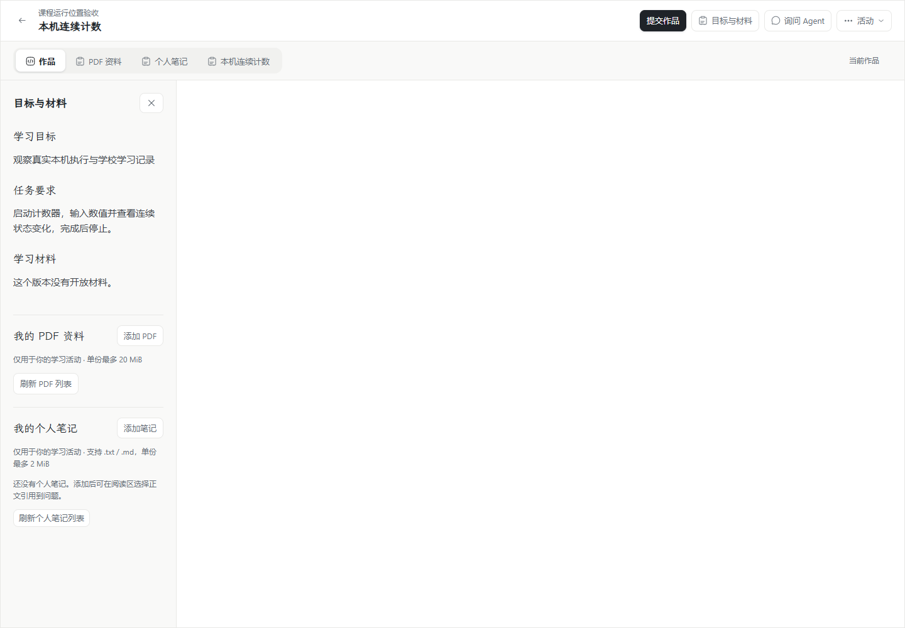
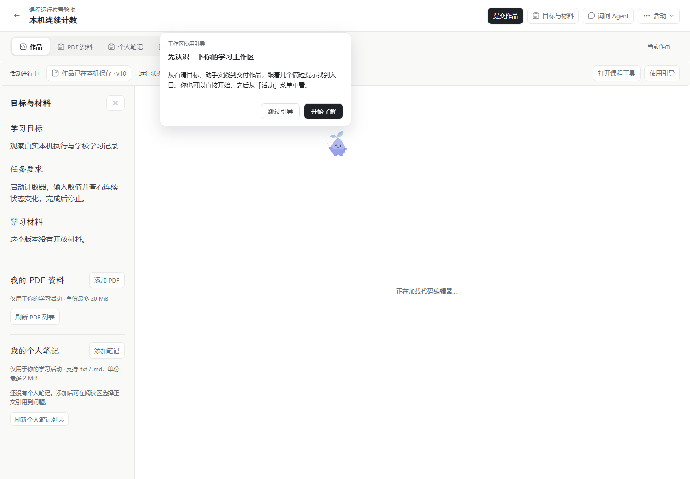
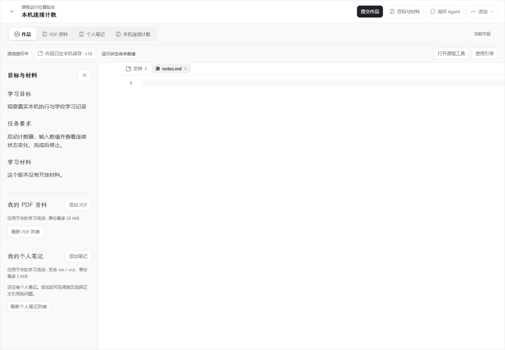

# 通用上手引导与真实状态栏交付记录

2026-11-17。分支 codex/workspace-ui-alignment，基线 b669c199。先形成[方案](../../workspace-onboarding-status-proposal.md)，用户选择“先做通用操作引导和真实状态栏”后实施。代码未提交，无关工具改动保留。

## 改动、原因及影响

- 首次进入显示欢迎气泡，可开始或跳过。后续围绕目标、作品、课程工具、求助、保存／提交依次介绍，并可直接导航到对应区域。没有工具时省略该步；个人活动说明本机保留，学校课程才说明正式提交。
- 使用 GuidancePresentation 复用旧版气泡和形象，而不移植固定样例的消抖脚本或预设 Agent 回复。非模态，不锁住其他操作；跳过／完成记住选择，刷新不重弹；“活动 → 工作区使用引导”及状态栏“使用引导”可以重看。未完成会记住步骤；偏好按客户端和学习主体隔离，存储异常时采用会话内降级。
- 新增 @xunjie/ui/workspace 的 WorkspaceStatusBar，接入真实活动、作品保护、确认版本和运行快照。点击作品状态返回作品，课程工具按钮打开已有工具；未新增运行、构建、烧录或提交命令。
- ReliableWorkspace 快照公开只读保护元信息，并在输入进入／结束保护时通知；未落盘输入显示“正在保护作品修改”，本机保存但未确认显示“版本待确认”，已确认显示真实版本。异常、分歧、只读独立显示。这里的保存指作品，不表示问题、笔记、上传或学校交付都已完成。
- 运行摘要按 requestId 去重；未知状态优先显示待确认，未就绪不冒充运行中。没有组件的活动不显示课程工具状态。百分比、板载版本和课程专属教学属于另有数据／课程流程的能力，本轮不填入演示值。
- 原 Agent 待答问题优先显示；上手引导不产生提问、执行、正式提交或示例作品。

## 访问

- 当前产品：http://127.0.0.1:50453/ （刷新后进入活动）
- 旧版参考：http://127.0.0.1:5601/
- 状态栏组件目录：http://127.0.0.1:5601/ui-catalog.html#/workspace/workspace-status-bar/ready

## 实际截图

桌面 Chrome 157.0.8103.78，1440 × 1000，浅色；同一已有活动 64654233-b7a6-4b38-801e-4d0bf7868e17。浏览器使用隔离偏好测试首次体验，不清除用户实际浏览器的偏好。

修改前：

首次引导：

跳过引导后的状态栏：

补充：[保存与提交说明](after/delivery-step.png)、[深色状态栏](after/status-dark.png)。引导在 1024 × 800 窗口完成边界检查。截图可能包含编辑器或运行控制器初始化反馈；不作为模块加载速度、实验运行或教学效果的证明。

## 验证结果

- 38 项相关测试通过（分组运行）：WorkspaceOnboarding 7、WorkspaceUi 8、recovery-readonly 1、PersonalMaterials 7、LearningApp.account-navigation 15。覆盖主体隔离、偏好不可写降级、无工具／个人活动分支、输入未保护与未确认状态、真实本机写入、运行去重及未知状态、既有导航与引用。
- Chrome 两轮有界检查通过：首次、跳过后刷新、菜单重看、真实导航、条件工具步、学校交付说明、完成、恢复步骤、Escape、深色和 1024px 边界。未观察到问题、运行或提交 POST；没有创建或更改真实作品。
- Web 类型检查及生产构建通过。构建期间有输入变化时，构建工具按保护机制要求重跑；代码固定后完成最终构建。保留既有 Zod 注释及大 chunk 提示。
- 组件目录与包边界检查通过：359 个条目覆盖 356 个公开组件。git diff --check 通过。未运行完整仓库测试；不覆盖此前已记录的无关快照下拉框测试问题。
- 教学效果未评估。没有实测课程专属交互教学、真实模型调用、编译烧录或学校交付成功；UI 引导和状态展示通过不代表这些业务已经完成。
