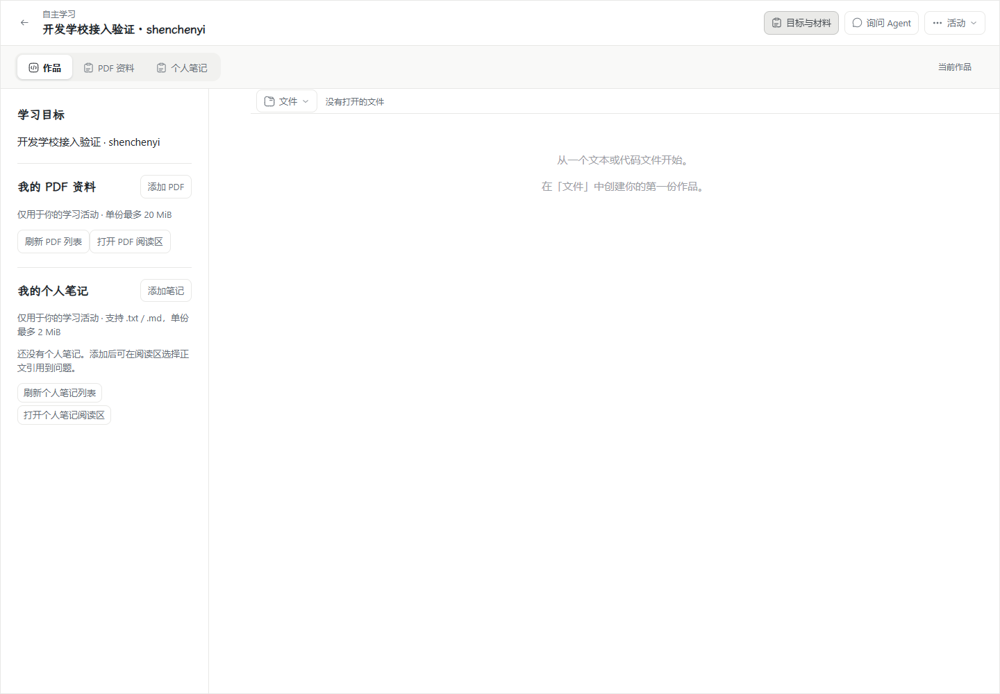
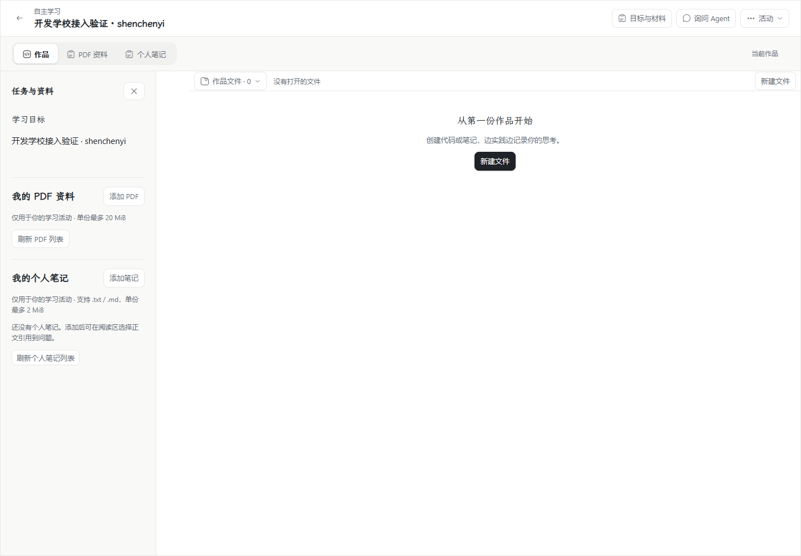
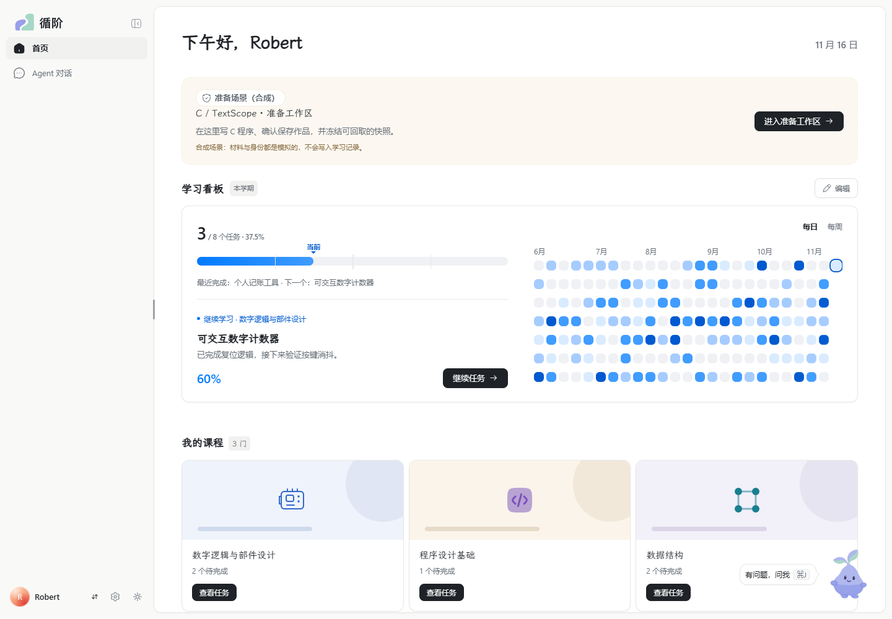
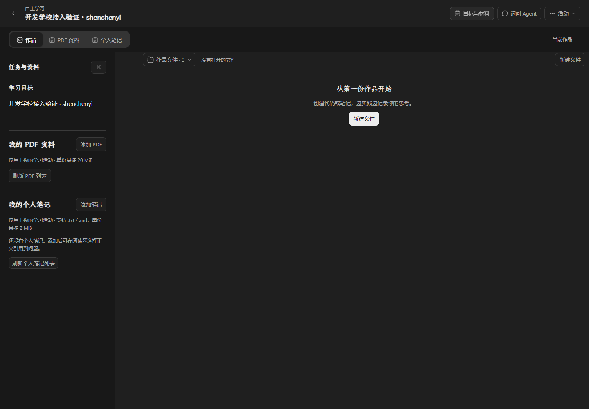
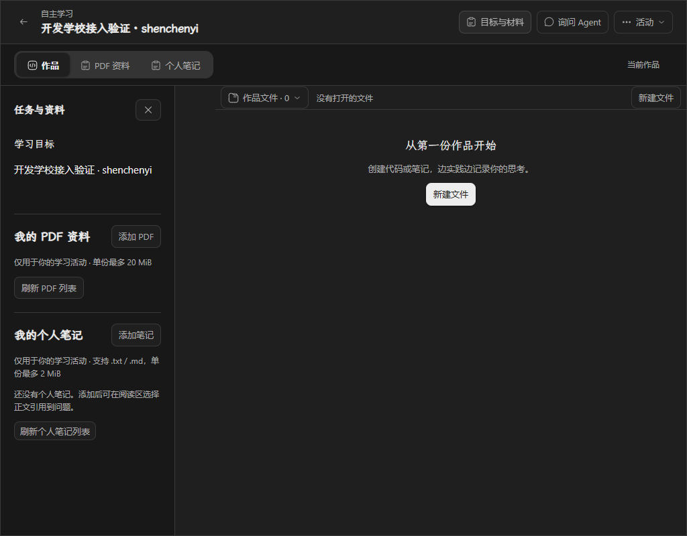

# 工作区 UI 修改记录 · 2026-11-16

分支：`codex/workspace-ui-alignment`。基线：远端 `upstream/main` 的 `37ab403f`。

## 运行入口

- 旧版参考：http://127.0.0.1:5601/
- 组件目录：http://127.0.0.1:5601/ui-catalog.html
- 当前产品：http://127.0.0.1:50453/

以上是本机开发服务，需保持服务运行。旧版使用 prep 数据，只用于观察布局和组件，不代表学校服务实际数据。

## 本批改动及影响

| 位置 | 修改前 | 修改后 | 原因与影响 |
| --- | --- | --- | --- |
| 左侧材料栏 | 任务与个人材料连续排列，缺少统一标题及栏内关闭入口 | 增加“任务与资料”标题、收起按钮、任务分区；调整栏宽与间距 | 让任务、PDF、笔记的层级更清楚；继续使用既有 shell 和主题 token |
| 作品文件栏 | 新建和改名表单都藏在“文件”弹层 | 文件列表、文件标签、新建入口、当前文件操作分开；命名在编辑器上方完成 | 降低操作寻找成本；复用 `@xunjie/ui/workspace` 的 FileTabs、WorkspacePopover |
| 文件名反馈 | 操作失败使用统一 toast | 无效名称和重名在输入位置显示；支持 Escape 取消 | 反馈与输入关联；仍使用既有文件对象及保存接口，未改变同名对象规则 |
| 空作品 | 文字提示用户进入文件菜单 | 直接提供“新建文件”按钮 | 空状态可直接开始 |
| PDF、个人笔记 | 通用“打开阅读区”按钮只打开空阅读器 | 移除这两个通用按钮，保留实际材料的打开入口及工具标签 | 减少没有内容的阅读入口；上传、实际材料打开及内容模型保留 |
| 活动菜单 | 混入完整学校连接表单及“刷新列表”，后者触发返回首页 | 保留活动状态及收纳页面，学校连接仍由全局账号设置处理 | 工作区菜单围绕当前活动，避免意外离开 |

## 同一活动对照

实际运行截图，桌面 Chrome，1440 × 1000，浅色主题。同一已有活动“开发学校接入验证 · shenchenyi”，材料栏展开；截图中的空作品和空个人材料是该活动原有状态。验收未创建或删除作品。

修改前：

修改后：

旧版参考：

深色主题：

1024 × 800 桌面窗口：

## 验证与范围

- 工程检查：`node scripts/build.mjs web:typecheck` 通过。
- 生产构建：`node scripts/build.mjs web` 通过。首次受沙箱 realpath 权限限制，沙箱外重跑成功；构建仍提示部分 chunk 超过 500 kB，以及 Zod 注释标记警告，本批未处理这些构建优化项。
- 局部回归：`LearningApp.account-navigation.test.tsx` 14 项、`PersonalMaterials.test.tsx` 7 项通过，共 21 项；没有单独的 PDF 测试文件，未计作 PDF 测试通过。
- Chrome 实际运行检查：材料栏收起及重新展开、阅读通用入口移除、活动菜单内容、无效文件名的就地错误、Escape 取消、浅色/深色、1024 像素桌面窗口通过。
- 此次没有执行真实 ALU 课程或评估教学效果，也没有通过创建/删除真实作品验收文件持久化；文件保存接口未变。
- Agent 上下文引用、发送方式、记录顺序、会话导航与右栏宽度仍按团队边界暂缓；没有在本批改动中实现。
- 后续每批界面修改继续保存修改前/后截图，并在记录中列出对应页面、状态、原因和影响；截图以实际运行界面为准。
