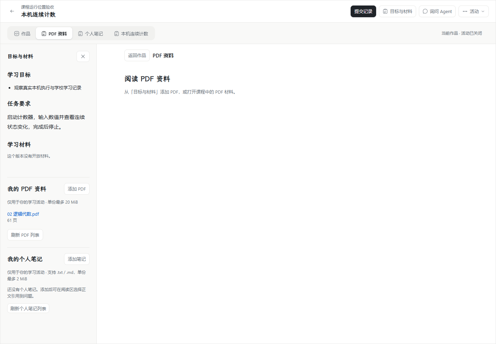
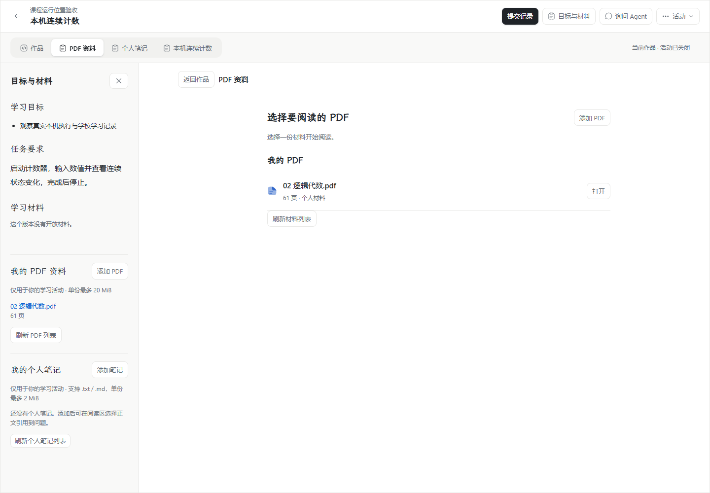
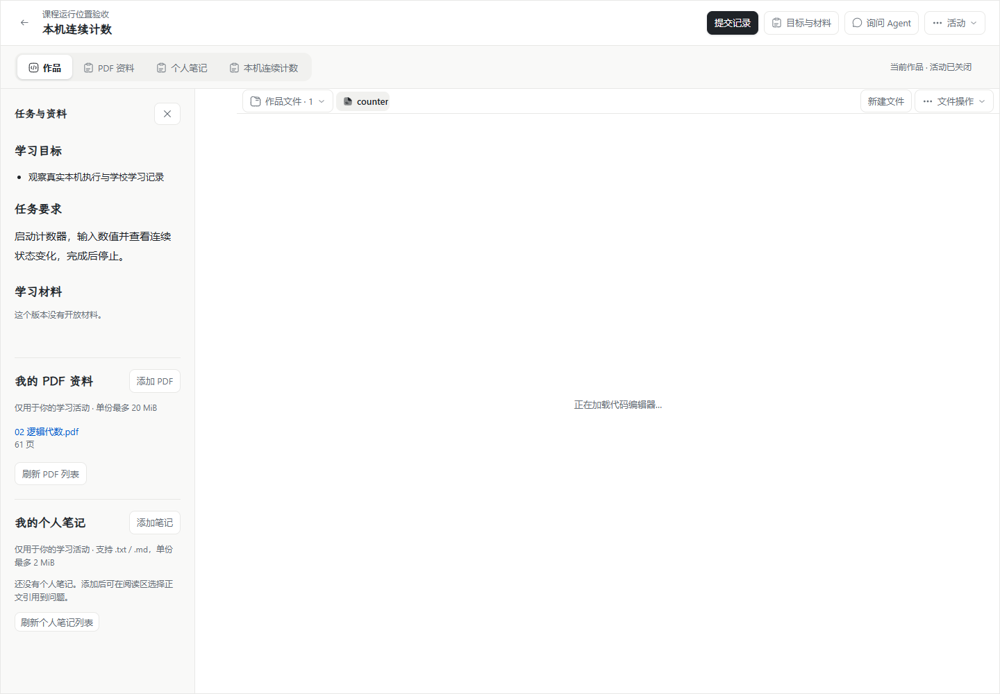
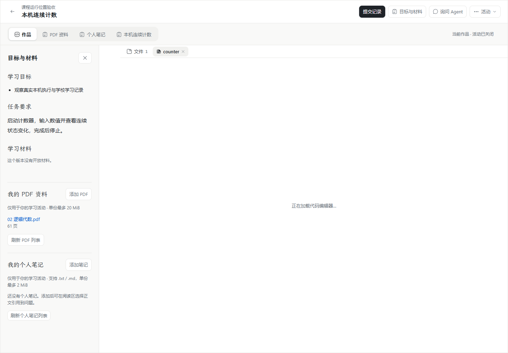
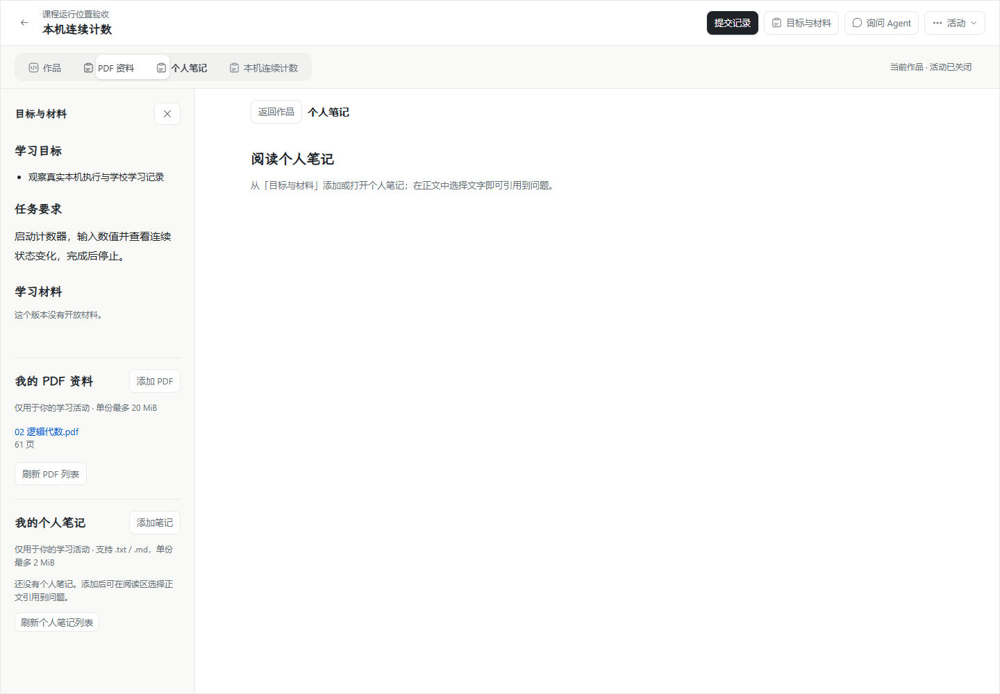
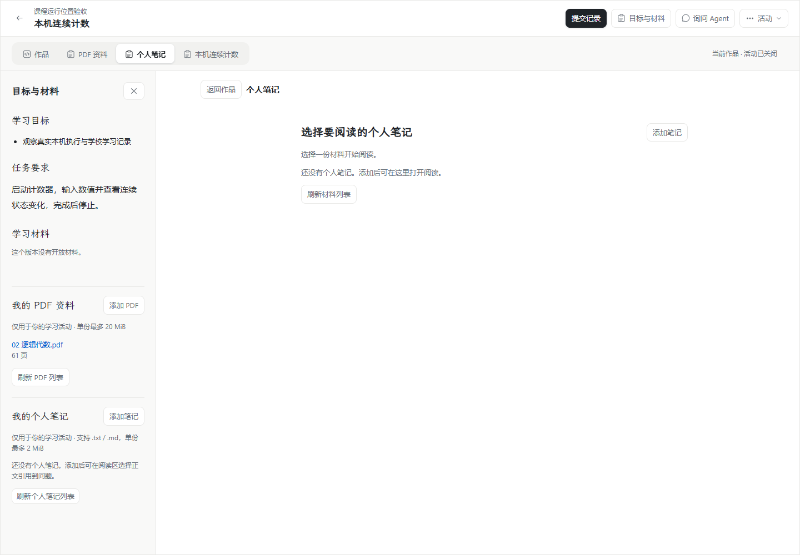
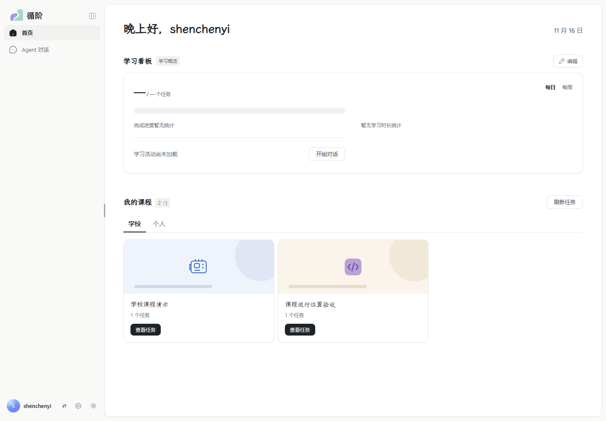
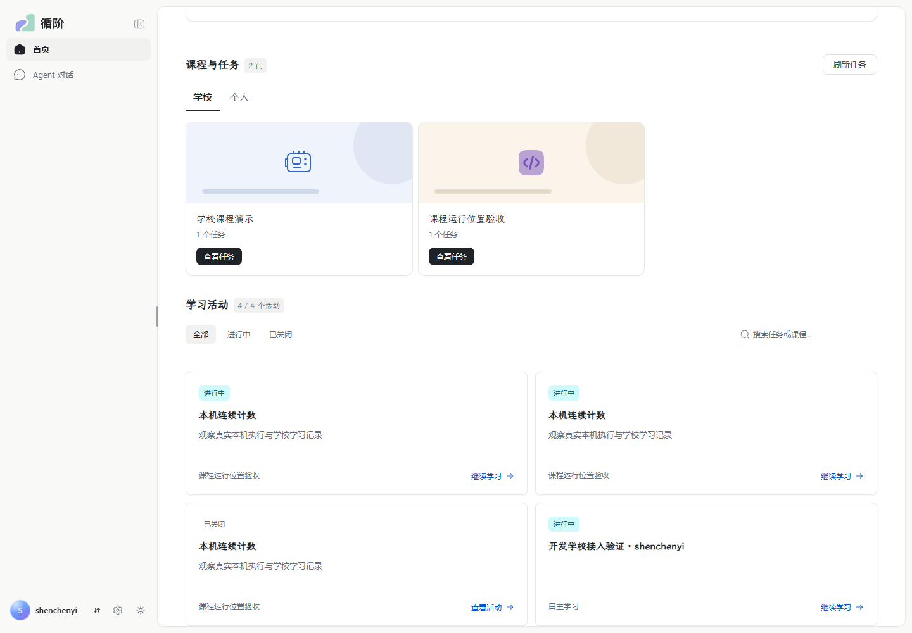

# 第二轮 UI 实现与截图记录

日期：2026-11-16。分支：`codex/workspace-ui-alignment`。基线远端提交 `37ab403f`，在首批 UI 修改上继续实施[已确认方案](../../workspace-ui-round2-proposal.md)。代码未暂存、未提交；原有其他工作保留。

## 运行入口

- 当前产品：http://127.0.0.1:50453/ （已有页面请刷新）
- 旧版参考：http://127.0.0.1:5601/
- 新文件栏交互目录：http://127.0.0.1:5601/ui-catalog.html#/workspace/file-strip-view/interactive
- 材料选择目录：http://127.0.0.1:5601/ui-catalog.html#/workspace/material-picker/list

## 改动、原因和影响

| 部分 | 已实现 | 影响 |
| --- | --- | --- |
| 左侧材料栏 | 名称统一为“目标与材料”，17px 栏标题与分区标题，统一正文、辅助字、间距及换行 | 与顶部入口及阅读说明一致，减少字号层级混乱 |
| 文件栏 | 使用旧版文件菜单、计数和标签布局；菜单内新建、行内改名、删除确认、备份导出；标签可关闭并从列表重新打开 | 文件与视图区分；取消上一批分散的常驻新建和当前文件操作按钮；不新增回收站 |
| 组件复用 | `FileStripView`、`MaterialPicker` 加入 @xunjie/ui，旧 FileStrip 与新文件栏共用 FileStripFrame；补充目录示例及包说明 | 当前自动保存与旧版回收／确认保存分别由调用方负责，不伪造旧业务状态 |
| 阅读列表 | 无内容时显示课程 PDF、个人 PDF 或个人笔记列表；课程 PDF 未导入也可发现；阅读中可返回列表 | 选择材料不再依赖到侧栏寻找文件；复用同一控制器、上传入口与笔记添加表单 |
| 引用兼容 | 返回笔记列表后仍注册固定引用定位入口；从引用打开时退出列表 | 保留原版本正文及选区定位；不因打开材料自动加入 Agent 上下文 |
| 首页 | 统一“课程与任务”，学校／个人活动使用同一筛选、搜索和两列卡片；课程页增加面包屑及本课程活动 | 保留学校领取及版本流程；个人活动不再重复显示为课程；关闭不冒充完成，无虚构进度 |
| 返回课程 | 进入课程时保留首页挂载，返回后保留来源、筛选和列表视图 | 减少返回后重新寻找活动的成本 |

Agent 求助与引导、回收站、新活动状态、Markdown 渲染和教学运行功能不在本轮范围。组件内部状态文件继续受保护，不开放文件菜单中的删除／改名。

## 实际产品截图

桌面 Chrome 157.0.8103.78；主对照 1440 × 1000 浅色主题。工作区为同一个已有活动 `15e922a2-e96b-4db8-a869-72b1e21cf20a`，标题“本机连续计数”。截图中的文件、PDF 及活动来自已有本机数据；没有为了截图向真实作品填入示例。

PDF 选择页，修改前：

PDF／笔记的基线是在对应阅读区修改前采集，左栏标题已经先行调整；这两组用于对比阅读区本身。左栏与文件栏请使用下方工作区对照。

PDF 选择页，修改后：

工作区修改前：

工作区修改后：

工作区修改前截图保留了当时编辑器模块的加载提示；修改后等待编辑器就绪。该组用于比较材料栏与文件栏，不作为编辑器加载速度的证据。

个人笔记修改前／后：

首页修改前：

首页修改后，滚动到课程与活动区：

首页修改前截图捕获的是首次读取阶段，修改后已等活动加载并滚动到活动区；这一组存在加载状态及滚动位置差异，不能用于逐像素比较。

补充状态：[首页已关闭筛选](after/home-filtered.png)、[个人活动](after/home-personal.png)、[课程页](after/course.png)、[PDF 实际阅读](after/pdf-reading.png)、[工作区深色](after/workspace-dark.png)、[1024 × 800 桌面](after/workspace-narrow.png)。

## 隔离组件交互截图

以下来自实际运行的组件目录，用合成文件操作，和用户作品分开。不是正式课程数据。

- [多文件菜单](after/catalog-files.png)
- [重名就地反馈](after/catalog-rename-error.png)
- [删除确认](after/catalog-delete.png)
- [深色材料列表](after/catalog-materials-dark.png)

## 验证结果及限制

### 工程

- Web 类型检查通过；最终生产构建通过。构建仍提示 Zod 注释标记及部分 chunk 超过 500 kB，本轮未扩大到打包优化。
- 产品局部回归 26 项通过：WorkspaceUi 4、ProductHome 1、PersonalMaterials 7、LearningApp.account-navigation 14。笔记测试补充了“返回材料列表后，从固定引用恢复正文与选区”。
- 旧文件栏与核心工具测试 core-tools 6 项通过；workspace 合同测试 7 项通过、1 项失败。
- 未通过项：`packages/ui/src/workspace/workspace.test.tsx` 的 `chooses native select boundaries without changing the controlled selection`，模拟 End 后未收到预期 onSelect。测试仍以原生选择器边界行为断言，而 RunPanel 已使用 Base UI SelectField；相关源文件和该测试在本轮均无差异。未修改此项，也不将整套组件测试报告为通过。
- 组件库边界检查、目录覆盖检查、git diff --check 通过。目录 357 个条目覆盖 354 个公开组件。

### 桌面 Chrome

两轮有界检查完成：首轮发现并修正状态徽标与进度条 class 冲突、搜索框被通用表单样式覆盖的问题；确认轮通过状态徽标高度、横排搜索、学校／个人切换、筛选搜索及清除、课程面包屑返回保留筛选、PDF 打开与返回列表、笔记添加入口、浅深主题及 1024px 窗口。

隔离目录通过新建、重名拒绝、改名成功、关闭标签后文件仍在列表、删除取消及删除成功。实际用户作品未新建、改名或删除；实际 PDF 打开会沿现有接口生成固定阅读记录。文件持久化没有通过修改用户真实作品进行破坏性验收。

笔记引用注册的最后修正由相关单元回归验证，之后没有追加视觉打磨轮次。截图不作为完整辅助技术、其他浏览器或移动端验收证据。

### 教学效果

本轮没有执行 ALU 课程全流程或评估教学效果；UI 交互通过不等于学习效果已验证。
