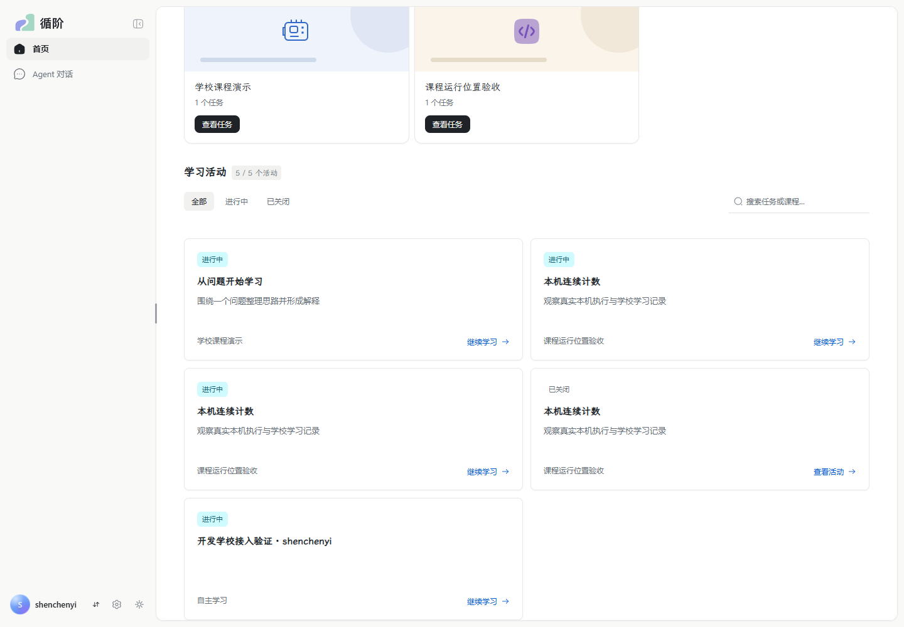
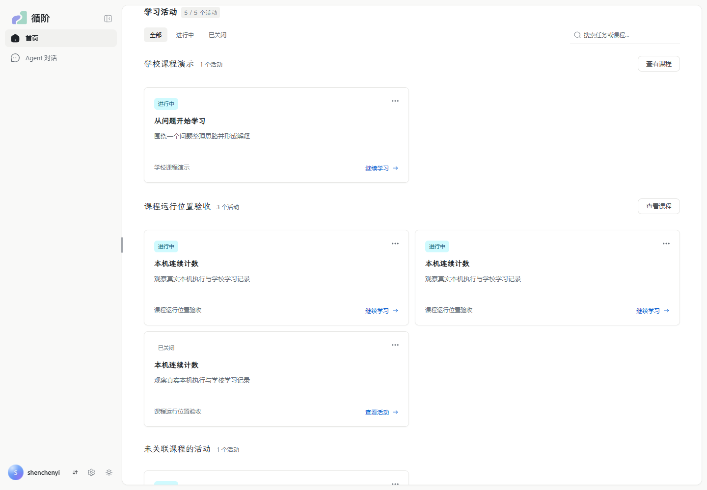
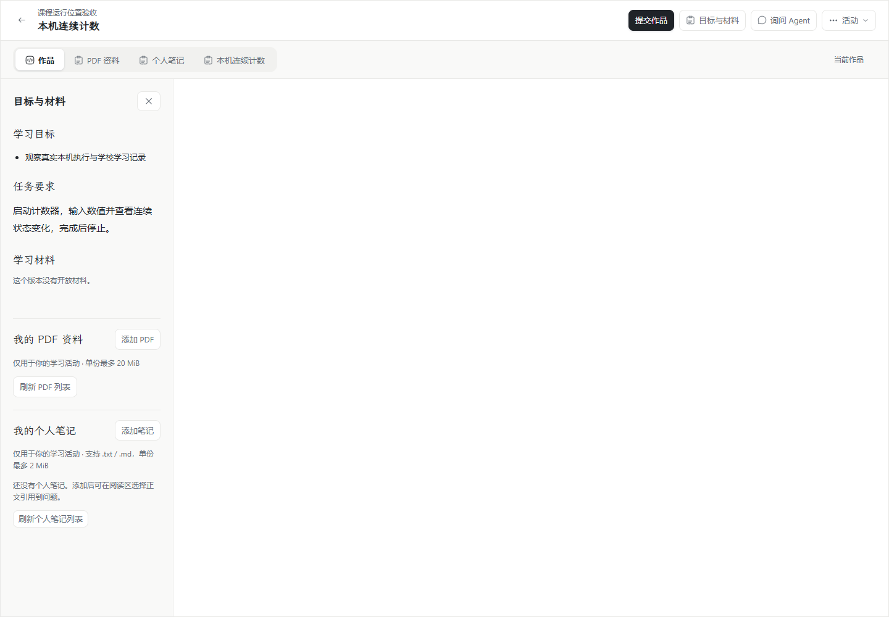
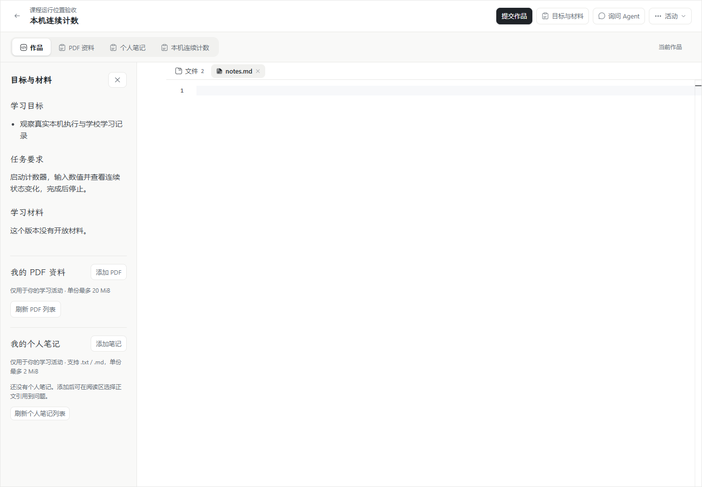

# 第三轮界面修改与验证

2026-11-16，分支 `codex/workspace-ui-alignment`，远端基线 `37ab403f`，继续上一轮未提交修改。先完成[方案及数据评估](../../workspace-ui-round3-proposal.md)，再实现可落地范围。用户明确同意：删除另行设计，本轮仅关闭／重新开始。

## 已实现及影响

- “学习目标”“任务要求”“学习材料”的正文使用同一 course-section-body，统一为系统字体、15px、400、24px 行高、ink-soft；修正目标 li 的 13px 覆盖、引用正文自己的字体规则、空材料 detail 小字。多项目标保留语义列表，文件链接保留操作色，页数等辅助信息继续用辅助字号。
- 活动卡片增加独立三点菜单，可打开、关闭或重新开始活动。关闭前确认会停止活动运行并保留作品与记录；服务确认后才更新列表，失败保留状态及错误以便重试。关闭／重开不打开工作区、不改路由。
- 菜单及确认使用组件库 Base UI Menu、ConfirmationDialog 和反馈组件；LearningTaskCard 增加可选菜单插槽，菜单与主按钮平级，隔离 Portal 点击与网格点击导航。没有菜单的旧版卡片保留原有结构。
- 学校活动按真实 courseId 分组，显示课程名和活动数并可查看对应课程；无课程绑定的学校活动单列“未关联课程的活动”。课程磁贴显示任务数和关联活动数。个人活动不套用学校课程分组。
- 学校与个人状态写入显式使用活动所属来源，响应后更新该来源缓存；不能沿首页当前路由猜测所属空间。

## 评估后未加入的功能

当前 LearningActivity、CourseRelease、CourseActivityBinding 没有任务完成比例或截止日期字段。本轮没有把关闭映射为完成，没有使用运行成功次数计算百分比，也没有把发布时间当截止日期。后续接入需先明确学校权威期限、延期／时区、进度评价单元及证据，再复用旧版进度条和截止日期布局。

删除活动的可恢复标记、最近删除、在途运行及请求、学校记录、历史引用和永久清理边界，已补入[学生学习全流程功能对齐与体验优化方案的 F08 补充](../../student-experience-alignment-proposal.md)。这是待单独实施的设计，本轮没有删除入口或后端删除契约。

## 实际运行截图

Chrome 157.0.8103.78；1440 × 1000 浅色。工作区是同一个已有活动 `64654233-b7a6-4b38-801e-4d0bf7868e17`（本机连续计数），不使用演示活动替代用户现场。首页两组均在活动区域取景，分组增加后滚动位置随内容高度有所变化。

首页修改前：

首页修改后：

左栏修改前：

左栏修改后：

这组比较左栏正文，不用于比较编辑器模块加载或材料读取速度；截图中可能保留当时模块加载反馈。

其他状态：[活动菜单](after/activity-menu.png)、[关闭确认](after/close-confirmation.png)、[工作区深色](after/workspace-dark.png)、[1024 × 800 桌面窗口](after/workspace-narrow.png)。

## 验证

### 工程检查

- Web 类型检查、生产构建通过。构建仍有 Zod 注释标记和大 chunk 提示；一次运行检测到构建期间输入变化而停止，代码固定后重新构建。
- 产品局部测试 24 项通过：WorkspaceUi 8、ProductHome 1、LearningApp.account-navigation 15。覆盖按课程 ID 而非名称分组、关闭取消／失败／重试、重新开始沿原身份、Portal 点击不触发网格路由、学校／个人分别写入正确来源。
- 组件库边界与目录覆盖检查通过；358 个目录条目覆盖 355 个公开组件。未运行完整仓库测试，本轮结果不覆盖上一轮已记录的快照下拉框测试问题。

### Chrome 验收

实际鼠标检查发现并修复卡片层级遮挡菜单，以及 Portal 菜单点击冒泡触发网格导航的问题。修复后完整路径通过：菜单打开、关闭确认、取消不写入、重开入口、路由保持、无嵌套按钮、课程分组、浅深主题及窄桌面。

浏览器对三段正文读取了 fontFamily、fontSize、fontWeight、lineHeight、color，三者完全一致：系统字体、15px、400、24px、浅色 rgb(66,71,77)。校验脚本随记录保留。

真实活动的 activity-status POST 次数为 0；浏览器只打开／取消确认，没有关闭或重新开始用户活动。状态写入、失败与缓存更新由隔离的组件及 HTTP 模拟回归覆盖，未对真实学校服务执行活动状态变更。

### 教学效果

未执行课程教学全流程或评估教学效果，不把 UI 验收当作教学成效证明。代码未提交。

## 查看入口

- 当前产品：http://127.0.0.1:50453/
- 旧版参考：http://127.0.0.1:5601/
- 活动菜单目录：http://127.0.0.1:5601/ui-catalog.html#/home/activity-card-menu/interactive
