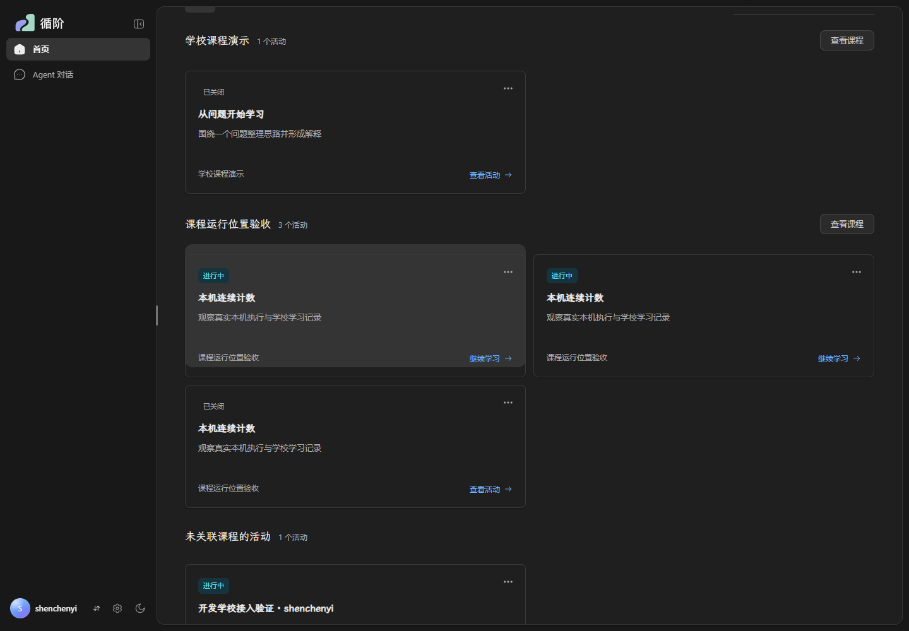
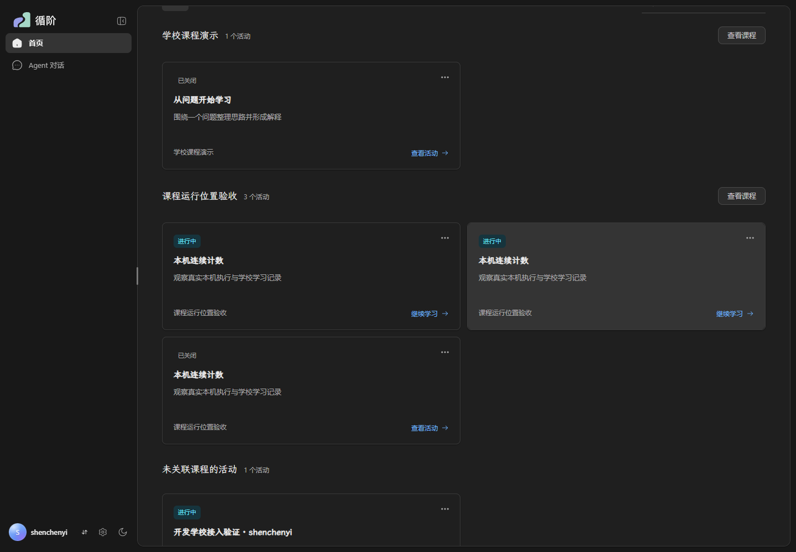
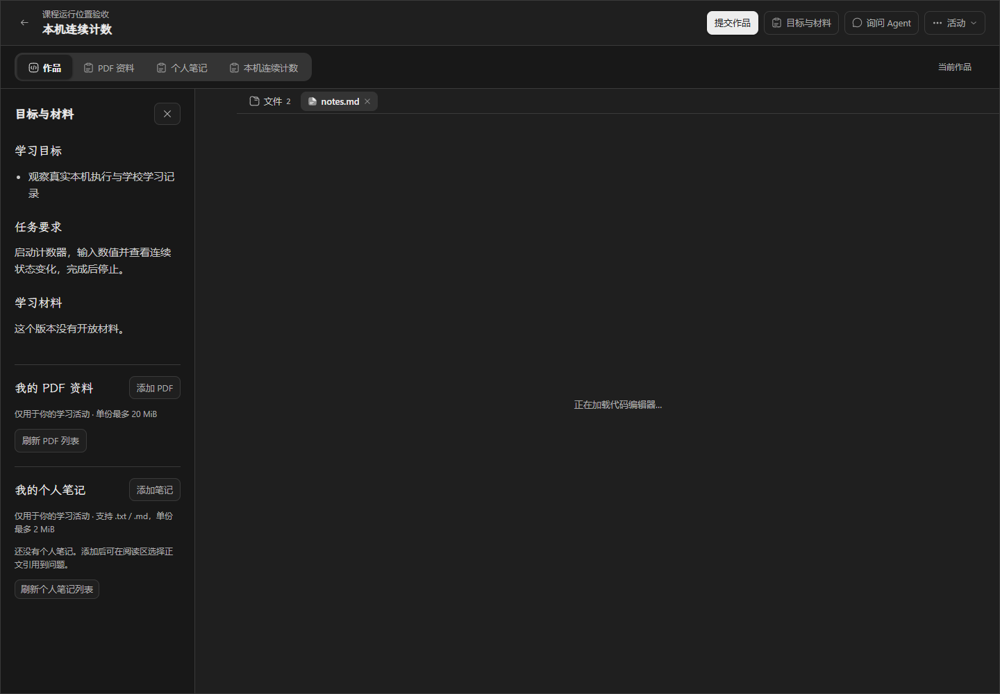
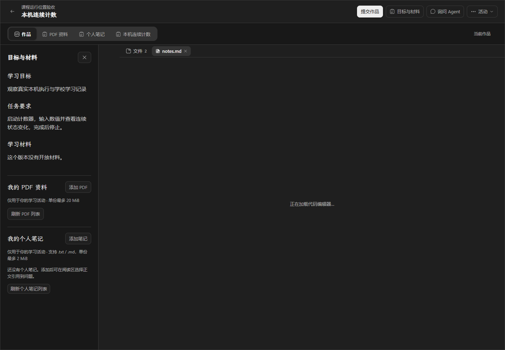

# 第四轮验收修复：悬停高亮与目标正文

2026-11-16，`codex/workspace-ui-alignment`，继续既有未提交修改。仅修复本次验收反馈。

## 修改及原因

- 卡片菜单增加了 position:relative 外框，旧 useFluidHover 直接读取按钮 offsetTop／offsetLeft，得到的是外框内的 (0,0)，不是网格坐标。因此第一张高亮向上偏 16px，多张卡片的测量位置也重合，鼠标移向其他卡片仍选中第一张。
- 修复为累加中间 offsetParent 的布局位置，统一到高亮层所在网格坐标系。保留原弹簧动效、间隙点击与菜单事件隔离。
- 学习目标改为正文段落，不再生成列表符号及列表缩进；多个目标按独立段落显示。沿用与任务要求、学习材料一致的正文档位，未改写目标原文。

## 实际截图

桌面 Chrome 157.0.8103.78，1440 × 1000，深色主题。同一课程的三张已有活动；两组均将鼠标移向同一张卡片。没有修改作品或活动状态。

鼠标移到第二张卡片，修复前：高亮仍留在第一张且上移。

修复后：高亮跟随第二张并与边界对齐。

其他截图：[第一张修复前](before/hover-1.png)、[第一张修复后](after/hover-1.png)。

目标正文修复前：

目标正文修复后：

正文组为同一已有活动 `64654233-b7a6-4b38-801e-4d0bf7868e17`。截图中编辑器模块加载反馈与本轮目标正文无关，不作为加载性能对比。

## 验证

- Chrome 逐一移向三张实际卡片并比较 boundingBox：修复前高亮始终在 x=293、y=386.5；修复后三张分别准确匹配 (293,402.5)、(845,402.5)、(293,609.5)，尺寸均为 540 × 195。四个矩形分量误差均小于 1px。
- Chrome 确认目标说明没有 li／列表符号，正文左边界与任务要求相同。
- 组件库回归 5 项通过：新增嵌套定位外框及三张卡片选择测试 1 项，既有 HomeSections 2 项、migration 2 项。
- Web 类型检查及生产构建通过；仍有既有 Zod 注释及大 chunk 提示。未运行完整仓库测试。
- 教学效果未评估。代码未暂存、未提交。

验收入口：http://127.0.0.1:50453/，已有页面需刷新。
