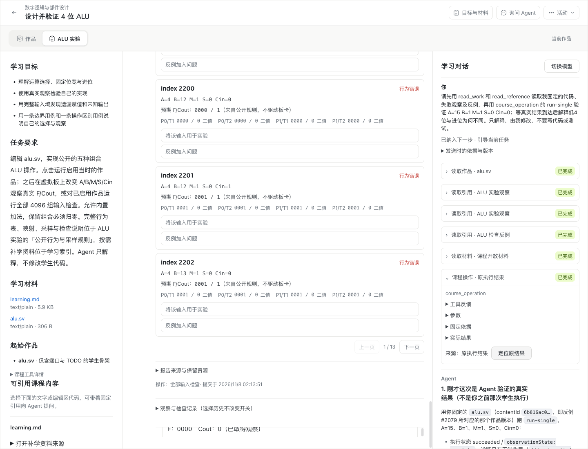
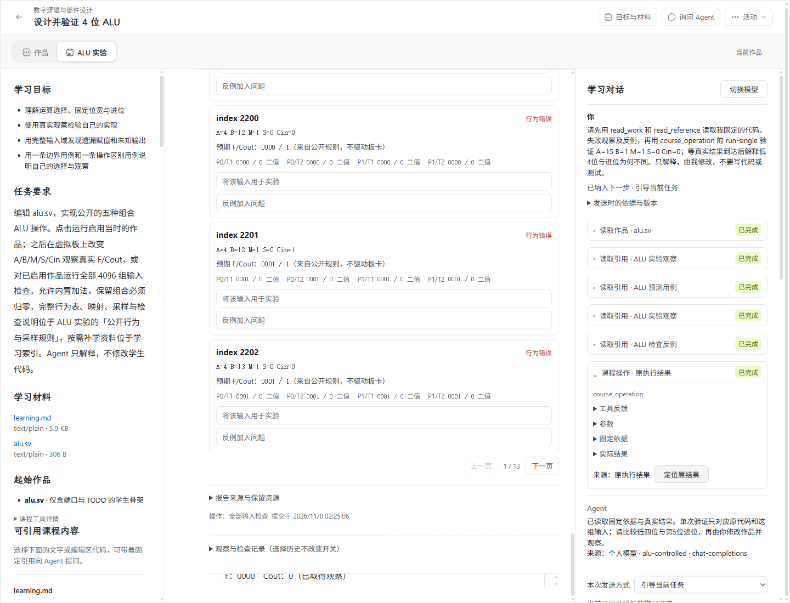

# 现有学习对话接入版本化能力装配：验收证据

本目录对应[现有学习对话接入版本化能力装配](https://github.com/paher-din/XunJie/issues/215)，保留公开 ID、摘要、状态与必要截图，不包含凭据或完整私有模型正文。时间均为报告中的 UTC。

| 验证 | 结果与来源 |
| --- | --- |
| 真实三协议与基础工具 | [真实模型装配报告](real-model-assembly.json)：DeepSeek Flash，Chat Completions、Responses、Anthropic Messages 各 2 次请求，全部成功；实际 transport 与各快照、装配、清单对应。每次最多 2048 输出 token、30 秒，0 自动重试。Command Code 沿用 WP06 豁免。 |
| macOS 正式 Chrome / ALU | [Mac 报告](mac-chrome-alu.json)：10/10，Chrome 156.0.8078.80、真实 DeepSeek、真实产品 PostgreSQL 和 Icarus Worker/WASM。 |
| Windows 正式 Chrome / ALU | [Windows 报告](windows-chrome-alu.json)：10/10，Windows 11 x64、Chrome 156.0.8078.81、真实产品 PostgreSQL 和 Icarus Worker/WASM，模型为受控上游。此项不宣称真实供应商模型验收。 |
| Windows Agent → Mac 数据 / 模型 owner | [跨机报告](cross-owner.json)：9/9，直接 LAN HTTPS，SSH 仅控制；真实 DeepSeek 2 次。撤权拒绝新操作，换发授权沿原 Action 恢复，重启纯读不新增工具或模型调用。供应商凭据留在 Mac。 |

Chrome/ALU 复用 `probe-alu-tutoring.mjs`，原始报告的 `issue:202` 是该探针的来源标识；本次运行由 `label:wp08-215-*`、时间及产品摘要定位。原始报告保持不改写。跨机用 [跨机装配探针](../../../../scripts/probe-teaching-assembly-cross.mjs)，三协议用 [真实工具探针](../../../../scripts/probe-teaching-tools.mjs)。

平台报告使用 2026-11-07 18:13–18:26 的候选：两平台 `applicationSha256` 为 `6405c7f88c8522628324fe6372630274514a5723cc09d93894ace52babf5e781`；完整分发摘要见各报告。之后的最终差异是容量暂停文案及快照恢复时固定上下文事实，由最终类型检查、工程检查及真实 PostgreSQL 故障回归覆盖；没有把这些较早平台报告改称最终提交逐字节复验。

独立工程与故障回归汇总记录在[工程结果](engineering.json)。审查记录在[双轴审查](review.md)。工程、模型/工具及浏览器通过不等于教学效果；本票未开展真实学生教学效果评估。

Mac 运行截图：

Windows 交互桌面运行截图：

