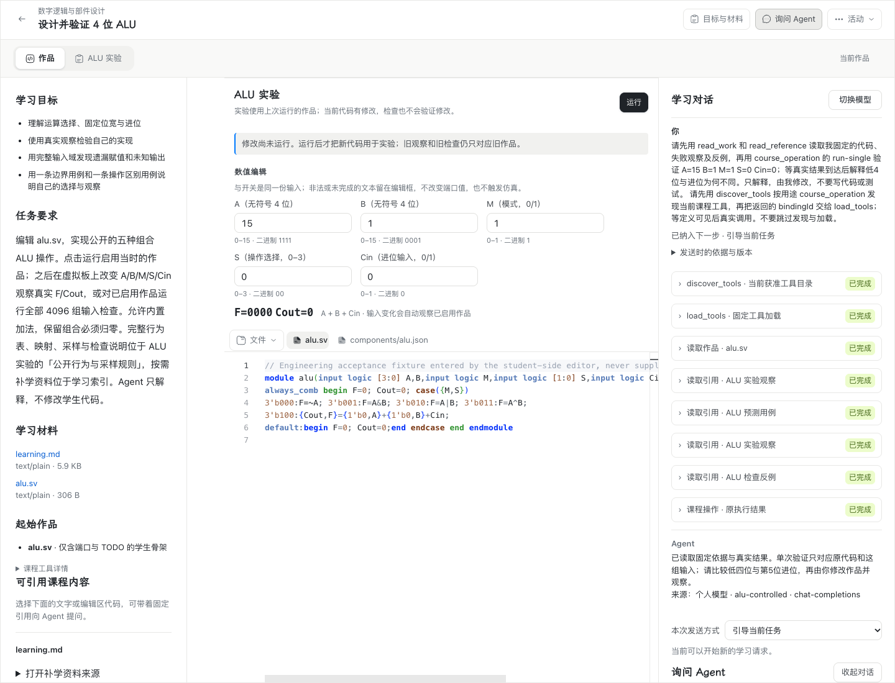
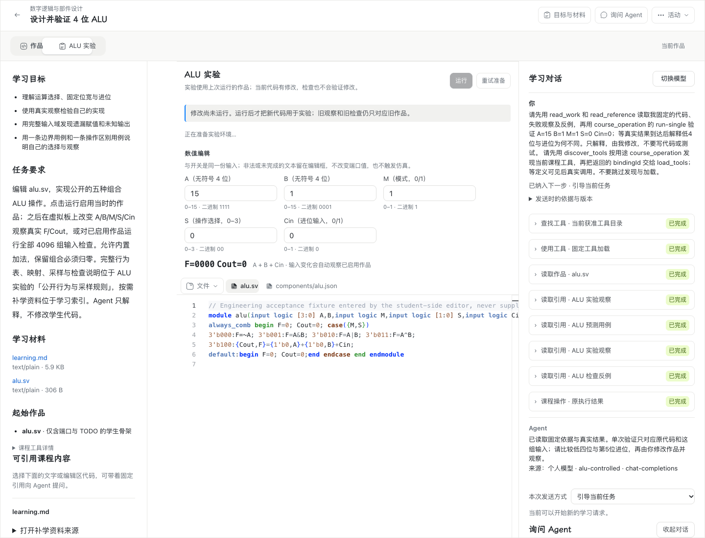
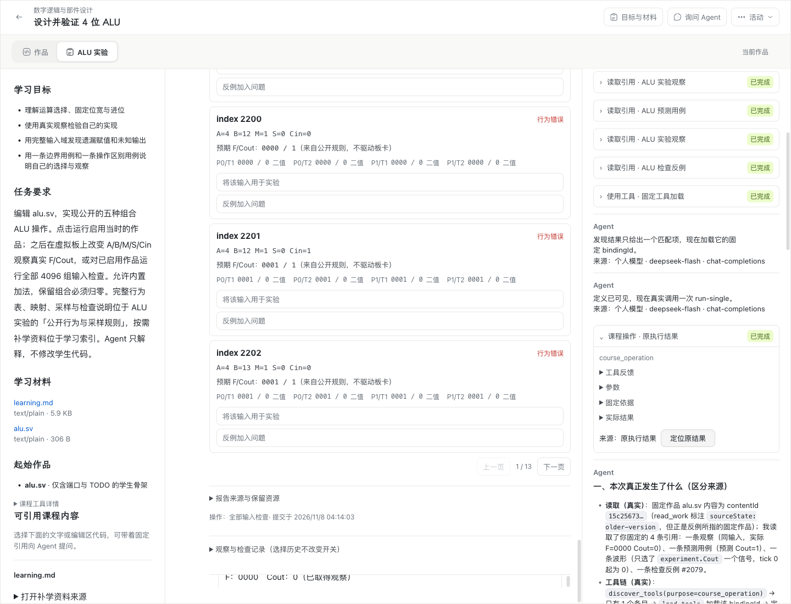
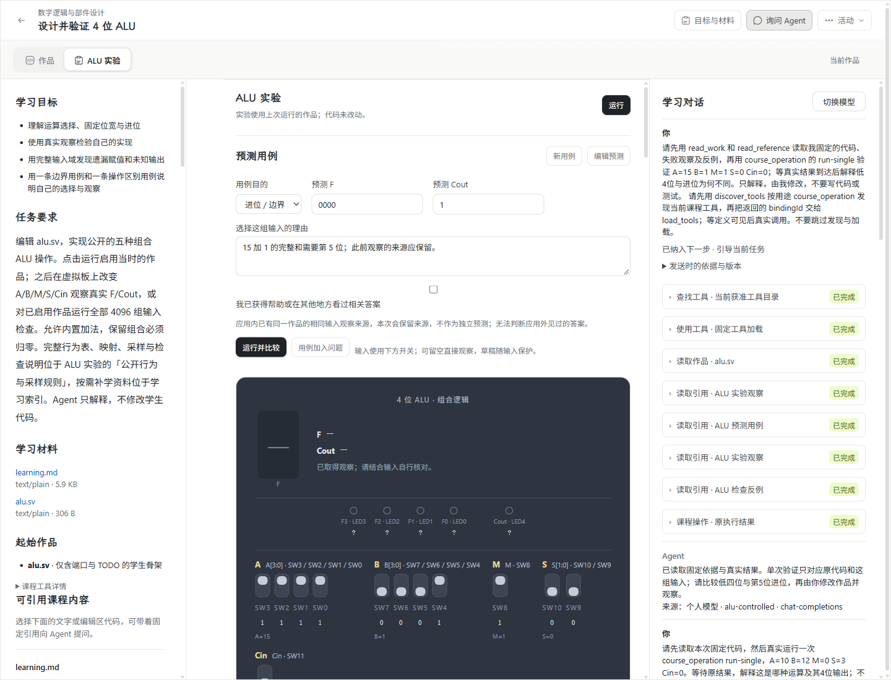

# #216 工具发现验收证据

对应[实施说明](../../wp08-216-tool-discovery.md)。报告时间为 UTC；凭据不进入报告。复用的 ALU 探针原始报告仍保留历史 `issue: 202` 字段，实际本票身份由 `label: wp08-216-*`、独立候选摘要及应用 hash 固定；后续探针已按 `--discovery` 正确记为 #216。工程、供应商调用、桌面运行和教学效果分别判定。

| 验证范围 | 实际结果 | 证据 |
| --- | --- | --- |
| 完整工程门禁 | `b6a0b40` 的 `npm run verify -- --jobs 2` 通过；最后旧状态 null 兼容修正另经类型/构建与目标回归；含类型、构建、契约与文档检查，35 个 unit、92 个 server、45 个 tools 任务 | [原始摘要](engineering-full-summary.json) |
| 公开生产入口回归 | 首轮 42 例中 39 过、3 项测试断言需同步；目录最终 7/7、结果原件最终 7/7，原 native/停止/未知/恢复案例通过 | [首轮原始日志](runtime-initial.log)、[目录复验](runtime-discovery-final.log)、[原件执行记录](runtime-results-worker.json) |
| 受影响回归 | 首轮 46 例中 44 过；两项测试把默认 v2 再注册为异内容 v2，改为实际版本递增后换段文件 8/8 | [首轮](runtime-affected-initial.log)、[换段复验](runtime-segments-final.log) |
| 清理与维护回归 | native 恢复 23/23、维护恢复 5/5；原生清理事件目标红后修复，覆盖中间/终态原件、重启及维护清单 | [目标红](runtime-cleanup-red.log)、[清理绿](runtime-cleanup-final.log)、[后续问题](runtime-cleanup-context-final.log)、[最终兼容复验](runtime-compat-context-final.log)、[native 恢复](runtime-tools-recovery-final.log)、[维护恢复](runtime-recovery-final.log) |
| 真实三协议 | Chat Completions、Responses、Messages 均完成发现→加载→新段读取真实课程材料→回答；共 12/12 HTTP200 | [最终协议报告](real-model-discovery-final.json) |
| macOS 正式 ALU / Chrome | 10/10；真实 DeepSeek 10 次 HTTP200、TLS 校验通过，真实 Icarus Worker/WASM | [摘要](mac-summary.json)、[原始报告](mac-chrome-alu.json) |
| Windows 正式 ALU / Chrome | 10/10；交互桌面 session 1，真实产品、PG、Icarus，外部模型为受控 transport | [摘要](windows-summary.json)、[原始报告](windows-chrome-alu.json)、[桌面会话](windows-desktop-session.json)、[任务身份](windows-task-principal.json) |
| 跨机 owner | 9/9；Windows Agent → Mac 数据/模型 owner，直接 LAN HTTPS，4 次真实 DeepSeek 调用；撤权拒绝、换发授权续原 Action、重启纯读无新增调用 | [跨机报告](windows-cross-owner.json) |
| 教学效果 | 未开展真实学生效果评估 | 不把固定案例等同于教学效果 |

## 候选与调用限制

两平台验收应用 SHA-256 为 `c802447d0de569fb8f4c638f49920e5dd986b2d658d19d137dd7777d9c175b1e`。打包 marker 固定 `8cdd22bf` 加未提交审查修复的 source diff SHA，完整记录在 Windows 摘要内；应用内容包含后续 `2342fa3f` 的生产修复，其后生产提交 `95f0a9eb` 补停止清理历史事件的步骤、调用、资源身份与已持久化 outcome 对齐；`b6a0b40` 另把有界物理清理事实传给后续问题及换段，最后旧 stop-only 事件不猜原操作状态的兼容修正另经静态审查、全项目类型/构建及目标 native 回归；未更改工具执行、模型 transport 或界面。这些收尾差异由真实 native 清理恢复、维护闭包测试和最终完整工程门禁核验。平台报告保留原候选 hash，不冒称在后续提交上重新执行过整套桌面/供应商验收。

短三协议探针：每协议最多 4 次生成、2048 输出 token、30 秒、0 自动重试。正式 ALU 沿既有已批准的 4096 输出 token，30 秒、最多 24 次调用、0 自动重试。跨机最多 4 次生成、2048 输出 token、30 秒、0 自动重试。没有为凑矩阵切换供应商型号。

## 界面与帮助边界

仅在既有工具记录补充“查找工具 / 使用工具 / 继续读取结果”与来源字段中文标签，帮助学生看懂真实调用。沿用原产品入口、导航、布局和组件，没有让学生操作装配步骤。实际 macOS、Windows 界面分别见下图；草稿、中文输入、重开、明暗及窄桌面均纳入原报告。

中文标签前后对照使用同一已完成活动与最终后端，修改前仅替换为基线 `cb104e33` 的 `TeachingToolRecords.tsx` 实际构建，修改后使用验收候选；没有修改 DOM 文本或伪造记录。补拍使用无头桌面 Chrome 与受控模型，不替代上面的有头桌面与真实供应商验收。[对照执行记录](ui-label-comparison.json)。

| 修改前 | 修改后 |
| --- | --- |
|  |  |

## 保留的失败与修复过程

- [首轮真实协议](real-model-discovery-initial.json)：发现与加载后，新段末尾 portable assistant 被供应商视为未闭合 thinking turn，HTTP400。修复为携带已接受的当前学生输入及真实操作状态；不搬运旧 reasoning。
- [中间协议复验](real-model-discovery.json) 与 [Messages 补验](real-model-messages-final.json)：保留当时事实。最终三协议结论以上表最终报告为准，早期失败不改写为通过。
- [Mac 首轮](mac-initial-length.json)：探针 2048 输出上限出现 length；正式 ALU 恢复既有 4096 上限。
- [Mac 中间复验](mac-initial-student-wait.json)：help-only 探针误附实验要求，产生合法 student_ask Wait；修正探针仅验证必要案例并明确帮助边界后最终 10/10。未伪造学生回应或预测，未放宽产品帮助边界。
- [Windows 早期尝试](windows-earlier-attempts.json) 保留启动与回包丢失排障事实，最终结果见正式报告。

## 审查与清理

[工程汇总](engineering.json) 与[双轴审查](review.md) 分别登记 Standards / Spec，不使用 codex security。[Windows 清理](windows-cleanup.json) 最后成功只读复核确认本票目录、计划任务、防火墙规则、监听与进程均无残留；跨机环境与 relay 均已关闭。不会因后续新 SSH 会话不可用重跑已通过项目或操作其他会话。

本机临时的两平台候选包、课程导入 payload、截图构建与早期失败运行目录已删除；已提交证据、必要原始日志及最终 Mac 原始验收材料保留。报告中的临时路径表示执行时出处，不表示当前仍部署或运行。

提交的文本证据仅统一为 UTF-8/LF 并移除行尾空白；测试事实、请求摘要与二进制截图不变。执行器原始日志仍保留在本机 `.verification/`。
