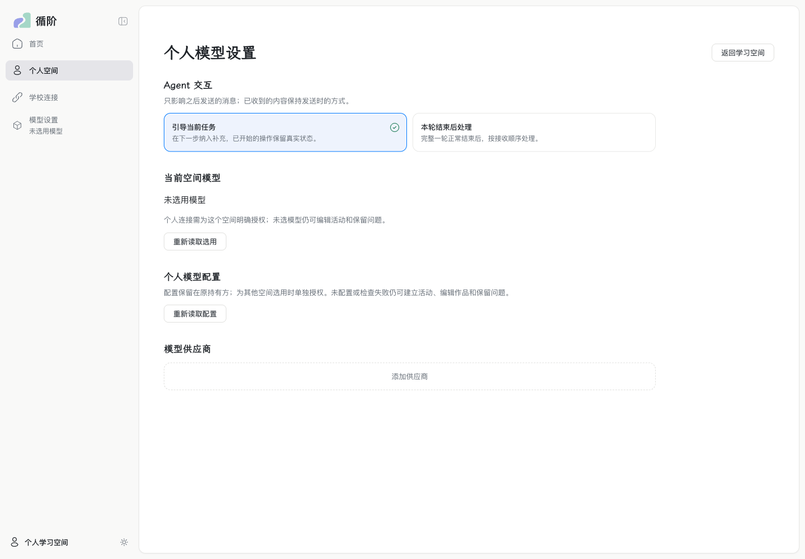
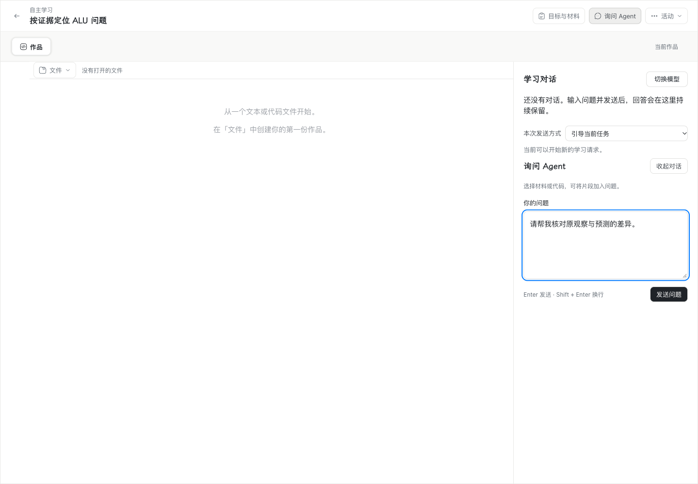
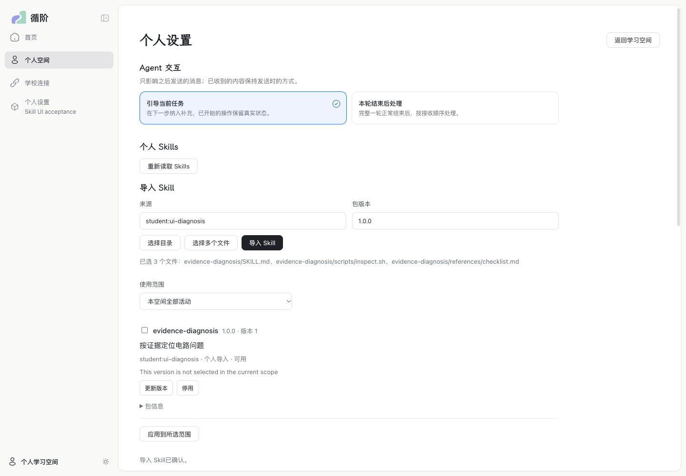
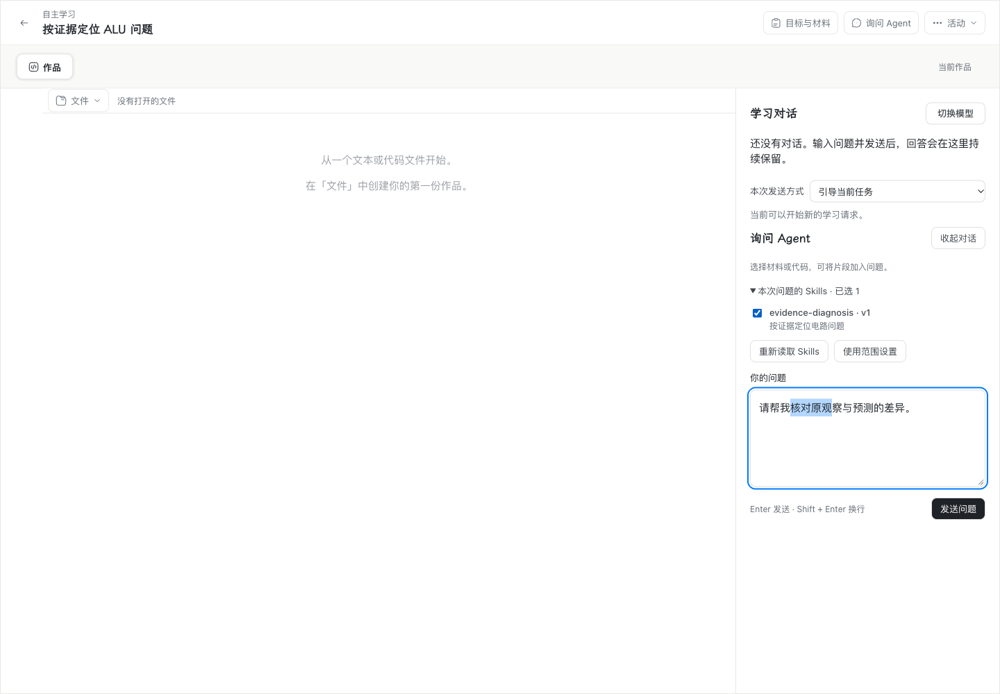
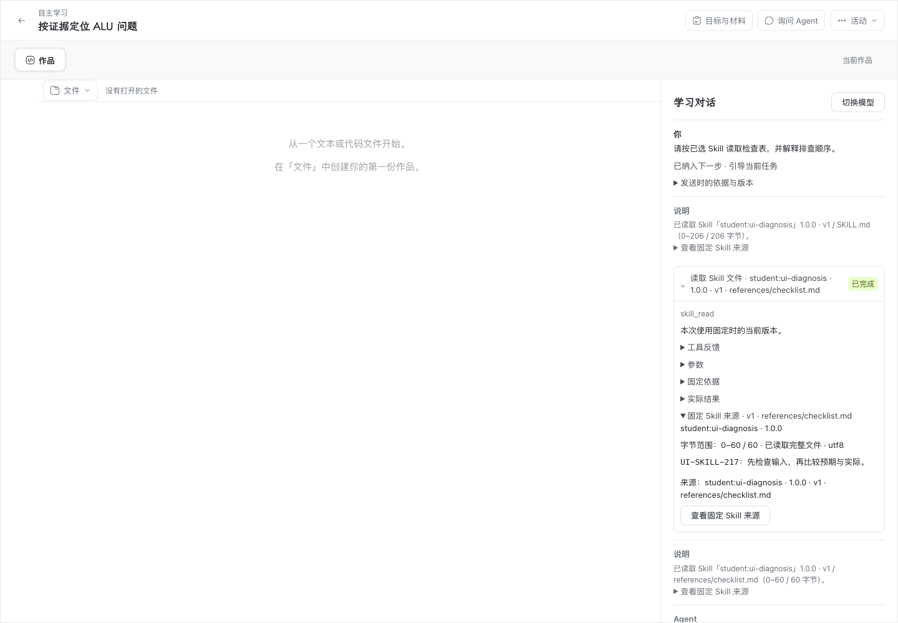

# #217 Skills 验收证据

实现及边界见 [#217 说明](../../wp08-217-skills.md)。这里分别记录工程、真实模型、正式 Chrome、跨机器与维护结果；教学效果未评估。

| 验证 | 实际结果 |
| --- | --- |
| 三协议真实模型 | [保留原生配对后的最终报告](real-model-skills-native-pair.json)：DeepSeek Flash；Chat Completions、Responses、Anthropic Messages 各 2 次，全部完成正文/指定附件读取及回答。实际外发摘要与快照一致，0 自动重试，最多 2048 输出 token、30 秒/次。Command Code 沿用 WP06 豁免。 |
| Windows Agent → Mac 数据/模型 owner | [跨机报告](cross-owner.json)：10/10；直接 LAN HTTPS，真实 DeepSeek 2 次，供应商凭据留在 Mac。原 Action 在离线/撤权后保留，换发授权和重启沿原来源恢复；纯读不外发。详见[跨机说明](cross.md)。 |
| 维护与隔离还原 | [报告](maintenance-runtime.json)及[说明](maintenance.md)：保留 2 版包、原附件读取、范围与停用；隔离还原及重启新模型/工具调用均为 0；兼容空新增事实的旧 v1 清单。 |
| 正式产品 Chrome | 最终审查候选的 [Mac 报告](mac/chrome-skills.json) 与 [Windows 报告](windows/chrome-skills.json) 均为 **8/8**。Chrome 156；包含导入、可靠草稿、选区/焦点、前后退、CDP 中文组合输入、真实模型工具循环、固定来源、更新停用/进程重启、同窗口默认版本刷新和深色窄桌面。Windows 在解锁 Default 桌面的普通交互会话运行，见[桌面事实](windows/desktop.json)。不声称 OS 输入法候选窗口验收。 |
| 工程与审查 | 完整 `npm run verify` **通过**：[摘要](verify-summary.json)，单元组 35/35、服务端组 92/92、工具组 45/45（计数为任务数），类型/构建/契约/文档均通过。[Standards / Spec](review.md) 最终未解决项分别为 **0 / 0**。原生 PostgreSQL 18.6 全套 **151/151**（失败、取消、跳过均为 0），见[原始日志](engineering-native.log.gz)。工程结果及原始日志见 [汇总](engineering.json)、[完整 verify 日志](engineering-verify.log.gz)。原 verify 中 20 项既有平台/环境条件用例保持跳过，不算通过；本票真实模型和原生 PG 验收另行记录。 |

初轮真实模型的重复读取与探针限额失败见 [原始报告](real-model-skills-initial.json)。临时明确“只读一次”的探针请求曾通过，但没有用该提示修改替代产品修复；后续仍以原问题复验，结果见 [换段方案复验](real-model-skills.json)。最终将普通附件读取保留在原生工具配对中，实际内容固定在原结果与步骤清单，三协议全部通过。

跨机报告使用的两平台 application SHA256 为 `37cd20484c1be3464d9730fabbf65326e15495e53f1e48ada9419a33d5283ffb`。之后的审查修复及正式 Chrome 候选按各报告自己的摘要登记，不把较早报告改称最终候选逐字节复验。

最终 Chrome 候选两平台 application SHA256 均为 `e765621c7a32232c00d367e89c4b4c3fcbff96a6351ad3b8dcc40e7e994a2d4f`。Windows 最终复验前曾因增量传包漏替换原生辅助文件而发生资源摘要不匹配，安装被拒绝；补齐同包文件后 8/8 通过。此前失败未算作通过。

修改前实际 Mac Chrome：

当前新增内容在原个人设置中管理包和范围，在原问题草稿中选择固定版本；保留原交互、模型、材料、学习对话和工具来源位置。原因是让学生自愿使用个人指导并能核对旧回答依据；不新增装配/加载阶段页，也不要求普通学习先配置 Skill。

修改后实际 Mac Chrome：

Windows 对应[个人设置](windows/win32-settings-after.png)、[问题草稿](windows/win32-draft-after.png)、[固定来源](windows/win32-skill-source.png)及[深色窄桌面](windows/win32-dark-narrow.png)。

Windows 最终 8/8 的原报告、截图及桌面会话事实已在 SSH 恢复后取回，并与成功 runner stdout 核对一致，见 [capture 记录](windows/capture.json)。[最终清理](final-cleanup.json)确认本票临时目录、相关进程和计划任务均已清除；没有重启 Windows/sshd 或改动兄弟作业。此前跨机清理快照为 UI 保留的共享候选也已移除。本地仅保留 `dist/wp08-217-macos-reviewed` 与 `dist/wp08-217-windows-reviewed` 两个可运行交付候选及有意保存的验证日志，旧候选和无用辅助文件已删。
