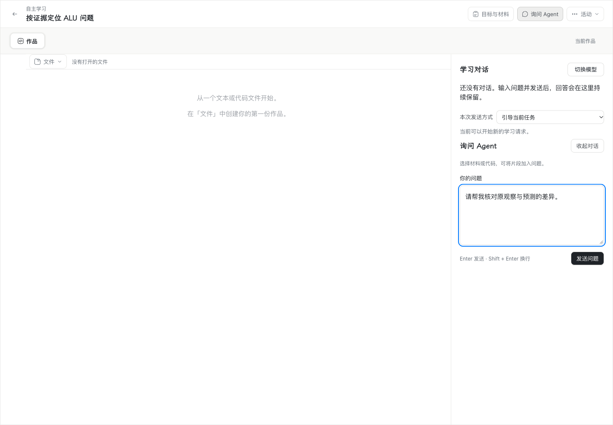
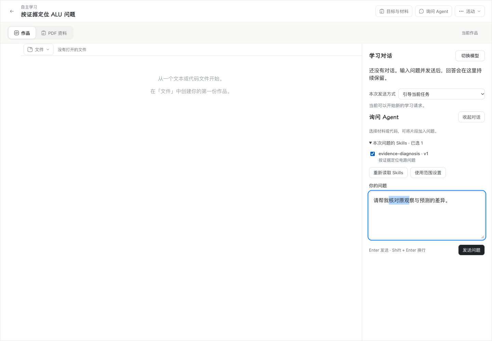
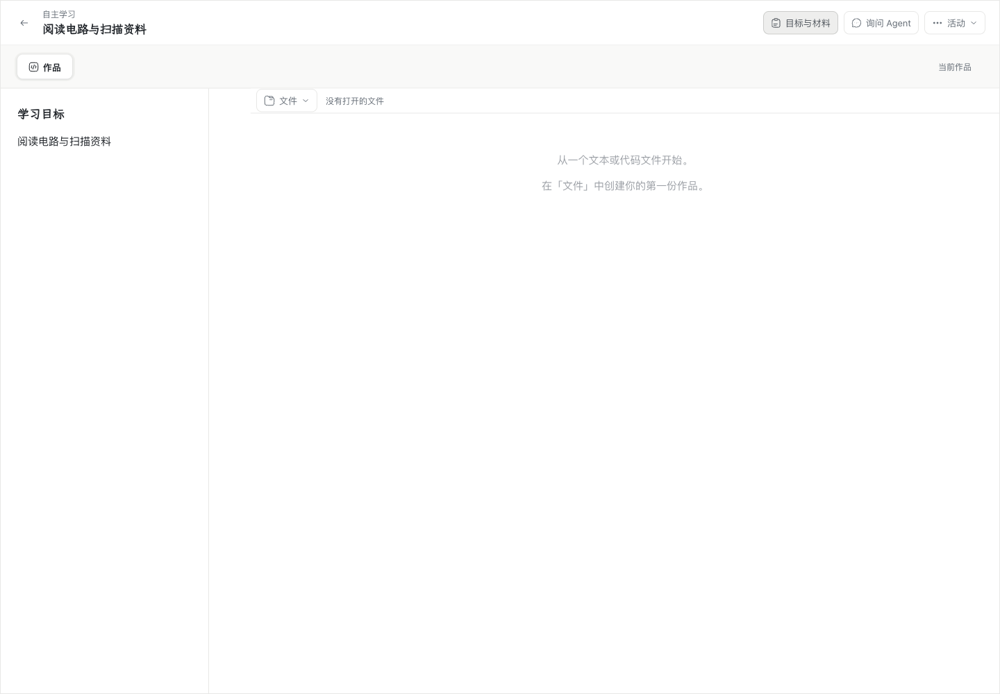
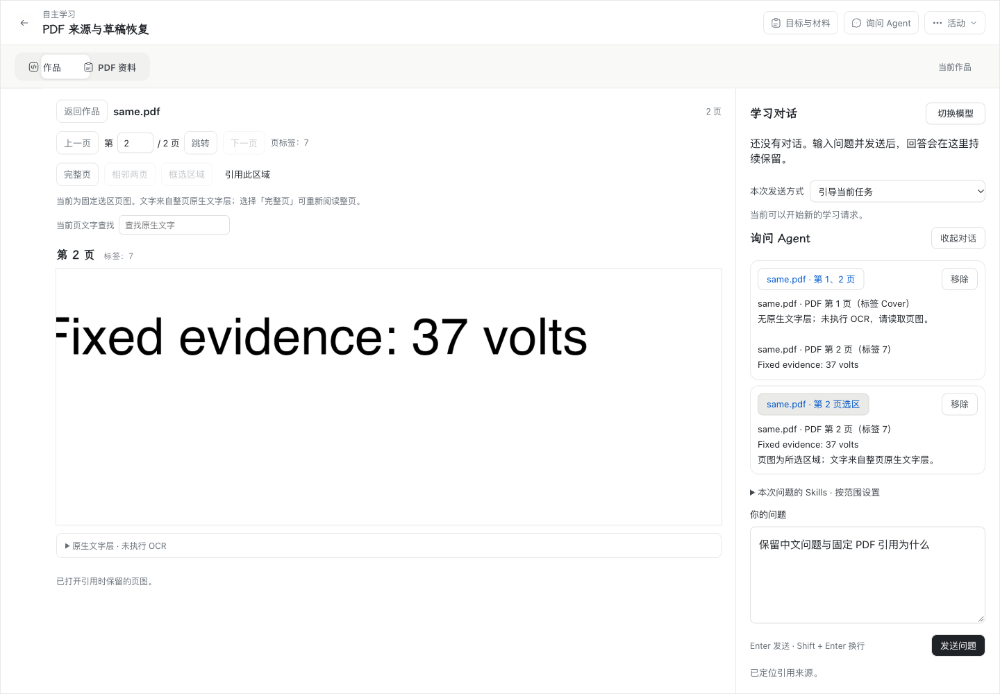

# WP08 整合验证证据

[整合说明](../../wp08-integration.md)记录四份源提交、合并历史与兼容选择。生产代码候选为 `c25cfbc1a18a408289402d102ffbef3f53061be0`。首次 Mac 产品包基于 `8808d5f`，application SHA256 为 `c4340885b1d479fe646e00718d849e99460affd74d823659e9ea574402f3233a`。

| 范围 | 本次实际结果 |
| --- | --- |
| 完整工程 | `npm run verify -- --jobs 2` **通过**：[摘要](verify-summary.json)、[完整日志](verify.log.gz)。冻结 HEAD `469b867ea70a32ba8966e423bdd473a2ad078df8`；单元组 35/35、服务端组 92/92、工具组 45/45（任务数），Web 97 文件 / 1029 项通过；20 项原有平台/环境条件用例跳过，未计作通过。 |
| 原生组合 | [日志](combined-green.log.gz)：最终整文件 3/3 通过，涵盖 Skill + 发现/加载 + 实际 PDF PNG + 原作品 + 压缩/重启，以及转义大附件原件续读和停用拒读；后续单例 1/1。日志也保留调试断言的早期失败。 |
| 原生受影响回归 | [首轮](native-initial.log.gz) 230/235；修复后 [11 文件回归](affected-green.log.gz) 80/81，剩余一项仅是清单版本旧断言，改为 v3 后[原停止清理单例](cleanup-green.log.gz) 1/1。PDF 续读与 Skills 恢复实际失败均已在受影响回归中通过。无未解决的用例失败；不将分批结果伪称一次全量绿跑。 |
| 两份 v11 的升级与恢复 | [迁移日志](migrations.log.gz) 10/10：新安装、原链备份、接管、损坏拒绝与事务回滚；[维护兼容日志](maintenance.log.gz) 2/2。 |
| 真正旧版问答备份 | #217 原提交生成带 Skill/步骤/transition 的加密备份；修复前[失败报告](legacy-recovery-red.json)，修复后复用相同 backup ID/manifest 摘要[通过](legacy-recovery-green.json)。原 2 次模型尝试不变，3 份资源字节验证、10 次公开读取和重启通过，私有备份与密钥已删除。 |
| 真实供应商 | [三协议](real-skills-protocols.json)：DeepSeek Flash，Chat Completions / Responses / Messages 各 2 次，6 次 HTTP 200，固定正文与附件及实际请求摘要匹配，0 自动重试。此项验证 Skills 读取，四能力长历史组合由原生公开入口测试验证。 |
| Mac 正式产品 Chrome | [Skills 8/8](mac/chrome-skills.json)；[PDF 6/6](mac/darwin-durable.json)，Chrome 156.0.8078.80，真实整合产品包，外部模型边界受控；设置、草稿选区/焦点、CDP 中文 composition、固定来源、页/区域、刷新、前后退和进程重启通过。 |
| 推送与清理 | [实测记录](cleanup.json)：`wp08` 与四个远端分支删除原子提交，逐分支使用原 SHA lease；四个本地分支按已合并检查删除，四个任务工作树及其文件已删除。其他分支和工作树保留；#218 的交付链接已固定到源提交，五张已交付 issue 均保持 closed，#214/#219 保持 open。 |
| Standards / Spec | [审查记录](review.md)：最终静态未解决项 0 / 0；最后错误分类 catch 已随完整工程重建，单／双 Skill 原件读取[定向复验](skill-eligibility-green.log.gz) 2/2。没有使用 Codex Security。 |

[双 Skill 公开入口 red](two-skills-red.log.gz)实际读到了已停用 A 的原件；B 仍保留共享工具。修复后[权限与组合回归](permission-final.log.gz) 11/11，通过精确身份/版本/摘要及当前资格检查。最后的已知资格错误分类 catch 随稳定工程重建后，单／双 Skill 两个用例均通过；这是同一生产提交 `c25cfbc` 的最终运行结果。

旧备份原始 green 报告的 `outboundRequests: 0` 仅覆盖探针进程 HTTP 诊断订阅；独立 daemon 的证据是原模型端点 trap 为 0 和模型 attempts 不变，不能据此声称观测了 daemon 的全部 HTTP。探针后续已将该字段改名为 `probeOutboundRequests`。原始报告保留旧键供核对。[原始 red 日志](legacy-recovery-red.log.gz)与[green 日志](legacy-recovery-green.log.gz)保留实际执行记录。

Mac 界面及三协议报告固定的是 `8808d5f` 候选；之后 `c25cfbc` 仅增加原件读取资格校验，实际布局未变，该差异由 11 项权限/组合回归及重建后 2 项定向回归覆盖，未将早期报告改称最终字节候选逐项复验。产品包已完成取证，临时副本已清理。

本次没有重新执行 Windows/跨机全矩阵；对应独立分支历史结果分别见 [#216](../wp08-216/README.md)、[#217](../wp08-217/README.md)、[#218](../wp08-218/README.md)、[#220](../wp08-220/README.md)。本次没有开展教学效果研究；Chrome composition 不代表系统输入法候选窗口验证。

界面继续使用原个人设置、问题草稿、活动材料和工具来源。新增 Skill 选择与 PDF 页/区域引用让学生在原流程中提供指导与证据；原作品、模型选择、继续和停止入口仍在相同位置。下列“前”图来自各独立能力开发前的实际 Chrome，标明历史来源；“后”图来自本次整合产品包。

| 修改前实际 Chrome | 本次整合后实际 Chrome |
| --- | --- |
|  |  |
|  |  |

[整合后个人设置](mac/darwin-settings-after.png) · [固定 Skill 来源](mac/darwin-skill-source.png) · [深色窄桌面](mac/darwin-dark-narrow.png)
