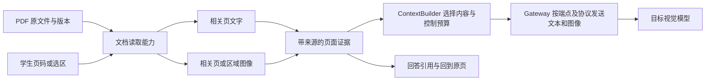

# Agent PDF 能力事实调查：原生输入、工具转换与循阶复用边界

议题：三协议模型接入：第三方端点能力、适配与原生续接。调查开始于 2026-10-22，资料核验跨至 2026-10-23（Asia/Shanghai）。**Robert 已确认首版 PDF 范围为 Agent 阅读与引用：定位页码、读取正文、查看图表与扫描页，回答能回到对应页面；生成、编辑、填写暂不纳入。** 随后确认采用按页读取工具，返回文字、页图、文档版本和页码引用；扫描页先走视觉读取，确需全文搜索时再加 OCR。具体渲染库随运行位置选择；下文接口名称、组件分工和推进顺序仍是建议，不构成实现验收通过。

调查范围为本机 PDF skill、OpenCode、Gemini CLI 和 Claude Code 的 PDF 读取路径。读取本机 skill 与当前仓库相关代码，浏览官方文档及公开固定版本源码；未运行模型请求、安装依赖、读取用户 PDF 或访问凭据。没有读取 `docs/archive/`。

## 关键结论

1. **目标模型没有原生 PDF 接口，不等于循阶不能支持 PDF。** DeepSeek 官方 `deepseek-flash` 当前由 V4.1 Flash 1017 承接，支持图像；其 Files API 的对象仍是图像，Messages 的 `document` 明确不支持。因此可以由产品把 PDF 的相关页转为图像并提供文字，再走图像协议。[模型映射][D1]、[Vision][D2]、[Files API][D3]、[Messages 兼容表][D4]
2. **真实 Agent 至少有两条不同路线。** OpenCode 与 Gemini CLI 的所查读取路径把 PDF 字节作为多模态附件交给模型；本机 PDF skill 用提取和渲染工具组合，Claude Code 的分页 Read 明确调用 `pdftoppm`。前两者的实现不能直接证明任意第三方模型能读 PDF，后两者说明 Agent 可以承担格式转换。[OpenCode][O1]、[Gemini CLI][G2]、[本机 skill][L1]、[Claude Code Read][C1]
3. **图像是本任务的必要能力。** 数字逻辑图、波形、流程图、扫描页不能只用文字提取替代。“按需读页或选区 → 文字及页图 → 图像输入”的路线已获确认；OCR 和文档检索按实际问题增加，不先建向量库。
4. **页码引用要由应用保留来源。** 模型看到 PDF 或图片，不自动产生可回到原文的产品引用。循阶应保留文档版本、实际 PDF 页序、可选区域及提取方式；回答中“第几页”是否准确仍需核对。Claude API 自身也区分文档理解与可选的引用机制。[Claude PDF 处理说明][C3]、[循阶现有选区代码][X4]

## 术语与证据口径

| 能力 | 本文的含义 | 不应据此推导什么 |
| --- | --- | --- |
| 模型／服务原生 PDF 输入 | 请求中直接传 PDF 字节、URL 或 PDF 文件 ID，由服务处理 | 不代表神经网络直接读取 PDF 容器；Claude 官方说明服务会提取文字并将页面转成图像。[C3] |
| Agent 提取文本 | 工具读取 PDF 文字层，返回可供模型使用的文本 | 不保证阅读顺序、表格关系、图形内容或扫描文字。pypdf 明确区分文字提取和 OCR。[P1] |
| Agent 按页渲染 | 工具把页面或区域变成 PNG 等图像，再送视觉模型 | 不自动得到可搜索文字、精确表格数据或可靠引用。Claude Code 的分页 Read 是实际案例。[C1] |
| OCR | 从页面像素识别文字；可以是独立引擎，也可以请求视觉模型转写 | 模型能读图不等于已交付带置信度、坐标、持久文本层的 OCR 流程。[P1] |
| 文档检索 | 在文档文字／页／片段中定位相关内容，再读取证据 | 不必等同于 embedding 或向量数据库；PDF 可读也不等于已建立索引、召回与引用链路。后文只对已查到的读取路径下结论。 |

“代码已实现”“官方文档声明”“工程推论”“未验证”分别使用。未看到 OCR 或检索，是指本文追踪的 PDF 读取路径未包含该步骤，不是声称该 Agent 的所有插件和扩展都不具备这些能力。

## 版本与可追溯边界

| 实现 | 固定版本／快照 | 本次证据覆盖 |
| --- | --- | --- |
| 本机 PDF skill | 插件目录版本 `26.1017.22135`；`SKILL.md` SHA-256：`a6e20f4ae66364a06d577dd51e0ce66ee2ef955be129cbe195e0a27f403daaf8` | 实际安装的技能指令。不是依赖安装证明，也不是已完成 PDF 运行实验。[L1] |
| OpenCode | commit `080e92d40ad335fe889fa4ceca1b93a8f44fe4cf`，2026-10-22 UTC；源码 `@opencode/core` 标记 `2.1.3` | 读取工具、文件系统分支、会话附件与 Anthropic 序列化路径；是固定源码快照，不把 dev 分支快照当作已发布安装包。[O0] |
| Gemini CLI | commit `09d81bf116b6f0ef084731dc996aa9d56438bb70`，2026-10-21 UTC；源码版本 `0.67.0-nightly.20261020.gb041de017` | `read_file` → 文件处理 → 工具结果多模态转换；不是本机已安装版本。[G0] |
| Claude Code | 官方 changelog 固定 commit `5ed799e5cc56bea9efff57398ca43e31d82784ff`，包含 `2.1.307`；分页功能可追溯到 `2.1.30`，页码列表修复到 `2.1.292` | 实现不以公开完整源码验证。Read 细节来自本次读取的官方在线文档；文档未标对应 CLI 版本，不能声称它是上述 commit 下的实现源码。[C2]、[C1] |

在线服务文档与模型别名可能变化。固定 commit 的源码链接可复核；DeepSeek、Command Code、Claude Code 在线说明仅代表本次访问时的公开声明。

## 四个实现的能力对比

| 实现 | PDF 怎么进入模型 | 文本提取／按页渲染 | OCR | 长文档与页范围 | 引用与检索 |
| --- | --- | --- | --- | --- | --- |
| 本机 PDF skill | Agent 调用工具后读取文字及 PNG；该流程不以原生 PDF API 为前提 | 指定 `pdfplumber`／`pypdf` 提取、Poppler 渲染和视觉检查 | skill 未规定独立 OCR 步骤；扫描页可渲染，转写质量未实测 | 可由 Agent 编排分批处理，但 skill 未交付统一页范围 API、调度器或上下文预算算法 | 要求保留来源与图表信息；不等于应用已拥有页码回链、索引或 RAG。[L1] |
| OpenCode `read` | PDF 全文件 base64 作为 `file` 内容返回，provider 再序列化 | 所查读取路径不提取文字、不渲染 PDF | 所查路径未见 OCR | 媒体读取上限 20 MiB；`offset`／`limit` 是文本行／目录项，不是 PDF 页码 | 工具结果带文件名；没有在该路径建立逐页锚点、文字索引或检索。[O1]、[O2] |
| Gemini CLI `read_file` | 全文件 base64 放入 `inlineData`，MIME 为 `application/pdf` | 所查路径没有本地 PDF 提取或渲染 | 所查路径未见 OCR | 本地读取先检查 20 MiB 上限；`start_line`／`end_line` 只用于文本分支 | 二进制进入工具结果后的多模态适配，但不是页索引、页码验证或文档检索。[G1]、[G2]、[G3]、[G4] |
| Claude Code `Read` | 短 PDF 整体读取；长 PDF 通过页范围读取，后者渲染页图 | 官方明确分页用 `pdftoppm`；没有充分证据把所有分支说成相同实现 | Read 文档未声明独立 OCR 引擎或可检索文本层 | 超过 10 页按范围读取，每次最多 20 页；缺少 Poppler 会失败 | 页范围提供读取定位，不自动证明回答引用准确；Read 文档未描述文档索引或向量检索。[C1] |

### 1. 本机 PDF skill：工作流指令组合，不是单个 PDF 模型接口

实际技能要求优先渲染页面为 PNG 并查看，用 `pdfplumber` 或 `pypdf` 做文字提取和快速检查，明确不能靠文字提取保证布局保真；创建 PDF 另用 `reportlab`。它还包含 AcroForm 填写与逻辑字段验证，这属于文档编辑能力，不是 PDF 阅读的必需组件。[本机 skill 来源记录][L1]

**可借鉴的是工具编排：** PDF 解析器负责读取结构或文字，渲染器负责恢复页面视觉，视觉模型解释页图，Agent 决定读哪些页。依赖清单、技能存在、能生成 PDF 都不能证明某次模型真的看到了页面。本文没有检查运行时包版本或实际执行渲染。

**扫描件边界：** pypdf 的 `extract_text()` 读取文字对象；只有图像的扫描页可能返回空文本，需要视觉读取或另外的 OCR。不能把 skill 中存在 pypdf 写成“本机插件自动 OCR”。[pypdf 官方说明][P1]

### 2. OpenCode：PDF 附件直传，必须继续检查 provider

固定快照中代码已移至 `packages/core/`，不能沿用旧路径推断实现。`read-filesystem.ts` 检测媒体类型，PDF 属于媒体分支，限额为 20 MiB，读完整文件后编码成 base64；这个分支在文本分页逻辑之前返回。[媒体读取实现][O2]

`read.ts` 的 `toModelContent()` 返回提示文本及携带 data URL、MIME、文件名的 `file` 内容。用户直接附加的 PDF 则由会话层转成 `media`。两条路径均未在这里提取 PDF 文本或页图。[工具结果][O1]、[会话附件][O3]

追到 Anthropic adapter 后，可以看到 `application/pdf` 被转换为 base64 `document`，工具文件结果也经过这个转换。这说明该 adapter 能表达原生 PDF，**不能说明 DeepSeek 的 Messages 会接受它**；后者官方明确拒绝 `document`。所查链路没有自动转图的降级步骤。[协议序列化][O4]、[DeepSeek 兼容表][D4]

### 3. Gemini CLI：读取工具与多模态工具结果一起构成路径

`ReadFileTool` 调用 `processSingleFileContent()`。后者的 PDF 分支读取原文件，返回 `inlineData.data` 与 `mimeType`；行范围裁剪发生在独立文本分支。20 MiB 限额来自 CLI 本地常量，不能用 Gemini 服务更宽的文档能力替换这个工具限额。[调用点][G1]、[处理分支][G2]、[限额常量][G3]

工具执行器把 `llmContent` 交给 `convertToFunctionResponse()`；该函数保留 PDF 等 `inlineData`，依模型能力嵌入 `functionResponse.parts`，或作为相邻 Part 返回。这比“装了一个 PDF loader”多了一段真实的模型输入链路。[执行器][G5]、[多模态转换][G4]

Gemini 服务官方声明可原生理解 PDF 中的文字、图、表和布局，文档说明可处理长达 1000 页的文档。这是服务能力，不是 CLI 自动分块、OCR 索引、无损读完任意长文档的证明。[Gemini Document understanding][G6]

### 4. Claude Code：整文件与分页渲染两种行为

官方 Read 文档说明短 PDF 整体读取，超过 10 页按 `pages` 范围读，每次最多 20 页；分页依赖 Poppler 的 `pdftoppm`，没有该命令会报错。它是直接支持“Agent 通过渲染补齐格式能力”的产品证据。[Read 官方说明][C1]

官方 changelog 的 `2.1.30` 引入页范围，并将超过 10 页的 `@` 提及改为轻量引用；`2.1.292` 修正了 `pages: "6,9,15"` 静默只读第一项的问题，现在要求分别读单页或范围。因此“提供了页码参数”也需验证实际覆盖页集合。[固定版本 changelog][C2]

Claude API 官方另有原生 PDF：服务提取每页文字、渲染每页图片，再组合分析。**这不是 Claude Code 所有 Read 分支的源码证明，也不是第三方 Messages 的通用承诺。** 本文不以 Claude API 的限额替代 Claude Code Read 限额。[Claude API PDF 流程][C3]

## 不同文档内容对处理路径的影响

下表是从上述机制推导的工程差异，不是四个产品的准确率评测。

| 场景 | 只有文字提取 | 页图／原生视觉 PDF | 循阶需要保留或补上的部分 |
| --- | --- | --- | --- |
| 数字生成、正文为主 | 适合查词、定位段落、低成本提供相关上下文；多栏阅读顺序仍须核对 | 可复核布局，但整页视觉输入不一定比文字更省 | 逐页文字、页序与来源版本；需要时补页图。[P1]、[C3] |
| 电路图、波形、流程图、图表 | 标签可能被提取，连线、箭头、坐标和空间关系仍可能缺失 | 能把视觉证据交给模型；细字仍受分辨率限制 | 完整相关图及图注，必要时附局部放大；不能把 OCR 标签当作图形理解。[D2]、[G6] |
| 扫描件、拍照页、手写 | 没有文字层时可能为空；已有 OCR 层也可能有错误 | 页图能保留原始证据，视觉转写仍要验读 | 选页问答可先读图；只有需要搜索、复制或稳定转写时再加 OCR，并标记来源方式。[P1] |
| 长教材、多份材料 | 页级关键词定位可减少送入上下文的内容 | 逐页图像累计消耗上下文；传整本不等于已检查所有相关页 | 页范围、目录或搜索、预算与“实际读过哪些页”记录；跨页表格要读相邻页。[O2]、[G3]、[C1] |
| 精确页码引用 | 若提取时丢掉分页，文本无法可靠回链 | 模型可提到页号，但回答本身不是页号验证器 | 区分实际 PDF 页序和印刷页码；引用定位使用前者，后者可作显示标签。Claude 官方亦建议使用 PDF 查看器页序。[C3] |

目标 DeepSeek 的图像处理还会按像素规模缩放，`detail: original` 不应被理解为无限保留像素；其文档给出了推理前缩放规则。**推论：** 对一页密集电路图，选择相关页加局部区域，比只提高整页导出分辨率更值得验证；同时保留整页概览以免丢失上下文。[DeepSeek 图像处理及限额][D2]

## 两个目标服务的事实与未知

| 项目 | DeepSeek 官方 `deepseek-flash` | Command Code `deepseek/deepseek-v4.1-flash` |
| --- | --- | --- |
| 身份与图像 | 官方说明当前映射到 DeepSeek-V4.1-Flash-1017；Vision 文档支持图像。[D1]、[D2] | 官方模型页列出准确 model ID，说明具有 vision；不能换成 `-fast` 或旧 `v4-flash` 后仍当作同一测试对象。[D6] |
| 文件／PDF | Files API 仅列 JPEG、PNG、GIF、WebP；Messages 的 `document` 不支持。`file` 这个字段名不等于任意文件输入。[D3]、[D4] | 本次查到的模型页和 Provider 文档不足以证明该具体模型接受 PDF，或提供与 DeepSeek 官方相同的文件存储 API。[D6]、[D7] |
| 三协议与图片结果 | Responses 文档明确图像可作为输入，也可出现在工具调用结果中；其他协议需遵守各自内容块与角色约束。[D5] | Provider 文档列出 Chat Completions、Responses、Messages，但要求按模型目录的 `supported_endpoints` 选择。不能推导目标模型在三者全部可用。[D7] |
| 本次验证状态 | 本 PDF 子调查只查文档；主线另完成三协议基础图片理解及原生工具往返，PDF 页图尚未测。[X6] | 本 PDF 子调查匿名目录读取未成功；主线带认证目录查询确认目标模型仅列 Chat Completions、Responses，并完成两条路线基础图片理解及原生工具往返。原生 PDF 和 PDF 页图尚未测。[X6] |

Command Code CLI 另有 `VISION` 工具：主模型不能看图时，可调用视觉模型取得描述。这是 CLI 编排能力，不能据此声称其 Provider API 自动给所有文本模型补视觉，更不能把它当成目标模型的 PDF 功能。[Command Code Vision][D8]

**建议：** 三协议接入应分别核对“用户图像”“工具结果图像”“原生 PDF”“文件 ID 引用”“原生续接”能力。图片能首次发送成功，不足以证明 PDF 渲染工具返回的图片和后续回放也成功；以上细分是实现与验证建议，不是新增已确认配置 schema。主线随后补测了五条路线的工具产图链路：Responses / Messages 使用原生工具结果图像，Chat 使用匹配的文本工具结果加相邻用户图像，均正确识别测试图；PDF 解析、页码关联和视觉质量仍未验收。[X6]

## 循阶当前实现可复用什么

本次读取的仓库 HEAD 为 `1f29715edbabc1997bbbb61bd73319a56becd8a4`。以下只描述所查路径，不把现有演示实现作为重构约束。

- 前端 `readChatImages()` 检查所选模型的图像能力、文件大小、实际图像格式和可解码性，产出 `{name, dataUrl}`；它接受 PNG、JPEG、GIF、WebP，未在这里处理 PDF。[chatImages.ts][X1]
- 个人 Agent 消息类型只有文本与 `image_url` 内容块，服务把历史中的图像序列化为 `image_url`。虽然模型配置的 `inputTypes` 联合类型含 `pdf`，这不等于消息层已实现 PDF 输入。[types.ts][X2]、[service.ts][X3]
- 代码选区引用已保存对象身份、快照、内容 hash 和行列，并核对选区对应的原文。可复用这种“引用绑定内容版本”的原则；不能直接把代码行列用作 PDF 页面区域，也不能声称通用 PDF 引用已经实现。[tutoringObject.ts][X4]
- 当前架构文档已经区分具体端点的能力核验、可移植历史和与路线绑定的原生续接记录。PDF 转换产物应接入这三个边界，不另外创造整套模型或会话平台。[模型接入架构][X5]

## 最小可复用边界（路线已确认，接口及组件分工为建议）

按已确认路线，将 PDF 能力放在**文档读取与上下文准备**之间：文档层知道页和来源，模型连接层知道协议；模型无需知道渲染器是什么。下图的 ContextBuilder / Gateway 沿用既有候选的职责名称，不要求最终总体架构照搬这些模块。

### 真正需要的组件

| 组件 | 首条 PDF 阅读链路需要做什么 | 可复用方案与边界 |
| --- | --- | --- |
| 文档资源与版本 | 找到获准原文件，知道内容版本、页数和实际可读页；缓存需绑定该版本 | 沿用工作区资源身份与内容 hash 原则；不以 provider `file_id` 代替产品文档身份。[X4] |
| PDF 解析／渲染 backend | 按页读取文字、按需输出页图或区域图；明确返回空文本、读取失败和覆盖范围 | 浏览器候选 PDF.js 已提供取页、文字和渲染 API；有本机运行环境时可选 Poppler 加 pypdf／pdfplumber。**选一个满足执行位置的组合即可，不要求两套都部署。**[P2]、[P3]、[L1] |
| 页面证据与选区适配 | 将原文、图像与同一个文档版本和页序关联；支持回到来源 | 在通用引用原则上增加 PDF 页与区域语义，不直接复用代码行列。[X4] |
| ContextBuilder | 优先处理明确页／选区；约束单次页数、像素、文本和总请求大小；记录实际已读范围 | 从少量相关页开始，缺上下文再读相邻页。限制值应针对目标端点验证，不照搬 Claude Code 的 20 页。[D2]、[C1] |
| 多模态 Gateway | 把文档证据中的文字和图像转换为各协议内容块，保存必要的工具调用关联 | 接入现有图像链路及原生续接边界；不得把图片 base64 字符串塞进普通文本充当图像。[X2]、[X3]、[X5] |
| OCR（条件性） | 扫描件需要文字搜索、复制或结构化转写时增加；输出保留页序和识别来源 | 页图问答本身不要求先装 OCR；图表理解也不能由 OCR 代替。[P1] |
| 搜索／索引（条件性） | 材料长到无法靠目录或指定页定位时，先用页级文本搜索 | 只有跨文档语义召回、频繁重复查询等需求被验证后，再比较全文索引、embedding、重排及增量更新；这些不属于首条读页链路的前置条件。 |

PDF.js 的 API、Poppler、pypdf 都只是可复用零件。上表仍需循阶实现调用、来源关联、上下文装配与结果回链，不能把“库支持提取／渲染”写成“循阶 Agent 已全流程支持”。本次没有安装或选择生产依赖版本。

### 建议的窄接口与引用内容

首版可以只表达两个操作，名称是示意，不是已批准工具合同：

1. `document.inspect(ref)`：返回版本、页数、可用页标签及可判断的读取状态。
2. `document.read(ref, pages, representation, region?)`：读取明确页集合；`representation` 表达文字、页图或两者，返回每页来源与实际产物。工具自己是否需要图像，由问题内容与调用参数决定，不仅凭“文字提取非空”决定。

页级关键词搜索在有需求时再加 `document.find(ref, query)`；它返回定位候选，相关页仍由 `read` 提供证据。页数多不自动触发向量化，扫描页未 OCR 时也不能假装关键词已经搜过全文。

建议页面证据至少保留以下语义，可由现有资源与引用系统承载，不要求独立数据库：

| 信息 | 作用 |
| --- | --- |
| 文档稳定身份＋内容版本／hash | 防止更新或同名文件替换后旧引用悄悄改变 |
| 实际 PDF 页序（建议外部从 1 开始）＋可选印刷页标签 | 消除封面、罗马数字目录、正文重启页号导致的歧义 |
| 原文片段与来源方式 | 区分原有文字层、OCR 文本和模型转写，保留不确定性 |
| 可选区域坐标与坐标约定 | 框选电路或公式时能返回同一区域；约定页面旋转、裁切和归一化方式 |
| 图像产物身份、对应页／区域和处理参数 | 保证模型看到的图与引用来源相符，复用缓存时不串版本 |
| 实际覆盖页集合与未读／失败页 | 长文档部分读取后，不产生“全文都检查过”的错误声明 |

其中页序与坐标转换有现成库支持，例如 PDF.js 的页面编号从 1 开始，viewport 提供尺寸、旋转与变换；来源合同和引用核验仍属于应用职责。[PDFPageProxy][P3]、[PDF.js 渲染示例][P2]

### 与三协议及原生续接的关系

**建议：** 在可移植历史中保存文档引用、选择范围和可见证据；在原生续接记录中保存该路线实际发送的内容块、工具调用身份及 provider 专用文件引用。切换端点时，根据同一文档版本重新装配图片／文字，不假定另一个服务认识原来的文件 ID。[现有架构边界][X5]

原生 PDF 可作为未来某些端点的额外输入方式；本任务两条目标路线的基础方案仍可使用文字＋图像。默认路径不应依赖“先把 PDF 上传到提供商”。对工具返回页图是否需要放入工具结果或相邻用户内容，交给具体 adapter 处理并验证；Gemini CLI 的两种 Part 布局、DeepSeek Responses 对图片工具结果的说明都表明这不是统一字符串接口。[G4]、[D5]

当某条路线无法把必要图像传到模型时，应明确该路线未满足任务要求；不把只有正文的结果标记为已经读过电路图。是否切换到其他已配置路线仍由主任务的模型路由设计决定。

## 建议推进顺序与验证缺口

**第一步：少量相关页的视觉问答。** 复用现有图像链路，补文档读取、页面引用和返回原页；先支持用户明确选择页或区域。图表与扫描页也能走同一条渲染路径，不以 OCR 或 RAG 为前置条件。

**第二步：长文档定位。** 在首条链路成立后补目录、页级文字提取、关键词定位和缓存；扫描件确有搜索需求时才加入 OCR。明确局部问答与全文总结的不同覆盖要求。

**第三步：按需求扩展。** 仅在课程确有跨教材语义检索或大规模重复查询需求时评估检索索引。表单填写、文档编辑、版面重建、批处理平台另立需求，不从“要读 PDF”自然扩张而来。

以上顺序未由 Robert 确认。未来可用小型合成材料验证下列项目，无需先建立完整平台：

| 验证材料／动作 | 必须区分的结果 |
| --- | --- |
| 含文字层与多栏的短 PDF | 文字是否读到、阅读顺序是否正确、页序是否保留 |
| 仅图中包含答案的电路图／波形页 | 是否真正传入页图并识别视觉关系，不能靠文字层碰巧答对 |
| 无文字层的扫描页 | 空文本是否正常进入视觉路径；若引入 OCR，单独测识别错误 |
| 带封面与印刷页码的文档，选择不连续页 | 实际读取页集合、引用页序、点击回原页是否一致；不能只测参数被接受 |
| 长文档与跨页表格 | 是否只读取声明范围、是否能继续读取相邻页、超限是否可诊断 |
| 同一材料经两条目标路线发送，随后继续提问 | 图像内容、工具调用关联和引用是否仍在；原生续接不能只测首轮文字回答 |

**未验证点：** 两个目标服务的真实 PDF 页图问答效果、PDF 工具结果经过更长历史的多轮回放、中文扫描与电路细字准确率、长文档成本和渲染性能、依赖在目标系统上的可用性。基础图片输入、Command Code 目标型号协议目录、原生文本工具往返及工具产图基础链路已有主线实测，见 [端点互操作结果][X6]；这些不等于 PDF 工具链已经通过。Claude Code 在线 Read 说明未提供可固定的实现源码，已用官方版本 changelog 补充可追溯证据，但不能消除这项限制。

**本次验证结果：** 完成文档与源码事实核对；未执行工程测试、浏览器验收或教学效果评估，均不计为通过。

## 来源索引

以下开源实现链接固定到已读取的 commit；本机资料保留当次版本、摘要及来源记录。`P` 类资料只证明库／组件的接口与边界，不能单独证明任何 Agent 全流程。

- L1：[本机 PDF skill 来源记录][L1]，版本 `26.1017.22135`，调查时关键阅读工作流在第 27 行起；保留版本及上表 SHA-256 供来源核对。
- O0–O4：[OpenCode 版本][O0]、[Read 工具][O1]、[媒体读取][O2]、[会话附件][O3]、[Anthropic adapter][O4]。
- G0–G6：[Gemini CLI 版本][G0]、[ReadFileTool][G1]、[文件处理][G2]、[限额][G3]、[工具结果转换][G4]、[执行器][G5]、[Gemini 原生文档说明][G6]。
- C1–C3：[Claude Code Read 官方文档][C1]、[固定 changelog][C2]、[Claude API PDF 说明][C3]。
- D1–D8：[DeepSeek 模型映射][D1]、[Vision][D2]、[Files API][D3]、[Messages 兼容][D4]、[Responses 图像][D5]、[Command Code 目标模型][D6]、[Provider API][D7]、[CLI Vision][D8]。
- P1–P3：[pypdf 文字提取边界][P1]、[PDF.js 示例][P2]、[PDFPageProxy API][P3]。
- X1–X5：[循阶前端图像][X1]、[消息类型][X2]、[消息装配][X3]、[选区引用][X4]、[模型接入架构][X5]。

### 本机 PDF skill 来源记录

调查时读取 `/Users/robertwu/.codex/plugins/cache/openai-primary-runtime/pdf/26.1017.22135/skills/pdf/SKILL.md`。2026-10-29 整理核对时，该缓存路径已不可用；此处保留当时位置与上表的固定版本、摘要，不用当前安装版本替代原始证据。

[L1]: #本机-pdf-skill-来源记录
[O0]: https://github.com/anomalyco/opencode/blob/080e92d40ad335fe889fa4ceca1b93a8f44fe4cf/packages/core/package.json#L3
[O1]: https://github.com/anomalyco/opencode/blob/080e92d40ad335fe889fa4ceca1b93a8f44fe4cf/packages/core/src/tool/plugin/read.ts#L169
[O2]: https://github.com/anomalyco/opencode/blob/080e92d40ad335fe889fa4ceca1b93a8f44fe4cf/packages/core/src/tool/read-filesystem.ts#L116
[O3]: https://github.com/anomalyco/opencode/blob/080e92d40ad335fe889fa4ceca1b93a8f44fe4cf/packages/core/src/session/runner/to-llm-message.ts#L76
[O4]: https://github.com/anomalyco/opencode/blob/080e92d40ad335fe889fa4ceca1b93a8f44fe4cf/packages/ai/src/protocols/anthropic-messages.ts#L751
[G0]: https://github.com/google-gemini/gemini-cli/blob/09d81bf116b6f0ef084731dc996aa9d56438bb70/package.json#L3
[G1]: https://github.com/google-gemini/gemini-cli/blob/09d81bf116b6f0ef084731dc996aa9d56438bb70/packages/core/src/tools/read-file.ts#L155
[G2]: https://github.com/google-gemini/gemini-cli/blob/09d81bf116b6f0ef084731dc996aa9d56438bb70/packages/core/src/utils/fileUtils.ts#L574
[G3]: https://github.com/google-gemini/gemini-cli/blob/09d81bf116b6f0ef084731dc996aa9d56438bb70/packages/core/src/utils/constants.ts#L12
[G4]: https://github.com/google-gemini/gemini-cli/blob/09d81bf116b6f0ef084731dc996aa9d56438bb70/packages/core/src/utils/generateContentResponseUtilities.ts#L49
[G5]: https://github.com/google-gemini/gemini-cli/blob/09d81bf116b6f0ef084731dc996aa9d56438bb70/packages/core/src/scheduler/tool-executor.ts#L480
[G6]: https://ai.google.dev/gemini-api/docs/document-processing
[C1]: https://code.claude.com/docs/en/tools-reference#read-tool-behavior
[C2]: https://github.com/anthropics/claude-code/blob/5ed799e5cc56bea9efff57398ca43e31d82784ff/CHANGELOG.md
[C3]: https://platform.claude.com/docs/en/build-with-claude/pdf-support#how-pdf-support-works
[D1]: https://api-docs.deepseek.com/quick_start/agent_integrations/
[D2]: https://api-docs.deepseek.com/guides/vision/
[D3]: https://api-docs.deepseek.com/guides/files_api/
[D4]: https://api-docs.deepseek.com/guides/anthropic_api/
[D5]: https://api-docs.deepseek.com/guides/responses_api/
[D6]: https://commandcode.ai/models/deepseek-v4-1-flash
[D7]: https://commandcode.ai/docs/provider
[D8]: https://commandcode.ai/docs/vision
[P1]: https://pypdf.readthedocs.io/en/stable/user/extract-text.html
[P2]: https://mozilla.github.io/pdf.js/examples/
[P3]: https://mozilla.github.io/pdf.js/api/draft/module-pdfjsLib-PDFPageProxy.html
[X1]: ../../../apps/web/src/lib/chatImages.ts
[X2]: ../../../apps/server/server/personal-agent/types.ts
[X3]: ../../../apps/server/server/personal-agent/service.ts#L285
[X4]: ../../../apps/web/src/workspace/tutoringObject.ts
[X5]: ../student-agent-architecture.md#模型接入
[X6]: 2026-10-23-model-endpoint-assessment.md
