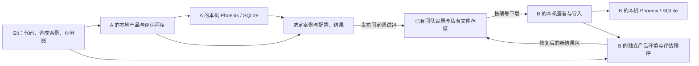

# Agent 调试评估：本机运行与按需共享

日期：2026-10-27。当前约束：开源发布的数据与安全、便捷的开发调试及协作、不使用付费版、不增设大服务器；团队开发电脑性能较好，平台选择须同时考虑功能、质量、易用性与本机运行。负责人已确认本机 Phoenix + SQLite、按需共享选定案例与固定结果包的方案（[L33](../student-agent-decisions.md#来源与状态)）。本文是[总体架构议题](https://github.com/paher-din/XunJie/issues/119#issuecomment-6438705950)内的工程方案，尚未接入产品或扩展开发工具；Phoenix/Langfuse 的临时隔离试用见[对照报告](2026-10-27-observability-local-trial.md)。

## 从实际问题确定共享边界

开发者日常需要在自己的代码和数据上看到模型输入输出、工具调用、错误、耗时与评估结果。协作时需要的是“同一个失败发生了什么、用什么条件能复现、修复前后是否改善”，不必让每次本地调用都进入常驻的团队观测数据库。

**已确认方案：每位开发者按需在本机运行 Phoenix，使用本机 SQLite；协作时发布选定的调试包或实验结果，通过现有团队文件共享链路传递。** 云端保留权限、目录和选定文件，不部署常驻 Phoenix/Langfuse 服务，也不接收全量实时 span。Phoenix 的本地调试功能、导出导入边界见[平台核查](2026-10-27-agent-observability-evaluation-research.md)。

选择 Phoenix 的综合依据是：本轮核心调用树、Prompt diff 和逐案例比较已实测可用；比较页默认显示输入、参考输出与实际输出；24 个 span、6 条评分及两组实验已在独立实例重建。它以单应用和 SQLite 满足当前异步交接流程，小数据阶段约 453–461 MiB。Langfuse 同场景也运行及传递成功，约 2.45–2.52 GiB，现代开发机能承载；其灵活视图、Prompt 运营和集中评审能力保留为后续有实际需求时的选择依据。当前不以“服务少”推断整体质量更高，也不把“不设共享服务器”误解成排除 Langfuse 本机运行。

| 场景 | 必要能力 | 数据放置与共享 |
| --- | --- | --- |
| 日常开发调试 | 查看真实调用过程，定位上下文、工具与输出问题 | 本机 Phoenix 与本机运行记录，默认不上传 |
| 交接一个失败 | 同事能查看这次运行，取得相关输入与版本 | 选定 case、trace、必要附件和诊断报告形成固定包 |
| 比较模型或 Prompt | 用相同数据集和评分规则比较基线与候选 | 固定数据集定义随代码或私有包共享，结果按 case ID 和版本关联 |
| 复现业务状态问题 | 恢复匹配的源码、业务数据和操作步骤 | 调试包关联现有 `xj-repro/1` 包；不为纯模型案例强制复制业务数据库 |
| 临时共同观察 | 两人同时看同一次运行 | 可受控访问一人的本机 UI 或屏幕共享，作为临时协作方式，不作为持久交接前提 |

取舍是异步协作以固定快照为主，不提供全员实时汇总的统一看板；本机 `localhost` URL 也不是可交接地址。接收方获得文件后，发送方关机不影响查看和复现。需要持续跨成员统计时，先汇总选定实验的轻量结果，不据此重新引入全量遥测服务。

## 推荐拓扑



平台进程按需启动，数据保留在仓库外的开发目录。产品中的集中可选观测模块使用 OTel/OpenInference 接入本机平台；未配置时关闭，慢或不可用时不阻塞业务。模型、工具、上下文和交付仍关联自有 Run/step/command 身份，观测平台不接管事实、授权或恢复。没有平台进程时，评估程序也应能保存本地结果报告。

SQLite 文件属于各人的本机服务，不放共享目录让多台机器共同写，不同步整份正在使用的数据库。传递的是显式导出的固定案例和结果。

## 分享的具体形式与交接步骤

**实际交付物是一份固定 ZIP；日常发给同事的是团队文件服务返回的稳定包编号。** ZIP 同时包含给人看的 Markdown 报告和供工具读取的结构化材料。以下是包内容分工，不表示新包格式和命令已经实现：

```text
agent-debug.zip
├── report.md       现象、关键轨迹、结果差异、复现条件与未验证项
├── manifest.json   格式/工具版本、来源身份、文件摘要和关联包
├── cases/          固定输入、预期行为与必要 fixture
├── traces/         选中 trace 的平台原生导出
├── evaluations/    评分、数据集和逐案例实验结果
├── configuration/ 实际 Agent、Prompt、工具和评分器版本及必要快照
└── attachments/   本例确实需要的图片、波形或文件
```

具体 JSON 字段和平台导出文件布局由采集/导入工具的版本化格式定义；复用平台原生记录，不另造实时遥测协议。空的可选目录可省略，所缺条件写进报告。只有合成案例和可公开配置可以进入 Git，实际交接包保存在仓库外。

1. **发送方说明目标。** 例如“把这次工具超时和修复后的对比分享给同事”。开发 Agent 选定相关 Run/case，采集、生成报告、校验并冻结 ZIP，复用已有文件权限直传团队私有存储。发布完成后返回实际包编号与一句现象说明。
2. **同事收到编号。** 把编号发给自己的开发 Agent，例如“打开这个调试包并查看失败步骤”。工具下载校验后先打开 `report.md`；无需启动 Phoenix，也不要求发送方在线。云端只保留目录和文件，不运行评估平台。
3. **需要深入时本机查看。** 开发 Agent 通过适配工具把选定内容导入本机独立收件数据库，再打开 Phoenix 调用树或实验比较。ZIP 不是 Phoenix 自带的一键导入格式，导入器是项目需要补的能力。
4. **需要重跑时生成新结果。** 使用包中的固定 case 和版本准备独立环境，按请求运行并产生新包；新包关联原包与基线，原结果保留。看报告、导入旧结果和真实复现分别记录。

共享层沿现有 `xjp_` 稳定编号机制扩展包类型；不要求新增分享网页。直接传递同一 ZIP 也可作为文件交接方式，但没有团队编号时按本地文件打开，不能伪造编号；实际发送文件或编号沿用用户对目标接收人的授权。

编码 Agent 的操作路由统一放在 [xunjie-development](../../../skills/xunjie-development/SKILL.md) 的[调试包参考](../../../skills/xunjie-development/references/agent-debugging.md)，与现有业务复现共用入口。当前 CLI 只接受 `xj-repro/1`，以上 Agent 包需要新增受限包类型及采集/导入适配；不能用现有 `repro share` 直接上传任意 ZIP。

## 一个调试包具体保存什么

以下是待实现的包内容契约，不是 Phoenix 内建的实例同步，也不是已经存在的 `xj-dev` 命令：

| 内容 | 最小范围与用途 |
| --- | --- |
| 身份与来源 | 包版本、摘要、发布者、case ID、原 Run/trace 身份和来源工具版本；同一包下载多次不产生不同事实 |
| 可复现条件 | 代码 commit 或源码包引用、Agent/Prompt/Skill/工具版本、模型路线与参数、数据集及评分器版本；必要时保留已选择的未提交差异 |
| 输入与 fixture | 当前问题、相关上下文、必要工作区状态、允许共享的工具结果及预期行为；不采集其他运行或完整个人数据库 |
| 选定 trace | 完整选中 trace 的相关 span、父子关系、时间、属性及必要 events；使用平台支持的导出格式，不自建第二套实时日志协议 |
| 实验与评分 | 按 case 记录基线/候选输出、规则分数、人工评价及理由、失败状态和用量；保留原评审来源，不冒充接收方账号作出的评价 |
| 必要附件 | 本次诊断确实需要的图像、波形、文件或结果，使用包内引用和摘要；缺失附件明确显示 |
| 可直接阅读的报告 | 现象、调用轨迹摘要、失败项、版本和复现步骤；接收方不启动平台也能阅读，完整平台导入不是查看交接的前提 |

共享数据集的底本是版本化 case 与 fixture，平台 dataset 是本地工作副本。公开合成案例、评分代码和可公开模板可以随 Git；真实运行记录、个人内容、密钥和私有案例留在本机或获准的私有文件存储。已有私有对象存储可能有容量和流量成本，本方案不新购付费评估平台，也不承诺存储无限或零成本。

导入分为“查看原记录”和“重新运行案例”。前者不调用模型、工具或写入业务对象；后者显式创建新的 Run，默认使用 fixture/模拟执行器，需要真实模型或执行器时再提供本机条件。不能通过导入旧结果自动重发提交、写入或外部调用，也不能把查看成功报告为复现成功。

## 平台导出导入能做到什么

以下传递路径由官方 API 和固定源码支持，并已用小型合成案例在独立实例核对选定字段；本例无附件和非空 events，未迁移原评审审计身份或全部 Prompt 历史。试用结果见[对照报告](2026-10-27-observability-local-trial.md)，更广的接口边界见[对象级核查](2026-10-27-agent-observability-evaluation-research.md#对象级导出导入与可恢复范围)。

| 对象 | 本轮接入选择 |
| --- | --- |
| 调用树 | 用 `getSpans` 完整分页取得所选 trace，再以 `logSpans` 写入独立接收实例；保留平台支持的原 trace/span/parent、时间、attributes/events。API 返回 202 后读回核对，不仅凭接收入队就报告完成 |
| 评分与人工评价 | 独立采集 annotation，按包和评审身份使用稳定 identifier；原作者、原时间和来源另存清单，不能冒充接收端登录用户或覆盖其现有评价 |
| 数据集 | 以固定版本的样本快照和稳定 case key 为底本，本机重建 dataset/example/version 映射；不承诺保留全部平台内部 ID 与历史 |
| 实验结果 | 保存逐 case 的原输出、错误、用量和评分，按需要通过记录 API 重建实验；查看旧结果不调用 `runExperiment` 重新执行 |

**仅新建一个 Phoenix project 不能隔离重复 span ID。** 已核对版本的 ID 在实例数据库中唯一；本轮 REST 重复导入已验证整批拒绝，OTLP 重复可能被忽略或合入已有 trace。默认把每个新包导入单独的收件数据库，按需启动一个查看实例；原包按摘要保持不可变，本人的正常开发库不接收这些旧 span。同包再次打开复用已有导入记录，新包即使沿用原 ID 也不写入旧收件数据库。不先建设全局 ID 改写和双向合并机制。

标准 OTLP 不携带平台的 annotation、dataset 和 experiment 对象，Phoenix 导出的 OTLP 也不等于原始请求的逐字段备份；不能承诺完整 UI、所有 links/resource/scope 字段或纳秒精度无损恢复。共享报告、原始导出和项目运行引用共同说明保留及缺失范围。实际评估依赖的输入、结果和 case 身份不能只存在于平台专有 UI 中。

## 怎样做到便捷，而不是手工搬文件

目标体验由开发 Agent 调用确定性的开发工具完成：

1. A 说“把这次工具调用异常分享给同事”。工具按所选 Run/case 采集必要内容，生成报告和固定包，展示范围并返回可交接编号。
2. B 说“打开这个调试编号”。工具下载校验，先打开报告，再按需导入本机平台或恢复关联业务复现包；不要求 A 的电脑在线。
3. B 修复后用同一 case、数据集和评分器重跑，生成新的结果包，与原 case 和基线关联。双方比较真实运行轨迹及评分，不覆盖原包。
4. 需要人工复核时，评价作为针对固定包与 case 的新记录发布。采用追加记录和明确版本，避免双向同步两套数据库及评论冲突。

这些是新增接入的目标流程，**当前没有这些一键 Agent 评估命令**。命令名称在实现时沿现有开发工具统一设计，不能现在就给成员提供不可执行的调用示例。

## 可复用的现有能力与实际缺口

项目已有[本地全栈与独立数据](../../development-collaboration.md)和[版本化复现包、团队直传](../../development-tooling.md#传递方式)。共享服务只承担成员授权和包目录，文件在客户端与私有 OSS 之间直接传输；它不运行模型或处理实时遥测。

源码核对表明，现有复现包可带明确选择的 `assets/` 与 `evidence/`，但仍要求源码 bundle、业务 SQLite 与场景；附件从工作树中的明确路径读取。[复现实现](../../../tools/xj-dev/src/repro.mjs)、[当前接口](../../../tools/xj-dev/README.md#复现包与基线)。包传输层也显式校验 `xj-repro/1`，不是任意 ZIP 文件通道。[传输实现](../../../tools/xj-dev/src/package-transfer.mjs)

因此接入需要补两条窄能力：

- 本机评估采集与查看适配：从选定 Run 和平台取得 trace/结果，生成确定范围的调试包及报告，按支持能力导入；普通运行数据直接在仓库外准备，不能为迁就现有附件入口先复制进开源工作树。
- 复用现有设备身份、目录、摘要、直传和下载的受限包类型扩展：纯 Agent 案例不强造业务数据库；有关业务状态时引用现有复现包。服务端只识别包元数据和授权，不解析或执行模型内容。

这是扩展现有文件协作能力，不建设实时数据合并、评论同步或新的团队账号系统。实际上线前仍需核对现有接口的包类型、权限与容量；源码能力不等于本轮已完成服务验收。

## 开源仓库边界

| 可以同仓公开 | 独立保存 |
| --- | --- |
| 集中可选观测接口、Phoenix/OTel 适配、评估 runner、包采集/导入适配、合成案例与配置模板 | Phoenix SQLite、原始 trace、真实模型输入输出、私有案例、运行报告和密钥 |
| 可公开的 Prompt/Skill、数据集定义、评分器与量表 | 真实学生材料或个人资料；经选择并符合共享范围后才进入团队私有包 |

Dify 在产品仓库维护独立 trace provider，Open WebUI 在产品仓库维护默认关闭的 OTel 接入；因此可选集成代码同仓本身不阻碍开源发布。[Dify 固定源码](https://github.com/langgenius/dify/tree/43c7f7b55e1fda4943fa3538fc4db066feb3cce8/api/providers/trace/trace-langfuse)、[Open WebUI 接入](https://docs.openwebui.com/reference/monitoring/otel/)。本项目仍需验证自己的默认关闭、采集范围和发行产物。

普通产品安装不要求 Phoenix、开发身份或团队文件存储，也不内置团队采集地址与密钥。开发者显式开启后默认只向自己的本机平台发送获准内容；共享是另一次明确选择的发布动作。平台 Python 服务与产品 Node/TypeScript 运行进程分开，产品仍使用直接模型 SDK。

观测适配在序列化前排除模型/服务凭据与鉴权头；共享采集按明确 case/Run 范围取出内容，处理需要保留的真实资料及附件。仅删除几个固定字段不能代替确认所选内容的实际共享范围；不把整份本机数据库作为省事的交接包。

## 后续接入验收

- 本机真实追踪能看到模型、工具、上下文和交付关联；评估集固定版本，完整 Agent 与只测 Prompt 的结果分别表达。
- A 发布一个选定失败，B 在 A 离线后仍能阅读报告、取得必要输入并在独立环境排查；不会被迫下载 A 的全部数据库。
- trace 导出导入检查父子关系、时间、事件、附件与评分；原始身份和接收端身份有明确映射，重复导入不覆盖其他案例。平台不支持直接往返的内容留在报告/清单中，不能伪装成无损同步。
- 两人能对同一固定 case 比较修复前后；缺少输入、模型或外部条件时如实报告，导入不重放真实副作用。
- 关闭平台、断网或共享服务失败不影响本机产品运行与本地结果保存；共享失败可以从已冻结包重试。
- 默认产品不外发，学生前端和发行产物无采集秘密；trace、SQLite、报告和私有配置不落入 Git 工作树。
- 实测目标开发电脑的启动时间、空闲/采集内存与磁盘增长；不以单进程架构代替资源验收，不承诺现有 2 GiB 服务器可容纳平台。

本轮完成资料核查、设计与临时两平台试用，包含核心浏览器操作和选定记录往返；没有修改开发 CLI 或接入产品。真实模型、完整协议接入与教学效果未验证，试用脚本不作为已发布功能。
