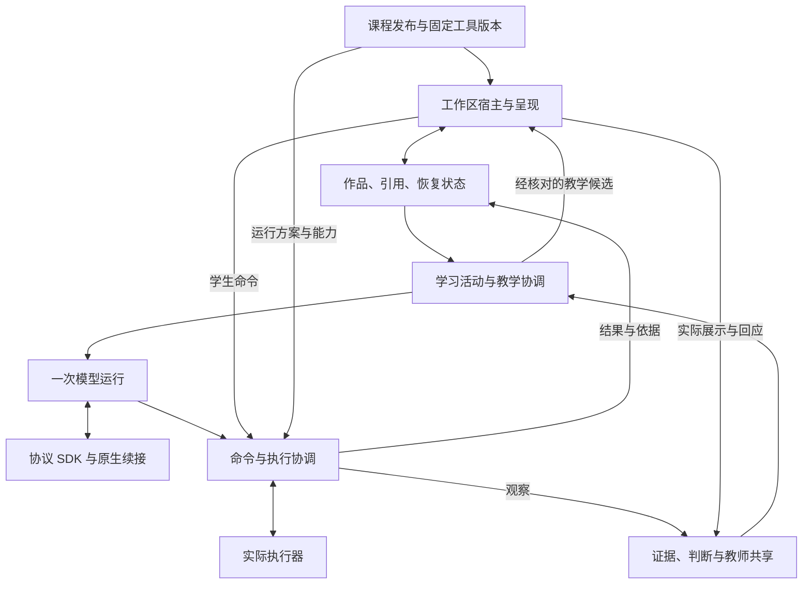

# 总体架构与复用取舍：长期目标设计

日期：2026-10-27（Asia/Shanghai）。对应[总体架构与复用取舍：模块边界、Agent 内核和部署方式](https://github.com/paher-din/XunJie/issues/119)。目标是长期最终设计。本文定义运行、恢复、部署与演进；原 Agent tools、Skills、MCP、plugin 和提示词覆盖缺口见[覆盖审计](2026-10-27-agent-design-coverage-audit.md)，逐项契约、具体能力表与完整请求走查现见[Agent 能力与质量契约](2026-10-27-agent-capabilities-design.md)。本轮新消息、过程显示和自主学习要求已有答复，工程设计见[交互方案](2026-10-27-agent-interaction-design.md)；本设计已按[最终决议](https://github.com/paher-din/XunJie/issues/119#issuecomment-6443526782)收束，不等于代码已经实现。

本议题已发布[最终决议](https://github.com/paher-din/XunJie/issues/119#issuecomment-6443526782)并以设计完成关闭；此前[讨论进展](https://github.com/paher-din/XunJie/issues/119#issuecomment-6438705950)、研究与探针保留作为证据。存储、迁移和实施验收由后续主题承接。

## 已形成的总体运行与部署设计

这些选择用于长期建设与维护。多步生成、长时间等待、故障恢复和组合部署都属于设计本身；不安排“先用简化内核、以后再换完整框架”的路线。以后出现实际新问题时，根据证据修订相关决定与迁移方式。

1. **归属与事实：** 同一客户端切换个人/学校学习空间；学习活动、作品、模型运行、工具执行、证据与教师交付分别持有可追溯事实，不以聊天历史替代。
2. **内核：** 长期采用自有持久 `RunDriver`，沿用直接协议 SDK 与原生续接契约。RunDriver 是一次逻辑运行的唯一调度权威，完整负责持久步骤、恢复、等待、取消、预算及并发控制；选择理由与长期成本见下文。
3. **执行：** 模型只产生意图；完整响应与意图可靠保存后，实际执行器校验授权、输入和对象条件。结果未知先查原命令，已接收请求有持久待处理记录；取消、停止工具与撤销效果分开。
4. **部署：** 客户端、空间/课程、学习数据、教学协调/Agent、模型连接、工具执行形成六个组合单元，可同机合设或经契约分开。覆盖个人全本地、学校统一和混合部署；存储产品选择留给后续迁移议题。
5. **使用体验：** 部署维护者配置组件位置，产品完成准备与连接。学生默认可开始学习，保留个人模型和主动引导等有实际价值的选择；不在上课流程配置 Agent、存储或执行节点。
6. **复用与替换：** 复用现有固定命令、可靠本机保存、回执和有界 job 的机制，重建它们之间的关联；统一全局聊天与课程辅导的运行基础，替换课程页面硬编码装配。课程组件、生成内容和局部渲染复用继续按已有决议。

本轮探针解决的是候选接口与有限故障路径是否成立；完整运行实现、跨服务联调、目标设备矩阵、浏览器与教学效果仍需实施验收。实施可以分步交付，但每一步都沿用本设计的身份、所有权和恢复契约，不为赶进度建立一套后续必然丢弃的产品状态模型。

## Agent 能力与开发评估的补充边界

[Agent 能力与质量契约](2026-10-27-agent-capabilities-design.md)承接工具注册/结果、Skills/MCP/Plugin、Prompt/上下文/Memory、新输入与输出检查。每个模型步骤绑定实际装配及上下文快照；这些模块属于既有教学协调/Agent 单元，Plugin 不建立新的调度所有者。

默认 steering 把输入持久加入当前 Run，完整模型响应后、未开始工具派发前及最终交付前核对；普通引导不取消在途模型，停止是独立控制。排队等完整轮正常结束后发起后继 Run。个人自主学习的活动可无课程绑定，沿用公共能力与同一运行基础；工具、思考摘要和状态是业务事实的学生可见投影，不成为新的执行权威。

开发调试与评估综合功能、实际操作、协作与本机资源，负责人已确认各开发者按需运行本机 Phoenix + SQLite（[L33](../student-agent-decisions.md#来源与状态)），同仓可选 OTel/OpenInference 模块记录实际运行，TypeScript 开发工具运行固定案例和评分。团队通过已有文件链路，以稳定编号交接含报告与结构化材料的 ZIP 调试包、数据集和结果，不部署常驻共享观测数据库；见[本机运行与共享设计](2026-10-27-agent-evaluation-integration.md)。集成代码、评估工具和合成案例可同仓，真实数据、平台 SQLite 与秘密配置独立保存；默认关闭观测，启用后默认只到本机。它不增加学生必装服务或接管 Run/命令/教学事实。两平台均已完成小型合成案例的核心 UI 和独立实例传递试用，Langfuse 也能在本机运行；当前更推荐 Phoenix 的直接比较流程与较小运行负担，见[试用结果](2026-10-27-observability-local-trial.md)。产品接入与未验证项见[研究报告](2026-10-27-agent-observability-evaluation-research.md)。

## 设计依据与已确认约束

本轮从[学生端 Agent 与工作区重新设计地图](https://github.com/paher-din/XunJie/issues/112)的目标出发。既有实现用于判断复用和迁移代价；此前 `TeachingRuntime`、Pi、DeepSeek Harness 及模块化应用服务均是候选，不因出现在架构文档中就视为获选。

本轮继承以下决议，遇到组合冲突时说明冲突并回到来源处理：

- [本地优先执行](https://github.com/paher-din/XunJie/issues/114#issuecomment-6363162710)：教师设计任务运行方案；浏览器、本机组件与必要远端能力按实际需求组合；首条 ALU 使用浏览器 Worker。
- [三协议模型接入](https://github.com/paher-din/XunJie/issues/115#issuecomment-6346123203)：直接协议 SDK 加薄适配；原生历史按路线保留；工具意图与实际执行分离。
- [工作区交互与状态](https://github.com/paher-din/XunJie/issues/116#issuecomment-6370870664)：本机保存、共享接收、模型接收、实验完成与教师收到分别确认；发送和交付固定当次依据。
- [课程工具与生成内容](https://github.com/paher-din/XunJie/issues/117#issuecomment-6409950554)：课程配置、可复用组件与活动实例分开；组件固定版本；统一状态、命令、观察与引用语义。
- [跨课程连续教学](https://github.com/paher-din/XunJie/issues/118#issuecomment-6364486548)：学习活动、事实证据与画像判断独立；主动引导受学生设置和课程策略约束；教师持续摘要与固定交付分开。

首轮产品行为与答复：

1. **负责人已明确：首版就从整体支持使用方选择模块部署位置。** 学生或教师个人可以把所有服务放在本机，学校也可以统一部署、分发账号与模型服务；各部分都要有本地运行与云端部署的选择，由使用者或组织按需求组合。课程实验仍按已有教师运行方案。此前“首个交付以共享服务为基线”的收窄建议已撤回，不作为本轮前提。
2. **负责人已确认：** 学生离开页面后，已接收的明确请求可在预算内完成并保存；依赖浏览器能力时记录等待或中断，离开后不新增主动教学推理。返回时重新核对上下文，已接收数据的同步和必要记录整理可继续。浏览器失联不能证明本机命令未执行，也不能触发换位置重跑。
3. **负责人已确认：** 同一客户端中个人空间与学校空间逻辑隔离，切换后按当前空间的部署配置连接服务，部分组件可以运行在学生电脑上。负责人以 Notion 工作空间作为交互类比。账号/成员身份、课程和数据保持各自边界，不要求分开安装。独立个人空间跨入学校课程、自动合并数据不由此次确认推导为需求。
4. **负责人已确认：** 学校空间内学生始终可自行选择个人模型，不由学校管理员决定是否开放。模型来源的变化不改变课程、作品和交付的空间归属。具体连接和凭据处理按下文契约执行。
5. **负责人明确设置价值原则：** 只把能给学生带来实际价值的选择留给学生，避免无必要的设置增加门槛。此前“学生可自行改选本机 Agent 和完整学习数据位置”的建议撤回；不能由技术上的可部署性直接推导出学生设置。部署能力仍保留，角色分工见下文。
6. **负责人明确设计期限：** 要的是长期采用的最终设计，后续遇到实际问题再补充或更改。“首版”曾用于强调部署能力从开始就应具备，不能据此把架构目标收窄为短期方案；本轮撤回以内核首版取舍来表述最终设计的做法。

部署可组合性与离开后的工作范围是本轮已确认的产品要求；具体部署单元、组合契约和安装方式由工程据此提出方案。个人全本地运行时，关网页与关闭实际服务进程是不同事件；本机服务退出后只能保留已持久记录，不能声称仍在后台完成工作。

## 先分清事实，再选择运行框架

需要拆开的是三种生命周期，不能用一条聊天记录或一个大状态机同时承载：

| 对象 | 何时开始、何时结束 | 主要记录 |
| --- | --- | --- |
| 学习活动 | 围绕目标开始，可跨对话、工具操作、暂停和返回 | 目标与课程依据、已尝试方法、疑问、等待事项、帮助与学生选择 |
| 逻辑运行（Run） | 一次已接收明确请求或通过规则筛选的主动触发；可跨步骤、进程重启和持久等待，完成、失败或取消后结束 | 触发来源、固定输入、路线与原生续接段、步骤、预算、工具意图、等待关系及结果引用 |
| 工具执行 | 某个有稳定身份的命令被实际执行器接受；终态由执行器确认 | 实际输入、工具和环境版本、执行器实例、运行状态、观察、检查点及回执 |

一次模型调用只是 Run 中的一个 `ModelAttempt`。Run 完成不结束学习活动，工具仍在运行也不要求持续占用模型连接或内存任务。`waiting` 是 Run 的非终态；匹配的结果或回应到达后核对原等待关系，再推进同一个 Run。消息归属由明确新建入口及 steering/queue 方式决定，不因模型判断“独立问题”自动另开并行 Run；显式回应等待项关联原 Run，输入追加不可变记录。等待学生时的 steering 可替代旧问题 Wait，过期回应不推进；已接收外部作业仍按原命令跟踪。聊天摘要辅助构造上下文，不能替代活动、作品或执行记录。

## 职责与事实所有权

这些是代码与数据所有权边界，并不各自对应微服务、数据库或独立框架。

| 边界 | 自己掌握的事实与职责 | 对外约束 |
| --- | --- | --- |
| 课程与组件发布 | 教师组件库、不可变组件版本、课程发布版本、开放资源、帮助策略与运行方案 | 活动绑定固定版本；私有材料仅在获准侧使用；已有活动不被组件更新静默替换 |
| 工作区 | 作品、引用、问题草稿、组件实例可恢复状态、待同步内容及确认 | 本机存储确认本机可靠保存，应用服务确认已接收的共享事实；组件视图不另立作品权威 |
| 活动与教学协调 | 活动进展、主动性设置、候选筛选、依据检查、帮助投递和实际回应 | 课程进展含义由课程提供；不因工具成功或点击即判定掌握 |
| 命令与执行协调 | 稳定请求身份、输入清单、授权依据、发送/接收记录、实际执行与结果查询 | 学生操作与 Agent 调用共用语义，本地操作可直接交给本地执行器 |
| 模型运行与连接 | 一次运行的步骤和预算；按协议保存的原生续接；模型输出与工具意图 | 不直接改工作区、运行实验或发布教学动作；模型框架内存不能成为持久事实的唯一来源 |
| 证据、判断与教师共享 | 有来源的事实、课程评价依据、可修正判断、持续摘要和固定交付 | 不改写历史交付；纠正判断保留来源；跨课仅共享已明确的通用偏好 |
| 工作区宿主与呈现 | 课程组件装载、隔离页面、IP/对话/教学产物、状态桥接与语义引用 | 呈现与实际展示分别确认；当前连接在展示或操作前做最后一次适用性核对 |

`TeachingRuntime` 若继续保留，只能作为上述教学协调与运行组合的统称，不再作为所有数据和副作用的共同入口。`TeachingEpisode` 与既有学习活动重合时应沿用学习活动语义，避免产生第二个生命周期。

模型运行与连接模块不拥有指向作品写入或教师交付的旁路。教学候选在宿主成为实际呈现后才增加展示事实；工具返回的观察以原始依据写入，不因当前活动已切换就篡改历史归属。

## 关键命令与顺序

最小记录需要关联学生/课程/任务/活动、请求身份、来源、固定输入、所需能力、预期状态与结果。实现可使用不同编码，不能省掉语义。

1. **先固定意图和输入，再确认接收或执行。** 浏览器本地实验先完成本机持久记录；共享服务接受提问或提交前，只核对该请求固定清单中的内容已接收。新编辑不扩大旧请求的依赖。
2. **完整模型步骤才产生可执行意图。** 保存完整原生响应和步骤状态后，再允许调度工具。参数片段、失败流或缺失终态不执行工具。
3. **执行前核对效果与当前条件。** 权限取课程策略、工具声明、当前主体、学生请求/采纳和具体对象依据的交集。读取历史输入可以继续使用固定快照；要求当前状态的操作必须重新取证。
4. **修改采用条件写入。** 依据核对与修改由实际状态所有者原子处理；检查后再无条件写入仍有竞态。浏览器内的新编辑尚未同步时，服务端的旧版本不能获得覆盖它的资格。
5. **重复请求沿原身份查询。** 相同请求身份绑定同一输入；不同输入拒绝复用身份。副作用结果未知先查询。请求接收、模型完成、工具完成与教师交付各有自己的回执。
6. **保存与调度不能留下漏发窗口。** 需要异步处理的已接收请求，在同一持久化事务中记录待处理工作；处理者根据记录领取，重复唤醒按身份去重。应用重启不直接重新执行未知工具操作。
7. **投递前和展示前核对。** 共享服务核对已收到的作品、策略、目标和设置；浏览器再核对本机最新状态、活动与连接身份。过期主动提示失效，历史解释可保留；未展示不能记作已帮助。

单个活动中冲突的更新按序处理；互不影响的读取可并行。工具并发必须依据效果和对象范围决定，不能因模型一次给出多个工具就默认全部并行。取消模型请求、停止实际工具、撤销已经发生的修改分别记录。

运行预算同时约束模型步骤、时间、输入/输出和工具资源；在发出下一次调用前检查，失败与重试也计入。客户端取消后缺失的最终用量保持未知，不能按零消耗再释放全部额度。长工具任务保存身份，Run 进入持久等待并释放内存处理者；结果到达后只唤醒仍适用的等待项。

执行调度允许处理者重启或领取超时，但旧处理者不能再提交有效新结果；领取代际与条件更新共同约束写入。重新领取只授权核对和恢复，不能据此把未知外部效果执行第二遍。这是持久化要求，不预选某款队列或工作流产品。

## 持久运行契约

RunDriver 通过三个接口组织运行：`RunStore` 持有运行与调度记录，`ModelGateway` 持有协议调用结果，`ToolExecutor` 持有实际执行事实。教学活动、作品和证据经各自领域服务访问。RunDriver 不私自修改这些数据，也不要求工具在同一进程执行。

| 记录或接口 | 必须保持的语义 |
| --- | --- |
| Request / Run | 请求身份、空间/主体/活动、不可变输入清单、课程与工具版本、模型连接配置和预算来源；相同身份只对应同一请求 |
| InputEvent / Inbox | 消息身份、接收顺序、发送时的 steering/queue 方式、固定引用、修订与待处理/已纳入状态；消费与步骤装配关联原子提交，重启不丢已接收补充，编辑不改写在途请求 |
| Step / ModelAttempt | 一个步骤可有多个明确编号的调用尝试；保存原生请求/结果引用、完整终态、错误、用量及未知状态；重试不能覆盖旧尝试 |
| ToolIntent / Command | 意图来自已完成且可靠保存的模型步骤；执行命令具有稳定身份、固定输入、效果类型、目标及条件，查询与重发沿用身份 |
| Wait | 等待身份、所属 Run/步骤、期望命令/事件/学生回应、已消费状态及可选到期策略；重复事件只推进一次，晚结果不能复活终态 Run |
| RunStore | 条件状态迁移、领取代际、待发记录、取消标记和预算预留/结算；运行记录与新增待发工作在所属存储内原子提交 |
| ModelGateway / ToolExecutor | 接收、查询、取消请求与结果回执分开；返回可持久引用，失联或缺少回执不伪装成未执行 |

Run 的运行状态为 `ready`、`running`、`waiting`、`suspended`，终态为 `completed`、`failed`、`cancelled`。外部模型或工具的 `outcome_unknown` 记录在对应尝试/命令上，并使 Run 等待核实；不能仅凭 worker 崩溃把 Run 直接判为业务失败。预算不足或连接条件不具备时进入明确暂停/等待，只有补充授权或条件恢复才能继续；超过已记录的硬期限则按失败原因结束，不静默放宽预算。

每个 Run 同时只有一个有效推进者。领取更新带代际，状态提交采用条件写入；旧处理者不能提交新的有效步骤或意图。派发器只投递已经持久提交的意图，重发依靠接收方去重，不从模型文本重新生成命令。取消提交后不再产生新的模型尝试或命令；已经进入派发/接收阶段的命令按原身份请求取消，执行器确认未开始、正在运行或已结束，停止确认缺失时保留未知。实际发生的结果照实保存，取消不代表撤销。

steering 的接收、待发工具的派发许可、下一请求的上下文绑定以及 Run 收尾按同一序列裁决。新引导已先接收时，未开始工具写入配对的未执行结果，不能继续旧派发；已获派发许可的调用按真实状态收束。输入先消费到不可变步骤装配，再标记已纳入，避免 claim 后崩溃丢消息。长作业接收回执可以先闭合模型工具调用，后续 Wait 由真实命令结果或新引导唤醒；唤醒对话不改变作业完成事实。

异常终态提交时同步将全部未消费输入结算为可见暂停项，包含 steering；继续由学生选定输入发起关联后继 Run，不复活终态、丢弃接收记录或自动重放旧操作。原 Run 非终态暂停的输入则保持原归属，按原恢复条件继续。问题 Wait 的失效、晚到回应和队列控制详见[交互设计](2026-10-27-agent-interaction-design.md)。

模型连接组件先可靠保存完整原生响应；RunStore 再原子记录该结果引用、步骤完成和工具待发项。跨组件不使用分布式数据库事务：引用具有内容身份和保留责任，在所属 Run、课程活动或交付仍引用时不得清除。重启时可重复读取同一结果并完成关联，不必重新请求模型。响应缺终态或结果取回失败时，不产生工具待发项。

已发出模型尝试的未知用量保留预留，不按零结算。新尝试须满足已记录的重试规则和剩余预算；SDK 不自行重试。原命令结果未知时先查询，执行器确实不支持查询也不能以重放有状态命令来猜测结果。人工决定如何处置未知效果须留下新的明确记录。

长时间等待、多轮资源生成、校验修订和独立工具并发都属于这一契约。等待期限与实际计算预算分别记录，等待不持续占用模型连接或工作线程。工具的依赖及冲突范围决定并发，Run 的下一步由已持久记录的结果决定；不按固定少数步数设计，也不把后续增加课程等同于更换内核。

## 关键使用路径

### 本地实验

工作区固定输入并确认本机保存 → 本地命令记录 → 课程允许的 Worker/本机执行器 → 保存真实结果和观察 → 按需要同步。应用服务未同步完成不能阻塞已就绪的本地实验；云端教学判断只能使用已接收的对应记录。

### 明确提问

工作区固定问题、引用和本次作品依据 → 保存待发请求 → 相关依赖同步后获得接收回执 → 教学协调构造上下文 → 有限模型运行 → 受控命令与结果 → 回复和教学候选。学生继续编辑不改变问题原本所指内容；若下一步要操作当前作品，重新获取当前依据。

### 主动引导

普通语义事件先合并、去重 → 课程规则与学生设置筛出候选 → 必要时调用模型解释 → 再次检查依据和时机 → 宿主检查本机状态后呈现 → 记录实际展示、反馈或失效。大部分事件无需调用模型；模型输出不直接成为画像或教师评价。

### 多步生成与长等待

固定需求与引用 → 建立 Run → 模型生成方案和工具意图 → 受控资源生成、构建或校验 → 保存结果 → 依据结果继续修订 → 形成可展示内容 → 宿主核对活动与状态后呈现。长计算、浏览器交互或明确学生回应通过 Wait 关联原 Run，不维持长连接；重启后从已记录的结果继续。生成修订保留此前可用版本和学生输入，校验失败只作为该次生成的结果，不能伪装成课程实验事实或覆盖既有作品。

### 教师交付

固定作品与证据清单 → 等待本次依赖 → 接收方按请求身份建立交付与回执 → 后续修订形成新交付关系。未结束实验留在本次交付的真实状态，后来的结果不补写进去；持续摘要另行更新。

## 设计走查：组合必须成立的情形

| 情形 | 必须保留的行为 | 负责边界 |
| --- | --- | --- |
| 学生发问后继续编辑，旧 Agent 建议稍后到达 | 原问题和引用仍可追溯；针对当前作品的动作须重新核对，不能覆盖新编辑 | 工作区、模型运行、教学投递 |
| 浏览器执行成功但回执丢失 | 先查询原命令；失联与失败不同；不能换执行器再跑一次有状态操作 | 命令记录、实际执行器 |
| 服务已接收提问，进程在派发前重启 | 从持久待处理记录恢复；接收回执不对应一个丢失的内存任务 | 请求接收、运行调度 |
| 模型给出半截工具参数后断流 | 记录中断和未知用量，不执行工具，不把该步记作完成 | 协议适配、模型运行 |
| 学生暂停主动引导时旧提示仍在传输 | 本机最后校验使旧提示失效；不得借新建同内容活动绕过暂停 | 设置、教学协调、宿主 |
| 教师发布工具新版，学生正在旧版活动 | 后续新活动可选新版，既有活动继续旧版并保留资源 | 课程发布、实例绑定 |
| 提交时实验尚未结束，结果稍后到达 | 固定交付保留未结束状态，新结果可用于后续摘要或新交付 | 交付、证据 |
| Agent 验证通过，学生尚未独立解释 | 标明帮助与发起者；不直接升级为独立掌握 | 执行记录、学习证据与判断 |
| 活动没有编译器或唯一答案 | 仍可保存作品、引用、讨论与证据，不伪造运行步骤 | 课程契约、公共工作区 |
| 长生成等待期间服务重启，稍后收到同一结果两次 | 恢复原 Run 与 Wait，按事件身份只推进一次；计算预算与等待期限分别核对 | RunStore、模型连接、执行器 |
| 运行取消后工具才完成 | 保留真实结果与费用，不复活 Run；原已接收命令的停止状态与运行取消分别显示 | RunDriver、执行器、预算 |
| 升级或迁移时仍有未知命令和未结预算 | 保留原身份和查询关系，交接唯一推进权；不能靠启动新运行清空未结事项 | 运行服务、数据迁移、部署管理 |

这些是设计检验，不是已执行的工程测试或真实教学验收。

## 现有实现的复用依据

当前检视基线为 `3eea16b`。下面描述实际机制和调整成本，不将旧流程升级为新架构要求。

| 已有机制 | 本轮建议 | 源码依据 |
| --- | --- | --- |
| 工作区草稿、固定命令、持久 outbox、接收回执 | 复用可靠保存和身份去重机制；去除学生手动确认/冻结的必经步骤，扩展到非代码对象和工具状态 | [frozenCommand.ts](../../../apps/student/src/workspace/frozenCommand.ts)、[confirmationDb.ts](../../../apps/student/src/workspace/confirmationDb.ts) |
| 有界教学 job 的领取、预算、版本核对与未知结果 | 复用状态转移和核对思路；与模型步骤、工具命令及投递记录建立明确关联 | [jobs.ts](../../../apps/teaching/server/records/jobs.ts) |
| 全局个人聊天与课程 `student_help` 两条路径 | 统一领域依据与运行基础；保留适当入口和可见对话，不让两套状态分别认定同一活动 | [personal-agent/service.ts](../../../apps/teaching/server/personal-agent/service.ts)、[tutoring/application.ts](../../../apps/teaching/server/tutoring/application.ts) |
| 个人模型配置、预算、流式输出与取消 | 审核后复用边界机制；文本历史重建和 Chat-only 传输不能充当三协议原生续接实现 | [personal-agent/service.ts](../../../apps/teaching/server/personal-agent/service.ts)、[tutoring/openai-compatible.ts](../../../apps/teaching/server/tutoring/openai-compatible.ts) |
| 工作区页面的课程组件分支、演示草稿 scope 和预置辅导 | 保留可用交互组件；替换装配与数据来源，接入真实课程组件实例和连续活动 | [WorkspacePage.tsx](../../../apps/student/src/pages/WorkspacePage.tsx) |

例如个人聊天进程重启后把未完回合标成失败、用量未知；课程 job 则能记录 `outcome_unknown`。这说明已有谨慎恢复机制，但还不存在贯穿模型步骤、工具效果、教学投递的一份可查询运行记录。不能仅因有 SQLite 或会话日志就宣称新活动能恢复。

## 内核取舍与判断依据

[当前研究](2026-10-27-agent-kernel-reuse-research.md)已补读前轮文档并完成真实库/固定源码的接入探针。比较对象是模型与工具步骤的运行基础，不把学生作品、课程组件和学习活动整体交给一个 CLI。

| 判断点 | 需要回答的问题 |
| --- | --- |
| 原生协议 | 能否继续使用既定三协议薄适配并完整保存 reasoning、签名、工具调用身份及续接段，而不是重建成会丢信息的统一消息？ |
| 执行接管 | 运行框架能否只提出工具意图，由循阶先持久记录并核对权限、依据和既有结果，再执行？ |
| 异步等待 | 长工具任务或等待学生是否能保存等待身份并释放模型运行，完成后从明确步骤边界继续？ |
| 中断与恢复 | 进程中断后，能否区分未发出、模型结果未知、完整响应已保存、工具结果未知与已经完成，且不自动重复外部效果？ |
| 预算与取消 | 能否把模型调用、工具资源、重试和未知用量放在同一可查询运行账本中；是否有绕过应用预算的自动重试？ |
| 升级成本 | 复用的是稳定的小接口还是整套插件、消息、会话与依赖管理；需要保留的适配和补丁有多少？ |

“有界”表示有清楚的停止、等待和资源边界，不等于教学过程只能调用一次模型，也不预设生成内容一定在两三步内完成。教学连续性由活动记录承接，工具循环的长度依据任务和预算确定。

本轮分别完成[自有/core](probes/2026-10-27-agent-kernel/core/report.md)、[durable](probes/2026-10-27-agent-kernel/durable/report.md)和[Harness](probes/2026-10-27-agent-kernel/harness/report.md)探针。它们使用假模型/工具验证有限路径，不能替代三协议实际接入、真实工作区修改与暂停、跨服务联调或性能验收。

**长期选择自有持久 RunDriver。** 运行的推进条件直接来自完整原生模型结果、固定工具意图、执行器回执、预算与取消记录。将这些条件直接表达为持久运行阶段，可以让本机、学校与混合部署使用同一套恢复语义，并减少向框架特定消息、任务及重放策略的适配。学习活动仍独立保存，模型步骤次数按任务和预算决定。

| 候选 | 已证实的价值 | 本轮取舍理由 |
| --- | --- | --- |
| Pi core | 内存循环、队列、异步工具前屏障和取消传递 | 仍需宿主实现持久阶段、等待、回执查询；`continue()` 不直接恢复末尾 assistant 的未结工具。当前加入它主要增加消息桥接，未替代关键恢复职责 |
| Pi durable | 持久任务、检查点、恢复调度和取消后的终态保留 | 有效替代是整体委托运行状态与调度，领域记录仅保留任务引用；并非必然双重调度。仍需原生记录、业务回执及单写者接入，整体委托成本尚未完整验证 |
| DeepSeek Harness | 公开进程内组合、独立 Agent 取消、会话日志、工具前 flush 与未知尾部修复 | 取消能力成立，不以 SDK wire 限制排除。仍需业务续跑与长等待；当前最小组合遇到发布缺口，需维护固定源码构建、Cordis/SessionEvent 和 adapter 接入 |
| 自有持久 RunDriver | 记录和阶段直接对应已定请求、执行器与活动契约；探针可按原命令恢复 | 选作长期运行内核；自行承担领取代际、预算账本、等待/唤醒、记录迁移、并发与错误路径，不能把研究探针当生产实现 |

这是对长期控制与维护责任的选择：循阶直接掌握步骤如何推进，也长期承担持久调度设施。领域事实自有不要求调度自研，Pi durable 整体托管能省去部分自研设施；本轮没有证明自研总成本更低。当前已知的多步生成、等待、取消与组合部署均纳入 RunDriver 设计，不作为将来才能补的能力。不预设迁往 Pi/Harness 的下一阶段；将来有实际需求或运行证据表明当前设计不合适时，再比较修改或替换的成本，并迁移真实运行记录。

## 开发协作与后续边界

### 按负责人要求检验产品部署组合

以下用例用于确定部署边界，不表示组合已实现，也不提前限定只能提供这些预设。

| 组合 | 使用方的需要 | 需要明确的连接与数据问题 |
| --- | --- | --- |
| 个人全本地 | 学生或教师可在自己的电脑运行全部循阶服务，使用个人课程与作品 | 本机身份、资源和运行状态可独立工作；模型使用本机推理服务或配置的外部端点分别表达 |
| 学校统一部署 | 学校部署共享服务、创建账号并提供模型服务；学生使用课程工作区 | 组织身份、账号权限、模型额度、学生数据归属与课程发布接口 |
| 学校服务加学生本机组件 | 学校提供课程、账号、模型服务和交付入口；同一个学校工作空间可使用学生本机 Agent 或执行能力 | 本机组件如何按学校身份获得对应权限；数据位置按部署方案确定，不因此引入另一份个人工作空间 |
| 独立个人环境与学校环境互通（未形成当前需求） | 另一个个人学习空间直接参加学校课程，并共享其作品或活动 | 额外涉及跨空间身份和共享语义；当前学校空间使用本机组件的需求由同空间组合承接，不据此新增跨空间合并验收 |
| 按模块混合 | 使用方按设备、管理和资源需要，把不同服务放在本机、校内或云端 | 可独立部署单元、版本契约、网络可达性、失联行为和跨模块请求身份 |

混合部署需要用具体服务边界证明，不能只因为所有容器能在一台电脑或一台云服务器启动就宣称已满足。个人环境与学校环境互通则是额外的使用行为，不由模块可部署性自动推导为已确认要求。

部署位置、执行位置与数据共享分别表达：某个服务在本机，不等于其调用的模型也在本机；本机作品服务若使用远端 Agent，需要发送该次处理获准且必要的内容；学校账号本身也不意味着组织必须保存个人的所有活动。组合按下文六单元契约实现，教师持续摘要与固定交付仍遵守已有决议。

每份可变事实要有明确负责更新的服务。远端读取、已接收副本、历史交付与当前作品不能都叫“主数据”。个人服务与学校服务之间，优先交换已发布课程、明确请求、摘要和固定交付；是否还需要同一个可变学习空间跨服务共同维护，应依据实际产品用例决定，不能用通用数据库双向同步补齐未定义的语义。

安装交付应提供常用组合与可检查的服务连接；高级使用方可以配置已支持的单元位置。模块拆分不能把手工设置数据库、端口或容器关系变成学生和教师的日常学习步骤。已有数据从一种组合迁移到另一种组合是独立的状态迁移问题，不能用修改服务 URL 冒充完成。

### 部署配置与学生设置的价值边界

本轮设置原则已明确：先说明选择能改善什么使用结果，再决定是否需要学生操作。部署者需要配置组件位置；学生进入课程时需要可用、可靠且归属清楚的工作环境。同一个学生自行安装个人空间时也可以承担部署者角色，不能因此把部署参数变成每次上课的设置。

据此确定以下职责分工；这是对负责人产品原则的工程落实，界面细节仍须在实现时遵循 DESIGN.md：

| 选择或配置 | 对学生的直接价值 | 处理方式 |
| --- | --- | --- |
| 学校模型或个人模型 | 按效果、费用和已有服务选择合适模型 | 保留可选入口，学校空间可直接用默认服务；不要求每次进入课程先选模型 |
| 主动引导程度、当前活动暂停 | 控制被帮助的时机和自主尝试空间 | 按已定主动引导契约保留控制，初始默认可直接使用 |
| 进入个人或学校学习空间 | 找到对应课程、作品与身份归属 | 选择使用哪个空间，产品随后连接该空间所需服务 |
| Agent 服务位置与地址 | 单独暴露位置不能直接保证更好的回答或学习体验 | 由部署维护者按设备、资源和服务需要配置，产品自动发现与连接；不提供学生常规位置开关 |
| 学习数据服务与存储位置 | 学生需要可靠保存、恢复和清楚的共享状态 | 由部署方案配置；按既定契约显示本机已保存、共享方已接收和教师已收到等真实状态，不要求学生配置存储服务 |
| 实验执行节点 | 学生需要完成课程实验 | 教师设计运行方案，平台检测、准备并连接所需能力，不让学生挑节点 |

学校部署维护者可以选择学校服务器、云端以及学生本机组件的组合；个人自托管者可以选择完整本机或受支持的混合组合。所需服务由安装与连接流程准备好。隐去学生常规设置不表示把所有学校数据和 Agent 强制搬到云端，也不改变学生对个人模型的选择权。

若未来出现需要新增控制的真实用例，先表达学生想获得的结果，再设计最少的操作；不预先为每个可拆分模块生成一个开关。保存可靠性、权限和教师共享范围必须由契约保证，不能通过让学生挑选存储位置来替代这些设计。

### 个人与学校环境：部署组合与空间归属

负责人在比较价值、问题和登录方式后，已确认个人与学校空间逻辑分开、同一客户端切换。保留以下概念区分：

- **部署位置**决定程序与数据服务实际运行在个人电脑、学校服务器还是云端。
- **学习空间归属**决定正在使用谁提供的课程、身份、帮助策略、模型授权和交付入口。学校空间可以使用本机组件；本机安装不必把它变成个人空间，也不要求学校与个人的数据合并。

独立个人环境直接加入学校课程的潜在额外收益，是复用已有个人作品/工具和学习积累、跨组织维持个人工作环境、按契约向学校共享过程与交付。如果只需要利用学生电脑算力、本机 Agent 或选择模型端点，同一个学校空间的本地组件已经可以提供这些收益，无需先建设两个独立环境之间的互通。

额外成本包括：个人身份与学校成员身份的对应；课程版本更新及访问资格变化；个人作品与学校交付的责任边界；重复/断线请求、帮助和证据归属；退出学校后数据与记录怎样保留。当前课程组件、固定提交和模型连接契约可复用，但没有直接解决跨环境的这些规则。

**已确认：个人与学校学习空间逻辑分开，组件部署仍可组合。** 共用客户端入口，学校课程使用该学校身份和独立状态；个人作品、个人画像与模型配置不会因登录学校而自动合并。学校选择的 Agent 或数据服务可以运行在学生电脑上，不要求所有学校组件都在服务器。统一客户端不依赖一个循阶中央账号服务；具体登录与成员关系由所连接空间的身份服务承接。

术语使用 **学习空间（Learning Space）** 表示个人/学校的归属边界，**工作区（Workspace）** 保留为课程任务的操作环境。空间标识、当前主体与任务/活动归属应贯穿数据、命令、模型运行、凭据及回执。切换空间后旧运行仍属于原空间，完成结果写回原处，不展示到新空间或使用新空间的模型配置继续；后台是否继续按已确认的预算与离开行为处理。

学校空间中的模型选择按本轮第 4 项答复处理：学生始终可以选择个人模型。具体连接处理见下节，不设置学校管理员的允许开关。

学校空间的本机客户端采用以下登录与连接流程：

1. 在本机选择学校入口或使用学校提供的邀请。
2. 打开学校的认证页面，以学校账号或学校配置的统一登录完成认证。
3. 学校向本机客户端签发可撤销的访问凭据，绑定实际学校身份和获准能力；无需把学校账号数据库复制到个人实例。
4. 本机凭学校身份获取获准课程和模型服务，按既定接口回传摘要与固定交付；个人身份与学校身份保持区分，连接凭据不授予访问另一学习空间的资格。

客户端通过学校空间的身份服务认证，该服务可使用学校账号或对接既有统一登录；本机组件保存独立、可撤销的连接凭据。标准 OAuth 原生应用接入采用外部浏览器与 PKCE，依据见 [RFC 8252](https://www.rfc-editor.org/rfc/rfc8252)；浏览器认证与独立客户端凭据的产品参照见 [Nextcloud Login Flow v2](https://docs.nextcloud.com/server/stable/developer_manual/client_apis/LoginFlow/index.html#login-flow-v2)。本轮设计没有扩张为两个独立个人/学校实例之间的数据联邦，登录与真实授权仍须实施验收。

### 学生的模型选择与凭据边界

以下契约落实 L21，不增加新的学校审批条件：

- 学校提供默认模型连接，学生可以为自己选择学校服务、本机模型服务或个人配置的外部端点。连接须满足当前任务实际使用的能力要求；能力不足时说明缺少什么，不以此静默退回付费服务。
- 个人连接可以在客户端配置一次，再由学生为某个学习空间显式选用。空间记录该主体选用的连接引用，不复制个人空间的课程、画像或会话；密钥留在持有它的模型连接组件中。复用同一个连接不等于合并两个空间。
- 显式选用同时建立连接所有者对该空间内本人主体的使用授权，由持有凭据的组件核对空间、主体、授权范围与运行身份。学校成员身份或知道一个连接引用本身不授予调用资格；密钥不进入空间配置、运行事件或回执。学生撤销授权后禁止新的模型调用，已发出的尝试仍按原身份查询结果与用量，不要求学校审批。
- 本次请求接受时固定模型连接、配置版本和预算来源；切换设置影响后续请求，在途运行仍按已记录路线完成、取消或报告中断。学校额度耗尽或个人端点失败时，不自动借用另一方额度。
- 原生模型续接按模型路线保存。更换路线时构造新的适用上下文，保留原路线原件与工具来源，不把不兼容的签名或隐藏状态强行拼接。
- 学生 Agent 只能获得课程开放材料和获准工具。私有测试与教师专属材料按既定课程组件契约留在相应执行侧，返回允许分享的反馈；个人模型不会因此扩大访问权限。
- 远端 Agent 选用学生本机模型连接时，通过已认证的本机组件建立任务通道；学校服务不能把自己的 `localhost` 当成学生电脑。连接离线时保留明确等待/不可用状态，不静默改用学校或其他付费模型。

### 可独立部署的单元

按以下六个单元提供同机组合与跨机连接。七项职责划分用于代码组织，六个单元定义独立部署边界；两者不要求一一对应。下表是目标部署契约，并非已交付服务清单。

| 部署单元 | 持有的事实或能力 | 本地与远端组合方式 |
| --- | --- | --- |
| 客户端与工作区宿主 | 当前空间选择、本机草稿、工具视图及最后一次呈现核对 | 交互代码在用户设备运行；页面可由本机或远端提供。安装本机组件与进入某个空间分开 |
| 空间与课程服务 | 空间身份/成员关系、课程与工具发布、教师共享入口及交付回执 | 个人空间全部本机；学校空间使用学校管理的服务，可放校内或云端。个人模式不依赖循阶中央账号 |
| 学习数据服务 | 作品、活动、学习证据、画像与学生设置的已接收事实及资源引用 | 可在个人设备或共享服务器。每份可变对象有唯一负责更新的服务；浏览器待同步草稿与历史交付单独表达 |
| 教学协调与 Agent 运行服务 | 语义事件筛选、教学触发与投递；请求接收、持久运行/步骤、原生续接、预算与等待/恢复 | 同一协调与运行实现可在本机或共享服务器。按请求身份调用学习数据、模型连接和执行器，不直接读写它们的数据库 |
| 模型连接组件 | 端点与凭据、协议 SDK、调用尝试及结果回执 | 可与 Agent 同机，也可独立放置。学校模型和个人连接并列；本机模型推理进程或外部提供商是它连接的能力 |
| 工具执行组件 | 工具版本、固定输入、命令执行、真实状态与结果回执 | 使用课程指定的浏览器 Worker、本机进程或必要远端执行器；位置可不同，命令语义一致 |

身份和课程是空间服务内的逻辑模块，空间服务可对接学校现有身份系统；内部职责不自动拆成独立微服务。元数据数据库与资源存储是各单元的可配置依赖，可同机或远端部署，不另建一个拥有全部业务事实的通用数据中台。同机组合可共用进程与物理存储，但事实的写入责任不变；跨机组合不依赖跨服务数据库事务。

每个空间配置明确公共入口、协议版本与实际身份；以“空间 + 成员”为范围记录学习数据与 Agent 服务绑定，新活动从该绑定找到本人服务，并固定引用对应版本。学校的课程入口与学生的学习数据服务可以分开，学校收到的持续摘要和固定提交仍走既定共享契约。一个学习数据服务也可以承载多个空间，但必须按空间和成员身份隔离。更换已有活动的数据服务属于显式迁移，不能改一个 URL 后让两边都继续写同一对象。

教学协调属于 Agent 运行单元中的独立逻辑模块。同一活动只允许一个有效协调者发起新的教学推理，以领取代际和条件写入防止旧进程继续调度。主动调用开始前检查学生设置、课程条件和有效页面连接；失联后暂停新增主动推理，宿主的展示检查不替代这里的启动检查。已经接收的明确请求按原身份、固定依据和预算继续，等待学生或工具时持久保存等待关系。

成员级服务绑定属于部署与运行记录，不自动成为学生的设置项。按 L22 的价值原则，由部署维护者配置、产品自动建立绑定；其用途是支持学校部署中每位学生的本机组件和可靠路由。此前让学生在本机与学校 Agent/数据服务之间二选一的问题已撤回。学生始终可选个人模型的既定要求独立落实。

连接与恢复必须满足以下要求：

1. **跨单元先接收，再确认。** 调用方持久保存待发请求；接收方将请求身份、固定依据和待处理记录一起提交后返回回执。调用超时先查原请求，不产生新身份盲重发。
2. **回执不足时保留未知。** 模型连接组件按调用尝试身份查询已保存的完整响应；提供商结果未取回时保留未知，不推断为未计费。Agent 拿到完整响应并保存关联后，才产生可执行工具意图。工具结果同理查执行器原命令。
3. **本机主动连接远端。** 远端服务需要使用本机模型或工具时，由已登录的本机组件建立连接或领取任务，绑定空间、主体和能力；不要求学校直接访问学生的私网端口。同一连接机制也承载本人成员绑定的课程通知、反馈、持续摘要、固定交付和回执，各自保留请求/事件身份与待传状态；收到回执前不显示教师已收到。具体传输协议留给实施验证，不把反向通道当成已有能力，也不将其扩为通用数据库双向同步。
4. **失联不改变归属或部署。** 已有本机输入和工具能完成的实验继续按本地规则运行；需要远端模型、课程发布或提交接收时明确等待。运行进程退出后按记录恢复，未知效果先查询，不自动换节点重跑。

按这套边界，个人全本地可将各服务放入一个安装组合；学校统一部署可集中空间、学习数据、Agent 和模型服务，学生设备承接交互与课程指定实验；混合部署可使用学校空间服务、学生本机学习数据和 Agent、学校或个人模型连接。这些组合使用同一学校身份及同一学习空间，不需要先建设个人空间与学校空间的数据合并。部署者配置组合，产品负责连接；学生的日常流程不暴露这些模块位置。

### 安装、升级与长期演进

客户端使用同一套工作区前端；个人安装组合包含所需可信本机服务，学校可提供网页入口及按部署方案准备的本机组件。安装与服务管理负责启动、就绪检查、登录和组件连接，学生进入活动后只处理课程所需操作。浏览器工具、需要可信本机进程的能力与远端能力各按真实运行条件实现，不以容器能启动替代产品安装体验。

同机接口与跨机接口遵守同一身份、接收和结果语义。同机实现可直接调用并合设进程；跨机使用经过身份核对的网络接口，组件连接时核对协议版本与实际能力。具体传输、安装包及数据库产品由实施设计选定，它们必须满足这里的部署与持久化契约，不能据此改变领域归属或删除恢复要求。

服务协议、工具 API、工具状态和持久记录分别版本化。兼容升级保留活动和运行的原身份；不兼容升级须提供记录迁移或继续读取/完成旧记录的适配。在途运行不能仅因升级被当作新请求重发，进行中课程活动继续固定工具版本。部署位置变化必须交接唯一写入责任及尚未结清的命令、等待和预算；切换前后不能同时推进同一运行。

扩展课程通过课程配置、工具版本及能力适配进入；改模型通过 ModelGateway 的协议与能力适配进入；改变部署通过服务绑定与显式迁移进入。只有实际新问题突破现有边界时才修订架构决定，记录触发依据、受影响契约和迁移安排。设计可修改不等于当前只是临时方案，也不预建没有真实用例的通用编排平台。

### 开发协作

开发协作沿用[本地全栈、独立可写副本与共享版本化基线](../../development-collaboration.md)。产品模块应能在本地以相同领域契约组合；模型替身、执行替身和真实能力明确标注。固定场景要覆盖意图、接收回执、工具未知结果及浏览器待同步状态，而非仅复制课程表。

新的产品数据结构会要求更新开发基线和复现场景；不要把旧运行队列导入后自动再次执行。开发接入身份、共享开发服务器和当前 SQLite 文件布局不成为产品交付契约。

存储与重建已由[后续决议](../wayfinder/student-agent/rebuild-storage.md)确定：本机与共享端统一原生 PostgreSQL，产品管理本机实例，资源默认文件并可选 S3 兼容后端；旧开发模型直接重建。2026-10-29 实施交接改为[按工作包逐包完整验收](../student-agent-implementation-overview.md)，不另设整轮总验收；本设计的所有权、事务与恢复契约继续成立。

## 验证状态

已核对 GitHub 现行决议和仓库讨论材料，补读此前候选讨论，完成[内核研究与实际接入探针](2026-10-27-agent-kernel-reuse-research.md)及[四个产品部署研究](2026-10-27-deployment-patterns-research.md)。负责人已确认模块部署选择、离开页面后的工作边界、学习空间逻辑隔离、学生始终可选个人模型、设置价值原则和长期最终设计目标。本次据此形成模块、内核、持久运行、部署、连接和演进契约。随后 Agent 能力覆盖审计发现提示与能力装配尚未闭合，完整设计继续在本票补齐，并检验是否影响这些工程选择；不将运行/部署完成等同于完整 Agent 定案。

本轮没有生产代码改动。研究探针在 macOS arm64 / Node 24.18.0 运行，包含已知限制和预期暴露的缺口；工程目标 Node 24.21.0、真实服务集成、浏览器验收和教学效果均未验收，研究断言不能代替这些结果。
