# WP04：虚拟板自由实验与 4096 组行为检查设计与实施方案

日期：2026-11-06（Asia/Shanghai）。需求依据：[实施票 #193](https://github.com/paher-din/XunJie/issues/193)、[WP04 母票 #190](https://github.com/paher-din/XunJie/issues/190)。源码核对基线：`wp04@c8932ed8`，本次已从 `origin/wp04` 快进同步。

> **实施状态（2026-11-07）：** 本方案的三操作课程包 v2、适配器、4096 检查、状态与 UI 已在本工作树实现；工程检查、真实 WASM 检查及 Windows 本机产品 Chrome 证据见 [实现与验收记录](../wp04-193-acceptance.md)。Apple Silicon Mac、独立学校 HTTPS 路径、完整 A01–A13 平台矩阵和教学效果未执行；实施差异以实现记录为准。

以下保留2026-11-06的设计基线；当日仅交付文档，未实施验收。2026-11-07已按负责人要求实现并审查修复，最终实现与验证以顶部交付记录为准；Mac、跨机与系统输入法由 [#211](https://github.com/paher-din/XunJie/issues/211) 接续并已登记于[#211 验收记录](../wp04-211-acceptance.md)，不计作通过。交互及线框见 [工作区设计](../wp04-193-workspace-design.md)，视觉遵循 [DESIGN.md](../../../DESIGN.md)，模块职责遵循 [ADR 0003](../adr/0003-runtime-entrypoints-and-owned-modules.md)。

## 1. 交付边界与现状

在现有正式 ALU 活动中，学生点“运行”启用当时的作品，随后拨动虚拟板即可观察真实 F/Cout；“检查全部输入”检查该已启用作品的全部 4096 组二值输入。两者共用原执行接收、查询、停止、结果保留与恢复能力。代码修改持续保存，但须再次运行才用于新实验；检查通过只说明那份作品符合这份公开行为约定。

本票交付虚拟板接线、连续输入、版本归属、全量检查与反例、自动保存和日常恢复、公开操作材料及两平台两连接路径的实际验收。不新增 ALU 页面、执行账本或教师接收记录；波形交互、语义引用和预测用例由 [#194](https://github.com/paher-din/XunJie/issues/194)接入，本票提供可消费资源及暂停自动反馈的 Interface；完整备份/隔离还原/接管组合由 [#195](https://github.com/paher-din/XunJie/issues/195)验收，本票先登记新增事实和资源。

| 当前位置 | 已核对事实与本票增量 |
| --- | --- |
| [课程包](../../../components/alu-experiment/package.mjs)、[材料](../../../components/alu-experiment/learning.md) | v3 定义、状态 v1、`run-single`、全部为零的初始输入；尚无板卡映射、启用依据、自由反馈和检查操作。固定新发布，不原地改写已导入定义。 |
| [RuntimeTool](../../../apps/web/src/product/RuntimeTool.tsx)、[动作组装](../../../apps/web/src/tool-execution/runtime-action.ts) | 宿主内五个数字输入，点运行固定当前代码；默认使用 `runtime.operations[0]`，把状态整体当输入。需改为按操作登记的参数/呈现，ALU 规则留在 ALU Module。 |
| [ALU Adapter](../../../apps/web/src/tool-execution/adapters/alu.ts)、[运行包适配](../../../apps/web/src/tool-execution/icarus-runtime.ts) | 仅处理 `run-single`，compile 后 simulate，`expectedIndices=[0]`；准备也只允许这一操作。不能只增加 UI 按钮。 |
| [独立运行包](../../../components/alu-icarus-runtime/index.d.mts)、[实现](../../../components/alu-icarus-runtime/index.mjs)、[Worker](../../../components/alu-icarus-runtime/worker.mjs) | 已有固定资源字节模式、可丢弃编译缓存、独立有界 Worker、终止；单次最多 4096 条索引且范围 0–4095。可在一个业务检查中顺序调用多次 simulate，不为每组输入建立业务任务。 |
| [ExecutionPanel](../../../apps/web/src/product/ExecutionPanel.tsx)、[ALU 呈现器](../../../apps/web/src/product/execution-presenters/alu.tsx) | 通用历史/查询/停止与 ALU 单次结果已分开；尚无当前输入和历史选择隔离、检查摘要与反例呈现。 |
| [执行契约](../../../packages/contracts/src/execution.ts)、[执行 owner](../../../packages/learning-space/src/learning-data/executions.ts) | v3 同属原执行账本，多资源最多 4 项、每项至多 8 MiB；主 artifact 至多 1 MiB。复用这些限制，不往查询摘要塞入全部采样或 VCD。 |
| [旧板卡展示](../../../apps/web/src/components/workspace/HdlToolArea.tsx) | 四态灯、开关、数码管可复用，但 `HdlBoardPane` 直接依赖旧会话、装载、推进周期和 AN/SEG 扫描。先提取纯受控显示，再接 ALU 固定映射。 |
| [#206 验收登记](../wp04-206-acceptance.md) | 已有跨机取证，也明确 M1–M8 细项未全收口；存在多活动写入 `409 identity-conflict` 的真实缺陷。本票复用事实，不继承“全通过”；相关恢复/同步验收须包含第二个活动，失败如实登记并定位原 owner。 |

不将 #191 的运行包 4096 探针、#192 单次产品运行或 #206 跨机跑通当成本票功能已交付。

## 2. Module 与 Interface

```mermaid
flowchart TD
  W[正式活动：作品、工具标签、运行簇] --> A[ALU 实验 Module：启用、候选输入、检查与选择]
  B[复用虚拟板纯显示] --> A
  A --> F[原可靠工作区：保护状态与固定动作]
  F --> E[原公共执行：接收、claim、查询、停止]
  E --> I[ALU Adapter：固定源文件、支架、compile / simulate]
  I --> R[原结果保留：观察 / 检查资源]
  R --> V[ALU 呈现器与历史]
  R --> S[原同步、所属资源与维护]
```

| Module | Interface 与不变量 | 建议写集 |
| --- | --- | --- |
| ALU 实验 | `enableCurrentWork`、`changeInput`、`checkEnabledWork`、`selectResult`；管理候选与启用指针，调用原 submit/query/stop/artifact。视图卸载不丢执行控制，不在组件内建 ledger | 从 RuntimeTool 提取 ALU 专属逻辑到 `apps/web/src/course-tools/alu/`，现有产品插槽只按登记能力挂载 |
| 板卡纯显示 | 接受输入、带归属的输出/等待状态、固定映射、输入回调；不认识 requestId、HDL session、构建、运行节点或 oracle | `components/workspace/HdlToolArea.tsx` 中可复用显示及必要提取文件，原消费者适配 |
| ALU Adapter | 按操作验证/固定输入，基于已核验资源 compile/simulate；返回真实观察和检查资源，错误携带诊断；不决定接收、启用指针或终态 | `tool-execution/adapters/alu.ts`、`icarus-runtime.ts`、必要的运行包适配源 |
| 公共执行 | 原 submit/query/stop/artifact；可靠接收、队列/资源槽、claim/fence、唯一终态、先保留再同步 | `tool-execution/`，`learning-data/executions.ts` 及其实际校验/转发消费者 |
| 固定课程发布 | 新定义/状态版本、操作、公开规则、映射、支架与预算；按固定发布授权 | `components/alu-experiment/`、`contracts/components.ts` / `execution.ts`、courses owner、准备能力登记 |

聚合/原生会话 Adapter 保持原能力；不把 A/B/M/S/Cin、4096 或反例比较逻辑下沉到通用活动、组件 bridge 或公共执行控制器。公开规则比较器属于 ALU；工程 oracle 独立于产品比较器和 HDL 支架。

## 3. 已启用作品与固定依据

分开三个事实：当前作品 head、已启用作品依据、所选结果。编译缓存只是加速数据，不能承担其中任何一个事实的持久化。

组件状态新版本建议保存：`inputDraft`、单调 `inputRevision`、`enabledBasisRef`、`activationRevision`、待核实的 `pendingActivationRequestId`、`selectedObservationRequestId`、`selectedCheckRequestId`、`feedbackPolicy` 和必要偏好。引用只保存原执行/固定资源身份与摘要，不保存第二份代码、F/Cout、检查报告或执行状态。活动/组件/主体由原状态信封限定。

`enabledBasisRef` 指向一次显式运行固定的 HDL 文件及只读依赖、课程发布、组件定义、行为规则、编译配置和运行包。服务验证指向同主体/活动/实例的原依据，并核对新动作复述的文件内容和摘要；不能仅凭客户端指针或 SHA 信任另一份作品。输入状态与结果选择变化不属于代码版本变化，不能令“修改尚未运行”常亮。

建议三种操作仍使用现有 v3 执行分支，按操作分别严格校验参数：

| 操作（建议标识） | 固定内容和作用 |
| --- | --- |
| 显式运行 `run-single` | 捕获当前全部获准 HDL/include、依赖及本次输入，保护动作后编译/仿真；成功保留本次完整观察后，CAS 提交启用指针并显示结果。X/Z 是真实完整观察，可启用以便继续调试；缺采样、编译/仿真失败、停止、预算或保留失败不启用。 |
| 自由观察 `observe-enabled` | 固定 `enabledBasisRef` 对应内容、输入及 inputRevision；仿真同一已启用作品，不读当前编辑 head，不推进启用指针。 |
| 全量检查 `check-all` | 固定同一已启用作品、公开规则和检查套件版本；不读取正在编辑的代码，不改变虚拟板输入或启用指针，不生成 4096 个业务请求。 |

运行的采样支架与全量支架可不同，但同一启用身份明确指向相同学生代码和共享依赖；派生编译键包含所用支架。服务与本地重推导操作、运行方案、资源、预算及来源；学生通道不能伪造 agent/self-check initiator。操作参数不能让 iframe 指定任意代码、URL 或可信执行身份。

2026-11-07 审查修正：自由观察和检查在 v3 basis 中显式携带可选 `enabledBy={requestId,inputDigest,executionRef}`，这两种操作必填，旧单次操作不补该字段。接收及维护验证核对同主体/活动/实例、成功且完整的原 `run-single`、保留结果和完全相同的代码/工具/发布依据；原服务尚未收到时按原身份重试同步，不重新计算。不新增数据库 schema。候选有效性在浏览器原接收事务写入前重验；分屏共用同一活动调度门，hold 同时屏蔽所有候选结果展示。

启用提交必须基于点击时的预期 activationRevision，并与该次已保留结果关联。保留结果后崩溃，重开仅补核实/提交原指针，不重新仿真；晚成功不得覆盖更新的启用指针。保护期间继续改代码不改变点击快照，新 head 仍提示“修改尚未运行”。双标签 CAS 失败保留本次结果并提示核对，不静默覆盖另一标签的启用选择。CAS 只更新相应状态字段，不能用整份旧状态覆盖新输入或历史选择。

新运行失败时原启用作品继续有效，失败诊断指向候选代码；界面明确“本次未启用，实验仍使用上次运行的作品”。尚无启用作品时允许设置输入，不自动派发；首次运行成功后才开放检查。

启用成功后，若运行所固定输入已不是当前 inputRevision，该观察只归原输入；在 live 策略下为当前最新候选发起新观察。即使端口值相同，也须同时匹配新启用依据与 revision 才可显示本次结果；不能把启用动作当成覆盖输入或强制跳回结果选择的理由。

编译键覆盖：运行包和 Adapter 身份、学生全部编译相关文件的规范路径/内容、include 闭包（可保守采用全部获准 HDL）、支架字节/版本、顶层/入口、选项、影响编译的课程配置。输入、前驱与采样时刻仅在使用运行期 plusargs 时可不进入编译键，始终进入执行依据。映射/比较规则即使不改编译，也须进入观察/报告来源；不把“编译可复用”当成“旧报告验证了新规则”。缓存淘汰后允许重新编译原启用依据，不推进到新 head。

旧活动按旧固定定义继续单次运行和重读历史；新活动采用新发布。旧 `run-single` 记录不自动升级为已启用指针或全量通过。新清单/操作/状态使用独立版本和显式支持表，旧 v1/v2/v3 摘要保持不变；不靠给旧内容补默认字段修改原摘要。若现有严格 v3 无法表达新增来源，使用明确新分支，不放松旧校验兜底。

## 4. 虚拟板映射、采样与输入时序

建议随新课程配置固定以下映射（位序均 MSB 在左、高有效）；实现以导入后固定配置为准，宿主不能另硬编码一份：

| 板卡控件/显示 | ALU 信号 |
| --- | --- |
| SW3…SW0 | A[3:0] |
| SW7…SW4 | B[3:0] |
| SW8 | M |
| SW10…SW9 | S[1:0] |
| SW11 | Cin |
| SW15…SW12、按钮/复位/时钟 | 本活动不绑定；收起无关操作，映射详情说明 |
| LED3…LED0、LED4 | F[3:0]、Cout；其余不绑定 |
| 数码管和旁边文本 | 预置显示转换读取实际 F/Cout，A/B 为当前输入辅助值；不要求学生产出扫描信号。混合 X/Z 显示逐位原串，数码管给不可数值化符号与文字，不能解码成 0 |

复用板卡外观和既有工具位置；参数输入和开关为同一 `inputDraft` 的两种操作方式。NOT 的 B、逻辑模式的 Cin 保持可操作，说明被忽略，不悄悄改值。输入只允许合法整数位宽；非法数字/输入法组合草稿留在编辑框，未完成前不改变已提交端口值或运行。

自由输入在可靠保护完成及接受为命令前合并。候选默认等待 150ms 安静窗口；连续变化最长 500ms 尝试提交一次，已有执行占槽时只保留最新未接受候选，不建立无限队列。提交异步期间再次改输入须重验 revision，陈旧未接受候选放弃；进入原接收器后身份与输入不可变，此后只能归档或显式停止，不能“最新值覆盖请求”。

自由观察先采用现有公开单输入支架：t=0 施加输入，t=1ns 采样，t=2ns 结束，1ns/1ps。它是指定时刻观察，不证明任意时刻都稳定；全量检查按下一节复核稳定性。等待/排队时当前输入旁显示“等待观察”，当前 F/Cout 无有效数值；旧观察在明确历史区继续可读。只有主体、实例、启用依据、inputRevision、输入及执行身份匹配的结果可以进入当前读数。A→B→A 不凭值相同接受第一次 A 的晚回包；仍归档其原记录。

`feedbackPolicy=live|hold` 是 ALU Module 的公开状态约束，默认 live；hold 只保存候选，不自动派发、揭示该候选旧结果或触发比较。#194 在编辑预测前先提交 hold，并让所有相邻结果视图消费同一策略，再切换候选；已接受的旧执行保留身份但不能绕过屏蔽。显式核准运行由同一 Interface 固定动作。此次不添加预测 UI 或另建板卡；未来“已看过结果”的判定来自真实已展示记录，不伪称能撤销此前曝光。

## 5. 全量行为与稳定性检查

公开规则沿用 [学习材料](../../../components/alu-experiment/learning.md)：M=0 时 S=00/01/10/11 分别为 4 位 NOT A、A AND B、A OR B、A XOR B，Cout=0；M=1/S=00 为 A+B+Cin 的低 4 位和第 5 位；M=1/S=01/10/11 为 F=0000、Cout=0。逻辑模式忽略 Cin，NOT 忽略 B；允许内置加法。

全部输入定义为 `index = (M << 11) | (S << 9) | (A << 5) | (B << 1) | Cin`，索引 0–4095。每种 `{M,S}` 控制有 512 组，逻辑 2048、加法 512、保留 1536，合计 4096。不得沿用旧 2800 采样或排除 don't-care。输入域、位序、支架、oracle/规则及采样版本进入套件摘要并公开。

### 5.1 建议的有界检查套件

固定遍历顺序可能掩盖遗漏赋值。建议一个业务检查执行一次编译及四轮真实 simulate；各轮独立 Worker，均完整返回 4096 个目标输入索引，沿用运行包现有上限，不增加单 Worker 无界任务。

| 轮次 | 每个目标前的输入（先保持 1ns） | 目标施加后采样时刻 |
| --- | --- | --- |
| P0/T1 | A=0、B=0、M=1、S=00、Cin=0 | 1ns |
| P0/T2 | 同上 | 2ns |
| P1/T1 | A=15、B=15、M=1、S=00、Cin=1 | 1ns |
| P1/T2 | 同上 | 2ns |

P0/P1 在正确实现上分别建立 `{Cout,F}=00000/11111`。每个目标重新施加前驱，不只是改变整轮顺序；前驱本身也属于 4096 域。支架只施加输入、记录采样，不内嵌答案。每轮完成后由 Adapter 比较公开规则，跨轮对同一目标比较 F/Cout，一处前驱或时刻不一致就不能通过。四轮并非所有可能前驱或时间的形式化证明，材料和报告明确有限采样范围。

共 4096 个唯一目标、16384 条计划目标采样。四轮同用支架，前驱与延时为固定可校验 plusargs，便于复用同一编译产物。VCD 仅记录公开输入/输出和必要时间信息，避免无关 DUT 内部信号撑爆预算。每轮的原始行、索引、采样条件及实际 VCD 归原检查资源；不为重放反例自动生成新的学生实验。

停止/预算中止时当前运行包可能来不及返回该轮部分行；已完整收到并保护的轮次才计入已确认采样，未返回的进度写“未确认”。不得按耗时或计划索引推算已完成量。若需实时行进度，必须先扩展真实 Worker 消息和保护约定，再展示实际计数；首版允许按轮更新，不使用模拟进度条。

### 5.2 计数与通过条件

报告至少区分：

- `totalInputs=4096`、`plannedSamples=16384`、实际合法采样行数 `sampledRows`、可进行二值 oracle 比较的 `comparedRows`。
- 唯一已采样输入数、四轮均具完整记录的 `fullySampledInputs`、四轮均为二值且已比较的 `fullyComparedInputs`、保留域覆盖数（目标 1536）。
- 二值行为错误、含 X、含 Z、缺失/格式错误/重复/越界、前驱不一致和采样时刻不一致的输入数；这些诊断可重叠，不相加冒充错误输入总数。错误输入总数按 index 去重。
- 每轮预期/实际索引、实际完成状态、停止/预算/编译/资源错误原因，以及独立于报告结论的公共执行状态与 `statusKnowledge`。

只有四轮全部完整、全部 4096 个目标均覆盖比较、所有 F/Cout 为二值且符合公开规则、跨前驱/时刻一致、资源保留确认，才给 `verdict=pass`。完整但含行为错误/X/Z/不一致给 fail 并列原因；缺行/重复/损坏或未完成给 inconclusive，不显示通过。执行 `succeeded` 仅代表计算结束，不能直接翻译成“检查通过”。编译错误、运行错误、预算中止、停止、终态未知分别沿原执行状态显示；“含 X 未知值”和“执行结果未确认”是两种不同事实。

每条反例包含输入 index 与 A/B/M/S/Cin、各轮实际 F/Cout/采样条件、公开预期和诊断类别。首屏最多 20 条，分页/筛选从保留原始行推导完整集合，摘要标明总数；不可静默截断后声称完整。预期值来自公开规则比较，明确标“预期”，永不拿来驱动板卡实际输出。

### 5.3 独立 oracle 与固定负对照

工程 oracle 从公开数学规则独立实现，不能导入产品比较器或从支架复制期望表。固定 HDL 及摘要保留于工程验收材料，复用 [原生探针](../../../tools/research/probe-alu-iverilog.py)、[运行包测试](../../../tools/alu-wasm/adapter-browser-test.mjs)的样例来源；正式学生入口经真实编辑输入验收源码，不用 fixture 接收器代替产品链路。

| 样例 | 必须断言的结果 |
| --- | --- |
| 正确实现 | 4096 唯一目标、16384 目标采样，保留域 1536，零错误/未知/缺失/前驱和时间差异；原生 Icarus 与实际交付 WASM 规范化行一致 |
| 固定丢进位 | 原正确实现仅把 `{Cout,F} =` 改成 `F =`，Cout 原默认零；检出 256 个唯一错误输入，四轮二值比较错误行共 1024，不把轮次数当新增反例 |
| 固定 X | 仅将保留组合 F 改成 xxxx；检出 1536 个唯一未知输出输入、6144 条含 X 目标行 |
| Z、保留组合错误 | 独立固定样例分别保留 zzzz 与非零保留输出，不能归零或排除；绑定各样例摘要记录精确计数 |
| 遗漏赋值 | 删除保留分支 F/Cout 赋值，构造前驱输出依赖；P0 单序列可能看似正确，P1 必须检出；另覆盖仅 Cout 漏赋值 |
| 延迟/不完整 | 固定延迟输出检出 T1/T2 差异；提前 finish、缺行、重复、错索引、格式错均不能通过；非法字节不转合法零 |
| 工具失败 | 语法/include 错误、无限仿真、零时循环、日志/VCD 超限，真实终止 Worker 并保留原因；随后的正常实验可用 |

固定负例计数只适用于上述准确变体，不推广为所有错误实现。工程验证另加采样时刻之间的行为差异；不将“两个时间点一致”称为无毛刺证明。

## 6. 调度、预算与真实停止

采用保守串行方案：同浏览器 origin 共用现有一个执行资源槽，自检也占此槽；已接受排队至多 1 项。自由实验未接受候选仅保留最新一份，它是组件输入状态，不是第二执行队列。与其他 Adapter 的槽协调沿公共实现，不建立 ALU 独立并发计数。不同 origin 不宣称统一限流。

已经接受的检查不因拨开关被隐式取消。检查运行时输入仍可改，板卡显示“检查中，输入已保留，结束后观察”；没有检查结果抢占板卡读数。检查结束或确认停止后，在 live 且仍获准时仅提交最新候选。显式运行/检查按原接受顺序排队，自动候选不能插队；只有释放对应资源槽才派发下一项。单实例同一时刻至多一项未结检查；重复点击复用原请求或禁用，不能批量堆积。跨标签 claim 和 Web Locks 必须同时满足，旧 generation/退役连接不能启动或写回。

| 预算 | 建议继续使用并真实测量 |
| --- | --- |
| 编译/仿真/整项 | 冷编译至多 30s；自由单次或检查每轮仿真至多 5s；整项执行共享 40s，编译、四轮、比较/结果组装均扣同一剩余预算，不为每轮重置整项时限 |
| 接受队列 | 最多 1 项，排队等待另设 15s 上限并可停止；排队超限明确未开始，不伪称已比较任何输入 |
| 内存/输入 | 每 WASM 模块 256 MiB，最多 64 个编译文件、总 UTF-8 输入 1 MiB；沿用更严格作品/HTTP 限制。浏览器整体内存只测量，不声称硬控 |
| 输出/资源 | 文本日志合计 2 MiB；VCD 原文合计及打包后的 trace 资源均不得超过 8 MiB；结果总计 16 MiB；主清单 1 MiB、单保留资源 8 MiB、最多 4 项 |
| 编译缓存 | 沿用最多 8 项/32 MiB 可丢弃缓存；输入变化不清历史，停止后失效 Worker 不残留占槽 |

40s 是候选硬上限而非响应承诺。实测四轮无法满足时先优化固定支架/资源复用；需要改变预算、采样套件或并发时先修订规范，不静默放大限制。停止信号贯穿排队、编译、轮间、仿真、比较及结果保留；运行中实际 terminate Worker 后才确认 stopped/cancelled。编译完成与仿真启动之间检查取消，禁止晚启动。

停止不取消另一执行或清空候选；被停止的当前自由观察不自动重试同一 revision，下一次输入变更或显式运行再启动。检查停止后可观察最新候选。完成/停止在原账本唯一裁决：已确认终态不倒退；资源晚到可归原执行但不能把已停止改成通过。状态未知保持可核实，不能当作槽已释放而盲目重复运行。

## 7. 资源、自动保存与恢复

自由观察沿用原观察 JSON、诊断和实际 VCD，并增加启用依据、输入 revision、映射/采样规则及实际工具来源。检查建议在原最多 4 个附加资源内打包：

| 保留资源 | 内容及后续消费 |
| --- | --- |
| `check-report.json` | 版本化摘要、计数/完整性/结论、前 20 反例、各轮状态与耗时、固定来源及其他资源身份；完整反例可由原行和公开规则重推导 |
| `check-observations.json` | 四轮原始行文本及规范化紧凑行、索引/输入映射、采样条件；缺失轮显式标记，保留实际收到内容，不补造行 |
| `diagnostics.txt` | 各阶段实际日志、编译/运行/预算原因，合计受限 |
| `check-traces.json` | 各轮实际 VCD 原文与轮次/模拟时间对应；未取得明确 null，不把多轮 VCD 直接拼成非法文件；#194 按轮选择消费 |

主 artifact 是小型不可变结果清单，资源长度/摘要/媒体类型、requestId/inputDigest/executionRef、主体/活动/实例、启用原请求/代码依据、initiator、组件/发布/规则/映射/套件与运行包/Adapter 版本齐全。预算同时核对 UTF-8 打包长度和原始 VCD 总量；不能因 JSON 转义、HTTP base64 或学校转发再次膨胀而绕过限制。上传、读取、同步、备份枚举均覆盖这四种资源，并实测最大合法包和超限拒绝。不要求预先扩大现有 4 项限制。

先可靠保护输入/动作/依据，再接受和 claim；结果及资源重读校验后才能发布引用与报告。组件状态只保留指针/偏好，旧报告不随当前选择改写。资源保留失败时不发布通过，保留可读内存/导出和具体错误；同步暂断不抹掉已保护结果。已确认的同身份同字节重传幂等，异字节拒绝；服务接收后再恢复不重新执行。

| 恢复情形 | 规则 |
| --- | --- |
| 刷新/返回/关闭工具 | 恢复代码、输入、启用/选择指针、报告和问题草稿；视图卸载不停止活动级执行。重开先查原请求，未知不自动重跑 |
| 有未执行候选 | 恢复后先核实资格、启用指针和未结请求；受保护但从未接受的最新 live 候选可正常首次提交，不能把已接受未知任务当候选重试 |
| 仅编译缓存丢失 | 历史无需缓存即可读取；新实验重新编译原启用依据，不自动启用当前代码 |
| 双标签/旧连接 | 状态沿原 CAS/冲突处理；启用和选择有各自 revision，原 claim/fence 限制执行/资源写入；不以最后回包覆盖当前选择 |
| 服务暂断 | 固定定义/支架/运行资源已准备、仍符合既有资格和本机保护可用时继续本地实验；已知失权拒绝新执行；无首次离线启动承诺 |
| 报告资源不可读 | 区分暂不可达、缺失、摘要损坏和无权；保留原选择与元信息，不替换成另一个报告、不重算历史 |
| 老定义/状态 | 按原版本读取；不迁移进行中活动或给单次旧记录补“全量通过” |

新增输入/启用/报告引用和资源须在所属维护 validate/资源枚举/pin/恢复解析中同步登记；试还原仍只读、旧接管代际不能派发。服务未收到的浏览器独有内容不计入服务备份。若实现确需 PostgreSQL schema/迁移、IndexedDB 升级，先列实际升级和兼容回退方案；本次不创建或执行迁移。

## 8. UI 接入、课程资料与清理

沿用正式活动 `CenterToolArea`、作品/ALU 实验标签、运行簇、结果区、分屏、目标与材料和问题草稿。板卡、当前观察与检查是同一工具内的平面分区，不新增页面/仪表盘。自由观察选择与检查报告选择分别保存；任何后台完成都不强行跳走学生手动选中的历史。查询/停止仍可从原执行记录访问。

课程新发布补充：固定映射图、自由输入说明、启用版本提示、全部公开行为/4096 含保留域、采样与前驱说明、检查/停止/重开方法，以及以下可直接操作的例子。公开预期不是完整 HDL 答案：

| 输入 A/B/M/S/Cin | 用途与公开预期 |
| --- | --- |
| 1111 / 0000 / 1 / 00 / 1 | 位宽与进位：F=0000、Cout=1 |
| 1010 / 1100 / 0 / 01 → 11 / 0 | AND 与 XOR 区别：F=1000 → 0110、Cout=0 |
| 1111 / 1111 / 1 / 01 / 1 | 保留组合：F=0000、Cout=0，不能当 don't-care |

补学页码与原来源沿现有材料，不以工程夹具导出课堂答案。完整正确/故障实现留工程验证目录，不进入 student starter、课程开放投影或生产前端。运行、检查、复制反例输入均不发送/清空问题草稿；本票不产生掌握结论或教师提交/接收。

替换前列出 HdlBoardPane/纯显示、RuntimeTool、旧单次表单与旧检查接线的实际 import/调用者。只迁接本票替代的消费者，C/教师/旧预览仍用的节点选择/会话不误删。可先在原文件提取受控显示并保留兼容调用；真正无消费者的旧文件/目录另列删除清单及影响，按根规范取得授权后删除。本次文档不删除文件。

## 9. 实施顺序与验收设计

1. 固定新课程定义、状态/操作 schema、映射、公开套件及资源格式；旧摘要/活动兼容；先列出需另批的 schema/删除事项。
2. 补启用依据的保护与 CAS、按操作组装及本地/服务双向重推导；原账本接通自由观察/检查，准备自检支持表同步更新。
3. Adapter 实现四轮真实套件、独立 oracle/固定负例、预算/停止和报告资源；先从公开执行 Interface 验证，再接视图，不绕账本跑快路径。
4. 提取板卡纯显示，在现有工具/运行簇/结果区接入输入与选择隔离、检查操作和反例；同时完成保存/恢复/维护登记及课程说明。
5. 受影响工程回归、真实两平台两路径、故障竞争与资源耗时取证，按实际授权清理被替代代码；逐条报告，不能把产品恢复留给 #195。

主验收路径是正式 Chrome 活动 → 可靠工作区/固定动作 → 原公共执行 Interface → 真 Icarus Worker → 真 IndexedDB/业务 API/PostgreSQL/所属资源 → 重开后的同身份记录。故障仅在现有 bridge、接收/查询/同步公开 seam 控制丢回执、乱序和旧连接；计算、oracle 校验和业务存储保持真实。

下表逐条对应 #193 的 13 项验收要求，实施时填入实际结果与证据，不以本文代替完成勾选：

| 编号 | 必须覆盖的行为与证据 |
| --- | --- |
| A01 板卡映射 | 正式既有位置加载；逐位输入/输出映射、MSB/极性与预置数值显示正确，无装载/扫描设计前置 |
| A02 连续输入 | 抓取 Worker/网络来源，输入不经服务/localhost；合并仅发生接受前；A→B→A、保存期间再改输入及乱序结果不串读数 |
| A03 启用/缓存 | 运行成功/失败/停止、期间改代码、新旧指针 CAS；源码新增/改名/include/支架/选项/配置/工具链逐项失效；纯输入复用；旧通过不验证新代码 |
| A04 四态/来源 | 0/1、逐位 X/Z、未取得、不完整各有真实显示；输入稳定后可核对；原输入/作品/发起者/工具/执行版本可读 |
| A05 全域操作 | 正式入口发起/查询/停止；4096 唯一输入含 1536 保留组合；多活动/跨标签预算遵守，不回退旧 2800 检查 |
| A06 报告 | 实际采样/比较/唯一完整覆盖、X/Z、全部反例可查；成功与业务通过分开；编译/行为/预算/停止/未确认逐项反馈 |
| A07 oracle/稳定性 | 正确、256 丢进位、1536 X、Z/保留错误/缺行、遗漏赋值及延迟样例；独立 oracle 与真实原生/WASM 对照，四轮不把重复采样计成新增输入 |
| A08 并存/停止 | 检查占槽时改输入、原候选合并、两类选择互不抢占；队列/编译/轮间/仿真/保留阶段停止与完成竞争，真实 Worker 终止后正常实验继续 |
| A09 保存/恢复 | 输入/启用/双选择/已确认报告刷新返回；丢接收/保留回执、旧连接、双标签和暂断恢复不重算；学校第二活动覆盖 #206 已知同步问题 |
| A10 资源/预测/草稿 | 不可变观察与报告资源、pin/摘要/缺失处理；hold 阻止候选自动执行/揭示，原执行正常归档；运行与检查前后问题草稿逐字保留 |
| A11 课程材料 | 公开例子、全部控制与采样/检查操作；student 开放资源和构建产物无完整工程答案；不生成掌握或教师接收 |
| A12 正式 UI | 相同数据/视口的真实前后截图；板卡/结果/token 复用与实际旧消费者清单；键盘焦点、系统中文输入法、浅深主题、分屏与窄桌面 |
| A13 平台/回归 | Windows 11 x64、Apple Silicon Mac 桌面 Chrome，各经正式本机产品与独立学校 HTTPS 页面；记录输入到结果/检查/停止/恢复耗时和资源；公共执行/准备/三类 WP03 样例及既有板卡回归 |

工程检查选取 `npm run typecheck`、`npm run build`、受影响行为测试/既有组件回归、`npm run check:contracts:browser`、`npm run check:docs`。并发、幂等、计数和资源完整性通过真实 Interface 断言，不测试 React 私有 state 或为文案写镜像测试。

两平台 × 两连接路径分别固定提交/产品包/Chrome/OS/组件/运行包/发布/套件及服务身份。每格记录冷/热输入到结果、全量检查、停止确认、刷新恢复耗时（含采样次数、范围和设备负载），Worker/WASM 峰值、输出/保留资源字节、缓存命中及失败；不能以单次本机数字做全平台 SLA。截图展示作品修改、等待时旧读数隔离、检查/反例、停止和恢复。工程、真实仿真、浏览器/部署、教学效果分项报告；教学理解和迁移不由检查通过推出。

## 10. 审阅与本次验证状态

本方案建议审阅：成功单次观察后提交启用指针；一个 origin 串行槽与最新未接受候选；四轮前驱/采样套件与 40s 总预算；检查四资源打包；组件状态 hold 供 #194 消费。它们没有新增产品导航或改变公开 ALU 运算范围。

本次仅新增此实施方案及交互设计、补文档入口；未更改业务代码、课程包、运行包、数据库、凭证或 CI/CD。

| 检查 | 本次结果 |
| --- | --- |
| 本次四份文档相对链接 | 通过，166 个本地目标无缺失 |
| 全部受 Git 管理的 Markdown 加两份新稿（排除归档） | 通过，219 份文档、2085 个本地目标无缺失 |
| 默认 `npm run check:docs` | 失败，222 份文档中有 48 项缺失链接，均在开始前已有的未跟踪 `.tmp/thread.md`、`.tmp/thread_192.md`、`.tmp/thread_tools.md`；未修改、删除或忽略这些无关材料 |
| Git 差异及新文件空白检查 | 通过；新稿另检查行尾空白，避免未跟踪文件漏检 |
| 输入域与计数算术复核 | 通过：2048 逻辑 + 512 加法 + 1536 保留 = 4096；固定丢进位 256，四轮对应 1024 错误行；固定 X 对应 6144 行。仅数学核对，不是真实仿真 |
| 工程类型/构建/行为测试、真实仿真 | 未执行，本次无业务代码改动 |
| Chrome/本机产品/学校 HTTPS/平台矩阵 | 未执行；线框不作为截图证据 |
| 教学效果 | 未评估 |

后续大改动需负责人确认具体方案；删除文件、schema/迁移、`.env`/密钥/CI/CD 或公开部署仍按根 [AGENTS.md](../../../AGENTS.md)逐项说明理由/风险并单独获准。本次未提交或推送 Git 变更，也未更新/关闭 GitHub 实施票。

> **实施后记（2026-11-07）：** 上段及 §10 的“本次未执行/未更改”描述的是 2026-11-06 设计稿提交时的状态，不是当前工作树状态。实际实现、工程检查、真实 WASM 和 Windows 本机产品 Chrome 结果见 [实现与验收记录](../wp04-193-acceptance.md)；Mac、学校 HTTPS、完整平台矩阵和教学效果仍未执行。
