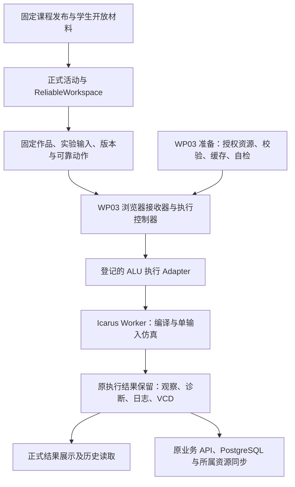

# WP04：正式活动中的 ALU 编辑与运行设计与实施方案

日期：2026-11-05（Asia/Shanghai）。依据：[正式活动中的 ALU 编辑与运行](https://github.com/paher-din/XunJie/issues/192)、[ALU 浏览器实验能力规范](https://github.com/paher-din/XunJie/issues/190)、[ALU 活动决议](../wayfinder/student-agent/alu-activity.md)。核对基线：`wp04@2d030fc`。

**2026-11-06 状态更新：负责人已授权继续实施，并要求先收口 Windows 本机。** 实现、实际截图和分项证据见 [Windows 本机交付](../wp04-192-windows-acceptance.md)；Mac 验收另见 [#206](https://github.com/paher-din/XunJie/issues/206)。本文保留 2026-11-05 的设计基线，下方原文档检查表是设计当日记录，不替代实施验收。工作仍在 `wp04`，沿用正式产品页面与所有者。

交互细节见 [工作区交互设计](../wp04-192-workspace-design.md)。源码结构遵循 [ADR 0003](../adr/0003-runtime-entrypoints-and-owned-modules.md)，视觉遵循根目录 [DESIGN.md](../../../DESIGN.md)。

## 1. 目标与范围

学生从正式课程入口进入固定 ALU 活动，查看目标和公开材料，在现有 Monaco 中编辑 `.sv`，设置一次输入并运行，得到真实编译诊断或 F/Cout。编辑、实验输入、固定依据和结果受到本机保护并同步；刷新后继续编辑、读取原观察，不靠重新仿真补造历史。

本票完成课程资料、正常导入、自动准备/真实自检、公共执行适配、正式编辑运行、诊断、原始观察/VCD 保留、日常重开及所属维护登记。单次输入实验可以独立使用。连续虚拟板与全量检查由 [自由实验与 4096 组行为检查](https://github.com/paher-din/XunJie/issues/193)完成；波形交互、语义引用、预测与解释由 [波形引用、预测用例与比较解释](https://github.com/paher-din/XunJie/issues/194)完成；[ALU 备份与恢复接管](https://github.com/paher-din/XunJie/issues/195)专门验收恢复组合，不承接本票缺失的保存或接线。

已确认且不在本方案重新选择的要求：浏览器 Worker 真实 Icarus/WASM；公开 A/B/M/S/Cin → F/Cout；允许内置加法；保留组合归零；只解释、不代改学生代码；复用正式 UI、WP02 可靠工作区及 WP03 接收/查询/停止/保留所有者。WP05 / Flights 暂缓。

建议工程决定：新增严格的组件清单 v3 和执行动作协议 v3；旧 v1/v2 原样解释；登记式执行 Adapter 隔离聚合与 ALU；多资源结果由原执行 owner 保留；为运行包补充经过校验的内存资源输入。以下接口名称为设计草案，实施时与现有导出对齐，不据此预建通用插件引擎。

## 2. 已核对的接入事实

| 位置 | 当前事实及直接影响 |
| --- | --- |
| [运行包公开接口](../../../components/alu-icarus-runtime/index.d.mts)、[实现](../../../components/alu-icarus-runtime/index.mjs)与 [Worker](../../../components/alu-icarus-runtime/worker.mjs) | 已有 compile/simulate、真实停止、四态及编译缓存；没有业务账本。Worker 按 `baseUrl` fetch 六个 JS/WASM 文件，因此单独缓存准备结果并不能让当前包离线运行。 |
| [运行包清单](../../../components/alu-icarus-runtime/manifest.json) | 固定身份为 `d27007d2f8725b22fc5ff3b7f79b4179c12c103d7789c5bd318cb9be5aa86026`；单模块内存 256 MiB、最长单阶段 60 秒、单生成文件 8 MiB。不能装进旧聚合的 16 MiB/5 秒限制。 |
| [组件 wire](../../../packages/contracts/src/components.ts) | v1 有受限聚合算法或原生会话；v2 有准备，但依赖仅为 JS 脚本，且不声明执行能力。把 v2 标作 ready 不会获得 ALU 执行能力。 |
| [准备模块](../../../apps/web/src/component-preparation/preparation.ts) | 已有固定身份、阶段保护、缓存重验、独立自检和原子启用；取得依赖后统一检查 UTF-8，不能直接读取 WASM。 |
| [固定动作组装](../../../apps/web/src/tool-execution/action.ts)、[执行控制器](../../../apps/web/src/tool-execution/controller.ts) | 固定依据目前只收组件状态；控制器直接调用 `jobFromAction` 并返回 `AggregationOutcome`。不能只替换 Worker URL。 |
| [资源 provider](../../../apps/web/src/tool-execution/provider.ts)、[执行面板](../../../apps/web/src/product/ExecutionPanel.tsx) | provider 逐次从服务取 algorithm；面板直接读取表格参数、聚合分组和 CSV，包含真实产品调用者中的课程假设。 |
| [课程组件 owner](../../../packages/learning-space/src/courses/components.ts)、[学习数据执行 owner](../../../packages/learning-space/src/learning-data/executions.ts) | 已有导入、授权、资源引用、接收与结果验证；执行依据校验仅接受 v1 算法，结果为一个有大小限制的 UTF-8 资源。须同步扩展服务端校验与资源保留。 |
| [ActivityPage](../../../apps/web/src/product/ActivityPage.tsx)、[ActivityWorkspace](../../../apps/web/src/product/ActivityWorkspace.tsx) | 正式外壳、目标/材料、组件标签和可靠编辑已存在；作品编辑没有 ALU 运行入口，`.sv` 尚未映射到 Verilog 编辑器语言。 |
| [ComponentView](../../../apps/web/src/component-host/ComponentView.tsx)、[bridge](../../../apps/web/src/component-host/bridge.ts) | 沙箱 iframe、旧连接退役和操作回执可复用；初始挂载依赖在线 bundle/view/material，离线重开还须补固定视图与材料缓存，不能仅缓存 WASM。 |

[运行包交付](../wp04-191-runtime-plan.md)与 [Mac 验收](../wp04-205-mac-acceptance.md)仅证明独立运行包，不作为本票正式产品、同步或学校部署通过证据。

## 3. 所有者与调用链

即时计算不经业务 API、localhost 或学校执行节点。服务是课程资格、同步与跨机历史的权威，不是每次浏览器计算的调度器。

| Module / 责任 | Interface 与不变量 | 实施位置 |
| --- | --- | --- |
| 课程组件与发布 | 固定定义、资源、运行方案与开放投影；按身份授权读取，禁止任意 URL 代理 | `packages/learning-space/src/courses/`、`packages/contracts/src/components.ts` / `courses.ts` |
| 组件准备 | 沿用 prepare / resume / capabilities / dependencies；取得、验证、自检、启用封装在内部 | `apps/web/src/component-preparation/` |
| 公共执行 | 沿用 submit / query / stop / artifact；接收身份、跨标签 claim、终态竞争、本机保留与同步集中处理 | `apps/web/src/tool-execution/`、`packages/learning-space/src/learning-data/executions.ts` |
| 执行 Adapter | `validateAndFreeze`、`run(fixedAction, verifiedResources, signal)`；返回有界结果资源，或带诊断的失败；不得接受/同步业务请求 | 在 `tool-execution` 下设 Adapter 登记与实现；将现有聚合实现迁入对应 Adapter |
| ALU 课程能力 | 解释源文件集合、公开端口/采样支架、单输入、诊断位置及结果呈现；只消费固定动作和结果 | 建议 `apps/web/src/course-tools/alu/`；课程分发源建议 `components/alu-experiment/` |
| 展示与操作 | 注册的工具呈现与运行操作插槽；编辑器和结果区共用一次 submit，不重复组装依据 | `product/ActivityPage`、`ActivityWorkspace`、`ExecutionPanel` 与组件宿主 |

Adapter 登记只含真实存在的受限聚合和 Icarus ALU 两种实现。按宿主支持的 `adapterId + adapterVersion` 解析；主工作区不按课程名称、ALU ID、文件扩展名选择执行器。原生持续会话保持现有所有者及调用链。

公共控制器负责生命周期，Adapter 负责算法输入/输出语义；聚合参数、CSV 和分组引用从公共控制器/面板移入聚合 Adapter 与呈现器。公共结果外层不理解 F/Cout 或表格。沙箱组件只提出本实例获准的操作与参数，不能指定作品原文、资源 URL、执行引用或可信 initiator。

## 4. 固定清单与版本兼容

建议新增 `formatVersion=3` 独立严格分支，而不是扩宽旧分支或给旧内容补默认值。定义摘要仍基于原版本的规范化内容；历史 v1/v2 的解析结果、摘要、课程发布和恢复保持不变。清单版本、准备协议、执行协议、组件状态和数据库版本分别管理。

v3 包含以下有界声明：

- 固定 HTML entry、状态结构和初始状态、必需能力；本 ALU 视图仅变更自己声明的输入/选择状态，不能获得学生代码写入能力。
- 运行描述：宿主认识的 Adapter 身份、运行包身份、每项资源的 `resourceId/path/role/mediaType/sha256/byteLength`；支持脚本、ESM、WASM、JSON、支架及被动分发附件。路径必须相对、唯一、无越级；资源一一匹配，无额外可执行 URL。
- 操作 `run-single`：参数严格为 A/B/M/S/Cin，公开端口及采样支架版本、编译入口与 include 目录、支持的编译选项、结果格式和预算。课程运行方案将该操作固定为 browser/job。
- 准备协议新分支声明 Worker、WebAssembly、crypto、IndexedDB、MessagePort、Web Locks 及独立编译/仿真自检；未知必需能力/Adapter/版本明确拒绝。旧 hostApiVersion=1 的现有消息继续使用；新字段及消息由双方显式协商。
- 准备资源候选上限为 32 项、单项 8 MiB、总计 16 MiB，覆盖运行资源与对应源码/许可证附件；可执行资源另列精确集合。入口、课程材料、被动附件与执行依赖各有角色，不能把源码归档当脚本加载。实包超出时先复核声明，不静默放大限制。

旧定义不经新版 schema 重编码；旧执行动作仍用原协议的 canonical/digest 路径。新 `runtime`/`limits`/结果格式使用显式版本与 discriminator，原 `ExecutionQuery` 的 output 以版本联合扩展，旧 artifact 字段不加默认值。动作分派、历史读取、维护校验和学校转发都必须识别同一联合；不能在新动作写入后才发现恢复读取仍只认识 v2。

课程组件 owner 完成所有资源的字节校验、资源写入和重读后，才登记完整定义与引用。WASM 不再做 UTF-8 检查；HTML/JS/JSON 仍检查编码及必要结构。CLI 导入、正式 HTTP、学校转发、响应上限、维护引用枚举与恢复校验同步支持 v3，不能只改前端 schema。

**传输上限（2026-11-05 决定）**。六个工具链文件共 3.0 MiB，base64 后约 4.0 MiB；`ivl.wasm` 单项即 2.36 MiB。旧上限按脚本大小设定，无法承载本票的固定资源集合，因此按实际路由分别有界放宽，不引入分片协议，也不扩大与模型无关的其他通道：

| 通道 | 原上限 | 新上限 | 依据 |
| --- | --- | --- | --- |
| 组件导入请求（`manage/component-import`） | 2 MB | 32 MiB | 设计允许原始资源共 16 MiB，base64 后约 21.3 MiB，再加清单与依赖 |
| 单个运行资源上传（`runtimeResources[].contentBase64`） | 2.8 MB（脚本口径） | 11 200 000 字符 | 单项最多声明 8 MiB，base64 后约 10.7 MiB |
| 学校转发的运行资源响应（`releases/…/components/…/resources/…`） | 无独立上限 | 16 MiB | 覆盖上述单项与元信息；按确切资源路由匹配 |

课程导入（`manage/course-import`）原已为 64 MiB，本次不改。运行资源请求体沿用既有 64 KiB 通道，本票不新增可写的大请求。放宽范围仅限上表三条路由：请求与响应分别计限，其他能力不得借用；授权、摘要校验与路径匹配保持原样。

## 5. 资源准备、自检与离线执行

### 5.1 可执行代码与资源取得

Icarus Adapter 的可执行控制代码由产品构建固定分发，支持的 Adapter 版本及源码摘要随构建核对。课程资源不能把任意上传脚本登记成宿主 Adapter。六个工具链 JS/WASM 是固定已知运行档案的资源，先授权取得、逐项验摘要，再交给受控 Worker；课程 HTML 仍在原沙箱中，不取得宿主身份或直接派发 Worker。

**建议给 #191 的公开适配增加可选的已验证资源字节输入。** 保留原 `baseUrl` 调用兼容；新增模式中，主线程从准备缓存读取完整固定资源映射，Worker 重验后使用字节，ESM 工具代码仍经 Blob 加载，WASM 经 `wasmBinary` 装入。六项运行资源缺失即失败，不偷偷 fetch。静态 `index/worker/identity` 由产品打包，构建检查 Worker/模块图全部本地可达，blob/模块 Worker 的 CSP 在两种产品路径实测。

这条路径复用现有 compile/simulate，不重写仿真器，不新增 Service Worker 代理体系。新增字节接口会改变适配器摘要，须产生**新运行包身份**、重跑受影响的公开适配测试并固定到新组件发布；不冒用原 #191 身份或覆盖已发布包。

产品登记按确切 Adapter 版本及运行包身份查找，不将旧活动映射到“最新版”。后续产品更新须保留仍被固定活动使用的 Adapter 实现与读取能力；新运行包只通过新组件/课程发布采用。对应源码与许可证保留在正常分发附件中，不因为宿主已打包控制代码而漏发。

### 5.2 准备事务与自检

缓存分区沿用恢复命名空间、环境/空间/主体、固定定义、配置及设备指纹。内容缓存可按摘要去重，但读取能力不因同摘要跨主体复用而授予。每次使用重验长度和摘要；准备记录在阶段推进前落盘，完整资源、自检与启用事实确认后才切换有效环境。

自检使用独立临时实例、固定公开微型模块和固定输入，真实走预处理、编译、仿真与 VCD 读取；核对已知输出与工具结束。自检模块只验证工具链，不是完整 ALU 答案，不读取学生作品、不生成学生观察、不更新学生已运行作品。记录为 preparation/self-check；学生执行 API 不接受客户端自报的 agent/self-check 发起者。

| 失败 | 恢复与可用范围 |
| --- | --- |
| 资源缺失或暂不可达 | 保留已核验项和原准备身份，重试缺项；作品及已有历史仍可读 |
| 摘要/长度错误 | 拒绝该项及其能力，不启用半包；重新取得原版本，保留诊断 |
| 协议、Adapter 或运行包版本不符 | 明确不支持，提示更新产品或使用兼容发布，不退回其他执行位置 |
| 加载/自检中断 | 原身份继续，未确认的检查重做；原自检实例不当作学生未结任务 |
| 浏览器配额不足 | 不宣布持久准备完成；保留旧有效版本和学生数据，给出存储问题及重试入口 |
| 新版准备失败 | 原版本保持可读可用；已经开始的活动继续固定原发布，不自动升级 |

### 5.3 暂断服务与重开

已核实身份、课程资格和固定发布、仍获准且准备完成的活动，在服务暂断时允许新本地实验；本机保存不等待服务确认。已知撤权、停用、恢复 fence、身份变更立即关闭新执行，不能用缓存 ready 绕过。准备报告不是资格凭证，不新造无限期离线授权。

已打开视图直接用已保护资源；同浏览器重开还需缓存固定 entry、开放文本材料及必要显示资产。建议在同一 `ComponentView` 内为 v3 增加经过原定义校验的 `srcDoc` 挂载方式，在线/缓存均使用相同固定 entry 和初始化消息；旧 v1/v2 维持原挂载行为。保留 `sandbox=allow-scripts`、每次挂载的新 MessagePort/connectionId 与旧连接退役。受控文档在任何组件脚本前注入与原 `/view` 等价的 meta CSP：拒绝网络连接、Worker、嵌套 frame、表单及 object，仅允许原内联脚本/样式与 data 显示资源；iframe 属性继续承担 meta 不支持的 sandbox 限制，不给 allow-same-origin。不得为离线视图放宽沙箱或把工具链搬进 iframe。

该缓存由原组件/课程资源所有者管理，不缓存学校凭证、不扩成完整离线首次启动。课程正文/补学短说明可随固定活动缓存，尚未缓存的 PDF 暂不可读要明确提示；不以短说明可读宣称全部 PDF 离线可用。恢复页如无法按现有身份契约核实资格，可读取本机保护内容并保留输入，暂停新派发；不能凭一份活动 JSON 宣称仍获准。恢复连接后按原身份核实再续传。

## 6. 课程资料与单次实验约定

通过正常组件登记和课程导入交付固定包，包含目标、公开行为表、补学索引、学生起始作品、支架、组件绑定和课程运行方案。学生开放投影与教师私有材料由课程 owner 分离；工程正确实现/故障实现放验收目录，不混入起始文件、开放资源或前端产物。

| M | S | F | Cout |
| --- | --- | --- | --- |
| 0 | 00 | 4 位 NOT A | 0 |
| 0 | 01 | A AND B | 0 |
| 0 | 10 | A OR B | 0 |
| 0 | 11 | A XOR B | 0 |
| 1 | 00 | A + B + Cin 的低 4 位 | 完整和第 5 位 |
| 1 | 01、10、11 | 0，保留组合 | 0 |

A/B 为无符号 4 位，S 为 2 位，M/Cin 为 1 位；逻辑操作忽略 Cin，NOT 忽略 B。允许内置 `+`；旧 `aluSel`、额外标志位、减法和扫描显示不进入本版要求。控制输入使用二值；真实输出保留 0/1/X/Z，缺失不是零。

起始 `alu.sv` 仅有模块端口、TODO 与局部写法提示，不填五种操作实现；未赋值引起的未知输出如实显示。只读验证支架负责连接端口、设置输入、稳定采样、写出固定格式观察与 VCD，不包含答案计算。单次实验设置输入后点运行；输入变化本身只保存草稿，不自动触发仿真。

建议首版支架在 `timescale 1ns/1ps` 下 t=0 施加输入、t=1ns 采样、t=2ns 结束；样例身份固定为一个 index。支架/采样版本、顶层及结果完整性规则对学生公开。组合逻辑未在采样时稳定、X/Z 或没有完整记录均不显示“正确”。这只是本票单次观察，不是 4096 组通过，也不自动判定掌握。

按需补学沿用 [课程资料索引](../../../course_matrial/README.md)：位宽/进位定位理论 01 第 23–24、41–42 页；按位运算定位理论 02 第 3–18 页；表达式/波形关系定位理论 02 第 45–48 页。包内短说明保留原来源、页码及本版改编说明；PDF 走授权材料读取/查看，不能经 UTF-8 组件材料入口解码。原课件访问不足时保留来源与可用短说明，不用旧 PPT 的不同端口覆盖活动规范。

## 7. 固定执行依据与 Adapter Interface

建议新增执行 `protocolVersion=3` 严格分支，仍属于原 `kind=execution`、接收器与执行 owner。v2 聚合/原生动作及摘要不变，不为 ALU 增加接收账本。

点运行时同步捕获当前作品和组件输入，形成不可变快照；随后等待**这份快照**及动作的 IndexedDB 事务完成，再接收和 claim。异步保存等待期间的新编辑继续留在当前 head，不被旧快照回写。无法可靠保护时不启动 Worker。

固定依据覆盖：主体/活动/组件实例、请求与输入摘要；真实源文件路径、objectId/contentId、UTF-8 内容及摘要；include 闭包；只读支架与显示配置；顶层、编译入口/选项；A/B/M/S/Cin；课程发布、行为表/采样规则、组件定义、课程运行方案；Adapter/运行包身份、实际资源及执行预算。严格校验相对路径、重复、保留路径冲突、缺 include 和不支持的选项。

本地与服务端都重推导固定依据：参数按本操作 schema 校验，组件/资源来自活动的原固定发布，运行方案摘要来自该发布及配置，预算不超过对应 Adapter profile。代码原文与内容摘要相互校验，资源引用不因客户端给出 SHA 就变得可信；服务 owner 的当前资格核验与浏览器设备自检分开，保持原可信来源。

首版可保守固定活动中全部获准 `.sv/.v/.svh/.vh` 文件及声明的只读依赖，不要求从学生 HDL 静态推导最小 include 闭包；实际编译入口另列，不能把头文件误当独立编译单元。缓存身份至少覆盖所有这些编译相关输入；实验输入仅在支架通过数据文件供仿真读取时可不进入编译键，必须进入本次执行摘要。

Adapter 输出建议为 `{ outcome, diagnostics, resources, provenance }`：资源是有界的原始观察、日志、VCD；provenance 与固定依据吻合。控制器验证结构、资源摘要/预算，再调用原保留机制。Adapter 不能自报新 requestId/executionRef，也不自行发布终态。编译失败同样保留诊断资源与依据；失败记录不要求产生 F/Cout。

预算建议（实施需真实测量并可收紧，不是性能 SLA）：

| 范围 | v3 ALU 候选限制及约束 |
| --- | --- |
| 输入 | 源文件/支架至多 64 项，总 UTF-8 1 MiB；路径及正文同时计入传输限制，沿用作品更严格上限 |
| 时限 | 冷编译 30 秒、单次仿真 5 秒，整条作业 40 秒；阶段不能借重试重置总预算，均不超过运行包 60 秒单阶段硬限 |
| 内存 | 每 WASM 模块 4096 页即 256 MiB；保留运行包限制，不声称浏览器总内存可硬控 |
| 输出 | 原始日志合计 2 MiB、VCD 单项 8 MiB、结构化摘要 1 MiB，结果资源总计 16 MiB；超限明确失败，不截短后报完整 |
| 并发 | ALU 每浏览器 origin 同时 1 项，排队至多 1 项；Web Locks 与持久 claim 共同约束跨标签，自检也占同一资源槽 |
| 缓存 | 沿用运行包至多 8 个编译项/32 MiB 的可丢弃缓存；历史依据和结果不得随编译缓存淘汰 |

先保留旧聚合的独立预算 profile，再加入 ALU profile；不能全局放大 `executionLimitsSchema` 后让旧算法获得额外资源。跨不同 origin 不宣称统一并发控制。

## 8. 接收、停止、保存与重开

| 情形 | 固定处理 |
| --- | --- |
| 重复同一请求 | `requestId + inputDigest` 相同返回原 acceptance/executionRef，不再运行；同身份不同输入拒绝 |
| 接收回执丢失 | 原动作与依据已保护；查询原身份，未确认前不新建请求。服务同步迟到不触发 Worker 重跑 |
| 运行时编辑/改输入 | 当前 head/输入草稿照常更新；已接受快照不变；旧结果只归原观察 |
| 双标签同时操作 | 原 CAS/候选比较保护作品；同请求仅持有 claim 的页面可运行/写结果，generation/fence 拒绝旧连接 |
| 取消尚未开始 | 持久停止/取消先落盘，晚接收不得复活；可确认从未启动才报告已取消 |
| 停止运行中 | signal 贯穿编译与仿真，实际终止 Worker 后确认；仅写 stopRequested 仍显示停止待确认 |
| 完成与停止竞争 | 在原账本事务中唯一裁决；已确认终态不倒退，晚结果不能改成新终态或覆盖当前输入 |
| 切换/关闭工具视图 | 视图卸载不销毁活动级控制器，查询和停止仍可访问；不把 iframe alive 当执行 alive |
| 刷新/关页后重开 | 查询原身份与历史；已开始但无可信终态为未知，不自动重跑。原 WP03 可证明未开始的队列策略保持兼容；不把未知归成未开始 |
| 结果保护失败 | 不发布成功或虚假历史，保留可读内存/导出并报告存储问题；服务重传不能代替本机保护 |
| 资源丢失/损坏/无权 | 分别提示缺失、完整性失败或权限问题；只读原记录，不重新仿真伪造旧 VCD |

组件状态只保存实验输入草稿、所选历史 requestId 与必要显示偏好；**不保存第二份 F/Cout、诊断、日志或 VCD 正文**。显示内容从原执行结果读取，历史选择也不改写当前作品。运行不会发送或清空原问题草稿。

## 9. 多资源结果、服务同步与维护

建议 v3 结果记录使用一个不可变结果清单，列出观察 JSON、诊断/日志、VCD 的稳定资源身份、媒体类型、摘要和长度。清单本身绑定 requestId/inputDigest/executionRef、作品/运行包/行为规则与 initiator。单次观察的 index、F/Cout 四态、完整性与采样条件显式保存；缺 VCD 或观察不完整如实标记。

浏览器在原执行存储中扩展资源与清单保护，写入并重读校验后才发布可见结果引用；崩溃后未发布资源可以按原记录继续关联，不能新建一份“完成”。服务端复用所属 storage 的 stage/read/reference 能力，所有资源确认后在短事务提交结果清单、查询事实和引用。服务同步按原身份、原摘要恢复，结果资源先于最终引用确认；半包不报完整。一个 executionRef 只允许一个已发布结果清单，相同资源/清单身份重传必须字节相同；迟到的不同正文不能覆盖。停止与结果提交仍在原账本裁决，允许保留原执行的部分产物，但不能凭部分产物宣布成功。

现有单 UTF-8 `artifact` 接口保留供旧聚合使用；新增按清单角色读取资源的有界接口，逐次核验原执行、活动、资格与完整性，学校转发保持相同限制。产物上传、历史读取、导出与资源恢复必须覆盖大 VCD，不能塞入当前 2MB 文本接口或只扩大一个 Zod 字段而忽略 HTTP/转发限制。

| 持久事实/资源 | 原所属机制及本票工作 |
| --- | --- |
| 起始作品、当前源文件、输入/选择状态 | WP02 works 和可靠工作区；沿用 CAS、保护、资源及历史引用，不另建 ALU 保存队列 |
| 固定代码/依赖与待发动作 | 原 intents/basis/executionCommands；固定内容登记不推进当前作品 head |
| 原始观察、失败诊断、日志、VCD 与结果清单 | 原 learning-data executions + storage 资源 pin；关闭活动、升级组件和清缓存不解除历史引用 |
| 固定组件、支架、运行包与公开材料 | courses owner 的不可变定义、发布与所属资源保留；旧活动继续读取原版 |
| 准备记录和编译缓存 | 原浏览器准备/执行分区；本机缓存可重建，不冒称已进入服务备份；准备报告按原请求同步 |

本票同步更新 [执行维护边界](../../../packages/learning-space/src/learning-data/maintenance.ts)、validate/资源枚举与备份参与者。恢复验证重推导动作、结果清单、资源长度/摘要和 pin，而非只比行数。只读试还原拒绝运行/状态写入；接管 fence 拒绝旧代际派发。服务尚未接收的浏览器独有数据不计入服务备份。

可能需要 PostgreSQL 追加迁移和 IndexedDB 非破坏升级；先列出实际表/索引、升级谱系、失败保留与回退约束，实施时再分配迁移编号。**本次文档工作不创建或执行迁移。**

## 10. UI 迁接与旧消费者处理

主工作区只增加通用运行/结果呈现插槽和能力判断；ALU 单输入表单、F/Cout 与诊断解释放在 ALU 呈现器。现有 Monaco、文件标签、目标/材料、问题草稿、工具拖拽分屏与主题均复用。`.sv/.svh/.v/.vh` 补齐语言映射；编译错误按固定文件路径解析，能定位到同内容当前文件，内容变化时先展示原依据，不能错标当前行。

现有 `PrepWorkspacePage` 使用 `HdlToolArea` 的板/波形/构建展示与 `ExecutionNodeSelect`；教师设计页也使用节点选择。迁接前先列出所有真实 import/调用方，提取纯展示供后续虚拟板/波形消费。正式 ALU 不接旧节点/HDL session、build/load 或旧检查表。

本票替代的公共聚合展示假设和 ALU 专属旧接线应移出正式路径；确认没有消费者后再移除。C、教师与旧预览仍使用的共享节点/会话能力保留并注明后续 owner，不删除整个 `HdlToolArea`、`ExecutionNodeSelect` 或 legacy 后端。删除具体文件/目录须先给出清单及影响并单独取得负责人同意。

## 11. 实施顺序与改动集

以下是一个票内的顺序，不是可延期交付的半成品：

1. **固定资料与契约。** 生成课程包草案、公开规则/支架/骨架；加入 v3 manifest/action/result 与旧摘要兼容验证，确定预算。列出需审批的 schema/删除事项，未授权前不执行。
2. **公共执行先去聚合假设。** 将算法输入、结果、CSV/引用呈现迁入聚合 Adapter；实际 `ExecutionPanel`、bridge、action/provider 与服务校验同步迁接，先通过 WP03 三类样例。
3. **准备与运行包接通。** 多资源登记/授权/校验/缓存/自检，补资源字节模式与离线挂载；重新固定运行包身份，验证中断恢复和旧版本保留。
4. **正式活动完整运行。** 正常导入、可靠编辑/输入、固定动作、编译/仿真、真实文件诊断、结果清单、本机保护、服务同步、重开与双标签竞争，一起接入现有产品入口。
5. **维护与平台收口。** 完成所属资源验证、只读/fence 回归；整理旧消费者、取得必要删除授权后移除；完成两平台两连接路径验收及前后截图。

预计写集为上述 contracts、learning-space courses/learning-data/learning-entry、Web component-preparation/component-host/tool-execution/product、产品学校转发与打包、ALU 课程分发源、运行包适配及关联测试/文档。仅改实际消费者；不重构模型、Agent RunDriver、教师提交或其他无关模块。

## 12. 验收设计

主边界为正式 Chrome 活动 → 可靠作品/动作与组件执行 Interface → 真实 Icarus Worker → IndexedDB → 业务 API/PostgreSQL/所属资源 → 重开后的作品与观察。正常入口禁止测试接收器/fixture API；工程正确/故障源只作为验收输入经真实编辑导入。故障注入仅控制公开传输或接收/查询时序，计算与存储保持真实。

下表顺序对应实施票的 14 条验收要求；所有项在实现后单独记录结果，不以计划表代替证据。

| 编号 | 必须覆盖的行为与证据 |
| --- | --- |
| A01 正式入口 | 正常 component/course-import 后从课程卡进活动、目标/材料、作品和工具；普通 Web/实际产品包同实现；生产产物无测试接收器和验收答案 |
| A02 课程资料 | 核对全部公开操作、保留归零、允许加法、来源/页码；起始骨架无完整答案，学生投影/网络包不含私有评价及工程实现 |
| A03 公共资源 | v3 多资源正常导入和授权读；WASM 真正装载；未知能力/错预算拒绝；v1/v2 原定义摘要与历史读取不变 |
| A04 准备自检 | 真实编译仿真、自检/学生状态隔离；缺资源、错摘要、版本不符、加载中断、配额不足、失败更新保留旧版；原准备身份续接 |
| A05 编辑与固定 | 编辑无需保存再运行；源/include/入口/支架/选项/运行包变化触发正确缓存失效；点击后异步保护期间的新编辑不混入原动作 |
| A06 结果归属 | 运行后修改显示待运行；新编译失败定位真实文件并保留旧结果标签；X/Z/缺失有区别，不把完成当正确 |
| A07 接收停止 | 相同请求只算一次、换输入拒绝、接受丢回执沿原身份查；等待/编译/仿真/保留时停止及完成竞争，实际 Worker 终止后才确认 |
| A08 固定结果 | 原始观察、诊断/日志/VCD 多资源完整落盘；组件状态无结果副本；initiator 可追溯，学生通道伪报 agent/self-check 拒绝 |
| A09 暂断同步 | 准备完成且获准时阻断应用服务，浏览器仍真实运行；恢复同 requestId/result 关联；已知撤权拒绝新运行；网络记录证明无 localhost/远端仿真 |
| A10 日常恢复 | 刷新、返回、关工具、双标签、旧 MessagePort/旧 generation、较早确认、未知任务不重跑；历史读取无需编译缓存；运行前后问题草稿完全保留 |
| A11 维护与帮助边界 | 新结果资源与 pin 被 validate/备份参与者枚举，损坏/缺 pin 拒绝；只读还原/旧安装失权；ALU 观察及验证 Interface 无学生代码改写操作；不宣称真实 Agent/教师链路完成 |
| A12 UI 与旧消费者 | 按交互设计完成真实前后截图，记录迁出/移除/保留的实际消费者；不出现第二正式页面、节点选择、保存/冻结/装载前置操作或常态保存标签 |
| A13 平台路径 | Windows 11 x64、Apple Silicon Mac 各验证本机实际产品包及独立学校 HTTPS 页；真实 PG/API/资源；学校页无本机数据库/执行组件依赖，同机代理不作跨机证据 |
| A14 回归与报告 | 受影响类型/构建、公共契约浏览器边界、WP03 无执行/聚合/原生会话；编辑器、导航、主题、分屏、焦点、中文输入；工程/Chrome/部署/教学效果分别报告 |

工程验证从 workspace package.json 与现有测试入口选择：`npm run typecheck`、`npm run build`、`npm run check:contracts:browser`、受影响行为测试、`npm run check:docs`；无需为文案或薄包装新增镜像测试。新增行为测试覆盖以上 Interface 的身份、竞争、资源完整性与故障恢复。真实 PostgreSQL、Chrome、产品包和学校 HTTPS 验收单独执行，单元测试通过不抵扣。

两平台 × 两连接路径记录 OS/Chrome/产品构建、组件与运行包身份、课程发布与服务环境、原执行身份、资源摘要及截图。测量首次准备、冷编译、复用、单输入运行、停止、重开及资源量；沿用 #191 4096 oracle 与负例验证运行包改动，本票不提前宣称已有全量检查 UI。

## 13. 待审阅事项与本次验证状态

需要负责人审阅的工程决定：v3 独立分支及按 Adapter 的预算；运行包的资源字节模式与新身份；单输入操作/公开采样支架；多资源结果归原执行 owner；通用呈现插槽与 ALU 局部 UI。它们不改变已确认的课程目标或产品导航。

后续触及数据库 schema/迁移、删除文件/目录、`.env`/凭证/CI/CD 或公开部署时，按根 [AGENTS.md](../../../AGENTS.md)列明实际操作、理由与风险另行取得同意。本设计稿不代表这些操作获准，不预先申请一揽子高风险授权。

本次只核对当前分支源码与需求并形成文档。验证结果如下：

| 检查 | 本次结果 |
| --- | --- |
| 四份改动文档的相对链接 | 通过，161 个本地目标无缺失；最终稿再次检查 |
| 受 Git 管理的 Markdown 加两份新增文档 | 通过，213 份文档、1924 个本地目标无缺失；排除归档，未将既有未跟踪临时材料作为项目文档 |
| 默认 `npm run check:docs` | 失败，全部 44 项缺失链接来自开始前即存在的未跟踪 `.tmp/thread.md` / `.tmp/thread_tools.md`；未修改、删除或忽略这些无关文件，未把默认门禁写成通过 |
| Git 差异空白检查 | 通过；新文档另做相同空白检查 |
| 业务类型/构建、真实仿真 | 未执行，本次无业务代码改动 |
| Chrome、本机产品包、学校 HTTPS 与教学效果 | 均未执行，不记作通过 |
