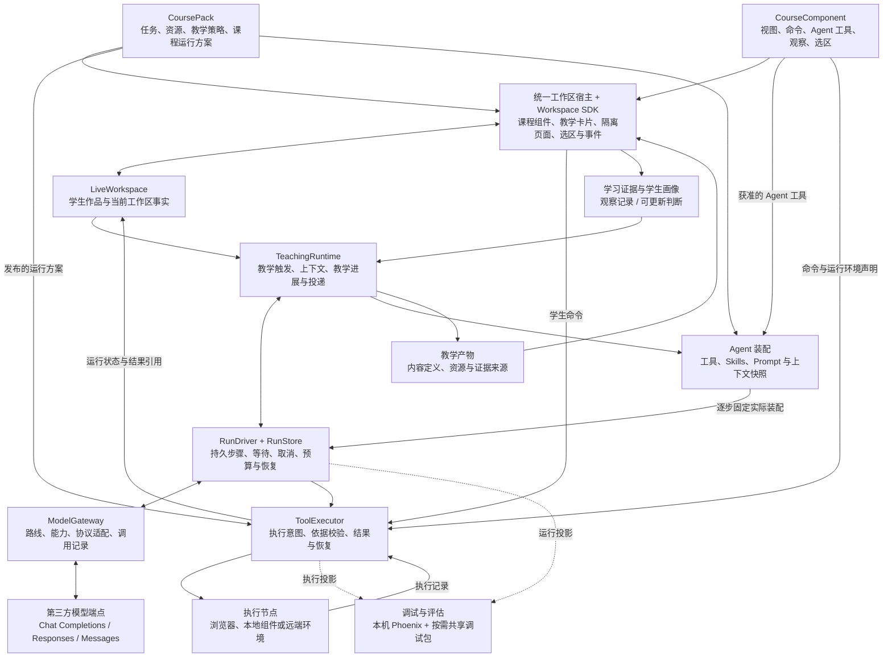

# 循阶学生端 Agent 架构

更新：2026-10-29。状态：长期目标架构设计；总体运行、部署与 Agent 能力已形成具体方案，本轮新增消息调度、过程展示、自主学习与完整请求走查。Robert 指出的 tool_use、Skills、MCP、plugin、system prompt 覆盖缺口已有逐项契约；方案仍按具体问题修订，总体设计已按[最终决议](https://github.com/paher-din/XunJie/issues/119#issuecomment-6443526782)定稿。产品要求、工程取舍与实测结果分开记录，见[需求与决策记录](student-agent-decisions.md)；本文不表示代码已经实现。

决策入口：[学生端 Agent 与工作区重新设计：数字逻辑与部件设计先行](https://github.com/paher-din/XunJie/issues/112)。本文汇总领域与产品行为；[总体运行与部署设计](references/2026-10-27-overall-architecture-proposal.md)定义模块组合、持久运行、部署和演进契约；[Agent 能力与质量契约](references/2026-10-27-agent-capabilities-design.md)补充工具、Skills/MCP/Plugin、Prompt、上下文、Memory 与回合行为；[覆盖审计](references/2026-10-27-agent-design-coverage-audit.md)保留问题来源和覆盖状态。局部决议以对应议题为准，执行方向及教师易用性依据[本地优先执行决议](https://github.com/paher-din/XunJie/issues/114#issuecomment-6363162710)。

负责人最新确认：新消息默认引导当前任务，可在设置中改为本轮结束后处理；Agent 显示工具调用、思考摘要和真实状态；个人空间无需先建课程即可直接自主学习。具体介入边界、显示程度与无课程默认能力见[交互设计](references/2026-10-27-agent-interaction-design.md)，工程设计不把“已接收”当作“已采纳”，也不将模型推理原文无条件展示给学生。

## 要解决的问题

循阶要把 Agent 放进学生实际动手的学习过程：它能读取正在变化的工作区，利用课程能力观察、验证和引导，并通过 IP、对话及交互内容持续与学生协作。学生无需管理保存版本；教师更换课程时通过课程发布装配课程组件。

本轮聚焦学生端。教师如何交付课程、哪些材料只供教师使用，以及学生过程如何留下证据，属于必须保留的接口；教师端 Agent 与教学分析系统暂不展开。

当前实现仍要求手动确认作品与冻结快照，学生辅导是一次有限动作，课程面板包含固定分支。已有运行输入绑定、执行记录和沙箱生命周期可以复用。源码依据及技术前提见[事实核对](references/2026-10-18-architecture-checks.md)；重构切换时还需处理教师端共享的提交和模型接口。

2026-10-28 已澄清：旧版未发布、只有开发数据，按新模型直接重建 schema 和接口；旧原件保留、按需提取，不做旧 API、旧会话或生产双写兼容。未来已发布数据的升级与恢复契约继续成立。ALU 和伯克利 STAT 20 / Flights 的具体内容是开发、验收与演示资料，准备这些资料属于开发交付，但不是产品功能本身。教师端课程设计与制作仍是产品能力，当前阶段只展开必要接口，深入设计留在后续教师端主题。来源与工程安排见[重构方案](references/2026-10-28-rebuild-storage-and-acceptance-proposal.md)。

权威事务记录已确认本机与共享端统一原生 PostgreSQL，由产品管理本机实例；同机可共用物理实例，保持服务的事实所有权。浏览器草稿与执行器内部文件按职责保存，资源默认文件、可选 S3 兼容后端。直接重建与存储依据见[本地最终决议](wayfinder/student-agent/rebuild-storage.md)和[重构方案](references/2026-10-28-rebuild-storage-and-acceptance-proposal.md)；安装和持久恢复探针尚未执行。

2026-10-29 实施交接：按[实施总览](student-agent-implementation-overview.md)划分工作包和 `blocked by`，每包完成自身范围与已完成依赖的完整验收，不另设整轮重构总验收。全部 Wayfinder 结论和研究附件从[本地决议索引](wayfinder/student-agent/README.md)进入。

## 从问题出发的架构判断

总体方向合适，但不应把模块名称都建设成独立框架。真正需要解决的是：学生持续操作时，Agent 能依据正确的内容采取合适的教学行动；教师更换工具时，不必重写学生工作区。由此确定以下边界：

- 学生作品、实际执行输入和教学证据必须由循阶掌握；模型会话只是一次推理所用的表示，不能成为这些事实的唯一存储。
- 教师决定课程组件及运行方案，平台检查实际设备并按方案调度。尽量在学生本机运行，仅为本地确实不能满足的能力配置远端路径；学生不选节点。
- 课程组件与生成教学页面共用状态、选区、事件和隔离宿主。组件定义可复用，教学产物实例保留学习过程，两者不需要两套运行设施。
- 教学协调负责触发、上下文取证与交付；自有持久 RunDriver 负责一次逻辑运行的完整调度、等待、取消、预算和恢复。模型连接按[三协议决议](https://github.com/paher-din/XunJie/issues/115#issuecomment-6346123203)采用直接协议 SDK 加薄适配。
- 支持个人全本地、组织统一部署和模块本地/云端组合；客户端、空间/课程、学习数据、教学协调/Agent、模型连接和工具执行构成六个部署单元，同机可合设进程，跨机保持同一契约。

[内核研究与接入探针](references/2026-10-27-agent-kernel-reuse-research.md)比较自有持久 driver、Pi core、Pi durable 与 DeepSeek Harness 后，长期选择自有持久 RunDriver：运行阶段直接表达原生结果、命令回执、等待、预算和取消条件，本机与共享服务使用同一恢复规则，减少框架特定消息与重放策略的适配。项目长期承担调度、领取、预算、取消、恢复和记录升级。Pi durable 整体托管是有实质收益的替代，现有证据没有证明它总成本更高；本次选择也不以教学事实自有或流程短为推导前提。不预设未来换框架，实际问题发生时再修订。详细取舍见 [ADR 0002](adr/0002-own-teaching-state-and-effect-control.md)。

**工作区宿主**是装载课程组件与教学内容、管理生命周期、提供公共交互能力的应用底座。**ModelGateway** 是可信应用服务中的模型调用入口：选择配置的路线、提供凭据、适配协议、检查能力并记录调用。图中的边界是职责边界，并不各自对应一个服务。

| 边界 | 持有的职责 | 不应接管的职责 |
| --- | --- | --- |
| 工作区宿主与 SDK | 组件和产物呈现、公共选区与引用、装配、状态桥接与生命周期 | 每门课程的业务分支、教学判断 |
| LiveWorkspace | 自动同步的作品、对象、需要恢复的交互状态与来源关系 | 将任务成功直接解释为知识掌握，或接管临时浮层位置与焦点 |
| TeachingRuntime | 介入时机、关注对象、教学进展、上下文构造、动作候选与交付 | 用某家模型的会话数据替代领域状态 |
| RunDriver / RunStore | 请求内的持久步骤、调度、预算、等待、取消及恢复；每个运行只有一个有效推进者 | 替代作品、执行结果和学习证据的实际所有者 |
| ToolExecutor | 执行读、算、写命令，保存执行意图与结果，处理重复与未知结果 | 决定学生下一步应该学什么 |
| ModelGateway | 路线与协议能力、模型调用、取消、超时、用量与原生回放 | 修改工作区、发布教学动作 |
| 教学产物定义与资源 | 内容、依赖、状态 schema、来源及发布状态 | 另存一份可变交互状态，或把教学示意当作实验事实 |
| 证据与画像 | 保存学习观察及其来源；维护可更新的学习判断 | 根据一条行为给学生下永久结论 |

## 实时状态与自动保存

本节按[工作区交互与状态决议](wayfinder/student-agent/workspace-state.md)同步设计边界；完整契约与不变量以该决议为准，[可操作原型](../../apps/student/prototypes/workspace-state.README.md)提供讨论证据，尚未接入真实保存、同步、实验或教师服务。

学生修改先在界面生效，并在本机持久记录待同步操作；应用服务连续接收变化。合并传输应有最长等待时间，持续输入也会同步。断线恢复按操作身份去重补传。自动保存与实验运行分别进行，保存不等于重新装载或重新运行。

“Agent 知道当前状态”包含两层：系统持续接收变化，需要当前内容的判断与动作读取相关的最新事实；明确指向历史引用或实验的问题保留其固定依据。模型无需在每次按键时运行，客户端尚未同步的修改不能被服务端当作已经知道。

不同操作在真正使用数据的位置固定依据，不统一要求先绕行云端：

| 操作 | 依据与同步要求 |
| --- | --- |
| 本地显示、滑块、筛选与编辑 | 本地即时响应，合并同步必要状态；不逐次调用模型 |
| 学生发起本地实验或装载 | 先在本机持久绑定命令与实际输入，再直接交给本地执行器；输入、结果与证据随后同步 |
| 向应用服务上的 Agent 提问或向教师提交 | 点击时固定问题、引用、作品及相关证据，只等待本次依赖同步；之后编辑不替换依据，也不使本次请求无限等待 |
| 发起远端执行 | 固定实际输入，待相关内容同步后按执行意图交给课程运行方案允许的节点 |
| Agent 发起命令 | 先持久化执行意图；目标节点校验输入与条件。需要当前内容而发现新修改时，重新取证，不静默使用另一份输入 |

每次运行保留不可变的输入身份和内容，学生不选择版本。首条 ALU 通过明确运行使用新代码，实验输入即时作用于已运行代码；继续编辑不改变已启动实验的输入归属，提示“修改尚未运行”。新输入形成新的实验观察，不改写旧观察；其他工具仍按自身生命周期执行。云端尚未收到的结果不参与云端教学判断。

界面区分正在保存、已保存在本机但待同步、已保存及保存失败。明确发送后的待发意图可靠保存，相关同步恢复后自动完成，等待中可取消；取消不能在恢复后复活。接收回执到达才算成功，结果未知先按原请求身份查询，重试不另造交付；学生明确发起的新交付与网络重试分别表达。

同一浏览器刷新或短暂断线后，恢复已完成本机保存的作品、实验输入、问题草稿和待发动作。中断实验不自动重跑，真实结果未知的操作按原身份查询；保存失败或未确认保存的内容不能声称已可靠恢复。局部断线可继续的能力按实际资源确定，不据此承诺完整离线首次使用或多设备协同。

LiveWorkspace 是同一个工作区对象体系：绑定的学习数据服务持有已接收事实，本机保留待同步操作及本地执行记录。学习数据服务本身可在本机或远端，归属不随位置变化。产物实例的可恢复状态也属于这一体系；资源仓库保存定义和素材。每份可变事实只有一个负责更新的服务，不以多主数据库或通用事件溯源框架代替业务契约。

**作品提交面向教师，自动保存保护持续创作，两者独立。** 学生可以把本次结果交给老师；提交时系统自动绑定交付内容和相关过程证据，后续编辑不静默改变老师收到的这次结果。提交不要求手动保存、冻结或选择版本，也不直接表示知识已掌握。教师审阅与修订的具体流程另行设计。

提交时尚未结束的实验、失败和缺项如实标注，不强制等待实验，也不在结果稍后到达时补入已固定交付。后续修订另有关联交付，进行中摘要与正式交付分别表达。

| 数据 | 语义 |
| --- | --- |
| 工作区事实 | 当前作品、对象及需要恢复的草稿、引用和实验输入；临时选区、浮层位置和焦点归呈现层 |
| 执行记录 | 实际使用的输入、命令、进度、结果和错误 |
| 学习证据 | 学生的预测、回答、实验、解释、修改和帮助使用情况 |
| 画像判断 | 根据证据形成的阶段性认识，与证据分开保存并允许修正 |

已确认：学习画像先在同一门课的多个任务间积累；跨课程只共享明确通用的偏好，不自动迁移学科掌握结论。画像更新保留证据归属，使后续解释和纠正有依据。

学生可查看简明能力判断、主要依据和不确定性，提出异议或补充证据。争议推断在复核前不再作为确定事实推动同类补学；复核结合实际作品、帮助情况和新证据更新或撤销判断，保留理由。原始记录不因异议被改写，Agent 修正不自动改变教师正式评价。该边界已[确认](https://github.com/paher-din/XunJie/issues/118#issuecomment-6364293339)，活动恢复和证据分层见[连续教学方案](references/2026-10-23-continuous-learning-proposal.md)。

教师可持续查看本课程的进展摘要、可能的困难及必要依据，争议判断标明待复核或已修正；提交时固定作品版本、关键证据、帮助情况与当时判断。进行中摘要随新事实更新，与固定提交和教师正式评价分别表达。后续画像修正通过关联记录体现，不静默改写当次交付。完整语义依据[连续教学决议](https://github.com/paher-din/XunJie/issues/118#issuecomment-6364486548)；第二个实际样本已确定为伯克利 STAT 20 / Flights，资料制作、接入和验证按[实施总览](student-agent-implementation-overview.md)由相应工作包完成。

运行时按对象和相关内容记录读取依据。相关内容改变时重新读取，动作写入时检查条件，展示前检查是否仍适用；移动光标或调整布局不使所有推理失效。多端并发编辑策略将在使用环境确定后补充。

## 通用选区与引用

工作区提供两种已确定的交互：对话关闭时，完成选择后显示“询问 Agent”工具条；对话打开时，选中内容自动加入输入框旁的引用区，学生继续输入自己的问题。选择本身不发送消息或调用模型。固定面板求助按钮由这套公共交互取代。

文本、编辑器、表格、波形、画布和隔离页面通过统一 SelectionProvider 报告语义；宿主负责引用呈现和提问入口。课程组件必须说明对象身份、选中内容、定位方法和回到来源的能力。常用文本与编辑器适配由 SDK 复用，全新组件类型补充适配。

引用保留学生当时所指内容及稳定来源身份，并在来源仍可用时支持定位。波形、板信号等引用保留实验、观察与类型化范围；来源已变化或不可用时仍保留选中副本，不按同名对象猜测替代来源。已加入草稿或已发送的引用都不随编辑静默改变；引用原文与发送时的当前作品分别表达。

临时选区默认替换，保留引用后才形成多处引用；输入框焦点变化和对话开合不清空引用，用户移除后不因失焦再次加入。教学卡片和生成产物也接入同一选区能力。旧教学动作执行前重新核对作品、观察、目标、课程策略和学生设置，过期动作停止并重新取证，不以历史解释仍可读为由继续执行。

## 课程组件与课程发布

课程装配单元统一称为 CourseComponent；早期底稿中的 CapabilityPlugin 是这层实现包的旧称。扩展包（Plugin）是分发层，可以包含课程组件、Agent 工具或 Skills，不能再与课程组件互作同义词。

将“组件包”拆成两个职责：**CoursePack** 是教师组装并发布的课程配置与资源；**CourseComponent** 是课程可复用能力的定义与实现。组件有两类已明确的来源：开发者提供常用组件供教师选择，教师也可借助教师端 Agent 创建自己的组件。学生端统一装载两类产物，组件来源不决定其接入权限。

组件目录提供发现入口，教师组件库保存可复用组件及其草稿、可用版本。入库与发布给学生分开；课程选择固定版本，教师预览和每位学生各自拥有活动实例。组件清单、统一状态/命令/观察/引用契约及资源边界依据[课程工具与生成内容决议](https://github.com/paher-din/XunJie/issues/117)，具体市场页面与完整教师创作产品不在本轮展开。教师能创造新界面、新算法，生成结果通过接入检查后装入课程。

| 对象 | 主要内容 |
| --- | --- |
| CoursePack | 学习目标、任务、学生材料、初始内容、默认布局、能力依赖与版本、课程运行方案、教学策略、可用 Agent 工具与 Skills |
| CourseComponent | 可复用组件定义与固定资源；按需提供视图、命令、观察、选区、语义锚点，声明 API/状态版本、输入输出、环境需求、示例与自检 |
| 活动中的组件实例 | 归属、组件版本、作品引用、已保存交互状态及运行/观察引用；不同学生与预览实例相互独立 |
| CourseExecutionPlan | 各能力的运行环境、版本、资源和设备要求，本地安排，以及确有必要时配置的远端路径 |
| Workspace SDK | 状态读写、命令调用、选区引用、锚点解析、受控交互、资源访问与生命周期 |

能力包只实现自身需要的贡献接口，不要求每个组件都有面板、编译器和教学策略。平台内建、受信的组件可直接注册；教师生成或外部提供的界面通过隔离 HTML/JS/WASM 包接入同一 SDK。符合已支持 API 和运行环境的新包可独立加载，不要求重新部署主前端；现有环境装配方式能承载的新依赖可随组件交付，只有超出执行能力的系统、硬件或控制机制才需增加适配并验证，不能由包任意安装到学生电脑。

教师易用性是组件交付的要求。平台直接执行构建、兼容依赖准备、固定检查、设备检测和已支持的恢复程序；Agent 理解需求、推荐组件、生成或修正实现与说明，教师核对教学与试用结果。只有超出现有系统、硬件或执行控制能力时才需要平台开发者新增适配；新课程或新算法本身不要求改主工作区。准备失败保留配置和进度，重构验收记录实际操作与阻碍。[职责与准备路径](https://github.com/paher-din/XunJie/issues/117)

包声明需求，执行节点提供环境，教师在课程设计时确定运行方案。平台在活动开始前检查真实设备；缺组件先引导准备，不能把“尚未安装”自动判断为“本地无法支持”。只有已发布方案包含适用的远端路径时才安排远端执行；没有可用路径则明确缺少的条件，由教师修订课程或完成环境准备。学生看到课程是否就绪和需要做什么，不看到节点选择器。

课程、能力包和运行方案固定版本并一起发布。组件新版本可用后，提示教师受影响的课程任务，由教师选择同步；兼容检查成功后更新所选任务供后续新活动使用的版本，已开始活动继续原版。本轮不迁移进行中活动。教师决定运行条件与资源安排，不需要预先知道每位学生的物理节点身份。[更新决议](https://github.com/paher-din/XunJie/issues/117) · [运行安排理由](adr/0001-teacher-owned-course-execution-plan.md)

宿主依配置装配能力，避免数字逻辑/C 等课程特判。关闭视图释放该连接及订阅，运行按自身生命周期处理；停用、移除库入口与删除学生数据分开。仍被课程或活动引用的固定版本保留供使用和恢复；不能再运行时保留可读作品、引用和历史结果，明确交互不可恢复的范围。

内部能力直接注册；MCP 接入外部 Agent 工具和资源，MCP Apps 适配外部交互界面，不要求每件课程组件先实现 MCP 服务。Skills 提供操作与教学指导，不扩大权限。学生组件包、Skills 和 Agent 只获得教师开放的内容与反馈；私有原文保留在教师或受控评测侧。需要保密的评测材料不下发学生设备，其评测在教师侧或明确配置的受控服务执行，日常实验仍按课程本地方案进行。Apps 上下文更新不等于工作区保存确认。[当前规范与复用依据](references/2026-10-26-course-tool-host-research.md)

## Agent 能力与评估

[能力设计](references/2026-10-27-agent-capabilities-design.md)确定每个步骤如何装配：AgentDefinition 定义角色与策略；AgentToolRegistry 绑定获准操作及实际执行器；Skills 按需加载；MCP tools/resources/prompts 分别映射操作、材料与任务模板；Plugin 负责分发，不成为另一套运行框架。Prompt、能力及上下文保存实际快照，每个 step/attempt 绑定当时版本；运行中加载、切换或压缩均追加记录，恢复不能采用后来才生效的配置。

综合功能、操作体验、异步协作和本机试用结果，负责人已确认各开发者按需运行本机 Phoenix + SQLite（[L33](student-agent-decisions.md#来源与状态)），以同仓可选 OTel/OpenInference 集成和 TypeScript 评估工具追踪完整 Agent。团队共享含报告与结构化材料的 ZIP 调试包、固定案例和实验结果，沿现有文件链路按稳定编号交接，不部署常驻共享观测数据库。集成代码和合成案例可同仓公开；平台数据、真实运行内容和秘密配置留在仓库外，默认关闭观测，开启后默认只到本机，详见[本机运行与开发协作](references/2026-10-27-agent-evaluation-integration.md)。该设施不要求学生安装，平台或共享服务不可用不影响 RunStore 与学习事实。规则回归、模型辅助评分、人工复核及真实教学效果分别报告；两平台核心 UI 与小型合成记录跨独立实例传递已通过，见[本机试用](references/2026-10-27-observability-local-trial.md)；产品接入、真实模型、附件及更大负载仍需验证。完整能力边界见[研究报告](references/2026-10-27-agent-observability-evaluation-research.md)。

## 教学运行时与工具执行

TeachingRuntime 中的 TeachingController 负责教学触发、上下文和交付规则；LearningActivity 是独立保存的跨交互活动，RunDriver 负责请求内的持久模型/工具步骤。教学协调与 RunDriver 属于同一部署单元，分别维护活动触发和逻辑运行；不会各自调度同一个 Run。学生始终面对一个连续的 Agent，后台生成或画像更新按需作为有明确身份与预算的运行处理。

活动状态保存当前目标、课程要求、作品与结果依据、已尝试方法、等待事项、帮助历史及目标切换关系；活动生命周期、等待对象和目标达成情况分别表达。返回时恢复这些状态，保留暂停，不重放失效提示或默认重跑未知结果的操作。不同课程可使用不同活动顺序与进展判据；聊天摘要辅助恢复，不能取代实际作品和执行事实。

Run 从请求接收到完成、失败或取消保持同一身份，可以多轮生成、校验、修订并跨进程等待。`waiting` 不是终态，释放模型连接和内存处理者；匹配结果到达后核对取消、预算与依据，继续原 Run。独立新问题创建新 Run，取消后的晚结果不复活旧运行。完整状态与存储接口见[持久运行契约](references/2026-10-27-overall-architecture-proposal.md#持久运行契约)。[本地执行决议](https://github.com/paher-din/XunJie/issues/114#issuecomment-6363162710)同时支持有限作业、保持状态的会话和无需计算的工具活动；会话的暂停、单步、复位、检查点和断连续接按实际能力声明。

主动观察先对事件合并、去重并判断时机，需要理解时才调用模型。学生提问优先；输入中、刚拒绝提示或已有待回应教学活动时，应避免反复打断。

连续教学讨论已确认默认采用有依据、简短、可忽略的轻度主动引导。学生可选“仅在我提问时 / 适时提醒 / 更多引导”，并暂停当前活动；全局默认可在课程内覆盖，算法不自动换档或解除暂停。反馈采用平时可选加少量活动结束询问。无扰检测采用已确认的路线：复用正常活动证据和课程进展依据，用可解释规则形成帮助候选，再控制投递时机；隐式行为不直接转换成满意度或掌握标签。先回放与观察候选，再做少量真实活动验证，有可靠标签和结果数据后才评估更复杂的模型。教师与 Agent 协作形成课程目标、评价依据和帮助策略，由教师确认后使用。数字逻辑只是一条样例，其教学流程不写成全课程规则。具体边界与待验证项见[主动引导提案](references/2026-10-23-proactive-guidance-proposal.md)，依据见[路线确认](https://github.com/paher-din/XunJie/issues/118#issuecomment-6364167173)。

已确认的教学动作边界：Agent 可主动观察、诊断、生成教学内容和执行课程允许的验证；修改学生作品须有学生明确请求或采纳。学生授权不会覆盖课程的帮助程度限制。主动验证应保留实际执行输入与结果，不把自动验证冒充学生独立完成的学习证据。

执行顺序：

1. 确定本次教学目的、可用能力与预算。
2. ContextBuilder 读取相关工作区、问题与引用、任务要求和学习证据，记录依据。
3. 通过 ModelGateway 完成一个模型步骤，工具声明与实际执行分离。
4. 保存完整助手响应、工具意图和必要回放数据，再进入 ToolExecutor。
5. 检查参数、范围、依据和既有执行结果，执行并保存结果；下一步重新读取相关状态。
6. 产生 TeachingAction 候选，或继续取证、等待任务、安静结束。
7. 校验教学策略与依据，发布给 IP、对话、锚点提示或教学产物；等待真实学生行为再继续。

工具请求未完成时，同步生成的教学结论仍是候选。独立读取可并行；有依赖或修改同一对象的命令顺序执行。学生手动运行与 Agent 调用共用命令语义、授权检查及结果格式，不强制采用同一条网络路径。长任务保存命令与等待身份，匹配事件再唤醒原 Run；预算不足时暂停推进，等待学生回应时保留持久等待，均不占用持续模型连接。

命令采用稳定身份；重试先查询结果。结果未知时先核实，不能默认重跑副作用。修改依据校验与实际写入必须原子完成。取消模型、停止执行和撤销已完成修改分别处理。

IP 是教学动作的呈现载体。TeachingAction 表达为什么介入、说什么、依据什么、期望什么回应；UIIntent 表达在哪展示和如何互动。锚点由课程组件提供语义定位，目标不可见时不抢焦点。生成、展示、回应、忽略和失效分开记录。

## 模型接入

三种协议全部纳入架构，实际仅连接配置的第三方端点。协议由连接配置指定，模型名称原样交给目标服务，厂商名不决定协议。缺少配置或必需能力时明确失败或选择已配置路线。

| 配置与记录 | 职责 |
| --- | --- |
| EndpointProfile | 服务地址、协议连接、认证引用、adapter、headers 与方言配置 |
| ModelRoute | 逻辑用途到端点、连接和 modelId 的映射 |
| CapabilityProfile | 对具体端点 × 模型 × 协议核验工具、结构化输出、图像、文件、reasoning、流与回放能力 |
| 可移植历史 | 学生问题、引用、可见回应与已完成结果 |
| 原生续接记录 | 与调用路线绑定的协议块、签名、工具调用身份和服务端续接信息 |

模型连接层根据 [三协议模型接入：第三方端点能力、适配与原生续接](https://github.com/paher-din/XunJie/issues/115) 的本轮调查，采用直接协议 SDK 加薄 adapter：`openai` 承接 Chat / Responses，`@anthropic-ai/sdk` 承接 Messages。首批基线分别为 `7.42.0` 与 `1.1.0`。完整原生助手内容用于续接，应用事件用于展示与运行协调；教学工具执行仍由运行层决定。[实际端点与 SDK 证据](references/2026-10-23-model-endpoint-assessment.md)

| 路线 | 可复用的部分 | 本轮判断 |
| --- | --- | --- |
| 直接协议 SDK + 薄 adapter | HTTP、SSE、原生响应、取消与错误对象；部分原生流聚合 | 模型连接层已采用，配合长期自有持久 RunDriver |
| AI SDK Core + 有界 driver | 模型协议适配、流、工具 schema、结构化生成 | 此前候选；本轮未选作连接基础。固定 OpenAI provider 的两条 Responses 路线实测存在原生保真或流校验失败 |
| Pi core | 有状态内层循环、输入队列、上下文准备、工具前后钩子 | 异步屏障与取消已测；未替代关键持久恢复职责，本设计不接入其消息循环 |
| Pi durable | 持久任务、检查点、等待与恢复调度 | 有实测收益的整体托管替代；本设计选择直接表达运行阶段并承担调度维护，未证明自研总成本更低 |
| DeepSeek Harness | 插件、会话日志、工具流水线与恢复修复 | 公开进程内单会话取消成立；仍需业务续跑与原生 adapter，当前源码组合与发布缺口增加维护范围 |

模型连接层决议与本轮长期内核工程选择分别记录；完整 Agent 架构的讨论与确认由[总体架构与复用取舍：模块边界、Agent 内核和部署方式](https://github.com/paher-din/XunJie/issues/119)承接。本轮已做隔离接入探针，未做生产集成或性能竞赛。教学证据、作品权限和执行记录无论采用哪种循环都由循阶维护；框架收益与额外责任见[最新比较](references/2026-10-27-agent-kernel-reuse-research.md)，旧成本判断与未测范围保留在[前轮核对](references/2026-10-18-architecture-checks.md#内核取舍的工程判断)。

更换 baseURL 不等于完成协议适配。参数、角色、工具格式、流事件、错误、用量和 reasoning 续接均需按实际端点核验。三协议的架构承诺与每个真实端点的互操作结果分别记录；不承诺任意兼容端点都支持所有高级能力。

切换路线默认在工具请求已结清的步骤边界重建模型上下文。学生会话保持连续；旧端点的签名与 response ID 不直接带入新端点。重试、切路线和副作用恢复共享运行记录及预算。

实时更新采用符合当前路线续接规则的方式：优先追加新的观察和工具结果；需要更换 system、工具集合或压缩历史时，使用端点明确支持的机制，或在完成工具往返后开始新续接段。运行时每步重新检查实际可用权限，不等于每步任意改写协议前缀。对部分 Messages 模型，前缀修改会影响旧 thinking 的有效性；实际第三方端点分别验证。[原生续接约束](https://platform.claude.com/docs/en/build-with-claude/preserved-thinking#keeping-the-prefix-unchanged)

图像输入是必需能力。PDF 采用文档工具按需读页，返回文字、页图及绑定文档版本的页码引用；扫描页可先经视觉读取，确需搜索时再加 OCR。具体渲染库与执行位置归工具宿主议题，引用交互归工作区议题。真实 Agent 实现及能力边界见 [PDF 调查](references/2026-10-22-agent-pdf-capabilities-research.md)；当前图像互操作结果不等于 PDF 端到端验收。

## 交互式生成 UI

同时支持受控教学组件与隔离自由页面。前者承载预测、选择、反馈、比较等稳定教学交互；后者承载定制可视化、计算器与轻量演示。两者与课程组件共用工作区宿主及状态、选区、事件契约。课程组件是可复用定义，教学产物是活动中的内容实例；一张临时预测卡无需走完整插件发布流程。具体布局与表现遵循 [DESIGN.md](../../DESIGN.md)。

按[课程工具与生成内容决议](https://github.com/paher-din/XunJie/issues/117)，复用 OpenIntelligentUI 的片段处理和渐进展示机制，基于已有 iframe 桥接补齐实例、状态与引用；不移植其整个 React renderer、聊天后端或 CopilotKit 状态，Websandbox 不作为必要依赖。上游不提供完整交互状态恢复；抽离构建和真实浏览器行为仍须验证。[固定源码与当前规范核查](references/2026-10-26-course-tool-host-research.md)

每个可恢复产物需要稳定身份、内容、资源依赖、状态定义和证据来源；当前交互状态保存在对应工作区对象中。选区、状态、学习交互和明确提问分别上报，宿主校验所属工作区和允许能力。普通滑块与筛选即时响应，关键预测、答案或解释形成学习证据；并非每次控件变化都调用模型。

生成预览与正式可交互发布分开：预览展示静态内容，正式发布后启用获准交互。页面不得直接取得宿主凭据或数据库能力，课程命令经过 ToolExecutor。收纳或再次打开恢复同一个产物；任意脚本的内部变量不会自动成为可恢复状态。

临时页面默认服务当前活动，可使用课程已开放能力；修改学生作品仍遵守学生请求/采纳与课程策略。教师选择复用时提取工具定义与示例，不把学生答案带进共享工具。Agent 修改页面优先原位更新并保留可对应输入，无法兼容时保留原页、另开新版；旧引用与观察仍绑定原内容。不同工具的非文本引用由自身适配提供语义范围和当时副本，宿主统一处理引用交互。

## 运行位置与部署组合

按 [L7](student-agent-decisions.md#开发协作与产品运行边界l7)，开发协作基线与产品运行拓扑分别设计。当前云端共享数据和部分服务仅用于尽量消除成员设备、环境与数据差异造成的调试难以复现，应保持尽量小的范围；它不代表最终产品部署选择，也不锁定产品数据库和资源存储。

开发复现基线需对齐代码 commit、工具链与配置版本、相关数据/schema/seed 版本，保留输入、步骤及预期与实际结果，并避免成员测试数据和任务互相污染。这些是待设计、待验证的要求，不预选容器或分库等隔离实现，也不表示现有环境已经具备这些能力。

依据 [L18、L23](student-agent-decisions.md)，目标架构整体支持使用者与组织选择模块部署位置：个人学生或教师可将全部服务放在本机；学校可统一部署、分发账号和模型服务；也可组合本地与云端模块。六个独立单元、组合契约和安装职责按[总体运行与部署设计](references/2026-10-27-overall-architecture-proposal.md)执行，不能把其中任何部署形态降为后续架构才支持的功能。

产品部署方案与课程运行方案分开：前者由使用方选择应用、Agent、模型连接、数据与其他能力的部署位置；后者由教师设计任务的实验安排，继续坚持尽量学生本地、必要时配置远端，不改为学生选择实验节点。

按 L20 已确认，同一客户端支持个人与学校**学习空间（Learning Space）**切换，账号/成员身份、课程、数据与模型配置逻辑隔离；每个空间按自身配置连接本地或远端组件。学习空间是归属边界，任务**工作区（Workspace）**是操作环境，两者不混称。学校空间使用本机组件不要求与个人空间合并；六个服务边界见[总体运行与部署设计](references/2026-10-27-overall-architecture-proposal.md)。

按 L21，学生在学校空间内始终可选择自己的模型；学校管理员不设置是否允许个人模型的开关。模型来源与课程权限分开，换模型不改变活动、作品、教师摘要和固定提交的空间归属。连接的显式选用、凭据位置与在途请求的固定路线见[模型连接契约](references/2026-10-27-overall-architecture-proposal.md#学生的模型选择与凭据边界)。

按 L22，只有能给学生带来实际使用价值的选择才进入学生设置。将 Agent 服务、学习数据服务和存储位置作为部署配置，由学校部署维护者或个人自托管者选择，产品自动连接所需组件；学生上课不需要选择服务器、数据服务或实验节点。模型选用、主动引导程度和活动暂停保留为可选控制，默认配置即可开始学习。同一个人可以既是部署者又是学习者，两种角色的操作不混入日常课程流程。这不缩减各模块的本地/云端可部署性，也不要求学校组件全部集中运行。

首条 ALU 的局部路径已确定为浏览器 Worker 内 Icarus/WASM，界面直接交互，省去该活动的本机组件和 localhost 连接。它仍需可复现构建、诊断修正、目标设备矩阵与产品集成验收；其他能力按任务需要选择浏览器、自动准备的本机环境或教师已配置的必要远端路径。详见[正式决议](https://github.com/paher-din/XunJie/issues/114#issuecomment-6363162710)及[探针记录](references/2026-10-23-local-execution-proposal.md)。

前端 React/TypeScript 与可信进程 Node.js/TypeScript 是现有技术基础。需要区分代码模块、可独立部署单元和安装组合：个人安装可合并多个职责，学校可集中或拆开部署，有明确网络契约的能力才承诺远端组合。不能因为采用同一语言就假定全部模块只能共置，也不把每个内部类都变成独立服务。每份可变事实需要明确责任方，具体数据位置、数据库和资源存储按组合需求选择；当前开发 SQLite 布局不锁定产品方案。

| 部署单元 | 负责的事情 | 部署与扩展边界 |
| --- | --- | --- |
| 客户端与工作区宿主 | 编辑、选区、交互页面、本机草稿及最后展示核对 | 交互在用户设备；页面可从本机或远端提供 |
| 空间与课程服务 | 空间身份/成员关系、课程与工具发布、教师共享入口及交付回执 | 本机、校内或云端；个人空间不依赖中央账号 |
| 学习数据服务 | 作品、活动、证据、画像、设置与资源引用 | 本机或共享服务；按空间/主体隔离，每份可变事实只有一个负责更新的服务 |
| 教学协调与 Agent 运行服务 | 触发、上下文、投递及持久 RunDriver | 本机或共享服务；调用其他组件接口，不直接访问其数据库 |
| 模型连接组件 | 协议 SDK、端点凭据、调用尝试与原生结果 | 与 Agent 合设或独立；学校/个人连接可选，凭据留在持有组件 |
| 工具执行组件 | 固定输入、实际执行、状态与回执 | 课程指定的浏览器、可信本机或必要远端能力；位置不改变命令语义 |

本地手动实验通过浏览器 Worker 或已准备好的本机直接通道运行，复用同一命令契约与权限检查；本机组件与远端服务的连接负责 Agent 命令、记录同步及恢复。浏览器权限、配对、跨源和安装条件按实际平台验证。若某平台确实需要中转，应明确其网络依赖与失联行为，并按实际时延验收。

现有云端服务到成员电脑执行节点的协议可复用任务绑定、查询、取消和结果核对的语义，SSH 只是传输实现。节点与学生设备或学校资源池明确配对；任务固定到原节点、代际与输入。失联或结果未知时先查询核实，不自动迁移到云端重跑。同一任务内不能把位置变化当成普通重试。[现状依据](references/2026-10-18-architecture-checks.md#当前实现与目标的差距)

浏览器/WASM 能力单独验收，不能把原生 C/HDL 二进制直接放进浏览器；本机组件也必须提供实际执行隔离。安装技术按目标系统选择，不预设桌面壳、容器或虚拟机之一已胜出。本地执行不等于源码不出机或全系统离线；这些需要额外的数据与资源策略。[执行位置研究](references/2026-10-18-execution-topology-research.md)

## 核心契约需要约束什么

本设计确定契约职责、不变量及跨组件最小语义，见[持久运行契约](references/2026-10-27-overall-architecture-proposal.md#持久运行契约)。实现选择具体编码与存储产品，不能删去已确定的身份、固定依据、回执、等待和取消要求；接口与持久记录分别版本化。

| 契约 | 核心约束 |
| --- | --- |
| WorkspaceReference | 同时保留当时内容与当前可解析来源；覆盖非文本对象 |
| ContextSnapshot | 单次判断的内部取证集合与依赖，不要求学生创建快照 |
| TeachingAction / UIIntent | 教学意图与展示方式分开；依据、目标与期望回应可追溯 |
| StudentInteraction | 宿主绑定身份，说明发生了什么以及关联对象 |
| ToolSpec / Command | 参数、执行范围、影响对象、幂等身份与结果归属清楚 |
| CourseExecutionPlan | 教师发布支持条件和必要远端路径；运行时只在方案内匹配，任务保持原节点归属 |
| ModelPort | 业务输入、能力需求、统一输出事件与原生回放分开 |
| Artifact | 内容与可恢复状态有明确契约；实验事实与教学示意分开 |

工作区事实、模型生成流、产物流和展示记录各自有身份与恢复语义。是否在边缘采用 AG-UI、A2UI 或 MCP Apps，应由具体接入收益决定；它们不替代课程、学习状态与教学领域模型。

## 验收与推进

首条验收采用已确定的[SystemVerilog ALU 行为设计与验证](https://github.com/paher-din/XunJie/issues/113#issuecomment-6348000023)，按现行决议使用浏览器 Icarus/WASM、固定引用与执行输入、连续教学及教师交付。该活动允许带失败交付，Agent 解释而不修改代码；这些活动级教学约束不推广为所有课程的规则。

验收重点包括输入归属、交互时延、重连不重复执行、卡片恢复、教学动作的实际呈现及 Agent 能力契约。第二个样本采用已选定的伯克利 STAT 20 / Flights，以数据分析、图表、报告与解释性反馈检验通用性；选择依据见[重构与存储决议](wayfinder/student-agent/rebuild-storage.md)，实际接入与验证尚待实施。三协议、部署组合与真实设备分别验收；可以分步实施，但不省略完整设计要求。实际证据暴露问题时修订相关决定并说明迁移。

重构按新模型进行；实现前盘点实际需要迁移的课程、作品、提交和教师共享接口，保留旧数据。附件里的模块落地顺序不作为必须遵循的步骤。

| 验收场景 | 应观察到的结果 |
| --- | --- |
| 编辑后立即提问或运行 | 本地运行绑定本机最新输入；服务端提问等同步到相关修改后再判断；无需手动保存 |
| 运行中继续编辑 | 结果仍属于实际输入；旧动作不修改新内容；界面简洁提示状态 |
| 代码与非代码内容划选 | 同一工具条、引用区与提问流程正常工作 |
| 更换课程能力 | 宿主按配置装配；不新增主页面课程分支 |
| 设备缺少能力 | 按教师方案引导准备或使用已配置远端资源；学生不选节点，未知任务不换节点重跑 |
| 主动引导 | IP 能结合真实行为继续引导；忽略提示不自动等于未掌握 |
| 三协议与模型切换 | 实际配置路线完成必需能力、工具往返和续接验证 |
| 取消、重试、重启 | 半截工具参数不执行；已完成操作不重复；未知结果可核实 |
| 生成页面恢复 | 状态与选区能回传；重新打开恢复；实验事实可追溯 |
| 学习判断 | 任务完成与掌握判断分开；画像判断可追溯、可更新 |
| 提交后继续编辑 | 教师收到的内容和证据保持该次交付的归属；学生继续自动保存 |

当前交付包括总体运行/部署设计、Agent 能力与质量契约、消息与过程展示、自主学习、具体能力表及完整请求走查，以及调试评估研究和可复现内核证据。课程内个人扩展、本机评估协作及本轮三项产品要求已确认；总体设计已按[最终决议](https://github.com/paher-din/XunJie/issues/119#issuecomment-6443526782)定稿。运行、工具和存储升级保留原身份及未结事实。有限探针与合成示意验证分别记录，不代表产品工程测试、生产浏览器验收或教学效果已通过。
