# WP02 产品 UI 整合（#159）

对应 [#159](https://github.com/paher-din/XunJie/issues/159)。修复基线为 `b45bb826bd364207e44158fd981a2d5e352043a8`，包含 PR #157 的 R1–R8 修复与复验；在该基线合入 main 的 `0041e681269c15310d072e8124e23132280d81ad`、`0f2fd89b016c5c5e64a9019d5ba46ab73967d0b3` 两笔文档提交后实施。未回退数据与可靠工作区底座。

## 修复识别

| 审查项 | 已有修复与保留回归 |
| --- | --- |
| R1 旧安装授权 | `870b945`、`7be961c`；`connections-installation.test.mjs`，旧 scoped/unscoped grant 退役后重启仍被拒绝 |
| R2 固定依据与较早清单 | `c02b67a`；`learning-works.runtime.test.mjs`，未进入 head 的新文件固定依据不被较早同步判删 |
| R3／R4 草稿选择与未解分歧 | `4835491`、`7be961c`；`reliableWorkspaceDraft.spec.ts`，选择期间的新输入保留，另一标签页后续变化更新比较侧而不关闭比较 |
| R5 取消真实性 | `0f3ab04`、`7be961c`；`reliableWorkspaceActions.spec.ts`，无法核实接收方时只显示取消请求，已接受不能报取消 |
| R6 无效问题请求恢复 | `4835491`、`7be961c`；`reliableWorkspaceDraft.spec.ts`，明确拒绝的请求退役，修正内容自动建立新请求 |
| R7 导入动作刷新 | `7be961c`；`reliableWorkspaceActions.spec.ts`，按原摘要继续采纳权威事实 |
| R8 无关取消与本机交接 | `7be961c`；`reliableWorkspaceActions.spec.ts`，本机保护与当前动作不等无关远端取消查询 |

既有 Mac／Windows／公网跨机证据见 [PR157 平台复验](evidence/wp02-pr157-repair-platform-acceptance.json)及[修复交接](wp02-action-intents.md#pr-157-修复后的平台补验2026-11-01)。该证据识别底座修复，不替代本次新 UI 验收。

## 页面与组件映射

| 处理 | 原位置／依赖 | 整合后的实际位置与状态来源 |
| --- | --- | --- |
| 抽取／复用 | `AppShell` 隐含旧 Session、账号及会话列表 | `ShellFrame` 共享品牌与容器；`ProductShell` 以 `SpaceIdentity` 驱动导航，复用主题与响应式轨道。旧 AppShell 也消费该展示层。 |
| 抽取／复用 | `HomePage` 课程卡、任务卡、hover | `components/home/LearningCards` 由旧预览和新产品共用；`product/LearningApp` 消费真实活动与课程发布，不显示演示统计。 |
| 复用／接线 | 既有沉浸工作区、`CenterToolArea`、Monaco、文件标签 | `product/ActivityPage` 装配目标／材料、作品与讨论；`ActivityWorkspace` 调用 `ReliableWorkspace`，`FileTabs` 与原 `FileStrip` 共用。 |
| 保留／迁移 | runtime 的身份、课程、活动、引用与动作适配 | 迁入 `product/`，由普通 Web 默认入口和独立包共同消费。可靠草稿、固定依据、动作仍由原公开接口负责。 |
| 删除／替换 | 独立 `runtime/LearningPage`、旧简化布局和 `learning.css` | 退出产品路径；`runtime/` 仅保留装配、状态读取与延迟加载诊断。无第二份作品库或保存队列。 |
| 补齐键盘行为 | 原 Core 原生选择框在 Mac Chrome 中 `End` 不选择 | `RunPanel` 保留原生控件与受控业务状态，补齐 `Home`／`End` 边界选择；原完整键盘路径验证实际请求身份与作品不变。 |
| 保留过渡消费方 | 旧执行、Agent、教师及其确认／快照 API | `LegacyApp` 的明确旧路由保留实际调用者；原首页只在开发预览中使用，正式返回新学习空间。后续 WP 替换所属能力时负责移除；不接入新产品状态权威。 |

界面以目标、固定材料与当前作品组织；课程默认开放材料栏，自主活动按需打开。问题／引用使用同一讨论位置，窄桌面可收放材料与讨论，不强制三面板。文件操作集中在文件条，常态编辑不显示保存控件。`?space`、`activity`、`course` 定位活动与课程；浏览器历史也经过本机离开保护。

## 真实界面对照

统一视口为 1440 × 1000、浅色；修改前长页采用全页截图，因此图片高度随内容增加。原 UI 参考来自 `b6072100411a4f1cc7db682bb2c0f92e045ef96a` 的隔离 `dev:prep`：首页 `/`，工作区 `/#/task/counter`，后者是数字逻辑 UI 预览，与产品截图不是同一业务数据，不作为新业务链路证据。修改前实际产品为该提交的生产 host、原生 PostgreSQL 与正式 `dist-runtime`；整合后来自完整 `accepted-product-darwin-arm64` 候选包的默认入口。产品前后使用相同合成课程、学习目标与作品内容，活动身份分别由各自环境生成。源码、产物、截图 SHA256 和平台版本见[本次验收记录](evidence/wp02-ui159-acceptance.json)。

原已确认 UI 首页参考：

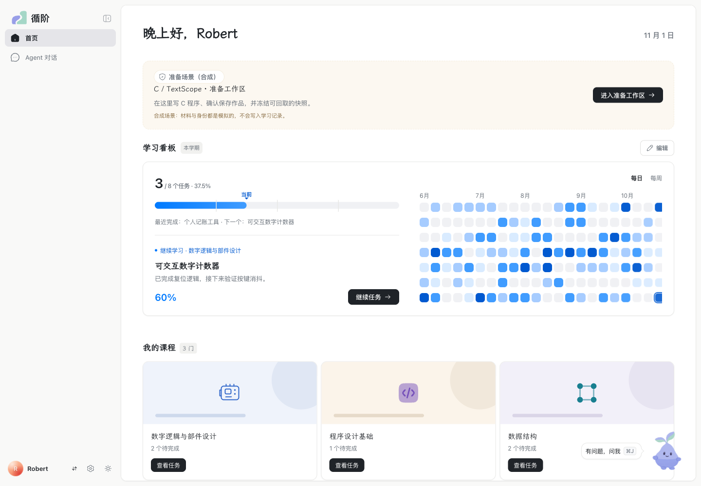

修改前实际产品首页：

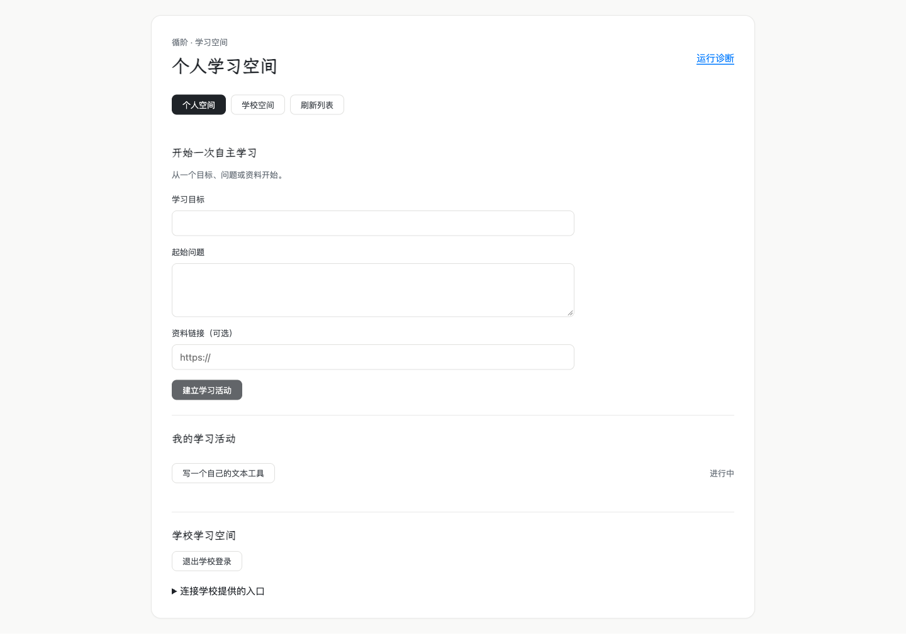

整合后实际产品首页：

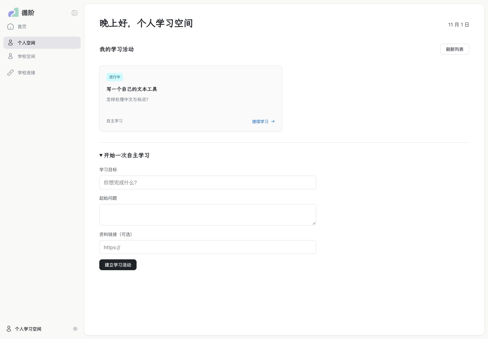

整合后学校空间、课程与活动入口：

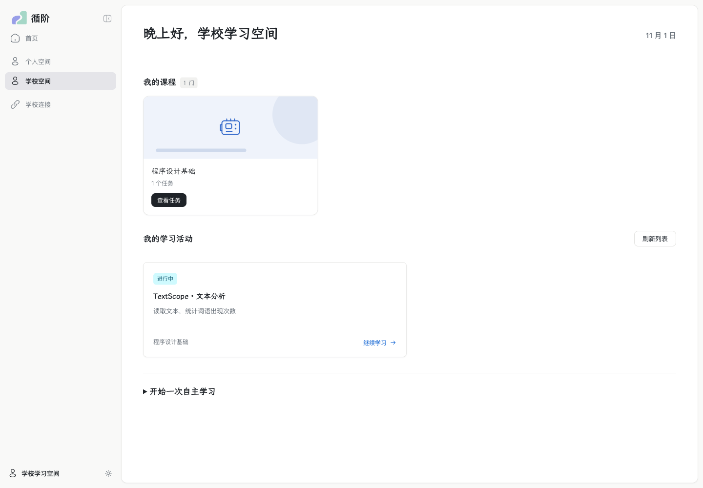

原已确认 UI 工作区参考：

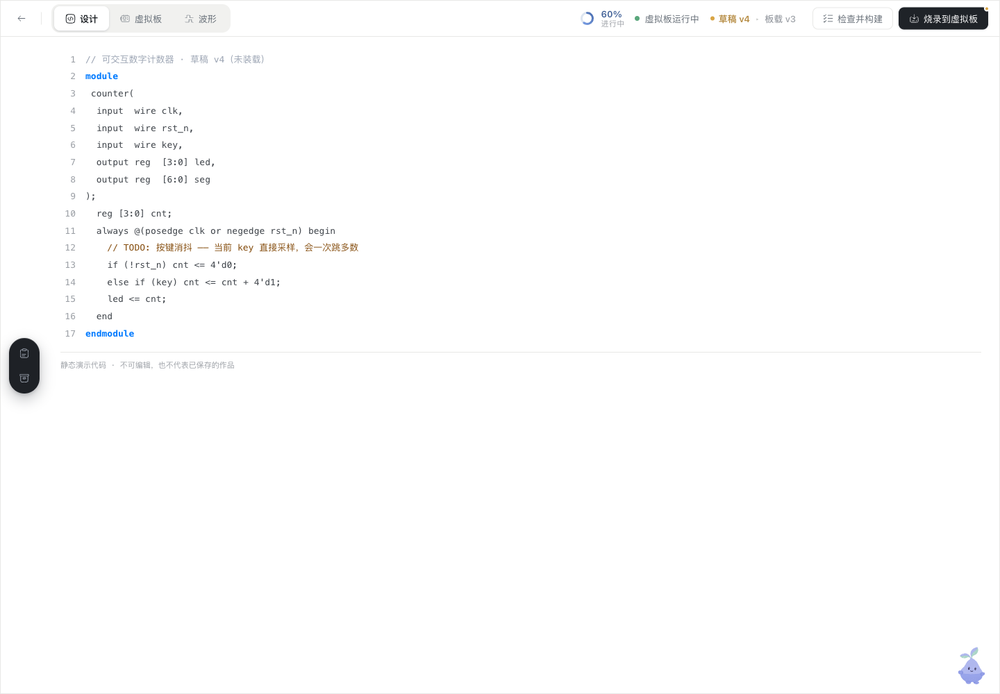

修改前课程活动：

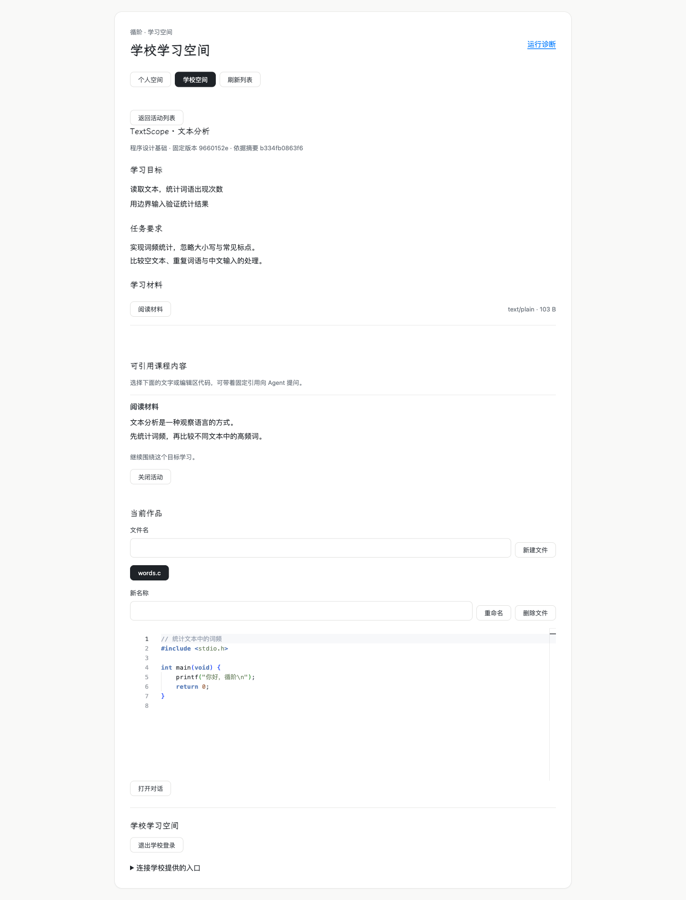

整合后课程活动：

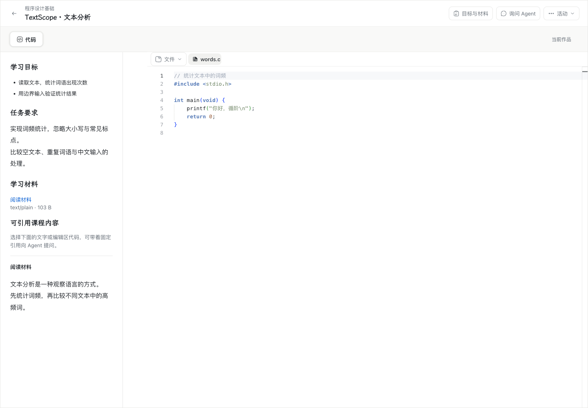

修改前自主活动：

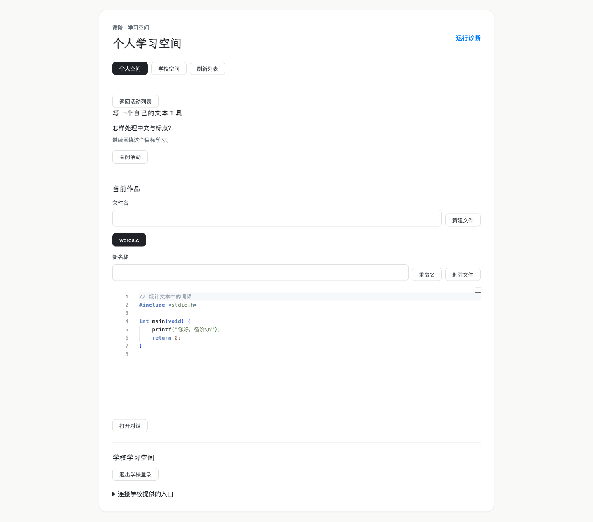

整合后自主活动、文件与引用／问题：

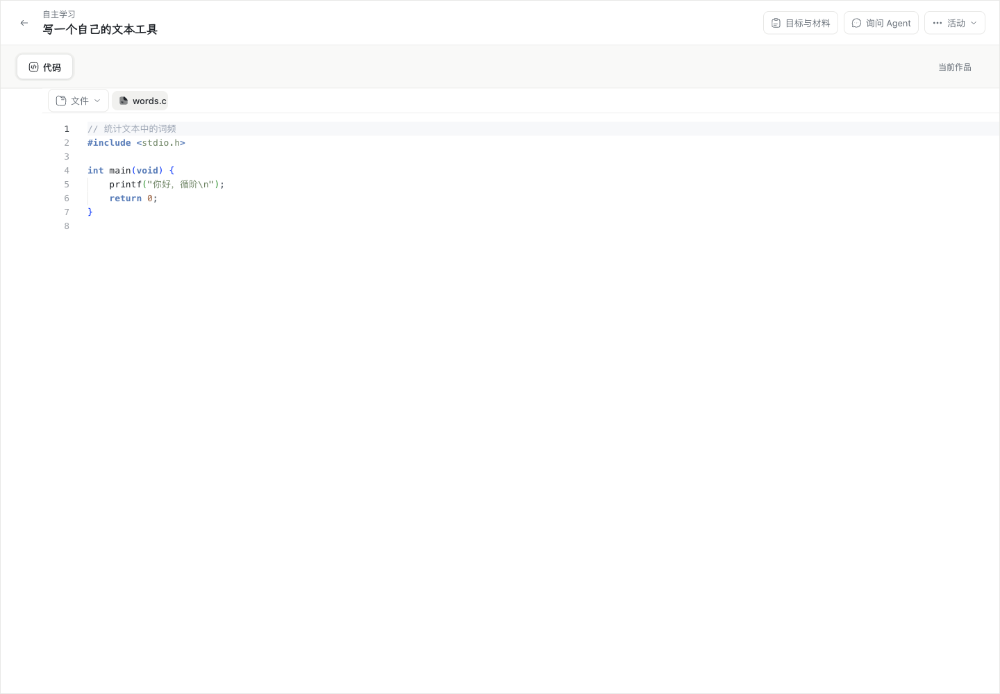

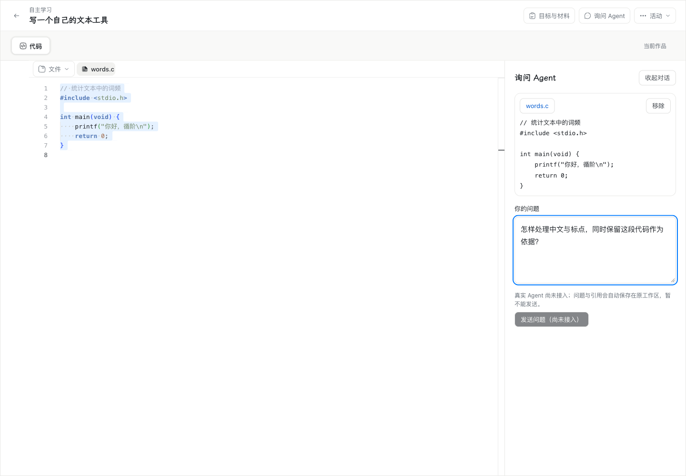

异常状态：

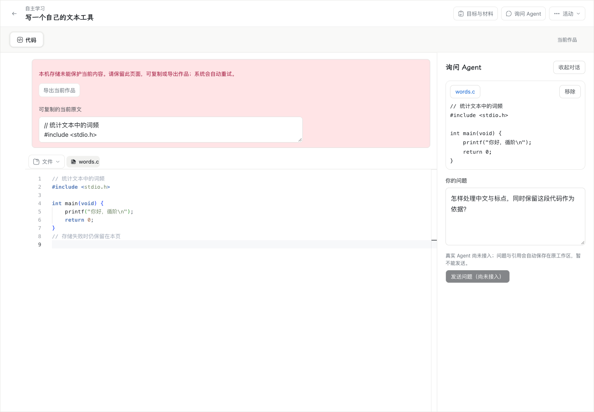

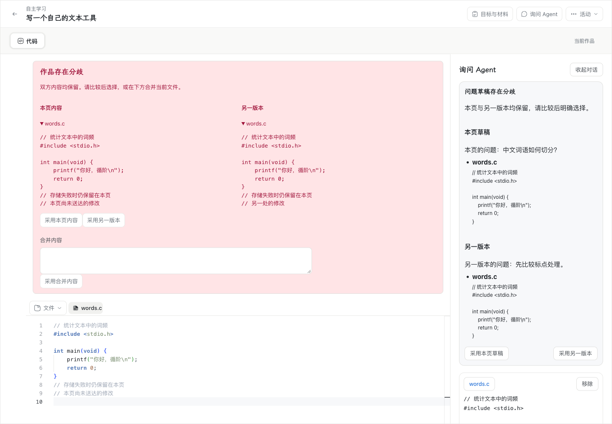

## 验收边界与后续接入

| 范围 | 实际结果 |
| --- | --- |
| 工程门禁 | Node 24.21.0 下初次完整 `npm run verify` 通过。合入最新 main 后，末次完整命令的 prepare 4/4、build:test 1/1、unit 23/23、server 78/78 通过；tools 44/45。唯一失败是 agent 运行中修改验收 JSON，触发复现测试的 Git 状态不变断言；保持工作区状态后，该完整文件 6/6 单项复验通过。各项最新结果无剩余失败，但不把退出 1 的整条命令改写为退出 0。更早一次主线整合检查因并行工具触发依赖重装失败，重新准备依赖后复跑。既有环境跳过项保留。产品与 UI 回归源码对应提交 `66e56b3` 的托管 CI 十个验证任务全部通过，发布任务按 PR 条件跳过。证据补录提交随后触发了主线调度测试的 80ms 启动时序假设：仅 unit 任务失败，其余九个任务成功。已改用首批 worker 启动屏障，并故意延迟一个进程 200ms，保留满载／上限／独占／隔离断言；定向 6/6 通过。最终完整结果以 PR Checks 为准。 |
| Apple Silicon Mac 正式包 | macOS 27.2、Chrome 156.0.8078.79、`headless=false`、原生 PostgreSQL 18.6；63 个不同场景均有通过结果。首轮 62/63，讨论面板入口适配后原失败项 1/1 复验通过，无未解决的新产品场景失败。 |
| Windows 11 x64 正式包 | NT 10.0.26200，普通账户交互桌面任务运行，同版 Node／PG／Chrome；同样首轮 62/63、适配后单项 1/1 通过，共 63 个不同场景。实际运行包的 manifest SHA256 与本机生成的 Windows 候选一致。未重跑 Windows 全仓工程测试或双击安装器验收。 |
| 新增产品 UI 回归 | 上述各 63 项均包含 9 项新增用例：稳定文件身份、quota 离开保护、固定发送与后续输入、宽度／主题／焦点／浏览器 IME、迟到活动读取、课程历史、初始化重开、跨空间历史和旧请求清理。其余 54 项保留作品、引用／问题、可靠草稿、可靠动作和部署回归。 |
| 真实公网跨机 | Mac → 独立 Ubuntu 学校，经直接公网 HTTPS：严格 TLS、学校默认页登录与课程重开、真实客户端批准、混合本机 owner、真正停学校期间继续输入及恢复、撤销连接退出原学校 scope，6 阶段通过。SSH 仅用于维护。 |
| 中文输入法 | 两平台 Chrome 的 IME 组合协议输入精确保留 `你好\n世界`。Mac 系统输入法最终复验通过：CGEvent HID 原生按键经过已安装的豆包拼音，在正式候选包输入 `开始你好世界\n粘贴中文\n结束`，验证真实组合上屏、系统回车／粘贴、应用焦点往返及刷新后的完整原文。记录有 4 次可信 compositionstart、27 次组合按键、1 次可信 paste；以 OS 前台进程核对焦点，不使用 Playwright 的 document.hasFocus 仿真作结论。早期锁屏和探针诊断保留。Windows 系统物理输入法未执行。 |
| 额外旧路径检查 | 原首页／准备模式／共享 UI 首轮 17 项通过、1 项失败。解锁后旧 Core 原生下拉框仍重现 `End` 无选择；已为三个选择框补齐 `Home`／`End` 的受控选择行为，并修正 Mac Monaco 的 Tab 焦点快捷键。原完整键盘流程 1/1 复验通过，验证新建、比较、冲突选择、快照切换、运行／停止、返回及原作品不变；合计 18 个不同场景均通过。Windows 旧 Core 专项未重跑。 |
| 环境清理 | 自有 Mac／Windows／学校进程、数据库、浏览器状态和临时目录已清理；Windows 三个任务已注销，临时公网 38196 规则撤回且查无残留。最终三平台候选包及必要日志留在忽略目录，未提交私有状态。 |

本轮新 UI 的学校网页与混合连接实拍：

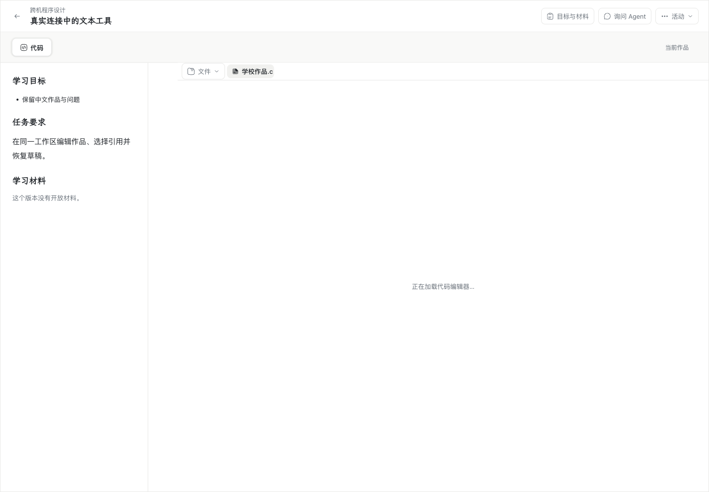

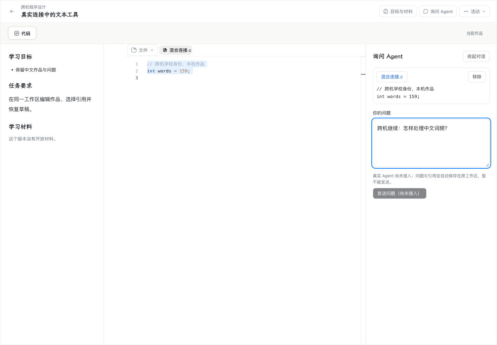

系统输入法最终复验实拍（原生按键注入，不是人工硬件键盘观察）：

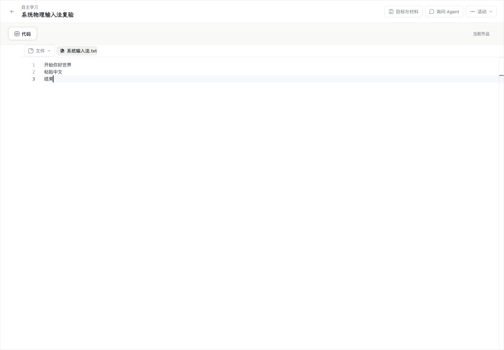

R1–R8 所在的七个底座源码与固定修复基线 SHA256 一致。原生备份、恢复与接管沿用上述固定修复证据，本次没有重跑，也不冒充新 UI 结果。Agent／执行／教师接收方尚未交付，新产品按真实能力禁用；测试中的受控 receiver 仅验证固定发送和后续输入语义。教学效果未评估。

后续接入统一以 [Web 入口说明](../../apps/web/README.md#正式产品入口与后续-wp)为准：WP03 扩展中心工具和结果，WP07 扩展既有讨论位置与真实 receiver，WP12 扩展当前活动交付；同时承担真实接线、被替代实现清理及回归。根 [AGENTS.md](../../AGENTS.md) 已随 main 两笔文档提交包含长期 UI 复用和交付前后截图要求。
