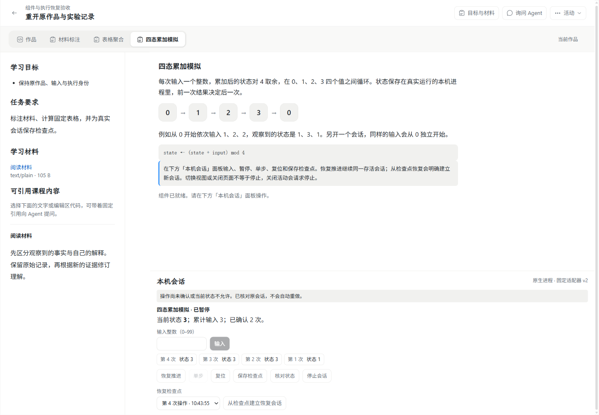
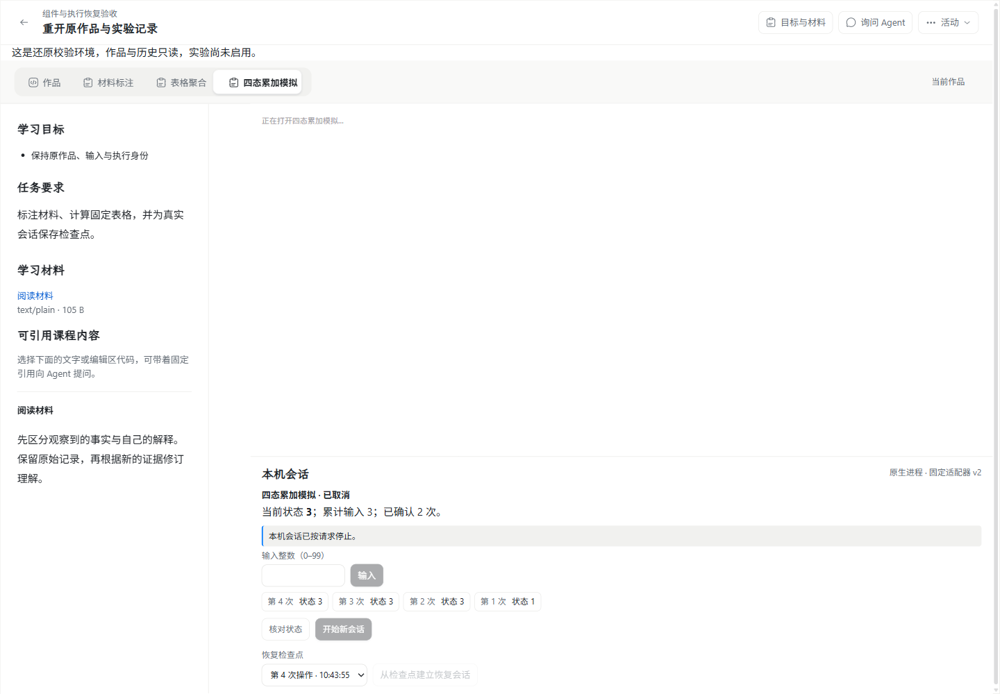
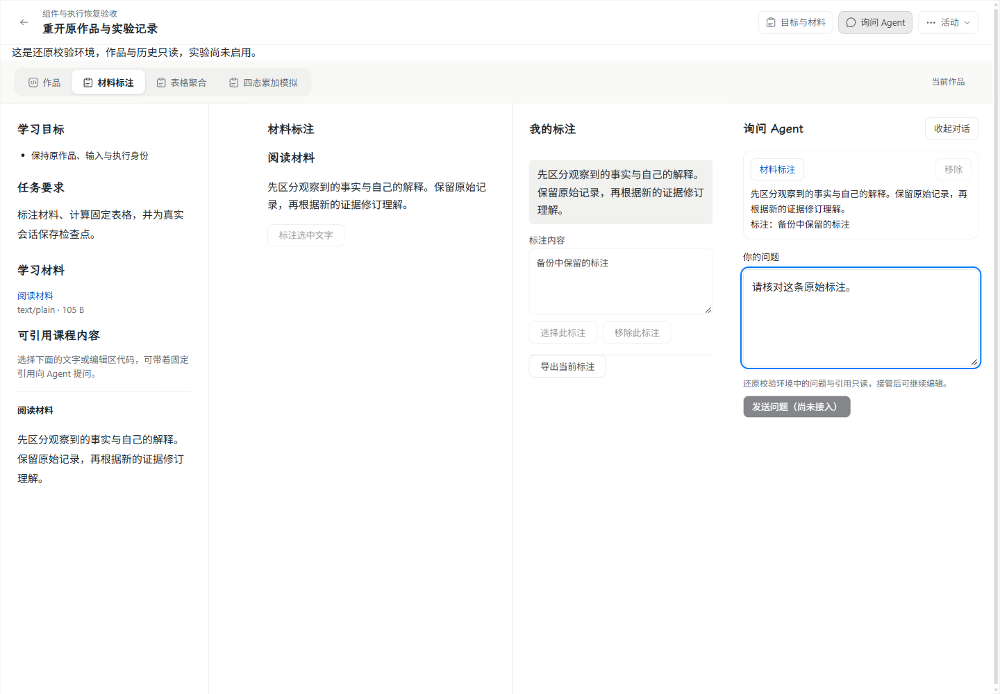
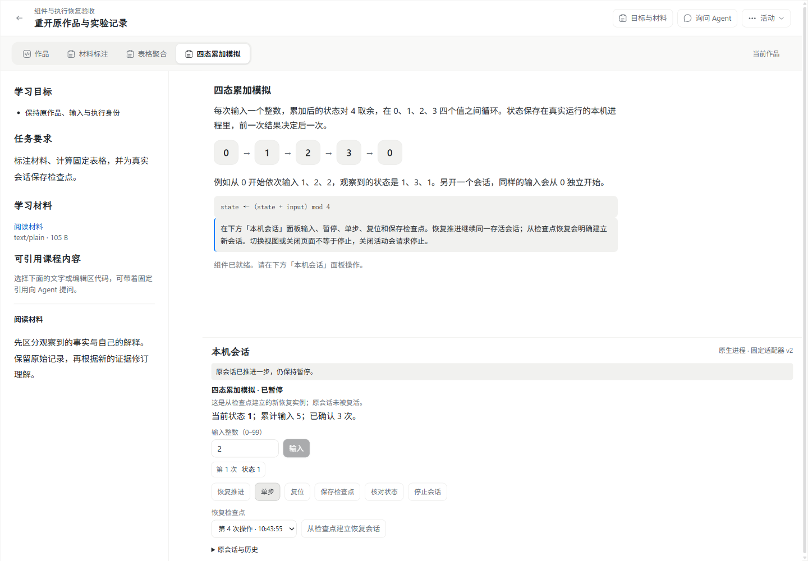

# WP03 #176 组件与执行数据备份、还原与接管：实施记录

对应 [#176](https://github.com/paher-din/XunJie/issues/176)，设计依据 [wp03-execution-recovery.md](specs/wp03-execution-recovery.md)。日期：2026-11-04。
基线 `08f2d3126e3665dcaa42f36526b0ce9588baa7a1`（`origin/wp03` 当前头，无更新）。工作树 `D:\XunJie-wp03-173`。

本页按交接阶段保留记录；前段的“未执行/剩余工作”描述首次交接状态，不代表接续实现的当前状态。当前 Windows 产品链路已在接续阶段通过，最终复验与交付矩阵将在文末登记。负责人已将 Mac 与独立学校机器验收明确拆到 [跨平台与跨机验收 #188](https://github.com/paher-din/XunJie/issues/188)，该票已发布并作为 #176 的原生子议题。

## 首次交接实现范围

按设计文档第 1、4 片推进，补齐“维护边界材料 + 接收端证明 + 分阶段接管”。不新增执行账本，不另建学习页面，不改 schema 与迁移。

| 能力 | 实现位置 | 行为 |
| --- | --- | --- |
| owner 维护边界材料 | [recovery-types.ts](../../packages/product-runtime/src/recovery-types.ts) | `OwnerRecoveryData.material` 显式版本化；`RecoveryOwner.material()` 在闸门关闭、排空完成后读取；`OwnerBoundaryMaterial` 记录边界时刻、源 environment/installation、覆盖范围、未结命令、已结算计数、保留清单计数、阻塞项及 owner 自有证据 |
| 命令分类与校验 | [maintenance.ts](../../packages/learning-space/src/learning-data/maintenance.ts) | 执行 owner 只读自己的表，把 `execution_commands`、`native_sessions`、`channel_executions` 分为 `accepted-not-started` / `running` / `paused` / `stop-pending` / `unknown`；保留原 `requestId`、`inputDigest`、`executionRef`、节点与执行器实例、停止与检查点计数；未知/停止待确认/存活会话产生阻塞项 |
| 备份强制边界 | [recovery.ts](../../packages/product-runtime/src/recovery.ts) | 导出前逐 owner 取材料；缺材料失败 `missing-boundary-material`，材料身份不符失败 `invalid-boundary-material`，存在阻塞项失败 `unconfirmed-execution-boundary`，都不发布完整备份 |
| 公开清单聚合 | [recovery-files.ts](../../packages/product-runtime/src/recovery-files.ts) | 清单只带每服务 `kind/unresolved/settled/blocking` 计数；逐命令材料留在加密 owner 数据内 |
| 还原重新推导 | [storage-recovery.ts](../../packages/product-runtime/src/storage-recovery.ts)、[learning-entry.ts](../../packages/product-runtime/src/learning-entry.ts) | 目标 `validateMaterial` 用还原后的库重新计算边界并与材料比对；计数、处置或身份不符按 `corrupt` 失败 |
| 历史备份隔离 | [recovery.ts](../../packages/product-runtime/src/recovery.ts) | 无材料的旧备份可隔离还原，但 `recovery-state.json` 标记 `legacy`，接管被拒 `boundary-material-required` |
| 接收端证明 | [recovery.ts](../../packages/product-runtime/src/recovery.ts)、[host.ts](../../packages/product-runtime/src/host.ts)、[ssh-recovery.ts](../../packages/product-runtime/src/ssh-recovery.ts) | 每个接收端必须返回 `fenced`、`receiverId`、源 environment/installation 与真实服务的证明；身份不符失败 `invalid-receiver-proof`，目标保持隔离 |
| 分阶段接管 | [recovery.ts](../../packages/product-runtime/src/recovery.ts) | 持久阶段 `verifying → retiring-source → fencing-receivers → validating-target → active`；失败停在隔离并保留阶段与证据，重试幂等 |
| 生产装配 | [learning-entry.ts](../../packages/product-runtime/src/learning-entry.ts)、[runtime-recovery.ts](../../packages/product-runtime/src/runtime-recovery.ts) | 学习数据 owner 接执行材料；组件 owner 走通用存储材料；运行库 owner 只声明 installation 身份，不冒充执行事实 |

设计取舍：材料放在 `OwnerRecoveryData` 内而非公开清单，避免学生内容进入 catalog；编排层只消费聚合计数，不读业务表；未结命令按原身份记录，不重算摘要、不换节点；旧备份不阻塞隔离只读，但绝不能接管。

## 工程验证（本机实际执行）

运行环境：Windows 11 x64（10.0.26200），Node v24.21.0（仓库批准运行时），PostgreSQL 18.6 原生发行版。

- 类型检查：`node scripts/build.mjs typecheck` 覆盖 contracts、storage、learning-space、server、product-runtime、local-runtime、web，全部通过。
- 产品运行库单测组：`node scripts/test.mjs product-runtime`，14/16 通过；唯一失败为 `recovery-files.test.mjs` 的符号链接用例 `EPERM`（当前 Windows 账户无创建符号链接权限），与本票改动无关，未记为通过。
- 恢复编排用例：`node --test packages/product-runtime/test/recovery.test.mjs`，37/37 通过，含本轮新增 6 例：公开清单只含聚合、阻塞边界拒绝备份、缺材料拒绝备份、还原重新推导材料、无边界证据拒绝接管、错误安装的接收端证明被拒且目标保持隔离。
- 真实 PostgreSQL 存储恢复：`node --test packages/product-runtime/test/recovery-storage.runtime.test.mjs`，2/2 通过（真实库、真实资源字节、独立目标还原）。
- 真实 PostgreSQL 执行边界：`node --test apps/server/tests/execution-boundary.runtime.test.mjs`，1/1 通过（未结命令分类、阻塞项、材料往返、篡改与结算后失配）。
- 连接与接管真实库用例：`recovery-connections.test.mjs`、`lifecycle.test.mjs`、`connections.test.ts` 在本组运行中通过。

未执行：全仓 `npm run verify`、`check:contracts:browser`、`check:docs` 之外的浏览器检查；本记录提交后单独跑文档检查。

## 桌面 Chrome 验收

未执行。本轮没有改动页面、组件或样式，未产生新 UI；隔离只读的正式产品打开能力也未实现，因此没有可用真实页面证据。

## 真实备份、还原与跨机接管

本机部分：真实 PostgreSQL 18.6 上的备份、隔离还原、材料校验与接管编排用例已运行（见上）。跨机部分：未执行。Apple Silicon Mac、独立学校机器、实际产品包与真实网络断开场景均未在本机取得证据，不记为通过。

## 首次交接时的未执行项与剩余工作

1. 隔离目标只能还原并退出，尚无“正式产品界面只读打开”（原首页、活动、工作区复用）；#176 验收项 5、10 的浏览器证据缺失。
2. 接收端证明尚未包含接收端自身的执行边界事实（已受理执行是否到安全边界），只核对了安装/服务/身份与 fencing 结果；设计要求的“执行事实级失权证明”仍需接收端回传结构化执行证据。
3. 学生侧恢复交互（检查点新建会话、旧队列提示、原命令待核实文案）未实现与验收。
4. 旧挂载/旧 namespace/旧队列在服务与组件桥接处的实际拒绝未做端到端验证。
5. 格式升级（旧备份→新格式）路径、跨平台产品包与学校/混合路径未验证。
6. 教学效果未评估。

## 证据与状态

- 源码：`D:\XunJie-wp03-173`，分支 `wp03`，基于 `08f2d31`；本轮改动未提交、未推送。
- 失败记录保留：`.verification/2026-11-04T13-35-38-292Z-7OOicL/`（符号链接 EPERM，环境限制）。
- #176 保持未完成：本记录只证明维护边界材料、材料校验与接管阶段在工程与真实 PostgreSQL 上成立，不替代跨机与浏览器验收。

## 接续实现：永久退休与执行事实级接收端证明

负责人要求继续完成 #176，并明确授权独立测试库初始化及本次临时环境清理；不涉及现有业务库、原备份或公开发布。本节更新上文第 2 项剩余工作的进度，其他未验证范围仍保留。

- 连接 authority 在 installation 级 fencing 后永久拒绝该安装重新申请 grant。scope 级凭据轮换与新 installation 授权仍分别处理；新安装获权、接收端重启均不复活旧安装。
- 接收端私有维护入口先 fencing，再通过真实维护参与者关闭并排空，逐恢复 owner 读取维护材料，核对完整参与者集合。HTTP handler 已结束而 owner 效果未结时仍等待；材料不安全或缺 owner 时保持关闭，不返回证明。成功恢复此前开放状态；失败后的重试不隐式开闸。
- `ReceiverFenceProof.execution` 改为必需，包含边界时间和逐 owner 的未结/已结/阻塞计数。接管要求完整源服务集合、接收端实际服务、零未结/阻塞，并核对 `backupId` 与 `targetInstallationId`；证明按接收端写入持久接管记录。CLI、本地适配和 SSH 适配消费同一证明。
- 未新增数据库 schema/迁移；学校领取通道的 installation 级永久拒绝及旧 namespace 端到端拒绝仍需后续完整验收，不能仅凭本节连接 authority 测试宣称所有旧实例均已失权。

本机实际验证（批准的 Node 24.21.0）：

- `node scripts/build.mjs local-runtime`：通过，包含 product-runtime 和 local-runtime 编译及其依赖。
- `node --test --test-concurrency=1 packages/product-runtime/test/connections.test.ts`：32/32 通过，含永久退休、新安装授权后旧安装仍拒绝及重启持久性。
- `node --test --test-concurrency=1 packages/product-runtime/test/recovery.test.mjs packages/product-runtime/test/ssh-recovery.test.mjs packages/product-runtime/test/recovery-connections.test.mjs`：52/52 通过。新增覆盖真实产品维护入口等待 owner 收尾、失败后保持关闭、缺执行证据、错误备份/目标、未结效果、阻塞 owner、缺/重复源服务和错误接收端。
- 一轮中间回归失败：两处测试转发包装没有传入新接管绑定，触发 `invalid-receiver-proof`；已修正包装传递全部参数，随后上述 52 项全部通过，未弱化生产校验。

本节不包含 Chrome、实际产品包、Mac 或学校真实跨机恢复验收；隔离只读产品打开仍在继续实现，#176 尚未完成。

### 隔离读取后端接线

正常产品 daemon 启动恢复目标时，将动态隔离状态交给学习 HTTP Module；只有显式实现隔离读取的 application 才能穿过宿主的维护读取闸。原生会话在该模式下读取历史，不做重启核实写入或检查点补结算，也不触发 Linux 原生自检。普通维护继续拒绝业务请求。

个人身份通过 owner 读取既有记录，避免读取上下文时隐式创建身份/绑定。学校隔离登录使用现有账号校验和内存中的只读会话，不向恢复数据库写 session，接管后该会话不能升级为正常授权。隔离模式拒绝业务修改、实验、领取、远程转发、算法/依赖取得和外部连接操作；正式 UI 的只读表现及后台同步抑制仍待接入。

真实 PostgreSQL 验证：`node --test packages/product-runtime/test/isolated-learning.runtime.test.mjs` 1/1 通过。使用普通产品 daemon 完成源活动/作品创建、held 备份、独立恢复、目标启动，确认原首页产物可加载、原身份/活动/作品可读、新 namespace，以及写入/实验/领取/连接/维护 resume 被拒且作品不变。测试没有替代真实 Chrome；本轮只证明 HTTP 和数据库链路。

故障记录：两轮目标上下文返回 `503 maintenance`，第一轮构建产物未包含并行补入的读取标记，强制重建后仍复现；最终定位到宿主更早的一处维护拦截未应用隔离读取例外。修复后沿原生产测试完整重跑通过，没有打开写入闸绕过问题。

## 2026-11-05 接续交付与验收矩阵

本机产品实现已覆盖原交接的五项代码缺口；Mac 和独立学校机器按负责人明确要求由 [#188](https://github.com/paher-din/XunJie/issues/188) 后续验收，不记为本机通过。没有新增数据库 schema/迁移。负责人于 2026-11-05 明确授权单独提交并推送 `wp03`，本记录随实现交付；原工作树的无关改动与临时数据不纳入提交。

| #176 要求 | 当前实现及证据 |
| --- | --- |
| 1. 产品编排、完整 owner | 正常产品包包含 runtime、课程/组件及学习/执行 owner；同一维护边界材料与恢复校验，不跨 owner 直写表 |
| 2. 未结执行与真实排空 | 原生/领取端确认真实退出；浏览器排队投影不构成未开始证明，未收到确认终态则阻止安全排空；原身份、停止、检查点和节点事实全量重推导 |
| 3. 一致备份与资源 | 使用原存储快照、资源 pin 和重读校验；缺参与者、资源损坏、材料不符及故障中断回归通过的范围见工程记录 |
| 4. 浏览器边界 | 最终 Chrome 探针在源浏览器保留独有未同步问题；目标读取服务已收到的旧问题，新 namespace 不读取/派发旧队列，源分区保持原内容 |
| 5. 隔离试还原 | 正常产品首页/活动/工作区只读打开，逐组件及产物可读；探针期间目标页面产生的 POST 数为零，无执行/自检/后台同步 |
| 6. 权威接管 | 逐接收端证明绑定完整源服务、源安装、backupId 和目标安装，包含真实 owner 执行边界；源退休/接收端失败保持隔离，证明持久记录 |
| 7. 原命令与丢回包 | 原 requestId/inputDigest/executionRef 保留；检查点生成后丢回包仍查询原身份；接管已完成但回包丢失可返回同一持久结果，不重新封闸或重做效果 |
| 8. 旧实例拒绝与晚归档 | 恢复后成员写必须携带当前 namespace；旧 namespace 和缺失握手实际拒绝。安装永久退休同时约束 grant 与原生领取/注册/新派发，原报告仅走既有晚归档；退休事实随接收端恢复保留 |
| 9. 检查点与新实例 | 最终真实原生会话在状态 3 保存检查点；接管后新请求/执行器实例关联原检查点，单步输入 2 得到状态 1，原运行仍保留 |
| 10. 原正式学习界面 | 新 Chrome 中读取标注、语义引用副本、原问题、固定 CSV 及会话；接管后新编辑。未另建恢复简化页，布局/颜色/字体沿用现有 token |
| 11. 跨平台/跨机 | Windows 实际包、原生 PostgreSQL、AppContainer 执行器与桌面 Chrome 已执行；Mac 与独立学校机、物理网络断链由 #188 负责，尚未验证 |
| 12. 格式、回归、包与清理 | 版本化材料/legacy 禁止接管、重推导、旧身份拒绝及包接线有测试；最终测试环境已清理，两处早期失败测试根因自动审批拒绝尚保留，见下文 |

### 工程与产品证据

- `node scripts/build.mjs typecheck` 通过全部 workspace；`node scripts/build.mjs all` 通过。保留上游 Zod 注释和大 chunk 提示，没有绕过编译错误。
- 最新定向 Web 回归 69/69 通过：controller、session、bridge 和只读分区。只读分区测试在无 window/IndexedDB 的环境中证明不启动保护/同步/旧队列，编辑与取消明确拒绝；桥接保留只读读取和定位，拒绝变更/执行/新引用。
- 真实 PostgreSQL 学习入口回归 8/8 通过，包含学校登录、撤权、正常产品重启与原 owner 恢复。
- 原生领取、边界及接收端回归一次补验 11/11 通过，实际使用产品 Windows helper；早期默认 worker 测试没有传 helper，按真实平台契约补齐参数后通过，未跳过测试或放宽隔离。
- 连接回归 32/32 通过；接收端含备份恢复后永久拒绝旧安装。一次组合负载中初始就绪检查失败，独立复跑通过并增加依赖诊断；不将该次失败记为通过。
- 公共契约浏览器检查通过 12 个导出；完整文档链接检查结果以最终交付命令输出为准。首次 product-runtime 单测组的 Windows 文件符号链接 `EPERM` 仍是未通过项，未修改测试绕过权限。
- 使用最终产品 PostgreSQL/helper 的相关工程组合 **61/61 通过**：[原始测试记录](evidence/wp03-176-engineering.txt)，本地完整日志 `.verification/wp03-176-packaged-tests.log`。包含恢复编排/存储、隔离学习、执行、边界、领取和学校转发；早期错误配置的失败日志 `.verification/wp03-176-final-tests.log` 继续保留，不记为通过。
- 最终公共契约检查 12 个导出通过；文档检查 193 份 Markdown、1593 个本地目标、0 失败；差异检查通过。没有将全库 `npm run verify` 或 Windows 文件符号链接权限用例声称为 #176 通过项；#188 后来在补齐完整 Node 24.21.0 发行版后单独跑通全库 `verify`，见下方交接段，不改写本页结论。

最终产品候选在 `.verification/wp03-176-product-win32-x64-final`，`distribution.json` SHA-256 为 `a38ad414654df2988d943f24084d20c31ec891edc9438e5bf58c74da4b2f15cf`。Chrome 为 156.0.8078.80、Windows 11 x64 10.0.26200、Node 24.21.0、产品声明 PostgreSQL 18.6（固定发行 18.6.1）。

[最终结构化报告](evidence/wp03-176-windows-recovery.json) 保存包/组件版本与摘要、原会话和恢复会话的请求/执行器身份、原检查点关系、CSV 摘要与 97 字节长度，以及两次丢回包和成功清理标记。故障注入仅在真实控制提交/接管已生效后丢弃回包，没有模拟计算结果。

### 实际界面对照

新增的是现有工作区的只读状态、历史回读及恢复选择；目的是让校验环境可核对原作品而不能继续实验。源环境与隔离目标复用同一套界面，接管后恢复正常编辑和显式新实例操作，没有新增导航或学习页面。

源环境保存检查点后：

独立目标隔离打开后的同一组件：

标注、固定语义引用和问题草稿恢复：

接管后新恢复实例的真实下一步：

浅深色与窄桌面原图在 `.verification/wp03-176-browser-final/`。工程、Chrome、真实本机恢复与跨机结果分别记录；教学效果未评估。

### 失败现场与清理边界

`browser-attempt1` 保存了错误验收步骤的失败：检查点只能在暂停后保存。`attempt2` 已完成隔离读取，但恢复出的检查点仍为暂停模式，应使用单步而非直接输入；其清理又遇到 Windows `EBUSY`，原异常被清理异常覆盖，截图保留了当时状态。探针已修正步骤并保证清理错误不覆盖原故障。`attempt3` 及最终探针完整通过，最终临时数据库/进程根已成功删除。

自动审批两次拒绝了清理早期失败目录的命令，只返回 `blocked by policy`，没有给出更具体理由。只读核实这两处绝对路径均为普通目录且无存活的对应 node/PostgreSQL 进程，尚未删除：

- `C:\Users\p3148\AppData\Local\Temp\xunjie-176-browser-v3MYth`
- `C:\Users\p3148\AppData\Local\Temp\xunjie-176-browser-hyz1Jl`

负责人随后手动清理了上述两处目录，Agent 已用 `Test-Path` 核实均不存在。没有删除原业务环境、原备份或其他工作留下的 `.tmp/`。

最终组合回归第一次误用了缓存解压的 PostgreSQL：中文路径的状态回报出现 `ѭ��`，导致 `realpath` 失败、业务 owner 未登记；清理失败又掩盖了原始就绪异常。改用最终产品包内带 UTF-8 兼容清单的 PostgreSQL 后，存储恢复独立复验 2/2 通过，组合回归改用相同产品资源重跑。缓存诊断的三个测试数据库已用产品 `pg_ctl` 停止；负责人随后清理 `循阶 complete recovery QMfFzJ`、`循阶 failed recovery GC nmzl77`、`循阶 failed recovery GC Q791SB` 三个现场目录，Agent 于 2026-11-05 用 `Test-Path` 核实均不存在。

## #188 跨平台与跨机验收交接（2026-11-05）

负责人拆出的 [#188](https://github.com/paher-din/XunJie/issues/188) 已在 Apple Silicon Mac 与 Windows 11 x64 两台真实客户端上执行，均连接同一台独立 Ubuntu 24.04.5 学校节点。完整交付（可复跑命令、版本、工程检查、桌面 Chrome、真实跨机恢复、失败现场、逐条验收对照与未执行项）见 [WP03 #188 跨平台与跨机验收](wp03-188-cross-platform.md)，本页第 11 项的「尚未验证」由该页取代，但本页 Windows 本机结论不被改写。

| 结果 | 证据 |
| --- | --- |
| Mac 实际产品包、原生 PostgreSQL 18.6、桌面 Chrome：备份/隔离只读/接管 3/3 通过 | [结构化报告](evidence/wp03-188-mac-local-recovery.json) |
| Mac → 独立学校节点完整恢复与接管 9/9 通过 | [结构化报告](evidence/wp03-188-mac-school-recovery.json) · [隔离只读](evidence/wp03-188-mac-isolated.png) · [接管后恢复实例](evidence/wp03-188-mac-recovered.png) |
| Windows 实际产品包、AppContainer 执行器 → 独立学校节点完整恢复与接管 9/9 通过 | [结构化报告](evidence/wp03-188-windows-school-recovery.json) · [桌面控制台](evidence/wp03-188-windows-desktop.txt) · [隔离只读](evidence/wp03-188-windows-isolated.png) · [接管后恢复实例](evidence/wp03-188-windows-recovered.png) |
| 两客户端学校 Web 路径各 10/10 通过，含真实 TCP 断链、撤权与按原身份重查 | [Mac](evidence/wp03-188-mac-school-web.json) · [Windows](evidence/wp03-188-windows-school-web.json) |
| Mac 工程检查：契约浏览器 12 导出、文档链接 0 失败、全量构建、product-runtime 16/16 | [原始输出](evidence/wp03-188-engineering.txt) |
| 全库 `npm run verify` 159/159 通过（完整 Node 24.21.0 发行版，产品包内 Node 缺 npm 的首次失败已如实记录） | [原始输出](evidence/wp03-188-full-verify.txt) |
| 两客户端真实产品包上的恢复负例各 7/7 通过：资源缺失/单字节损坏/manifest 篡改/错密钥/legacy/不可核实边界均被拒，原备份逐字节保留 | [Mac](evidence/wp03-188-mac-recovery-negative.json) · [Windows](evidence/wp03-188-windows-recovery-negative.json) |
| 两客户端执行 disposition 负例各 6/6 通过：产品自身分类 `accepted-not-started`/`stop-pending`/`unknown`，未结命令使维护排空 fail-closed，持有备份字节不变 | [Mac](evidence/wp03-188-mac-execution-disposition.json) · [Windows](evidence/wp03-188-windows-execution-disposition.json) |
| 真实终止并重启独立学校守护进程、fence 后恢复旧连接文件、可信晚回包 401、新安装授权后旧安装仍被拒 | [Mac 7/7](evidence/wp03-188-mac-school-lifecycle.json) · [Windows 5/5](evidence/wp03-188-windows-school-lifecycle.json) · [停机后学校 Web 10/10 复验](evidence/wp03-188-mac-school-web-post188.json) |

Windows 验收必须运行在交互桌面会话：SSH 会话中产品自带的 AppContainer helper 无法启动子进程，经同一 helper 在两种会话下的对照诊断后改用一次性计划任务；被遮挡的 Chrome 还会延迟组件 iframe 的输入与确认轮询，已在探针侧加节流禁用标志与无副作用点击重试，未修改产品代码或放宽断言。[失败现场](evidence/wp03-188-windows-failure.png) 与 [Mac 失败现场](evidence/wp03-188-mac-failure.png) 均保留。

后续补跑：全库 `npm run verify` 在补齐完整 Node 24.21.0 发行版后 159/159 通过；备份资源缺失、单字节损坏、manifest 篡改、错密钥、legacy 历史格式与「阻塞/不可核实 owner 不生成完整维护成功」已在 Mac 与 Windows 两台真实产品包 + 原生 PostgreSQL 上各 7/7 重跑，原备份字节不变、源未退休。负责人随后再次授权动独立学校节点与停服务，于是三类原先未重跑的负例全部补齐：「已接受未开始」「停止待确认」「未知」三种执行 disposition 由两客户端真实产品包的 owner 边界代码分类（各 6/6，未结命令令维护排空 fail-closed）；独立学校守护进程被真实 `kill` 后由产品 `start` 重启，同一连接身份与原 `requestId`/`inputDigest` 全程保持；fence 后恢复 7 个旧凭据/连接文件、fence 前发出的可信晚回包均返回 401，新 installation 授权后旧 installation 仍被拒（Mac 7/7、Windows 5/5），停机与两次 fence 后学校网页路径再复验 10/10。教学效果依旧未评估。Windows 两轮临时现场目录与一次性计划任务均已按负责人授权移入回收站/删除并核验，阶段证据先脱敏[归档](evidence/wp03-188-windows-failure-sites.txt)。
