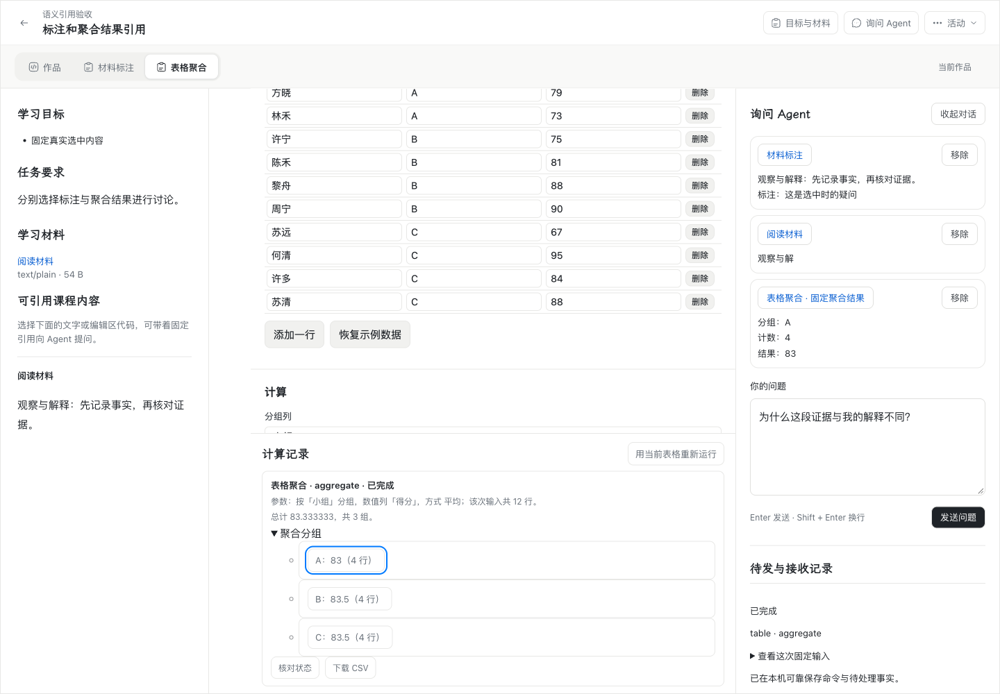
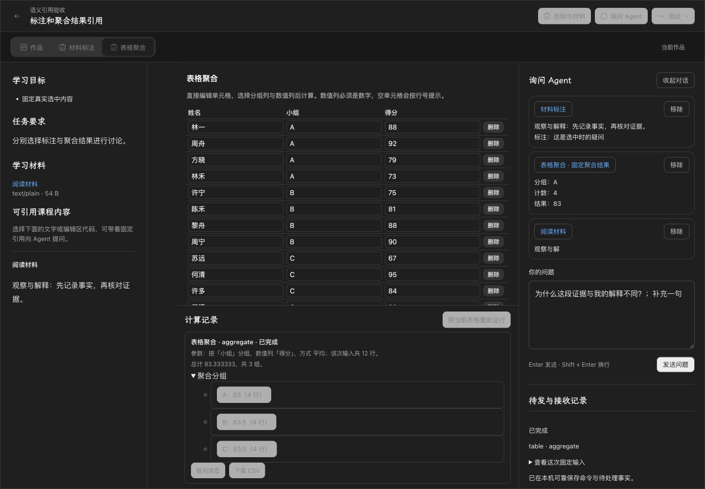
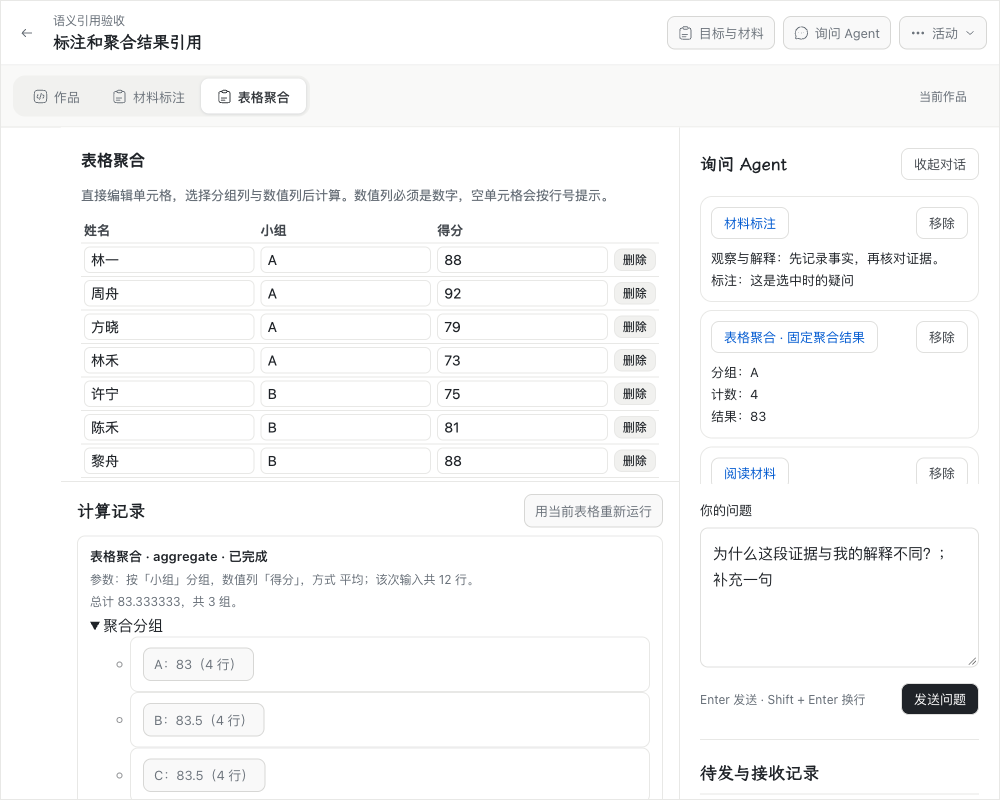
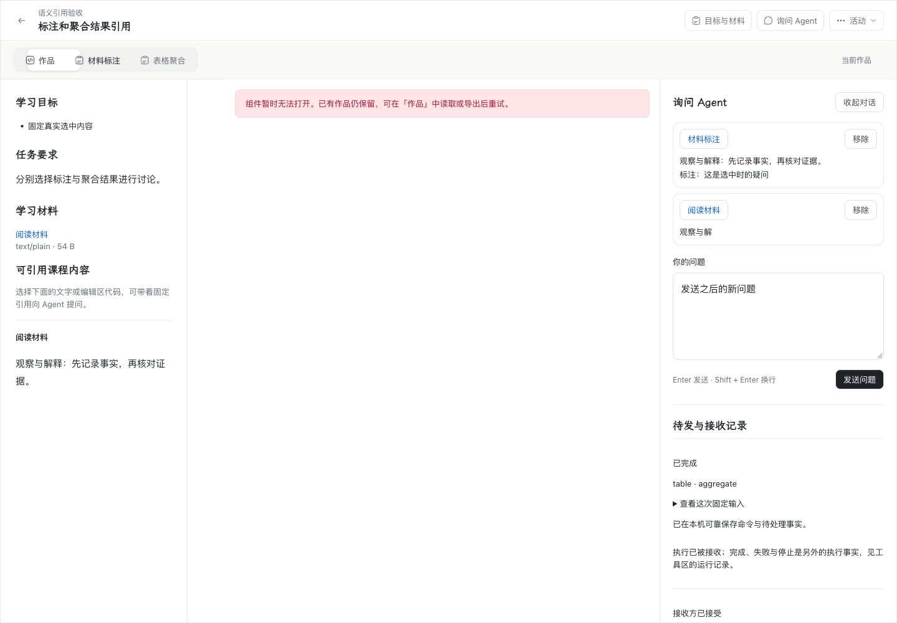
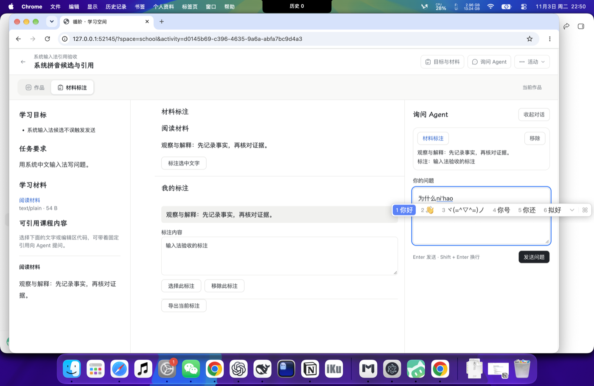
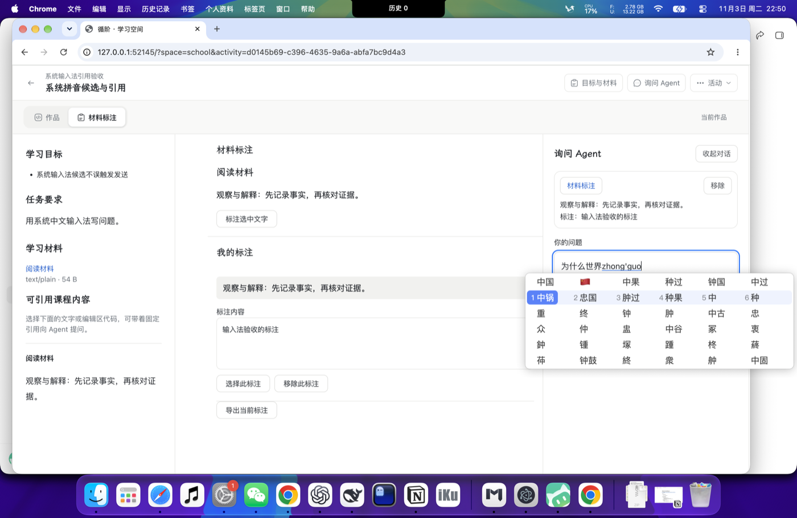
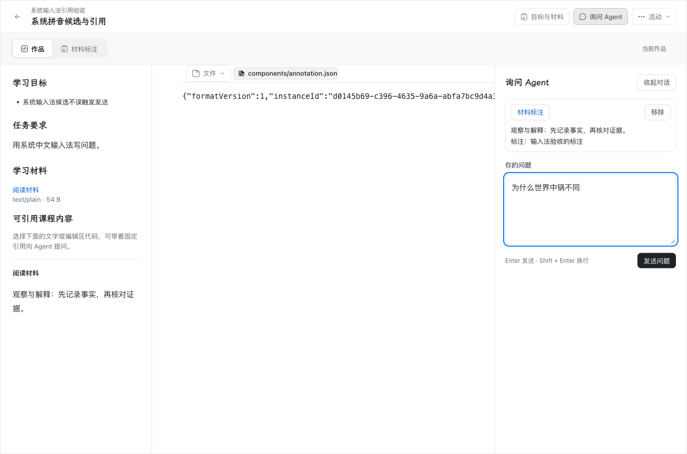
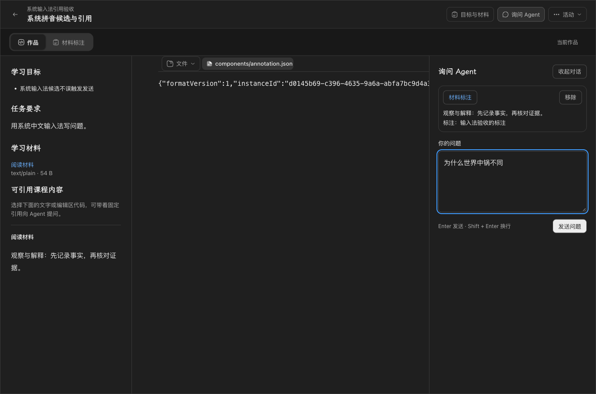

# #185 Apple Silicon 非文本引用与历史恢复验收

日期：2026-11-03（Asia/Shanghai）。本文是 [#185](https://github.com/paher-din/XunJie/issues/185)（母票 [#172](https://github.com/paher-din/XunJie/issues/172)）的 Apple Silicon 验收记录。实现与 Windows 验证见[#172 交付](wp03-semantic-references.md)，实施方案见[非文本引用方案](specs/wp03-nontext-references.md)。

## 依据与授权

- 负责人已明确允许本轮先交付 Windows 实现、把 Mac 验收另行交接；本票就是该交接的独立取证，不复用 #178/#179/#181 的结论，也不以 Windows 结果替代。
- 验收对象：`wp03@6620596dd10f014fb773ce81970448dae21b24e7`（`test(wp03): accept Apple Silicon isolation and the product candidate (#184)`）。该提交已包含 #172 实现 `495eb44`、审查修复 `93865a4`，以及上游集成 `b288410`/`120b8bb`。
- 与票面记录的候选关系：#185 正文写的 `wp03@133d72c` 是本票约定的基线，实际取得时 `wp03` 已在其上叠加 #184 的两个提交（`bbb2efd` 原生会话 Seatbelt 隔离、`6620596` 其验收记录）。两个提交只涉及 macOS 原生会话与文档，但既然分支已前移，本票全部探针都在 `6620596` 上重跑，不沿用 `133d72c` 的任何数字。
- 写集：`scripts/probe-macos-semantic-acceptance.mjs`、`scripts/probe-macos-semantic-ime.mjs`（新增）、两个原有探针的平台/版本记录修正、`evidence/wp03-185-*` 与本文件，以及 [#172 交付](wp03-semantic-references.md)、[方案](specs/wp03-nontext-references.md)、[索引](README.md)的回填。**不修改产品代码、契约、迁移、组件字节或 UI。**
- 因此 6620596 之后的产品行为没有变化：证据里的 `codeSha` 记录的是运行时 HEAD，本票提交只新增取证脚本与记录。若后续 wp03 继续叠加产品改动，需在新候选上重跑同一批探针。

## 平台与环境（记录项）

| 项 | 实测值 |
| --- | --- |
| 机型 / 架构 | `Mac17,3`（Apple M5，16 GB）/ `arm64` |
| macOS | 27.2（`26B123`），内核 `27.2.0` |
| 运行时 | 候选内置 Node `v24.21.0`（`resources/node/bin/node`），非系统 Node |
| 数据库 | 候选内置 PostgreSQL `18.6`，managed 模式，真实 `initdb`/`postgres` 进程 |
| 桌面浏览器 | Google Chrome `156.0.8078.80`（headed，`channel: 'chrome'`） |
| 产品前端 | `apps/web/dist-runtime`，本轮从当前候选重建 |
| 运行入口 | `openProductRuntime` 在临时根目录安装并启动；真实 daemon、回环监听、真实资源 owner |
| 系统输入法 | TIS 选中 `com.bytedance.inputmethod.doubaoime.pinyin`（系统级中文拼音输入法） |

密钥与账号口令均为运行期随机生成，不进入仓库、日志或本文。

## 部署拓扑与实际连接路径

- **local（本机）**：客户端与学习数据 owner 同机，`127.0.0.1:51742`，managed PostgreSQL；组件资源由同一 owner 提供，`origin=state` 与 `origin=execution-result` 都落在本机库。
- **school（学校 profile）**：学校部署配置，业务 owner 仍在**这台 Mac** 上以 `127.0.0.1:51828` 监听，客户端与 owner 同机。它验证的是“学校 profile 的连接与路由分支可用”，**不是实际跨机的学校客户端**。
- 两者都不是真实班级服务器：没有跨机网络、没有学校侧 TLS、没有多成员并发。清单要求的“未执行的跨机路径”见文末。

## 运行方式

```sh
export XUNJIE_PRODUCT_POSTGRES_BIN=$PWD/dist/product-darwin-arm64-wp03-r3/resources/postgres/bin

node scripts/probe-semantic-references.mjs                                  # 原有 13 项
XUNJIE_SEMANTIC_PROFILE=school node scripts/probe-semantic-references.mjs
node scripts/probe-semantic-reference-history.mjs                           # 历史恢复 6 项
XUNJIE_SEMANTIC_PROFILE=school node scripts/probe-semantic-reference-history.mjs
node scripts/probe-macos-semantic-acceptance.mjs                            # 本票新增 22 项
XUNJIE_SEMANTIC_PROFILE=school node scripts/probe-macos-semantic-acceptance.mjs
node scripts/probe-macos-semantic-ime.mjs                                   # 本票新增 10 项
```

探针不接收模型配置；问题接收方是仓库内的受控接收器，只按固定动作返回回执，**不调用任何模型**。输入法探针额外要求 `XUNJIE_IME_TOOLS`（`xjkeys` + `select_ime`，已获辅助功能授权）与已安装的中文拼音输入法。

## 逐项结果

被测行为全部在真实 Chrome、真实 PostgreSQL、真实 Worker/WASM 聚合下发生；下表“证据”列的 `report.json` 逐条记录用例名与实测值。

| 清单项 | 结果 | 关键事实 |
| --- | --- | --- |
| 标注对象与真实聚合分组进入同一个现有问题引用区；选择不发送、不运行、不调用模型 | 通过 | 标注“选择此标注”→`询问 Agent`→引用区出现固定副本；聚合分组用 `focus` + `Enter` 加入同一列表。三次选择后动作列表仍为空、计算记录仍为 1 条（只有显式点“运行计算”产生的那条）、问题仍为空 |
| 去重、多来源顺序、移除、失焦、键盘选择/定位/焦点、浅深色与窄桌面 | 通过 | 重复选择标注后仍是 3 条；顺序为 `annotation-objects, text, aggregation-groups`，即选择顺序；键盘移除第 2 条后剩标注+分组；重新选择文本追加到末尾；失焦后引用与问题不变；键盘定位把焦点移到 `[data-group-key="A"]`；浅色/深色/1000×800 三张截图同一状态 |
| IndexedDB/业务 API/PostgreSQL 保存，刷新与重开可读；发送固定原引用；后续输入/删除/结果变化不改写；迟到回包不覆盖后来草稿 | 通过 | IndexedDB `xunjie-reliable-works-v1` 的 `drafts` 记录 `localRevision 6`，3 条引用来源分别为 `component/component/course-material`；刷新后问题与 3 条副本由业务 API 读回；发送时接收器拿到**原始 3 条**，随后把问题改成“发送之后的新问题”并删掉第 2 条；第二次运行计算后该动作的 3 条引用不变；再次刷新仍是后来的问题与 2 条引用 |
| 修改/删除/同名重建后保留原副本，定位明确已变化或不可用，不猜替代对象；固定副本显示不要求重新加载可执行组件 | 通过 | 改标注内容、删除标注、用同样文字重建标注三种情况，定位都返回“来源已变化，选中时的副本仍保留。”，草稿里的副本字节不变；停用标注组件后刷新，引用区仍显示副本，页面中**没有** `iframe[title="材料标注"]` |
| 审查修复：引用从当前草稿移除后，旧修订与取消/失败动作中的引用在适配器退役或组件停用时仍可恢复 | 通过 | 历史恢复探针 local/school 各 6/6：移除后从旧修订恢复、退役适配器下的旧修订恢复、仅在已取消动作里出现过的引用恢复、伪造副本/范围/引用 ID 被拒、停用组件仍允许历史恢复但拒绝新建、owner 重启后校验仍在 |
| 伪造主体/活动/对象/范围、同长度伪副本、新引用 ID、未知适配、缺失资源/保留失败、旧连接 | 通过（缺失资源见说明） | 七个伪造负例（principal/activity/object/range/copy/new-reference-id/unknown-adapter）都被 owner 以非 200 拒绝，且问题与引用数量不变；owner 重启后旧组件连接不再被复用，定位返回不可用而不是猜测替代；**缺失资源与保留失败**在浏览器路径上没有构造，由源 owner 边界测试覆盖（24 项中的未保留资源、摘要损坏、越主体动作） |
| 原文本/代码引用、半开区间与既有动作仍可读可核实；本地与学校连接路径均验证并说明真实部署拓扑 | 通过（跨机未执行） | 同一草稿里文本引用 `range.start=0, range.end=4`，副本为 `观察与解`；替换/发送/刷新后该引用仍按半开区间读回；既有动作在第二次运行后仍可读到原始 3 条引用。local 与 school 两个 profile 各跑一遍，连接地址/端口/数据库归属见“部署拓扑”；两者都是同机回环，真实跨机学校路径列在未执行项第 1 条 |
| macOS 系统中文拼音输入法 | 通过 | 见下节，另附候选窗口截图 |
| 契约、类型、构建与回归，分别记录 | 通过 | 见“工程检查”，失败与未执行项单列 |

### 系统输入法细节

按 HID 层注入真实按键（`xjkeys` 走 `CGEventPost(.hidSystemState)`，↑/↓ 与删除走 System Events `key code`），按键先经过 WindowServer 与 TIS 选中的系统拼音输入法，再到 Chrome。页面侧只做导航、点击非文本控件和读取，不用 `fill`、不合成 composition 事件。

- 先提交“为什么”，使发送路径处于可用状态（该状态下“发送问题”按钮为 enabled）。
- 候选期间按 `Return`：页面收到的 keydown 是 `trusted=true, keyCode=229, isComposing=true`；没有换行、没有发送（动作列表仍为空）、输入法只把原始拼音 `nihao` 上屏，随后用真实删除键逐个删掉，问题回到“为什么”。
- 候选期间按 `Esc`：只取消这次组字，输入法面板与引用区都还在，问题文本不变。
- 数字键 `1` 选中候选，上屏“世界”。
- `↓` 移动候选高亮后 `Space` 上屏“中锅”（不是默认首选的“中国”），说明方向键确实改变了候选选择。
- 继续组字上屏“不同”，最终问题为“为什么世界中锅不同”；切到引用区定位按钮后文本与引用不变；刷新后问题与引用副本从业务 API 读回一致。
- 事件统计：6 次 `compositionstart`/`compositionend`，提交序列 `为什么 / nihao / 世界 / 中锅 / 不同`（`nihao` 即被删除的原始拼音）。候选词随输入法自身词频排序变化，不同次运行可能给出“中果”或“中锅”，判据是“不等于默认首选的‘中国’”，不是固定某个词。

### 工程检查

全部在候选内置 Node `v24.21.0` 下执行。为避免构建缓存把“没编译”记成通过，构建与类型检查在**同一源码的干净副本**里从零执行（排除 `dist`、`.cache`、`.verification`）：

- `node scripts/build.mjs all`：9 个任务全部 RUN，退出码 0（15 s）。
- `node scripts/build.mjs typecheck`：7 个类型检查任务全部 RUN（contracts/storage/learning-space/server/product-runtime/local-runtime/web:node），退出码 0。
- `node scripts/verify.mjs --group unit --jobs 3`：25/25 任务通过；其中 Web 单元测试 70 个文件、814 项通过。
- `node scripts/verify.mjs --group server --jobs 2`：81/81 通过（167.9 s），含真实 PostgreSQL 的草稿/动作/组件宿主路径。
- `node --test apps/server/tests/semantic-references.test.mjs`：24/24，覆盖来源核验、伪造副本/范围/ID、未保留资源、摘要损坏、越主体动作与历史恢复。

首次在沙箱内强制重建被会话级批量删除守卫拦下（`packages/learning-space/dist` 81 个文件），改为在干净副本中重建取证；这不是工程失败。`scripts/verify.mjs --group unit` 首次失败是运行环境缺少 npm CLI（PATH 只放了候选 Node），补上 `npm_execpath` 后 25/25 通过，失败不计通过。`scripts/test.mjs server --external` 在干净副本上首次 14 项中 7 项通过后中止，原因是需要私有 S3/SSH 夹具（`XUNJIE_STORAGE_S3_CONFIG` 等），本机没有；改跑不含外部夹具的 `--group server`，外部依赖项不计通过。

### 浏览器验收汇总

| 探针 | 本机 | 学校 profile |
| --- | --- | --- |
| `probe-semantic-references.mjs`（原有） | 13/13 | 13/13 |
| `probe-semantic-reference-history.mjs`（原有） | 6/6 | 6/6 |
| `probe-macos-semantic-acceptance.mjs`（本票新增） | 22/22 | 22/22 |
| `probe-macos-semantic-ime.mjs`（本票新增） | 10/10 | 不适用（单机系统输入法） |

原始报告：[本机引用与历史](evidence/wp03-185-references-local.json)、[学校 profile 引用与历史](evidence/wp03-185-references-school.json)、[本机历史恢复](evidence/wp03-185-history-local.json)、[学校历史恢复](evidence/wp03-185-history-school.json)、[系统输入法](evidence/wp03-185-ime.json)、[原有 13 项本机](evidence/wp03-185-legacy-local.json)、[原有 13 项学校 profile](evidence/wp03-185-legacy-school.json)。运行目录 `.verification/wp03-185-*` 为本地临时产物，不入库。

## 未执行与已知限制

1. **跨机学校路径**：本机没有第二台成员设备，学校 profile 是同一台 Mac 上的回环服务。真实学校服务器、跨机客户端、学校侧 TLS 与多成员并发都未执行。
2. **Windows 复验**：本轮不重跑，Windows 结论沿用 #172 记录；本票只负责 Mac。
3. **缺失资源/保留失败的浏览器路径**：没有在 API 层构造“资源被删但引用仍在”的现场，仅由源 owner 边界测试覆盖；浏览器侧负例覆盖伪造与不可用定位。
4. **输入注入方式**：按键来自 `xjkeys`/System Events 的 HID 事件，不是人手敲键；输入法候选、上屏、删除都是真实系统行为。若要求“人工手敲”证据，需另安排一次人工操作。
5. **打包与分发**：未重打包 darwin 候选，未做签名、公证、Gatekeeper、干净机器验收；`dist/product-darwin-arm64-wp03-r3` 只作为 Node/PostgreSQL 资源来源。
6. **课程与教学效果**：使用合成课程与 12 行合成表格，**教学效果未评估**，不产生学习收益结论。
7. **模型调用**：本轮没有任何模型参与，接收器只回执固定动作；这不是“模型质量”证据。

## 实际 UI 对照

界面沿用既有工作区、组件页签、选区询问入口和问题引用列表，本票不新增控件。截图来自同一次本机运行：









