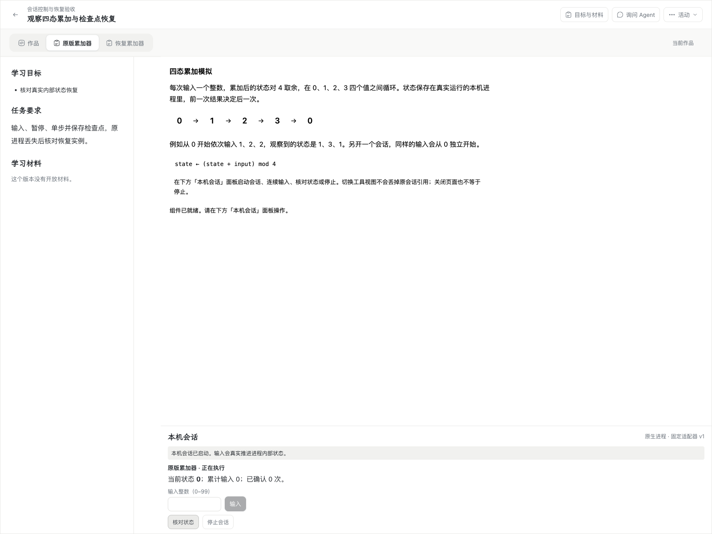
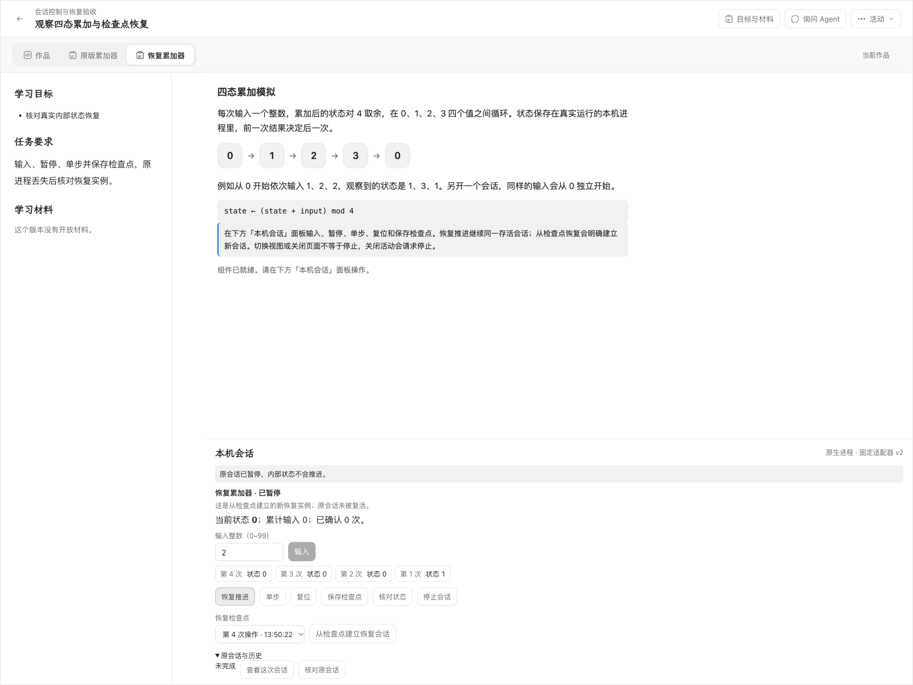
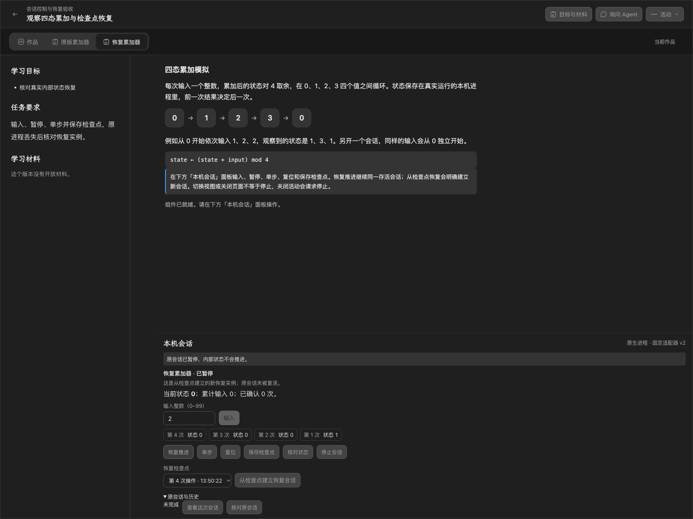
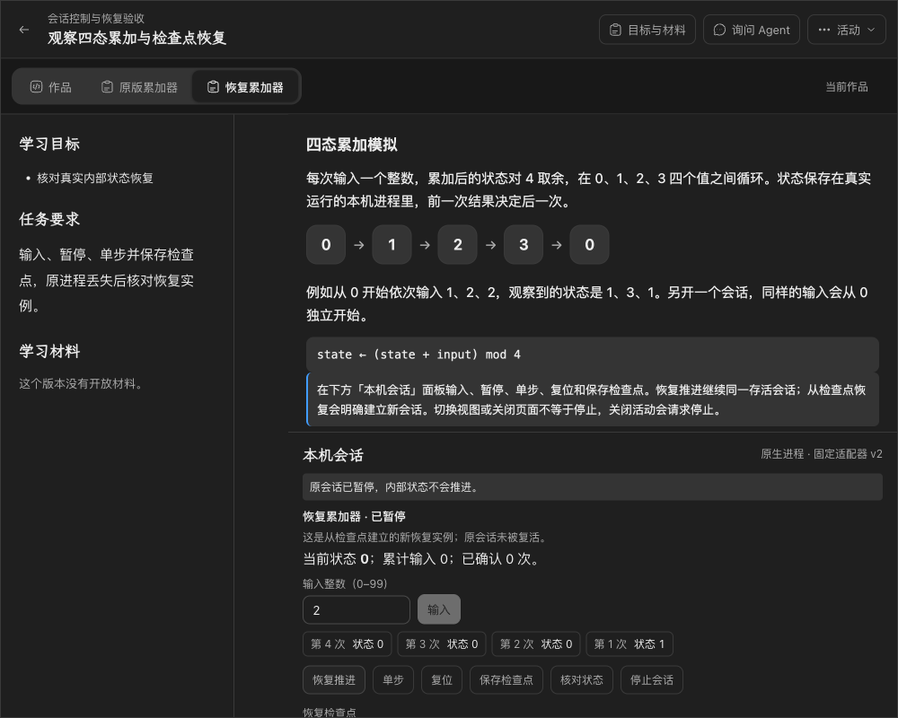
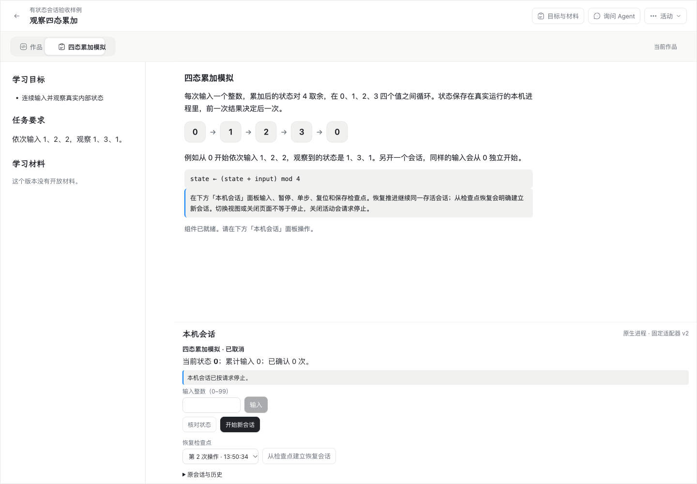
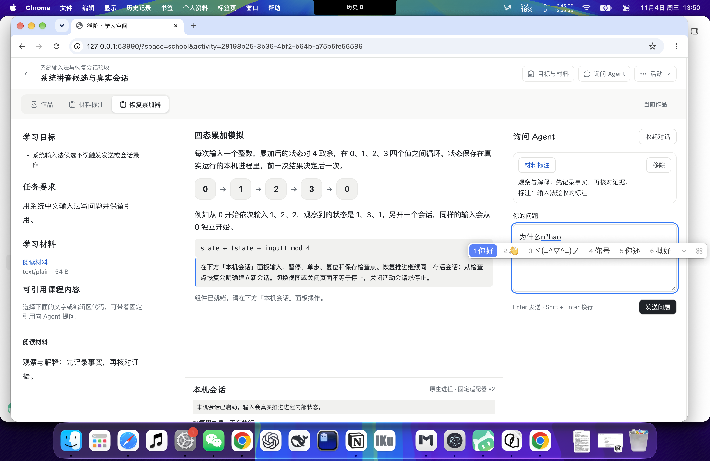
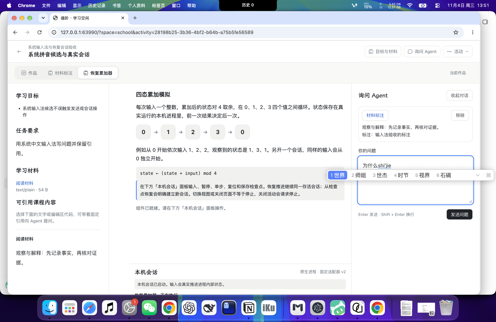
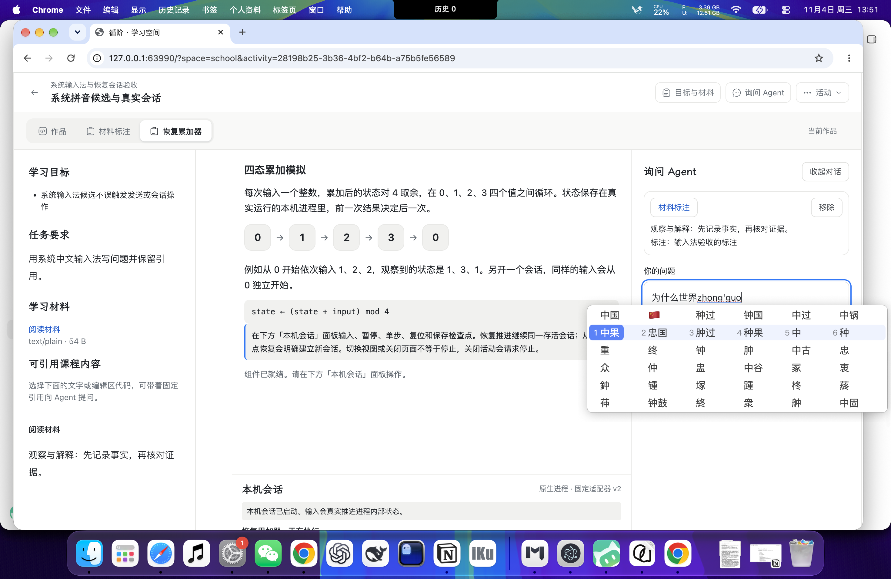
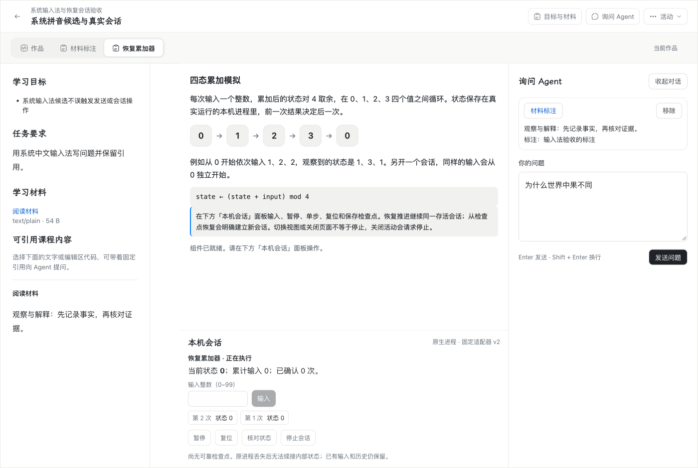

# #187 Apple Silicon 会话控制、检查点与返回恢复验收

日期：2026-11-04（Asia/Shanghai）。本文是 [#187](https://github.com/paher-din/XunJie/issues/187)（母票 [#174](https://github.com/paher-din/XunJie/issues/174)、[#162](https://github.com/paher-din/XunJie/issues/162)）的 Apple Silicon 验收记录。实现与 Windows 验证见[#174 交付](wp03-session-recovery.md)，实施方案见[会话恢复方案](specs/wp03-session-recovery.md)。

## 依据与候选

- 验收对象：`wp03@05bb6a98c17f8e75f58ecc96a3206264f86638a3`。本轮产品修复提交为 `4ada66054450ca7c8c2ed84321109215503f617f`；基线为 #187 记录的 `wp03@375c9670b7707c1c5d7f2154a3c39435fdbddfc4`。
- 写集：`apps/web/src/product/NativeSessionPanel.tsx`、`apps/web/src/reliable-workspace/index.ts`、`apps/server/tests/native-isolation.test.mjs`、`apps/server/tests/session-checkpoints.test.mjs`、`scripts/probe-session-recovery.mjs`（报告标签）、`scripts/probe-macos-session-ime.mjs`（新增）、`apps/server/tests/checkpoint-history.runtime.test.mjs`（报告标签）、本文与 `evidence/wp03-187-*`。**没有修改契约、迁移、组件字节或执行 owner 的产品语义。**
- 本文不替代 Windows、跨机执行、分发包或教学效果结论；未执行项在文末单列。

## 平台与环境（记录项）

| 项 | 实测值 |
| --- | --- |
| 机型 / 架构 | `Mac17,3`（Apple M5，16 GB）/ `arm64` |
| macOS | 27.2（`26B123`），内核 `27.2.0` |
| 运行时 | 产品资源内 Node `v24.21.0`（非系统 Node） |
| 数据库 | 产品资源内 PostgreSQL `18.6`，真实 `initdb`/`postgres` 进程 |
| 桌面浏览器 | Google Chrome `156.0.8078.80`（headed） |
| 产品前端 | `apps/web/dist-runtime`，从候选源码重建 |
| 产品资源组合 | `dist/product-darwin-arm64` 的 Node/PostgreSQL 二进制；此为**开发资源组合**，不是新分发包 |
| 系统输入法 | TIS 选中 `com.bytedance.inputmethod.doubaoime.pinyin`（系统级中文拼音） |

`dist/product-darwin-arm64` 的 `distribution.json` 生成于 2026-11-03（`createdAt 2026-11-03T06:32:11.974Z`，`unsigned-candidate`）。本轮只使用其中的 Node/PostgreSQL 可执行文件；服务端、产品运行时、学习空间和 Web 全部从候选源码重新构建，因此该包的旧代码没有被当作本轮产品候选。签名、公证、Gatekeeper、干净机器验收未执行。

## 验收中发现并修复的实际问题

1. **终态会话仍可编辑整数输入。** `NativeSessionPanel` 为支持暂停态单步，把输入框禁用条件从 `!canInput` 放宽为工作区/权限条件，结果停止或取消后输入框仍然可用。修复为 `canEditAmount`：仅已确认、非终态、未请求停止、无未解决控制且状态为 running/paused 时可编辑；单步仍可在暂停态输入。原有 `nativeSession.spec.ts` 的停止回归重新通过。
2. **启动/恢复动作可能提交尚未到达 owner 的组件状态。** 新版的待输入整数由可靠工作区保护；当最后一次 `pendingInput` 只在 IndexedDB 本地持久化、尚未同步到业务 owner 时，新会话启动会把该 `contentId` 作为 basis 发送，owner 以 `missing` 拒绝。修复为 `ReliableWorkspace.flush()`：等待本地输入和待确认工作区请求同步（5 秒上限），并在创建启动/恢复动作前调用。`nativeSession.spec.ts` 的“停止后开始新会话”场景连续 3 次通过。

两项修复都在最终候选上重新验证；失败计入验收过程，不把修复前的结果当作通过。

## 逐项结果

证据报告：[验证汇总](evidence/wp03-187-verification.json)、[Chrome 控制/恢复/维护](evidence/wp03-187-browser-report.json)、[历史检查点](evidence/wp03-187-history.json)、[系统输入法](evidence/wp03-187-ime.json)、[隔离与负例](evidence/wp03-187-isolation.json)。

| # | 清单项 | 结果 | 关键证据 |
| --- | --- | --- | --- |
| 1 | 旧 v1 样例可读可用、不展示未声明控制；v2 在原工作区/会话面板操作，无并行保存/恢复 UI | 通过 | 探针第 1 项：v1 实际启动/停止，`暂停` 按钮计数为 0；v2 使用同一「本机会话」面板；`session-before.png` 与 `session-after-*` 对照 |
| 2 | 暂停不自行推进、普通输入拒绝；单步只推进一次，重复 controlId 不多推进，错序/参数冲突明确拒绝 | 通过 | `native-session.test.mjs` 暂停后输入拒绝、单步幂等、同 controlId 重放返回原观察、错误参数/顺序拒绝；`session-recovery.runtime.test.mjs` 重复单步 `appliedSeq` 不变、参数冲突 409；探针第 2 项 |
| 3 | 恢复推进继续同一存活实例；复位是明确操作，保持原会话/执行器/公共序号，不以结束重建模拟 | 通过 | `native-session.test.mjs` resume/reset 后 `instanceId` 不变；探针第 6 项 `executorInstanceId` 不变，复位后观察归零、resume 仍同实例 |
| 4 | 检查点由真实执行器产生并绑定会话/位置/组件/配置/主体/环境；经 PostgreSQL 与资源保存、重读、保留后才可恢复；丢回包按原身份查询，不重新采样或重复推进 | 通过 | `session-checkpoints.test.mjs` 12 项（上传中断复用缓存、重读失败不发布、corrupt/missing/retention/config/adapter/format/principal/digest/environment）；`session-recovery.runtime.test.mjs` 真实 PG 资源损坏/缺失；探针第 4 项丢回包跨 IndexedDB 刷新只查询一次 |
| 5 | 从检查点恢复建立新请求/执行引用/执行器，保留原会话与检查点关系；下一步与同输入基准一致；不重放未知操作 | 通过 | `session-recovery.runtime.test.mjs` 新 `executionRef`/`executorInstanceId`、`restoredFrom` 保持、真实下一步等于 baseline；探针第 5 项强制结束原进程后恢复，恢复实例下一步与基准相同 |
| 6 | 强制结束执行器、丢失监督器或重启节点后保留最后可信观察与中断原因；原实例不复活；无检查点、资源损坏/缺失、失权、配置/适配/Node/平台不兼容分别有负例 | 通过 | 探针第 5 项真实 `SIGKILL` 执行器；第 9 项 owner 重启后保留检查点；`session-checkpoints.test.mjs` 环境负例写入 `plan9/mips/v0.0.0` 得到 `invalid`，另有 corrupt/missing/retention/config/adapter/format/principal/digest；`native-isolation` 的 v2 元数据含 `supervisorDeath: session-watchdog` |
| 7 | 切换工具、关闭/重开视图、关页和刷新先保护显式整数输入、问题与引用；返回只查原请求；IndexedDB v6 追加升级保留旧分区和原数据；丢回包后的启动/控制/停止身份跨刷新保留，不自动派发 | 通过 | 探针第 3 项切工具并整页 reload 后输入仍为 `2`、执行器不变、无新增 POST；第 4 项检查点丢回包只查询原控制；`nativeSession.spec.ts` 停止/新会话；`questionDrafts.spec.ts` 旧库升级到 v6 且 12 个 store（含 `nativeSessionRequests`）全在，旧作品仍可读；`session.test.ts` 丢失启动/控制/停止回包跨新控制器保留，不自动重发，显式按原请求身份重试 |
| 8 | 心跳失联/暂时查不到标注待核实，不误报停止/未执行；心跳不延长空闲时限；旧结果不倒退终态、不替换当前选中恢复实例；原会话历史可查看/停止 | 通过 | `session.test.ts` 16 项：连接丢失保留观察并标 unknown、缺席记录不解释为 running/stopped、晚 running 不倒退终态、晚旧查询不替换恢复实例、历史分页；`native-session.test.mjs` 空闲期间快照心跳仍按 1 秒真实退出；探针原会话历史/停止 |
| 9 | 维护先停止新接受/控制，等待实际进程退出并保存事实，再关闭写入；无法确认终止/检查点边界时不宣告 `safeToStop`；恢复写入后显式建立新恢复实例，安装代际正确，原实例不继续 | 通过 | 探针第 8 项 `maintenance.enter('backup')` 返回 `safeToStop: true` 前真实退出已确认；`maintenance.resume()` 后从检查点建立新实例，`installGeneration` 不同；`session-checkpoints.test.mjs` 未确认排空负例 |
| 10 | 检查点/控制事件/恢复关系/资源保留经 owner 验证和正常重启；停用组件不删除历史、不能新推进；关闭活动请求停止；关页不误当停止 | 通过 | `session-recovery.runtime.test.mjs` 停用组件后 reset 拒绝且检查点仍在、owner 重启后恢复、关闭活动后会话 `cancelled` 且新控制/动作拒绝；探针第 9 项正常重启；整页 reload 后会话仍运行、不把刷新当停止 |
| 11 | Seatbelt、进程组回收、工作集/时间预算和资源边界对新增适配真实生效，不复用旧适配结果；明确未执行的跨机/分发包组合 | 通过 | `native-isolation.test.mjs` 新增 v2 真实适配：seatbelt、network denied、session-directory 写、fixed-node-only、heap-cap+RSS watchdog、supervisor-group-confirmed；v2 暂停/单步/检查点/停止后空组确认；v2 `idleMs=1000` 真实退出；见[隔离证据](evidence/wp03-187-isolation.json) |
| 12 | Chrome 键盘焦点、浅/深色、窄桌面及原编辑/问题/引用/停止回归；实际 UI 截图 | 通过 | 探针第 7 项键盘焦点与 1000×800 窄桌面；`session-after-light/dark/narrow.png`；原草稿/动作/IDB/停止 22/22；引用/编辑 27/27 |
| 13 | macOS 系统中文拼音输入法：候选期间 Enter/数字/方向键不发送/不触发快捷操作；确认候选、继续编辑、失焦、刷新保留中文问题与引用 | 通过（HID 层系统按键，非人手敲键） | 新增 `probe-macos-session-ime.mjs` 12/12：Enter 候选时 `trusted=true, keyCode=229, isComposing=true`，不换行/不发送/不控制会话；数字选择“世界”；方向键+Space 选择“中果/钟国”等非默认候选；继续编辑“不同”；会话保持运行；失焦与刷新后问题“为什么世界中果不同”与引用副本由业务 API 读回；全程执行 POST 增量为 0。见[输入法报告](evidence/wp03-187-ime.json) |

## 工程与浏览器检查

全部在候选 Node `v24.21.0` 下执行，真实 PostgreSQL 18.6 与安装版桌面 Chrome：

- `node scripts/build.mjs all`：9 个构建任务通过，退出码 0。
- `node scripts/build.mjs typecheck`：全部类型检查任务通过。
- `npm run check:contracts:browser`：12/12 公共导出浏览器安全。
- `node scripts/verify.mjs --group unit --jobs 3`：25/25 任务通过；Web 70 个文件、826 项通过。
- `node scripts/verify.mjs --group server --jobs 2`：83 个任务（含 82 个本地测试任务）通过，165.9 秒。
- `node --test packages/product-runtime/test/school-client.test.mjs`：2/2 学校转发边界。
- `node --test apps/server/tests/native-isolation.test.mjs apps/server/tests/native-session.test.mjs apps/server/tests/session-checkpoints.test.mjs`：21/21。
- `node --test apps/server/tests/session-recovery.runtime.test.mjs`：1/1，真实 PostgreSQL，2.8 秒。
- `node --test apps/server/tests/checkpoint-history.runtime.test.mjs`：1/1，真实 PostgreSQL/Chrome，6.5 秒；66 个检查点跨 2 页，单会话投影 64，字号 17px、代码行高 19.5px。
- `node scripts/probe-session-recovery.mjs`：9/9，真实 Chrome/PostgreSQL，4 个实际执行器，11.7 秒；宿主 Node RSS 约 325 MiB（不含 Chrome/PostgreSQL/子进程峰值）。
- `node scripts/probe-macos-session-ime.mjs`：12/12，6 次 compositionstart/end，提交序列“为什么 / nihao / 世界 / 中果 / 不同”，候选期间执行 POST 增量 0。

浏览器回归：原草稿/动作/IndexedDB 升级/本机停止 22/22；引用与编辑器 27/27。Web/服务端验证日志位于 `.verification/`，为本地临时产物，不入库。

## 实际 UI 对照

复用既有工具页签、组件视图和本机会话面板，不新增并行恢复页面。旧 v1 只显示原输入/停止入口；v2 在同一面板显示暂停、单步、复位、检查点和恢复选择，并说明恢复实例与原会话的关系。

## 未执行与限制

1. **新分发包与签名**：未从最终候选重新打包 darwin 产物；签名、公证、Gatekeeper、干净机器验收未执行。`dist/product-darwin-arm64` 只作为 Node/PostgreSQL 资源来源。
2. **真实跨机**：本轮是同一台 Mac 上的本机回环产品运行；学校服务器、跨机客户端、学校侧 TLS 和多成员并发未执行。
3. **Windows**：本票只验收 Apple Silicon；Windows 结果沿用 #174 记录，未重跑。
4. **系统输入法操作方式**：按键经 `xjkeys` 的 `CGEventPost(.hidSystemState)` 与 System Events 进入 WindowServer 和真实系统拼音输入法，不是 Playwright `fill` 或合成 composition 事件；但不是人手敲键。若要求人工手敲证据，需另安排一次人工操作。
5. **教学效果**：使用合成课程与固定接收器，教学效果未评估；本轮没有调用任何模型。
6. **资源统计**：宿主 RSS 不含 PostgreSQL、Chrome 或执行器峰值，不据此推断课程容量。
