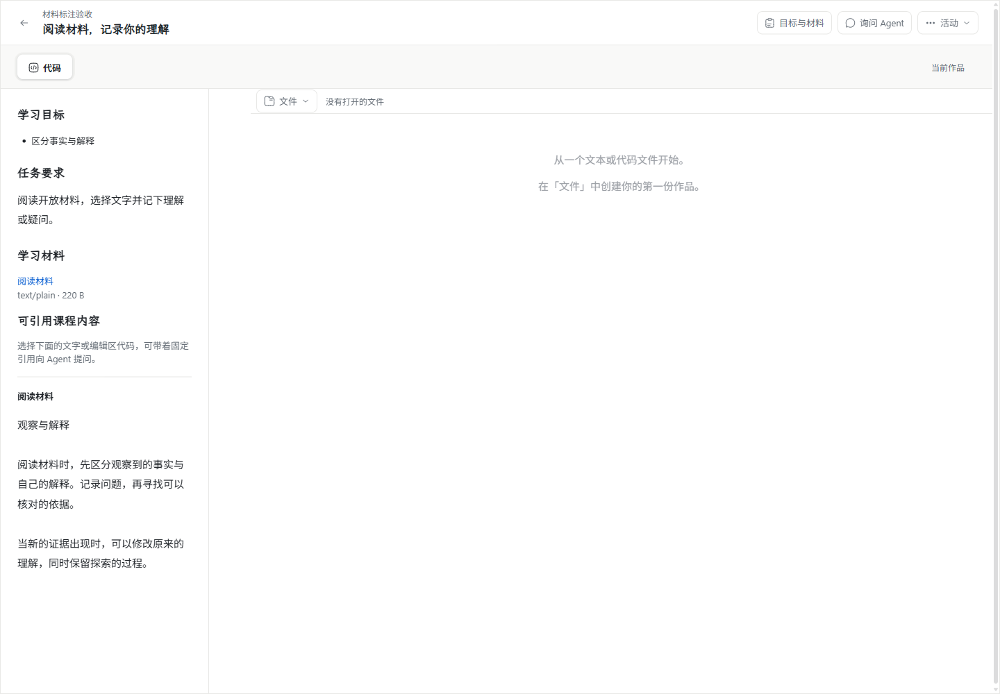
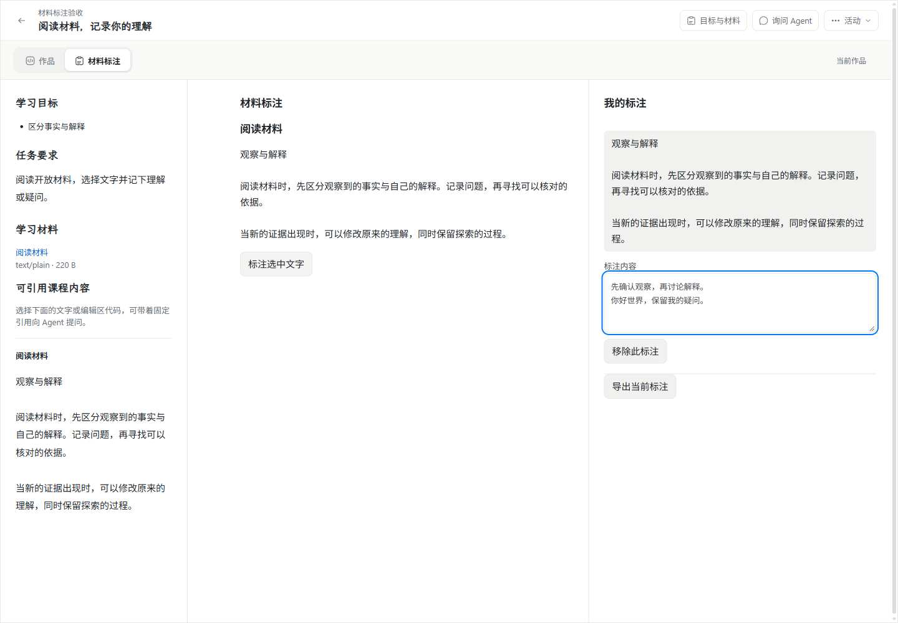
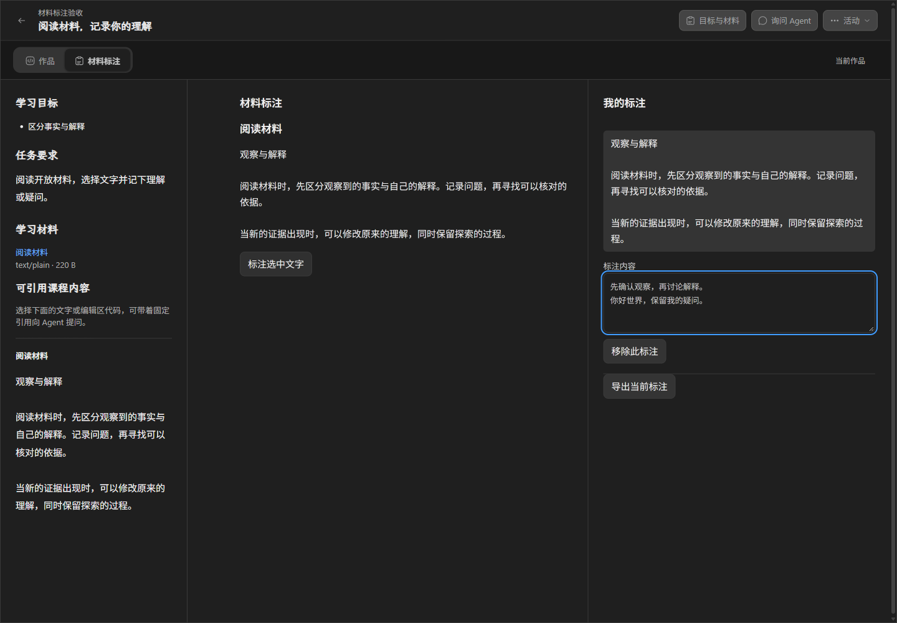
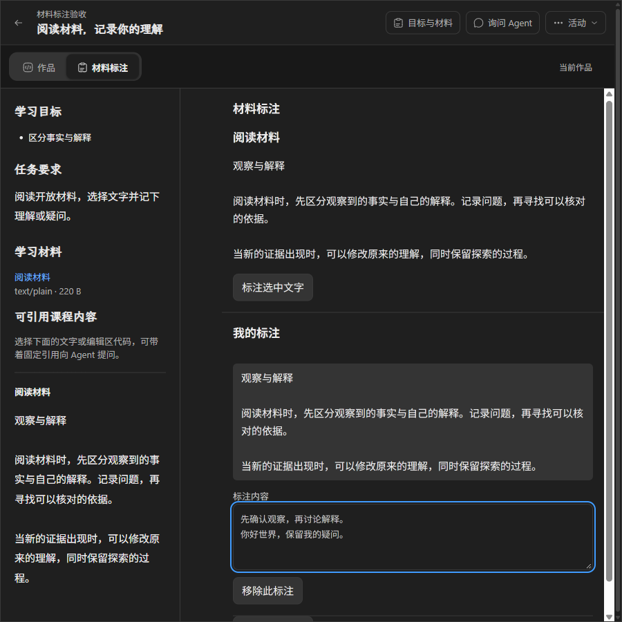

# #169 动态组件与可靠标注工作区

日期：2026-11-02。状态：本地候选实现；Windows 验证见下，Apple Silicon Mac 尚待交接验收，不标记本票完整验收。

## 依据与授权

- [实施票 #169](https://github.com/paher-din/XunJie/issues/169)、[WP03 规范](specs/wp03-course-components-and-execution.md) §1–4、§12–13。
- 基线 `f0979d5794c977f077a30d6abc8716af7f3a925d`，从 `upstream/wp03` 创建 `codex/issue-169-component-host`。
- 负责人授权本地实现与 Windows 验证；Mac 作为完整交付前必须补齐的独立交接。推送 upstream/wp03 必须经负责人最终审核，不创建 PR、不合 main。
- 保留既有 `.trae/`、`apps/student/`、`docs/tasks/` 未跟踪内容及 `tools/xj-dev/xj-dev.mjs` 行尾标记。

## 方案与写集

组件清单/不可变视图资源通过课程 owner 注册；发布固定绑定定义、配置和开放材料。学习数据 owner 继续拥有实例显式状态，复用 typed state、既有 IndexedDB/服务端 CAS 和保存周期。隔离视图仅通过 hostApiVersion=1 桥接访问本实例。

可写：contracts 的组件/课程 wire、learning-space 对应 owner 与 HTTP 入口、产品运行装配与恢复校验、local-runtime 导入命令、Web 中心工具/宿主和可靠工作区接线、材料标注样例、相关测试和本记录。只读：产品设计、其他 WP 规范和无关实现。执行、非文本问题引用、教师组件库与完整跨 owner 恢复不在本票。

## 实现与接口

- `@xunjie/contracts/components` 提供版本化清单、固定绑定、资源与宿主消息。首版支持自包含 HTML、无执行组件；状态使用有限深度、属性数、数组数和字符串长度的声明结构。未知必需能力及协议版本拒绝装入；执行和语义引用方法返回不可用，后续子票扩展。
- space-course owner 登记迁移 7（不可变定义）和 8（装载启停），复用 OwnedStorage 回执、资源暂存/保留、维护关闸及恢复校验；不跨 owner 写表。清单摘要按规范化结构生成，兼容 PostgreSQL JSONB 对象键排序。
- 管理接口 `POST /api/learning/manage/component-import` 输入 `{requestId,manifest,contentBase64}`；`component-read` 输入 `{componentId,version}`；`component-status` 输入 `{requestId,componentId,version,enabled}`。沿用私有 control 授权；学生不能调用。重复登记身份查询原回执，同一组件版本不得替换定义或字节。
- 课程导入可增加 `release.components`：每项 `{key,definition,configuration:{title},materialIds}`。定义必须已登记、可用且摘要相符；映射只允许发布内学生开放材料。配置、定义与映射进入发布摘要及活动固定绑定；旧发布未增加字段时原摘要不变。
- `POST course-activities` 可传 `purpose:"preview"` 建立独立活动和工作区，预览不进入正式活动列表。仍需真实主体和课程资格，不授予教师权限；教师预览 UI 属于 WP10。
- 宿主从授权发布读取并验证资源；独立 `/view` 文档以不透明 iframe origin、`sandbox allow-scripts`、禁止业务网络的 CSP 装入。主体/空间参数仅作范围校验，实际资格来自既有认证与连接转发；父文档 CSP 不放宽。
- `workspace.change` 使用 operationId、expectedContentId 和新的 contentId；重复返回原确认，改变同 operationId 的输入拒绝。确认表示本机保护，不能解释为服务端同步完成；中间输入被后续输入取代时返回实际已保护身份。关闭连接不能写入，迟到回调不投递新挂载。
- 状态文件 `components/<key>.json` 为 `state/json`，含实例、组件与状态版本。即时编辑复用 ReliableWorkspace，不增加保存队列；旧基线保留为原工作区冲突候选。保护失败阻止切换，并保留可复制输入。
- 停用阻止新装载及新绑定，不撤销已挂载连接，不删除旧作品和保留资源；重开可在「作品」读取/导出状态。视图资源损坏不清空作品。

## 可重复开发入口

依赖与公共库构建完成后，用产品 CLI 操作已安装并启动的环境；不是旧 SQLite 开发服务器验收入口：

```sh
node components/material-annotation/package.mjs
node apps/local-runtime/dist/cli.js component-import --root <产品私有目录> --file dist/material-annotation/component.json
node apps/local-runtime/dist/cli.js component-read --root <产品私有目录> --file <查询.json>
node apps/local-runtime/dist/cli.js component-status --root <产品私有目录> --file <状态.json>
```

查询文件 `{componentId,version}`，状态文件如上节。课程清单的 definition 使用登记结果，不自行拼造摘要。样例首次登记使用生成文件固定 requestId；改版必须改组件版本、资源身份及登记身份，不能同版热替换。CLI 从导入目录读取 path 并拒绝越界，API 再验证字节。私有输入和授权不进入仓库。

## UI 改动与保留消费者

正式 ActivityPage 将固定「代码」接线替换为「作品」与发布声明的组件标签，沿用沉浸外壳、中心工具分屏、编辑器/文件条、目标材料与问题面板。材料标注在中心显示材料和标注，窄桌面内部上下排列，沿用浅深色 token。目的是按任务声明装入能力，避免主工作区逐课程增加分支；无组件活动继续使用原编辑器。

CenterToolArea 新增正文映射和布局变化前保护回调，没有材料标注课程分支。旧 CODE_TOOLS 仍由 `pages/WorkspacePage.tsx` 消费，textscope-c 仍由 `pages/PrepWorkspacePage.tsx` 消费；未删除仍有消费者的旧实现。

修改前取自 f0979d5 实际正式 UI；修改后使用同一公开验收材料，在新宿主实际输入后截图：






## 验收记录

环境：Windows 11 x64（10.0.26200）、Node 24.21.0、原生 PostgreSQL 18.6、桌面 Google Chrome 156.0.8078.80，非 headless。Chrome 原未安装，本次使用 Google 签名官方安装包安装。本地报告保存在 `.verification/wp03-169/`，不提交临时数据库和凭据。

工程检查：`npm run typecheck`、`npm run build`、`npm run check:contracts:browser`（11 个公开导出）通过；构建保留现有 chunk 大小及上游 Zod PURE 注释提示。桥接 Vitest 3/3 通过（协议单元测试，不替代真实存储验收）。`node --test apps/server/tests/component-host.runtime.test.mjs` 通过：真实 API、原生 PostgreSQL/资源、重复登记、同版不可变、协议拒绝、私有材料拒绝、主体/空间/活动/预览隔离、CAS、重启、资源损坏、停用保留及撤销。

已有 `course-releases.runtime.test.mjs` 7/7 通过，覆盖课程固定发布和已安装客户端转发。既有 productUi Chrome 选定回归 3/3 通过：作品建立/重命名/删除重建/返回重开、问题面板及刷新、课程内容/主题/窄桌面/键盘焦点。问题派发回归使用原受控 receiver，不是实际 Agent 或教学效果验证。

最终原生集成连同上述课程用例合计 8/8 再次通过；另补跑 productUi 浏览器历史、拒绝保护、跨课程详情退休、初始重开与跨空间导航 4/4 通过，现有 UI 选定回归合计 7/7。本票 3 份文档以同一 checkDocLinks 检查器定向核对 73 个本地目标，0 失败。

浏览器 `node scripts/probe-component-host.mjs` 10 项通过：动态导入、键盘焦点与中文多行输入、真实 iframe→IndexedDB→业务 API→PostgreSQL/资源、存储/父文档/业务网络隔离、浅深色/窄桌面、刷新恢复、双页面条件更新、旧输入冲突候选、真实 IndexedDB 写入失败阻止卸载且可复制导出、主前端产物不变。写入故障只注入浏览器 IDB readwrite 边界，不模拟业务接口。中文文本输入不等于系统输入法候选操作。

发现并修复：资源恢复校验最初使用错误引用表名导致维护停止失败，修正 `_storage_references` 后重启通过；中心工具激活回调未更新布局，已修正；srcdoc 继承父 CSP 阻止脚本，改为独立严格 CSP 文档；主题映射现有 token。沙箱曾阻止 Vite realpath，获授权后重跑通过；一次浏览器命令遗漏原生 PostgreSQL 变量，在启动前拒绝，补齐后重跑通过。未修改无关 CI 随机断言。

未执行：Apple Silicon Mac Chrome、该组件真实跨机新增路径、系统中文输入法候选操作、教学效果。执行/非文本引用与跨 owner 全量恢复属于后续子票，不在本次交付内。

文档全库检查未通过：现有未跟踪 `.trae/documents/` 内有 9 个指向已不存在 planning/product/reference 文档的链接；均不属于本票写集，未修改。这不记为文档全库通过；本票新增及修改文档另按同一检查器定向验证。

Windows 未签名候选包在本地 `dist/wp03-169-review`；打包第一次误用 Git tar 导致盘符解析失败，改用 Windows 原生 tar 后成功。最终 Chrome 验收使用该包内 Web 与 PostgreSQL 资源，通过全部 10 项；前端摘要覆盖整个文件树而非仅 index.html，具体摘要保存在本地 browser-report.json。旧版对照截图等待作品加载完成后再截取。

另以候选包自带 Node 和 `app/cli.js` 在独立临时 root 实际运行 install、start、component-import、component-read、stop，全部成功；查询摘要与登记结果一致，未使用仓库开发服务代替正式 CLI。

## Mac 交接验收

用相同候选源码和官方 Mac ARM 产品资源，单独准备产品 root，使用真实原生 PostgreSQL 18.6。运行类型/构建/公开契约检查；安装桌面 Chrome，设置 XUNJIE_PRODUCT_POSTGRES_BIN 后运行原生集成测试与 `scripts/probe-component-host.mjs`，不得改为模拟 API 或跳过。补验系统中文输入法、焦点、重开、浅深色与窄桌面，记录系统、架构、浏览器与失败；跨机学校连接按实际拓扑补验组件资源、主体校验和撤销。Mac 未通过前不勾选本票跨平台完整验收。
