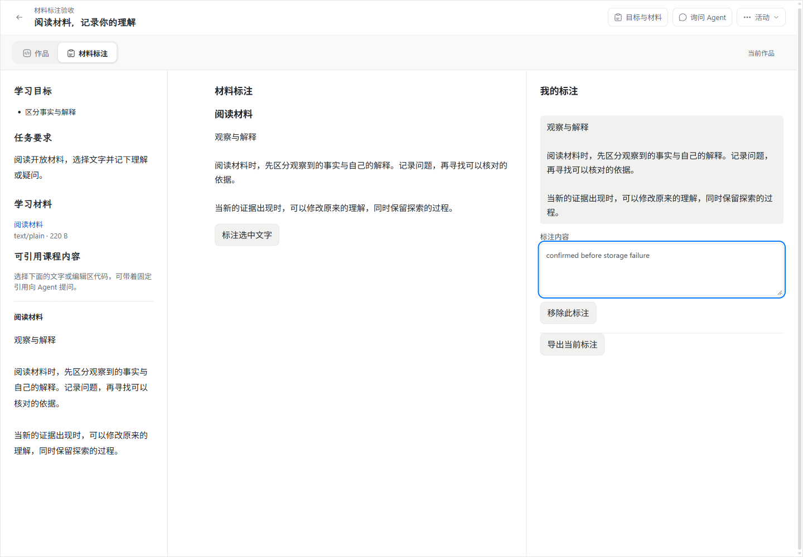
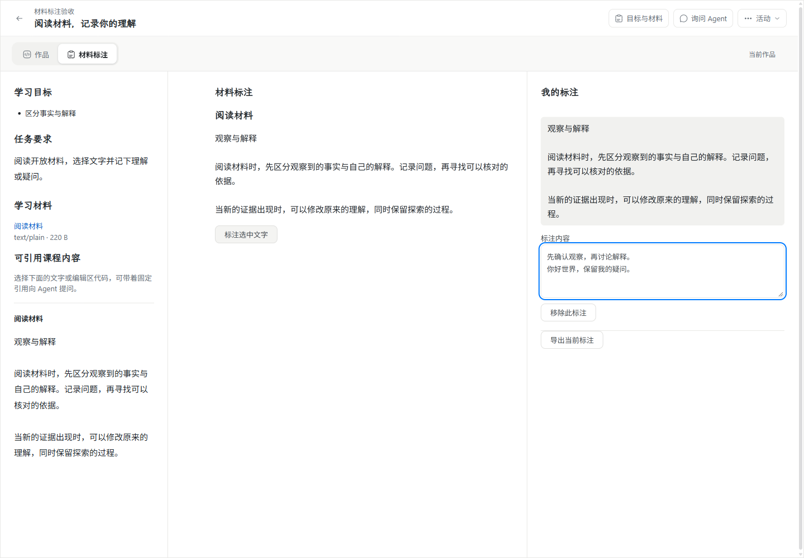
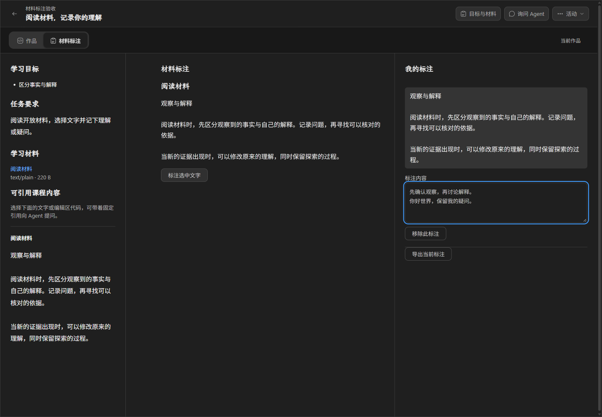
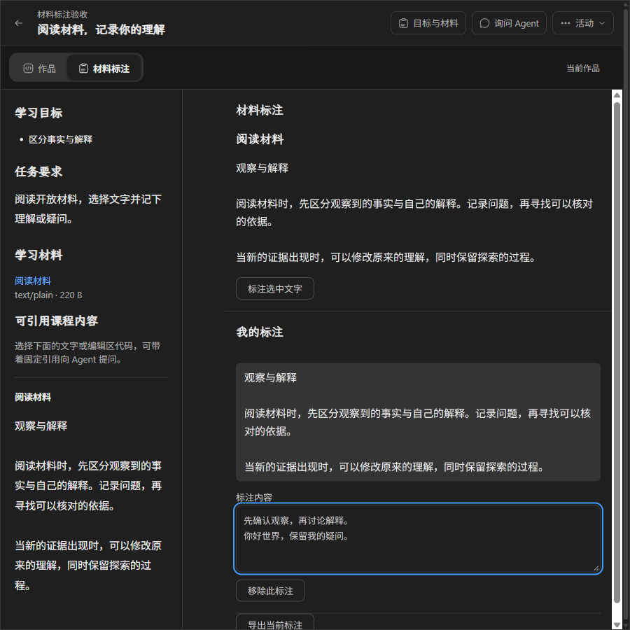

# #169 审查问题修复与验收边界

最终与 #170/#171 的整合审查见 [执行最终审查](wp03-execution.md#最终审查与-pr-182-整合)。下文保留独立修复分支的原验收来源；合入 `wp03` 时材料标注新版已分配为 v3，保留既有 v1/v2，整合后的工程与双平台结果以最终审查记录为准。

日期：2026-11-03（Asia/Shanghai）。来源：负责人提供的 `XunJie_169_wp03_review_and_remediation.md`；审查基线 `wp03@60f58c5917aeaef4d00e29f857a3cfad0c385bd5`。修复分支 `codex/issue-169-review-remediation`。本轮只做本地修复和取证，未经负责人审核不推送、不建 PR、不合 main，不将 #169 的既有关闭状态视为完整验收证据。

## 修复范围

| 项 | 改动与边界 | 对应回归 |
| --- | --- | --- |
| R1 | 聚合 leave 句柄由持续挂载的 ActivityPage 提供，等待作品、问题草稿和待发动作；编辑器不再拥有唯一 ref。LearningApp 所有返回、历史、空间/身份/活动切换入口共用保护，活动存在却无句柄时明确拒绝离开 | 组件单窗格返回、后退/前进；IDB 写失败返回/跨空间历史保留同一 iframe、输入和导出；恢复后重开；动作存储单独失败时仍阻止返回，并恢复原固定问题与后来草稿 |
| R2 | UI 不显示组件状态的普通改名/删除；可靠工作区和服务端均拒绝占用绑定状态路径、篡改身份/类型。加载历史记录时，只对完整不可变绑定仍匹配且目标未被占用的错误路径做恢复；不改内容或原未知请求 | 正常文本改名、状态公开变更拒绝、保留路径；真实 API 拒绝后的旧 invalid pending 形状注入真实 IDB，重开后保留标注并继续同步普通文件 |
| R3 | 未知回执保留回调也在实际修改前重新校验 active 和主体资格；退休请求返回 stale-connection/forbidden，不改变当前文件/候选 | 生产类四组成功/失败 × 关闭/失权对照；真实旧 iframe 延迟失败与后继输入竞争；仍有效的存储故障继续保留候选 |
| R4 | contracts 提供方向明确、严格的初始化、请求、成功和错误信封；响应有独立 messageId、原 method、replyTo，错误 payload 为 null。宿主发送端与样例接收端使用同一校验器 | 严格公共校验器覆盖初始化、实际成功及所有公开错误类型；旧缺字段格式拒绝，不依赖样例忽略字段 |
| R5 | 新登记在落盘前拒绝非小写组件 UUID；读取按 UUID 语义定位。旧清单的拼写、字节、摘要和引用不改写，维护按原清单构造引用身份 | 旧包正常 API 接收大写 ID 并在小写查询失败；修复 owner 启动同一环境，双拼写读取保持原定义/摘要，再次 stop/start 通过 |
| R6 | 四类非执行事件：control-change、answer、prediction、confirmation；有限值结构、事件 ID、连接/实例、连续序号、重复同内容回执与复用/乱序拒绝。宿主交互消费器保存瞬时观察供订阅读取 | 类型化消费、各类非法字段、实例/连接错误、重复/改写/乱序；兼容组件实际发送四类，不派发问题或调用模型 |
| S1 | 共享隔离视图 CSS；标题使用经摘要校验的现有自托管文楷，普通按钮 32px/13px、现有次级 token。字体由宿主固定构建资产经端口传输，iframe 只加载内存字体，CSP 仅允许 data 字体，业务网络仍禁止 | 真实字体加载和 computed style 断言、浅深色/窄桌面截图、既有隔离反例 |
| S2 | 浏览器及服务端共同调用 contracts 的纯绑定状态校验，各自仍执行授权与错误映射 | 客户端/服务端路径与结构的正负用例；未删除所属服务验证 |

## 请求与历史数据恢复

本机增加可选 pendingRejected 字段，不另建作品权威或保存队列。只有直接向所属服务提交原请求后得到明确 invalid 拒绝，才持久标记该请求不可重发；若修正内容已经保护，以新 requestId 建立下一请求。网络断开、丢 ACK、commit-unknown、读取原回执失败都不被解释为未接受，不换原身份重做。现有迟到/丢回执回归继续验证该边界。

历史错误状态路径的修复只在状态对象的组件、实例、版本、摘要、结构全部与活动固定绑定一致且无路径冲突时进行；既有原 pending 仍先查证/重交，得到明确拒绝后才由保留内容生成新请求。没有清空 IndexedDB，没有把任意 JSON 当成状态，也没有自动重置学生进度。

大写历史组件记录无需改写不可变数据：SQL UUID 查询规范化，但返回原清单与摘要，资源引用继续使用其登记时的原始拼写。新导入拒绝大写/混合大小写；查询允许同一 UUID 的任一合法拼写。不能用新的小写清单冒充旧清单的同版定义。

## 协议、事件与样例分发

`componentHostMessageSchema` 校验初始化/成功/错误方向；`componentRequestSchema` 校验组件请求，业务去重仍用独立 operationId。错误保留请求关联和下一步，分类包含 invalid-input、unsupported-version、capability-unavailable、forbidden、stale-connection、conflict、resource-unavailable、outcome-unknown。

事件 formatVersion=1，sequence 从 1 连续递增；同 eventId 同内容重放不重复消费，不同内容或乱序返回 conflict。每连接最多保留 4096 个事件回执，达到上限明确报告能力不可用，不静默淘汰。事件消费器仅保存活动会话内的瞬时观察，不是学习证据、持久执行轨迹或掌握判断；关闭会话不自动触发模型或重放事件。

材料标注样例升级为组件 **v2**，入口资源与登记 requestId 均换新身份，stateVersion 仍为 1；旧 v1 和已开始活动不热替换。源 HTML 是开发模板，经 `node components/material-annotation/package.mjs <输出目录>` 打包后才得到自包含可导入视图：打包器嵌入共享 CSS 与从 contracts 构建的严格协议校验器。运行时不依赖 esbuild，也不从第三方网络加载字体/脚本。宿主基础 v1 消息仍兼容原先按 replyTo 读取响应的 v1 样例，但不将旧样例样式冒充新版样式。

## 已执行验证

Windows 11 x64（10.0.26200）、Node 24.21.0、原生 PostgreSQL 18.6、安装版桌面 Google Chrome 156.0.8078.80，实际 headed。工程、浏览器、产品包和教学效果分别记录；脚本中文字符串输入不等于系统输入法。

- 类型检查、完整构建、11 个浏览器公开导出检查通过。
- 桥接与修复单元测试 12/12：包括生产类失效回调对照、严格信封、四类事件、公开状态路径保护。
- 原生组件/课程集成 8/8；最终组件保留路径服务端权威校验另重跑 1/1。
- 原有产品/编辑器回归与新增组件动作保护合计 25/25，0 跳过、0 重试。动作场景使用已有受控 receiver 验证持久竞争，不声称实际 Agent 或教学效果。
- `scripts/probe-component-legacy.mjs` 使用未修改的旧正式包、真实管理 API/PG 接收大写 UUID，先复现原问题，再由修复代码恢复同一环境并保持原定义/摘要、资源保留及正常重启。
- 使用旧 Web 产物与对应 `60f58c5` 组件字节，在真实 Chrome 复现 R1 返回丢输入、历史卡住及 R2 修正名称后仍保留 invalid pending。R3 使用原 bridge 的生产逻辑做四组定向对照，旧版两组失败分支确实污染候选；不是拿替身结果冒充真实 IDB。

最终包和扩展 Chrome 探针结果、差异格式/文档检查见本页后续记录及脱敏证据；候选包位于本机忽略目录，不提交数据库、认证 trace 或凭据。

## 实际 UI 对照

视图仍沿用原工作区及材料/标注布局。修复的是标题字体、按钮尺寸与次级样式，目的是遵循 DESIGN.md，减小控件并保持浅深色一致；文件菜单不再提供破坏内部组件状态的改名/删除。截图来自独立合成活动，标注文字不同，不是同一学生数据的迁移截图。

## 失败、调整与未执行

保留实际失败记录：contracts 不含 DOM crypto 类型，响应消息 ID 改由宿主注入；样例内嵌 JS 的美元符号曾被字符串替换解释，改为函数替换；不存在的标题变量导致继承正文栈，已修正并用真实字体/尺寸断言取证；新增 `.mjs` 调用缺声明，已补精确 `.d.mts`。曾把依赖构建与回归并行，造成测试启动时构建模块短暂缺失（2 失败、22 未运行），构建完成后串行重跑 25/25。旧反例第一次误用了更早传输版本的样例，后改为审查 SHA 的视图字节重跑；失败不计通过。

Windows 系统中文输入法现已由负责人手动验收通过（2026-11-03，Asia/Shanghai）：负责人按本会话提供的 7 项操作与合格标准逐项检查，并明确反馈“每一项都符合，全部通过”。范围为候选确认、候选选择、候选取消、连续编辑、焦点切换、刷新恢复、离开再进入。验收入口为 #169 独立候选包的专用 Chrome 窗口，测试使用合成课程；不包含 #171。详见[用户手动验收记录](evidence/wp03-169-windows-ime-manual.json)。

保留此前自动验收未完成的事实：首次 Chrome 应用授权超时，第二次原生电脑控制因无法可靠识别浏览器 URL 被系统停止，Agent 未执行系统候选输入。此次通过属于用户手动确认，Agent 未独立观察全部过程；未取得用户录屏、逐步截图、最终正文或具体系统/浏览器版本回填，不把它记成自动化通过，也未据此改写早期失败记录。

Apple Silicon Mac、其系统中文输入法及该组件实际跨机访问另由独立 [Mac 验收 #179](https://github.com/paher-din/XunJie/issues/179) 接续，不挂 #178；须使用修复后的固定候选。Windows 系统 IME 的用户手动通过与 Mac 验收分开记录；实际跨机路径仍需独立核实。本轮未验证教学效果，未重跑无关全量 CI，也不据这些局部修复自动关闭总验收。

## 本轮复审 P2 冲突裁决补修

[复审报告](wp03-169-remediation-review.md)发现普通编辑的 objectId 保留限制误用于显式冲突选择。现已拆开校验：选择合法对方状态或合法空状态可以完成，普通状态改名、删除、对象替换和非法候选仍受保护。新增回归先复现四项失败，补修后桥接/修复单元 23/23、真实 Chrome 探针 26/26；类型检查和运行版 Web 构建通过。[本轮证据](evidence/wp03-169-conflict-fix-verification.json)与早期修复数据分开，旧分发包未被改写，本轮未重打包。#171 不在范围内，平台验收缺口及用户手动 IME 通过保持上述边界。
