# #179 / #181：Mac 产品包与真实学校连接验收

日期：2026-11-03（Asia/Shanghai）。对应 [#179](https://github.com/paher-din/XunJie/issues/179) 与 [#181](https://github.com/paher-din/XunJie/issues/181)。本轮固定生产候选为 `6171351171025bae457b9afbc1d33fc18ab5e481`，起点为干净的 `692fa066b2990d7d1c18524dabba4d758b607460`。后续验收脚本、截图与文档提交不改变这个产品源码身份。

**两票全部适用验收已完成。** 工程、完整包、真实 Chrome、macOS 系统中文输入法、四条真实学校跨机路径与所属环境清理均通过；教学效果未评估。本页记录本轮实际证据，早先 Windows、表格聚合及同机 school profile 报告不充抵本轮结果。逐项结果与原始报告摘要见[脱敏证据](evidence/wp03-179-181-acceptance.json)。本轮只关闭独立验收票 #179、#181，不自动关闭 #169、#171 或母票，不合 main、不部署。

## 固定候选与设备

真实 Apple M5 MacBook Air（Mac17,3，16 GB）、macOS 27.2 / build 26B123、darwin/arm64、安装版 Google Chrome 156.0.8078.80。完整未签名 `darwin-arm64/full` 候选使用自带 Node 24.21.0、PostgreSQL 18.6；两个执行文件均为原生 ARM64，没有 Rosetta 或平台模拟。

- 本机完整包：`dist/wp03-179-181-6171351`。
- `distribution.json` SHA256：`c1f3cce0d6fea8bc445dec24b13f35d11aef9a3bffea7e40f6c716cfe281ce6e`。
- `resources.json` SHA256：`54e3bfca6394b6d600a77eff946427123f2bbbf095a9563e6c731bd5b0159469`。
- Web 整树 160 文件 SHA256：`22ec66d715863ae7f0370a7a11a1f9ba0b3edbb0d737183b4af4e0eb0bdc6ae7`；正常导入与使用前后不变。
- canonical 材料标注 v3 入口摘要：`efaf3ddef0171f7ddf12601c8ddfd8dc1908a2aebc51eda124d7d3d447a1c53f`；保留 prepared v2 入口摘要：`6c5045dbe0758dc4bd0412fe3f17bd420cab3405ae8162ec2388fdc244fd6081`。
- v2 固定依赖 mark.js 8.11.1，16917 bytes，SHA256 `21d62e1053f7589fe6365cccd7c636d1781abf7879a605d8ce5f1f5b81a7b8fa`。对照新版本 v4 仅用于独立合成验收，不替换 v2/v3 或既有活动。

## 工程、正式包与 Chrome

下列命令均以包内 Node 24.21.0 调用；按需设 `XUNJIE_PRODUCT_POSTGRES_BIN`、`XUNJIE_PRODUCT_WEB_ROOT` 到相同包内资源。工程测试、CLI、浏览器与物理输入分别记录。

| 检查 | 本轮实际结果 |
| --- | --- |
| `npm run verify -- --group prepare --jobs 2` | 类型、构建、浏览器公共导出、文档四阶段通过，退出 0；最终原始日志 `.verification/2026-11-03T08-10-47-649Z-B89xNx/` |
| 原生 component/course API 集成 | 最终候选 component/course 全部 9/9；主体反例曾先红 `200 != 403`，修复后通过。工程测试自身的 Web 路径不能冒称完整包 CLI 验收 |
| bridge、preparation、remediation 单测 | 28/28 + 18/18；包括严格 v1 信封、四类事件、失效回调、状态保留路径与准备版本隔离 |
| 停启/排空/生命周期回归 | Mac 13/13；Linux/Windows 的两个新反例各 2/2，消费正式包 API；真实 Linux TLS 预连接复验通过，类型检查通过 |
| `probe-component-package.mjs` | 新完整包正式 CLI 6/6，14 条产品 CLI 命令退出 0：安装、启动、v3/v2 导入、真实材料课程导入、读取、停止及重启。重新登录后原活动/状态/材料/依赖一致，Web 整树不变 |
| `probe-component-host.mjs` | 新候选 26/26，真实 Chrome/IndexedDB/API/PG；R1–R6、S1 及实际导航/存储故障/旧状态修复反例通过 |
| `probe-component-preparation.mjs` | 新候选 18/18，冷/热、真实依赖执行、双标签身份、坏缓存、加载超时、失败降级、激活事务及撤权通过 |
| `productUi.spec.ts worksEditor.spec.ts --headed --workers=1` | 新候选 25/25，0 跳过、0 重试；`XUNJIE_E2E_BROWSER_CHANNEL=chrome`，`XUNJIE_XJ_DEV_URL=1` 禁用无关开发服务 |
| `probe-component-ime.mjs` | 新完整包 18/18；真实系统拼音候选、OS 按键、v3/v2、持久化重读、缓存恢复和后来版本隔离，退出 0 |

最终准备报告明确记录 `platform=darwin`、`arch=arm64`、`headless=false`、`status=passed`、`mac=passed`、`sourceDirty=false`、固定源码/源码摘要和 `cleanup=owned product stopped`。本轮冷准备记录为 39 ms、16917 依赖字节；热开 0 次依赖取得。这个耗时是准备模块报告的阶段计时，字节是取得的依赖量，均不代表安装总耗时、浏览器内存或课程容量。

完整包 CLI 环境、旧数据复验环境及两套本机浏览器探针均已停止。CLI 专项另核对 `pg_ctl status=3`，其临时 root、合成账号和导入目录已删除。最终本机原始报告位于 `.verification/wp03-179-181/`；仓库外数据库、密码、cookie、TLS 私钥和认证 trace 不提交。

## 本轮修复与失败经过

真实学校路径发现：依赖和准备报告的直连学校入口未核对旧页面携带的 `x-xj-expected-subject`。当前登录有效时，旧环境/空间/主体页面可能取得资源或提交新诊断。`728b848` 在 release 入口统一核对提供的主体绑定；新反例覆盖三种身份字段 × 依赖读取、报告读取、新报告提交，正确绑定继续通过。已安装客户端原有 forward 校验继续保留。

跨机真实停服还发现：已完成连接但尚未发送 HTTP 请求的公共预连接会卡住 `server.close`，PG 已停而运行元数据不能完成清理。最小原生反例先红；`6171351` 在业务写入/请求排空后关闭本宿主公共 TCP/TLS 连接，控制通道 ACK 保持原流程。新增反例同时确认已准入响应先完成，停启/排空/生命周期 13/13 通过；两次真实停服失败与后续新候选结果分开保留。

Mac 宿主复跑两次分别在选区/保存场景超时；探针改为选区前先通过实际点击聚焦材料，再设置选区，原断言未减少，最终 26 项通过。公网组件重载初次只等默认 5 秒，截图仍为“正在打开材料标注”；改为先等实际组件可用，再核对原文字，Mac 网页重跑通过。失败记录保留，未合并成“首次全绿”。

## 旧大写 UUID

以未修改 `60f58c5` 源码制作旧完整 Mac 包（manifest SHA256 `28df661281265c148d8473518114ae81f9472db914a4cfee59e7b23a5718cc48`），真实旧 API 接收大写 UUID，并复现小写查询 503。新候选在新导入时拒绝非小写，查询按 UUID 语义处理，旧清单原拼写/字节/摘要/引用不改写。

旧库相对当前新增了准备报告与执行 schema，直接启动被精确版本检查拒绝，不能将此误判为 UUID 修复失败或添加自动升级。旧 owner 的 held backup 又因原大写记录返回 `corrupt`；本轮没有声称旧产品备份/恢复/接管成功。

UUID 专项通过所属 storage 公开 API，在关闭写入并正常停止后显式追加已注册迁移（space-course 8→9、learning-data 5→6），不修改旧 journal/checksum 或业务记录。随后新包启动、新登录、两种拼写读取、原活动/状态摘要及两轮正常 stop/start **4/4 通过**。这证明 UUID 异常记录安全保留，不是全量跨 owner 恢复或自动 schema 升级交付。临时测试库与凭据已删除，旧包及脱敏报告保留。

## 真实学校连接

学校是独立 Ubuntu 24.04.5 x86_64 主机，使用新候选生产 app 与未变化的固定 Web，Node 24.21.0/PG 18.6、独立 `school` profile 和本轮合成课程。Windows、Mac 是独立客户端设备，直接经公网严格 HTTPS 到学校；不用同机代理或 SSH 转发充抵。连接使用获准 CA，`ignoreHTTPSErrors=false`，不关闭 TLS 校验。网页 actor 没有安装本机产品/数据库依赖；已安装客户端使用各自独立产品 root 和真实学校授权页。

| 路径 | 当前实际结果 |
| --- | --- |
| Mac 学校网页 | 13/13 通过：v2 固定资源/字节摘要、准备报告登记与重读、另一主体活动拒绝、9 组主体反例、错误发布报告拒绝、原身份热重开、下载中断原身份恢复、v4 隔离、v3 真实标注与刷新、Chrome 离线保留及重连、课程资格撤销 |
| Mac 已安装客户端 | 新候选 15/15：真实学校批准、固定资源与报告、原身份/版本、v3 标注刷新、Chrome 保持打开时真实停启独立学校、原活动/笔记恢复、资格和连接撤销均通过 |
| Windows 学校网页 | 新候选 13/13，通过严格 HTTPS、组件/报告、v3 标注刷新、Chrome 离线恢复与资格撤销 |
| Windows 已安装客户端 | 新候选 15/15，通过真实学校批准、固定资源/报告、标注恢复、仅阻断本包 Node 到学校的真实 Windows 防火墙断网与原身份恢复、资格及连接撤销 |

Windows 实际环境为 Windows 11 Home China、10.0.26200、x64、Chrome 156.0.8078.79；包内 Node 24.21.0/PG 18.6。早先出现 SSH 会话重置和确认等待超时，恢复连接并重跑后两路径均通过。该机本轮新增 CA、防火墙规则与临时压缩包已按精确身份清理；既有 CA 与服务不动。

预连接专项通过批准 CA 真实连接 Linux TLS 后不发送 HTTP，修复后一次 stop 655 ms、恢复 3604 ms，原 environmentId 不变，实例/启动元数据清除且原 socket 由服务关闭。Mac 客户端实跑的 stop/start 同样一次成功，SSH 外层分别 2056/5057 ms，CLI 内层分别 736/4293 ms；不以重试绕过仍活跃的连接。

四条浏览器路径的整轮实测耗时依次为：Mac 网页 81.111 s、Mac 客户端 46.130 s、Windows 网页 81.318 s、Windows 客户端 46.494 s；包含各自等待、恢复与撤权步骤，不代表单次组件准备耗时。

四条路径结束后，本轮独立学校 root、合成账号和临时凭据、Windows 客户端测试 root、任务新增 CA/防火墙规则均清理，任务原生进程剩余 0；两条本轮 443 `/32` 入口规则已回收。Mac 以安装记录所指向的本轮 Node 为归属依据，清理 44 个已确认停止的测试 root。正式候选、原始脱敏报告和可重复的旧包/视图保留；原共享学校服务、原规则和既有 CA 保留。

学校资源与准备报告留在本轮学校 owner；学生固定活动和标注通过适用路径读取，不静默切换个人空间、别的节点或新版组件。具体环境/空间/发布/主体身份、服务和客户端包摘要、网络恢复、撤权及所属环境清理结果须随最终报告记录。实际远端计算仍属 #175；本轮只验新增组件、依赖、状态与诊断路径。

## 本轮实际画面

本轮没有新增或替换产品 UI。v3 的文楷、32px/13px 按钮、次级 token 与隔离继续通过真实 computed style 和字体加载断言。另用未修改 `60f58c5` 的完整 Mac 旧包与原始组件字节实际补拍修复前界面：旧标题为系统 sans，普通按钮实测 39.5px/15px；修复原因是遵循 DESIGN.md，布局与原材料/标注任务保持一致。前后使用同一材料和标注文本、两个独立合成活动，不能当作学生数据迁移截图；旧环境已停止且删除。

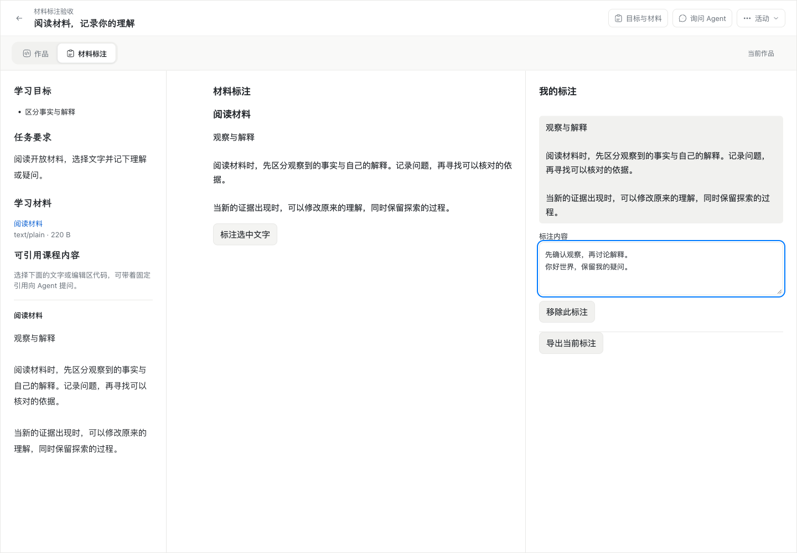

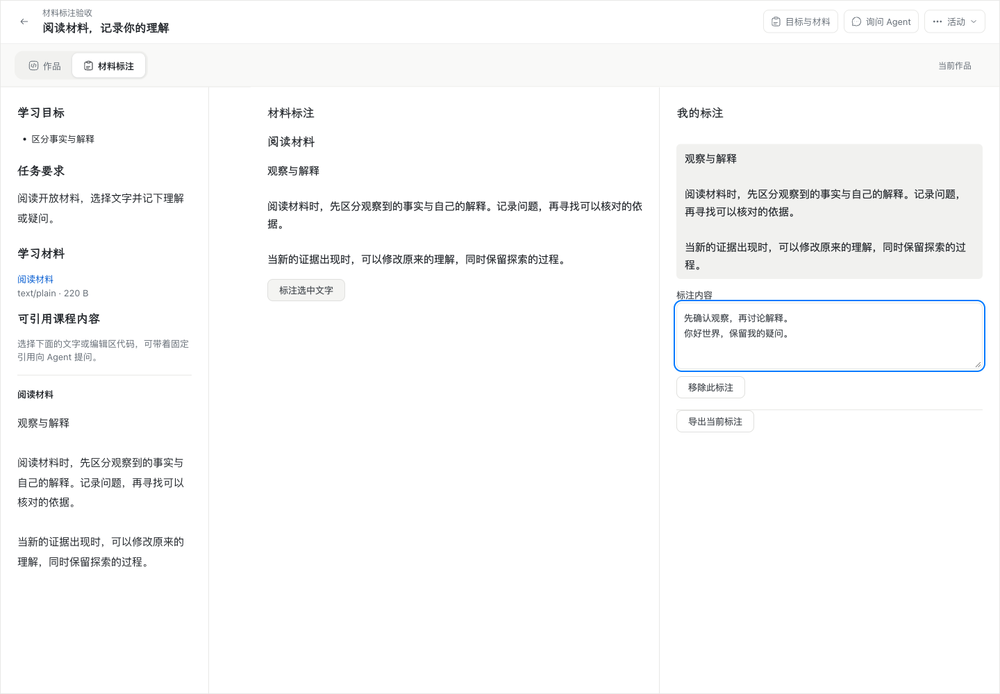
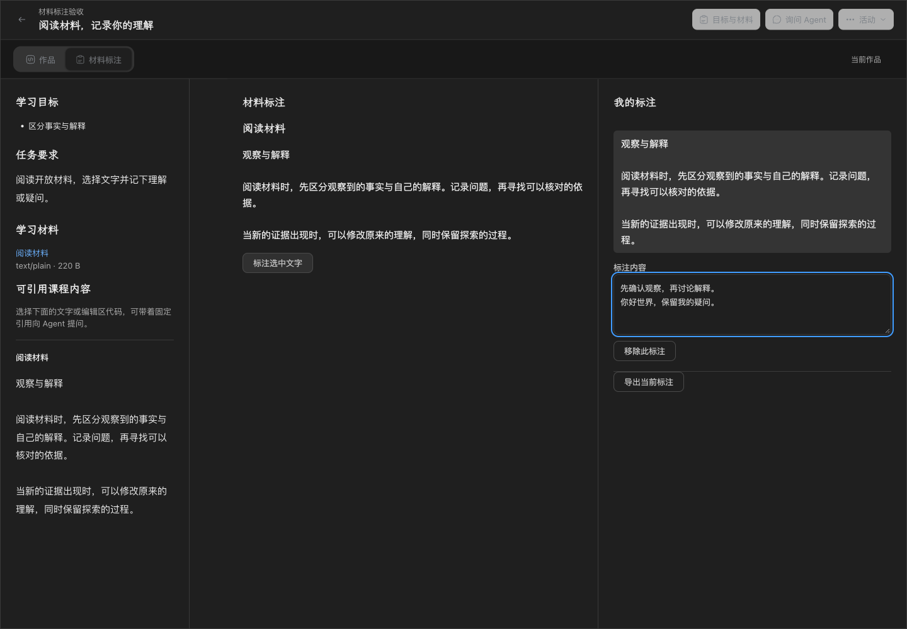
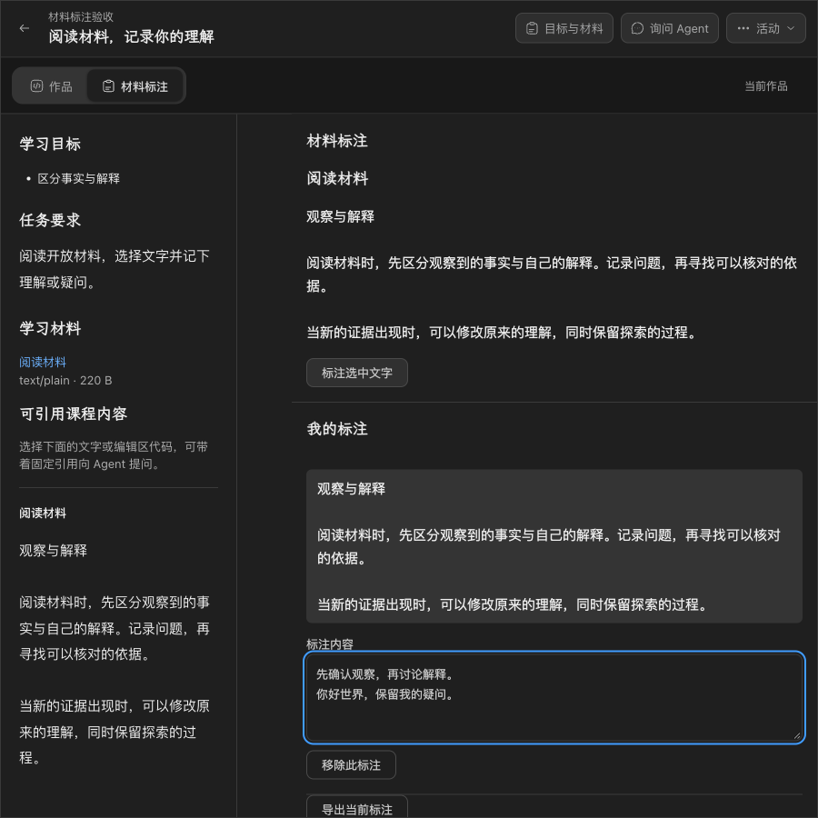
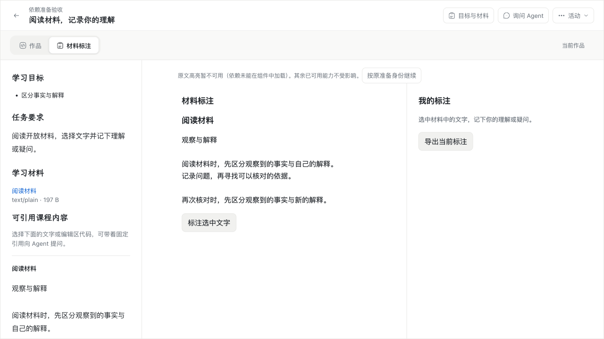
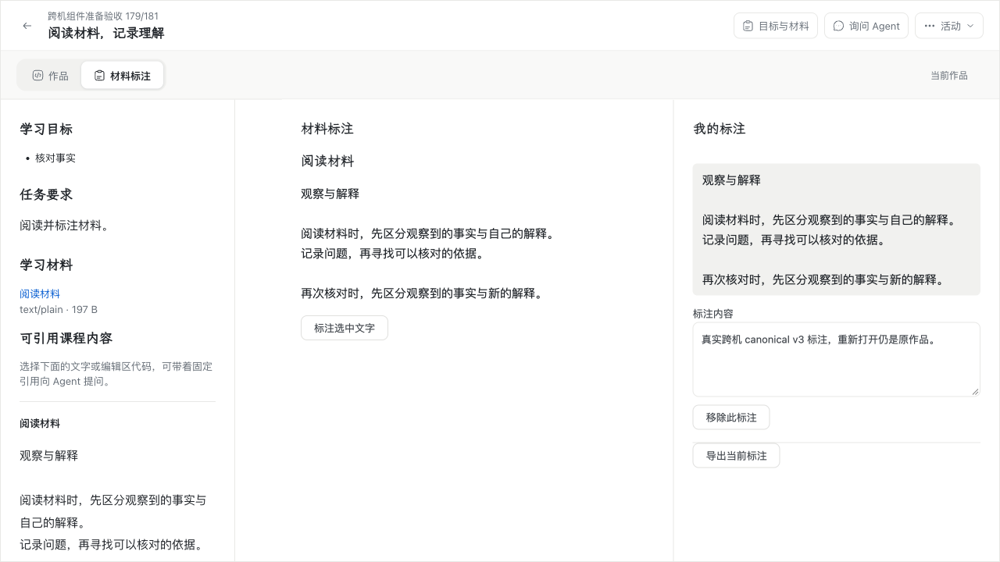
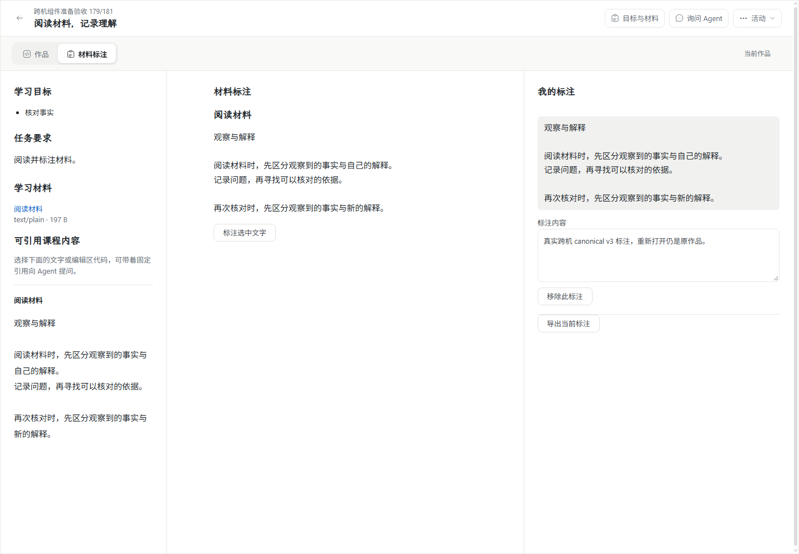

## 系统中文输入法

最终自动运行于 2026-11-03 17:20:50–17:21:49（Asia/Shanghai），**18/18，退出 0**；报告为 `darwin/arm64`、`headless=false`、`status=passed`、`mac=passed`。使用相同 `6171351` 完整产品包、自带 Node/PG、独立私有 root，经正式 CLI 安装/启动/导入；整棵 Web 摘要前后不变，最后正常 stop/start/stop，私有 root 已删除。执行时仓库 HEAD 为 `907d051`，生产目录 `sourceDirty=false`；探针自身 SHA256 单独记录，产品身份仍由上述固定包摘要确定。

`scripts/probe-component-ime.mjs` 自动驱动已安装的豆包拼音，文字只经 `CGEventPost` HID 和 System Events 系统按键到达 Chrome。Playwright 仅导航、选择材料、聚焦和观察，不使用 `fill`、`insertText`、CDP composition 或合成 DOM 输入。负责人解锁桌面后，最终运行无需人工界面操作。v3、prepared v2 均通过 Space/数字候选确认、Escape 取消、连续输入、中英文切换、换行、Tab/Meta、组合期间切焦点/工具；v2 另通过实际高亮、清除依赖缓存后的恢复。两种组件均在切换、刷新和 PostgreSQL 业务 API 重读后保持相同文本；导入独立 v4 后原活动仍绑定原发布、组件摘要和原笔记。

已确认的正文为 `你好世界\nabc上海`。失焦和工具切换时，该输入法保留未确认拼音，实际最终文本为 `你好世界\nabc上海bei'jing'hang'zhou`，UTF-8 为 40 bytes、1 个换行，SHA256 为 `c7ba250dff8d4f618748f81c3e2fa0200092aab073eaa2eb536f9a0cd04cdc3c`。逐次比较切换前后的完整值，既没有丢失已确认字节，也没有重复插入；没有把未确认拼音误报为已选定的“北京/杭州”。

两种组件各观察到 5 次可信 `compositionstart`，`keydown`、`compositionupdate`、`beforeinput`、`input` 全部可信；“你好/世界/上海”各自都有携带中文的可信 `beforeinput` 和 `input`（`insertCompositionText`），另保留实际候选窗截图。当前 Chrome/输入法组合的 4 次 `compositionend` 均为 `isTrusted=false`；报告如实记录，不用这些结束事件充当原生输入证明，也不要求仍未确认的最后一段提前结束。

此前尝试的失败分别为锁屏/系统焦点不属于测试 Chrome，以及过严的探针假设。自动脚本改为先选择输入源、再按实际 PID 将测试 Chrome 置前并核对系统焦点；每次输入源切换后重新聚焦。另一次已通过 15 项后，v4 测试数据复用了 v2 的依赖资源身份，导入被正确拒绝为 409；为新版本分配独立资源身份后完整重跑通过。失败尝试不计通过，产品代码未为此修改。最终运行和脱敏报告保留；失败尝试留下的本轮独立 root 在核对安装归属、CLI 停止及 `pg_ctl status=3` 后删除。

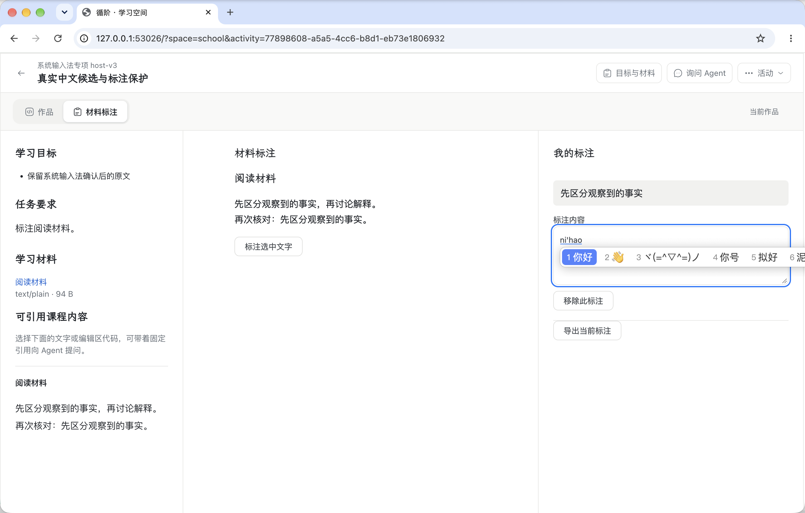
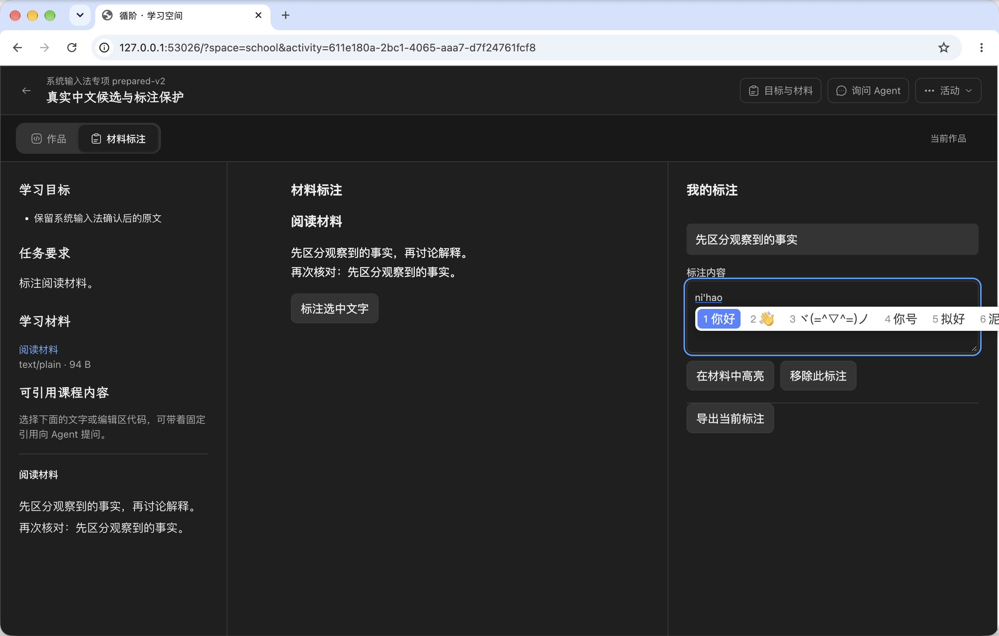
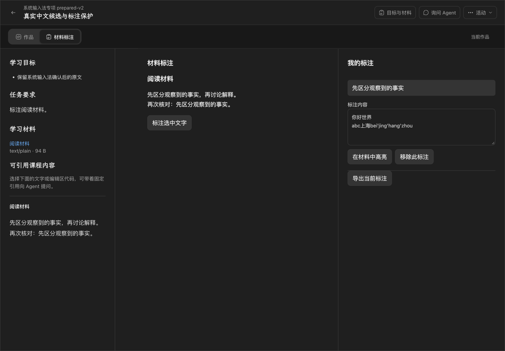
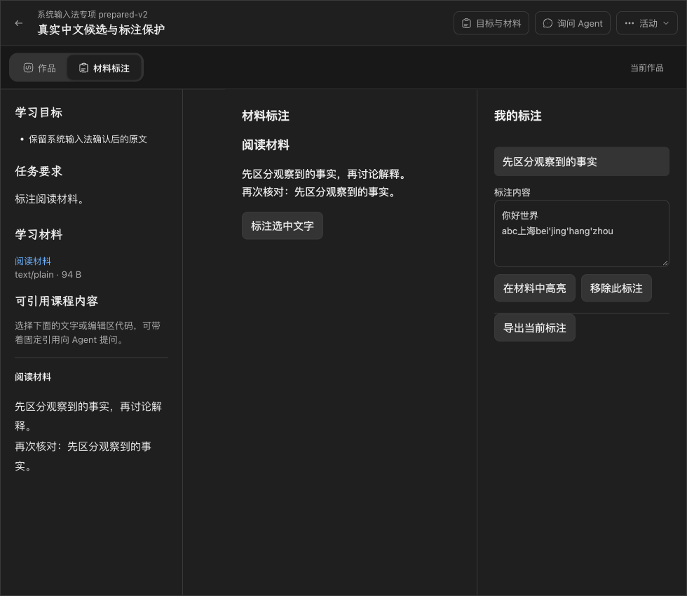

## 可重复入口

```sh
dist/wp03-179-181-6171351/resources/node/bin/node scripts/probe-component-package.mjs \
  --package "$PWD/dist/wp03-179-181-6171351" --out "$PWD/.verification/wp03-179-181/package-cli"
XUNJIE_COMPONENT_LEGACY_PACKAGE="$PWD/.verification/wp03-179-181/legacy/old-product-60f58c5" \
XUNJIE_COMPONENT_CURRENT_PACKAGE="$PWD/dist/wp03-179-181-6171351" \
  dist/wp03-179-181-6171351/resources/node/bin/node scripts/probe-component-legacy.mjs
XUNJIE_PRODUCT_PACKAGE="$PWD/dist/wp03-179-181-6171351" \
  dist/wp03-179-181-6171351/resources/node/bin/node scripts/probe-component-ime.mjs
```

真实学校 harness 为 `scripts/probe-component-school.mjs`；它消费仓库外本轮私有 actor 配置，不能将密码或管理 token 填到命令行/文档。CLI、浏览器与网络清理按对应拥有者执行，只撤销本次新增规则/CA，不改现有学校服务。两票关闭依据是上述全部适用路径的实际通过证据。
