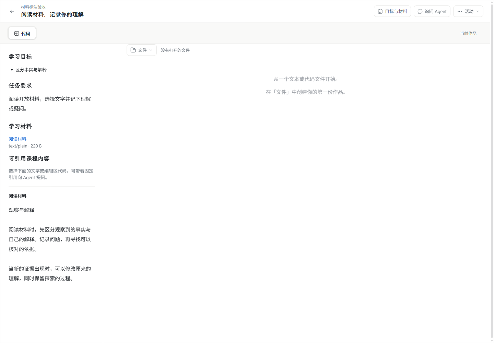
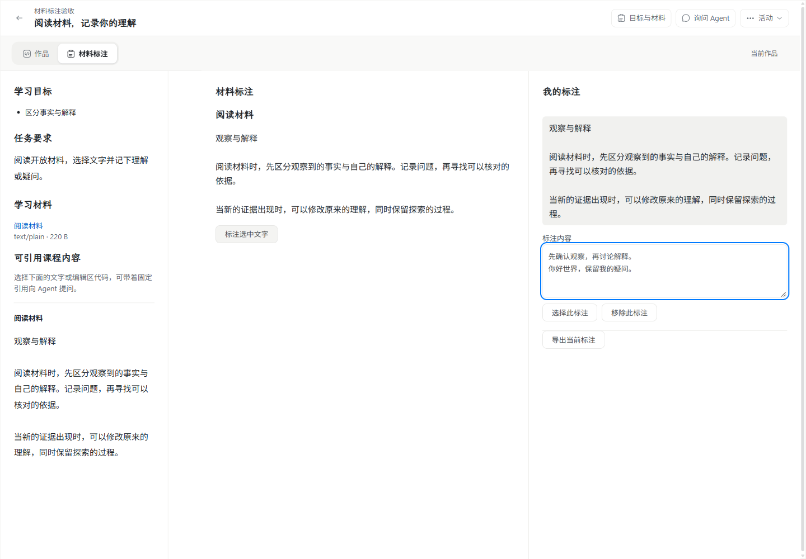
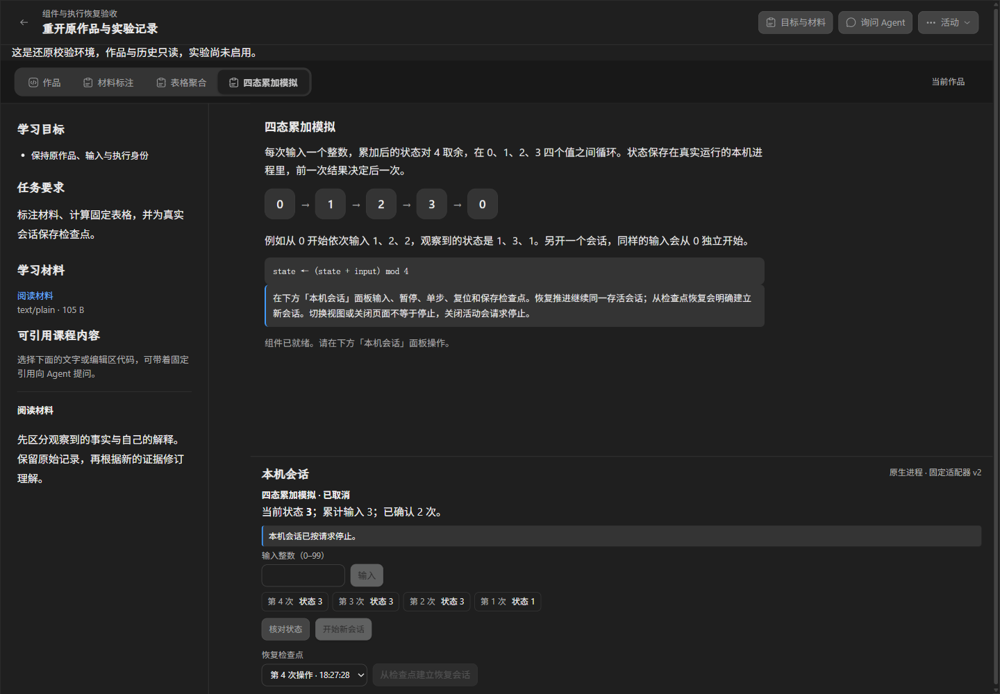
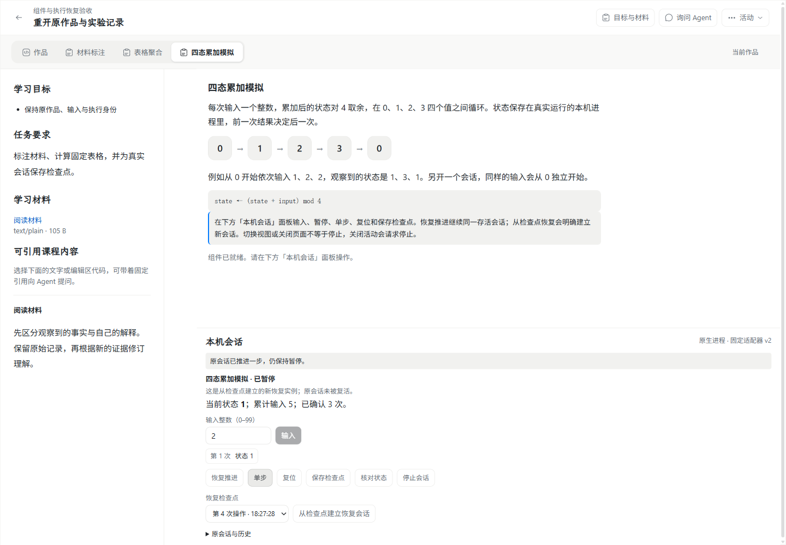

# WP03 PR #189：集成审查与 Windows 复验

2026-11-05，按负责人要求审查 [WP03 PR #189](https://github.com/paher-din/XunJie/pull/189)、解决与 main 的冲突并在验证后合并。审查遵循 [code-review](../../skills/code-review/SKILL.md)，需求以[课程组件与公共执行母规范](specs/wp03-course-components-and-execution.md)、[恢复规范](specs/wp03-execution-recovery.md)及对应实施票为准，排除归档与无关未跟踪材料。

原 PR 快照 `d7bccd6e`，原比较基线 `f0979d5`，涵盖整个 WP03 的组件、准备、语义引用、真实作业/会话和恢复接管，不仅是最后的恢复验收票。纳入 main 的固定版本为 `e778ef25`；冲突解决独立提交 `646f8293`，保留原分支历史。生产修复快照 `aab4c8f9`；后续 `32bd7ddb`、`620d1129`、`940ade3f` 仅修正验收接线和测试可移植性。最终 head、CI 与合并身份以 PR 页面及审查回填为准。

## 冲突裁决与实际产品

12 个内容冲突均逐项整合：CLI 同时保留组件和模型管理；公共导出、依赖与锁文件包含两侧新增能力；正式 LearningApp 保留 WP03 的组件/执行/只读恢复和 WP06 的模型设置/来源选择。没有创建并行产品页面。

运行装配同时登记学习执行与模型 owner，保留原生生命周期、执行排空、模型轮询和取消排空。model-only profile 不初始化学习 owner 或原生通道。学校转发的白名单同时包含组件/执行与模型，模型继续进入独立的授权路径。恢复目标保留各自迁移和校验，并兼容旧备份缺少模型 owner 的场景。

真实四 owner 隔离还原后，模型配置/选择 GET 可读，配置和检查 POST 被拒绝；改用 readPersonal 统一只读语义。该场景在修改前已通过：spaces.personal 优先读取已有回执，并非每次写入，因此这项只读加固不计作已复现缺陷。

## Standards

两条审查线独立执行并复核修复，未将静态审查当作测试结果。

- 原发现两项规范/记录问题：会话输入/检查点选择使用不存在的 `--canvas`，已改用设计 token `--paper`；#171 索引仍写 Mac 未验，已回链同 PR 中 #179/#181 的实际结果与限制。
- 原判断性 Fowler Duplicated Code 一项：浏览器固定输入摘要另行维护 canonical，已复用公共 canonicalValue 并保留导出别名；递归排序、英文 locale 与字节语义不变。
- 上述发现均已解决。对集成、修复及验收接线的最终复核：硬规范/记录剩余 0，值得报告的判断性 smell 剩余 0。

## Spec

原发现三项，均已 red→green 修复并由独立审查者复核：

1. P1：合法空停止原因被恢复校验当作损坏。现在按公开契约验证字符串及长度；真实 HTTP/PG 回归包含空原因、重复停止、完成后的停止、真实停止/重启和原查询不变。
2. P2：学生可自行标记为 Agent、自检或教师预览发起。现在共同 execution accept 入口在 native/channel 分派前拒绝未获可信调用上下文的用途，也覆盖本机持有学校数据的转发；保留公共 enum 供后续显式授权入口使用。三种冒报均 403，原请求查无执行记录。
3. P2：组件在等待固定输入摘要时失效，仍可新建执行。现在在交给独立控制器前重查挂载、写资格和执行能力；真实消息/IndexedDB 回归覆盖关闭、失权、能力撤销及有效挂载正例。已合法交接的执行仍沿自己的生命周期查询和停止。

原 Spec 三项均解决，最终剩余 0。教学效果不在这些检查的通过结论中。

## 验证时修正的测试接线

保留所有先前失败，未靠删除断言或跳过充抵通过：

- 标注视图已增加“选择此标注”，旧探针仍断言一次 Tab 到删除按钮。真实 Chrome 证明焦点正确落在新按钮，探针改为依次验证选择、删除及反向返回文本框。
- 旧 v3 IndexedDB 的当前升级结果为 v7，旧探针固定写 v5。保留必须实际升级、操作回执存储存在与中文哨兵原文完整，移除对当前版本号的耦合。
- 原生代际/撤销夹具补齐开放活动状态、生产 sessionRecoveryMigration 和实际 Windows AppContainer 资源；原有权限、停止、恢复与远端负例继续断言。
- 模型选择的仅配置夹具使用不依赖 DNS 的公开 IP 字面量，满足主线新增的学校目标校验；这些用例不派发 provider 请求。三份模型测试的目录链接和外部 ESM URL 处理修正为 Windows 兼容，原有 124 项行为断言保留。

## 工程与浏览器结果

详细计数、失败文件、包摘要及日志 SHA256 见[脱敏工程记录](evidence/pr189-windows-review.json)。各分组可能重叠，不能相加当作独立测试总数。

| 检查 | 实际结果 |
| --- | --- |
| 合并后的完整 build/typecheck | 通过；完整 Windows full 包构建通过 |
| 受维护文档/公共浏览器契约 | 通过，实际文件/目标/导出数量见工程 JSON |
| 桥接竞争及既有桥接回归 | 31/31，通过真实消息、控制器与 IndexedDB；真实 digest 仅暂停时序后继续 |
| 八文件真实 PG 原生集成 | 首跑 15/16、0 跳过；旧原生夹具失败后已修正，其代际/撤销用例定向 1/1 通过。包括新旧停止、组件导入、课程计划、模型来源/管理、原生会话、检查点恢复和四 owner 隔离模型读取 |
| Windows 三份模型协议/安全测试 | 124/124，0 跳过 |
| 正式普通 Web：组件宿主 | 安装版 Chrome、headed，26/26；真实动态隔离视图、保存/冲突/导航/权限、严格协议、固定前端产物与语义交互 |
| 正式普通 Web：表格执行 | 同一 Chrome，14/14；真实 Worker/WASM 计算、固定输入、产物重读/下载、跨页停止和超时终止 |
| 完整 Windows 产品包 | 同一 Chrome，3/3；三样例、真实原生会话、备份、隔离只读、接管、旧 namespace 拒绝及检查点新实例下一步结果为 1 |
| WP06 设置/选择回归 | 普通 Web 首跑 12 通过、1 个准备失败、3 项未运行；修正目标夹具后选择组 4/4；完整包全组 16/16，一次通过，0 跳过 |
| 全库本机 verify | 首次默认发现原有未跟踪文档的 252 处失效链接，准备阶段退出；临时排除原有无关未跟踪路径后 prepare 4/4、build:test 1/1，测试文件 137/159 通过、22 失败，不宣称全量绿色 |
| 失败后的定向复验 | 4 个工具文件在用户临时目录共 33/33 通过；3 个模型文件 Windows 修正后 124/124。这 7 个失败文件取得单独通过证据，剩余 15 个失败文件集合与 #165 记录相同；不把分组结果改写成整套重跑通过 |

本机 Windows 11 x64 / 10.0.26200、Node 24.21.0、PostgreSQL 18.6、桌面 Chrome 157.0.8103.38，浏览器均 headed。产品包为未签名候选，使用包内 Node/PG 和独立私有根。首次将工具临时目录放在工作树内导致私有目录 ACL 检查失败；改回用户临时目录取得上述定向证据，没有改项目权限规则。原全量中两个长时间不退出的工具任务在核对进程树归属后终止并记失败。受维护文档只排除原有无关未跟踪路径，不改动、删除或提交这些材料。

原 PR 的 Apple Silicon Mac 和独立 Ubuntu 学校节点跨机结果保留在 [#188 记录](wp03-188-cross-platform.md)及对应固定快照证据，本次 Windows 集成复验未重新执行那些平台/跨机步骤，也未重验物理中文输入法。教学效果未评估。

## 实际界面对照

WP03 在原沉浸工作区中心按活动声明装入组件，复用目标/材料、作品、引用和问题入口，使标注、计算和原生会话使用同一产品与持久事实。审查修正只涉及设计 token 与接口/权限接线，未重排导航。下图“改动前”复用原 PR 的真实 `f0979d5` 基线实屏；“改动后”是本次 `aab4c8f9` 正式 Web 实屏，保留日期/快照差异。

完整包隔离只读与接管后的真实执行，均沿现有工作区：

