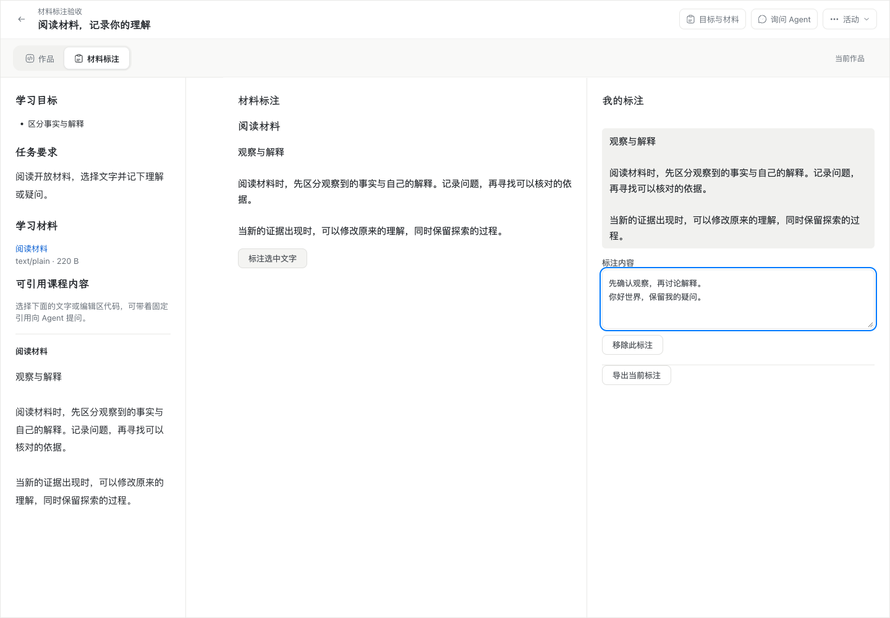
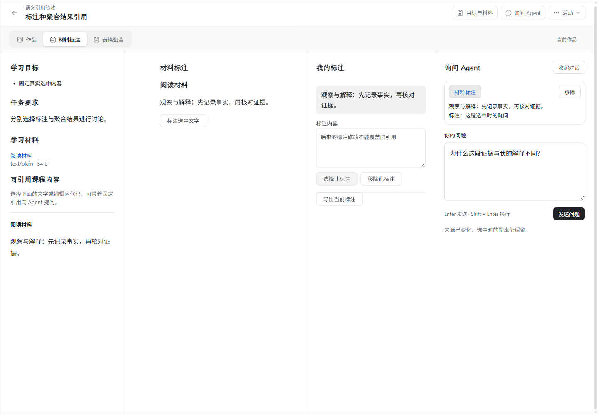
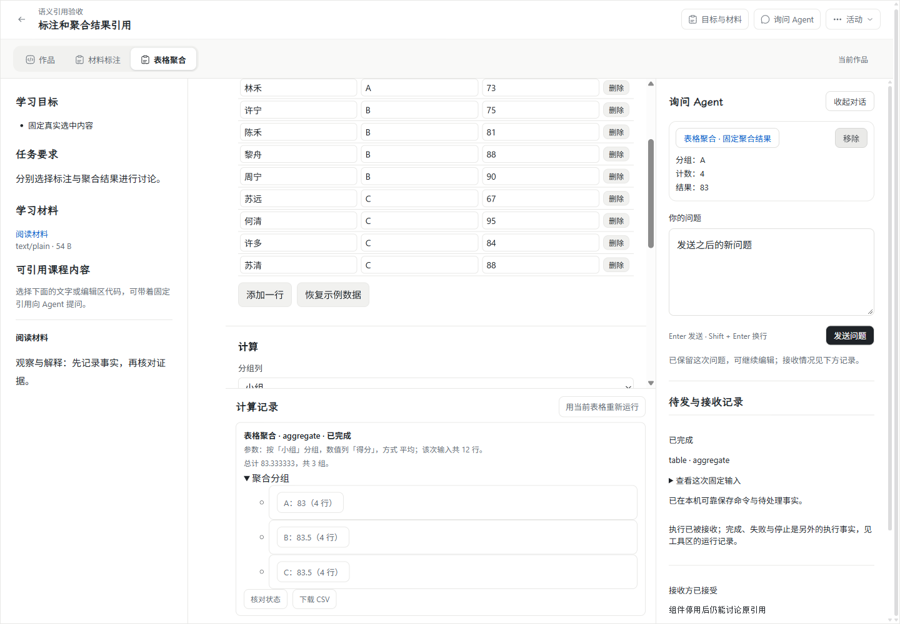
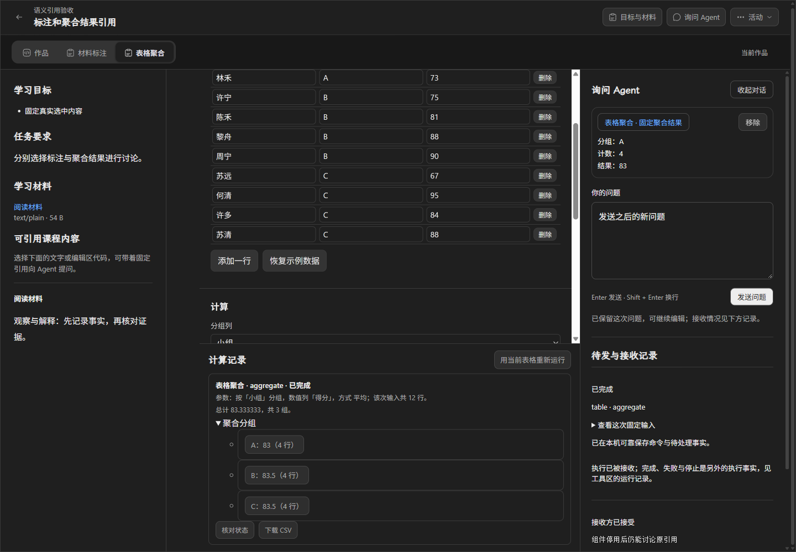
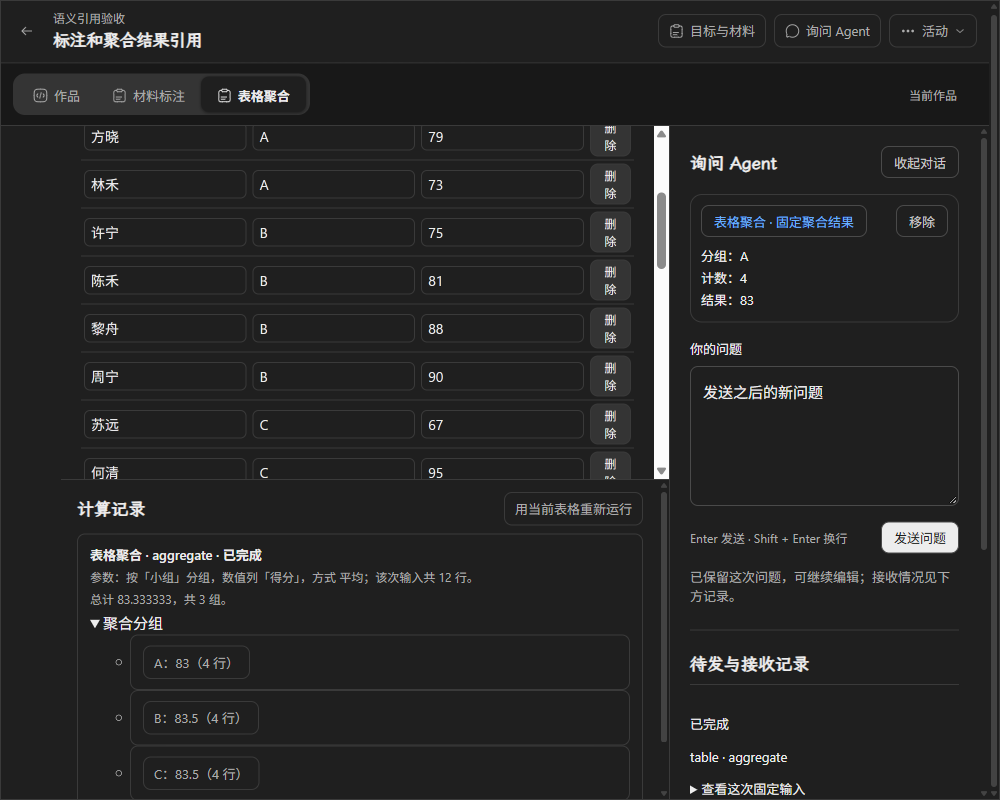

# #172 非文本选区与固定结果引用

日期：2026-11-03（Asia/Shanghai）。实现基线 `wp03@6e7d13e`，本地分支 `codex/issue-172-nontext-references`。依据 [#172](https://github.com/paher-din/XunJie/issues/172)、[实施方案](specs/wp03-nontext-references.md)及母规范。实现和 Windows 验证已完成；Mac 按负责人明确要求暂缓，不据此关闭全平台验收。负责人已授权提交审查修复、集成最新上游并推送至上游 `wp03`；不创建 PR、不合 main。

Mac 独立验收已交接至 [#185](https://github.com/paher-din/XunJie/issues/185)，暂不指派任何人，待团队分配；该票要求在集成最新 wp03 且包含审查修复的最终候选上取证，不以其他工作包或 Windows 验收替代。审查修复提交为 `93865a4`；上游 `wp03@9c965a1`（新增 #173）通过合并提交 `d652231` 集成；推送前再次出现的 `b288410`（Windows 会话隔离）通过 `120b8bb` 追加集成，均无需手工解决冲突。合并后的构建、类型和下列相关回归均已完成。

## 已实现行为

材料标注 v4 增加“选择此标注”，沿用现有“询问 Agent”选区入口和问题引用区。真实浏览器聚合结果的计算记录提供可键盘操作的分组选择，固定该组计数与结果。多来源共享一个可靠问题草稿，选择不发送、不运行、不调用模型。固定副本显示原文/标注或分组/数值，不把内部对象 ID 当学生可读内容。

重复选择去重；移除及引用顺序由原控制器维护。来源内容变化、删除或同名重建不能重定向到另一个对象。定位核对固定内容身份及适配版本，不可操作时明确反馈并保留副本。恢复副本不要求挂载原可执行组件。明确发送时动作固定原引用，接收等待期间后来输入与移除不改写原动作；测试接收器只验证边界，不调用实际模型。

## 契约与注册

`questionReferenceSourceSchema` 增加 `kind=component, formatVersion=1`，固定环境、空间、主体、活动、实例、组件版本/定义摘要、对象和内容身份。`origin=state` 指向不可变作品状态；`origin=execution-result` 还固定原 requestId/executionRef，结果对象身份是原命令而非显示名称。

语义范围外层为 `kind=semantic, formatVersion=1`；注册键为 typeId + version。首批 `annotation-objects@1` 接受稳定标注 ID 集，`aggregation-groups@1` 接受固定结果内的分组键及受支持字段。范围由注册结构验证、规范化、按真实记录成员提取，不能把任意 JSON 当合法范围。兼容字段 start=0/end=固定副本 UTF-16 长度只描述副本信封，不是来源坐标，也不充当语义身份。去重包含隔离作用域、固定来源/内容及规范化集合范围。

语义 target 对象键在解析时规范化，数组语义在范围注册器中规范化；避免 JSONB 的键顺序改变草稿回执比较或固定动作摘要。原文本/代码 schema 不增加默认值，保留原半开区间和既有记录/动作摘要读取。

创建新引用须有兼容注册器和 owner 核验；未知适配不得创建新引用。已确认引用再次随问题保存时，允许核对原身份/范围/副本后只读接续未知适配；定位不执行未知适配，不清空整份草稿。该兼容边界针对已知固定来源外层内的适配类型/版本，不接受任意未知来源对象。

审查后修复了历史来源只认当前草稿 head 的缺口：现在从同一活动、环境、空间和主体的不可变草稿修订或固定动作中核验历史引用，比较 referenceId、固定来源、语义范围和副本，并核对记录摘要及该修订/动作的资源保留关系。引用从当前草稿移除后，仍可从旧修订或取消/失败动作恢复；适配器退役、组件停用不再将它误判为新引用。更换范围、副本或引用 ID 仍须经过新建授权和适配校验，不接受客户端自报历史身份。

## 所有权、保留与恢复

学习数据 owner 核对活动实际身份、固定组件绑定、不可变状态或实际 execution_results/命令/资源，重新提取选中内容并比较副本；客户端摘要不能自证。允许本机已保护但尚未成为作品 head 的状态 basis，通过原 registerBasis 保存且不移动当前 head。

创建新引用还经课程 owner 的 verifyComponentReference 只读 authority 操作核对当前访问范围和组件可用性；学校混合部署复用原连接及预期学习 owner 核验，不跨库查询或写表。历史副本重读和后续问题编辑不因组件停用或适配退休而清空。

首批两类原始状态和结果资源均属于同一学习数据 owner；草稿修订及动作事务分别保留 `question-reference/<draftId>/<revisionId>/<referenceId>` 与 `action/<requestId>/reference/<referenceId>`，确认之前原资源已可读。课程定义由原固定发布保留，跨 owner 这里只进行可重复的只读资格核验，没有新增跨 owner 可变副本，不需要伪造跨库事务或空保留协议。未来外部资源类型必须先实现可查询保留协议才可注册，当前契约不接受此类未知来源。

本票增加版本化 JSON 信封及资源引用，不新增表或 IndexedDB store，不修改原迁移 SQL。原 IDB v5、草稿修订、动作和存储引用承载新数据。恢复检查覆盖所有草稿历史修订的语义来源、副本摘要和资源 pin，以及固定动作的来源与 pin；活动关闭、移除当前引用不删除历史修订和动作持有的资源。执行结果上传未确认时保留本机副本并重试，不重新计算或虚报 owner 确认。

材料标注默认打包输出升级为 v4，新入口资源和导入 requestId；既有 v1/v2/v3 活动继续读取原已登记字节，不热替换。表格组件入口不变，新增结果选区在受信宿主结果记录中接入。

## 验证

首次集成验证（代码候选 `d652231`）：运行目标构建、全工程类型检查通过；7 个前端测试文件 58/58；来源/历史恢复与真实原生子进程测试 26/26；真实 PostgreSQL 的组件宿主、浏览器执行和 #173 原生会话集成测试 4/4。安装版桌面 Chrome 的原本地引用端到端回归 13/13，历史恢复本地、学校 profile 各 6/6，均在合并后重跑通过。首次构建及前端测试在沙箱内因 Vite realpath 的 EPERM 失败，前端命令另曾误用工作区内不存在的 Vitest 路径；改用实际根依赖路径并在沙箱外重跑后通过，失败不计通过。

追加集成验证（最终代码候选 `120b8bb`）：运行目标构建、全工程类型检查重新通过；上述来源/子进程/PostgreSQL 测试合并重跑 30/30，原 Chrome 引用全链路 13/13、历史恢复本地及学校路径各 6/6 再次通过。没有重新进行 #173 浏览器专用验收、AppContainer 分发包验收或 Mac 验收；本轮 native runtime 测试使用开发资源配置，未配置 Windows session helper，不能将此结果视为隔离分发包验收。

审查修复追加验证：运行目标构建通过；来源与历史恢复边界测试 24/24（本轮新增 13 项），覆盖旧修订、仅存在于动作的引用、篡改副本/范围/ID、错误摘要、缺失资源保留及越主体动作。真实桌面 Chrome / PostgreSQL 的历史恢复回归在本地和学校 profile 各 6/6，包含取消动作、退役适配、停用组件和 owner 重启；原本地语义引用端到端回归重跑 13/13。详见[本地历史恢复证据](evidence/wp03-172-history-local.json)、[学校路径历史恢复证据](evidence/wp03-172-history-school.json)。学校 profile 仍为同一 Windows 主机，未新增 Mac、系统输入法或教学效果验收。首次新增回归脚本误将空间显示字段带入严格动作 scope，收到 400；修正脚本仅传契约字段后重跑通过。

[脱敏证据](evidence/wp03-172-verification.json)。Windows 11 x64、Node 24.21.0、原生 PostgreSQL 18.6、安装版桌面 Chrome 156.0.8078.80，实际 headed。

- 类型检查、完整构建、最终运行测试目标构建通过；12 个浏览器公开导出安全检查通过。
- 相关前端单元 54/54，来源 owner 边界测试 11/11；包含规范化、未知适配、作用域伪造、相同长度伪副本、异步退休连接不变更草稿。
- 正式本地产品 13/13，学校部署入口 13/13，均使用真实 IndexedDB/API/PostgreSQL、真实 Worker/WASM 计算。包含标注和结果、去重/定位、来源变更、未知适配退休、组件停用、伪造负例、固定动作与后来输入、刷新和正常重启。学校 profile 在同一台 Windows 主机执行，不冒充实际跨机。
- 原引用/草稿回归首次 28 项中 26 通过、2 失败；两项为基线上已过期的课程标题数量和 IDB v3 断言，更新到现有 UI/IDB v5 后该文件重跑 8/8。测试仍核对旧 v1 记录及所有现有 store，不跳过原数据保留断言。
- 原生固定动作/身份/取消/丢回执/完整恢复与迁移回归 6/6。
- 本轮 5 份相关文档、93 个本地目标检查通过；全量文档 187 份/1447 目标仍有 9 处既有未跟踪 `.trae/documents` 链接失败，未改动无关材料，也不把全量文档门禁计为通过。
- 原中文文本和组合输入保护回归通过；本轮没有重新进行系统拼音候选的原生操作验收，不复用 #169 人工结果冒充 #172 新证据。教学效果未评估。未重新打分发包。

保留失败事实：首次 initdb 磁盘同步超时；JSONB target 键顺序导致两处回执/摘要核实失败后修正并加入测试；动作测试最初错误地在已发送草稿正常清理后执行移除，后改为受控接收等待以验证真实竞争。失败不计通过。依赖按现有锁文件恢复，没有修改依赖版本或自动 audit fix。

## 实际 UI 对照

沿用原工作区、组件页签、选区询问入口和问题引用列表，仅新增标注选择按钮、聚合分组选择与注册定位。原因是让学生把真实选中对象带入同一个问题草稿，影响限于相关控件及引用内容，不另建一套界面。下图来自不同合成活动，旧图是上游基线已有实测截图，不表示同一学生数据迁移。

