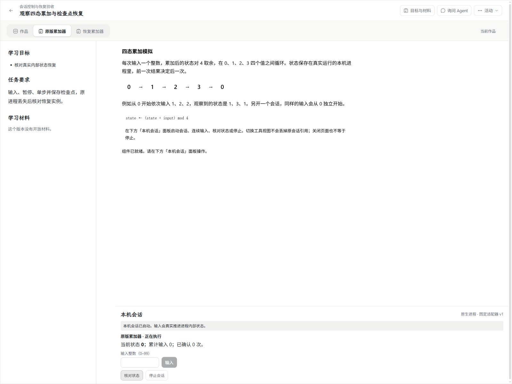
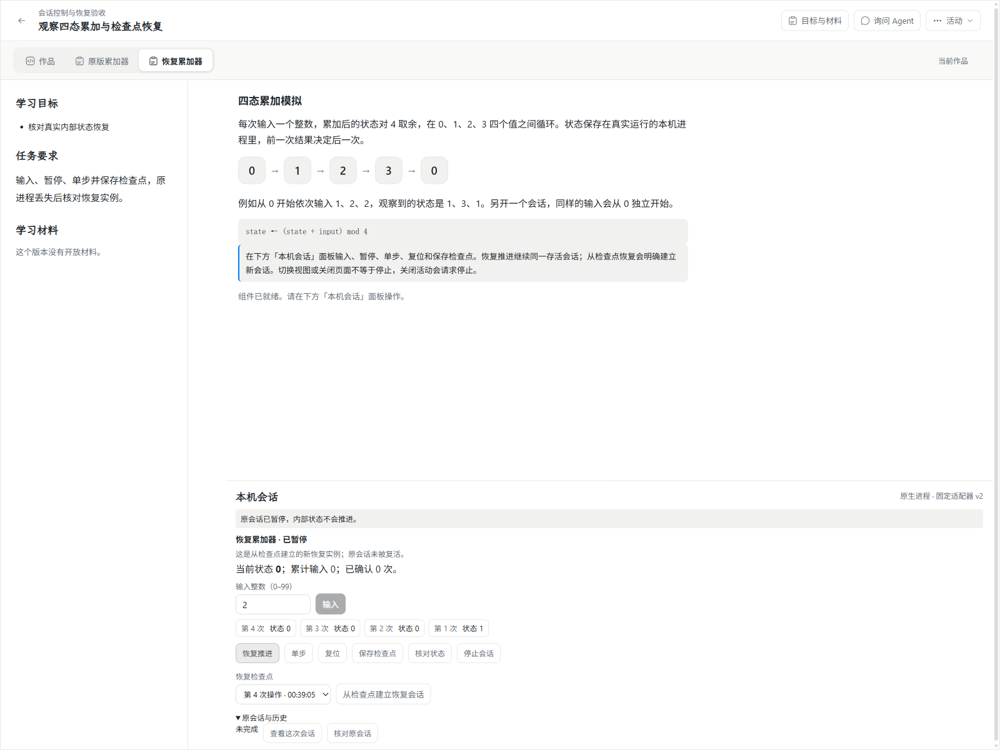
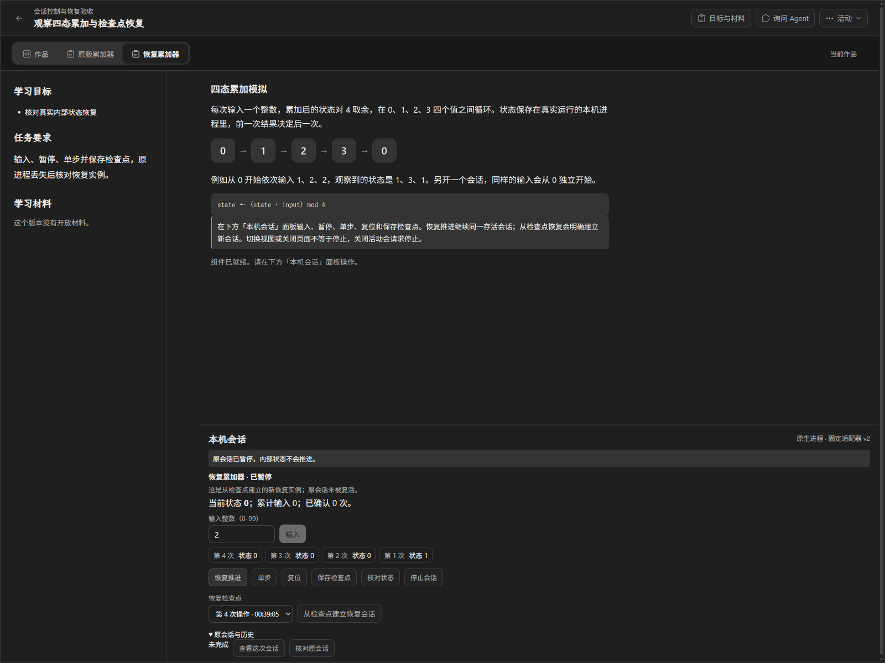
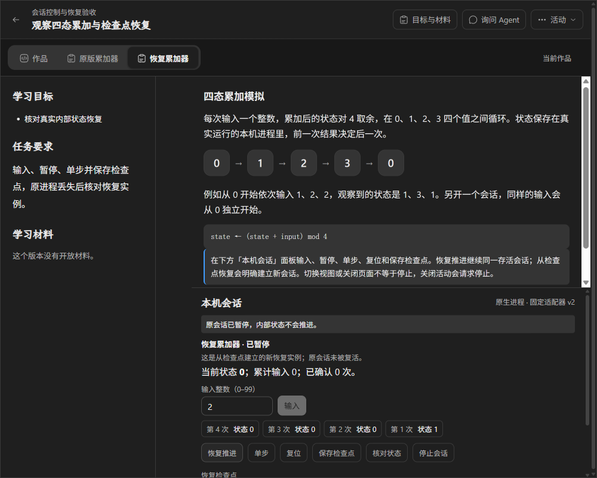
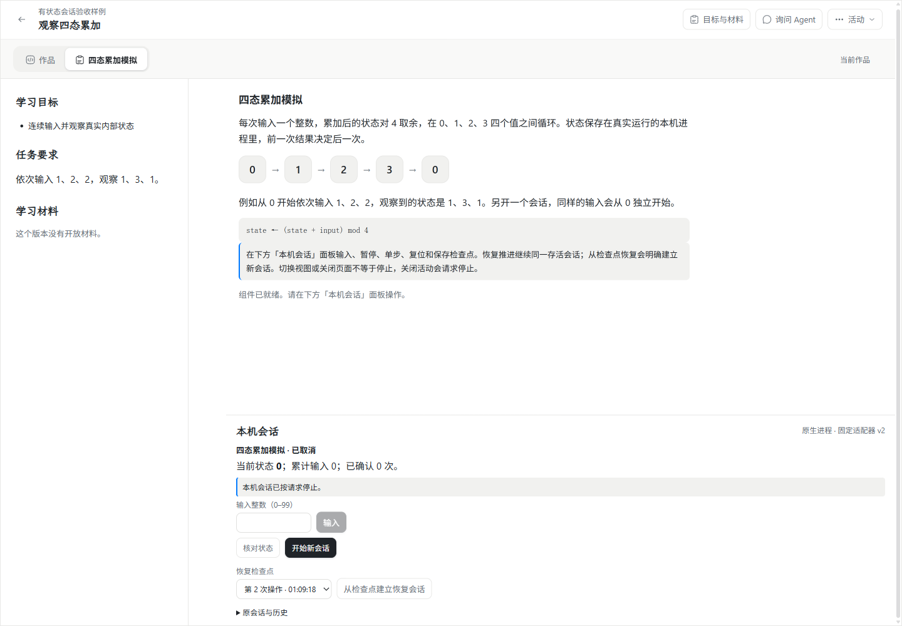

# #174 会话控制、检查点与返回恢复

实施日期：2026-11-03 至 2026-11-04（Asia/Shanghai）。分支 `codex/issue-174-session-recovery`，基线 `upstream/wp03@e5b3743`。依据 [#174](https://github.com/paher-din/XunJie/issues/174)、[实施方案](specs/wp03-session-recovery.md)和 [WP03 母规范](specs/wp03-course-components-and-execution.md)。负责人已授权先提交当前实现与审查修复，再完成验证并推送上游 `wp03`；不创建 PR、不合 main。Mac 独立交接至 [#187](https://github.com/paher-din/XunJie/issues/187)，保持无人指派，不据此关闭双平台验收。

审查修复：新版组件字号/行高改为规范内的 17px/1.5；检查点改经 `executions/<activity>/checkpoints[/<cursor>]` 独立分页读取，每页至多 64 项，不依赖最近 16 次会话或单个会话的 64 项投影。读取不完整与确实不存在分别显示。实现与修复已提交为 `38b55f1` 并推送上游 `wp03`，Mac 验收仍独立暂缓。

## 实际行为

默认四态累加样例升级为组件 v2 / `four-state-accumulator@2`。旧组件 v1、旧入口字节和适配 v1 继续保留，未声明的控制不展示。v2 在现有本机会话面板提供暂停、恢复推进、单步、复位和检查点：暂停后实际子进程拒绝普通输入，单步只推进一次显式输入；恢复推进和复位保持原执行器实例，公共操作序号持续递增。不是通过停止重建模拟暂停。

从检查点恢复使用新的 execution.submit、requestId、executionRef 和 executorInstanceId，显式携带 `resumeFromCheckpoint`。原会话的状态与历史不被复活或重写，新实例不重放检查点之后的操作。原会话与恢复实例可分别查看、查询和停止；迟到的旧查询不能替换当前选择。恢复前后的作品、问题和待输入整数保持原样。

v2 声明跨视图继续、关页继续、关闭活动停止、重连先查询。切换工具、关闭组件视图和刷新不等于停止。未提交整数通过原可靠作品的组件状态保护，现有问题草稿另由原可靠草稿所有者保护。心跳只核对状态，不更新实验的空闲输入时限。原请求暂时查不到、连接失败或监督器代际改变时保留最后可信观察并标注待核实，不把未查到解释为未执行或已停止。

## 操作与可靠请求

扩展原 execution.control 的 effect 为 input/pause/resume/step/reset/checkpoint；每项操作保留 controlId、规范化参数摘要、原执行引用及 expectedSeq。状态、能力、权限和组件当前可用性在 owner 核验，数据库预留派发位置先于子进程操作，重复 ID 不重复推进。旧 input 摘要仍可读取和校验。

`GET executions/<activity>/<request>/controls/<controlId>` 返回原操作状态、参数摘要、位置和执行查询。客户端校验请求、控制、执行身份、effect、位置和摘要后才能清除待确认请求。

在原 `xunjie-reliable-works-v1` IndexedDB 上追加 v6 的 `nativeSessionRequests` 分区，保护启动、控制和停止的原请求；不是第二份执行状态权威。先完成本机请求事务才派发。刷新后只查询已保留请求，不自动提交或重放；显式继续核对也只使用原请求身份，并先查原回执。未知操作不会被发送给新的恢复实例。旧 v1 作品数据库与所有既有分区保留。

## 检查点与所有权

检查点实际内容由执行器在暂停的操作位置序列化，包含内部模拟状态和模式；owner 再封装原会话、操作、已应用位置、执行器实例、环境/空间/主体/活动、适配/检查点版本、组件定义、配置及创建参数摘要、OS/架构/Node 版本。摘要只用于校验，不能替代真实来源核对。

先可靠缓存执行器原回复，再通过所属资源 stageResource 保存固定字节，重读核对摘要与长度后事务发布检查点及保留关系。保存中断或回包丢失重读原缓存和原身份，不重新向模拟器采样。旧进程丢失后完成迟到的资源确认，只归档原操作与有效检查点，不将原实例重新标成可继续；终态不会被迟到事件倒退。

学习数据 owner 追加迁移 8 `session-controls-and-checkpoints`：给操作增加 effect/待确认检查点快照，给会话增加已发布检查点投影，增加 `native_session_checkpoints`。没有改写既有迁移或原动作格式。保留键为 `native-checkpoint/<controlId>` 和 `native/<恢复请求>/restore`，沿现有 owner 资源/事务/收集机制管理；活动和历史仍引用的资源不删除，没有跨库写表。未确认发布的资源不冒充可恢复检查点。

恢复核验同一作用域、原会话与资源保留、内容摘要、固定组件/配置、适配与检查点版本、创建参数和实际环境。缺失、损坏、失权、摘要冲突及不兼容分别拒绝。维护验证接入原学习数据 owner，核对操作摘要、位置、观察、检查点资源与恢复关系。维护停止必须等待真实进程退出；未得到终止确认不宣告排空。

学校客户端沿原执行路由增加控制回执读取及本机绑定转发，保留预期主体与请求关联校验。本轮学校边界测试使用受控 HTTP 对端，不宣称远端原生执行已实现或真实跨机已验收；原生实验仍在实际声明的本机执行。

## 验证与限制

审查修复后的[验证汇总](evidence/wp03-174-remediation-verification.json)、[历史检查点回归](evidence/wp03-174-history-regression.json)、[Chrome 实测报告](evidence/wp03-174-remediation-browser-report.json)：构建、全工程类型、12 项公共导出检查通过；前端回归 69/69；学校转发边界 2/2；真实 PostgreSQL 控制/恢复回归 1/1；Chrome 控制/恢复/维护 9/9。新增历史回归在真实 Chrome 验证第 17 次会话后仍能选择旧检查点并从界面恢复，另保存 65 项检查点，使单会话投影只剩 64 项，再经两页读回全部 66 项历史检查点；非法游标和跨主体读取拒绝。实际 iframe 验证字号 17px、代码行高 19.5px（13px × 1.5）。

工程与浏览器结果以本目录的脱敏证据和本节最终记录为准。测试使用 Windows 11 x64、Node 24.21.0、原生 PostgreSQL 18.6 系列和安装版桌面 Chrome；公开契约浏览器检查覆盖 12 个导出。

[首轮实现验证汇总与工作区文件摘要](evidence/wp03-174-verification.json)、[首轮正式 Chrome 实测报告](evidence/wp03-174-browser-report.json)。首轮运行目标构建、全工程类型检查通过；7 个前端文件 66/66；owner/来源/检查点/原生进程/PostgreSQL 回归整批 44/44；学校转发边界 2/2；原草稿/动作 Chrome 21/21；新增控制/恢复/维护 Chrome 9/9。首轮 Chrome 探针整体约 34 秒（包含准备与清理），创建 4 个实际执行器；宿主 Node RSS 约 145 MiB，不包含 Chrome、PostgreSQL 或子进程峰值，不据此推断课程容量。审查后新增修复另行验证，不将上述旧文件摘要视为新候选摘要。

- 前端控制器、原执行/停止、桥接与引用回归通过；覆盖持久原请求、只读重开查询、显式重试、晚响应/终态、原记录暂缺和恢复实例选择。
- 真实子进程覆盖同实例暂停/继续、单步幂等、复位、检查点后真实下一步一致及空闲到期。检查点 fault-injection 单元覆盖上传确认丢失、重读失败、不兼容与保留失败，不将这些单元冒充 PostgreSQL 实证。
- 真实 PostgreSQL 集成覆盖操作竞争、固定回执、检查点/恢复关系、实际资源文件损坏/丢失、撤销权限、组件停用、不同活动、重启后恢复和关闭活动停止。
- 正式 Chrome 验收覆盖旧组件、真实控制、可靠输入/问题保护、切换/刷新只查询、检查点丢回包跨刷新、强制结束本测试实际子进程、新恢复实例下一步等价、复位、键盘、主题和窄桌面；没有模型调用。
- 原问题草稿、代码/材料固定引用、旧数据库追加升级和可靠动作的正式 Chrome 回归 21/21 通过。

未执行：Apple Silicon Mac、真实跨机执行组合、重新制作与验收分发包、原生系统中文候选操作和教学效果。Windows 本轮 Chrome 使用真实开发资源组合，没有配置 AppContainer helper，不冒充分发包隔离验收。已有 #173/#184 的隔离证据不替代本票新增能力的 Mac 验收。

保留失败事实：新版适配最初遗漏监督器 ready 握手，真实进程测试检出后修正；首轮截图检查发现新版 iframe 未消费宿主主题，补上主题 token 并增加实际深色断言；新增 mock 的静态类型不完整导致一次构建失败后修正。43 项 owner 回归首次 42 通过、1 项旧执行测试在临时目录清理时遇到 EBUSY，单独重跑及最终整批 44 项均通过。新集成 fixture 也曾在清理时遇到 EBUSY，改为保留原错误并重试该自建临时目录清理。维护探针曾在恢复实例仍排队时提前读取空观察，改为等待实际恢复到暂停状态后重跑 9/9。失败不计通过。

## 实际 UI 前后对照

复用既有工具页签、组件视图和本机会话面板，新增已声明的控制、检查点选择、恢复实例说明与原会话历史入口。原因是让学生在原工作区核对真实执行、保留输入并明确区分“原会话继续”与“建立恢复实例”，不新增技术阶段页面。新版示例同时接宿主主题 token，保持深色可读。

对照来自同一真实活动中的旧 v1 和新 v2 样例；旧图展示原输入/停止入口，新图展示本轮控制与恢复入口，不将旧组件热替换为新字节。

审查修复后，最近会话窗口已不含原运行，但独立检查点目录仍提供可操作的恢复选择：

