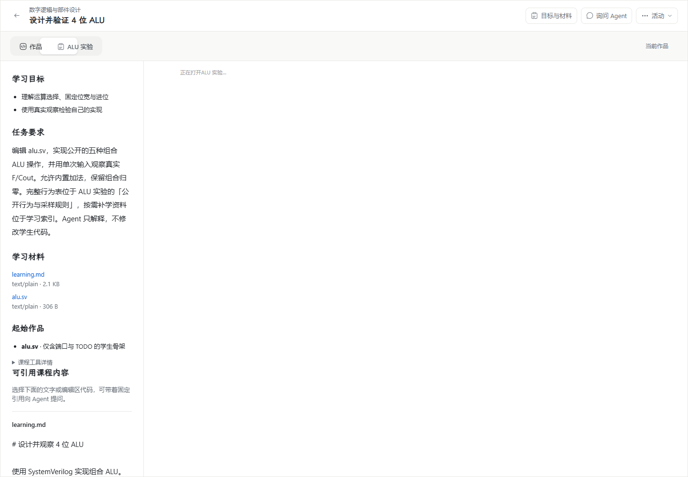
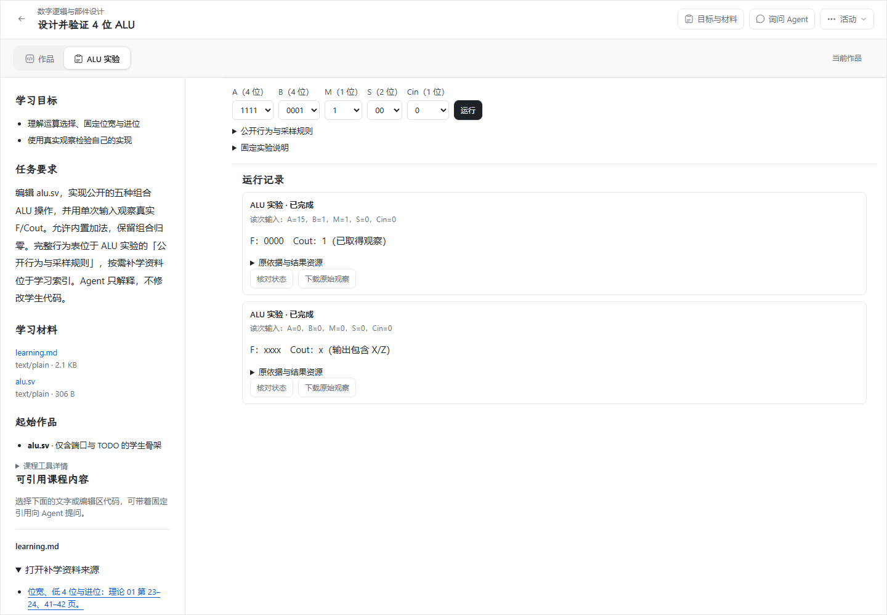

# #192：正式 ALU 编辑与运行，Windows 本机交付

日期：2026-11-06。依据：[正式活动中的 ALU 编辑与运行](https://github.com/paher-din/XunJie/issues/192)、[实施方案](specs/wp04-alu-edit-run.md)及[交互设计](wp04-192-workspace-design.md)。基线为 `wp04@2d030fc`，在该分支已有契约、Adapter/presenter 和传输改动上继续实现。本轮实现与验收按 `wp04` 分支交付；原始证据在提交前采集，源码摘要与当时工作区状态保留在收口摘要中。

负责人本轮明确要求先收口 Windows 本机。Mac 验收已建为 [Apple Silicon Mac 验收 #206](https://github.com/paher-din/XunJie/issues/206)，并以原生子议题挂到 #192。Windows 本机结果不代表独立学校 HTTPS、Mac 或教学效果已经验收，也不据此关闭 #192。

## 已实现的链路

- [正式课程包](../../components/alu-experiment/README.md)提供公开 A/B/M/S/Cin → F/Cout 规则、允许内置加法、保留组合归零、按需补学来源与页码、无答案的 `alu.sv` 骨架、只读单次支架及独立自检样例。支架 t=0 设输入、t=1ns 采样、t=2ns 结束；完整正确实现只存在工程验收脚本，不进入学生起始包。
- [v3 准备](../../apps/web/src/component-preparation/runtime.ts)复用原准备 owner 的 IndexedDB、资源缓存、准备记录和启用机制，真实读取并核验所有声明资源，独立编译/仿真/VCD 自检后开放能力。缓存损坏会修复并重验，配额失败不启用；整体准备截止覆盖资源请求和自检。准备报告先固定原身份，异步同步，服务不回报告确认也不阻塞已验证的本地能力。
- 运行包适配器固定为 `0.3.0`，身份 `f37a9589d6bc91fd91cce93f23cff5a02aad47ca4f0d32dde32162a0341e01cd`。六个工具链二进制/JS 资源与 #191 相同，新身份覆盖已验证资源字节模式的适配器变化。用 [refresh-adapter](../../tools/alu-wasm/refresh-adapter.mjs)复核固定工具资源并重算适配器摘要；没有以新原生编译替换已验证工具链。
- [ALU Adapter](../../apps/web/src/tool-execution/adapters/alu.ts)登记到原公共执行注册表；[固定动作](../../apps/web/src/tool-execution/runtime-action.ts)同步捕获实际 HDL 文件/头文件、组件状态、输入、支架、编译选项、课程运行方案及运行包依据。显式运行受离开保护追踪，继续编辑不改已接受内容。编译缓存限定在该活动执行 Adapter 内，键由完整编译依赖决定；自检使用独立实例。
- [正式工具](../../apps/web/src/product/RuntimeTool.tsx)接现有作品/组件标签和分屏、Monaco、文件条、可靠作品与问题草稿；作品视图也能设置输入并运行。`.sv/.svh/.v/.vh` 使用 HDL 编辑语言。真实诊断保留原文件与行号，当前同内容文件显示 marker，改动后的文件不贴旧 marker；原依据仍可只读查看。
- 原 [执行 owner](../../packages/learning-space/src/learning-data/executions.ts)接收 v3、重推导固定课程依据、沿原 requestId/inputDigest/executionRef 去重及查询；观察、诊断/日志和 VCD 经原资源存储保留。本机结果先重读确认再发布，次级资源随原清单身份同步，并在 owner 事务登记 pin；同一结果身份不能换正文。既有表的 JSON 元数据即可承载资源清单，**没有新增或执行数据库 schema 迁移**。
- 产品 CSP 允许宿主加载已验证的 Blob 模块，并保留 `wasm-unsafe-eval` 与独立 Worker 限制，没有开放任意 `unsafe-eval`。v3 固定说明通过缓存 `srcDoc` 沙箱只读挂载，当前说明不执行脚本，计算始终在宿主受控 Worker 中。

单次运行返回的“已取得观察”只说明实际输出可读，不代表完整行为正确。X/Z、缺失与不完整均保留区别。本票没有虚拟板连续输入、4096 全量检查 UI、预测/波形范围交互、真实 Agent 或教师提交；分别按后续实施票接入。

## 导入、运行与资源限额

```sh
node components/alu-experiment/package.mjs
# 生成目录含实际文件；component.json/course.json 是相对路径 CLI 清单
xunjie component-import --root <产品环境> --file <绝对路径>/dist/alu-experiment/component.json
xunjie course-import --root <产品环境> --file <绝对路径>/dist/alu-experiment/course.json
```

Windows 启动器为 `xunjie.cmd`。管理端程序化调用使用 `aluPackage()` / `aluCoursePackage()` 的完整请求，不把 API 的 base64 请求误当 CLI 文件清单。

组件导入请求上限为 32 MiB，固定课程导入保留原 64 MiB；单运行资源响应限于确切资源路径的 16 MiB。结果资源上传/读取另有 32 MiB JSON 传输边界以覆盖转义开销，owner 仍执行原始结果 16 MiB 总预算和单项上限。没有全局放宽连接 authority 的 1 MiB 限制。学校转发核对返回资源的相对路径，不能把另一份资源的正文冒充请求路径。

## 工程与本机验收

| 范围 | 结果与证据 |
| --- | --- |
| 类型与构建 | `npm run typecheck`、`npm run build` 通过；Node 24.21.0。生产构建有既有 chunk 体积及第三方纯注释提示，不是失败。 |
| 公共契约浏览器边界 | `npm run check:contracts:browser` 的 13 个公开导出通过；旧 v1/v2 定义与摘要兼容测试通过。 |
| Web 行为回归 | 74 个文件、867 项通过（`--exclude='**/.verification/**'`，排除旧基线副本），覆盖组件准备、宿主、公共执行、持续会话、只读恢复及新增 v3 固定动作/缓存/配额/整体截止/待确认报告，以及新增开放文本材料缓存 5 项（首读后不再请求、损坏缓存重取、回包描述不符与摘要不符均拒绝且不落盘、仅学生可读文本视为本机可读）；独立截止测试验证超时不能启用环境，报告挂起测试验证本地执行不等服务。 |
| 契约与资源传输 | 17 项通过，包含导入上限、资源路径、超限/截断响应、回包路径不符、原学校资格与撤销竞争。 |
| 原生会话 | `native-session.runtime.test.mjs` 两项真实 PostgreSQL/子进程回归通过，覆盖状态/有序输入、代际围栏、撤权后回收。 |
| 运行包公开适配 | [Windows Chrome 53 项](evidence/wp04-192-runtime-public.json)通过，含 4096 组独立 oracle、保留组合、四态、include/源码/支架/选项失效、复用、真实停止与预算、固定字节模式。该结果不是全量检查 UI 或教学效果验收。 |
| Windows 完整产品包 | 本轮新生成的未签名完整包，由包内 runtime/Web/CLI 与原生 Node/PostgreSQL、Chrome 156.0.8078.80 跑通 [17 项实际链路](evidence/wp04-192-windows-closeout-product.json)；此前 [15 项记录](evidence/wp04-192-windows-product.json)保留为阶段证据。使用包内 CLI 导入完整资源及材料，未依赖测试接收器。 |
| 普通 Web | 普通 `apps/web/dist` 消费相同学习空间、Adapter 与执行 owner；[14 项同链路](evidence/wp04-192-windows-web.json)通过，包含真实双标签竞争与维护验证。此探针用产品 HTTP/API 宿主承载普通 Web 产物，不是独立学校部署。 |
| Windows 学校 HTTPS 入口 | school profile 以非回环地址 192.168.31.196 严格 TLS 监听，Chrome 用 SPKI 固定验证该证书（未关闭校验），无本机产品、无本机数据库的页面完成资源准备、自检与真实 Worker 运行；[8 项](evidence/wp04-192-school-https.json)通过，页面只访问该学校来源（`https:`/`blob:`），无 4xx/5xx。截图见[学校 HTTPS 运行](evidence/wp04-192-school-https.png)。 |
| Windows 日常恢复与中文组合输入 | 桌面 Chrome、原生 Node/PostgreSQL 下的 [7 项](evidence/wp04-192-windows-recovery.json)通过：真实编译运行；中文经 Chrome 组合事件管线提交（trusted `compositionstart`/组合中 `input`/`compositionend`）且组合过程中不自动运行、编辑区不残留拼音；已取得进位的原文随运行进入固定依据；运行前后问题草稿在编辑区与服务两端都未被发送或清空；已开始但本页不再持有的运行刷新后显示“正在执行（状态待核实）”，本地执行账本键集合不变、没有新运行；重开活动时固定发布的两份文本材料由本机缓存读取（首开有 2 次材料请求，重开后 0 次）。截图见[恢复与组合输入](evidence/wp04-192-windows-recovery.png)。 |
| 文档 | 本次文档的相对链接和差异空白检查通过。默认全仓文档门禁受原有未跟踪 `.tmp` 断链影响，未删除或忽略这些无关文件。 |

产品包探针 `scripts/probe-alu-product.mjs` 真实覆盖正常导入、骨架自动进入可靠作品、Worker 自检、未知值观察、中文源码编辑与固定依据、进位输出、原 VCD 的业务 API 重读、阻断应用 API 后本机继续计算、刷新恢复、编译失败保留旧观察、零时间循环停止、停止后新 Worker、窄桌面/深色、两 Chrome 标签保留竞争内容并显式裁决，以及真实维护 owner 验证和 source fence 后恢复。该 fence 使用隔离验收环境，不冒充独立学校旧安装接管证据。

网络阻断、维护关闸及原接收尚未同步时停止会产生预期的网络失败、503 或暂时的原身份 404；探针断言原执行事实与本机结果，而不是把 HTTP 返回失败改成成功。没有通过过滤原始模拟器诊断使验收通过。

普通 Web 探针由产品宿主承载，其严格 CSP 会阻止普通 Web 原有的内联主题预置脚本并产生控制台提示；React 接管后的主题与实验链路可用。这不是独立学校部署证据，也未据此宣称首帧主题预置已验收；没有为消除提示开放任意内联脚本。

学校 HTTPS 探针 `scripts/probe-alu-school-https.mjs` 用一次性 CA 签发含该非回环地址 SAN 的证书，school profile 在 `0.0.0.0` 上以 TLS 监听；Node 侧只通过 `NODE_EXTRA_CA_CERTS` 信任这张一次性 CA，Chrome 侧用 SPKI 公钥固定校验（`ignoreHTTPSErrors: false`），两边都没有关闭证书验证。无本机产品/数据库的页面从该入口完成资源授权取得、逐项摘要校验、独立自检、真实 Worker 单次运行，中文源码随固定依据进入学校 owner，原 VCD 经业务 API 重读。页面实际只访问了该学校来源与已验证字节的 `blob:`，无 4xx/5xx。仍是同一台机器，不冒充跨机学校部署或学校旧安装接管。

本轮收口后的本机产品候选在 `.verification/wp04-192-closeout/windows-product`，为未签名完整 Windows 包；此前 `.verification/wp04-192-candidate` 是早期验收候选。固定 Node/PostgreSQL 档案摘要验证通过；曾遇到旧 ZIP 缓存摘要不符，保留旧缓存后在独立验证目录重新下载并核对固定 SHA。一次 Windows 提取目录重命名 EPERM 后重跑成功，未降低资源校验。不是全新 Windows 机器安装或生产部署证据。

恢复与组合输入探针 `scripts/probe-alu-windows-recovery.mjs` 用 CDP `Input.imeSetComposition` 驱动 Chrome 自身的组合事件路径，`compositionstart` 与组合中的 `input` 都是 trusted 事件，`compositionend` 携带提交后的中文。**这不等同于系统输入法候选窗验收**：候选窗由操作系统输入法绘制，本探针没有改动机器的输入法设置去取得它，报告里的 `osCandidateWindow` 记为 `not exercised`。系统候选窗的原生取证仍未完成。

该恢复探针记录一次预期内的 `404 /courses/digital-logic.png`：这是首页课程卡片引用的一张既有课程封面，文件在 `28b9e858` 起就不在仓库中，与本票改动无关；没有为让探针通过而新增或忽略该资源。

最新候选的 `distribution.json` SHA-256 为 `49f4620b9214b90ef02f4d0648269177e377dc44a51f844b698dfe0a7307d5a6`，登记 222 项应用/Web/启动入口摘要，包含固定文本材料缓存及本轮通道维护查询修复。早期实屏证据原候选哈希为 `82e4da7c975ebb86dc08264f8abf7802ca52ca62fa3b10c8f91ad2e1f00ae77d`，不把它当作本轮最终代码的分发包。

复跑使用精确 Node 24.21.0 与原生 PostgreSQL 18.6：

```sh
XUNJIE_ALU_PRODUCT_ROOT=/absolute/windows-product node scripts/probe-alu-product.mjs
# 普通 Web，单独保存报告
XUNJIE_PRODUCT_POSTGRES_BIN=/absolute/postgres/bin XUNJIE_ALU_WEB_ROOT=/absolute/apps/web/dist XUNJIE_ALU_OUTPUT=/absolute/output node scripts/probe-alu-product.mjs
# Windows 学校 HTTPS 入口；证书 SAN 须含该非回环地址，Node 侧仅信任一次性探针 CA
XUNJIE_PRODUCT_POSTGRES_BIN=/absolute/postgres/bin XUNJIE_ALU_SCHOOL_CERT=/absolute/server.crt \
XUNJIE_ALU_SCHOOL_KEY=/absolute/server.key XUNJIE_ALU_SCHOOL_IP=<非回环地址> \
NODE_EXTRA_CA_CERTS=/absolute/ca.crt node scripts/probe-alu-school-https.mjs
# 日常恢复、中文组合输入与固定材料本机缓存
XUNJIE_PRODUCT_POSTGRES_BIN=/absolute/postgres/bin node scripts/probe-alu-windows-recovery.mjs
```

脚本创建独立合成课程与本机数据环境；密码/控制凭据不进入报告。环境保留用于检查，不删除现有用户数据。

## Windows external 补验收口（2026-11-06）

本轮在 `wp04` 接续处理交接中的四类 external 失败。四个测试文件以 `--test-concurrency=1` 在同一个批次串行运行，**14/14 通过，零跳过、零取消，未使用强制退出参数**。新维护边界回归另外 **2/2 通过**。最终源码的 `npm run typecheck`、`npm run build`（all）和 `npm run check:contracts:browser` 已重新执行通过，浏览器边界覆盖 13 个公开导出。

本轮命令退出码、external 用例名、相关源码摘要、新包哈希与验证范围见 [收口摘要](evidence/wp04-192-windows-closeout.json)，新包正式 Chrome 复跑为 17/17。它们替代早期构建的概括性措辞，不替代仍未执行的平台与教学验收。

本交付记录 23 个本地链接检查通过，差异空白检查通过；默认全仓文档检查仍有 48 个断链，全部来自既有未跟踪 `.tmp/` 材料，因此默认文档门禁仍记为失败，未修改规则或删除这些文件来掩盖结果。

| 测试文件 | 最终结果 | 修复与断言边界 |
| --- | --- | --- |
| `learning-cli.runtime.test.mjs` | 1/1 通过 | fence-source 按实际执行边界字段验证时间、服务身份、未决与阻断事实，不再比较加入执行边界字段之前的旧字面对象。 |
| `postgres.runtime.test.mjs` | 5/5 通过 | fixture 声明 Windows prerequisite helper；仍覆盖提交/中断事务、端口冲突、外部数据库生命周期、失败停止重试及同地址数据库身份拒绝。 |
| `hybrid-learning.runtime.test.mjs` | 2/2 通过 | 真实客户端先取得 context，并在配对前携带原 namespace；无 namespace 的反向断言仍必须返回 403。 |
| `native-channel-maintenance.runtime.test.mjs` | 6/6 通过 | 传入真实 Windows 隔离 helper；Windows 原生查询唯一测试目录下的实际 Node 子进程，POSIX 保留原环境标记查询。只有安装阶段的 OS 查询期间维持心跳，维护、断网和撤权场景的真实退出及认证终态确认断言均保留。 |

原生维护失败不只是环境限制，实际修复了两处生产查询问题：

1. `channel_execution_intents` 的操作保存在 `command` JSON，维护边界错误地查询了不存在的独立 `operation` 列。现从固定命令信封读取原 stopId，不新增列、不迁移数据库。
2. 排空已收到原执行器的认证退出证明时，历史查询仍可以保留原“运行中/未知”投影。备份边界以前只看该投影而误报阻断；现与通道 drain 复用 [同一个退出证据判定](../../packages/learning-space/src/learning-data/native-channel.ts)，核对原 claim、节点、代际、owner 及完整执行身份。没有借此改写原查询或将失联当作停止。

[真实 PostgreSQL 回归](../../apps/server/tests/execution-boundary.runtime.test.mjs)同时验证原停止身份保留、错执行引用的清理证明不能结清、原执行器身份缺失仍未结，以及匹配证明能结清运行边界但不改写原未知查询。

还修正了 fixture 的失败清理：先撤销故障注入再停止自有 worker/host，清理错误不能覆盖首个断言错误；未建立的还原目标不调用 stop。备份断言核对全部注册 owner 和 schema 版本，不再把数量写死为 3。隔离还原的业务 HTTP 通道必须拒绝旧执行器的清理请求并保持事实不变；这与原权威普通维护期间可重复返回已有确认不同，未放开隔离写入。

原始日志保存在 `.verification/wp04-192-closeout/`。停止了 14 个较早失败测试遗留的隔离 PostgreSQL 进程，未删除它们的目录。这里的备份/还原是既有 WP03 通道的回归，不代表 ALU 的 #195 恢复组合已经完成；Mac、跨机学校 HTTPS、系统输入法候选窗、真实 Agent/教师链和教学效果仍按上文边界记录。

## 实际运行界面对照

统一浅色 1440 × 1000。修改前使用 `2d030fc` 的正式 Web UI，修改后使用本轮实际 Windows 产品包。两次使用相同新 ALU 课程资料，分别建立隔离环境/活动；前图只核对旧 UI 的位置与缺少正式运行接线，不证明旧后端支持新 v3 导入。没有用设计线框或生成图代替实屏。

| 修改前 | 修改后 |
| --- | --- |
|  |  |

增加输入/运行、公开规则和原结果详情，是为了让学生在当前作品直接完成一次实验；导航、文件编辑、材料及问题位置继续复用。新编译失败不会把上次输出贴到新代码，见 [真实失败界面](evidence/wp04-192-compile-failure.png)。未加入保存、冻结、节点选择或装载前置操作。

## 旧消费者、剩余范围与边界

聚合输入/结果语义已由其 Adapter 和 presenter 消费；ALU 不接旧节点、HDL session 或 build/load 编排。`HdlToolArea` 仍由 `PrepWorkspacePage` 消费，`ExecutionNodeSelect` 仍由准备页和教师页消费，因此未删除这些共享文件。本轮未执行文件/目录删除、修改 `.env`/凭据/CI/CD、公开部署或推送代码。

#192 剩余验收已按负责人要求统一转交 [跨平台与剩余验收 #206](https://github.com/paher-din/XunJie/issues/206)：Mac 本机完整包、Windows/Mac 客户端连接独立学校 HTTPS 节点、两平台系统输入法候选窗原生取证，以及最终候选可获取、版本固定和受影响复验。Windows 学校 HTTPS 入口已按上表实测，但这是同一台机器上的非回环 TLS 监听，不是跨机学校部署证据，也不代表学校旧安装接管。Windows 中文正文输入/保存与代码执行已覆盖，中文组合事件路径已按上表取证；**系统输入法候选窗本身的原生操作未取证**。刷新后关页重开按 A10 只认“未知、不重跑”，本票不宣称关页后 Worker 继续存活——浏览器 Worker 随页面结束，Spec §8 要求的是如实记为未知，而不是保活。完整离线首次启动、完整备份/隔离还原/接管（#195）、真实 Agent/教师链及教学效果保持原工作包边界，没有因本次转交而宣称通过。
