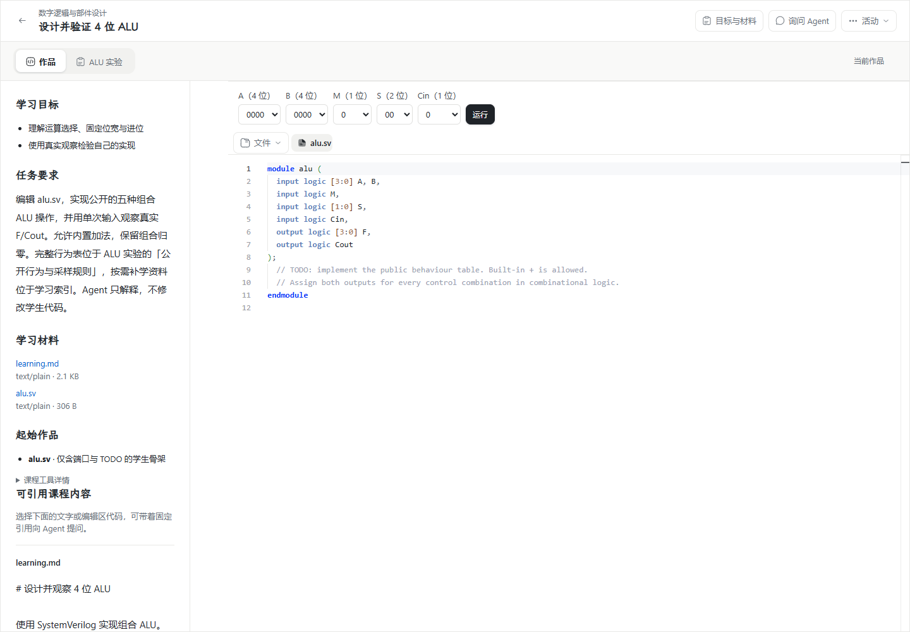
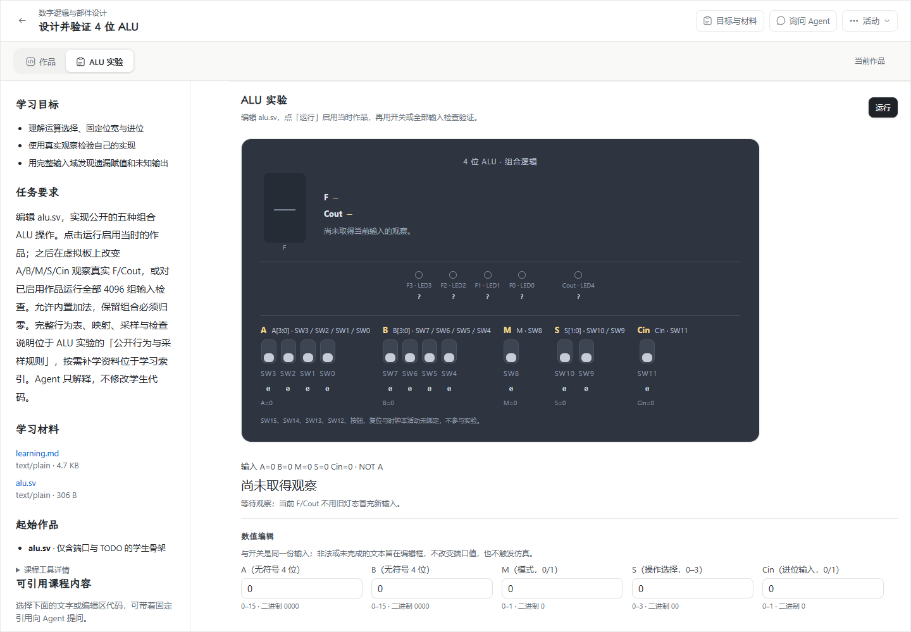

# WP04 #193：虚拟板自由实验与 4096 组检查实现与验收记录

日期：2026-11-07（Asia/Shanghai）。基线：`wp04@c8932ed8`；工程与浏览器证据采自当时未提交的工作树，源码摘要保留在工程门禁中。需求：[虚拟板自由实验与 4096 组行为检查](https://github.com/paher-din/XunJie/issues/193)；[实施方案](specs/wp04-alu-board-check.md) · [交互设计](wp04-193-workspace-design.md) · [DESIGN.md](../../DESIGN.md)。

本轮完成代码审查、缺口修复、工程回归和 Windows 正式本机产品运行时的真实 Chrome 验证。**Mac、独立学校 HTTPS、多机联调和真实系统中文输入法未执行，已按负责人要求发布为 [剩余验收 #211](https://github.com/paher-din/XunJie/issues/211)，并核对其原生父票为 #193。** 不把转交视作通过，不宣称完整 A01–A13 平台矩阵或教学效果完成。负责人已于2026-11-07明确要求将本交付提交并推送到`wp04`；最终提交身份可从本文件Git历史追溯。#193保持开放。

## 1. 最终实现

| Module | 实际行为与代码入口 |
| --- | --- |
| 固定课程发布 | [课程包](../../components/alu-experiment/package.mjs)交付组件/状态 v2、新 release `…0076`、三操作、固定 boardMapping、只读四轮支架；配置摘要按公共 canonicalValue 计算，正常导入会重推导验证。旧定义与发布不被原地更新。 |
| 有界真实计算 | [ALU Adapter](../../apps/web/src/tool-execution/adapters/alu.ts)复用原账本和 Icarus Worker，一次编译、四轮真实仿真；[check.sv](../../components/alu-experiment/check.sv)只施加前驱与输入/采样，不计算答案。 |
| 全量比较 | [alu-check.ts](../../apps/web/src/tool-execution/adapters/alu-check.ts)统计4096唯一输入、16384目标采样、1536保留组合、二值比较、X/Z、缺行/重复/格式/越界及跨轮差异。保留域覆盖独立于正确性，完整采样的错误输出仍计入覆盖。 |
| 固定启用来源 | [runtime-action.ts](../../apps/web/src/tool-execution/runtime-action.ts)在观察/检查 basis 中携带 enabledBy 的原 requestId/inputDigest/executionRef；代码来自成功显式运行的固定副本，不读当前编辑 head。 |
| 服务核验与维护 | [runtime-basis.ts](../../packages/learning-space/src/learning-data/runtime-basis.ts)及[执行 owner](../../packages/learning-space/src/learning-data/executions.ts)核验同主体/活动/实例、成功完整的原 run-single、相同代码/工具/发布与保留结果；恢复验证同样核验来源。未新增数据库表或迁移。原服务未收到父记录时沿原身份重试同步，不重新计算。 |
| 接受与输入归属 | [原接收器](../../apps/web/src/tool-execution/receiver.ts)在[原 IndexedDB 接收事务](../../apps/web/src/tool-execution/store.ts)写入前重验候选与资格；陈旧 revision、hold 或更换启用依据不接受为新观察。已经接受的身份重传仍返回原回执。 |
| 正式工作区 | [AluExperimentTool](../../apps/web/src/course-tools/alu/AluExperimentTool.tsx)管理运行启用、输入150ms/500ms合并、当前/历史选择、检查、停止和恢复；分屏通过[活动准入门](../../apps/web/src/course-tools/alu/coordination.ts)协调，同一输入不因compact/full双视图重复接受。它不是第二执行队列或账本。 |
| 板卡与兼容 | [AluBoard](../../apps/web/src/course-tools/alu/AluBoard.tsx)消费固定课程映射，正确显示MSB与X/Z；等待时隐藏所有旧数值。[RuntimeTool](../../apps/web/src/product/RuntimeTool.tsx)按状态版本委托，新旧活动分别使用各自契约；旧stateVersion1仍单次运行，不写新状态字段。 |
| 报告读取 | [读取 Module](../../apps/web/src/course-tools/alu/check-report-reader.ts)有界读取报告、观察、诊断和trace；缺失/损坏资源、原始行与结论不符、缺轮VCD均不显示通过。失败报告仍可查看已保留的反例并说明缺项。 |
| 公开资料 | [learning.md](../../components/alu-experiment/learning.md)补固定映射、自由输入例子、公开行为、四轮采样与停止/重开说明；完整正确/故障HDL仅用于工程验证，不进入学生骨架或开放包。 |

运行成功并确认完整观察后才CAS提交启用指针，X/Z是可用于调试的真实观察；失败、停止、预算或不完整输出不启用。代码修改须重新运行；旧报告不能验证新修改。输入、启用及两个结果选择自动保护，晚结果不抢历史，未知终态不自动重跑。hold同时屏蔽候选的当前读数、历史与检查报告。运行/检查不发送或清空问题草稿，不生成掌握结论或教师接收。

检查结果沿原机制保留主 `check-report.json` 及三个附加资源 `check-observations.json`、`diagnostics.txt`、`check-traces.json`，合计四项；不是四个附加资源再加主文件。查询事实、文件摘要/pin、维护与恢复归原 owner。

## Standards

审查固定点为HEAD `c8932ed8`，对象为未提交diff及#193新增文件，排除原有无关未跟踪材料。Standards与Spec分别审查，不用一轴通过抵扣另一轴。

1. **P2，硬规则：普通界面字号/间距偏离DESIGN.md。** 修复[alu.css](../../apps/web/src/course-tools/alu/alu.css)的非仪器字号、间距和行高，使其使用既有阶梯；板卡材质豁免不扩散到普通表单。
2. **P2，判断建议：证据只链接被忽略的本机目录。** 必要JSON/截图已保留到[证据索引](evidence/wp04-193-reviewed-evidence-index.json)，正文不依赖`.verification/`才能阅读关键结果；原文件未删除。
3. **P2，判断建议：视图兼管多项可靠行为。** 将跨视图准入与报告读取收敛到独立ALU Module，生命周期和账本仍归公共执行；未作无关全仓重构。视图准备/状态编辑仍留在课程工具内，不把这项判断建议描述成违反硬规则。

Standards共3项，最高硬规则问题是设计阶梯偏离；对应修复与证据已登记。

## Spec

原审查发现7类实质缺口，均已修复并由相应回归覆盖：

| 缺口 | 修复及证据 |
| --- | --- |
| P1：F位序反转且映射硬编码 | MSB正确对应F3…F0；SW/LED来自固定配置；另修共享Seg7的数字8缺中段问题，等待不再显示旧数码管或hex。板卡5项与既有HDL展示11项通过。 |
| P1：旧活动被新状态破坏 | stateVersion1委托独立旧单次表单，保持原五字段和结果形状；旧活动2项DOM回归通过。 |
| P1：分屏双挂重复提交 | 共用活动准入门，异步保护期间保留选择；DOM回归及真实分屏接受计数均为一条。 |
| P1：服务未验证启用来源 | 显式enabledBy、成功原运行与保留事实交叉查询；3项服务规则测试通过，真实服务对改写HDL的伪造检查返回400 invalid。 |
| P1：异步保护后未重验候选 | 接受事务写入前校验当前revision/输入/启用/hold及资格；拒绝无执行身份，已接受重传保持原回执。 |
| P1：hold仍泄露旧输出 | 屏蔽当前/历史/检查及原执行面板；被明确拒绝且从未接受的候选可在恢复live后继续，未知已接受任务不重算。 |
| P2：把正确保留输出计为覆盖 | 1536保留域按完整采样统计，错误/X/Z与覆盖分别计数。 |

另补报告读取完整性、未确认状态不显示通过、历史原输入标签、两类选择持久与不互抢、缺失选择可显式返回最新、稳定stopId等修复。报告读取新增10项回归通过。Spec原7类问题的最高风险集中在版本/来源与接受竞争，不以平台转交掩盖这些实现缺口。

## 2. 最终工程与真实仿真

| 检查 | 最终结果 |
| --- | --- |
| 根 `scripts/build.mjs typecheck`（Node24.21.0） | 通过 |
| 根 `scripts/build.mjs all`（含普通Web与dist-runtime） | 通过；既有大chunk/上游注释告警保留，无绕过标记 |
| Web全量Vitest，maxWorkers=4 | **83文件、935/935通过，0失败/跳过** |
| 公共契约浏览器边界 | 13个公开出口通过 |
| 成功启用来源规则 | 3/3通过：完整X观察可用；缺失/失败/未知/不完整、跨主体/实例、不同代码/工具及错误源操作拒绝 |
| 真实WASM四轮与负例 | **162项通过**，见[报告](evidence/wp04-193-reviewed-wasm-check.json)和[截图](evidence/wp04-193-reviewed-wasm-check.png) |
| 文档 | 本次5份文档208个本地目标通过；Git差异及新增文件空白检查通过。默认检查223份文档仍有48项失败，全部在原有未跟踪.tmp材料，未修改或忽略它们 |

最终检查与未提交候选的源码摘要见[工程门禁](evidence/wp04-193-reviewed-engineering-gates.json)。

真实WASM探针使用交付运行包、实际check.sv和桌面Chrome Worker，独立oracle不导入产品比较器。正确实现零失配；丢进位256唯一错误/1024错误行，X1536唯一输入/6144行；补真实Z、1536保留组合错误、遗漏赋值的前驱差异、延迟的采样时刻差异，以及仅100行的不完整输出。原生与WASM的完整再对照、Mac/学校矩阵由#211继续核验，不把本机合成HDL探针称作全部产品/教学验收。

最终全量Web复跑通过前，首次默认高并行运行的既有PersonalModelSettings beforeAll出现10秒超时；未修改超时或跳过测试，限制4个worker后完整通过。先前全仓`npm test`在tools/xj-dev的baseline-team CLI子进程超时/挂起记录保留，本轮未重跑或宣称全仓npm test通过。

## 3. Windows正式产品与Chrome

[最终产品报告](evidence/wp04-193-reviewed-product-report.json)：**22/22通过**。使用原生PostgreSQL18.6、正式openProductRuntime及生产dist-runtime、桌面Chrome156.0.8078.80（headless），不是开发代理或测试接收器。候选为工作树构建的生产Web/运行时，不冒称已构建并验证新的独立安装分发包。

覆盖正常导入、真实X骨架启用、代码修改待运行、板卡/数值同源、真实F/Cout、应用API阻断时本地观察、完整检查/256反例、服务来源拒绝、检查中改输入、非法数值草稿、Space键、停止零时Worker及随后正常运行、刷新恢复、深色与1024/900px、分屏和两个真实标签。

| 单次本机观测（非SLA） | 耗时/资源 |
| --- | --- |
| 起始/正确作品启用 | 302ms / 473ms |
| 拨码到观察 / API阻断观察 | 367ms / 352ms |
| 全量检查通过 / 固定错误报告 | 1493ms / 951ms |
| 检查中修改到新观察 | 1498ms |
| 刷新恢复 / 真实停止确认 | 1101ms / 302ms |
| 主报告/观察/诊断/trace | 1788 / 291150 / 238 / 1646482 B，总1939658 B |

分屏真实挂载compact/full两个视图，一次输入仅增加1条已接受观察。两标签均保留原请求，实际基线为4、5，最终activationRevision=6，属于读取新基线后的安全串行；没有发生同基线冲突，不能把这条证据称为“强制CAS冲突已实测”。跨平台/学校路径的强制竞争及其失败恢复继续列在#211。

900px可到达板卡与检查操作。200%证据是CSS内容缩放后的真实重排和操作可达，不等同操作系统缩放或Chrome原生页面缩放；后两者没有在本轮冒领通过。Worker/WASM资源峰值未测，256MiB为声明上限，不是峰值实测。

## 4. 实际界面与证据

变化：原单次数字表单演进为虚拟板自由输入和全量检查，保留原作品、工具标签、分屏与问题区；等待隐藏旧输出，历史保留原依据，减少错误归属。检查报告就在原ALU工具内，不新增页面或执行权威。

下列前后图均为实际运行界面、1440px浅色初始态：

| 改动前：#192单次实验 | 改动后：#193虚拟板与检查入口 |
| --- | --- |
|  |  |

更多实际截图：[自由观察](evidence/wp04-193-reviewed-after-observation.png) · [检查通过](evidence/wp04-193-reviewed-after-check-pass.png) · [反例](evidence/wp04-193-reviewed-after-counterexamples.png) · [刷新恢复](evidence/wp04-193-reviewed-after-refresh.png) · [900px](evidence/wp04-193-reviewed-after-900.png) · [200%内容缩放](evidence/wp04-193-reviewed-after-200-content-zoom.png) · [分屏](evidence/wp04-193-reviewed-after-split.png) · [双标签](evidence/wp04-193-reviewed-after-two-tabs.png)。

[审查前证据索引](evidence/wp04-193-initial-evidence-index.json)保留原实现17项和72项探针结果；它们不抵扣新修复的验证。最终证据与来源SHA见[审查后索引](evidence/wp04-193-reviewed-evidence-index.json)。原始本机失败尝试保留，没有删除或改写为通过：首次配置摘要不规范导致课程导入400；随后探针旧按钮文字假设不适配保留报告、以及把串行要求误写成必须冲突，均在修正后完整复跑。

## 5. 剩余范围与授权

- [#211：Mac、跨机HTTPS、系统中文输入法](https://github.com/paher-din/XunJie/issues/211)承接明确转交的验收，包含版本固定、真实候选窗、学校第二活动及#206已登记identity-conflict复核、丢回执/乱序/旧连接、并发、性能和资源取证。尚未执行，不算通过。
- 波形/范围引用/预测产品UI由#194接入，复用同一输入、hold、原观察及检查资源；完整备份/隔离还原/接管组合归#195，新增来源和结果资源已有所属验证入口。
- 教学理解、迁移、掌握与教师提交/接收均未评估或实现，不由4096检查通过推导。
- 本次没有修改.env、密钥或CI/CD，没有新增数据库schema/迁移、删除文件/目录或公开生产部署。原有.tmp/、apps/student/、course_matrial/data_logic/.gitignore、scripts/windows-ime-keys.ps1未动。取证时尚未提交/推送，本轮提交推送已获负责人明确授权。
