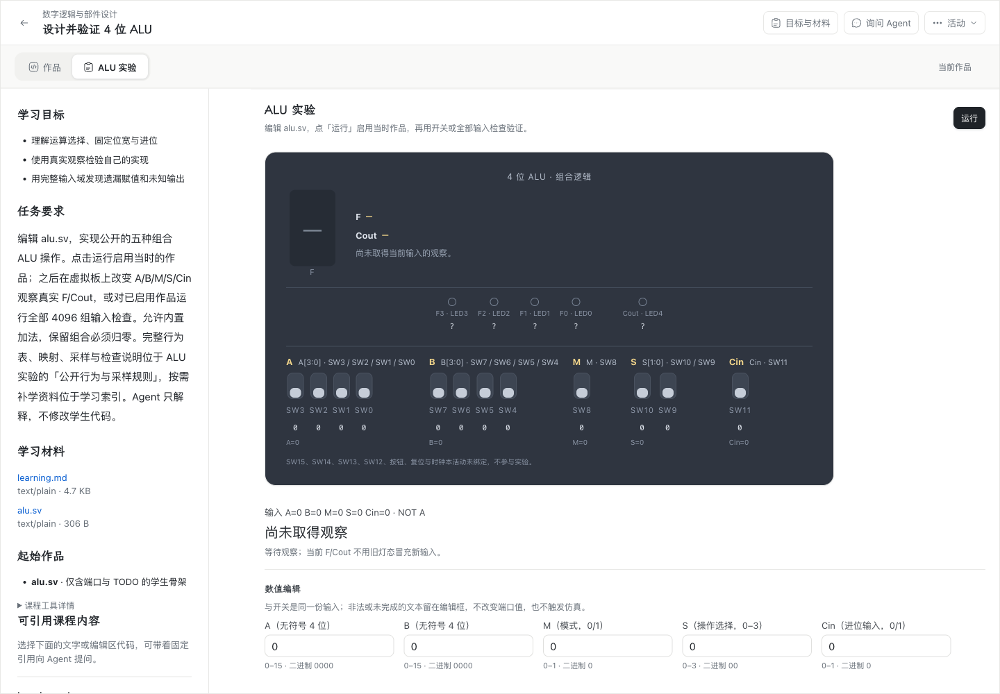
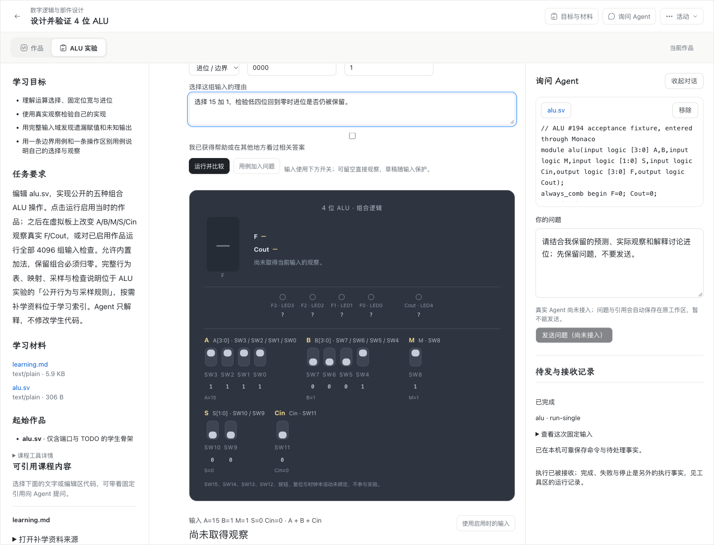
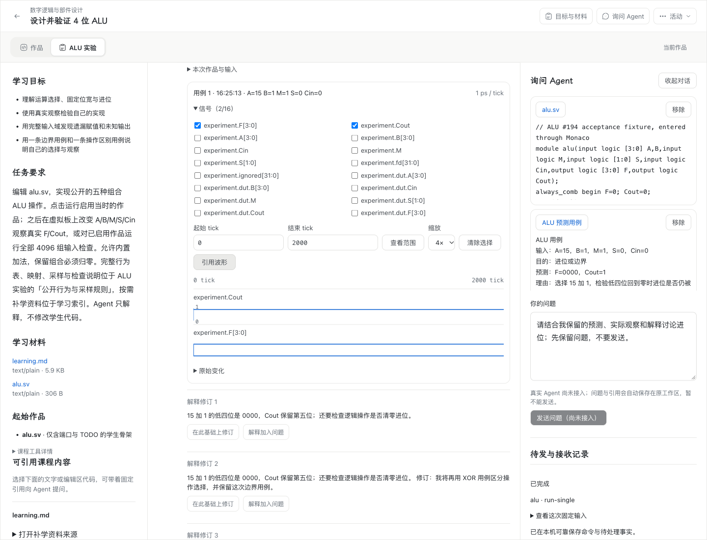

# WP04 #194：预测、解释与波形引用验收

需求为 [#194：波形引用、预测用例与比较解释](https://github.com/paher-din/XunJie/issues/194)，接线与所有权见[实现说明](specs/wp04-alu-learning.md)。本次基线为 `33aada1831b83fd0f29f7431993598a835439951`，使用 `wp04-194d` 三平台正式候选包。

当前状态：实现、工程验证、独立双轴审查、四条真实浏览器路径和两端原生中文输入验收全部通过。教学效果另行取证。

## 改动与影响

沿用原 ALU 工具与虚拟板，在原工具中增加预测用例、比较、不可变解释修订及真实 VCD 查看；原问题草稿接收代码、用例、结果、解释和波形范围引用。候选编辑抑制具体结果；运行比较固定点击时的输入、预测、理由和启用作品，后续编辑保留为新草稿。普通运行或自由观察也可保存解释，预测保持缺项。

解释修订固定原观察与所选父解释，清空正文再输入也不改挂父项。新对象与引用继续由原作品、执行、资源和可靠草稿所有者管理；不新增数据库 schema、结果账本或保存队列。新组件为版本 3，保留既有版本 1、2 的原入口。测试中的完整 ALU 实现只用于验收，不进入学生起始作品。

## 工程与审查

- Node `24.21.0`：最终 `npm run verify -- --jobs 2` 通过，prepare、build:test、unit 31、server 87、tools 45 个文件任务全部成功，未使用测试缓存。原始目录为 `.verification/2026-11-07T08-27-09-226Z-8nwQxR/`。
- 原父项回归先实际失败，再修复通过；相关 UI、runtime action、组件包三个文件共 14 项通过。真实 PostgreSQL 的解释及语义引用所有者两文件共 23 项通过，覆盖身份、跨 scope、父链、终态滞后重试、普通观察及维护恢复。
- `code-review` 两轴独立复核：Standards 最终 0 项，Spec 最终 0 项。首轮发现均已修复并回归，包括父项错挂、晚回执覆盖自由观察、普通观察无法解释，以及终态滞后误拒合法引用。
- [可复查摘要](evidence/wp04-194-browser-acceptance.json) 固定四份原始报告的 SHA-256、候选分发清单摘要、实际浏览器版本、各项断言及清理结果。完整本地报告在 `.verification/wp04-194/` 下对应路径，私有登录材料不进入本记录或 Git。

## 四条真实浏览器路径

均为桌面 Chrome，真实 Worker、IndexedDB、API、PostgreSQL 与保留资源；每条路径实际运行全部核心项和故障项。

| 客户端及入口 | 报告目录 | 结果 |
| --- | --- | --- |
| Apple Silicon Mac，正式完整本机产品 | `mac-product-d2` | 25/25 通过 |
| Windows 11 x64，正式完整本机产品 | `windows-product-d` | 25/25 通过 |
| Apple Silicon Mac，独立 Linux 学校 HTTPS | `mac-school-d` | 25/25 通过 |
| Windows 11 x64，同一独立学校 HTTPS | `windows-school-d` | 25/25 通过 |

学校入口实际部署于独立 Linux 节点，客户端校验正常 CA 链和精确 SPKI，无同机代理或 SSH 隧道。验收结束后通过候选原运行库停止学校候选，再通过原运行库恢复此前 #188 学校实例、原数据和配置；其 `degraded` 为原有可选原生会话依赖，必需数据库依赖正常。

| 验收行为 | 实际证据 |
| --- | --- |
| 边界与操作区别用例 | 真实 `15+1 → F=0000, Cout=1`；`10 XOR 12 → F=0110, Cout=0`，原预测与理由固定 |
| 预测先后及来源 | 候选编辑不新增命令，不展示旧具体值或报告；同作品同输入重跑保留原观察来源 |
| 直接观察与解释 | 原 `run-single` 可保存解释，原预测仍为空，保存不重跑；解释追加不可变资源 |
| 修订及并发编辑 | 从第一次解释分支，先清空再重写仍以第一次为父项；原两份解释与副本不变 |
| 真实波形 | 从原 `trace.vcd` 验证资源 SHA-256、信号与原 tick 闭区间；缩放不改原范围；[原始 trace](evidence/wp04-194-original-trace.vcd) |
| 四态、失败与不完整 | 真实 X/Z 输出显示四态，非法编译不启用失败作品；运行中编辑后可核对并停止原执行，缺项不填造二值 |
| 同一问题草稿 | 原代码引用及四类 ALU 语义引用一致，草稿本机与服务副本核对；全程零问题派发 |
| 结果或终态未同步 | 分别阻断原结果和终态报告，实际草稿 POST 返回 `503 unavailable`；原副本继续待同步，恢复原关联且不重跑 |
| 丢失回执 | 实际接收、结果、草稿与作品先提交再丢确认；恢复同 requestId，不新增执行或重复草稿修订 |
| 刷新、工具切换与双标签 | 输入、预测、解释草稿、波形范围、引用和问题恢复；真实 CAS 分歧展示双列，明确保留 A 后双方收敛 |
| 主题、窄桌面与键盘 | 真实页面浅/深主题、1440/1024/900px；Tab 从预测 F 到 Cout，有可见焦点，布局切换不执行实验或清空引用 |

四条路径的全部 100 项均已实际运行。来源身份拒绝、资源 pin、未知适配只读恢复、同批解释父链与维护完整性另由真实所有者回归验证；不以浏览器截图替代服务所有权验证。

## 原生中文输入

本轮使用 `probe-alu-ime-{macos,windows}-211.mjs --learning --only-tool-switch`，在正式 `194d` 产品中实际验证原 Monaco 组合切换及新理由、解释字段的真实系统输入、候选、提交、取消与切换恢复。

| 平台 | 原始报告目录 | 实际结果 |
| --- | --- | --- |
| Apple Silicon Mac | `mac-ime-d5` | A0、D1、E1、E2 共 4/4 通过 |
| Windows 11 x64，Interactive Session 1 | `windows-ime-d2` | A0、D1、E1、E2 共 4/4 通过 |

每次物理按键均核对本次 Chrome 的前台进程。Mac 通过 Text Input Sources 选择真实输入法，Windows 使用同一交互桌面的真实按键与 Desktop Duplication 截图；新增字段原生候选图片已逐张人工查看。理由提交中文后，Escape 取消不留拼音残余，组合期间工具切换延后到输入法结束，返回保留原文；解释提交、取消并保存不可变修订，输入阶段没有误运行或派发问题。

[Mac 理由候选](evidence/wp04-194-macos-ime-reason.png)、[Mac 解释候选](evidence/wp04-194-macos-ime-explanation.png)、[Windows 理由候选](evidence/wp04-194-windows-ime-reason.png)、[Windows 解释候选](evidence/wp04-194-windows-ime-explanation.png)均为本轮实际系统候选窗口；原始报告摘要及 SHA-256 收录于[验收证据](evidence/wp04-194-browser-acceptance.json)。临时产品均通过原 owner 正常清理。

初始锁屏与前台不符的尝试保留失败，未发送错误窗口的按键。解锁后还发现旧组合输入用例会改动未完成的起始代码，导致新增字段探针的准备运行失败；现通过真实编辑器先载入有效的验收 fixture，再测试比较与解释，两端均重新运行通过。此修复仅涉及验收脚本，正式产品源码及四路径验收候选保持一致。

## 实际界面对照

修改前：正式 #211 候选、组件版本 2 的原 ALU 工具。

修改后：在原工具中预测候选，暂不揭示具体输出；问题与引用沿用原侧栏。

真实观察的原信号、tick 范围、波形及解释修订可在同一工具中查看和引用。

[Windows 本机波形](evidence/wp04-194-windows-waveform.png)、[Mac 学校 HTTPS](evidence/wp04-194-mac-school-waveform.png)、[Windows 学校 HTTPS](evidence/wp04-194-windows-school-waveform.png)、[深色主题](evidence/wp04-194-mac-dark.png)、[900px 窄桌面](evidence/wp04-194-mac-narrow.png)均为本轮实际运行界面。

## 失败尝试与边界

早期 core 探针因等待快照和回调处理问题失败，旧报告保持失败。首个 d 全套在解除故障 route 时重复处理真实请求，修正拦截器等待后，d2 全套和其余三条路径全部重跑通过；失败环境均先排空原执行，再经原 owner 停止和删除，没有通过重跑补造旧观察。终态滞后探针须先看到实际 `503 unavailable` 再释放故障，不以尚未提交的本机 pending 当作服务已校验。

工程与浏览器结果只证明本轮行为及恢复链。教学效果未评估，不从一次预测、解释或全量检查推断学生掌握。完整备份、隔离还原与接管属于后续 [#195](https://github.com/paher-din/XunJie/issues/195)。
