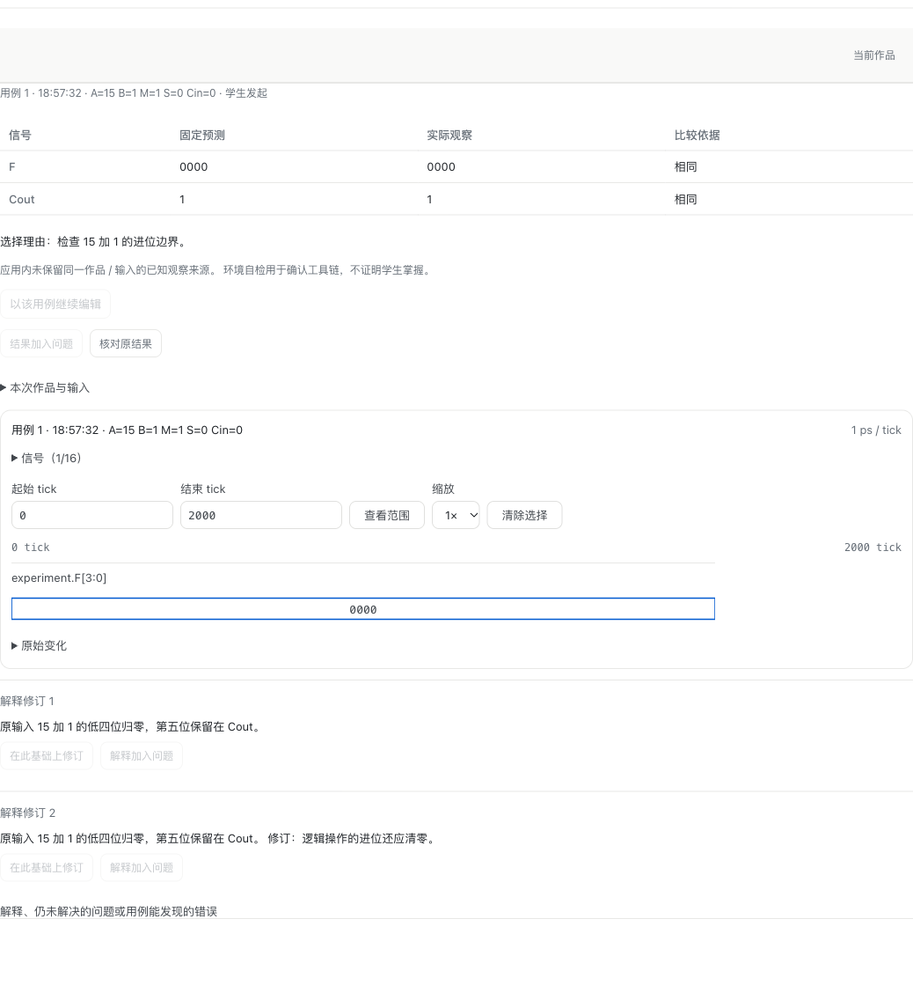

# WP04 #195：ALU 备份、隔离还原与恢复接管

需求为 [#195](https://github.com/paher-din/XunJie/issues/195)，交付基线为 `54216d99bd78829e8e1f9245a27561766b3a1bdd`。本票沿用 WP01/WP03 产品维护入口和 ALU 原有事实所有者，不增加业务表、运行账本或另一套恢复界面。

交付使用同一 H 候选包；最终浏览器证据为补齐资料、组件入口和命令身份集合断言后的 H3 轮次。阶段轮次不替代最终证据。

## 实现与影响

- 学习数据 owner 在排空前核对原浏览器命令的确认终态及其已声明结果是否实际保留；恢复校验拒绝悬空结果引用。结果字节晚到时，原保留通道继续可用，不能先关掉它再等待它完成。
- 维护期间由所属 owner 确认已接收的浏览器命令后，仅放行其查询、停止、结果与状态核对；owner 继续校验当前身份、原请求、摘要、执行引用和单调状态。新接收与派发保持关闭，隔离副本及已退休安装没有此例外；原生接收端仍走原退出证明通道。浏览器接收确认丢失时，先核对原三项身份，再继续同步原停止、资源和终态，不能重复执行。
- 隔离环境的用例、历史观察、检查与波形范围选择仅改变当前视图，按工作区隔离；原作品、IndexedDB 保护分区与同步队列不变。继续使用原 ALU 控件、只读横幅、预测比较、解释和波形界面。
- 第一次备份失败也可从原 `backup-list` 入口读取失败记录；原 `status` 暴露维护失败原因及原执行 ID，提示保留原页面、核对或停止、等待原结果同步后重试。

## 所有权与覆盖

| 事实 | 原所有者与核对方式 |
| --- | --- |
| 固定组件、运行包、课程绑定与资料 | `space-course` 保留原版本、manifest、字节摘要及资源引用；恢复后不改选当前目录中的另一版本 |
| 源作品、用例与解释修订 | `learning-data` 的原作品对象、不可变内容与资源；保留解释父链及引用依据，即使当前作品已改变 |
| 命令、回执、观察与全量检查 | 原执行 owner 保留 `requestId/inputDigest/executionRef`、固定代码/输入/运行依据、报告与资源清单 |
| VCD、诊断、完整检查采样与 trace | 按原执行引用读取原字节，逐项校验 SHA-256 和长度，不重新编译或仿真补结果 |
| 问题与语义引用 | 原可靠草稿及固定副本，覆盖 `alu-case`、`alu-observation`、`alu-waveform`、`alu-reflection` |
| 安装及接管 | 原产品 runtime 的一致边界、加密备份、独立数据库/资源根、新安装/命名空间及源退休证明 |

覆盖范围仅为服务已接收的事实。旧浏览器未同步问题保留在旧命名空间；编译缓存、浏览器准备缓存和任意活 Worker 内存不在服务器备份范围。隔离期间不提供可执行运行包下载；owner 负责验证其保留字节，接管后再按原版本公开重读。

## 可复跑入口

使用 [probe-alu-recovery.mjs](../../scripts/probe-alu-recovery.mjs) 与 [alu-recovery-host.mjs](../../scripts/alu-recovery-host.mjs)。前者运行真实桌面 Chrome、Monaco、Worker、IndexedDB 和 HTTP；后者只消费正式候选包公开的产品维护 API。源码侧用 `aluPackage()` 与 `aluCoursePackage()` 固定完整导入请求，验收实现只经 Monaco 输入，不进入学生起始作品。公开资料集合须与原导入包逐项相等；原两份资料、组件入口及 26 个运行资源均核对原 SHA-256 和长度。

```sh
node scripts/probe-alu-recovery.mjs --host-config=/private/local.json --output=/evidence/local --label=local
NODE_EXTRA_CA_CERTS=/private/ca.crt node scripts/probe-alu-recovery.mjs --remote=/private/maintenance.json --output=/evidence/school --label=school
```

本机配置包含 `product`、本次独占的临时 `root`、包含组件/课程请求的 `packages` 文件。学校配置的 `sshArgs`、`command` 仅用于独立学校节点的维护；学生页面/API 直接访问独立节点的严格 HTTPS，Chrome 只绑定精确 SPKI。登录材料和恢复密钥仅留在私有配置，不进入 Git、参数或报告。

`root` 必须不存在；本轮随机身份经私有标准输入贯穿所有维护操作，清理须同时匹配本轮身份和 root 标记。若认领失败，保留原安装与备份。[清理归属回归](../../scripts/probe-alu-recovery-ownership.mjs)可用正式完整产品包独立复跑，不打开浏览器。

每次 GUI 运行前以原子 `mkdir` 取得共享 `macos` 或 `windows` 桌面锁，记录会话及时间，核对解锁和前台进程，持有至实际浏览器退出并在 `finally` 释放。Windows 使用真实交互 Session 1。学校源与目标各自拥有独立数据库和资源根；同一 HTTPS 入口迁移前，通过既有退休机制生成源失权证明并停止源监听，再开启隔离目标。

## 工程与真实验收

以下全部为本票的新运行，此前 #194 证据不作为通过依据。Mac 为 Apple Silicon、macOS 27.2（26B123）；Windows 为真实 Windows 11 家庭版中文版 10.0.26200 x64。产品均使用 Node 24.21.0、PostgreSQL 18.6；学校服务为独立 Linux x64 节点，两端 Chrome 经公网直接访问 `https://101.201.141.133:8443`，无同机代理或隧道。

| 客户端与产品路径 | 桌面 Chrome | H3 结果 |
| --- | --- | --- |
| Mac → Apple Silicon 本机产品包 | 156.0.8078.80 | 9/9 |
| Windows → Windows x64 本机产品包 | 156.0.8078.81 | 9/9 |
| Mac → 独立学校 HTTPS 产品包 | 156.0.8078.80 | 9/9 |
| Windows → 独立学校 HTTPS 产品包 | 156.0.8078.81 | 9/9 |

每条路径覆盖：真实准备与首个运行；接收确认丢失时维护内核对原身份、停止并归档；接收和结果确认丢失的幂等重试；固定代码/输入/预测、两次解释父链、四类语义引用、4096 组完整报告与 VCD；一致边界备份；两类 owner 资源容器的缺失/损坏负例；独立只读还原；原固定版本停用；接管确认丢失后重试、源退休、旧权限拒绝及一次新的显式运行。备份前只存在预期的四个原命令；接管后只增加一个新请求，原记录保持精确相等。

隔离记录从目标页面首次导航起累计全部 Worker 创建事件，并记录登录后的业务页面/API 写请求；两者必须为空。可浏览原用例、观察、解释、检查与波形，切换历史不会修改原工作区。浏览器独有的未同步问题仍在旧 IndexedDB 命名空间，不能自动进入恢复副本。

负例分开取证：产品包探针破坏加密备份中的 ALU owner 与固定运行资源容器，四次还原均须拒绝且原备份不变；工程 owner 测试直接删除/破坏原 VCD 字节、验证拒绝，再恢复同一原字节验证通过。固定版本负例经原组件 owner 停用版本 3，原资源 GET 返回 503，作品、解释和结果副本继续可读；随后仅重新启用同一版本，不改选版本或重跑旧结果。

这些 ALU 浏览器备份的 `receiverIds` 为空。原生接收端边界另由 7/7 真实 HTTP/native 回归验证，包括原进程退出与认证终态回执、HTTP 中断/租约退出后的确认重试、三种撤权以及独立恢复；不把它写成新增 Windows 跨机原生接收端 fencing 验收。

| 工程检查 | 结果与范围 |
| --- | --- |
| ALU 解释、执行 HTTP、产品恢复存储 | 18/18；含终态已声明但原结果未保留、原 VCD 缺失/损坏、首次失败备份目录诊断 |
| 既有维护边界与 ALU 原依据 | 16/16 |
| 浏览器 controller 与 ALU 视图 | 34/34 |
| 浏览器 HTTP 与原生维护边界 | 7/7 |
| 清理归属独立产品包探针 | 通过；新认领失败后不能删除前一轮安装和备份 |
| 完整 `npm run verify -- --jobs 2` | 通过；unit 31/31、server 87/87、tools 45/45 个测试文件，类型、构建、浏览器契约与文档检查均通过，未缓存测试 |

定向回归日志在 `.verification/wp04-195/`；最终完整验证日志与汇总在 `.verification/2026-11-07T11-05-09-516Z-QnVfhp/`。[证据摘要](evidence/wp04-195-recovery.json)记录四轮原三项身份、资料/运行包/结果资源摘要、包分发摘要、原始报告摘要、完整验证与清理结果，`pending` 为空。Standards 与 Spec 两项独立源码审查均为 0 项新发现。

界面仅调整隔离环境的历史选择状态，不新增页面、控件或布局。以下为同一原作品在备份前与隔离还原后的真实 Chrome 截图，展示的是恢复边界：

| 平台 | 备份前 | 隔离只读 |
| --- | --- | --- |
| Mac | [原作品](evidence/wp04-195-mac-product-h3-source-before-backup.png) | [只读还原](evidence/wp04-195-mac-product-h3-isolated-restored.png) |
| Windows | [原作品](evidence/wp04-195-windows-product-h3-source-before-backup.png) | [只读还原](evidence/wp04-195-windows-product-h3-isolated-restored.png) |



## 失败与清理

早期探针的报告资源名称断言、起始作品接收等待及路由释放顺序失败均保留为失败。H/H2 阶段对照曾漏掉资料或组件入口，不作为完整通过证据；已修复并使用 H3 重新核对。真实维护故障另复现了终态/资源不完整、接收确认丢失与关闸组合等缺口，修复均先有失败回归。一次完整验证因运行时新增文档触发工具测试的 Git 状态保护而失败，最终验证须在文件及暂存状态固定后重跑。

维护失败现场可取回的原本机终态，经原 owner、原请求及实际保留资源归档后再停止；没有更换身份或重算旧结果。一次早期未保存本机事实的可丢弃环境只按已核对的进程归属清理，未宣称其执行已结算，也未产生成功备份。

四轮最终探针均确认临时源/目标已停止、临时根已删除。随后删除本票临时凭据、恢复密钥、启动脚本、传输归档与旧候选包，并注销已完成的 `XunJie-195-*` Windows 计划任务；保留最终 H 包与原始证据。两轮学校验收均通过原 #188 运行库恢复原环境，保留 `environmentId=72fa2198-a743-420f-8fb9-e0027e28a37b`、`installationId=b92c4889-eeb4-42d0-8571-54b1be3dc181`，配置 SHA-256 均为 `41525bb1bc40934017d99905254167b463b2c0b9043206cdcac50b6db6761ae6`。最终再次读回 PostgreSQL 为 ready；原有 degraded 来自可选 native-sessions 未测状态，未计作新失败。

本票工程与恢复验收不证明教学效果、学生掌握、教师收到或第二课程验收；这些均不从 4096 组检查推导。
