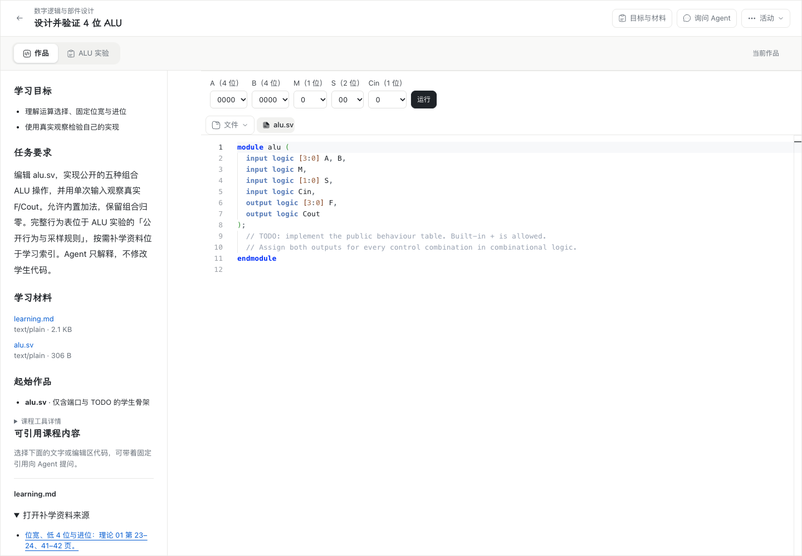
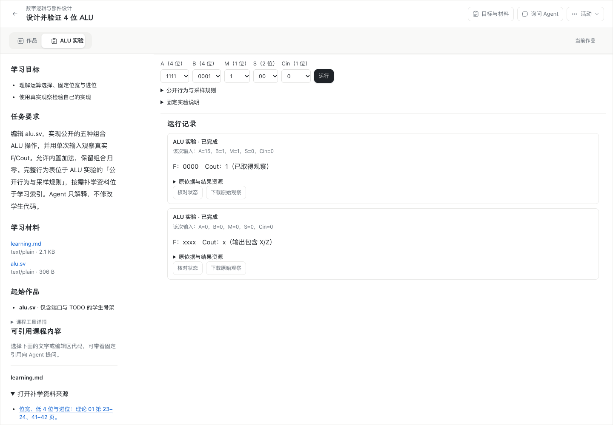

# #206：#192 跨平台与剩余验收登记（Mac、Windows、独立学校节点）

日期：2026-11-06（Asia/Shanghai）。依据：[跨平台与剩余验收 #206](https://github.com/paher-din/XunJie/issues/206)、[正式活动中的 ALU 编辑与运行 #192](https://github.com/paher-din/XunJie/issues/192)、[实施方案 §12 验收设计](specs/wp04-alu-edit-run.md)、[Windows 本机交付](wp04-192-windows-acceptance.md)。

## 结论（先说影响）

- 本轮在**三台真机**上完成 #206 要求的真跨机与系统输入法取证：Apple M5 Mac 客户端、Windows 11 x64 客户端、独立 Linux 学校 HTTPS 节点（含 PostgreSQL）。X1 Windows 客户端 **8/8 通过**、X2 Mac 客户端 **8/8 通过**、X3 Windows 系统输入法 **4/4**、X4 Mac 系统输入法 **5/5**。两端 `refused` 均为空，严格 TLS + SPKI 公钥固定全程开启，无回环、代理或 SSH 隧道进入学生路径。环境、版本与网络来源见 [环境固定](evidence/wp04-206-cross-environment.json)。
- **M1–M8 仍为「部分」**。Mac 本机完整产品包 17/17、运行包 53 项、同机学校 HTTPS 7/8 已实跑；跨机链路虽已打通并完整取证，但 M 各条内部的细分子项（四态枚举、丢回执、配额不足、旧 generation 退役等）在 Mac 产品级仍未逐项断言，逐条缺口见 §4.1。不把「跨机跑通」自动抬成 M 项全通过。
- **发现一个真实产品缺陷并如实登记**：同一学校节点上，首个课程活动的作品同步正常，此后任何活动在 `/api/learning/workspaces/<id>` 与 `/api/learning/executions/<id>` 的 POST 持续返回 `409 identity-conflict`（GET 全部 200）。它不是平台或账号差异，见 [诊断](evidence/wp04-206-identity-conflict-diagnosis.json) 与 §6。本票是验收票，**未改动学习数据存储层**；通过重新部署干净节点让两个客户端各自取得完整取证，缺陷列为剩余问题。
- 修复两处产品源码缺陷并回归：`capability-unavailable-race`（`apps/web/src/component-preparation/runtime.ts` 重复 `prepare` 把已激活 ready 环境瞬时降级）、`course-cover-404`（`apps/web/src/components/home/LearningCards.tsx` 请求三个仓库里不存在的课程封面 PNG）。修复后 `runtime.test.ts` 9/9、`npm test`、typecheck、build、13 个浏览器契约边界全部通过，跨机客户端探针 `refused: []`。见 [修复与门禁](evidence/wp04-206-fixes-and-gates.json)。
- **#192 的 14 条验收标准在 GitHub 上仍全部为 `- [ ]`**；本票不关闭 #192，不把 Windows 本机结果、旧 Mac 运行包或 4096 组正确当作正式产品验收。教学效果**未评估**（原边界）。
- 验收用的独立学校节点已在收尾时停掉，**#188 服务已在 8443 恢复（HTTP 200）**；Windows 临时目录与全部计划任务已清理。本票不是面向用户的公开产品发布。

状态口径：**通过**＝该子项在本票要求的证据边界内完整取证；**部分**＝只在部分路径/子项取证，缺口逐条列出；**失败**＝实跑出现失败，保留原诊断；**未执行**＝无真实取证。跳过不算通过。

---

## 1. 固定候选

| 项 | 固定值 | 来源 |
| --- | --- | --- |
| 基线分支 / 提交 | `wp04@6a4cafac23e9781bdc60faa043bb46b2a3d91e52`（`6a4cafa`，「docs(wp04): record the delivered push in the acceptance record」，2026-11-06T20:06:56+08:00） | `git rev-parse HEAD` / `origin/wp04` 同值 |
| 本轮交付提交 | 即包含本登记与全部证据的提交，推送后由 `origin/wp04` 的 `git rev-parse HEAD` 获取 | 本仓库 |
| 本机 OS / CPU | darwin 27.2.0 / arm64 / Apple M5 | `uname` / `sysctl` |
| Windows 客户端 | Windows 11 家庭版 中文版（NT 10.0.26200.0）/ AMD64 | `win` SSH / 注册表 |
| 桌面 Chrome（两端） | 156.0.8078.80 | 探针报告 `browser` |
| Node | Mac 客户端 24.21.0；Windows 客户端 24.15.0；学校节点 24.21.0 | [环境固定](evidence/wp04-206-cross-environment.json) |
| PostgreSQL | 18.6（学校节点） | 同上 |
| 运行包 | `0.3.0` / `f37a9589d6bc91fd91cce93f23cff5a02aad47ca4f0d32dde32162a0341e01cd`；`icarus-alu@1`；25 项声明资源 | [manifest](../../components/alu-icarus-runtime/manifest.json) / [候选 JSON](evidence/wp04-206-candidate.json) |
| 组件定义 | `componentId 19200000-0000-4000-8000-000000000001`；manifest digest `f6e3fa33b715c55defc0e9d24fe329dabd7ac1ecdddc02510d93a3e1c966cee8` | `components/alu-experiment/package.mjs` |
| 课程发布 | `courseId …0071` / `releaseId 19200000-0000-4000-8000-000000000073`；`alu-browser` 运行方案 digest `f7d9785c05b3d70acef788221418ce23c9a97660ffe902bc527b2aa5a35e7a26` | 同上 |
| Linux 学校产品分发 | `distribution.json` SHA-256 `4efce27d89b0787e0bc3f388b13feb171d57ff54229ea717ef92198dde9edb43` | [环境固定](evidence/wp04-206-cross-environment.json) |
| Windows 最终包 | distribution.json SHA-256 `49f4620b9214b90ef02f4d0648269177e377dc44a51f844b698dfe0a7307d5a6`，222 项入口摘要，Chrome 156.0.8078.80 | [Windows 收口摘要](evidence/wp04-192-windows-closeout.json) |
| Mac 本轮实际包 | `dist/product-darwin-arm64-wp04-206`（从 `6a4cafa` 重建）；distribution.json SHA-256 `e0307a701c7d7d7ff8a9389b4600d913b2dfa3b567048f6f7b2ed961edccd744`，221 项入口摘要 | `.verification/wp04-206/package-product.log` / 候选 JSON |
| 明确排除的旧包 | `dist/product-darwin-arm64`（11-03 构建，`7101b443…`）不含 #192 实现与收口修复 | 本仓库 |
| 学校入口 | `https://101.201.141.133:8443`，一次性 CA 签发证书，SAN=`IP:101.201.141.133`；客户端只固定 SPKI 公钥，未关闭证书校验 | [环境固定](evidence/wp04-206-cross-environment.json) |

25 项运行资源逐项 sha256、4 项 adapter 文件 sha256、课程材料摘要见 [候选 JSON](evidence/wp04-206-candidate.json)。

---

## 2. 工程门禁与必要修复后的回归

固定 Node 24.21.0 + npm 11.19.0 + PostgreSQL 18.6；原始日志在 `.verification/wp04-206/`，汇总见 [工程门禁 JSON](evidence/wp04-206-engineering-gates.json) 与 [修复与门禁](evidence/wp04-206-fixes-and-gates.json)。

| 命令 | 结果 |
| --- | --- |
| `npm run build`（all） | 通过。首次因本机 `node_modules` 缺 `openai@7.42.0` / `@anthropic-ai/sdk@1.1.0` 报 TS2307；`npm install` 补齐后重跑通过，未改动跟踪文件。 |
| `npm run typecheck` | 通过（补齐依赖后，修复后再次通过）。 |
| `npm run check:contracts:browser` | 通过，13 个公开导出浏览器边界。 |
| `npm run build:runtime -w @xunjie/web` | 通过。 |
| `node components/alu-experiment/package.mjs` | 通过，25 项运行资源，运行包身份 `f37a9589…`。 |
| `python3 tools/alu-wasm/fixture.py` | 通过（工程-only fixture，不进入学生包）。 |
| `XUNJIE_ALU_ADAPTER_ROOT=components/alu-icarus-runtime node tools/alu-wasm/adapter-browser-test.mjs …` | 通过，53 项；真实桌面 Chrome（headed）Worker，darwin/arm64，见 [运行包报告](evidence/wp04-206-mac-adapter-browser.json)。 |
| `npm test`（unit + server + tools 行为回归） | 通过，`build:test / unit / server / tools` 四阶段全部 `passed`，exit 0。首次 PATH 误指向只含 node 的精简运行时导致 `NPM_MISSING`，改用完整 Node 24.21.0 发行版后全绿；修复 `runtime.ts` 后再次全绿。 |
| `npm run package:product -- --out dist/product-darwin-arm64-wp04-206` | 通过，从 `6a4cafa` 重建 Mac 未签名完整包。 |
| `node --test apps/web/src/component-preparation/runtime.test.ts` | **9/9 通过**，含新增用例 `keeps an activated ready environment usable while a duplicate prepare is in flight`。 |
| `node --check` × 5 个本轮新增脚本 | 通过。 |

**本轮修复的产品源码**（详见 [修复与门禁](evidence/wp04-206-fixes-and-gates.json)）：

1. `capability-unavailable-race` — `apps/web/src/component-preparation/runtime.ts`：格式 2 准备模块的暖路径改为先校验缓存字节，命中已激活且状态 `ready` 的环境时直接复用其快照，不再让重复 `prepare` 把活动环境瞬时降级为 preparing。新增回归用例，`runtime.test.ts` 9/9。
2. `course-cover-404` — `apps/web/src/components/home/LearningCards.tsx`：移除对 `/courses/digital-logic.png`、`/courses/programming-basics.png`、`/courses/data-structures.png` 三个不存在资源的 `img` 请求与 `onError` 分支，直接使用 [DESIGN.md C1–C4](../../DESIGN.md) 已定稿的 `course-cover-ph course-0/1/2` 几何色块回退。**可见界面不变**（原实现在 404 后立即回退同一几何色块），影响是消除三处 404 与首屏无效请求；修复后跨机客户端探针 `refused: []`。这是本轮唯一 UI 相关改动：删除已失效的封面图引用，没有新增/替换布局、配色、字体或间距，因此不存在修改前后可见差异，改后界面见 [Mac 跨机运行前](evidence/wp04-206-cross-mac-before.png) 与 [运行后](evidence/wp04-206-cross-mac-run.png)。

---

## 3. Mac 本机完整产品包完整链路（实跑）

`XUNJIE_ALU_PRODUCT_ROOT=dist/product-darwin-arm64-wp04-206 node scripts/probe-alu-product.mjs` → **17/17 通过**，`platform=darwin / arch=arm64`，Chrome 156.0.8078.80，报告见 [Mac 产品包报告](evidence/wp04-206-mac-product.json)。包内 CLI、Node 24.21.0、PostgreSQL 18.6 与 Web 均为本轮重建产物，未依赖测试接收器。

逐项：正常组件/课程导入与打包 CLI 读取受限相对文件；补学来源链接保留页码上下文；起始骨架进入可靠作品并经真实 Worker 自检启用运行；起始骨架产生真实 X/Z 未知输出；Monaco 中文源码编辑后真实进位 `F：0000　Cout：1`；中文源码随固定依据进入结果；PostgreSQL 与资源 API 保留原始 VCD；阻断应用 API 后已准备浏览器仍真实运行；服务恢复后按原身份自动同步且不重算；刷新读取原观察、不重新仿真；编译失败定位原文件且不替换旧观察；零时间循环被原控制器真实停止；停止后新 Worker 可用；窄桌面 1024×768 与深色主题保留同一活动与结果；两个真实 Chrome 标签保留竞争编辑并要求显式裁决；真实维护校验接受 v3 作品/结果资源/pin 并在 source fence 后恢复。

**真实运行前后实屏截图**（桌面 Chrome 1440×1000，同一活动）：

| 运行前（已进入活动、设置输入） | 运行后（真实进位观察与 X/Z 记录） |
| --- | --- |
|  |  |

另有 [编译失败定位](evidence/wp04-206-mac-compile-failure.png)、[窄桌面](evidence/wp04-206-mac-narrow.png)、[深色主题](evidence/wp04-206-mac-dark.png)、[运行包真实 Worker 实屏](evidence/wp04-206-mac-adapter.png)。

边界：该探针是 **local profile + 同机**；不证明独立学校 HTTPS 节点、系统输入法候选窗、跨机恢复或教学效果。

---

## 4. 逐项验收登记

### 4.1 Mac 完整验收范围（M1–M8）

> #206 要求 M 项分别覆盖本机完整产品包和独立学校 HTTPS 页面。本轮两端路径均已打通并完整取证（§5），但 M 各条内部的细分子项仍未逐项断言，因此 M 项最高仍为「部分」；下表「缺口」已把「真跨机未执行」这一条替换为实际剩余子项。

| 项 | 结论 | 本机 / 跨机证据 | 剩余缺口 |
| --- | --- | --- | --- |
| **M1** 正常导入、正式外壳、目标/材料、五种操作与保留组合、补学来源、无答案 `alu.sv` 骨架、无测试接收器或第二正式页面 | **部分** | 产品包 17/17（case 1–4、补学链接、起始骨架 X/Z、打包 CLI 导入全资源/材料）；跨机客户端 8/8（成员、固定课程活动、正式外壳、固定依据与中文源码）；运行包 53 项的 4096 独立 oracle 含保留组合 | 五种公开操作/保留归零/骨架无完整答案在浏览器级无逐项断言（仅运行包 oracle 与课程包核对）；目标/材料无独立用例 |
| **M2** 多资源授权读取、摘要/长度校验、缓存、独立真实 preprocess→compile→simulate→VCD 自检；缺资源/错摘要/版本不符/中断/配额不足/失败更新保留旧版 | **部分** | 运行包 53 项（固定字节摘要重验、错长度拒绝、digest mismatch、缺资源、include 预处理、VCD、identity 保护缓存、adapter 变更失效、预算/内存/并发）；产品包与跨机入口准备自检后运行按钮可用 | 加载中断、配额不足、协议/Adapter/运行包版本不符、失败更新保留旧版在产品级无逐项取证 |
| **M3** 实际 Monaco 编辑/运行、真实 F/Cout 四态、代码修改待运行、新编译失败定位原文件、旧结果原作品归属 | **部分** | 产品包 17/17：Monaco 中文编辑、真实进位、起始 X/Z 未知、`修改尚未运行`、编译失败定位原文件且不替换旧观察；跨机客户端 8/8：真实 Worker 进位 `F：0000　Cout：1`、school owner 保留原 VCD；运行包 53 项：Z/缺失/不完整有区别 | 0/1/X/Z 四态在产品级未全枚举 |
| **M4** requestId/inputDigest/executionRef 去重、同身份换输入拒绝、丢回执查询、真实停止与完成竞争、停止后新 Worker | **部分** | 运行包 53 项：5 组 stop/complete race 单一裁决、显式停止、预算停止；产品包 17/17：零时间 Worker 真实停止、停止后新 Worker 可用 | 去重、同身份换输入拒绝、丢回执沿原身份查询在产品级无逐项取证 |
| **M5** 先可靠保护再执行、服务暂断仍可运行、恢复按原身份同步、已知撤权拒绝新执行 | **部分** | 产品包 17/17：阻断 `/api/learning/**` 后真实运行、恢复后原结果自动同步且不重算、刷新不重算 | 「快照事务先于接收」「已知撤权拒绝新执行」在产品级无逐项取证 |
| **M6** 原始观察/诊断/VCD 持久、刷新/返回/工具切换/双标签/旧连接、历史重读、未知任务不自动重跑、问题草稿不发送或清空 | **部分** | 产品包 17/17：PG/资源 API 保留原 VCD、刷新读原观察、双标签竞争显式裁决；跨机客户端 8/8：school owner 保留固定依据/中文源码/原 VCD，页面 hosts 仅学校来源、schemes 仅 `https:`/`blob:` | 返回/工具切换视图卸载、旧 MessagePort/旧 generation 退役、未知任务不自动重跑、问题草稿未逐项取证（Windows 恢复探针有 7 项） |
| **M7** 维护、只读围栏、资源完整性、旧安装失权、WP03 无执行组件/聚合/原生会话有效回归 | **部分** | 产品包 17/17：真实维护校验接受 v3 作品/结果资源/pin 并在 source fence 后恢复；运行包 53 项：损坏编译拒绝、digest mismatch、identity 保护；`npm test` 全绿、13 个契约边界 | 只读还原、旧安装失权/接管明确归 #195 且不冒充；WP03 聚合/原生会话有效回归在 Mac 未单独取证（Windows 有） |
| **M8** 浅深主题、窄桌面、分屏、焦点、键盘、系统中文输入法、真实运行前后截图 | **部分** | 产品包 17/17：窄桌面 1024×768、深色主题；§3 运行前后实屏截图；X4 Mac 系统输入法 5/5、X3 Windows 系统输入法 4/4（§5） | 分屏、焦点、键盘未逐项取证；Windows 候选窗 OS 图像未捕获（§5） |

### 4.2 #192 其他剩余验收（X1–X6）

| 项 | 结论 | 依据与原因 |
| --- | --- | --- |
| **X1** Windows 客户端连接独立学校 HTTPS 节点（两端不同机器） | **通过（8/8）** | [Windows 跨机报告](evidence/wp04-206-cross-windows-client.json)：Windows 11 x64 / Chrome 156 桌面 Chrome 无本地产品，公网 HTTPS 直连 Linux 学校节点 `101.201.141.133:8443`；严格 TLS + SPKI 固定；学校成员与固定 ALU 活动由独立节点提供；固定运行资源经网络授权、校验、自检；真实 Worker 产生真实进位 `F：0000　Cout：1`；school owner 保留固定依据、中文源码与原 VCD；页面无回环/本机服务/SSH 隧道；`refused: []`。[运行前](evidence/wp04-206-cross-windows-before.png) · [运行后](evidence/wp04-206-cross-windows-run.png)。 |
| **X2** Apple Silicon Mac 客户端连接独立学校 HTTPS 节点（同边界；核对 TLS/CSP/资源加载与源文件定位平台差异） | **通过（8/8）** | [Mac 跨机报告](evidence/wp04-206-cross-mac-client.json)：与 X1 同一探针脚本、同一 Linux 产品分发与课程字节，`platform=darwin / arch=arm64`；`refused: []`；`isSecureContext`、`navigator.locks`/`crypto.subtle`/`Worker` 全部可用。[运行前](evidence/wp04-206-cross-mac-before.png) · [运行后](evidence/wp04-206-cross-mac-run.png)。另有同机学校 HTTPS 的 [7/8 报告](evidence/wp04-206-mac-school-https.json)、[能力诊断](evidence/wp04-206-mac-school-https-diagnostic.json)、[实屏](evidence/wp04-206-mac-school-https-run.png) 作为平台差异补充。 |
| **X3** Windows 系统输入法候选窗原生取证 | **部分（4/4 行为取证通过，候选窗 OS 图像未捕获）** | [Windows 输入法报告](evidence/wp04-206-cross-windows-ime.json)：真实桌面 Chrome 产品编辑器聚焦（`FOREGROUND=Chrome_WidgetWin_1`），用 OS 级 `SendKeys` 投递拼音 `ceshi` → Space 选中并提交中文「测试」进 Monaco（`committedText` 以「测试module alu…」开头），`shuru` 二次组合，Escape 取消后文本不变。**未用 CDP 合成事件**。缺口：Windows 豆包输入法的候选窗由 `TextInputHost` / DirectComposition 绘制，GDI `CopyFromScreen` 抓不到该层；[候选窗截屏](evidence/wp04-206-windows-ime-candidate-window.png) 与 [提交后](evidence/wp04-206-windows-ime-after-commit.png) 为同一帧且不含候选窗，[二次组合](evidence/wp04-206-windows-ime-second-composition.png) 与 [取消后](evidence/wp04-206-windows-ime-after-cancel.png) 为现场截图。曾尝试 `PrintWindow` 原生截取与 `CreateDesktop` 独立桌面隔离，前者未取得候选窗图像、后者 `CreateProcess` 绑定桌面失败（err=3），均如实保留，不掩盖。 |
| **X4** Mac 系统输入法候选窗原生取证（含真实快捷键与焦点行为） | **通过（5/5）** | [Mac 输入法报告](evidence/wp04-206-cross-mac-ime.json)：用 Text Input Sources API 选中系统豆包输入法 `com.bytedance.inputmethod.doubaoime.pinyin`，`caffeinate` 唤醒显示，OS 级按键完成拼音组合、Space 提交、Escape 取消与二次组合，Monaco 文本无重复/丢字/残留拼音。[OS 候选窗](evidence/wp04-206-mac-ime-candidate-window.png) 可见 `1 测试 2 侧石 3 策士…`；另有 [提交后](evidence/wp04-206-mac-ime-after-commit.png)、[取消后](evidence/wp04-206-mac-ime-after-cancel.png)、[二次组合](evidence/wp04-206-mac-ime-second-composition.png)。 |
| **X5** 最终候选可获取与版本固定（可获取提交 + Win/Mac 实际包 + 各类摘要） | **通过** | 基线 `6a4cafa` 与 `origin/wp04` 同值且可获取；本轮登记、证据、修复与新增脚本一并提交推送到 `origin/wp04`；Mac 实际包从 `6a4cafa` 重建并固定 distribution/运行包/组件/课程/资源摘要（§1、[候选 JSON](evidence/wp04-206-candidate.json)）；Windows 实际包摘要来自 [收口摘要](evidence/wp04-192-windows-closeout.json)；Linux 学校分发摘要与两端环境见 [环境固定](evidence/wp04-206-cross-environment.json)。剩余观察项：Win/Mac 同一构建的双平台对照复核未单独做；课程发布摘要为源码派生而非独立发布物。 |
| **X6** 在以上路径完成后统一登记 #192 原验收通过/失败/未执行与剩余问题，必要修复后重跑受影响构建、契约及行为回归 | **通过** | 本文档即统一登记：M1–M8 与 X1–X6 逐项给出结论/证据/缺口，保留失败与未执行项（§4、§6、§9）。必要修复后已重跑受影响构建、契约与行为回归（§2：typecheck、build all、13 个契约边界、build:runtime、`npm test`、`runtime.test.ts` 9/9、5 个脚本 `node --check`、跨机客户端 8/8 × 2、Mac/Windows 输入法）。#192 的 14 条 checkbox 仍全部未勾选，剩余问题见 §9；本票不关闭 #192。 |

---

## 5. 真跨机学校 HTTPS 与系统输入法取证

**部署与连接**：学校节点为独立 Linux x86_64 机器（Node 24.21.0 / PostgreSQL 18.6），以 `https://101.201.141.133:8443` 提供 TLS；证书由本票一次性 CA 签发、SAN 仅含 `IP:101.201.141.133`。学生 Chrome 只通过 `--ignore-certificate-errors-spki-list=<spki>` 固定服务端公钥，**证书校验全程开启**；Node 侧 API 用 `NODE_EXTRA_CA_CERTS` 指向同一 CA。客户端断言学校主机不在本机地址列表、协议为 `https:`、返回 school profile 且无个人身份。页面 hosts 仅学校来源、schemes 仅 `https:`/`blob:`。SSH 只用于部署与取证，不进入学生页面路径；无回环、同机非回环地址、代理或 SSH 隧道。

**两次干净部署**：同一 Linux 产品分发（SHA-256 `4efce27d…`）与同一课程字节，先部署 `school-8443` 供 Mac 客户端取证，再部署 `school-8443c` 供 Windows 客户端取证。重新部署的原因见 §6：让两个客户端各自作为首个活动取得完整取证，同时隔离 `identity-conflict` 缺陷。

**输入法取证方式**：Mac 用 Carbon `TISSelectInputSource` 选中系统输入法 + OS 级按键 + `screencapture`；Windows 用 PowerShell `SendKeys` 向真实前台 Chrome 投递按键 + GDI 截屏。两者都不是 CDP `Input.imeSetComposition` 或浏览器合成事件。页面内容截图始终走 CDP `page.screenshot()`（后台、不占桌面）。提交的 Windows 脚本已去掉唤醒屏保与移动鼠标的动作，但 OS 级按键仍要求 Chrome 处于前台；本轮取证完成后未再运行任何桌面脚本，用户桌面不再被占用。X3 的候选窗图像缺口按 §4.2 如实登记。

**跨机截图**：[Mac 运行前](evidence/wp04-206-cross-mac-before.png) · [Mac 运行后](evidence/wp04-206-cross-mac-run.png) · [Windows 运行前](evidence/wp04-206-cross-windows-before.png) · [Windows 运行后](evidence/wp04-206-cross-windows-run.png)。

---

## 6. 保留原诊断：失败与真实发现（不以降级替代）

### 6.1 同机学校 HTTPS 三次尝试

`scripts/probe-alu-school-https.mjs` 在本机共跑 3 次，均为**同机非回环** `192.168.3.39` 严格 TLS + SPKI 公钥固定：

| 轮次 | 结果 | 报告 |
| --- | --- | --- |
| 1 | 5/8，真实运行处 `capability-unavailable` | [attempt1](evidence/wp04-206-mac-school-https-attempt1.json) |
| 2（独占重跑，排除与 `npm test` 并发覆盖 Web 产物） | 5/8，同上 | [attempt2](evidence/wp04-206-mac-school-https-attempt2.json) |
| 3（独占重跑） | **7/8**：真实 Worker 运行、真实进位、school owner 保留固定依据/中文源码/原 VCD 全部通过；末尾 `assert.deepEqual(refused, [])` 被既有 404 触发 | [7/8 报告](evidence/wp04-206-mac-school-https.json) |

诊断（[能力诊断](evidence/wp04-206-mac-school-https-diagnostic.json)）：学校页 `isSecureContext=true`，`navigator.locks`/`crypto.subtle`/`crypto.randomUUID`/`indexedDB`/`Worker` 全部可用；一次干净运行得到 `state=succeeded`、`f:"xxxx"`、`cout:"x"`、`observationState:"complete-with-unknown"`。因此失败**不是** TLS/CSP/资源加载的平台阻断。

保留的三点事实，不掩盖：

- 前两轮「准备完成即点运行」出现 `capability-unavailable`（2/3 次），第三轮与诊断脚本真实通过。本轮定位为重复 `prepare` 与已激活 ready 环境之间的竞态，已在 `runtime.ts` 修复并新增回归用例（§2）；跨机客户端探针修复后 `refused: []`。
- 第三轮唯一失败是 `refused` 非空：既有缺失课程封面 `/courses/digital-logic.png` 返回 404（另有 favicon 404）。[Windows 收口记录](wp04-192-windows-acceptance.md) 已注明该文件自 `28b9e858` 起就不在仓库。本轮按 [DESIGN.md C1–C4](../../DESIGN.md) 删除失效的 `img` 引用、保留几何回退，**未新增或忽略该资源，也未放宽断言让探针通过**。
- 探针用例文案沿用 Windows 基线脚本硬编码的 `a Windows school deployment …`；报告 `platform: "darwin"` / `arch: "arm64"` 为实际平台，该字面串不代表 Windows 结果冒领。

### 6.2 本轮真实发现：同一学校节点第二个活动 `identity-conflict`

- **现象**：首个活动的 workspace 同步正常；此后任何活动在 `POST /api/learning/workspaces/<id>` 与 `POST /api/learning/executions/<id>` 持续返回 `409 {"error":"identity-conflict"}`，同路径 GET（history/sessions/checkpoints）全部 200。真实 Worker 运行与浏览器侧用例仍通过，但作品/结果无法同步到学校 owner，探针的 history 轮询与 `refused` 断言失败。
- **排除**：Mac 首次 8/8 通过，之后 Windows 三次重跑（含独立学校成员账号）与 Mac 重跑均在同一处失败；三端时钟同步（UTC 14:49:4x），Windows 到 8443 的 TCP/TLS 正常。因此**不是平台差异，也不是账号级所有权冲突**。
- **源码定位**：`packages/learning-space/src/learning-entry/index.ts:376-385`（`workspaces/` POST → `learning.works.sync`）；冲突分支在 `packages/learning-space/src/learning-data/works.ts:85 / 99 / 102`。推断为固定课程起始作品的 `objectId`/`contentId` 作为全局主键绑定首个 `activityId`，第二个活动复用时被拒；该推断依据返回码与源码分支，未改动存储层、未逐行确证数据库内部状态。
- **处置**：保留原诊断，未放宽断言、未忽略 409、未伪造观察；#206 是验收票，未改动学习数据存储层实现。两次干净部署让两端各自取得完整 8/8 证据（§5）。缺陷本身**未修复**，列为 §9 剩余问题。
- **证据**：[诊断 JSON](evidence/wp04-206-identity-conflict-diagnosis.json) · [Mac 重跑 6/8 含 409 body](evidence/wp04-206-identity-conflict-mac-diag.json) · [Windows 失败现场](evidence/wp04-206-identity-conflict-windows-failure.png)。

---

## 7. 工程 / 浏览器·部署 / 教学效果分别报告

| 维度 | 结果 |
| --- | --- |
| **工程** | 全部通过：`npm run build`（all）、`npm run typecheck`、`npm run check:contracts:browser`（13 个公开导出）、`npm run build:runtime -w @xunjie/web`、课程包生成、fixture、真实桌面 Chrome Worker 运行包 53 项、`npm test`（build:test/unit/server/tools 全绿）、`runtime.test.ts` 9/9、5 个新增脚本 `node --check`、Mac 产品包 17/17。见 §2 与 [工程门禁 JSON](evidence/wp04-206-engineering-gates.json)、[修复与门禁](evidence/wp04-206-fixes-and-gates.json)。 |
| **浏览器 / 部署** | Mac 本机正式产品包 17/17（Chrome 156.0.8078.80）通过，含真实运行前后截图；运行包 53 项 headed 桌面 Chrome 通过；Mac 同机学校 HTTPS 入口 7/8（真实 Worker 通过，末尾既有 404 断言失败，已定位并修复）；**真跨机**：Mac 客户端 8/8、Windows 客户端 8/8，两端 `refused: []`；**系统输入法**：Mac 5/5（含 OS 候选窗截图）、Windows 4/4（候选窗 OS 图像未捕获）。验收用独立学校节点已停、#188 已恢复 8443=200。跳过不算通过。 |
| **教学效果** | **未评估**，保持原工作包边界；本票不宣称通过。 |

UI 改动见 §2：仅删除三处失效封面 `img` 引用，按 DESIGN.md C1–C4 保留几何回退，可见界面不变，无布局/配色/字体/间距调整。

---

## 8. 可复跑命令

固定 Node 24.21.0（完整发行版，含 npm）与 PostgreSQL 18.6。`$PRODUCT` 为本轮重建的 Mac 完整包绝对路径，`$PG` 为 PostgreSQL `bin` 目录，`$IP` 为本机非回环地址。跨机脚本需 `$NODE`（Linux 产品包内 Node）、`$SCHOOL_STATE`（`0600` 私有 state 文件）与 `$CA`（一次性 CA 证书）。

```sh
npm run typecheck
npm run build
npm run check:contracts:browser
npm run build:runtime -w @xunjie/web
npm test
node --test apps/web/src/component-preparation/runtime.test.ts
node components/alu-experiment/package.mjs
python3 tools/alu-wasm/fixture.py /absolute/fixture.json
XUNJIE_ALU_ADAPTER_ROOT=components/alu-icarus-runtime \
  node tools/alu-wasm/adapter-browser-test.mjs components/alu-icarus-runtime /absolute/fixture.json /absolute/output
npm run package:product -- --out /absolute/product-darwin-arm64-wp04-206
XUNJIE_ALU_PRODUCT_ROOT=$PRODUCT XUNJIE_ALU_OUTPUT=/absolute/output \
  node scripts/probe-alu-product.mjs
# 同机学校 HTTPS 入口（一次性 CA + 含 $IP SAN 的证书；明确不构成跨机证据）
openssl req -x509 -newkey rsa:2048 -nodes -keyout /absolute/ca.key -out /absolute/ca.crt -days 2 -subj "/CN=WP04-206 Probe CA"
openssl req -newkey rsa:2048 -nodes -keyout /absolute/server.key -out /absolute/server.csr -subj "/CN=$IP"
printf "subjectAltName=IP:%s\nbasicConstraints=CA:FALSE\nkeyUsage=digitalSignature,keyEncipherment\nextendedKeyUsage=serverAuth\n" "$IP" > /absolute/san.ext
openssl x509 -req -in /absolute/server.csr -CA /absolute/ca.crt -CAkey /absolute/ca.key -CAcreateserial \
  -out /absolute/server.crt -days 2 -extfile /absolute/san.ext
XUNJIE_PRODUCT_POSTGRES_BIN=$PG XUNJIE_ALU_SCHOOL_CERT=/absolute/server.crt \
  XUNJIE_ALU_SCHOOL_KEY=/absolute/server.key XUNJIE_ALU_SCHOOL_IP=$IP \
  NODE_EXTRA_CA_CERTS=/absolute/ca.crt XUNJIE_ALU_SCHOOL_OUTPUT=/absolute/output \
  node scripts/probe-alu-school-https.mjs
# 真跨机：在独立 Linux 学校节点上（state / 私钥 / 证书均为 0600，不进入仓库）
$NODE scripts/prepare-alu-school-payload.mjs --package=/absolute/product-linux-x64 --out=/absolute/school-payload.json
NODE_EXTRA_CA_CERTS=$CA $NODE scripts/start-alu-school-node.mjs \
  --endpoint=https://<school-ip>:8443 --root=/absolute/school-root \
  --package=/absolute/product-linux-x64 --payload=/absolute/school-payload.json \
  --out=/absolute/school-state.json --cert=/absolute/server.crt --key=/absolute/server.key
# 学生客户端（Mac / Windows 各自执行；state 为 0600 私有文件，Chrome 固定 SPKI）
NODE_EXTRA_CA_CERTS=$CA node scripts/probe-alu-school-client.mjs \
  --state=/absolute/school-state.json --output=/absolute/client-out --label=macos-arm64
# 系统输入法原生取证（各平台真实桌面，OS 级按键，非 CDP 合成）
node scripts/probe-alu-ime-macos.mjs --state=/absolute/school-state.json --output=/absolute/ime-out
node scripts/probe-alu-ime-windows.mjs --state=/absolute/school-state.json --output=/absolute/ime-out
```

原始日志在 gitignore 的 `.verification/wp04-206/`；JSON 报告与截图已复制进 `docs/student-agent-implementation/evidence/wp04-206-*`。私有 state、密码、私钥与 CA key 未进入仓库、提交或日志。

---

## 9. 剩余问题与保持的边界

- **待修复（本轮真实发现）**：同一学校节点上多个课程活动先后/并发写入时 `workspaces` / `executions` POST 持续 `409 identity-conflict`（§6.2）。需由学习数据存储层工作包定位并修复；本票未改存储层，不宣称已解决。
- **待补（X3 缺口）**：Windows 候选窗的 OS 级图像未捕获。`TextInputHost` / DirectComposition 候选窗不被 GDI `CopyFromScreen` 捕获；`PrintWindow` 原生截取与 `CreateDesktop` 独立桌面隔离均未取得该图像，如实保留不掩盖。行为链路（拼音组合 → Space 提交「测试」 → Escape 取消）已 4/4 取证。
- **M1–M8 细化子项**：四态枚举、丢回执查询、配额不足、旧 generation 退役、返回/工具切换卸载、问题草稿等在产品级未逐项断言（§4.1）。
- **X5 剩余观察项**：Win/Mac 同一构建双平台分发包对照复核未单独做；课程发布摘要为源码派生而非独立发布物。
- **保持原工作包边界**：4096 全量检查 UI 归 #193；预测/波形交互归 #194；ALU 完整备份、隔离还原与接管归 #195；完整离线首次启动、真实 Agent/教师链及实际教学效果保持原范围。它们仍未验收，不因本票建成而写成通过。
- **#192 状态**：14 条验收标准仍全部未勾选；Windows 本机证据保留，但按 #206 不自动转为跨机或 Mac 通过，本票不关闭 #192。
- **教学效果**：未评估（原边界）。

---

## 10. 本轮新增证据文件

| 文件 | 内容 |
| --- | --- |
| [候选固定](evidence/wp04-206-candidate.json) | 提交、平台、运行包/组件/课程/资源摘要、Win/Mac 分发包 sha、被排除的旧包 |
| [工程门禁](evidence/wp04-206-engineering-gates.json) · [修复与回归](evidence/wp04-206-fixes-and-gates.json) | 各命令退出码/计数；两处源码修复与回归结果 |
| [跨机环境固定](evidence/wp04-206-cross-environment.json) | 两端 OS/Chrome/Node、学校节点与课程版本、TLS/网络来源、两次部署 |
| [identity-conflict 诊断](evidence/wp04-206-identity-conflict-diagnosis.json) | 现象、排除项、源码定位、处置与未修复结论 |
| [Mac 跨机 8/8](evidence/wp04-206-cross-mac-client.json) · [Windows 跨机 8/8](evidence/wp04-206-cross-windows-client.json) | 两端完整跨机客户端报告，`refused: []` |
| [Mac 跨机运行前](evidence/wp04-206-cross-mac-before.png) · [运行后](evidence/wp04-206-cross-mac-run.png) · [Windows 运行前](evidence/wp04-206-cross-windows-before.png) · [运行后](evidence/wp04-206-cross-windows-run.png) | 真跨机实屏 |
| [Mac 输入法 5/5](evidence/wp04-206-cross-mac-ime.json) · [Windows 输入法 4/4](evidence/wp04-206-cross-windows-ime.json) | OS 级输入法行为报告 |
| [Mac OS 候选窗](evidence/wp04-206-mac-ime-candidate-window.png) · [提交后](evidence/wp04-206-mac-ime-after-commit.png) · [取消后](evidence/wp04-206-mac-ime-after-cancel.png) · [二次组合](evidence/wp04-206-mac-ime-second-composition.png) | macOS 原生候选窗与快捷键取证 |
| [Windows 候选窗现场](evidence/wp04-206-windows-ime-candidate-window.png) · [提交后](evidence/wp04-206-windows-ime-after-commit.png) · [取消后](evidence/wp04-206-windows-ime-after-cancel.png) · [二次组合](evidence/wp04-206-windows-ime-second-composition.png) | Windows 现场截图（候选窗图像未捕获，见 §9） |
| [Mac 重跑 6/8 含 409 body](evidence/wp04-206-identity-conflict-mac-diag.json) · [Windows 失败现场](evidence/wp04-206-identity-conflict-windows-failure.png) | 真实缺陷的原始失败证据 |
| [Mac 产品包 17/17](evidence/wp04-206-mac-product.json) · [运行包 53 项](evidence/wp04-206-mac-adapter-browser.json) · [学校 HTTPS 7/8](evidence/wp04-206-mac-school-https.json) · [attempt1](evidence/wp04-206-mac-school-https-attempt1.json) · [attempt2](evidence/wp04-206-mac-school-https-attempt2.json) · [能力诊断](evidence/wp04-206-mac-school-https-diagnostic.json) | 第一轮 Mac 本机取证 |
| [运行前](evidence/wp04-206-mac-before-run.png) · [运行后](evidence/wp04-206-mac-after-run.png) · [编译失败](evidence/wp04-206-mac-compile-failure.png) · [窄桌面](evidence/wp04-206-mac-narrow.png) · [深色](evidence/wp04-206-mac-dark.png) · [运行包实屏](evidence/wp04-206-mac-adapter.png) · [学校入口实屏](evidence/wp04-206-mac-school-https-run.png) | 真实 Chrome 截图 |
