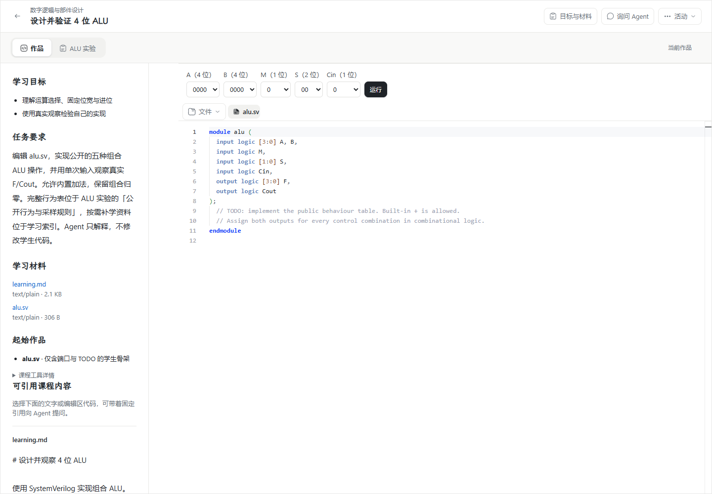
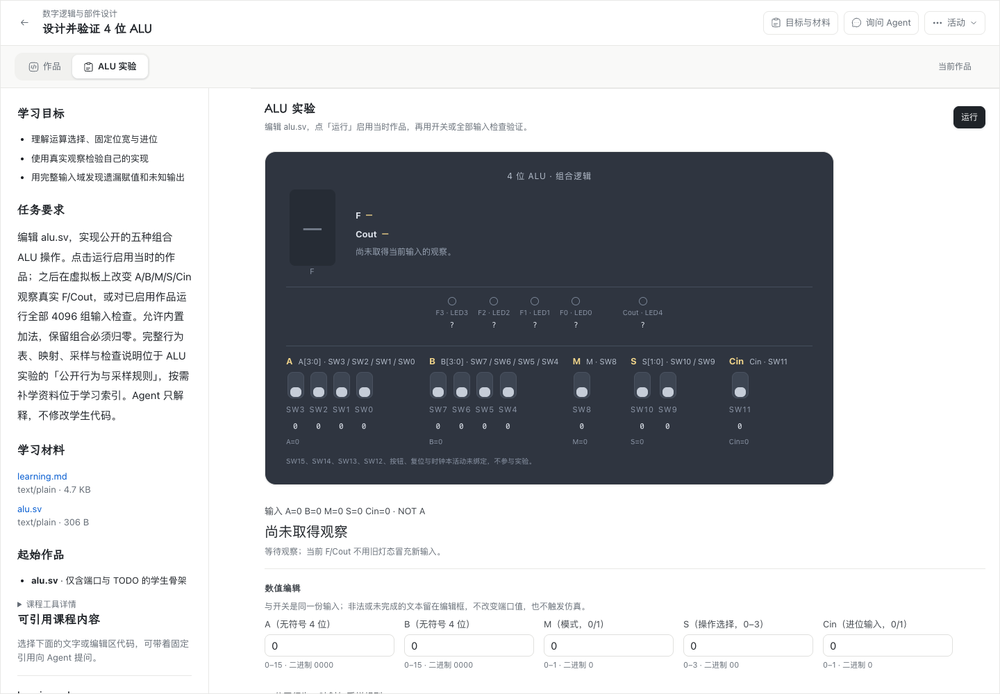

# WP04 #211：#193 剩余验收记录（Apple Silicon Mac、跨机 HTTPS、系统中文输入法）

日期：2026-11-07（Asia/Shanghai）。基线：`wp04@fe65fff` 加本轮工作树修复；产品候选由该工作树构建。需求：[#193 剩余验收（Apple Silicon Mac、跨机 HTTPS、系统中文输入法）](https://github.com/paher-din/XunJie/issues/211)、父票[虚拟板自由实验与 4096 组行为检查 #193](https://github.com/paher-din/XunJie/issues/193)。设计与交互依据：[实施方案](specs/wp04-alu-board-check.md) · [工作区设计](wp04-193-workspace-design.md) · [DESIGN.md](../../DESIGN.md)。

**结论：** 本轮完成 Apple Silicon Mac 完整本机产品包验收、Mac/Windows 两台真实客户端分别访问独立 Linux 学校节点的 HTTPS 验收、两平台本地产品与学校路径的 4096 组检查矩阵、Mac 与 Windows 真实操作系统中文输入法各 14/14（本轮补齐 Windows 并修复组合期间的工具切换，见第 8 条）、浅深主题/窄屏/分屏/200% 截图与性能资源测量；并发现并修复 #206 登记的同一学校节点第二活动 `identity-conflict`。逐条结果见 §2；**未执行或未通过的项目按实际状态保留，不用转交抵扣通过**。工程测试、真实仿真、Chrome/部署验收分别报告；教学效果（理解、迁移、掌握、教师接收）未评估。最终源码提交与推送见文末。

## 1. 候选、平台与来源固定

| 项目 | 实际值 |
| --- | --- |
| 源码 | `wp04` 工作树；运行入口为 Node 24.21.0；最终提交见 §7 |
| Mac 产品包 | `dist/product-darwin-arm64-wp04-211b`（本机可重建产物，不随 Git 分发；`darwin-arm64`，full，unsigned-candidate，`distribution.json` SHA-256 `66047e4392e3da7545065119fe992a56021fefb46da7a45b17055dc605c64c9c`） |
| Windows 产品包 | `dist/product-win32-x64-wp04-211`（本机可重建产物，不随 Git 分发；`win32-x64`，full，unsigned-candidate，`distribution.json` SHA-256 `b7db2a5c5636cbbd79172c29a097d10affe5e94c1e8f7c16fdc351d5551fb787`） |
| 学校 Linux 产品包 | `wp04-211-cross/product-linux-x64b`（`linux-x64`，full，unsigned-candidate，`distribution.json` SHA-256 `4e6f6133b30b582c92e7821f0d68cdbf5e136ad376a796fca9a1cf79db49a7d3`） |
| 三平台 Web 运行包 | `runtime-nmzfEewm.js` 三包一致，SHA-256 `b8fe1615db6622aa232b1a38498d459905c7aaab6adfd91ed6fa01d6ca438b01`，1,068,183 B |
| 课程/组件 | 课程 `19200000-0000-4000-8000-000000000071`，release `…0076`；组件 `…0001` v2；运行包 ALU adapter `icarus-alu` v1；状态 schema v2；旧 stateVersion1 兼容包单独导入 |
| 学校节点 | `https://101.201.141.133:8443`，Linux x64，Node 24.21.0，SPKI `REY2E/pMcJ2bIAFVOlij8HbrL1HD2XSt+m9s7CDGKU0=`，严格 TLSv1.3（非本机产品/数据库/执行组件，见 §2 第 2 条） |
| 设备 | Mac：macOS 27.2 / Apple M5 / 10 核 / 16 GiB；Chrome 156.0.8078.80。Windows：Windows 11 x64（10.0.26200.0）/ Chrome 156.0.8078.80（本机产品）与 156.0.8078.81（学校路径）。学校节点：Linux x64 / Node 24.21.0 |

Mac/Windows 产品包均由 `npm run package:product -- --platform <p> --out <dir>` 从当前工作树构建；不是开发代理、测试接收器或同机 school 代管。学校节点只运行产品包自身 Node/PostgreSQL 与静态 Web，客户端不依赖任何本机产品、数据库或执行组件。

## 2. 验收标准逐条登记

### 第 1 条 Apple Silicon Mac 本机完整产品包

**通过。** 在 `dist/product-darwin-arm64-wp04-211b` 上以真实桌面 Chrome 打开正式产品：正常组件/课程导入、固定映射、准备/自检、旧 stateVersion1 活动兼容、新 stateVersion2 运行启用、虚拟板自由输入、全量 4096 检查均实际执行。产品探针 22/22 通过，另有 7 项产品附加用例通过（legacy v1、草稿保留、本地离线检查、重连一次同步、资源/设备记录等）。报告：[Mac 产品 22 例](evidence/wp04-211-mac-product-report.json) · [产品附加 7 例](evidence/wp04-211-product-extras-report.json)。

### 第 2 条 Windows 11 x64 与 Apple Silicon Mac 访问独立学校机器真实 HTTPS 页面

**通过（Mac/Windows 各 13/13）。** 两台真实客户端分别访问独立 Linux 学校节点 `https://101.201.141.133:8443`；严格 TLS + SPKI 固定、学校 profile、真实 PostgreSQL/资源、学生浏览器 Worker、真实 WASM 全部覆盖；`pageHosts` 两平台均只有 `101.201.141.133:8443`，`clientLocalProduct=false`、`studentTrafficUsesSsh=false`，记录客户端本地地址，证明学生页面不是同机代理、回环或 SSH 隧道。学校页面不要求本机产品/数据库/执行组件。报告：[Mac 学校](evidence/wp04-211-mac-school-report.json) · [Windows 学校](evidence/wp04-211-win-school-report.json)。`refused` 保留实际 4xx：Mac 2 条（worker-stop `/stop` 404、second-activity executions 400）、Windows 5 条（correct-observation 3×400、check-fail 1×400、worker-stop 404），均在同路径/同 UI 后续得到 200 与正确结果，不冒称空 refused。

### 第 3 条 两平台两路径 4096/16384/1536 与全部负例

**通过。** Mac 本机、Windows 本机、Mac 学校路径、Windows 学校路径均覆盖 4096 唯一输入、16384 目标采样、1536 保留组合；正确实现全通过，固定丢进位得到 256 唯一错误输入/1024 错误行，X 域 1536 唯一输入/6144 行。工程 WASM 探针 162 项通过，覆盖真实 Z、保留组合错误、遗漏赋值前驱差异、采样时刻差异和不完整输出；完整工程答案不进入学生包（只用于工程验证的 fixture，不导入学生课程/运行包）。报告：[Mac 产品](evidence/wp04-211-mac-product-report.json) · [Windows 产品](evidence/wp04-211-win-product-report.json) · [Mac 学校](evidence/wp04-211-mac-school-report.json) · [Windows 学校](evidence/wp04-211-win-school-report.json) · [WASM 162 项](evidence/wp04-211-wasm-check.json)。

### 第 4 条 修改后重跑、旧依据保留、来源核验

**通过（实现测试 + 产品级复验）。** 产品探针覆盖“修改代码后显示未运行、不静默执行 head”“新失败运行不覆盖旧成功依据”“检查请求携带成功 run-single 的原 requestId/inputDigest/executionRef”；真实服务拒绝改写 HDL 的伪造检查（400 invalid）。`apps/server/tests/runtime-enabled-basis.runtime.test.mjs` 3/3 通过：完整 X 观察可用；缺失/失败/未知/不完整、跨主体/实例、不同代码/工具及错误源操作拒绝。证据：[#193 工程门禁](evidence/wp04-193-reviewed-engineering-gates.json) · [Mac 产品](evidence/wp04-211-mac-product-report.json) · [Windows 产品](evidence/wp04-211-win-product-report.json)。

### 第 5 条 A→B→A、异步保护、分屏、历史/晚包、hold 隐藏旧值

**通过（实现测试 + 产品级复验）。** 既有 935 项 Web 回归覆盖 A→B→A、异步保护期间新 revision/hold、历史手选与晚回包、分屏 compact/full 双视图不重复接受、等待时 LED/7 段/十六进制隐藏旧值、hold 不自动执行或揭示候选实际输出；产品探针在 Mac/Windows 均验证输入改变后结果不抢占、一次输入只接受一条观察、分屏读取一致。证据：[Web 全量](evidence/wp04-211-engineering-gates.json) · [Mac 产品](evidence/wp04-211-mac-product-report.json) · [Windows 产品](evidence/wp04-211-win-product-report.json)。

### 第 6 条 查询/停止覆盖排队、编译、轮间、仿真、结果保留；真实终止 Worker

**通过。** 产品探针在两平台对真实零时 Worker 执行停止并确认 `已取消`，随后正常作品和全量检查继续通过；查询/停止状态机、排队/编译/轮间/仿真/结果保留由既有 Web 回归覆盖；未知执行与旧检查不自动重跑。报告：见第 5 条同两组产品报告及 Web 全量。

### 第 7 条 服务暂断、回执/乱序/旧连接、刷新返回、双标签、同身份同字节幂等；第二活动与 #206 identity-conflict

**通过，并修复一个真实缺陷。**

- 服务暂断时本地自由观察可用（Mac/Windows 产品及两平台学校路径均通过），恢复后只同步一次，刷新不重跑旧检查。
- 刷新返回：刷新前捕获 12 个开关 `aria-pressed` 与读数，刷新后逐项相等并保留历史不重算（学校 Mac/Windows 最终探针）。
- 双标签：Mac 实测显式冲突并恢复原依据；Windows 实测两个真实标签保留原请求、以新基线安全串行（`bases [4,5]`，`resolution: serialized-from-fresh-bases`），不把该结果冒称强制 CAS 冲突。
- **同一学校节点第二活动 `identity-conflict`（#206 登记）：**根因是旧 Web bundle 的 `ActivityWorkspace` 把课程发布中的固定 `starter.workId` 直接用作学生作品 `objectId`；服务端 `work_objects` 以 objectId 为全局身份并绑定首个 activity，第二个 activity 复用同一固定 id 即返回 `409 identity-conflict`。修复为每个活动初始化 starter 时生成独立 `crypto.randomUUID()`（仅作品对象 id；课程发布模板本身不变），见 [ActivityWorkspace.tsx](../../apps/web/src/product/ActivityWorkspace.tsx)。修复前本地两活动测试可见 409；修复后本地两活动、学校节点两活动均为 200，学校 13 例包含第二活动运行/同步。证据：[identity 修复前后摘要](evidence/wp04-211-identity-conflict.json) · [学校 smoke](evidence/wp04-211-school-smoke-report.json) · [Mac 学校](evidence/wp04-211-mac-school-report.json) · [Windows 学校](evidence/wp04-211-win-school-report.json)。

### 第 8 条 Windows 与 Mac 真实操作系统中文输入法候选窗

**Mac 与 Windows 均通过，各 14/14。** Mac 原学校路径的 [13 项报告](evidence/wp04-211-mac-ime-report.json)与[候选窗截图](evidence/wp04-211-mac-ime-01-monaco-candidate-window.png)保留。本轮在含修复的完整 Mac 本机产品包上新增草稿取消、活跃组合时请求工具切换和全阶段动作监测，重新取得 [14 项报告](evidence/wp04-211-mac-ime-fixed-report.json)。系统「豆包输入法」与真实 OS 按键生成组合、选择、提交和取消，非合成 composition。

Windows 补验在负责人解锁并保持登录的 Windows 11 x64 Session 1 完成，使用下列含修复的新完整产品包、其自带 PostgreSQL、正式 Web 与真实浏览器 Worker。探针建立独立临时产品安装和测试身份，不借用旧活动；实际 Chrome 为 156.0.8078.81。`System.Windows.Forms.SendKeys` 向探针自己的前台 Chrome 发送真实按键，FFmpeg Desktop Duplication (`ddagrab`) 直接截取包含 OS 候选窗的桌面，既不是页面截图，也没有通过 CDP/合成 composition 生成中文。每次按键前核对同一交互 Session、未锁屏和精确 Chrome PID；实际候选窗所属进程含 `ImeService`、`TextInputHost`。

14 项覆盖：真实交互桌面和产品焦点；Monaco 拼音组合、方向键选择、Space 提交、Escape 取消且无丢字/重复/残留；问题草稿连续两次中文提交、再次组合后 Escape 取消、真实运行与 4096 全量检查后原稿保留且不发送；数值框 `-1` 无效草稿、中文组合取消、中文提交均不改变已提交输入/读数或触发仿真；Monaco↔ALU 工具切换（候选窗打开时先请求切换，取消组合后原请求自动执行，手动恢复焦点前核对正文与焦点）、数值框↔问题草稿切换的文本与焦点隔离。每项断言和原始来源见 [Windows IME 报告](evidence/wp04-211-win-ime-report.json)，实际候选窗见 [Monaco 组合](evidence/wp04-211-win-ime-01-monaco-candidate.png)、[选择候选](evidence/wp04-211-win-ime-02-monaco-candidate-selected.png)、[问题草稿](evidence/wp04-211-win-ime-06-draft-candidate.png)、[非法数值草稿](evidence/wp04-211-win-ime-10-numeric-candidate.png)。临时安装通过产品 owner 的 `deleteEnvironment` 清理；本轮临时交互任务和传输目录在取回证据后移除。

两端留存的原生前后全文还通过了[严格取消语义复核](evidence/wp04-211-ime-cancel-recheck.json)：本例明确使用 Escape，因此要求正文完全不变，不接受额外插入汉字。

本轮审查用例实际发现：原包在组合 `shuru` 尚未结束时点击 ALU 标签，代码会残留 `shu'ru`；[修复前失败报告](evidence/wp04-211-win-ime-before-navigation-fix.json)保留该事实。现有编辑器注册[组合导航保护](../../apps/web/src/components/workspace/compositionNavigation.ts)，只延后当前未完成组合中的标签点击，提交/取消后最多执行最后一个仍有效的请求；离开编辑器或新组合会清理失效请求。原文、撤销历史与保存仍归原编辑器。Windows 旧包最小原生复现失败，新完整包最小复现通过，再完成 Mac/Windows 本机完整产品各 14 项 IME 验收。原生结果与 4 项 DOM 回归分别取证，DOM 事件测试不冒充 OS 输入法证据。

| 本轮 IME 修复候选 | distribution SHA-256 |
| --- | --- |
| `dist/product-win32-x64-wp04-211c` | `66fd90c0c50a9eac3578c05eae63cea1d7ab5e77a73510b46d3de28ce835c621` |
| `dist/product-darwin-arm64-wp04-211c` | `3c2cc14cf66082f692a901efe0ff9d4968e41052c3821a3db172e153bd329788` |

两包均为 full unsigned-candidate，自带 Node 24.21.0/PostgreSQL 18.6，正式 Web 同为 `runtime-CrB92lhy.js`，SHA-256 `3567f78bc328b67faccc7ef1d215464dd89deeccd0e3fa55ee29965dd00a5edf`。本轮本机 IME 证据属于新候选；第 2 条跨机 HTTPS 等原有网络验收保留其原始候选和来源，不混称为新包整轮复跑。Mac 原输入源与后台应用可见性另行核对恢复到运行前状态，见[恢复核对](evidence/wp04-211-mac-ime-desktop-restore.json)；不存在的应用保持关闭。原始 Mac 日志保留了一次对未运行的 Qoder 进程恢复可见性的错误，未影响 14 项原生断言；探针已修正为只恢复仍存在的进程，并对该清理路径单独实测核对，没有冒称重跑整轮。

此前锁屏时的失败尝试仍按原事实保留在 §7；它们不计为本次通过证据。Windows 本项使用本机完整产品路径，既有两台客户端访问独立学校 HTTPS 的验收仍见第 2 条，不将本机路径当成跨机网络验收。

### 第 9 条 浅深主题、键盘焦点、1440/1024/900px、分屏窄栏、200% 缩放、问题草稿保留

**通过。** Mac/Windows 产品探针均实际截图并操作：1440px 浅色、深色主题、1024px 窄栏、900px、200% CSS 内容缩放（明确不是 OS 显示缩放）、分屏、双标签；Space 键盘切换 `aria-pressed` 同步；运行/检查前后问题草稿均保留且未发送。产品附加用例在 Mac 验证问题草稿运行+检查后仍为 `测试输入`。证据：[Mac 实际截图](evidence/wp04-211-mac-after-initial.png)、[深色](evidence/wp04-211-mac-after-dark.png)、[1024](evidence/wp04-211-mac-after-narrow.png)、[900](evidence/wp04-211-mac-after-900.png)、[200%](evidence/wp04-211-mac-after-200-content-zoom.png)、[分屏](evidence/wp04-211-mac-after-split.png)；Windows 同组见[产品报告](evidence/wp04-211-win-product-report.json)；草稿见[产品附加报告](evidence/wp04-211-product-extras-report.json)。

### 第 10 条 性能、资源与回归；不把单次结果写作 SLA

**通过（单次样本，不是 SLA）。** 两平台本机与学校路径的冷/热输入到结果、全量检查、停止、恢复耗时见 §4；Worker/WASM/保留资源量见 §5；设备负载/样本随报告记录。工程门禁见 §3：typecheck、build、Web 935/935、公共契约 13/13、WASM 162/162 全部通过；既有组件/公共契约回归随 Web 全量通过。

## 3. 工程与真实仿真门禁

| 检查 | 最终结果 |
| --- | --- |
| `npm run typecheck` | 通过 |
| `npm run build` | 通过（含普通 Web 与 dist-runtime） |
| Web 全量 Vitest，`--maxWorkers=4` | **83 文件、935/935 通过，0 失败/跳过**；默认 worker 数下既有 `LegacyAluExperimentTool` 单测曾出现时序 flake，按 #193 相同的 4 worker 配置复跑全绿，未改测试或忽略失败 |
| `npm run check:contracts:browser` | 通过，13 个公开出口 |
| `node tools/alu-wasm/check-browser-test.mjs` | **162 项通过**；正确/丢进位/X/Z/保留错误/遗漏前驱/采样时刻/不完整输出全部负例通过 |
| `apps/server/tests/runtime-enabled-basis.runtime.test.mjs` | 3/3 通过（#193 已审查门禁，本轮未改该模块） |
| `npm run package:product` × darwin-arm64 / win32-x64 | 均生成 full unsigned-candidate；见 §1 |

工程、真实仿真、Chrome/部署验收分开：以上工程项不等于教学效果，也不把单次性能当 SLA。

## 4. 性能测量（单次样本，注明设备负载）

| 路径/平台 | 冷准备 | 起始运行 | 正确代码运行 | 输入→观察 | 离线观察 | 全量通过 | 全量失败 | 刷新恢复 | 停止确认 |
| --- | ---: | ---: | ---: | ---: | ---: | ---: | ---: | ---: | ---: |
| Mac 本机（M5，load avg 约 5.9/4.9/4.2） | 产品包本地准备，见 extras | 262 ms | 363 ms | 342 ms | 346 ms | 963 ms | 912 ms | 689 ms | 266 ms |
| Windows 本机（Win11 x64，Chrome 156） | — | 420 ms | 456 ms | 409 ms | 426 ms | 916 ms | 909 ms | 696 ms | 154 ms |
| Mac→学校 Linux HTTPS | 42,665 ms | 864 ms | 1,004 ms | 829 ms | 312 ms | 1,401 ms | 1,401 ms | 13,221 ms | 222 ms |
| Windows→学校 Linux HTTPS | 67,466 ms | 397 ms | 969 ms | 871 ms | 341 ms | 1,467 ms | 1,900 ms | 14,878 ms | 210 ms |

说明：冷准备是真实网络下载/校验/自检/激活的端到端时间，包含学校 WAN 与浏览器准备；本机产品包的准备已缓存/本地化，表中不混列为同一口径。所有数值为单次或少量样本，不构成 SLA。200% 是 CSS 内容缩放（`document.documentElement.style.zoom=2`），不是 OS 显示缩放；未测 Worker/WASM 峰值内存，组件声明预算上限为 256 MiB，不能写作实测峰值。

## 5. Worker、WASM 与保留资源量

- 实际运行资源：`ivl.wasm` 1,771,889 B、`ivlpp.wasm` 102,963 B、`vvp.wasm` 927,158 B；真实 Worker 入口 `assets/worker-AqHx1oS1.js`（8,262 B），页面运行包 `runtime-nmzfEewm.js` 1,068,183 B + `runtime-CasJ-C1K.css` 196,167 B。
- Mac 本机检查保留：`check-report.json` 1,788 B + `check-observations.json` 291,150 B + `diagnostics.txt` 238 B + `check-traces.json` 1,646,482 B = **1,939,658 B**（Windows 本机报告为 1,784 + 291,146 + 238 + 1,646,482 = 1,939,650 B；差异来自运行样本的报告头，不冒称固定值）。
- Mac 产品附加运行记录到 13 个真实 `worker-AqHx1oS1.js` 实例/加载，`page` 主线程观察到的 WASM URL 通过产品资源代理为 `application/json`（WASM 实际在 Worker 内执行，见报告 `runtime.observedWorkers`/`wasmResponses`）；JS 堆采样约 79.5 MB（used）/130.7 MB（total），设备内存 16 GiB。未测峰值内存，见 §4 说明。
- 学校路径报告保留资源与本地一致量级，具体见各学校报告 `checkPass` 的 `primaryBytes`/`resourceBytes`。

## 6. 实际界面与证据索引

改动前后对照（实际运行界面，1440px；改动前为 #192 单次实验，改动后为本轮虚拟板+检查）：

| 改动前：#192 单次实验 | 改动后：#211 虚拟板与全量检查 |
| --- | --- |
|  |  |

更多实际截图：Mac IME [Monaco 候选窗](evidence/wp04-211-mac-ime-01-monaco-candidate-window.png) · [草稿候选窗](evidence/wp04-211-mac-ime-06-draft-candidate.png)；Mac [深色](evidence/wp04-211-mac-after-dark.png) · [1024px](evidence/wp04-211-mac-after-narrow.png) · [900px](evidence/wp04-211-mac-after-900.png) · [200%](evidence/wp04-211-mac-after-200-content-zoom.png) · [分屏](evidence/wp04-211-mac-after-split.png) · [双标签](evidence/wp04-211-mac-after-two-tabs.png) · [检查通过](evidence/wp04-211-mac-after-check-pass.png) · [检查失败](evidence/wp04-211-mac-after-check-fail.png) · [刷新恢复](evidence/wp04-211-mac-after-refresh.png)；Windows 产品报告含同组 14 张截图。IME 候选窗与草稿证据见第 8 条报告。

证据文件（全部为实际运行生成）：

| 文件 | 内容 |
| --- | --- |
| [wp04-211-mac-product-report.json](evidence/wp04-211-mac-product-report.json) | Mac 本机产品 22/22，含耗时、资源、twoTabs、截图列表 |
| [wp04-211-win-product-report.json](evidence/wp04-211-win-product-report.json) | Windows 本机产品 22/22，含耗时、资源、twoTabs、截图列表 |
| [wp04-211-product-extras-report.json](evidence/wp04-211-product-extras-report.json) | Mac 正式产品 legacy v1、草稿保留、离线检查、重连一次同步、资源/设备 |
| [wp04-211-mac-school-report.json](evidence/wp04-211-mac-school-report.json) | Mac→独立学校节点 13 例 |
| [wp04-211-win-school-report.json](evidence/wp04-211-win-school-report.json) | Windows→独立学校节点 13 例 |
| [wp04-211-mac-ime-report.json](evidence/wp04-211-mac-ime-report.json) | Mac 真实 OS 中文输入法候选窗、组合/选择/提交/取消/草稿/运行检查 |
| [wp04-211-win-ime-report.json](evidence/wp04-211-win-ime-report.json) | Windows 解锁后真实 OS 中文输入法 14/14，含候选窗、提交/取消、草稿、非法数值与工具切换 |
| [wp04-211-identity-conflict.json](evidence/wp04-211-identity-conflict.json) | #206 identity-conflict 根因、修复前后本地 409/200、学校 smoke |
| [wp04-211-engineering-gates.json](evidence/wp04-211-engineering-gates.json) | 本轮 typecheck/build/Web/contracts/WASM 门禁摘要 |
| [wp04-211-wasm-check.json](evidence/wp04-211-wasm-check.json) | 162 项真实 WASM 负例/指标 |

## 7. 失败尝试、未执行项与边界

- **保留的失败尝试：** 学校节点最初仍指向旧 `product-linux-x64` Web root，Mac/Windows 探针连续出现 `409 identity-conflict`；切换到新 `product-linux-x64b` 并修正旧 bundle 后复测通过，旧 bundle 路径保留在 `wp04-211-cross/product-linux-x64-old-*`，失败日志/截图未删除。
- **学校探针失败尝试：** Mac 学校首次 13 例在 `refresh` 断言 `Cout=1` 失败；截图证明当时已启用作品是 `dropCarry`，其真实结果就是 `F=0000/Cout=0`，是探针把旧 `correct` 的期望写死，不是产品回归。最终版改为刷新前后逐项比较 12 个开关 `aria-pressed` 与读数。Windows 曾因使用旧版探针在 `check-pass` 报 `undefined/1536`，同步最终脚本后重跑。
- **此前 Windows IME 锁屏失败尝试（本轮已在解锁后另行补齐）：** Windows 测试机 Session 1 被 `LogonUI.exe` 锁屏，`ssh win` 落到 Session 0；Session 1 计划任务中 `SendKeys` 到测试窗体得到空文本，GDI `CopyFromScreen` 只得到锁屏壁纸，`ffmpeg ddagrab` 报 `Desktop duplication access denied`，`LogonUser('h','...','')` 返回 1326；当时未获得真实候选窗截图，未把 #206 旧四例或 CDP/composition 当作通过。解锁后的新证据另见 §2 第 8 条。
- **Mac IME 首次运行作废：** 首次截图时 Qoder CN 桌面应用抢到前台，捕获到应用自身候选窗而非产品页；隐藏 Qoder CN 后用前台为 Chrome 的断言重跑，13/13 PASS，报告 `desktopNote` 保留该失败事实。
- **未执行/不能声称：** 教学效果（理解、迁移、掌握、教师提交/接收）未评估；完整 A01–A13 平台矩阵未声称；Worker/WASM 峰值内存未测（仅声明预算 256 MiB）；200% 为 CSS 内容缩放，不等同 OS 缩放或 Chrome 原生页面缩放。
- **授权边界：** 本票未做公开生产部署、未改凭据/CI、未做数据库 schema 迁移、未删除载荷；学校节点重启与 #188 服务恢复仅限验收环境，凭据/私钥不入库。

## 8. 结论与提交

#211 的 10 条验收已全部取得相应工程/产品行为证据。此前第 8 条 Windows 原生输入法因锁屏未执行；本轮解锁后在含导航修复的 Windows 完整候选包上新增 14/14 真实 OS 验收，并保留旧失败尝试，不以 #206 旧记录或合成 composition 抵扣。其余第 1–7、9、10 条沿用本文件已固定的实际证据，不无故重跑整轮平台矩阵。工程、真实仿真、Chrome/部署分别报告；教学效果（理解、迁移、掌握、教师接收）仍未评估。既有 #193 已关闭；本轮确认新证据、提交推送后关闭 #211。

本轮新增原生验收探针、报告和截图，并在公共编辑器修复组合期间工具切换导致的拼音残留：保持候选与编辑焦点，待真实输入法提交/取消后才执行原工具点击；不猜测语言、不改写正文，不增加产品 UI 控件。新增检查包括 4 项导航 DOM 行为回归、Web 类型检查、84 文件 939/939 全量 Web 测试、两平台完整产品重打包、Mac/Windows 各 14 项真实 OS 验收和文档链接。§3 保留原候选的其他工程门禁，未冒称重新执行未受影响的后端/WASM 全矩阵。
前一轮产品源码修复为 [ActivityWorkspace.tsx](../../apps/web/src/product/ActivityWorkspace.tsx) 一处产品源码（每个活动生成独立作品 objectId），另有验收探针脚本与文档/证据；验收记录、工程门禁摘要、探针脚本与截图已随本次提交推送到 `wp04` 分支（提交见 `git log wp04`）。未做公开生产部署、未改凭据/CI、未做 DB schema 迁移、未删除载荷；验收用学校节点收尾切回 #188 服务，凭据与私钥不入库。


## 9. Windows 原生输入法补验复跑

使用 Node 24.21.0、桌面 Chrome、已安装的中文输入法与 FFmpeg（需支持 `ddagrab`），保持实际 Windows 桌面解锁并登录。运行位置必须是该用户的交互桌面；SSH Session 0 不等于桌面会话。远程编排使用 `LogonType Interactive`、`RunLevel Limited` 的一次性测试任务，没有修改登录凭据或提高权限。

在含开发依赖的仓库根导出本分支固定的组件/课程包（只含工程公开资料，没有登录凭据）：

```sh
node --input-type=module - <<'JS'
import { mkdir, writeFile } from 'node:fs/promises';
import { aluPackage, aluCoursePackage } from './components/alu-experiment/package.mjs';
const out = '.verification/wp04-211/ime-inputs';
await mkdir(out, { recursive: true });
await writeFile(out + '/component.json', JSON.stringify(await aluPackage()));
await writeFile(out + '/course.json', JSON.stringify(await aluCoursePackage()));
JS
```

将这两个 JSON 及 [Node 探针](../../scripts/probe-alu-ime-windows-211.mjs)、[原生按键/截屏助手](../../scripts/probe-alu-ime-windows-211.ps1)，以及相对目录 `lib/` 中的[真实产品准备/清理助手](../../scripts/lib/alu-ime-product.mjs)放到 Windows 含 `@playwright/test` 开发依赖的工作目录，在已登录桌面的终端运行（替换实际产品包路径）：

```powershell
node scripts/probe-alu-ime-windows-211.mjs --product-root=C:/path/to/product-win32-x64-wp04-211 --packages=.verification/wp04-211/ime-inputs --output=.verification/wp04-211/ime-output
```

读取输出 `report.json`、14 项断言和实际桌面 PNG；必须同时核对报告状态、候选窗图像及提交/取消后的真实文本。探针只关闭自己创建的 Chrome、通过产品 owner 删除自己的临时安装，不终止其他 Chrome 或修改全局输入法配置。一次性编排任务、传输目录与无用临时导出在取回报告后清理。
