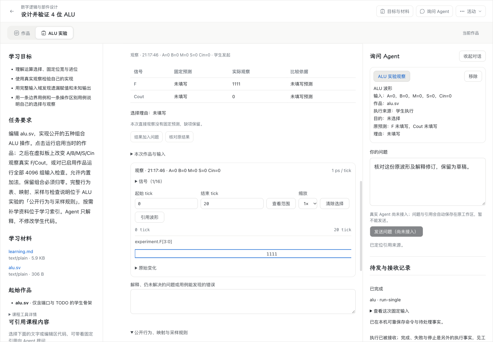
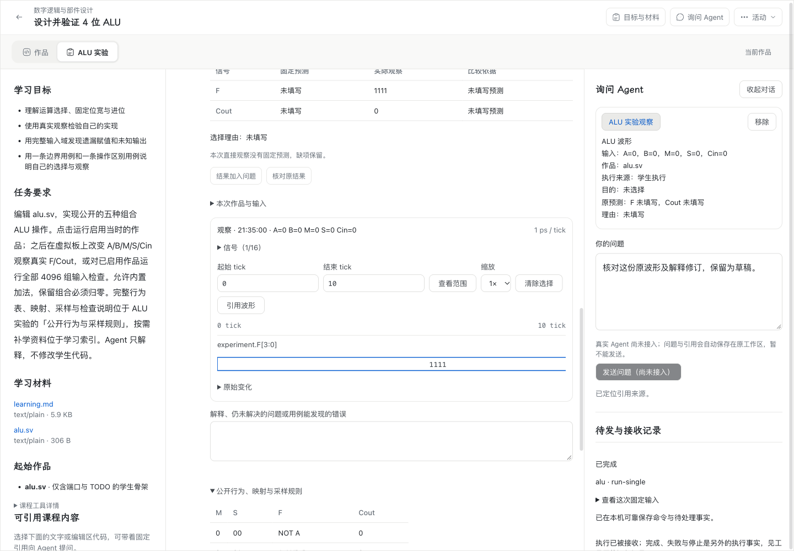
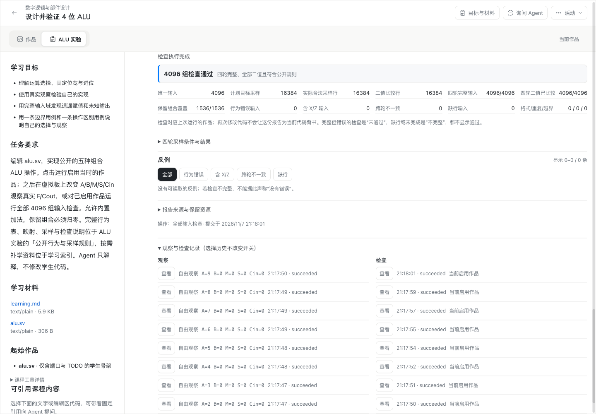
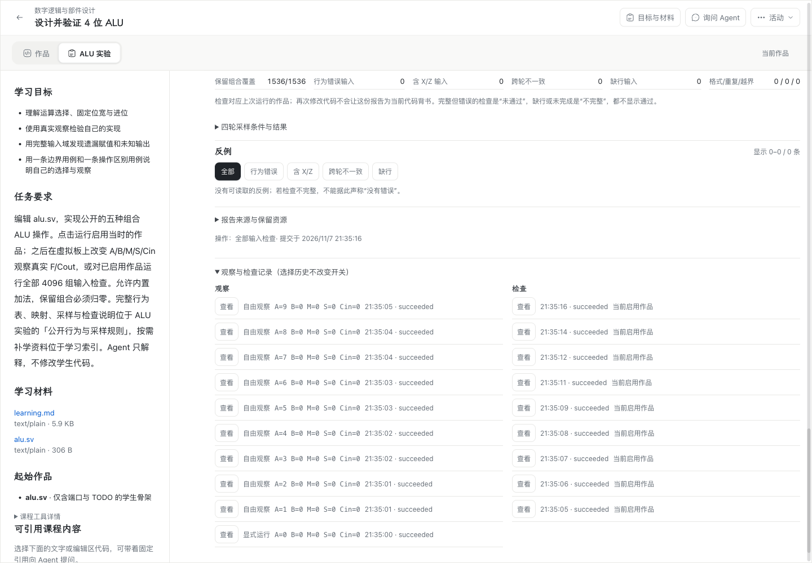

# WP04 / PR #213 审查包修复与验收

日期：2026-11-07（Asia/Shanghai）。审查基线：`09afdd01553a0e3e262f6c40ff91a5cb17aeaf67`，base `6b4c3eee35439e083f7d37d25f9ca60afbddf6f7`。本记录覆盖 Robert 提供的 `wp04-pr213-evidence` 中全部 6 项 Spec、2 项 Standards 发现及修复中发现的相关边界。

## 修复结果

| 发现 | 最终行为与回归 |
| --- | --- |
| SPEC-01 父解释尚未同步 | 暂缺父来源返回 `unavailable`；保留原草稿请求并自动重试。循环、跨执行及身份冲突仍拒绝。新增后端/前端边界回归，并以真实 Chrome、HTTP 和 PostgreSQL 验证 N2 引用先到、父作品后到、同一原请求成功。 |
| SPEC-02 引用定位虚报成功 | 从原执行重开实际资源，恢复规范化信号/tick 并聚焦；暂不可读或内容变化如实失败。隐藏结果、刷新、只读恢复、非法范围及迟到请求均有回归；较早请求不能覆盖新选择、焦点或提示。查看不新增执行。 |
| SPEC-03 历史八条截断 | 原列表增加“显示更多观察/检查”，每次扩展 8 条。真实产品刷新后可重开最早的 10 条观察、9 条检查，查看原 VCD/报告；不改变输入、板卡读数或新增 Worker。只读模式仅修改本视图。 |
| SPEC-04 无换行输出绕预算 | 在原始 TTY 写入进入行缓存前累计 stdout/stderr 字节，合计上限 2 MiB；解码回调不重复计数。两端真实 Chrome 验证有/无换行的两类输出、受限日志及终止后恢复。 |
| SPEC-05 整体预算误记取消 | 整体截止立即保存 `failed / budget-exceeded`，用户先停止仍为 `cancelled`；晚到的资源读取不能再分派 Worker。真实控制器、接收者与 IndexedDB 回归覆盖加载/编译、仿真超时以及两种截止/停止先后顺序，并重开核对终态。 |
| SPEC-06 失败与检查日志丢失 | 公共失败结果保留有界 stdout/stderr；产品保留失败运行、失败检查轮及成功检查各轮日志。累计检查日志越界时保留报告、观察及预算内 UTF-8 日志，并保存预算失败。实际 `$fatal` 的文件/行号、消息、time/scope 可在产品刷新后重读，终态保持失败。 |
| STD-01 奇数间距 | 普通数值输入水平 padding 改为 10px；真实 Chrome 核对浅色宽布局、深色窄布局。 |
| STD-02 重复准备反馈 | 新旧界面共用纯 `preparationMessage` 格式化函数，保留各自准备生命周期、旧 iframe 与重试行为；quota、资源损坏、未知原因仍有反馈。 |

## 固定版本与兼容

当前组件发布为 **version 4 / stateVersion 3**，运行包 **0.3.1**，身份：

```text
21a0a1ed4438143b33530efb293f83733dac84405b2f4c458b107a0b79358d4f
```

旧组件 v3 的运行包 0.3.0 身份仍为 `f37a9589d6bc91fd91cce93f23cff5a02aad47ca4f0d32dde32162a0341e01cd`。[完整原包](../../components/alu-icarus-runtime/versions/0.3.0/manifest.json)与审查 HEAD 原字节一致；两套清单各 27 个文件的长度/摘要核验通过，六个 JS/WASM 工具链文件保持原字节，当前四份适配源码镜像一致。本轮未重新编译工具链二进制。

产品准备与执行共同按固定身份选择原 Worker 或修复 Worker，未知身份仍拒绝。新组件的入口、运行资源和课程材料使用独立资源 ID；导入请求和课程发布 ID 同样分开。真实 PostgreSQL 服务可同时导入原 v3 与新 v4，真实 Chrome 分别运行两份活动，原活动身份没有升级。刷新适配器使用 `node tools/alu-wasm/refresh-adapter.mjs <new-version>`，先验证并保留完整旧包，再更新当前清单。

## 实际验证与边界

| 检查 | 本轮结果 |
| --- | --- |
| Node 24.21.0 类型检查、完整构建 | 通过；最终引用提示序号保护后再次完成。 |
| `npm run verify -- --group unit` | 31/31 分组通过；[原始汇总](evidence/wp04-pr213-unit.json)。最后的共享引用提示保护后，完整 Web 再跑 **88 文件、986/986** 通过。 |
| 原生 PostgreSQL 解释/恢复 owner 回归 | **15/15**；[输出](evidence/wp04-pr213-native-reflections.log)。使用产品分发中的 PostgreSQL 18.6，测试数据独立并已清理。 |
| Browser-safe contracts | 16 个公开导出检查通过。 |
| Mac Apple Silicon / Chrome 156.0.8078.80 | 公共运行包 **69/69**；[报告](evidence/wp04-pr213-runtime-mac.json)。 |
| Windows 11 x64 / Chrome 156.0.8078.81 | 公共运行包 **69/69**；[报告](evidence/wp04-pr213-runtime-win.json)。临时运行包、依赖副本及传输 ZIP 已移除。 |
| Mac 正式产品路径、真实 Chrome + 原生 PG | [修复后报告](evidence/wp04-pr213-product-after.json)：新旧活动并存、准确定位、跨结果/刷新定位、完整历史、板卡与零重跑、浅深布局等 **8 项**通过。 |
| N2 草稿先于父作品的实际 HTTP 顺序 | [报告](evidence/wp04-pr213-reflection-http.json)：先得到 503/unavailable，随后相同 requestId 和完整输入得到 200。只控制作品通道短暂不可用，未替代服务、数据库或草稿协调器。 |
| 实际 `$fatal` 的产品保留与重开 | [报告](evidence/wp04-pr213-fatal-product.json)：`/alu.sv:3`、原消息、`Time: 500 / Scope: experiment.dut` 均保留，刷新无重跑。 |

运行包 69 项使用真实桌面 Chrome 和真实 Worker/WASM，经回环 HTTP 供给固定资源；它们不代表 Windows 正式产品全链或学校 HTTPS 验收。实际产品新增交互在 Mac 验证；只读恢复与定位竞争由真实组件测试验证。本轮未重跑完整学校 HTTPS、Windows 产品恢复或系统 IME 矩阵，既有记录仍对应各自候选。教学效果、教师接收与真实 Agent 辅导不属于本次验证。

## 实际运行界面前后对照

界面保留原学习外壳、工具位置与列表布局，仅增加完整历史的展开入口、恢复真实引用范围，并对齐数值输入间距。截图使用审查 HEAD 单独构建的 Web 与修复版真实产品，均在真实 Chrome 中产生。

| 修复前：引用固定为 0–10，定位后仍显示 0–20 | 修复后：回到原 0–10 及信号 |
| --- | --- |
|  |  |

| 修复前：观察、检查各只提供 8 条 | 修复后：展开后提供 10 条观察、9 条检查 |
| --- | --- |
|  |  |

[修复前反例报告](evidence/wp04-pr213-product-before.json)。普通输入的 [浅色宽布局](evidence/wp04-pr213-numeric-light-wide.png) 与 [深色窄布局](evidence/wp04-pr213-numeric-dark-narrow.png) 同时确认 10px padding。
