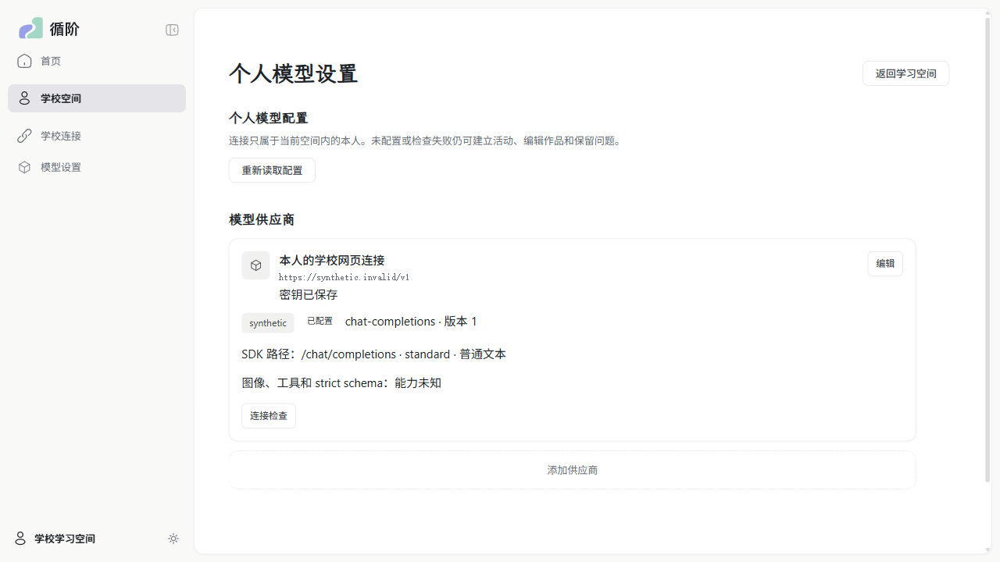
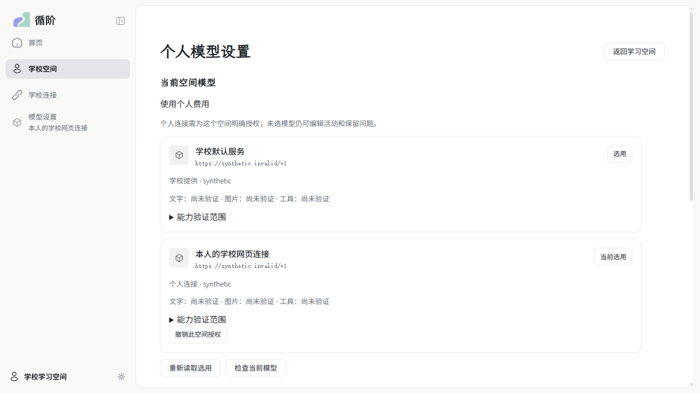
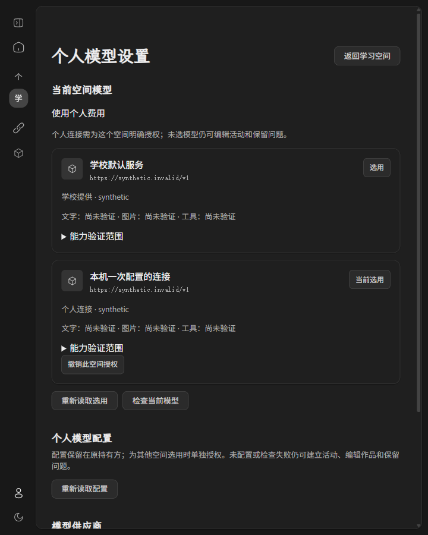

# WP06 #165：学校／个人选择与 Chat 原生续接

来源 [#165](https://github.com/paher-din/XunJie/issues/165)；依据[母规范](specs/wp06-model-connections.md)和[实施方案](specs/wp06-selection-chat-continuations.md)。开发基线 `wp06 @ f0c211ad27455063480b28cbfd8c6a33f97eacd4`，分支 `codex/wp06-165`，单独向 `wp06` 提 PR，不合并、不修改 PR #177。Windows 交付验证在本记录中；本票 Mac 验收追加到统一交接 [#178](https://github.com/paher-din/XunJie/issues/178)，完整独立部署/真实跨机接管归 [#168](https://github.com/paher-din/XunJie/issues/168)。

## 本次行为

学校维护者通过 `school-model --root … --file <私有 JSON>` 配置/更新/停用默认连接及检查许可/限额。学生在正式设置中直接使用默认模型，或明确“授权并选用”个人连接；当前模型在原侧栏入口内可见。授权按真实环境、空间、主体保存引用，无管理员开放个人模型的开关，不复制学校账户库、课程、画像或会话。

安装客户端用原 WP02 学校连接实时确认身份和目标。学校默认由学校持有并计学校额度，个人由本机持有并计个人费用；尝试 ID、输入摘要及持有方先持久绑定。切换选用不让原尝试改由另一方接收、重发或查询。撤销/停用/清除凭据会阻止已接收但未外发者；仍获准查询的主体可读原历史。配置更新固定旧请求的路线和版本，不补用最新配置或另一方额度。

同一 Gateway 的 `chat-probe` 公开契约承接图片、工具 schema/结果、观察和原生段；受控调用方使用真实身份、PostgreSQL、所属资源及直接 `openai@7.42.0`。这没有接通学习聊天、工具调度、Run 预算或 PDF 工具。旧教师、个人聊天和课程辅导保留原身份、预算和控制器。

工具必须在整体成功结束且完整结果可读后才发布意图；无副作用结果由调用方配对为 success/error/not-executed。DeepSeek `reasoning_content` 和实际 Command Code `reasoning`、分片 `reasoning_details` 原样组装/持久/回放；公开结果不泄漏推理。未知关键格式保留原 chunks，但不发布可执行工具或伪称可续接。

段固定路线、格式、system/工具/参数和顺序；工具未结清不能换段，不替调用方执行或取消工具。新段只接受显式可移植文本和本主体已完成结果引用，封存旧段并保留出处。新观察带调用方来源和版本追加，不覆写旧工具结果。PNG 从固定原件引用物化，变换保留来源；不接任意 URL、教师材料 ID 或路径。

具体 wire、限额、错误与维护操作见[模型 owner](../../packages/learning-space/src/model-connections/README.md)。

## 真实端点（2026-11-02）

最终原生 adapter `xunjie-chat-native-v2`，SDK `openai@7.42.0`；每次最多 2048 输出 token、30 秒、重试 0。通过正式产品宿主和 Gateway，网络边界透明记录真正发送到目标 HTTPS 地址的请求，并与实际收到的原生分片作保真比较。使用两张 64×64 合成双色 PNG、随机 nonce 和两个无副作用工具；凭据只由获准私有文件读取，报告不含 key、原生推理或签名。

| 路线与参数 | 图片/多工具/重启续接 | JSON 与反例 |
| --- | --- | --- |
| DeepSeek `https://api.deepseek.com/v1/chat/completions` / `deepseek-flash` / thinking enabled + auto tools | 首轮 2 工具，图片左侧颜色正确；重启查询同一结果引用，实际下一轮 assistant、完整参数/身份/reasoning 与原生输入一致；nonce 和工具图左侧颜色正确。最终两轮 usage：600/72/672、928/87/1015，均 final | plain JSON mode + 应用 schema 通过；有效及无效 `json_schema` 都返回 400；thinking 强制具体工具返回 400 |
| Command Code `https://api.commandcode.ai/provider/v1/chat/completions` / `deepseek/deepseek-v4.1-flash` / 默认参数 | 首轮 2 工具，图片读取正确；重启后的原生 `reasoning` 和 `reasoning_details`、工具顺序及参数与下一轮 wire 一致；nonce 和工具图读取正确。两轮 usage：600/78/678、935/70/1005，均 final | JSON mode + 应用 schema 通过；有效 native schema 返回 200；无效 schema 也返回 200，被本地应用验证拒绝，不能标为 native strict |

Chat 工具产图是“配对文本 + 紧邻用户图片”的实测装配，非原生 tool-image 能力。原生推理非空与实际 wire 保真均已比较，nonce 正确没有代替该比较。SDK/raw 请求正文和 reasoning 仅在私有 owner/探针内存中使用。

初轮发现 Command Code 实际字段与 DeepSeek 不同，先保留失败证据，再用合成反例完成 red→green 后复验。初轮 10 次、Command Code 修复复验 5 次、最终 DeepSeek v2 复验 6 次，共 21 次有限生成尝试，没有自动重试或改型号凑数。复验脚本 [probe-model-chat.mjs](../../scripts/probe-model-chat.mjs) 可以按 `--provider` 限定单条路线。

能力证据只匹配实际 endpoint/model/protocol/dialect/mode、日期及 SDK/adapter；名称不参与判断。未测组合维持 unknown，JSON mode、应用校验与 native strict 分列，已知 thinking/强制工具限制独立保留。旧样本不是所有未来版本的永久保证。

## 工程、恢复与浏览器

验证主缝为生产公开 Gateway + 真实 WP02 身份/原生 PG/资源/SDK→受控 HTTP/SSE。重点覆盖共享学校额度、个人授权及撤销、固定配置、图片格式/来源、交错多工具、非空/空字符串/null 推理、半截参数/拒绝/截断/未知字段、重复接收、重启和段边界。维护测试使用真实备份→隔离还原→接管，核对原授权、选择、图片、待配对工具和结果，并发送恢复后的下一轮实际 SDK 请求。

最终功能与包的源码快照为 `5b86ead591c1f2e80ba5d432ed302020af7671a0`；之后只补充 null 回放断言和本次交付记录。工程、浏览器、包摘要及全量失败列表见[Windows 验证 JSON](evidence/wp06-selection-chat-win-verification.json)，真实两路上游保真、能力及用量见[Chat 端点 JSON](evidence/wp06-chat-native-win.json)。

| 检查 | 当前记录 |
| --- | --- |
| 全工程 build / typecheck | 最终功能快照均通过；浏览器公共契约 11 个公开导出，0 失败 |
| 受维护文档链接 | 已跟踪且排除归档的 174 份 Markdown、1390 个本地目标，0 失败；未把无关未跟踪历史文档纳入此次检查 |
| 相关模型/可靠调用与真实恢复 | 4 个模型文件隔离运行 23/23；审查修复后真实备份恢复、UTF-16 摘要和跨持有方 3/3；strict/同方边界/跨方出处强化 3/3；非空、空字符串及 null 重启回放 1/1；COMMIT ACK 丢失补充回归 1/1。各组有重叠，共覆盖 25 个场景，均无跳过；不把组计数相加当作独立用例数 |
| 旧模型 owner 升级 | 真实 #164 Windows 包创建 `storage/1;owner/3` 数据，经正式备份、WP01 `upgradeProductRecovery`、隔离还原与严格接管至 `storage/1;owner/8`；旧凭据/原取消事实保留，新授权和选用可用 |
| 完整本地 `npm test` | 一次全量运行：146 个测试文件任务中 131 通过、15 失败，准备构建另计通过。15 个失败文件均在 #164 的原失败清单中；全量闸门未通过。包括 Windows 软链/路径/socket、旧 zod 初始化及工具故障；`package-transfer` 超过 18 分钟，经核对所属进程后终止，计失败 |
| 完整 Windows 独立候选包 | `win32-x64`、`full`、unsigned candidate；包内 Node/PG/CLI 与正式前端完成 7/7 桌面 Chrome，0 跳过。`app/cli.js` SHA256 `5836916b50dfc9560820e796419c4abdf5f8882c62868ea7c8a57a2630ced221` |
| 学校网页与安装客户端的桌面 Chrome | 普通正式 Web 7/7，完整产品包 7/7；均 installed Chrome、headed、单 worker。覆盖来源选择/撤销、真实主体及空间隔离、Enter、720×900 深色、迟到回执不污染新视图/中文输入、确认 CAS 冲突后重试，以及原设置保存/检查/焦点/Tab/Escape/空白 key 回归 |
| Apple Silicon Mac | 未执行；登记到 #178，不记通过 |
| 教学效果 | 未评估；本次模型连接和合成工具验收不证明教学效果或完整 Agent 可用 |

首轮模型原生回归与全量套件同时重建了共享前端目录，出现缺构建产物的失败；保留该失败记录，停止并行重建后隔离运行的 23 项通过。最终修复后的定向回归、构建、普通 Web 和包验收依次完成。

Windows 为 Windows 11 x64（内核 `10.0.26200`），Node 24.21.0、PostgreSQL 18.6、安装版桌面 Chrome `156.0.8078.76`。最终包创建于 `2026-11-02T16:16:55.999Z`，浏览器记录截至 `2026-11-02T16:18:48.836Z`（本地已为 11 月 3 日）。本机中文回归使用 CDP 组合输入，没有验收物理 Windows 输入法候选窗；Mac 的物理中文输入、Meta 操作、独立包和受影响学校路径按 #178 交接逐项执行。

以下截图来自实际桌面 Chrome 的正式产品路径，分别为改动前、选用后的设置和 720×900 深色窄桌面；未对截图做内容修改。

## 审查与剩余边界

双轴静态审查以 `f0c211ad...5b86ead` 为固定差异，两名独立审查者分别检查仓库规范和 #165/母规范；没有把静态审查当作测试执行。

## Standards

最终审查剩余 0 项。初审发现选用 CAS 冲突后继续复用旧版本、持久段摘要依赖 `localeCompare`；已分别通过确认冲突后清理旧操作并保留授权、使用确定的 UTF-16 排序修复，red→green 和恢复回归通过。新增出处/结果能力位于模型 owner 内，公开接口不泄漏 SDK 类型、密钥或隐藏推理；未发现需要保留的代码异味。

## Spec

最终审查剩余 0 项。初审发现 CAS 冲突恢复及跨持有方切段/可移植结果引用不足；已修复，并以双向学校↔个人持有方、工具未结清拒绝、未知引用不封存原段、重启后出处一致等公开接口用例验证。新段仅携带获准文本和结果事实，旧原件、原持有方及出处保留。

审查汇总：Standards 0，Spec 0；两轴均无剩余代码发现。Mac 的平台验收仍未执行，不包含在该静态结论内。

Responses/Messages 属于 #166/#167；完整独立部署、真实跨机和独立持有组件恢复接管属于 #168；本票 Windows 上两个真实产品进程的持有方切换不冒充跨主机验收。本票的具体 Mac 验收统一交接 #178；教学效果未评估。本次单独提交 PR，不合并、不关闭 #165。
