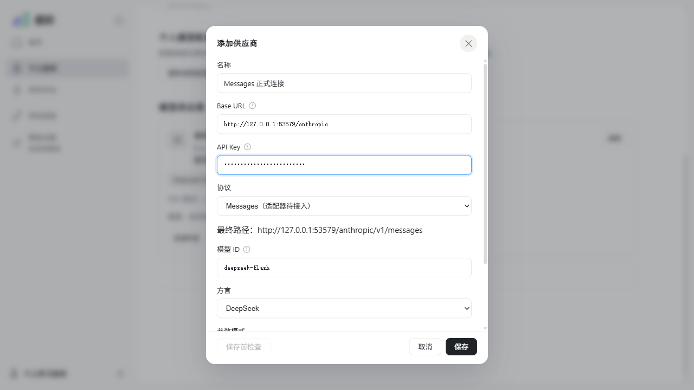
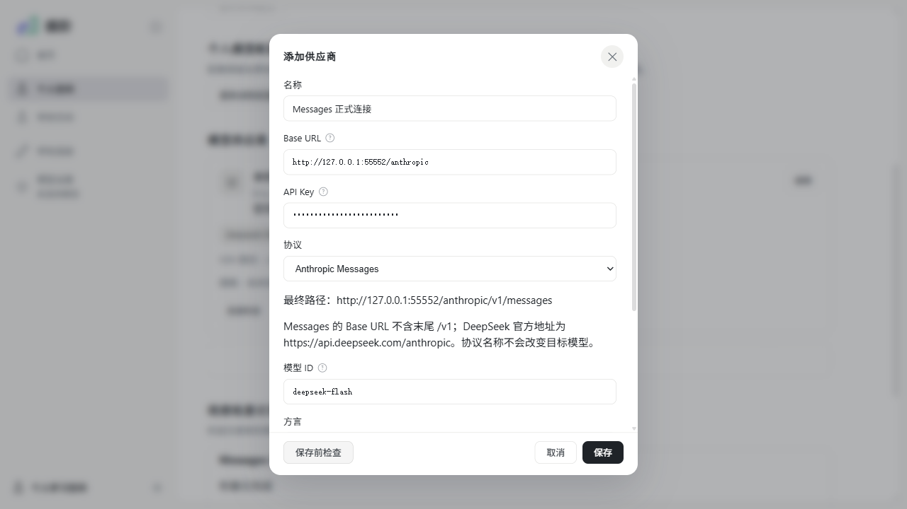
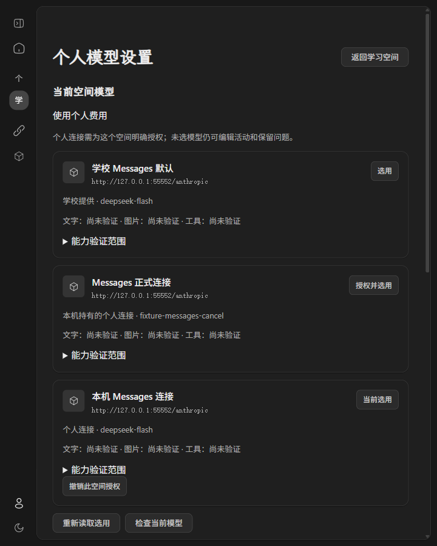
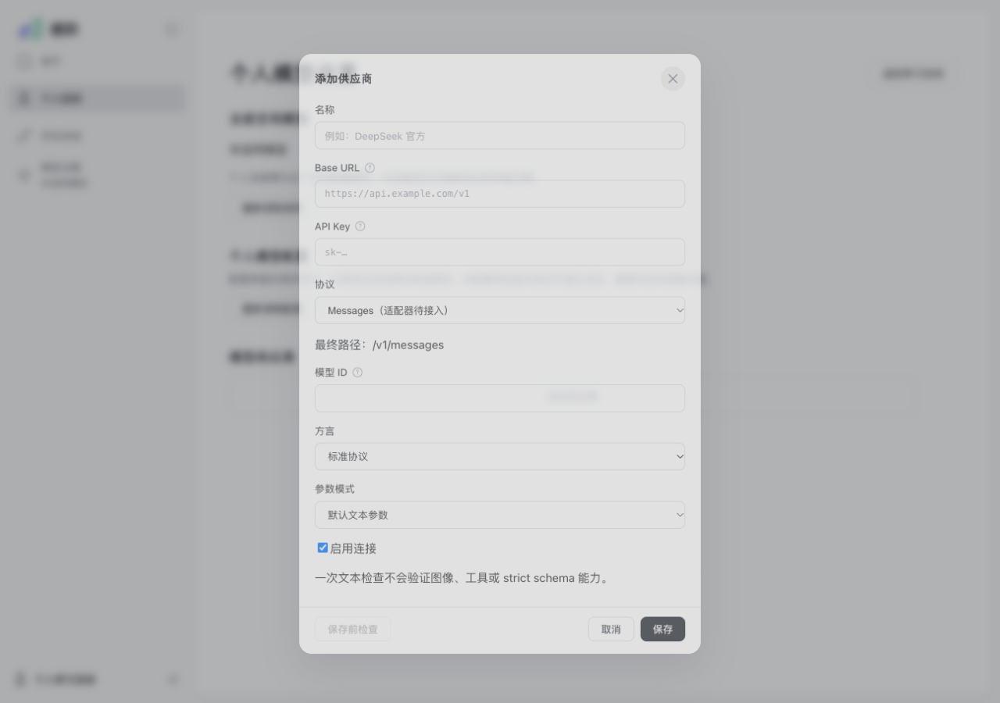
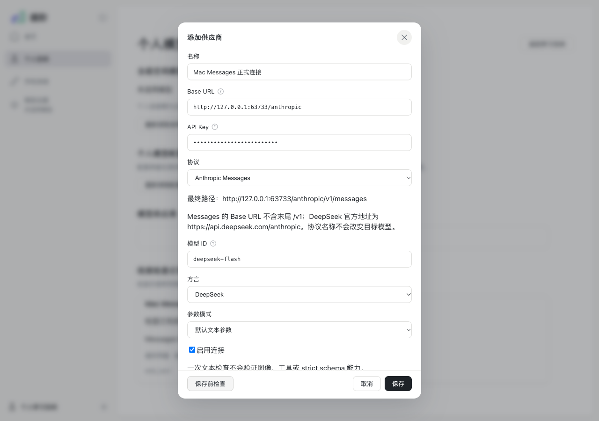
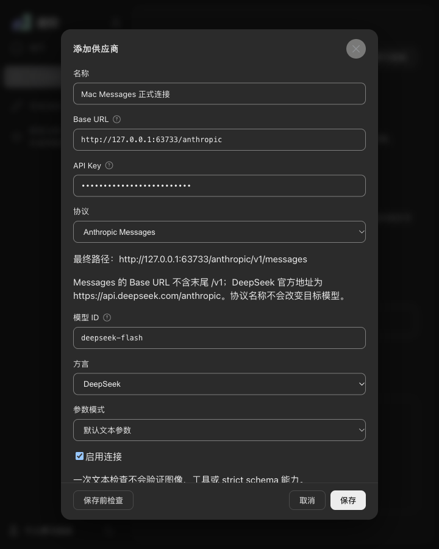

# WP06 #167：Anthropic Messages 接入与验收

2026-11-03（Asia/Shanghai），依据 [#167](https://github.com/paher-din/XunJie/issues/167)、[母规范](specs/wp06-model-connections.md)与[实施方案](specs/wp06-messages.md)。同步基线为 `wp06 @ 92e8cea6b5ad06fb8b967bf56e1450be06f257a4`；继续在同一 `wp06` 提交，由已有 PR #177 承载，保持草稿且不合并。Mac 具体清单在 [#178](https://github.com/paher-din/XunJie/issues/178) 执行并回填，完整独立部署/真实跨机接管仍属 #168。

## 已交付行为

正式设置现在可选择 Anthropic Messages，完成保存前检查、保存重开、原连接检查和取消。复用原表单、来源选择、身份/空间隔离、授权、费用及固定配置版本；学校默认和本机个人连接使用同一生产 Gateway。没有新增配置页、导航、学习聊天、Agent loop 或工具执行。界面只调整协议选项、检查可用性、地址提示与实际能力文案，使用原 token、焦点、状态及错误反馈。

模型 owner 直接使用固定 `@anthropic-ai/sdk@1.1.0`，adapter `xunjie-messages-native-v1`。DeepSeek base URL 为 `https://api.deepseek.com/anthropic`，实际路径 `/v1/messages`，明确发送兼容 header `anthropic-version: 2023-06-01`；不改写模型 ID，不改用 Claude。Base URL 已以 `/v1` 结束时可保留配置供修正，但检查在外发前拒绝，避免重复拼接。SDK `maxRetries: 0`，禁止重定向、自动多轮或自动工具 helper。每次最多 2048 输出 token、30 秒；正式检查仍为原有限短文本和原准入/并发限制。

使用直接 `messages.create(stream:true)` 的原始 SDK 事件，通过有界聚合记录完整 assistant content 和事件。SDK 1.1.0 的 `MessageStream` 对连续 signature delta 会覆盖旧值，因此本模块显式按块索引合并片段，再用持久事件重建并校验原生结果。content 顺序、thinking、signature、tool-use ID/参数保留；起始签名缺失/null 可等待后续片段，终态保留合法空字符串/null。未知关键块、错序、半截 JSON、未知工具/schema 不符、截断、拒绝、缺整体 message_stop 或流内错误均不可消费。只在整体成功且完整资源/引用可靠提交后才发布工具意图。

同段重启后读取原 request/result 并回放完整 content，不从可见聊天文本重建签名，不依赖 DeepSeek 可能提供的隐藏恢复。工具按 tool_use_id 配对，success/error/not-executed 由调用方明确给出；失败状态同时编码为配对文字和 is_error，不依赖 DeepSeek 忽略的标志。固定所属 PNG 在用户 image 和原生 tool_result image 中物化；图片上限只统计真正的图像块，不把工具参数里的普通元数据当图像。旧资源和新原生格式加入同一 owner 的引用、维护验证、备份还原及接管，没有新状态权威。

Messages↔Chat、Messages↔Responses 只在工具结清、物理调用结束后显式新建段；输入为获准可移植问题/可见结果，旧原件与出处保留，签名、隐藏块和原 response/tool/file ID 不跨协议复制。查询、重复接收、取消与重启沿原尝试，不隐式重新生成。

DeepSeek 用量采用最终 message_delta.usage，累计值覆盖而不相加；缺失不由初始占位零补齐。input_tokens 不含缓存命中，cachedTokens 分列；Messages 没有原生 total_tokens，因此不捏造总量。取消仅证明本机停止接收，服务端计算/费用仍未知。凭据回显时禁止消费并移除可能重建 key 的原生正文/分片；SDK 日志关闭，公开证据不含 key、推理正文或 signature。

审查补齐 `ModelAttempt.upstream`：白名单保存实际 HTTP 状态、有限 request-id、retry-after 秒数或 HTTP 日期。该事实与原生结果同次发布，重启查询不重发；不返回原始 headers/body，不把等待提示当自动重试授权。含当前 key 的 request-id 丢弃。owner 9 为新增调用事实追加 JSON 约束和版本标记，旧 owner 8 数据须走 WP01 正式 schema upgrade；正常启动不静默升级。

## 真实端点与能力反例

[脱敏端点证据](evidence/wp06-messages-real-win.json)保存日期、路径、参数模式、SDK/adapter、终态、原生比较、用量及失败。探针 [probe-model-messages.mjs](../../scripts/probe-model-messages.mjs)从用户获准私有配置读取凭据；按 native/schemas/controls/check/cancel 分组在独立环境运行，单组最多 6 次，累计本轮 **12 次有限生成**，自动重试 0（含审查修复后 1 次正式检查，HTTP 200，upstream 状态可查询）。真实原生探针通过独立宿主子进程，重启 PID 后从同一私有数据根读取，再观察下一轮真实 HTTPS wire；原生正文仅在内存比较。首轮原生链路在 owner 8 验证，后续追加的 owner 9 只增加错误事实/约束，不改变原生 payload/聚合；新版本恢复及 wire 回归单列。

| 路线/参数 | 结果与限制 |
| --- | --- |
| DeepSeek deepseek-flash / thinking + auto | 两次均 completed：用户图左侧颜色正确，两个无副作用工具正确配对；重启后同一 resultRef，完整 assistant content/thinking/signature/工具身份与下一轮 wire 相同；随机 nonce、tool_result 图像颜色正确 |
| 上述两轮用量 | 第一轮 input 585、output 222、cached 0；第二轮 input 298、output 73、cached 768，均 final。input 不含缓存命中，不把 cached 大于 input 误判为协议损坏 |
| plain 正式连接检查 | completed/end_turn；input 14、output 1、cached 0，final |
| plain 应用 schema | 初次输出不是合法 JSON，本地拒绝；明确要求双引号的 JSON 样本通过。合成上游同时覆盖合法/非法样本。应用校验不等于上游强制格式 |
| plain output_config.format | 有效/无效 schema 均 HTTP 200，输出未通过本地校验；不能宣称 native schema/strict。普通调用在未验证/不支持时拒绝原生格式请求，包括 strict:false，不静默降为应用校验；调用方可明确使用 applicationSchema |
| plain strict 工具 | 有效 schema 完成；不可满足 schema 仍返回 HTTP 200 和非法工具输出，本地拒绝且无工具意图。原生 strictTools 标为 unsupported |
| thinking + 强制具名工具 | HTTP 400，保留限制，不改成 auto |
| 真实客户端取消 | HTTP 200 后取消，cancelled/client-abort、物理请求结束、用量 partial；不声称上游停止 |
| Command Code deepseek/deepseek-v4.1-flash | 2026-11-03 目录 HTTP 200，只声明 /chat/completions 与 /responses；Messages 能力拒绝，不外发、不替换型号。目录是本次带日期证据，变化后须重新核对并更新 |

首轮 schemas 探针执行了 4 次外发，随后因本地不接受最初 oneOf 工具样本而停止，保留该失败；换用有效但不可满足的本地 schema 做负对照后，补齐剩余反例及 JSON 正例，没有把首轮探针记为全通过。Messages 未实现独立 JSON object mode；JSON mode、应用校验、原生 schema 与 strictTools 分开投影。能力证据只匹配实际 endpoint/model/protocol/dialect/mode、日期与 SDK/adapter；未知组合保持 unknown，plain 不继承 thinking 图片/原生回放标签。

官方资料仅作为编码依据，不代替实测：[DeepSeek Messages 兼容说明](https://api-docs.deepseek.com/guides/anthropic_api/)、[Anthropic SDK](https://github.com/anthropics/anthropic-sdk-typescript)、[Command Code supported_endpoints](https://commandcode.ai/docs/provider)。

## 工程、浏览器与恢复

主测试为生产宿主 Gateway + 真实 WP02 身份/PostgreSQL/资源 + 直接 SDK→受控 HTTP/SSE，见 [model-messages.runtime.test.mjs](../../apps/server/tests/model-messages.runtime.test.mjs)。不以内部 SQL 或私有类调用次数代替业务事实。

| 验证 | 记录 |
| --- | --- |
| build / 类型检查 / 浏览器契约 | 全工程 build、typecheck 通过；最终边界修复后 local-runtime build、learning-space:typecheck 与完整包构建通过；浏览器公共契约 11 个导出、0 失败 |
| 正式检查、工具/签名/图片/重启 | 生产 Gateway 原生组通过；加强回归 4/4，含空/null、交错工具、UTF-8 分片、8 图边界、凭据回显及能力范围 |
| 故障与终态 | 10/10（9 个反例 + 父用例），0 跳过；负用量二次异常已 red→green 修复 |
| 用量、取消、HTTP 不重试、格式边界 | 各定向分组通过；缺最终字段、真实零值与累计覆盖分开断言 |
| 上游错误元数据 | 429/request-id/retry-after 秒数、503/HTTP 日期、敏感 header 过滤及重启查询 red→green 通过 |
| 最终故障/地址回归 | 17/17、0 跳过：终态反例、取消/超时、错误元数据、重复 /v1/// 和响应头前断线 unknown/重启不重发；已确认 HTTP/SSE 失败不被迟到取消覆盖 |
| 维护恢复 | 真实备份→隔离还原→严格接管后原签名/工具/固定图片续接通过，旧源被拒绝重开 |
| 旧 schema 正式升级 | #165 旧完整包生成 owner 8 凭据与尝试，经 WP01 upgrade→隔离还原→严格接管为 owner 9；旧凭据/尝试不变，新授权/选择可用，最终再验通过 |
| 跨协议段 | Messages↔Chat、Messages↔Responses 两组及父用例 3/3 通过 |
| Responses 终态回归 | 最终隔离运行 12/12、0 失败/取消/跳过；覆盖完整/不完整/失败终态、流内错误、非法工具/schema、未知块/事件、身份复用及终态后错误 |
| Windows 桌面 Chrome | 普通正式 Web 11/11、最终完整 Windows 包 11/11，均 0 失败/跳过；各含 Messages 3 项和原有个人设置/选择/Responses 8 项 |
| 全量本地测试 | 一次 npm test，131/146 个文件任务通过、15 失败；失败文件集合与 #165 相同。build:test 另通过；unit 21/23、server 76/78、tools 34/45。旧包传输任务运行 27 分 45 秒仍未退出，核对进程树归属后终止并计失败，不宣称全量通过 |
| Mac | 完成：完整包与源码路径 Chrome 各 11/11；Messages 原生 29/29、模型回归 76/76；owner 8→9 升级、错误事实恢复、物理中文输入法 5/5、真实 DeepSeek 13 次有限生成；详见下方 Mac 章节 |
| 教学效果 | 未评估；连接和合成工具验收不证明完整 Agent 或教学效果 |

Chrome 使用安装版 156.0.8078.76、Windows 11 x64（10.0.26200）、headed、单 worker；Node 24.21.0、原生 PostgreSQL 18.6。最终功能快照 `3a90baa`；完整 `win32-x64` / `full` 包为 unsigned candidate，使用包内 Node/PG 和仓库外私有 root。[脱敏工程记录](evidence/wp06-messages-win-verification.json)包含包的创建时间、CLI SHA256、各原生组、实际失败清单、恢复与 Chrome 结果。普通正式 Web 11 项运行于 owner 9 的 `47648e3`；最终完整包另覆盖末尾斜杠及错误分类修复后的同一 UI。没有物理 Windows 中文输入法候选窗验收；既有 CDP 中文输入/焦点回归不冒充物理输入。

原生组存在重叠，不能相加当作独立用例总数。首轮七文件回归 98/102 通过、4 个失败计数（两处 Windows EBUSY 临时目录清理失败及其父用例）；业务断言没有报失败，其他五文件 25/25 通过。仅为本轮创建的 Messages/Responses 临时目录增加有界 fs.rm 重试，不忽略最终错误。owner 9 两文件隔离运行：Messages 全组 27/27；Responses 11-fixture 父用例在全量测试负载下超出 180 秒，合计 74/78、2 失败和 2 取消。仅延长这份含 11 次独立 PG 安装的父测试至 600 秒，每请求 deadline 不变。再次定向运行 10/12，依赖类型检查重建共享 dist 期间有一处宿主未启动，保留失败；停止构建后的最终串行回归 12/12 通过。最终 17/17 是增加响应头前断线及地址边界后的分组。

首次直接 node 打包的 Windows fallback 把 outDir 引号当成路径内容，改用根 package.json 的正式 `npm run package:product` 入口；该失败保留。随后完整包构建及 Chrome 11/11 通过。没有用前次失败或跳过充抵通过。

## 实际截图

同一桌面 Chrome 表单，改动前 Messages 仍为待接入且保存前检查不可用；改动后通过检查并显示实际路径与地址说明。截图仅使用本机合成凭据，没有真实 key。

## Mac（Apple Silicon）

2026-11-03 在 `wp06 @ cf076b5` 完成 [#178 的 #167 待验清单](https://github.com/paher-din/XunJie/issues/178)。环境为 macOS 27.2（构建 26B123）、arm64、Apple M5、16 GiB；安装版桌面 Chrome 156.0.8078.80；Node 24.21.0、npm 11.19.0；PostgreSQL 18.6（发行版 18.6.1）；直接 SDK `@anthropic-ai/sdk@1.1.0`、adapter `xunjie-messages-native-v1`。`.agents/skills/xunjie-development` 为忽略的软链，未提交。私有凭据只由获准文件读入探针内存，未写入仓库、数据库或日志。

- **环境与工程检查**：`npm ci` 装入 334 包；`npm run build`、`npm run typecheck` 均退出 0（保留既有大 chunk / zod 注释警告）；浏览器公共契约 11 个导出、0 失败；受维护文档 178 份、1444 个本地目标、0 失败（含本节新增证据链接）。
- **全量测试**：首次在终端 C locale 下运行 146/147，唯一失败为 `tools/xj-dev/tests/env-removal.test.mjs`——`ps` 把含中文的工作树路径解码为乱码，xj-dev 误判“外来进程”，不是产品断言失败。以 `LANG=en_US.UTF-8 LC_ALL=en_US.UTF-8` 重跑 **147/147、exit 0**，build:test 1、unit 23、server 78、tools 45；两次结果均保留，不用重跑覆盖首次失败。
- **完整包**：`darwin-arm64` / `full` unsigned candidate，4088 个文件 / 411 MB，创建于 2026-11-03T14:31:50+08:00；`app/cli.js` SHA256 `24b23e2b26b5f64077dcf29af4da37a1ce7d820e73c6a8caf32586b22c45895d`。包内 Node 24.21.0、PostgreSQL 18.6；正式 CLI 在仓库外 root 用包内 Node/PG 启动到 `ready`，四个 owner 与 PostgreSQL 依赖就绪。签名/公证状态据实为 unsigned candidate。
- **Messages 原生组**：[`model-messages.runtime.test.mjs`](../../apps/server/tests/model-messages.runtime.test.mjs) **29/29**、0 失败/取消/跳过。覆盖精确 `/v1/messages` 与 `anthropic-version: 2023-06-01`、system、thinking/plain、交错工具、UTF-8/input_json/thinking/signature 分片、非空/空字符串/null 签名、图像与 tool_result 图像、重启后下一轮 wire、终态/截断/拒绝/半截参数/未知块/200 后流内错误、用量与取消、跨协议段和真实备份恢复。
- **模型回归**：gateway、claim concurrency、selection、chat、responses、client 六文件 **76/76**、0 失败/取消/跳过（Messages 与回归分组有重叠，不相加当作独立用例总数）。
- **owner 9 恢复与升级**：owner 8 旧包（`92e8cea` 构建，CLI SHA256 `272fd1d6…`）生成真实旧数据后，当前包正常 `start` 被精确兼容闸拒绝（`Storage operation failed: incompatible`），未静默迁移。经 WP01 正式 `upgrade` 从 `storage/1;owner/8` 到 `owner/9`，旧连接/凭据、completed 结果引用 `259aa67d…`、cancelled/client-abort 与 usage 保留；新授权与选用可读；旧源重开被拒绝。证据见 [`wp06-messages-owner-upgrade-mac.json`](evidence/wp06-messages-owner-upgrade-mac.json)。
- **错误事实恢复**：Messages 429 上游事实 `httpStatus 429`、`request-id`、`retry-after: 7` 只外发 1 次；真实备份→隔离 restore→严格 takeover 后原样可查，连接凭据保留，旧源 `source-retired` 拒绝重开。证据见 [`wp06-messages-error-recovery-mac.json`](evidence/wp06-messages-error-recovery-mac.json)。
- **桌面 Chrome E2E**：安装版 Chrome、headed、单 worker。普通正式 `apps/web/dist` **11/11**（Messages 3、选择 4、个人设置 4），完整产品包 **11/11**，均 0 失败/跳过；`headless:false`、Chrome 156.0.8078.80 已记入两份 JSON。证据见 [`wp06-messages-e2e-normal-mac.json`](evidence/wp06-messages-e2e-normal-mac.json) 与 [`wp06-messages-e2e-package-mac.json`](evidence/wp06-messages-e2e-package-mac.json)。
- **手工界面与物理输入法**：浅色/深色、1280×900 与 720×900 窄桌面、Enter/Tab/Escape/焦点、Meta 复制粘贴均通过；使用 macOS 系统简体拼音 + System Events 物理按键完成组字、提交、换行「你好\n世界」及切换空间后新输入保持，5/5 通过，未用 CDP composition/fill/insertText 充抵。证据见 [`wp06-messages-physical-ime-mac.json`](evidence/wp06-messages-physical-ime-mac.json)。
- **真实 DeepSeek**：本轮预算 13 次有限生成（check 1、native 2、schemas 6、controls 3、cancel 1），实际 13 次，SDK/adapter 自动重试 0，每次最多 2048 输出 token / 30 秒。native 完成双工具、用户图与 tool_result 图、独立宿主重启、同一 resultRef、下一轮 wire 完全一致、nonce 与两张图颜色正确；usage 585/105/0 与 307/90/cached 640。cancel 为 HTTP 200 后 cancelled/client-abort、usage partial、上游停止未知。证据见 [`wp06-messages-real-mac.json`](evidence/wp06-messages-real-mac.json)。
- **格式/严格能力反例**：plain 应用 schema 通用提示未通过本地校验，显式 JSON 样本 completed；有效/无效 native `output_config.format` 均 HTTP 200 且输出未通过本地校验；不可满足 strict 工具 schema HTTP 200 但本地拒绝、无工具意图；thinking 强制具名工具 HTTP 400。native strict/format 不因 HTTP 200 或一般答对而标为支持；未知组合保持 unknown。
- **Command Code**：2026-11-03 支持目录 GET HTTP 200，目标 `deepseek/deepseek-v4.1-flash` 只声明 `/chat/completions` 与 `/responses`，Messages 仍明确不支持，generation 0；未换型号凑验收。证据见 [`wp06-messages-command-code-mac.json`](evidence/wp06-messages-command-code-mac.json)。
- **UI 前后截图**：owner 8 界面为「Messages（适配器待接入）」且保存前检查禁用；当前包为「Anthropic Messages」、显示实际 `/v1/messages` 路径与地址说明、检查可用并完成。截图见下方。

**Mac 限制与未执行项**：完整独立跨机部署/恢复接管仍待 #168，同机两进程不冒充跨主机；教学效果未评估；Windows 物理中文输入法候选窗本轮未重跑，Mac 物理输入法已单独取证。首次 C locale 全量失败已保留，不宣称单次 147/147。工程摘要见 [`wp06-messages-mac-verification.json`](evidence/wp06-messages-mac-verification.json)。

## Standards

对固定基线 `92e8cea` 的全量变更独立审查，并复核最终 `3a90baa` 增量：硬规范违规 0、值得报告的 Fowler smell 0。静态审查不冒充执行测试。

## Spec

初审 1 项 P2：缺少母规范要求的上游状态/请求身份及 retry-after 事实；已补白名单持久化、公开投影、owner 9 标记及重启回归。独立审查复核至 `3a90baa`，剩余 0 项。Mac 和完整跨机后续范围分别登记，不冒充通过。
