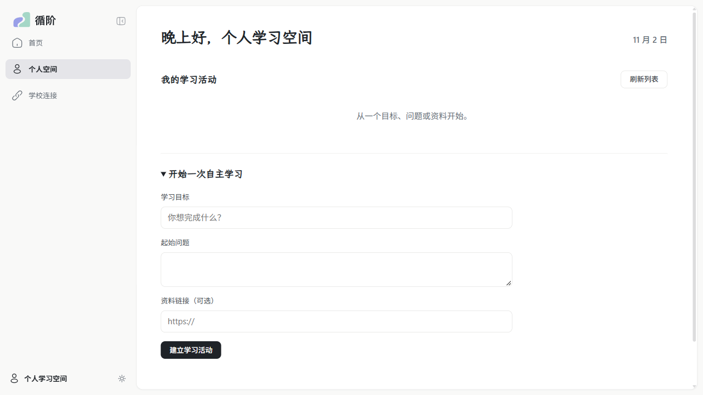
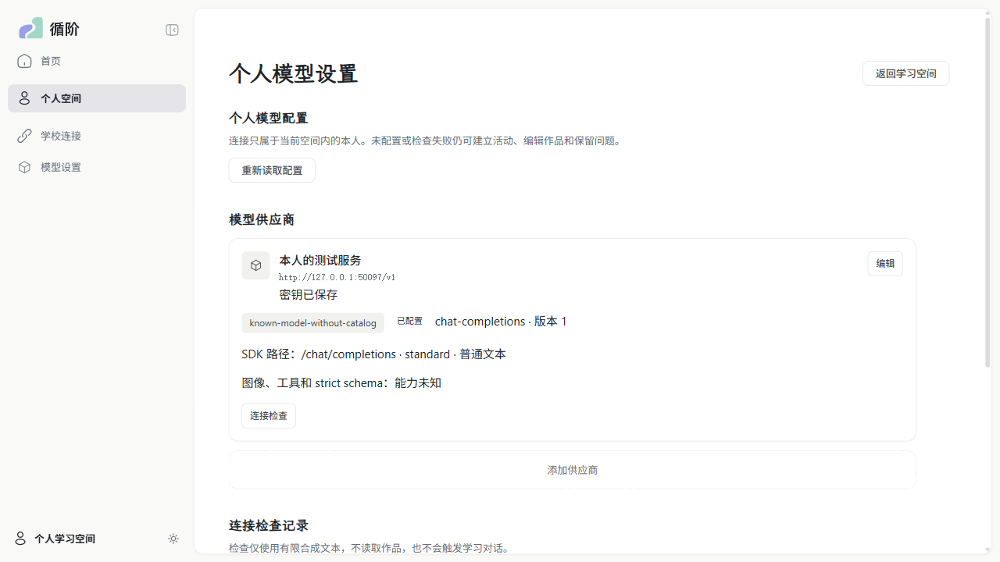
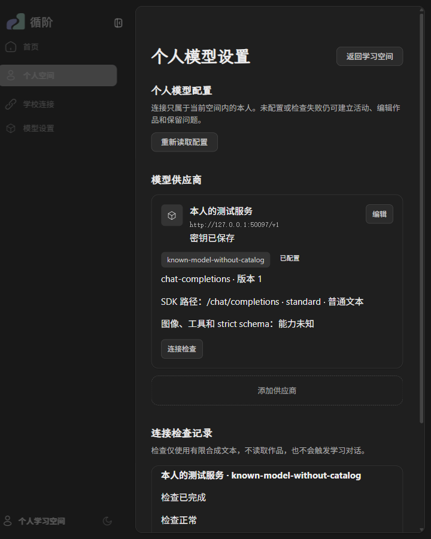

# WP06 #164：个人模型设置与可靠连接检查交付

来源 [#164](https://github.com/paher-din/XunJie/issues/164)，实施分支 `wp06`，基线 `f0979d5`，最终代码 `2b4b87f2b962f38201320ed75ca1398fbd0cf389`。实施边界见[方案](specs/wp06-personal-model-checks.md)，操作及生命周期见[模型 owner](../../packages/learning-space/src/model-connections/README.md)。[草稿 PR #177](https://github.com/paher-din/XunJie/pull/177) 不合并；Mac 待验项已登记在 [#155 专节](https://github.com/paher-din/XunJie/issues/155#issuecomment-6576481863)，完整跨机/独立部署接管属于后继 [#168](https://github.com/paher-din/XunJie/issues/168)。

## 本次变化

正式产品侧栏增加“模型设置”，普通 Web 与独立产品包共用 `PersonalModelSettings`、纯展示 `ModelTab`、供应商卡和表单。配置、版本、凭据、检查授权、尝试与原生资源由独立模型 owner 持有；旧聊天/教师显式保留 `LegacyModelTab` 控制器与原身份、配置、预算，不双写或回退。未配置模型不阻止活动、作品和问题草稿。

连接显式保存协议、认证地址、最终 SDK 路径、模型 ID、方言/参数、启停及版本；手填模型 ID 不依赖目录。保存前检查固定独立快照，不保存配置。空白 key 沿用、显式清除/替换、变更认证目标拒绝沿用；迟到检查和保存回执不覆盖后来输入。未接入协议/参数不能执行检查，文本成功不冒充图像、工具或 strict schema 能力证据。

直接 `openai@7.42.0` Chat adapter，SDK 自动重试为 0。检查最多一次生成，有限输入、输出、时间、准入及物理并发；取消、失败、缺 usage 或重启不返还持久准入。原生结果先可靠落盘再发布完成；取消只确认本机 abort，上游计算和费用仍未知。真实 PostgreSQL COMMIT 回执丢失时按原操作核实：不覆盖已完成事实、不重发占槽尝试、未核实者不能伪报排空。

## 工程与恢复

逐项结果见 [Windows 验证 JSON](evidence/wp06-models-win-verification.json)。本次使用 Node 24.21.0、PostgreSQL 18.6、Windows 11 x64 和安装版桌面 Google Chrome 156.0.8078.76。

| 检查 | 结果与边界 |
| --- | --- |
| 全工程 `npm run build` / `npm run typecheck` | 通过；最终受影响后端再次构建，完整包包含最终修复。保留既有大 chunk / zod 注释警告 |
| 浏览器公共契约检查 | 通过；公开 wire 不依赖 SDK 或 Node |
| 模型原生主测试与补充并发 ACK 测试 | `4216198` 上 11/11，0 跳过；生产 HTTP、真实身份/PG/资源、实际 SDK→合成 HTTP/SSE，含真实子进程终止与 PG wire COMMIT 回执丢失。最终 `2b4b87f` 追加明确不支持分类，相关畸形/超时/不支持分组再验 1/1 |
| 固定动作旧消费者回归 | 6/6，0 跳过；原固定输入、取消、备份恢复和既有迁移保留 |
| 正式 CLI 完整备份/恢复 | 1/1；四 owner 包含模型配置、凭据及原检查，目标恢复后保持原记录 |
| 旧 WP02 实际产品包兼容 | 旧包生成三 owner 备份 → 当前还原 → 严格接管 → 正常重启 → 空模型 owner，全部通过 |
| Windows 完整独立候选包 | 构建及实际 CLI 启动通过；使用包内 Node、PG、前后端运行下方 Chrome 用例；仍为 unsigned candidate |
| 全量本地 `npm test` | **未通过：146 个测试文件任务中 127 通过、19 失败**；不是 146 个单项断言。失败文件清单入上述 JSON；含 Windows symlink EPERM、路径/本机 socket 冲突、旧辅导入口 zod 解析失败及开发工具失败。三个 xj-dev 任务长时间不退出，核实本轮进程后终止并计失败。未据此宣称全量门禁通过，也未修改这些无关模块 |
| 文档 | 本次维护的 172 份 tracked 文档及交付记录共 1365 个本地链接，0 失败；默认扫描还包含用户原有未跟踪 `docs/tasks`/`docs/planning`，有 252 个失效链接，保留原文件，不记为默认全量通过 |

主测试：[model-gateway.runtime.test.mjs](../../apps/server/tests/model-gateway.runtime.test.mjs)。补充 [并发 ACK 交错测试](../../apps/server/tests/model-claim-concurrency.runtime.test.mjs) 保留真实 PG 事务/回执，只在其返回边界丢 ACK 或拒绝首次查询；不把该补充夹具冒充完整 HTTP 主测试。真实 wire 故障由 [relay](../../apps/server/tests/model-commit-relay.mjs) 在服务器发出 COMMIT CommandComplete 后切断回执。

旧三 owner 备份的接管步骤保留精确版本校验：隔离阶段不提前创建第四个 owner，接管成功后正常 `stop` / `start` 一次才初始化模型 owner。新四 owner 备份按原流程完整恢复。此处同机兼容验证不充抵 #168 的真实跨机部署与接管。

## 桌面 Chrome

普通正式 Web 构建 3/3；完整独立产品包 3/3，均使用 `channel=chrome`、headed、单 worker 和真实产品 API/PG/SDK，未用自带 Chromium 代替。

- 保存、刷新、重开同一模型配置；页面重开不生成请求；检查有结果和真实未知 usage，重开 API Key 为空。
- 真实 POST 已提交但 HTTP 回执延迟期间继续输入 B；A 回执保留 B，下一次保存用已确认新版本成功。
- Tab 焦点留在表单，Escape 返回打开按钮；Chrome CDP 中文组合输入、空白 key 沿用、返回首页；浅/深主题和 720×900 窄桌面。

CDP 组合输入不充抵物理系统输入法候选窗验收。本轮未另做 Windows 物理输入法验证；Apple Silicon Mac 的工程、独立产品包、桌面 Chrome、物理中文输入法及 Meta 操作仍待 #155 执行。

实际正式入口改动前（没有模型设置入口）：

改动后（同一产品外壳中的个人模型设置）：

窄桌面深色主题：

## 真实目标端点

2026-11-02 以本分支交付代码 `4ded6cd` 实测。之后变更针对 PG ACK 并发/维护核实，SDK adapter、payload 与两条路由未改变，且以最终原生及独立包测试回归。SDK `openai@7.42.0`、adapter `xunjie-chat-text-v1`，每次 `max_tokens=64`、30 秒、stream/include_usage、retries=0；固定合成短文本。凭据由获准私有文件读入内存，不入库或日志。

| 路线 | 有限文本 | 客户端取消 |
| --- | --- | --- |
| `https://api.deepseek.com/v1/chat/completions`，`deepseek-flash`，显式 thinking disabled | completed/stop；final usage 输入 14、输出 1、总计 15、缓存 0 | cancelled/client-abort；本机物理结束；usage 与上游停止/退款未知 |
| `https://api.commandcode.ai/provider/v1/chat/completions`，`deepseek/deepseek-v4.1-flash`，默认文本参数 | completed/stop；final usage 输入 40、输出 15、总计 55、缓存 0、reasoning 13 | cancelled/client-abort；本机物理结束；usage 与上游停止/退款未知 |

每条都按原 attemptId 查询到同一 resultRef。脱敏事实、日期和参数见 [真实端点 JSON](evidence/wp06-models-real-chat-win.json)；不发布模型原生 reasoning。初测与交付复测合计最多 8 次外发尝试（两轮各四次），均有限额。Command Code 地址规则亦与其[官方 Provider 文档](https://commandcode.ai/docs/provider)核对。

## 审查与未执行项

双轴审查固定基线 `f0979d5`，最终代码 `2b4b87f`：Standards 0 项剩余发现；Spec 0 项剩余发现。已修复临时凭据原子清理、迟到保存/空白 key、跨 delta 密钥脱敏、结果资源核验、维护/本机死进程槽、旧备份接管及并发 COMMIT ACK 窗口；红绿证据保留在本机 `.verification/164/`。

Mac 待 #155，完整跨机部署/恢复/接管待 #168；其他协议、学校默认/跨空间个人授权、Chat 图像/工具由对应后继票扩展。本票没有实现完整学习 Run、真实 Agent/教师接收器，不产生教学效果结论。
