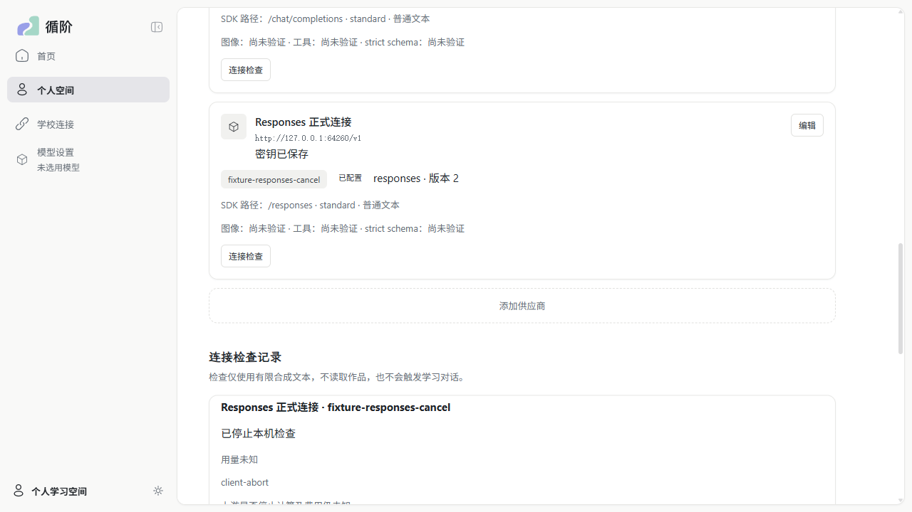

# PR #177 Windows、真实跨机与 DeepSeek 补验

2026-11-03（Asia/Shanghai）。负责人在 [PR #177 审查修复](wp06-pr177-review-fixes.md) 合并后明确追加：Windows 和真实跨机一起验收，DeepSeek 少量真实请求，Command Code 继续豁免；发现问题直接修复并补齐记录。

## 环境与包

- 基线 `main@5aeb49ee2e9fae7319331a732111cfbce15b967f`，即 PR #177 合并结果。补验发现的前端修复为 `4660e1d`，通过 [PR #186](https://github.com/paher-din/XunJie/pull/186) 交付。
- 学校宿主：macOS 27.2 arm64，`192.168.3.16`；产品 HTTPS `:19445`，独立受控 HTTPS 上游 `:19446`。
- 设备：`LAPTOP-S7A4IQFU`，Windows 11 家庭版中文版 x64 build 26200，`192.168.3.8`；独立 `model` profile，有自己的 PostgreSQL、模型 owner 和加密凭据，不含 `learning-data`。
- 包内 Node 24.21.0、PostgreSQL 18.6。桌面 Chrome：Windows 156.0.8078.79，macOS 156.0.8078.80；headed、单 worker。
- SSH 只控制任务和取回脱敏证据，没有端口转发。配对、授权、任务轮询走实际 LAN HTTPS，受控上游记录的五次请求源地址全部为 Windows `192.168.3.8`。
- 普通用户桌面通过 `Interactive/Limited` 计划任务运行。首轮 SSH 原生 PG 测试使用提升令牌，不能单独用作普通用户证据；Chrome 与跨机设备进程使用非提升令牌。

基线包和修复包分别保留 `product-{mac,win}` 与 `product-{mac,win}-r2`，避免覆盖运行中的实例。两版 `app/cli.js`、`app/daemon.js`、`app/product-runtime.js` 逐文件 SHA-256 完全相同，因此跨机后台证据适用于最终包；前端变更另外用 r2 包完整复跑 Chrome。包及源码指纹见 [provenance](evidence/pr177-platform/package-provenance.json)。

## 发现与修复

Windows 首轮 Chrome 为 8/9。保存成功后弹窗关闭，列表尚未完成异步 GET，立即点击连接检查会使用旧 version，收到 `conflict`。单纯让测试等待版本更新只能绕过这个窗口。

`PersonalModelSettings` 现在直接应用 POST 返回的权威连接，并推进读取发布代次：保存前发起的迟到 GET 不能覆盖新回执，乱序轮询也不能倒灌。后续实际读取仍可显示备份恢复后的较低版本，不永久锁死历史最大版本；较新轮询仍 pending 时，已经完成的读取仍可发布。

两个真实 React/Radix 回归先红后绿：弹窗关闭后立即检查卡片及实际 POST 的 `source.version=2`，释放保存前旧 GET 后仍为 v2；再验证重叠轮询和后续恢复 v1。组件文件 20/20、两组 TypeScript 检查通过。Chrome 用例增加弹窗关闭后的非重试版本断言，最终包不靠延长等待掩盖竞态。

## 实际结果

| 检查 | 结果与证据 |
| --- | --- |
| Windows 基线正式包原生 PostgreSQL | 12/12，0 skipped；SSH Session 0 提升令牌，单独计证 |
| Windows 基线 Chrome | 首轮 8/9；同步可见版本后 9/9，但该轮不等于生产竞态修复 |
| 最终 r2 macOS 正式包 Chrome | [9/9](evidence/pr177-platform/mac-r2-chrome-results.json)，0 skipped，29.6s |
| 最终 r2 Windows 正式包 | [PG 12/12、Chrome 9/9](evidence/pr177-platform/windows-r2-summary.json)，0 failed/skipped/flaky；均为 Session 1、非管理员；distribution 清单 219/219 hash 匹配 |
| LAN HTTPS 真实跨机受控场景 | 配对与固定目标、学校成员目标权限、能力预检、图片/双工具、Windows 重启原生回放、物理取消、转义凭据扣留、设备离线队列、学校断线恢复均通过 |
| DeepSeek | [实际 5 次、全部 HTTP 200、无生成重试](evidence/pr177-platform/deepseek.json)；Responses 保留预算截断，图片工具往返与重启成功，详见下节 |
| 工程门禁 | `verify --group prepare` 通过（含构建、类型和文档检查）；`verify --group unit` 23/23 通过；最终正文与证据的 docs 检查通过；远端门禁以 PR #186 当前检查为准 |
| Command Code | 负责人明确豁免，0 次调用 |

跨机原始脱敏记录见 [cross-machine.json](evidence/pr177-platform/cross-machine.json)。该次整体 `status=failed` 原样保留：十个学校/跨机场景都 passed，随后第一次 DeepSeek 派发因下述 DNS 环境在发送前失败；后续五次真实上游的独立完整记录是 [deepseek.json](evidence/pr177-platform/deepseek.json)。其中 `state=failed / credential-in-tool-output` 是预期的凭据门禁成功：无可执行工具意图，原生正文扣留；`upstreamStopped=unknown` 保留未知上游事实，不将关闭本地连接解释为供应商停止计费。

受控跨机只有五次上游生成：首轮双工具、带图工具续聊、挂起取消、合成凭据负例、离线恢复。重复 dispatch 不增加请求；设备停机的 12 秒内学校无代发；学校停机重启后读取原 `resultRef`，无重新生成。首轮与续聊原生 assistant 的 canonical hash 相同，工具组完整后才出现图片 user 消息，实际图片字节 SHA 与固定资源一致。

## 真实 DeepSeek

使用 Windows 设备自己的个人连接、选择、原生段和已认证学校任务派发；密钥只从负责人已有私有凭据文件读取，经 SSH stdin 交给设备加密保存，不进入命令参数、记录或 Git。

预算为三协议文本各一次，以及 Chat thinking 图片/双工具首轮和重启续聊各一次，共最多五次，无自动重试。使用 `deepseek-flash`；文本上限 128 output tokens，图片工具请求上限 2048，每次物理请求上限 30 秒。原生 reasoning 只留在产品私有资源，不作为公开证据。

| 实际请求 | HTTP / 结果 | 观察 |
| --- | --- | --- |
| 1 Chat 文本 | 200，completed/stop，final | input 14 / output 5 / total 19；没有命中脚本最初额外要求的固定字面量，仅计协议连通性，不宣称该字面量遵循度通过 |
| 2 Responses 文本 | 200，incomplete，final | input 14 / output 128 / total 142，非空文本；达到本次小预算上限，保留截断事实，不记作 completed |
| 3 Messages 文本 | 200，completed/end_turn，final | input 14 / output 6；非空文本，供应商未给 total 字段，不补算成已报告值 |
| 4 Chat thinking 图片＋双工具 | 200，completed/tool_calls，final | 正确读出初图左侧 red，并在同一响应返回两个工具；input 602 / output 52 / total 654 |
| 5 重启后工具图片续聊 | 200，completed/stop，final | 正确带回随机 nonce、读出返图左侧 blue；原 assistant hash、工具组与固定图片字节均吻合；input 978 / output 81 / total 1059，reasoning 43 |

文本冒烟脚本最初把固定字面量和 completed 都当作供应商协议验收条件，分别在请求 1、2 后停止。这些断言不等于产品错误：此次要求是小预算真实协议与持久化验收，合法预算截断必须保留。修正脚本后从已有回执继续，仅执行剩余场景，没有重发前两次；[首次 wire 后断言](evidence/pr177-platform/deepseek-first-wire-attempt.json) 与 [第二次 wire 后断言](evidence/pr177-platform/deepseek-second-wire-attempt.json) 均保留。`scope=paid` 支持只补付费部分，`previousPaidReport` 只允许复用有 HTTP 200、resultRef 和合法终态的文本回执；外部 witness 跨所有运行累计恰好 5 次。

两台机器最初都受到代理 fake DNS 影响：Windows 将域名解析为 `198.18.0.8`，Mac 为 `198.18.0.132`，属于产品拒绝的保留测试网段；首次派发记录 `unknown/result-unconfirmed`，设备 observer 0 次上游，未消耗付费请求。为验收真实公网路径，从 AliDNS 与 Cloudflare 的 HTTPS DNS 查询核实公网地址，临时给 Windows 的该域名映射 `61.170.82.99`，无凭据 HEAD 验证正常 TLS 后执行五次请求。没有放宽产品网络门禁，也没有关闭 TLS 校验。[DNS 证据](evidence/pr177-platform/dns-environment.json)、[恢复回执](evidence/pr177-platform/hosts-restored.json) 表明验收后 hosts 与原文件逐字节 SHA 相同。该结果依赖有效公网解析，不证明代理 fake-IP 模式与保留地址门禁兼容。

设备端只对这次明确允许的上游加一个验收 fetch observer，真实请求仍由正式包 SDK 直连供应商。产品正常启动会清除 `NODE_OPTIONS`；因此观测进程显式以 `node --import <observer> <unchanged packaged daemon> --root ...` 启动，不修改产品包或将请求改走代理。observer 在外部 witness 文件跨重启累计次数并在第六次发送前拒绝，持久化的只有协议、HTTP status、角色/工具 ID、图片与 assistant hash；不保存 key、消息正文或隐藏推理。

## 复跑与证据边界

工程与浏览器入口：

```sh
node scripts/package-product.mjs --platform win32-x64 --out <fresh-win-package>
node scripts/package-product.mjs --platform darwin-arm64 --out <fresh-mac-package>
# Windows 使用包内 Node，设置 XUNJIE_PRODUCT_TEST_PACKAGE 后执行：
node --test --test-reporter=tap apps/server/tests/model-review.runtime.test.mjs
# apps/web；使用系统 Chrome 与最终完整包：
XUNJIE_PRODUCT_TEST_PACKAGE=<package> XUNJIE_PRODUCT_POSTGRES_BIN=<pg-bin> \
  XUNJIE_E2E_BROWSER_CHANNEL=chrome XUNJIE_XJ_DEV_URL=http://127.0.0.1:1 \
  npx playwright test e2e/personalModelSettings.spec.ts --headed --workers=1
```

跨机入口是 [probe-model-paired-device.mjs](../../scripts/probe-model-paired-device.mjs)。配置 JSON 提供 `commit/lab/product/out/ssh/host/deviceIp/schoolPort/fixturePort/certificate/key/deviceLauncher/credentialsFile`；先准备自己拥有的独立目录、两台正式包、可信测试 TLS（学校服务器私钥仅在 Mac）、Windows 非提升桌面任务及控制 launcher。Windows launcher 的 `fixture/paid` 参数分别对应独立 root 和 witness 文件。设备启动 [model-paired-device.mjs](../../scripts/model-paired-device.mjs) 的 `--listen <loopback-port> <private-control-token-file>`；SSH 内 [model-device-bridge.mjs](../../scripts/model-device-bridge.mjs) 只桥接带认证的本机控制 RPC。`XUNJIE_ACCEPTANCE_UPSTREAMS` 明确列出受控及三协议 DeepSeek URL，`XUNJIE_ACCEPTANCE_MAX_REQUESTS=5`；设置两端 `NODE_EXTRA_CA_CERTS` 后运行：

```sh
node scripts/probe-model-paired-device.mjs --config <private-run.json>
```

本轮 Windows 部署脚本的无密钥副本：[准备任务](evidence/pr177-platform/device-prepare.ps1.txt)、[启动中继](evidence/pr177-platform/device-start.ps1.txt)、[普通用户服务](evidence/pr177-platform/device-server.ps1.txt)。它们记录本轮实际路径，复跑时替换为新独立目录，并把三个设备端 mjs 放到同级；launcher 是调用 start 脚本、透传 `fixture/paid` 的 cmd。准备脚本只能在服务已停时运行，避免更换活跃控制 token。[设备桌面证明](evidence/pr177-platform/device-proof.json) 中 Session 0 是 SSH 控制中继，真正 RPC 服务和产品 daemon 为 Session 1。

最终 Windows 的 [普通用户环境](evidence/pr177-platform/windows-r2-session.json)、[Node/PG 原生进程](evidence/pr177-platform/windows-r2-processes.json)、[PG 原始 TAP](evidence/pr177-platform/windows-r2-pg.tap)、[清理](evidence/pr177-platform/windows-r2-cleanup.json) 分开保留。保存竞态的 [原实现失败](evidence/pr177-platform/save-race-red-original.log)、[迟到 GET 失败](evidence/pr177-platform/save-race-red-late-read.log)、[重叠轮询失败](evidence/pr177-platform/save-race-red-overlapping-polls.log) 与 [最终组件通过](evidence/pr177-platform/save-race-green.log) 形成红绿记录。



这是显式付费验收入口，不进入默认测试或 CI。重跑前必须核对已有 paid witness，不能清空记录以绕过预算。学校与设备的临时产品环境已由 `stop/deleteEnvironment` 清理；临时控制 token、TLS 私钥、计划任务、浏览器数据、基线包和解压源码已删除，保留最终 r2 正式包和证据。[设备清理](evidence/pr177-platform/cross-cleanup.json)、[Windows 临时源码/包清理](evidence/pr177-platform/scratch-cleanup.json)、[Mac Chrome 环境清理](evidence/pr177-platform/mac-cleanup.json)、[本机临时文件清理](evidence/pr177-platform/local-scratch-cleanup.json) 单独计证；验收进程残留为 0。

前期控制器失败均发生在付费请求前：Windows ESM preload 需要 `file:///`；Interactive 任务需使用实际用户 SID；控制 RPC 的认证字段必须叫 `controlToken`，避免覆盖产品授权的 `token`。这些是验收脚本装配错误，记录中不计为产品通过或供应商失败。首轮 Windows 保存竞态则是实际产品问题，修复与复跑分开计证。

本轮不评价教学效果，不以浏览器组合事件代替物理中文输入法验收；签名和公证继续沿用负责人本轮豁免。其余未执行项不计通过。
