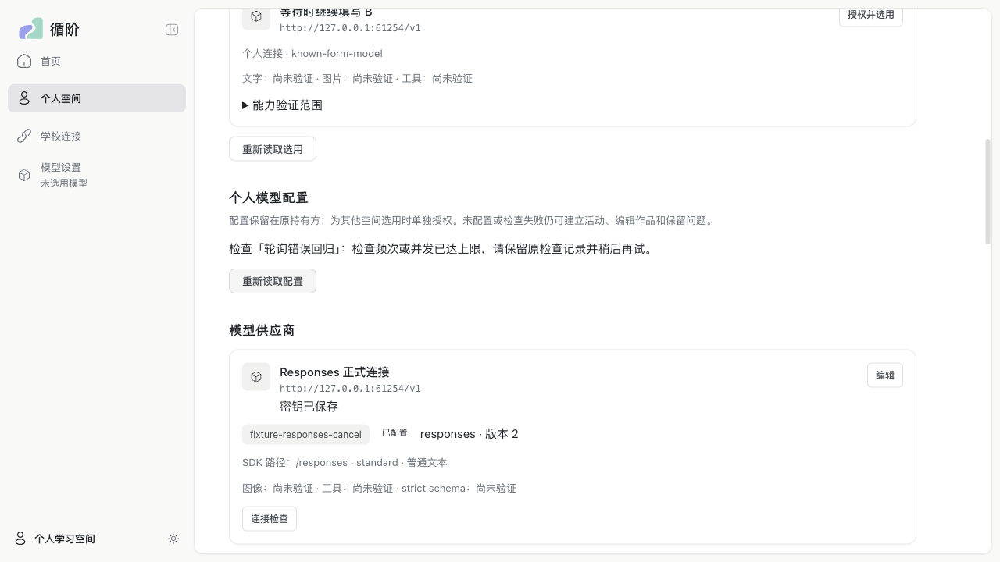
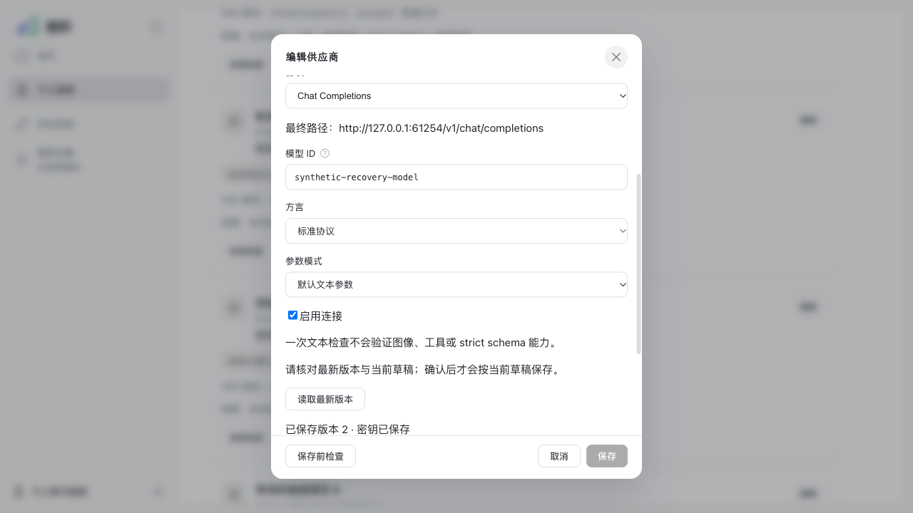
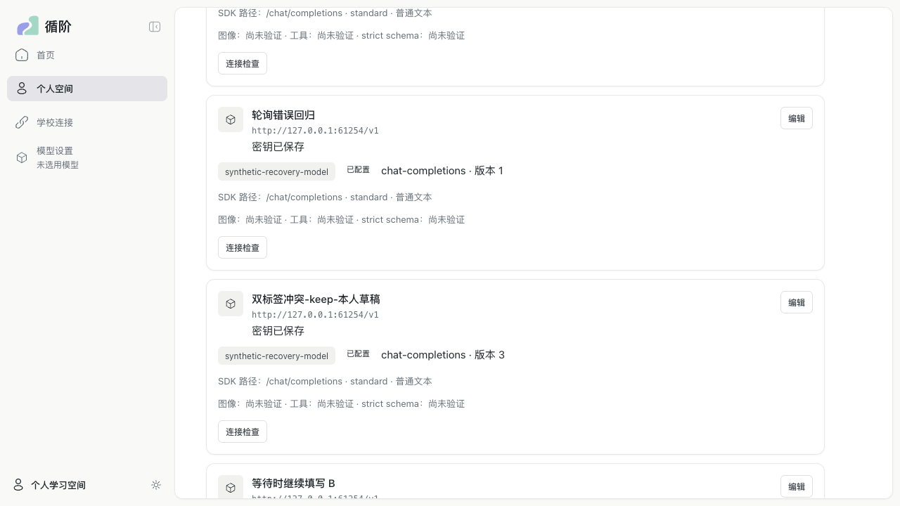

# PR #177 审查修复与回归

2026-11-03（Asia/Shanghai）。修复依据为负责人提供的 `XunJie-PR177-review-evidence.zip`，固定审查 HEAD `0e75a0e3a19c75f4bef4c48440953f011e8eff56`、基线 `f0979d5794c977f077a30d6abc8716af7f3a925d`。首批修复提交 `735d275`，后续补齐非成功终态和被拒绝事件的凭据门禁，继续由 [PR #177](https://github.com/paher-din/XunJie/pull/177) 交付；本轮负责人已授权在确认修复后合并 main，取代前次交付中的保持草稿要求。

## 逐项结果

| 发现 | 修复后的行为 | 回归证据 |
| --- | --- | --- |
| STD-01 / P1 凭据公开投影 | 三协议共享发布前门禁；在协议参数反序列化、文本/参数分片聚合后检查，命中则拒绝成功/工具意图，清空可重建凭据的原生正文，不改写签名伪造回放 | Unicode/JSON 特殊字符、跨 delta、未结束/畸形工具 JSON、隐藏块；真实 Gateway/PG 的资源与重启查询；配对设备任务回执 |
| STD-02 / P2 轮询清除操作错误 | 读取与操作错误分离，迟到 GET 不抹掉失败；错误带操作/连接身份，主体切换整体隔离 | 真实 React 交错 GET/POST；Chrome 两次轮询后仍显示限额失败，主动重试成功后清除 |
| SPC-01 / P1 持有方目标权限 | 可信产品装配选择学校/设备政策；学校普通成员仅公网 HTTPS，维护者明确批准的学校内部目标与获准设备 loopback/私网模型保留；保存、快照、派发检查，全部 DNS 答案校验，实际连接固定地址且不重定向 | IPv4/IPv6、特殊地址、混合解析和重绑定；真实学校成员保存/草稿被拒、trap 0 请求；管理员默认与设备调用成功，停用后未派发者被拒 |
| SPC-02 / P2 CAS/未知保存恢复 | 草稿、密钥意图与 baseline 分离；原弹窗显式读取/比较后确认重试；未知提交先以相同 requestId/payload 核对，不创建新写入身份 | React 和 Chrome 双标签 keep/replace/clear；真实 owner 已 COMMIT 而浏览器 ACK 丢失，核对原回执后保存后续草稿 |
| SPC-03 / P2 能力判定 | `POST models/capabilities` 和段创建共用判定器；公开固定 route/version、全部缺项、证据/限制与装配策略；缺项返回 HTTP 422 / `capability-unavailable`，学校转发保留该 DTO | images/nativeReplay、strict schema/tools 和 thinking/forced-tool 同时缺项；无外发、无换路线，探针不晋升证据 |
| SPC-04 / P2 上游事实 | 三协议共享白名单 HTTP status/request ID/Retry-After 采集，持久保存并在重启后保留，无自动重试 | 429/503、秒数/HTTP 日期、缺失/非法/敏感头；三协议真实 PG 和重启查询 |
| SPC-05 / P2 Chat 终态后 reset | 仅传输中断让位于有效协议终态；格式错误、矛盾终态、半参数、显式上游错误和资源上限仍不可消费 | stop/tool_calls + reset、晚 abort 与负对照；真实 PG completed、工具意图与 resultRef 重启稳定 |
| SPC-06 / P2 Messages 截断 JSON | block_stop 不抢先抛出丢掉后续事实；继续有界读取 max_tokens/message_stop 与用量，截断参数无工具意图 | 截断/完整/畸形参数、最终/零/部分/未知计数、终态后 reset；真实 PG 和重启 |
| SPC-07 / P2 多工具带图顺序 | 全部 role=tool 先配完，再追加带原 callId/固定资源版本的图片 user 消息 | 首工具带图、双工具带图、逆序结果；实际 SDK wire；真实 PNG/PG 重启后完整历史逐字节相同 |
| SPC-08 / P2 截断最终 usage | usage finality 与业务 completed/incomplete 独立；length/content_filter 可为 incomplete/final，缺字段不补零 | 完整/部分/缺失/全零计数、终态前临时 usage；真实 PG 与重启 |
| SPC-09 / P2 原始流字节上限 | SDK 解析前对 raw body 限界 2 MB，覆盖注释、半帧和小事件累计，明确 response-limit | 2.1 MB comment/未闭合 data、多事件超限、恰好 2 MB；真实 owner 的限界失败可持久查询且不重发 |
| SPC-10 / P3 空 end_turn | 合法无内容块的 end_turn 保留完成/用量；未闭合块、错序和未知块仍失败 | 空终态/空文本块 × final/partial/unknown/zero，原生回放；真实 PG 和重启 |

实现与接口说明见 [模型 owner README](../../packages/model-gateway/README.md)。公开字段为增量契约，本轮没有新增数据库 schema，也没有重解释旧原生记录；既有学校内网个人配置仍可读取，但不能绕过新的派发政策。

## 实际验证

本机 macOS 27.2（26B123）/ arm64，Node 24.21.0、PostgreSQL 18.6（18.6.1 发行版），安装版桌面 Chrome 156.0.8078.80，headed、单 worker。合成上游均由本轮自行启动，不读取真实模型密钥、不调用付费供应商。

| 检查 | 结果 |
| --- | --- |
| 新增 SDK/网络/能力定向回归 | 181/181 通过，5 个文件，含真实 SDK 与受控 HTTP/SSE |
| 设置页真实 React/Radix 回归 | 18/18 通过；jsdom 26.1.0 已加入锁文件，测试不依赖外部 NODE_PATH |
| 新增真实 Gateway/PostgreSQL 回归 | 12/12 通过，含学校权限、原生资源、重启、能力决策、原始流上限、非成功结构化输出和被拒绝原生事件 |
| 既有 Gateway/三协议/选择/客户端/配对恢复回归 | 功能回归 114/114 通过；该组早于最后的 malformed 正文扣留补充，最终包 12/12 单列覆盖补充行为。另配对设备两组通过（同机独立进程），含转义凭据任务回执、原生资源及设备重启 |
| 完整 `npm run verify` | 通过：prepare 四项、build:test、unit 23/23、server 83/83、tools 45/45；日志汇总 `.verification/2026-11-03T12-28-25-740Z-EH3wbs/summary.json`。默认门禁不包含 external PostgreSQL 测试，上行单列 |
| 桌面 Chrome 普通 Web | 9/9 通过（首次 6 项与修正 modal 背景选择器后的 3 项），真实产品页面、owner 与 PostgreSQL |
| 桌面 Chrome 完整 macOS 产品包 | 9/9 一次通过，包含轮询失败保留、三种密钥意图的双标签恢复及 ACK 丢失 |
| macOS 完整包构建与原生回归 | `darwin-arm64/full` 通过；`distribution.json` SHA-256 `30e65c1b9e6bf4f869562c90425b1b2abcaa096e9dad2c9c35d618aa962992d5`，包内 CLI/Node/PG 的实际调用已由 Chrome 用例覆盖；同一包执行新增原生 PostgreSQL 用例 12/12 通过 |

复现附件中的协议和图片脚本已用修复后的生产 dist 原样重放：Chat 终态后 reset 为 completed/final，length 为 incomplete/final，超限 comment 为 response-limit，Messages 截断 JSON 保留 max_tokens/final，空 end_turn 为 completed/final；多工具 wire 的 `interruptions=[]`；三协议 429 都保留 `fixture-429-request` 和 17 秒提示，每项只有一次请求。合并前独立源码反例复核又捕获非成功结构化文本及被拒绝参数事件中的转义凭据；新增边界测试先 16/25 失败，补齐共享门禁与原始事件字段聚合后 49/49 通过，普通文本控制仍不猜测 JSON。真实 PG 新增五组覆盖完整/截断结构化文本、晚到/错误序号事件，并确认失败结果的资源已清空。矩阵复核进一步覆盖逻辑索引交错、重复 snapshot、未支持 MCP/shell 的 JSON 和 logprobs 主 token；无法解释的 malformed/invalid-native 正文统一扣留，仅持久保留安全结果 envelope、终态/用量/上游事实，合法截断不受影响。凭据脚本只将确认缺陷的断言改为修复预期，输入与 SSE 保持原样，三项结果均为 failed，公开工具参数与原生 chunks 不包含/不能重建 synthetic key。

地址附件的 schema/adapter 路径仍允许 loopback，因为合法设备与管理员批准的模型需要它；这不能作为学校普通成员的授权结论。本轮以实际学校 HTTP 身份、owner 与 PG 的拒绝和 trap 0 请求证明该权限边界，设备请求继续走已认证任务通道。

首轮完整门禁暴露新增 HTTP 池依赖在纯生命周期 bundle 中被提前加载，已改为派发时加载并定向验证通过。两组复现工具还原测试因未提交的新锁文件与 HEAD 不同被正确拒绝，在提交候选后复跑；首次失败不记为通过。首次 Chrome CAS 用例误用被 Radix 隐藏的背景 accessible region，已改为验证背景 DOM 更新，三项全部通过。一次并行重建 dist 造成旧 PG 组的瞬时启动失败，停止重建后的定向复验通过；最终以稳定构建上的复跑结果为准。

附件原输入的修复后摘要：[终态和用量](evidence/pr177/adapter-repro-results.json)、[三协议上游事实](evidence/pr177/upstream-facts-results.json)、[凭据](evidence/pr177/chat-credential-probe.json)、[工具图片次序](evidence/pr177/multi-tool-image-results.json)。这些受控上游结果与 PG/产品包验收分别计证。

复跑入口（先用仓库固定 Node 完成 `npm ci` 和构建）：

```sh
node --test --test-concurrency=1 apps/server/tests/model-sensitive-boundary.test.mjs apps/server/tests/model-protocol-review.test.mjs apps/server/tests/model-messages-review.test.mjs apps/server/tests/model-capability-images.test.mjs apps/server/tests/model-network-policy.test.mjs
node --test --test-concurrency=1 apps/server/tests/model-review.runtime.test.mjs
# PostgreSQL 行需 XUNJIE_PRODUCT_POSTGRES_BIN；既有三协议与配对 runtime 测试使用同一环境。
# 在 apps/web：
npx playwright test e2e/personalModelSettings.spec.ts --workers=1 --headed
# Chrome 设置 XUNJIE_E2E_BROWSER_CHANNEL=chrome；普通 Web 指向 XUNJIE_PRODUCT_WEB_ROOT，
# 正式包指向 XUNJIE_PRODUCT_TEST_PACKAGE。
```

## 设置页恢复界面

仅补操作失败和配置冲突恢复流程，沿用现有布局与 token。以下为本次实际 Chrome 产品包界面中的失败、核对与恢复状态，不把同版页面的交互前状态冒称修改前版本。







## 验证边界

首轮重新执行的是上述 macOS 工程、真实 PG/SDK、同机独立进程配对和桌面 Chrome 路径，当时未重跑 Windows、真实跨机与付费端点。负责人随后追加补验并继续豁免 Command Code，当前结果与新发现的保存版本竞态修复见 [Windows、真实跨机与 DeepSeek 补验](wp06-pr177-platform-acceptance.md)，不再将首轮未执行状态当作最终验收结论。教学效果未评估。物理中文输入法不由浏览器组合事件测试代替。
