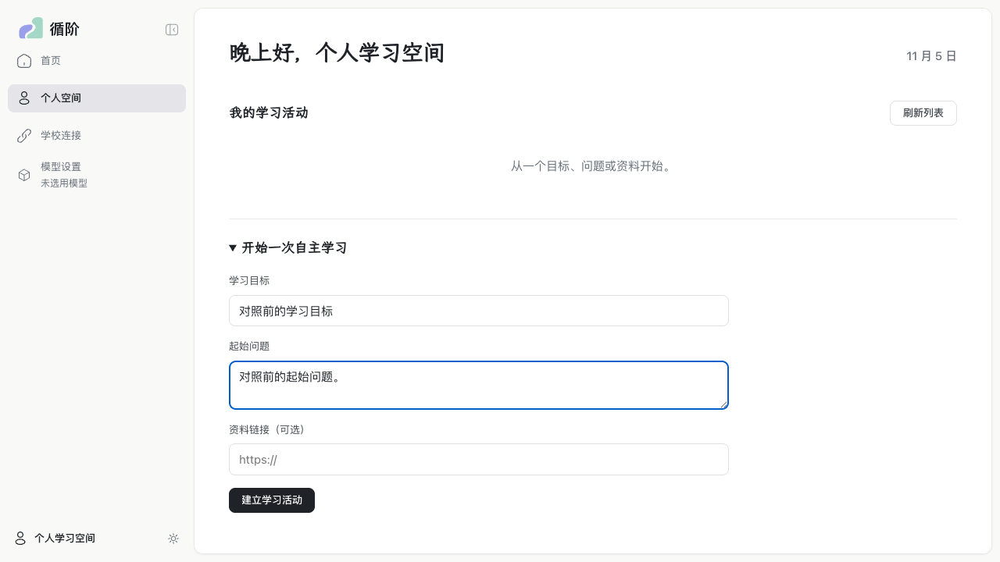
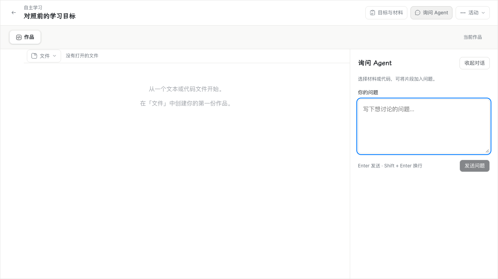
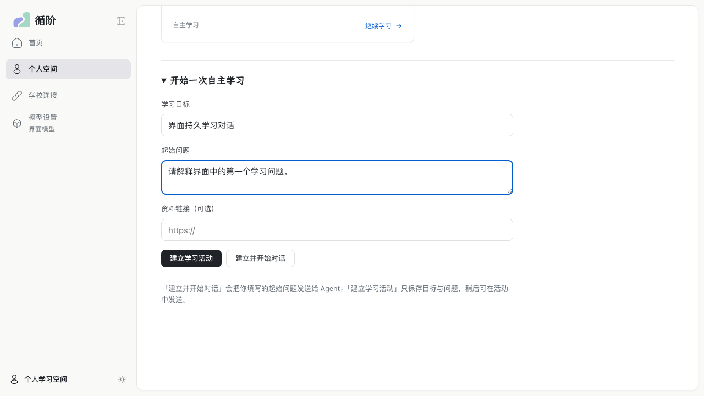
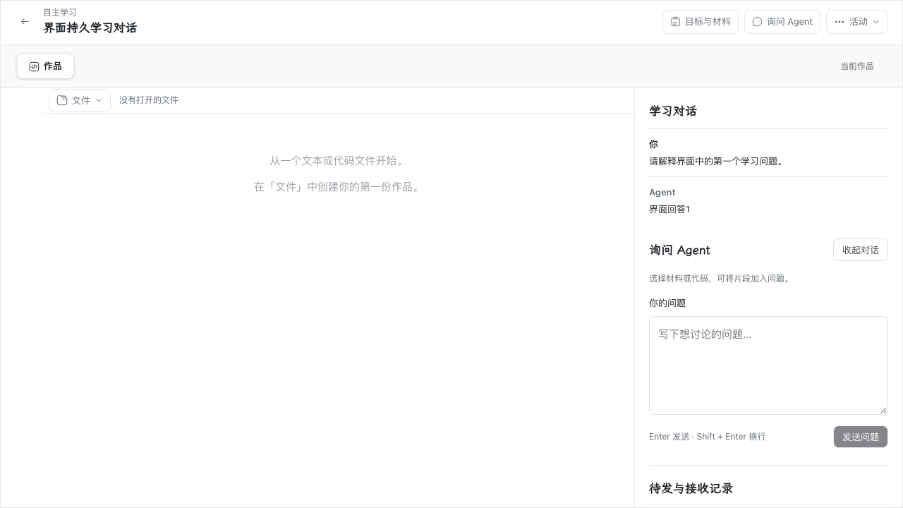
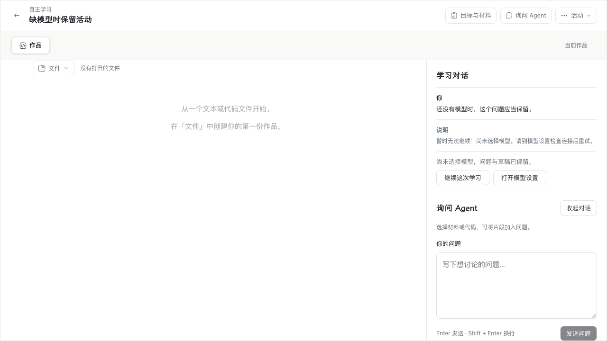
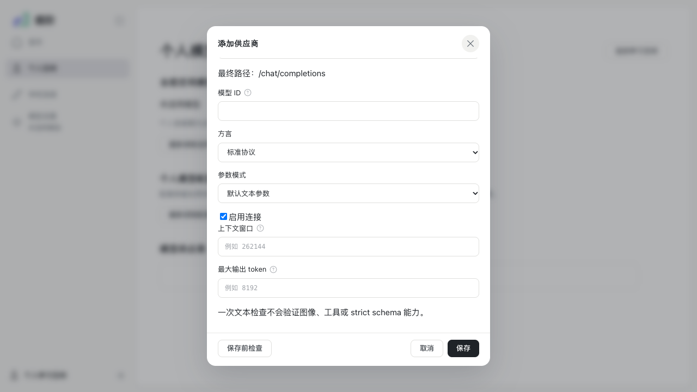
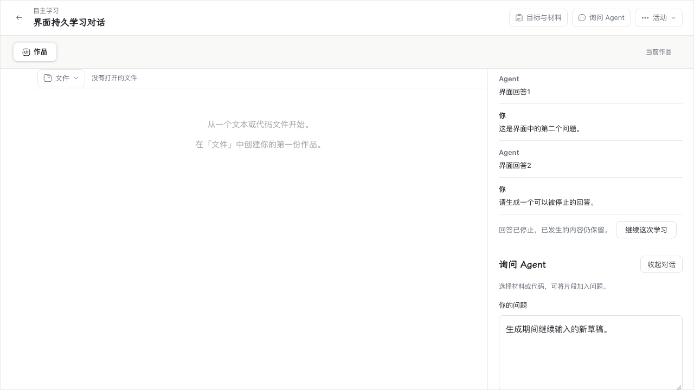

# WP07 #197 可恢复的基础学习对话

2026-11-05（Asia/Shanghai），分支 `wp07`，双轴审查基线 `6b4c3ee`。实现见 [teaching-agent README](../../packages/agents/README.md)，审查记录见 [双轴审查](wp07-197-code-review.md)。

## 本轮范围决定

按修订版 [Issue #197](https://github.com/paher-din/XunJie/issues/197) 的范围决定执行：

- 不建设 token、成本、调用次数、Run 步骤数、累计生成时长或硬期限额度；保留实际 `usage` 事实与 unknown 状态。学校模型的预算以后按需设计。
- 不自动摘要、不任意截断历史或作品；容量不足保留完整输入与原生资源并暂停。
- 生成期间允许继续编辑，新问题作为可靠草稿等待当前 Run 结束；steering / queue 留给 #200。
- 工具、完整上下文选择与压缩、独立部署、跨安装接管分别留给后续实施票。
- 不建设旧数据兼容层；课程发布、活动绑定和导入都要求显式版本化帮助策略，开发样例、探针与脚本同步更新。

## 实现结果

### 所有权、接收与 session log

- 新增独立 PostgreSQL owner，迁移保存 `teaching_requests`、`teaching_runs`、`teaching_sessions`、`teaching_events`、`teaching_snapshots` 及所属资源。
- 复用 WP02 `ActionReceiver`：同身份同内容返回原回执，换内容冲突；接收前取消写入持久取消记录，迟到派发不能复活请求；接收、Run、输入和日志同事务提交。
- 活动级 `teaching_events` 使用数据库分配的稳定 `seq`，对话游标取最后返回事件的 `seq`，重复读取不增加模型调用。
- `RunDriver` 使用 `clock_timestamp()` 领取代际和 lease，条件提交保证单一推进权。lease 只用于推进权核验，不作为生成期限；过期接管先按原 attempt 身份查询/续接，已接受未派发的 attempt 由新推进者继续派发，不重复付费生成。
- 停止先持久关闭新尝试准入，再取消原调用；已发生正文和终态分别保存。失败或终止后 `continue` 建立关联后继 Run，原终态不复活。

### 增量正文公开

- 三协议 transport 在收到每个文本分片时调用可选 `onText`；`ModelGateway` 只对正式学习用途接收进度。
- `createProgressPublisher` 在敏感输出校验之后发布安全前缀：至少扣留凭据长度的尾部字符，完整凭据一旦出现立即停止发布；空凭据不扣留。
- 进度按 `model_attempt_progress` 的单调修订持久化（迁移 11，`attempt_id` 主键，`FOR UPDATE` 写读）。较短或重复正文不覆盖较长事实。
- `RunDriver` 只读取已持久化的进度，按最后公开的版本和长度追加 `assistant-progress` 事件；派发前重新核验推进权。事件携带 `runId/attemptId/segmentId/revision/length/delta`。
- 对话投影以 `operationId('teaching-assistant:' + attemptId)` 合并同一 attempt 的进度和最终 `assistant` 消息：最终正文替换预览，不产生第二条助手消息；已停止或失败保留已发生正文。
- 界面复用 `Markdown` 的 live 渲染和 `turn-caret`；停止请求先进入“已请求停止，等待上游收尾…”，实际停止后保留部分正文并标记截断。

### 上下文与快照

- `ContextBuilder` 分开平台指令、运行职责、课程规则、本次引用/作品/问题和跨 Run 历史；真实 `student/assistant` 角色进入原生段可移植前缀。
- 模型连接、固定前缀或配置变化时封存旧段并建立新段；同一配置下跨 Run 连续推进，不因 Run 结束自动换段。
- 每次外发前保存不可变快照：装配正文、来源、模型参数、`payloadSha256`、稳定关联的 segment / attempt / 原生请求资源。重建只读取已保存事实。
- 容量把最终原生 payload 字符数与输出预留作为计数不确定性记录（`counter:"unavailable"`），不把字符数换算成 token，也不缩小保存的 `contextWindow`。只有超出学习传输边界（系统前缀 400,000 字符或用户文本 1,000,000 字符）时保留完整输入并暂停。

### 模型与课程策略

- WP06 `ModelGateway` 增加正式学习用途：同一选择、授权、segment/check 状态机、三协议 SDK 和原生结果资源；学习调用不受探针次数、段序号、输出或时间上限约束，使用保存的 `contextWindow` / `maxOutputTokens`，不再被 2,048 输出上限静默改写。
- `models/calls` 仍只接受探针；学习 attempt 只由受认证的 `RunDriver` 在自己的 owner 内接收。
- 课程导入、持久化发布、活动绑定和读取都要求版本化 `helpPolicy`；`questions:"disabled"` 时接收前直接取消，不产生模型调用。

### 正式 UI 与恢复

- 首页提供“建立学习活动”和“建立并开始对话”：后者先把首问写入可靠草稿和固定请求身份，再建立无课程活动并通过同一活动模型发送；刷新后不会把“只建立活动”误判成自动发送。
- 活动页新增“学习对话”：显示学生/Agent/系统消息、Run 状态、停止、继续和缺模型设置入口；助手正文复用现有 `Markdown` 排版。带首问或待发送首问的活动自动展开对话。
- 生成期间新问题保留为可靠草稿，发送按钮显示“等待当前回答”；活动切换隔离旧请求的迟到回复。
- 共享输入组件处理中文组合事件：组合期间 Enter 不发送，结束后才提交；打开对话时聚焦输入框，收起后焦点回到“询问 Agent”。
- 模型设置增加“上下文窗口”和“最大输出 token”，保存/读取/选择/学习请求使用同一配置版本。
- owner 接入迁移、资源保留、维护关闸、排空、验证、备份/还原/接管和恢复 namespace；普通重启后从原 attempt 继续。
- 还原安装的 namespace 护栏按精确路径豁免 `login`、`logout`、`client/start`、`client/complete`，并沿用 `manage/`、`connections/`、`native-channel/` 原有的管理员凭据或握手豁免；其余业务 POST 仍要求当前浏览器握手。

## 验证

本机 macOS 27.2 / arm64，Node 24.21.0，PostgreSQL 18.6（Homebrew），安装版桌面 Chrome 156.0.8078.80，headed、单 worker。合成上游用于产品路径与恢复测试；真实供应商验收单独记录。

| 检查 | 结果 |
| --- | --- |
| 完整构建与类型检查（contracts/storage/learning-space/server/product-runtime/local-runtime/web） | 通过 |
| 学习对话、Driver 竞争、进度发布、正式入口 runtime（真实 PostgreSQL、三协议 SDK transport、长上下文、课程策略、重启/停止/继续、快照重建、备份/还原/接管） | 20/20 通过 |
| 混合部署恢复 runtime（学校绑定作品、还原后接管、client 握手与 local-binding） | 2/2 通过 |
| 桌面 Chrome 正式产品页（首问、刷新、追问、生成期间草稿阻塞、增量预览、停止、课程问答、重启；含焦点与中文组合事件） | 4/4 通过 |
| Windows 11 桌面 Chrome 同一四场景 | 4/4 通过 |
| Windows 产品包构建、安装、启动与首问/回答/刷新冒烟 | 通过；5 个服务含 `teaching-agent` |
| 真实 DeepSeek 三协议问答 | 4 次有界请求，全部 HTTP 200；详见 [real-model.json](evidence/wp07-197/real-model.json) |
| 完整 `rtk bypass npm run verify` | unit 27/27；server 88/88；tools 44/45，仅 `xj-dev/tests/env-removal.test.mjs` 未通过，详见下文 |

### 工程结论

本轮改动的构建、类型检查、真实 PostgreSQL/SDK transport、三协议、增量正文、跨 Run 续接、配置变化隔离、快照重建、备份还原、混合部署恢复和桌面 Chrome 路径均通过。完整 verify 的日志与 summary 位于 `.verification/2026-11-05T16-24-48-801Z-QS7zUD/`；这是最终代码的收尾复跑，tools 失败全部集中在未改动的 `env-removal.test.mjs`。

### 真实模型结论

已执行。使用获准的既有私有供应商配置，模型 `deepseek-flash`，共 4 次有界文本请求，产品自动重试为 0：

- Chat Completions：128 输出上限的请求被 `length` 截断，记录实际用量；同一问题以 512 输出上限再次调用后 `stop` 完成，输出 143 tokens、132 字符。
- Responses：`completed`，输出 34 tokens、58 字符。
- Messages：`end_turn`，输出 40 tokens、69 字符。
- 每次请求都产生了持久进度修订，快照保存了当时的 `contextWindow`、`maxOutputTokens` 和 payload 哈希。

系统 DNS 把供应商解析到不可用的 fake-IP 段，验收通过仅限本次的 loopback HTTP 转发到供应商公网地址，并保持 TLS/SNI 校验；产品网络策略未放宽，DNS 未修改。凭据只在运行时读取，未写入证据、代码、提交或日志。该结果只覆盖这四次文本问答，不外推为限流、费用或所有课程场景的质量结论。

### 浏览器／产品包结论

- Apple Silicon：安装版 Chrome 跑了正式产品 runtime 与真实 PostgreSQL；首问、课程外活动、刷新后恢复、追问、生成期间继续输入并保留草稿、增量预览、停止、缺模型设置入口、焦点与中文组合事件均通过。
- Windows 11 10.0.26200：安装版 Chrome 156.0.8078.80（headless、非交互验收会话）跑同一四场景，4/4 通过；截图为 [teaching-home-win32.png](evidence/wp07-197/teaching-home-win32.png)、[teaching-conversation-win32.png](evidence/wp07-197/teaching-conversation-win32.png)、[teaching-course-win32.png](evidence/wp07-197/teaching-course-win32.png)、[teaching-stopped-win32.png](evidence/wp07-197/teaching-stopped-win32.png)、[teaching-missing-model-win32.png](evidence/wp07-197/teaching-missing-model-win32.png)、[teaching-model-settings-win32.png](evidence/wp07-197/teaching-model-settings-win32.png)、[teaching-restart-win32.png](evidence/wp07-197/teaching-restart-win32.png)。
- Windows 产品包：从同一工作树在 Windows 主机构建 win32-x64 未签名候选，安装、启动到 `ready`，服务列表含 `client`、`space-course`、`learning-data`、`model-connection`、`teaching-agent`；桌面 Chrome 冒烟完成首问、回答与刷新后重读。截图为 [package-conversation-win32.png](evidence/wp07-197/package-conversation-win32.png) 与 [package-conversation-reloaded-win32.png](evidence/wp07-197/package-conversation-reloaded-win32.png)。
- 详细环境、步骤与限制见 [windows-summary.json](evidence/wp07-197/windows-summary.json)。

### 教学效果结论

未评估。本轮只验证对话持久性、恢复性、输入路径和界面行为，没有课堂或学生样本，不能据此声明教学效果。

## 界面前后对照

修改前（基线 `6b4c3ee` 构建）首页只有“建立学习活动”；活动讨论只有草稿，没有持久对话：





修改后首页提供两种创建语义并说明差异；活动讨论显示持久消息、Run 状态、增量预览与停止/继续：





缺模型时保留活动、首问和草稿，并提供真实设置入口；设置弹窗新增上下文窗口与最大输出：







## 未完成项与边界

- **旧个人聊天页面**：正式产品 runtime 入口（`apps/web/src/runtime/main.tsx`）始终渲染共享的 `LearningApp`，首页、活动对话和课程问答共用同一对话控制器与可靠草稿。开发/准备构建的 hash 路由 `#/agent` 仍指向 legacy `AgentPage`，它有自己的旧控制器和独立 e2e，本轮没有迁移或删除；这是 PLAN“完整 Agent 页面共用控制器”的已知未完成项，不能声称该旧页面已接入新控制器。
- **竞态专项测试**：已有停止、重启、双推进者、未知结果暂停、取消持久记录、备份/还原/接管和三协议结果关联；取消竞争、提交失败/丢确认、结果关联前崩溃尚无逐条独立用例。
- **物理中文输入法**：macOS Chrome 已覆盖聚焦与组合事件下 Enter 不发送；Windows 验收为 headless 非交互会话，不声称物理中文 IME 通过。
- **视图隔离**：由 runtime 身份/授权测试和共享 UI 空间路由覆盖，没有单独的 Windows Chrome 视图隔离用例。
- **`tools/xj-dev/tests/env-removal.test.mjs`**：在未改动的 `tools/xj-dev` 上复现 `barrier CLI exited: 1` 与 mutex inode 断言失败，与本轮学习对话改动无关；完整 verify 因此退出 1。
- **教学效果**：未评估，见上。

复跑入口（先按仓库固定 Node 24.21.0 构建）：

```sh
PATH=/tmp/node24/bin:$PATH node scripts/build.mjs all
PATH=/tmp/node24/bin:$PATH npm run typecheck
XUNJIE_PRODUCT_POSTGRES_BIN=/opt/homebrew/opt/postgresql@18/bin \
  node --test --test-concurrency=1 apps/server/tests/teaching-agent.runtime.test.mjs \
  apps/server/tests/teaching-agent.driver.runtime.test.mjs apps/server/tests/model-progress.test.mjs \
  apps/server/tests/learning-entry.runtime.test.mjs
XUNJIE_PRODUCT_POSTGRES_BIN=/opt/homebrew/opt/postgresql@18/bin \
  node --test --test-concurrency=1 packages/product-runtime/test/hybrid-learning.runtime.test.mjs
cd apps/web && XUNJIE_PRODUCT_POSTGRES_BIN=/opt/homebrew/opt/postgresql@18/bin \
  XUNJIE_E2E_BROWSER_CHANNEL=chrome XUNJIE_XJ_DEV_URL=http://127.0.0.1:5999 \
  npx playwright test e2e/teachingConversation.spec.ts
```
