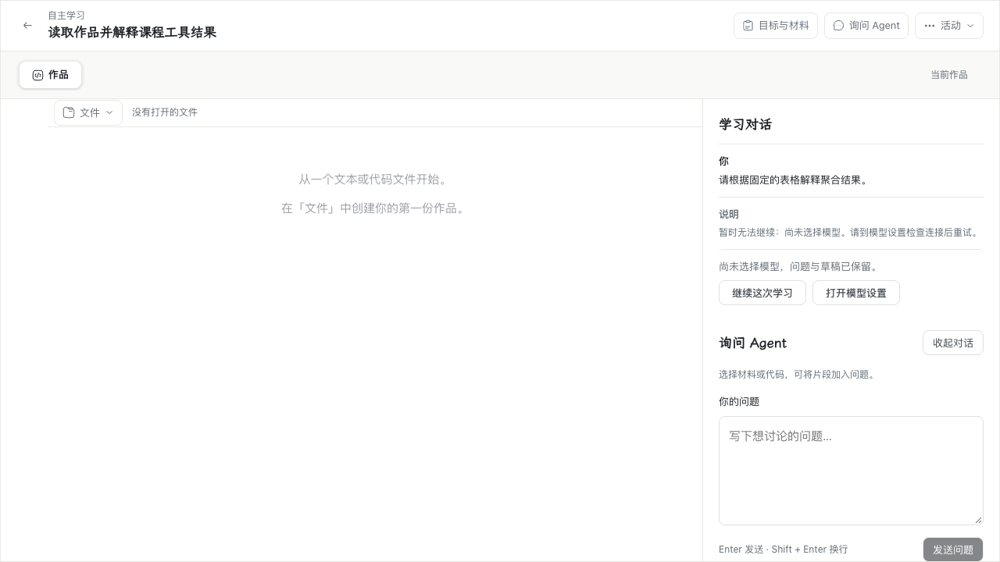
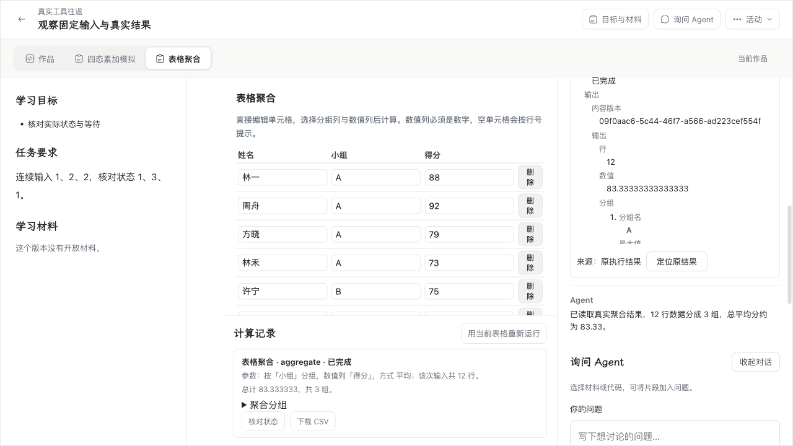

# WP07 #198：读取作品、课程工具与结果解释

本轮实现对应 [#198](https://github.com/paher-din/XunJie/issues/198)，基线 `e39462c`，分支 `wp07`。运行设计见[实施选择](specs/wp07-agent-tools.md)，所有权与接口见 [teaching-agent README](../../packages/learning-space/src/teaching-agent/README.md)，旧消费者的迁接归属见[入口迁移清单](wp07-198-legacy-consumers.md)。

## 实现

模型通过同一 `ModelGateway` 的原生工具接口选择 `read_work`、`read_reference`、`read_material`、`read_result`、`execution_query`、`execution_stop`；活动有获准组件时增加 `course_operation`。每次实际请求快照保存工具定义和版本。平台按固定授权校验工具参数，再由所属存储或 WP03 执行器完成真实读取、计算与状态推进，沿原生 call ID 把结果交回模型。没有动态工具发现、通用 shell 或作品代改入口。

- 作品使用本次可靠问题动作固定的对象与内容版本；发送后的编辑不替换依据。引用保留原范围与来源，课程文本材料来自固定发布；PNG 只走 WP06 已核实能力与持久资源。
- Driver 保存模型步骤、完整请求计划、原生结果关联、工具命令与 Wait。只有完整、已保存、可消费的原生结果产生工具意图；关联、步骤完成与全部意图在 Agent owner 同事务提交。恢复重读原结果，不重新生成。
- 每条命令保留原生 call ID、稳定独立 command ID、Run／步骤／快照、固定输入、对象条件、效果与执行位置。实际执行点复核课程资格、取消与派发许可；学生 HTTP 入口不能自报可信 Agent 发起者。
- 当前工具并行度为 1；共享冲突范围由持久事实协调。多步模型与工具命令预算在事务中扣留；实际用量沿原 attempt 唯一结算，unknown 保留预留，停止不覆盖已结算事实。
- 浏览器组件仍通过原有持久 broker、Worker 与 WASM 执行；原生组件仍通过受限会话执行器。首次领取固定浏览器身份，丢回包或重开只查询原身份；没有服务端伪计算或换节点重跑。
- 长任务先以真实接受回执闭合工具调用，再保存独立 Wait。等待释放连接与内存推进者，有界确定性程序查询原执行，结果作为有来源的新观察继续模型。重复结果只消费一次；到期暂停自动推进。
- 结果等待和原执行清理使用独立的 `result`／`cleanup` Wait。已完成输入不因停止被改写；原进程尚未退出时保留清理等待，Agent 重启后仍沿原执行核对并归档。过期 Wait 继续有界接收晚结果，终态 Run 不重新推进。
- 停止先关闭新派发，再停止该 Run 发起的原执行；独立学生实验不受影响。已经完成的输入、完成／停止竞争与可信晚结果保留原事实，终态 Run 不复活。撤权后只允许按原关联回收已有执行。
- 原生 outbox 在入队前中断后可凭原许可补齐投递；先停止或撤权时，所属 owner 核实未派发并持久取消。领取时的单条 Agent 命令取消与连接撤权分别处理，不因停止 Agent 而清理学生独立会话。

步骤、命令、Wait、预算、请求和完整结果资源已进入所属维护、保留与恢复验证；会话日志保存工具准备、许可、结果、配对和等待事实。原生摘要只读取已验证的实际摘要资源，无摘要不生成展示块。

## 产品变化

沿用正式学习工作区、活动对话和已有组件结果区。在对话中新增紧凑工具记录；展开可查看参数、固定输入、实际结果和来源，并定位到对应组件、历史观察或计算记录。等待与停止使用真实执行状态，刷新或重开保留原任务及未发送的新问题。普通 Web 的正式 `#/agent` 入口接入同一活动对话，保留消费者按清单归属，不再启用旧个人聊天发送循环。

取消的计算显示“已取消”；完成输入背后的会话分别显示仍在运行、正在停止或已确认停止。停止请求已接收不表示会话已结束，清理完成也不把未完成的原操作标为完成。

修改前的正式活动对话：

修改后，真实浏览器聚合结果同时出现在对话记录和原计算记录中：

界面复用原设计 token、明暗主题和工作区布局；输入、结果、来源与定位共用既有组件，没有新增第二个正式工作区。

## 验证证据

真实模型验收使用受限的 `deepseek-flash` [探针](../../scripts/probe-teaching-tools.mjs)：Chat Completions、Responses、Messages 各完成一次实际 `read_work` 与后续解释，共 6 次生成，均 HTTP 200，无重试。证据含协议、SDK 版本、真实工具结果、用量与回答摘要：[real-model.json](evidence/wp07-198/real-model.json)。探针的生成次数、输出和超时边界仅属于验收，不是产品配置。

Chrome 用例 [teachingTools.spec.ts](../../apps/web/e2e/teachingTools.spec.ts) 使用生产 HTTP、真实 PostgreSQL、固定作品与 WP03 样例。模型 transport 只控制工具选择和时序；作品读取、WASM 聚合与原生连续状态均由真实实现产生。覆盖固定版本、结果定位、刷新、丢失接受回包、原浏览器失联、等待、停止与新问题草稿保留。

恢复测试 [teaching-agent.tools-recovery.runtime.test.mjs](../../apps/server/tests/teaching-agent.tools-recovery.runtime.test.mjs) 另覆盖结果关联前中断、双推进者、原执行输入丢回执、停止许可竞争、已结算用量保留及真实晚结果唯一消费。宿主与原生通道测试覆盖可信发起者、浏览器身份、能力门控、跨活动拒绝及撤权回收。

Windows 验收使用已登录桌面的普通用户令牌。相同受限原生启动器在 OpenSSH 的 Session 0 中退出 `0xc0000142`；改由 `InteractiveToken / Limited` 的任务运行后，正式工具用例通过，未放宽隔离规则。这与 [WP03 已记录的运行边界](wp03-course-execution-plan.md) 一致。

最终记录见 [verification.json](evidence/wp07-198/verification.json)，完整原生回归原文见 [core-native.tap](evidence/wp07-198/core-native.tap)，审查见[双轴记录](wp07-198-code-review.md)。

| 验证层 | 本轮结果 |
| --- | --- |
| 完整工程门禁 | 最终 `npm run verify -- --jobs 3` 通过，包含类型、构建、公共契约浏览器检查、文档链接和全部本地测试组。原始阶段记录为 `.verification/2026-11-05T18-52-14-032Z-Yl2ICg/summary.json`。此前默认 4 worker 的完整门禁也已通过。 |
| 真实 PostgreSQL／资源与 WP03 工具 | 最终 8 个核心文件 **54/54，零跳过**；包含读取、真实 WASM、原生连续状态、原命令恢复、结果／清理 Wait、停止、撤权、维护、备份和隔离还原。 |
| 协议与连接回归 | 本轮另覆盖实际 Responses SDK、可靠动作、组件宿主、学习 HTTP、学校／设备混合连接、独立模型 owner 及隔离还原。广泛回归初次 123/124 通过，失败夹具缺少显式帮助策略；修正后该文件在最终核心回归中完整通过。 |
| 真实供应商 | DeepSeek 三协议工具往返均通过，共 6 次生成，无重试。 |
| Apple Silicon Mac 桌面 Chrome | 实际 Chrome 156.0.8078.80，headed，两个正式用例通过；修改前采集用例按配置跳过。覆盖明暗／窄窗口、固定读取、原生输入、真实聚合、丢回执、等待、停止和重开。[环境](evidence/wp07-198/macos-environment.json) · [日志](evidence/wp07-198/chrome-macos.log) |
| Windows 11 x64 桌面 Chrome | build 26200，普通桌面令牌，实际 Chrome 156.0.8078.80，headed；相同两个正式用例通过，采集用例跳过。[环境](evidence/wp07-198/windows-environment.json) · [日志](evidence/wp07-198/chrome-windows.log) |
| 审查 | Standards 2 项、Spec 6 项均已修复；最后三项停止 P1 定向复核确认无剩余阻塞。 |
| 临时载荷 | Windows 本票计划任务和验收源码／依赖目录已删除，共享运行时保留；本机一次性载荷清理见[记录](evidence/wp07-198/cleanup.json)。 |

过程中的失败均未计作通过：初次完整门禁的开发工具删除用例失败，单文件 12/12 和最终完整门禁已通过；原生通道夹具的帮助策略及旧拒绝断言已修正。两条非租约停止用例在并行负载下使用 1.5 秒测试租约未能收尾，单独复跑通过；最终改用产品默认 10 秒租约并顺序通过。专门的代际抢占测试保留短租约。相对 PG 路径导致的一次启动失败已停止清理，最终全部使用绝对路径。

教学效果未评估。本轮验证正式产品接口和本地运行组合，没有新增托管部署或发布。ALU 专属适配仍属于 [#202](https://github.com/paher-din/XunJie/issues/202)。
