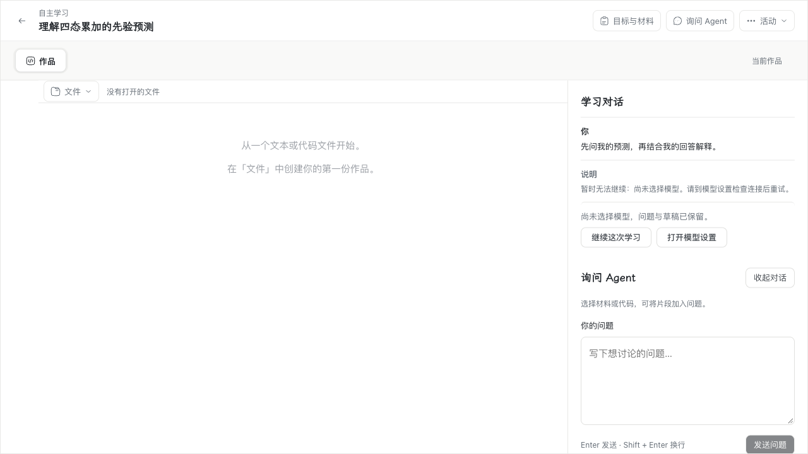
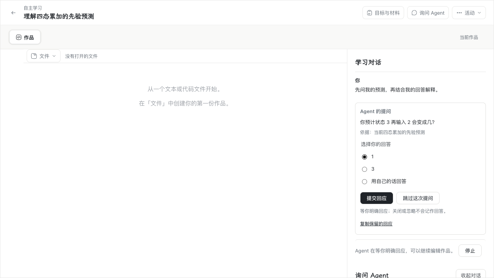
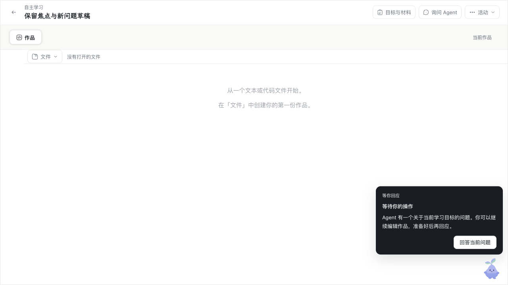
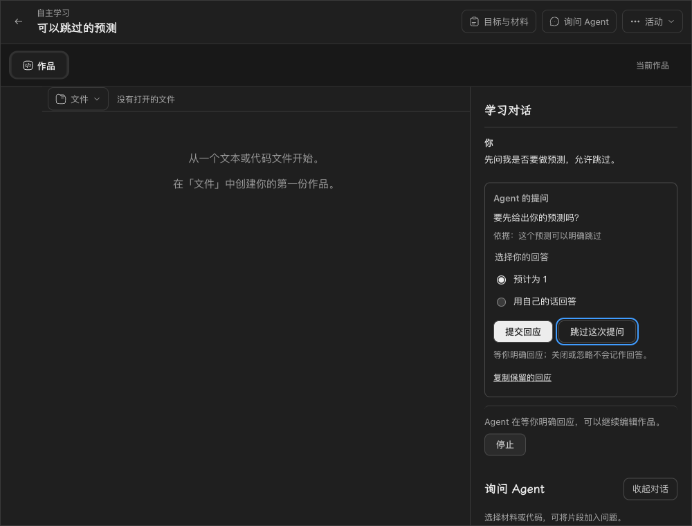

# #209：Agent 提问与学生明确回应的 Mac 平台验收

本文保留旧版本的验收历史；旧 Agent 探针已退休，文中脚本名仅标识原证据来源。当前 session v2 工程入口为 [agent-student-ask.runtime.test.mjs](../../packages/product-runtime/test/agent-student-ask.runtime.test.mjs)、[capabilities.runtime.test.mjs](../../packages/agent-runtime/test/capabilities.runtime.test.mjs)。这些测试不继承本页的历史通过结论，真实供应商、桌面与跨机结果须另行验收。

本记录完成 [#209](https://github.com/paher-din/XunJie/issues/209) 在已有 Apple Silicon / macOS 环境上的验收，来源需求为 [#199](https://github.com/paher-din/XunJie/issues/199)。不包含 macOS 或虚拟机环境搭建，不合并 PR #207，不自动关闭 #199。产品设计与 Windows 交付记录见 [#199：Agent 提问与学生明确回应](wp07-199-student-ask.md)。

## 结论

工程检查、原生 runtime、完整 `darwin-arm64/full` 产品包、正式 CLI 生命周期、普通正式 Web 与完整包入口的桌面 Chrome、系统物理中文输入法、真实模型三协议全部通过。教学效果未评估；工程和模型成功不证明学生理解或学习收益。完整包为既有流程产出的未签名候选，签名、公证和 Gatekeeper 未作为本轮通过项。

候选固定为 `wp07` 分支 HEAD `55a746189eb96e5f1717bb6549305d2c4bb2c7fc`（= `origin/wp07`），产品代码沿用 `5e9cf4ad`（功能）、`e0e2fcdb`（审查修复）、`6b2ef11b`（夹具与证据）及独立部署后继 `9cdc6e69`。

## 环境

| 项目 | 实际值 |
| --- | --- |
| 机器 | Apple M5，arm64，16 GB |
| 系统 | macOS 27.2（26B123），Darwin 27.2.0 |
| 浏览器 | 安装版 Google Chrome `156.0.8078.80`，headed、单 worker |
| Node | `24.21.0`，来自固定 `node-v24.21.0-darwin-arm64.tar.gz` 解包缓存 |
| PostgreSQL | `18.6`（固定发行版 `18.6.1`，`postgresql-18.6.1-aarch64-apple-darwin`） |
| 输入法 | 豆包拼音 `com.bytedance.inputmethod.doubaoime.pinyin`（macOS TIS） |

## 工程检查

| 检查 | 命令 | 结果 |
| --- | --- | --- |
| 类型检查 | `npm run typecheck` | 通过，全部 workspace 退出 0 |
| 完整构建 | `npm run build` | 通过，生成 `dist` / `dist-runtime` |
| 浏览器公共契约 | `npm run check:contracts:browser` | 14 个 public export 全部 browser-safe |
| 维护文档链接 | `npm run check:docs` | 新增本记录前 220 个 Markdown 文件、2016 个本地链接、0 失败；新增后复跑 221 个文件、2034 个本地链接、0 失败 |

## 原生 runtime

使用固定 Node 24.21.0 与固定 PostgreSQL 18.6 二进制，每个文件独立运行并保留日志与 TAP：

| 文件 | 通过/总数 | 跳过 | 耗时 |
| --- | --- | --- | --- |
| `apps/server/tests/teaching-agent.student-ask.runtime.test.mjs` | 12/12 | 0 | 37.5 s |
| `apps/server/tests/teaching-agent.runtime.test.mjs` | 9/9 | 0 | 26.4 s |
| `apps/server/tests/teaching-agent.driver.runtime.test.mjs` | 3/3 | 0 | 4.4 s |
| `apps/server/tests/teaching-agent.tools.runtime.test.mjs` | 8/8 | 0 | 21.0 s |
| `apps/server/tests/teaching-agent.tools-recovery.runtime.test.mjs` | 17/17 | 0 | 48.4 s |
| `apps/server/tests/teaching-tools-host.runtime.test.mjs` | 6/6 | 0 | 9.5 s |

合计 55/55、0 失败、0 跳过。`student-ask` 的 12 个场景逐项通过，包含重启持久化、显示确认不消费问题、停止/过期、中文原文、错误活动、预算、串行等待、真实备份与只读还原接管、4000 字符边界和接收幂等。

## 完整产品包与正式 CLI

构建命令：

```bash
node scripts/package-product.mjs --platform darwin-arm64 --profile full \
  --out <验收私有目录>/product-darwin-arm64-full
```

包内 `resources/node/bin/node` 为 Node `24.21.0`（arm64 Mach-O），`resources/postgres/bin/postgres` 为 PostgreSQL `18.6`（arm64 Mach-O）。包体约 404 MB，未签名候选为既有流程状态；签名、公证、Gatekeeper 与 clean-machine 验收未声称通过。

| 校验项 | SHA256 |
| --- | --- |
| `distribution.json` | `aa8b260ebe6358d8dc322807fdc6552e5658b9e082d5d4f5f2366e007bdb4d1f` |
| `resources.json` | `54e3bfca6394b6d600a77eff946427123f2bbbf095a9563e6c731bd5b0159469` |
| `app/cli.js` | `7070decc12d95efe27cc2a11a125095befeb6a75a98c22b8ea8164afda161a52` |
| `web/` 整树 | `f2b57988c1095a65a684656a9226c1acaf2473ba82687015262012e05635295f`（160 文件、11,419,566 字节） |

`distribution.json` 的 220 个 entry hash 全部与包内实际文件一致（0 mismatch）。用包内正式 CLI 在仓库外私有 root `<验收私有目录>/product-root` 执行：

`install --profile local` → `start` → `status` → `stop` → `start` → `stop` → `status`

每步退出 0；实际 endpoint `http://127.0.0.1:51839`，PostgreSQL 依赖 `ready 18.6`；最终 `stopped`，无残留监听。

## 桌面 Chrome

`studentAsk.spec.ts` 的四个业务场景分别对普通正式 Web 和完整包入口各跑一次；headed Chrome、单 worker、`--grep-invert baseline`，均 4/4、0 跳过。

| 入口 | 结果 | 耗时 | 日志 |
| --- | --- | --- | --- |
| 普通正式 Web（`apps/web/dist`） | 4/4 | 21.0 s | `.verification/wp07-199-mac/chrome-web.log` |
| 完整产品包（`XUNJIE_STUDENT_ASK_ENDPOINT=http://127.0.0.1:51839`） | 4/4 | 20.1 s | `.verification/wp07-199-mac/chrome-package.log` |
| 修改前 baseline capture | 1/1 | 4.7 s | `.verification/wp07-199-mac/chrome-web-baseline.log` |

完整包入口命令：

```bash
XUNJIE_STUDENT_ASK_ENDPOINT=http://127.0.0.1:51839 \
XUNJIE_PRODUCT_POSTGRES_BIN=<验收私有目录>/product-darwin-arm64-full/resources/postgres/bin \
XUNJIE_E2E_BROWSER_CHANNEL=chrome \
XUNJIE_XJ_DEV_URL=http://127.0.0.1 \
XUNJIE_STUDENT_ASK_EVIDENCE_DIR=<验收私有目录>/screenshots/package \
npx playwright test --config apps/web/playwright.config.ts studentAsk.spec.ts \
  --headed --workers=1 --grep-invert baseline
```

实际界面对照（修改前为未配置模型时的对话基线截图，不出现回应卡片；修改后取完整包运行界面）：

| 修改前：原有活动对话 | 修改后：Agent 提问与明确回应 |
| --- | --- |
|  |  |

| 对话收起时的 IP 定位 | 深色窄桌面及键盘操作 |
| --- | --- |
|  |  |

[中文原文](evidence/wp07-199/student-ask-text-darwin.png)、[丢回包后原身份恢复](evidence/wp07-199/student-ask-receipt-recovered-darwin.png)与[明确跳过](evidence/wp07-199/student-ask-skipped-darwin.png)均为完整包实际运行截图。

## macOS 系统物理中文输入法

验收使用已安装的完整产品包和安装版桌面 Chrome，输入法为豆包拼音。文本只通过 WindowServer 与 TIS 选中的系统输入法进入 Chrome：`xjkeys` 以 `CGEventPost(.cghidEventTap, .hidSystemState)` 发送 HID 级按键；Tab、Shift+Tab、Command+A 用 System Events 发送物理 key code。Playwright 只做导航、点击非文本控件和读取状态，未使用 `fill`、`insertText` 或任何合成文本。

最终探针 13/13 通过：

1. 既有对话先呈现一个未回答的固定问题，模型请求数为 1；
2. TIS 选中并核验豆包拼音；
3. 拼音组合 + 真实空格候选提交输入「你好」；
4. 真实数字键选择系统候选，追加「世界」；
5. 候选窗打开时按 Enter 只提交组合，不提交回应、不推进 Run（记录 trusted `keyCode=229`、`isComposing=true`）；
6. 非组合状态按 Return 插入真实换行，换行后继续用系统输入法输入「上海」；
7. Tab 离开 textarea、Shift+Tab 返回，文本与焦点保持；
8. Escape 取消候选组合，不清空已提交文本；
9. Command+A 通过真实 Meta 快捷键全选，不提交；
10. 页面滚动保持 textarea 焦点与文本；
11. 关闭页面再打开，未接受的「你好世界zhongguo\n上海」从 IndexedDB 恢复，服务端问题仍为 `pending`、模型请求数不变；
12. 点击「提交回应」后只继续原 Run 一次，模型请求数从 1 变 2，原回答原文进入请求并完成；
13. DOM 记录到 5 次 `compositionstart`、39 次 `compositionupdate`、5 次 `compositionend`、39 次 `VK_PROCESSKEY` 组合 keydown、44 次 trusted keydown，中文组合提交为「你好」「世界」「上海」。

候选窗实拍：[拼音候选「你好」](evidence/wp07-199/student-ask-ime-candidate-darwin.png)、[数字候选](evidence/wp07-199/student-ask-ime-digit-candidate-darwin.png)。页面实拍：[浅色](evidence/wp07-199/student-ask-ime-light-darwin.png)、[深色](evidence/wp07-199/student-ask-ime-dark-darwin.png)、[窄桌面](evidence/wp07-199/student-ask-ime-narrow-darwin.png)。

探针脚本为 `scripts/probe-student-ask-ime.mjs`；首次两次自检分别因组合态标点基线和关页后读取事件列表失败（产品场景均通过），修正探针后最终 13/13，未修改产品或测试断言。

## 真实模型

使用 DeepSeek `deepseek-flash` 跑 `scripts/probe-teaching-tools.mjs --student-ask`，三协议 `chat-completions`、`responses`、`messages` 各 2 次模型请求，共 6 次 relay 全部 HTTP 200；三协议均 `state=completed`、`student_ask:completed`、`responseAdopted=true`，快照摘要两枚一致。限制为每协议最多 2 次、2048 输出 token、30 秒、SDK retries=0，未关闭证书校验。报告 SHA256 `30808f00570d7094c83f4b9838277526e20cea8877f876479aea4faaf9819854`。凭据只从用户授权私有文件读取，未进入提交、日志或截图。

## 失败、未执行与边界

- 本机验收未出现产品代码或测试代码失败；55 个 runtime 场景、8 个 Chrome 业务场景全部通过。
- 完整包签名/公证/Gatekeeper、clean-machine、备份升级探针不在本轮范围；`distribution.json` 对此保持 `deferred-by-user` / `not-run` / `cancelled-by-owner`，不据此声称通过。
- 教学效果未评估；本记录只证明工程与交互路径通过。
- macOS 或虚拟机环境搭建未执行，本机为已有合格环境。
- 探针两次自检失败已保留在本机日志 `.verification/wp07-199-mac/student-ask-ime-attempt1.log`、`student-ask-ime-attempt2.log`，最终结果以 `student-ask-ime.log` 为准。

## 证据与清理

脱敏证据汇总：[mac-verification.json](evidence/wp07-199/mac-verification.json)，包含候选 SHA、环境、命令、每项通过计数、包哈希、CLI 生命周期、Chrome、IME 与真实模型结果。截图均在 [evidence/wp07-199](evidence/wp07-199)。原始日志保留在忽略的 `.verification/wp07-199-mac/`；一次性完整包与私有 root 在验收后停止并删除，未提交凭据、私有路径或模型推理正文。
