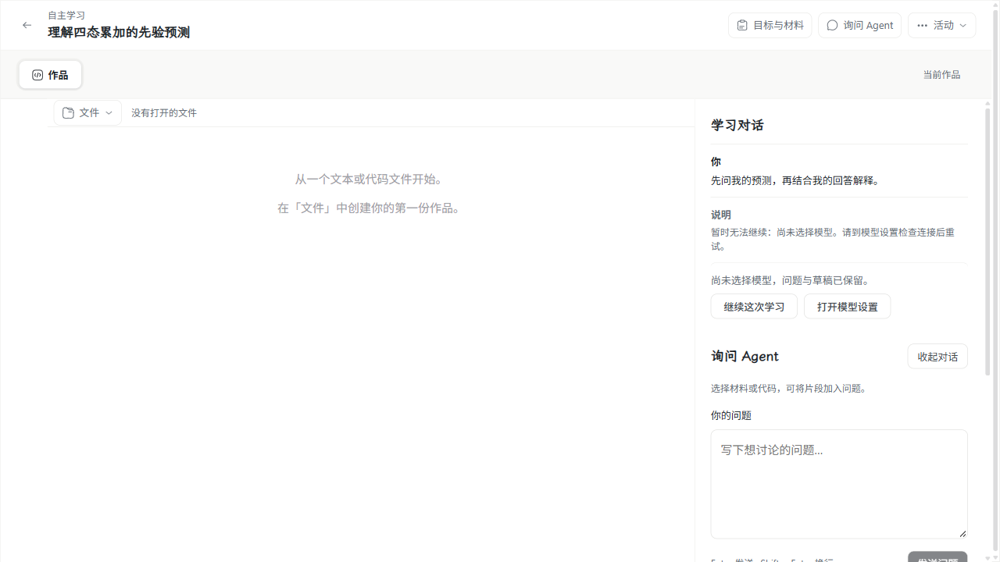
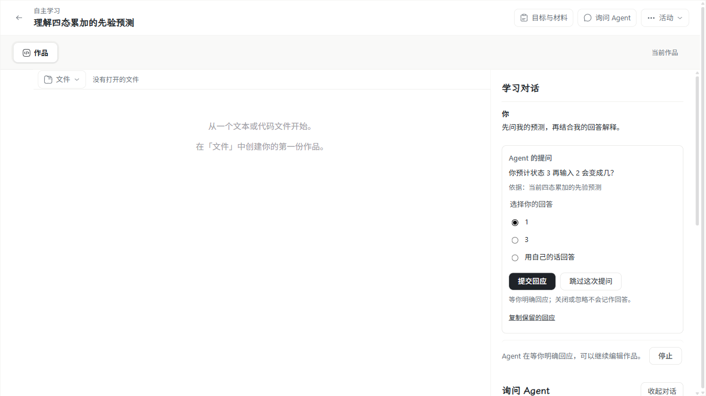
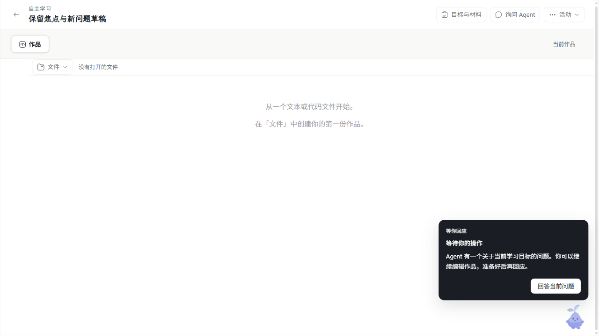
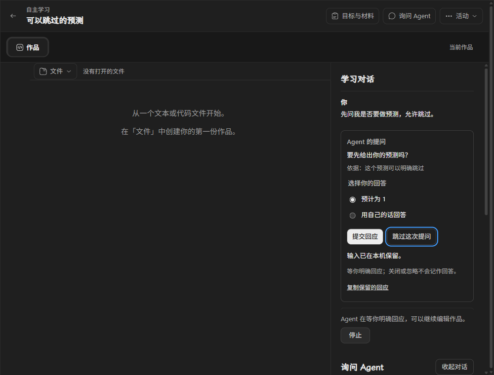

# #199：Agent 提问与学生明确回应

需求来自 [#199](https://github.com/paher-din/XunJie/issues/199)，沿用同一 `wp07` 分支。实施基线 `0db7765`，产品功能 `5e9cf4ad`，审查修复 `e0e2fcdb`。实施选择见[固定提问与回应](specs/wp07-student-ask.md)，[双轴审查](wp07-199-code-review.md)分别记录 Standards 与 Spec。此交付不自动合并 PR 或关闭 #199；Mac 平台验收已由 #209 完成并回填，见 [Mac 平台验收](wp07-199-mac-acceptance.md)。

## 产品变化及影响

Agent 可以在当前请求中调用固定 `student.ask`，保存带来源的问题、稳定选项、自由输入和可跳过设置。原生函数名为 `student_ask`，问题绑定原 Run、步骤、命令、输入与版本化 Wait；问题、接受事实和日志在同一所属事务提交。已呈现与学生已回答分别记录，未呈现、关闭、忽略、失焦、断线和历史读取均不作回答。

既有活动对话增补回应卡片，保留原导航、作品、问题草稿和设计 token。IP 在对话收起时引导到同一卡片，学生可继续编辑作品，只有主动定位时移动焦点。普通新问题与明确回应是不同输入，不用文本分类猜测是否在回答旧问题。

回应先在 IndexedDB 固定身份与原文，再交给公开接收接口；丢回包先查询原身份，未确认时保留输入。有效回应唯一消费原 Wait，在当前资格和原剩余预算下继续同一 Run；重复、版本不符、错活动、过期与停止后的回应保存实际处理结果。超期先保存过期事实，再结清同批未派发原生调用后暂停，不残留阻塞下一请求的工具配对。

明确回应进入 session log 和实际请求快照，合法 4000 字符的中文、引号、换行和 Unicode 原文不会截断；超过单条观察边界时按字段和序号完整分段。问题、呈现、回应、Wait 与引用资源同时参加所属迁移、保留、维护、备份、隔离只读还原及接管。未新增强制步骤锁、通用生成页面或主动教学触发器；完整消息队列/切换模型/独立部署仍由后继票交付。

## 真实界面对照

修改前使用实施基线运行页面取证；修改后为修复结束后的实际 Windows 安装版桌面 Chrome。变化是原对话中增加带来源的回应表单、可靠回应结果和 IP 定位；作品区和原问题草稿继续可用。界面不显示协议身份、内部 schema 或原生推理正文，也不增加常态保存提示。

| 修改前：原有活动对话 | 修改后：同一对话的明确回应 |
| --- | --- |
|  |  |

| 对话收起时的 IP 定位 | 深色窄桌面及键盘操作 |
| --- | --- |
|  |  |

[中文原文](evidence/wp07-199/student-ask-text-win32.png)、[丢回包后原身份恢复](evidence/wp07-199/student-ask-receipt-recovered-win32.png)与[明确跳过](evidence/wp07-199/student-ask-skipped-win32.png)均来自实际运行页面。

## 验收环境与结果

Windows 11 x64 10.0.26200，Intel Core Ultra 9 275HX，安装版 Google Chrome `157.0.8103.38`（headed、单 worker），Node `24.21.0`，原生 PostgreSQL `18.6`（固定发行版 `18.6.1`）。工程夹具使用真实生产 Agent/Gateway、HTTP、身份、PG 与资源；仅控制模型上游/故障时序。完整产品包自带固定 Node、PG、生产应用和静态页面，通过正式 CLI 安装、启动和停止，不以源码宿主替代包。

| 验证类别 | 实际结果 |
| --- | --- |
| 完整构建、类型、浏览器公共契约与维护文档 | 首轮 prepare 4/4；依赖恢复后的完整构建全部命中已核对产物。最终新增文档另核对链接。 |
| `student-ask` 公开接口与实际 PG | 完整 12/12、0 跳过，覆盖超期原生配对与 4000 字符回应。 |
| 前置学习对话、双推进者、工具/恢复/宿主 | 对话 9、双推进者 1、工具宿主 6 均通过；工具文件补验 8/8；最终恢复文件 11/12，余下一条四轮长链保持原断言单独复验 1/1。各轮失败和补验分开保存，未称一次合跑全绿。 |
| runtime Web 的安装版桌面 Chrome | 4/4、0 跳过。 |
| 普通正式 `apps/web/dist` 的桌面 Chrome | 4/4、0 跳过。 |
| 完整 Windows 产品包的桌面 Chrome | 正式 CLI `install/start/stop` 成功，4/4、0 跳过。 |
| DeepSeek `deepseek-flash` 三协议真实用途 | 最终产品代码三条路线均成功，快照核对 `responseAdopted=true`；网络失败和有限补验分别保留。 |
| 本机完整测试与依赖恢复后补验 | 完整轮本地文件任务 82/160，通过 prepare 4/4 与 build:test 1/1；受依赖中断影响。恢复后 unit/server 为 108/115，之后产物归档和核验器 2 文件补验通过（38 测试通过、2 平台跳过），按文件收敛为 110/115，仍有下述 5 个失败文件。 |
| Apple Silicon Mac | 通过（#209）：Apple M5 / macOS 27.2，完整 `darwin-arm64/full` 包与正式 CLI 生命周期、普通正式 Web 与包入口 Chrome 均通过；见 [Mac 平台验收](wp07-199-mac-acceptance.md)。 |
| 系统物理中文输入法 | 通过（#209）：豆包拼音候选窗、空格/数字候选提交、Enter 组合与提交区分、换行、Tab/Shift+Tab、Escape、Command+A、滚动、关页重开保留和明确提交均通过；见 [Mac 平台验收](wp07-199-mac-acceptance.md#macos-系统物理中文输入法)。 |
| 教学效果 | 未评估；工程与模型成功不证明学生理解或学习收益。 |

### 故障、修复及证据口径

TDD 从公开 HTTP/Agent/Gateway/PG 和正式 Chrome 边界逐项完成。首轮完整提问文件 10/10 后，双轴审查发现的同批超期与长文本问题分别补回归再修复。长文本测试最初只读取 SDK 字符串，后来校正为同时读取真实文本数组，并做原实现与修复实现对照；修复前仍失败，修复后原文完整进入模型、重启可读并通过 owner 备份校验。

全量本机测试中，旧开发工具根据 manifest 时间判断依赖过期，尝试对正在使用的根工作树执行 `npm ci`；Windows 已加载的 `better-sqlite3` 扩展拒绝 unlink，安装中断使后续任务缺包，并影响并行原生回归。该轮结果保留，受影响的原生进程已明确结束。随后在隔离目录按原锁文件离线准备 371 个包，补回缺失文件/项目链接、保留字节相同及已使用的扩展，生产导入恢复后先统一构建，再独立补验；没有停止原有服务或修改锁文件。

六个原生文件首次补验共 48 个场景，37 通过、11 失败。普通工具恢复夹具原先统一使用 1.5 秒 lease，在 Windows 实际 PG/owner I/O 中于原生配对前失效；另有目录删除 `ENOTEMPTY`。夹具现直接采用产品默认 10 秒，四处故障恢复/竞争仍显式保留原 1.5 秒，清理增加有界重试。中间 15 秒试验曾使接管等待逼近完成观察窗，经双轴复审纠正并保留记录。最终恢复文件为 11/12，四轮模型与原生输入长链的原 15 秒完成观察超时；公开状态显示三项工具完成、Wait 已消费、四个实际 attempt 已完成。其后在同一默认租约、同一观察窗与全部原断言下单独复验 1/1，通过后核对原身份、四次模型请求、三个不同命令、一次消费及真实累加结果。未修改产品租约、运行预算或放宽业务断言，也不据单例成功宣称延迟正常。

恢复后的普通工程检查仍有以下 5 个失败文件；它们不是 #199 的业务通过项，也不被隐藏或改为 skip：

| 文件 | 本机实际失败 |
| --- | --- |
| `packages/product-runtime/test/lifecycle.test.mjs` | 已完成维护边界的清理出现 Windows `ENOTEMPTY`。 |
| `packages/product-runtime/test/recovery-files.test.mjs` | 测试建立文件符号链接被 Windows `EPERM` 拒绝。 |
| `packages/storage/test/blobs.test.mjs` | 文件符号链接 `EPERM`。 |
| `apps/server/tests/account-control.test.ts` | `LOCAL_SOCKET_CONFLICT`。 |
| `apps/server/tests/application-database.test.ts` | 建立目录符号链接 `EPERM`。 |

`ci-build-artifact` 的 tar 路径问题和 `verify` 的负载下超时在独立补验后通过；未为剩余项更改系统权限或放宽其断言。完整 tools 轮的 17 个失败文件另在验证摘要中保留，不用后来 unit/server 补验替代其结果。

完整包第一次构建因 PATH 中 Git tar 将 `D:` 误认远程地址而失败；改用 Windows 自带 tar 后成功，未改生产代码。真实模型复验有四次尝试未取得上游 HTTP 响应；对官方 DNS 两地址做无凭据 TLS 核对，保留证书链失败，使用通过 hostname/证书校验的地址继续。最终 Chat 单独补验的业务 1/1 成功，但探针原先硬编码三路线导致退出 1，现已按实际选定路线数修正，未为报告逻辑重复调用模型。

本次真实模型探针累计 16 次 relay 准入尝试：12 次取得 HTTP 200，4 次未取得上游 HTTP 响应；其中首轮产品代码 6 次成功，最终产品代码三协议共 6 次成功。每条路线每轮最多两次、2048 输出 token/30 秒、SDK retries=0；失败报告保留，不关闭证书校验、不无限重试。凭据只从用户授权私有文件读入，不进入提交或日志。

脱敏证据：[Windows 验证摘要](evidence/wp07-199/windows-verification.json)、[真实模型汇总](evidence/wp07-199/real-model-summary.json)。原始日志留在忽略的本机验证目录，不复制凭据或原生推理。临时安装和故障夹具在验收结束后清理，保留完整 Windows 候选及诊断日志供复核。

## 复跑与平台交接

先完成构建，运行原生/Chrome 宿主时不重建共享依赖。原生主文件为 `apps/server/tests/teaching-agent.student-ask.runtime.test.mjs`；桌面入口为 `apps/web/e2e/studentAsk.spec.ts` 的四个业务场景，历史 baseline capture 默认不运行。已有 Mac 环境所需版本、全部命令和清单见独立交接票 [Mac 明确回应平台验收（#209）](https://github.com/paher-din/XunJie/issues/209)。完整包先用包内 CLI 安装启动，再通过 `XUNJIE_STUDENT_ASK_ENDPOINT` 将同一 Chrome 用例接到实际入口；结束后用该包停止。

本机为 Intel Windows。初步核对 [QEMU VMApple 官方条件](https://www.qemu.org/docs/master/system/arm/vmapple.html) 后，又实际在现有 Ubuntu WSL2 中验证 KVM VM/vCPU 创建，并用独立解包的 QEMU 8.2.2 启动了 2 vCPU 的通用 x86_64 UEFI 虚拟机；虚拟机已正常退出。这证明本地虚拟化基础可用，尚未下载、安装或启动 macOS，也未形成 Apple Silicon 验收环境。按负责人 2026-11-06 要求停止尝试并清理，本次新增工具、固件及临时文件共 558,653,825 字节已删除，原有 WSL/Ubuntu/Docker 和 Windows 验收证据保留。独立交接票只交付已有 Mac 环境上的验收，不包含环境搭建；既有 Windows 或通用虚拟机结果不计作 Mac 通过。
