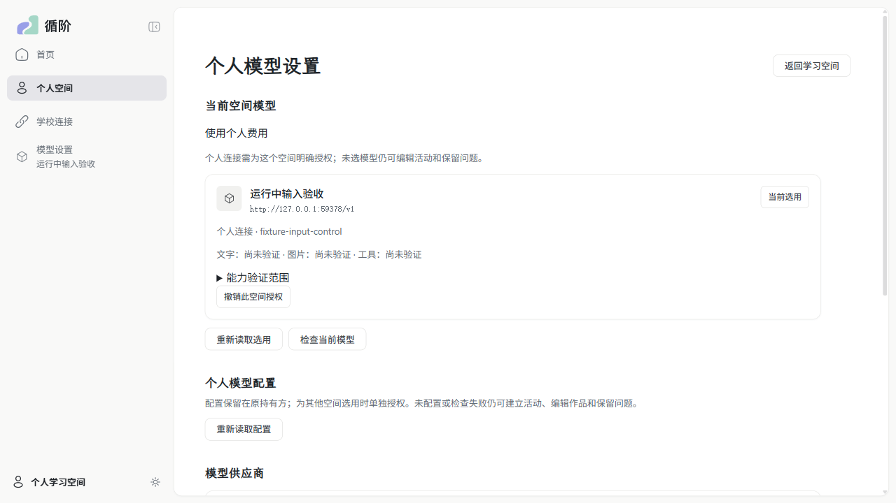
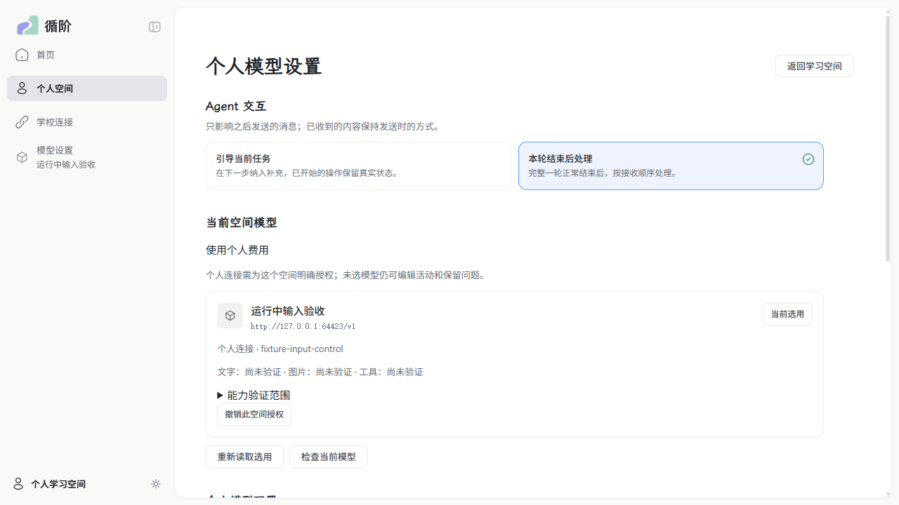
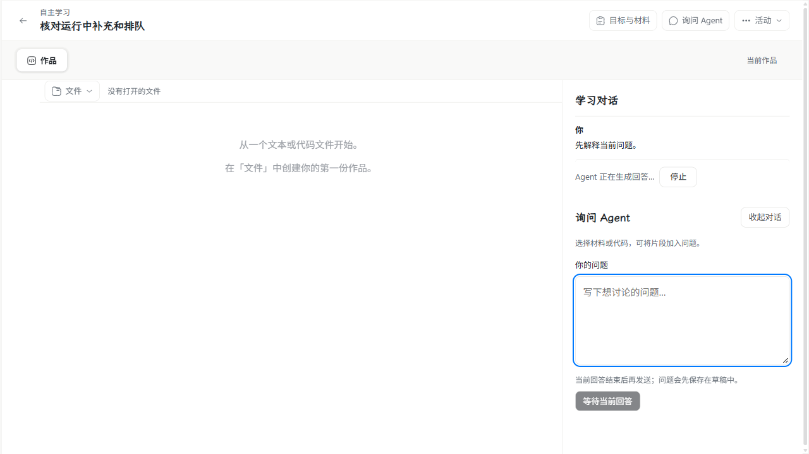
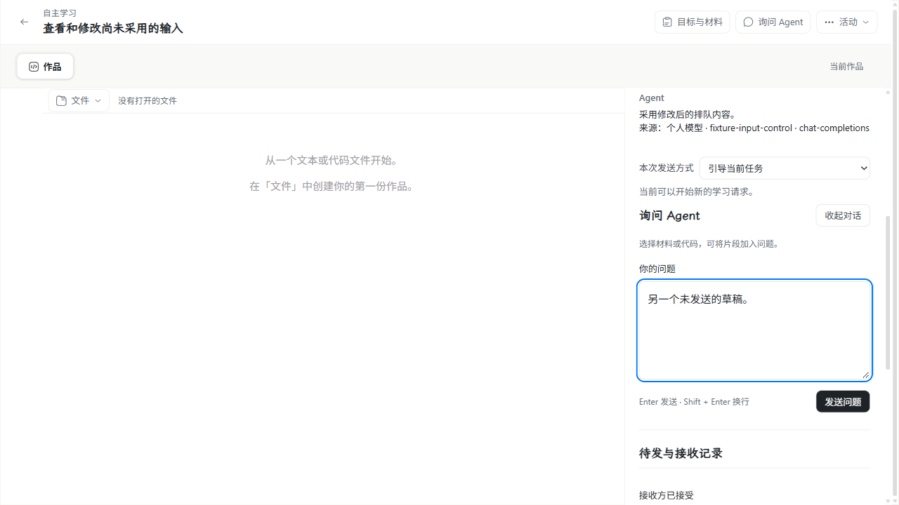
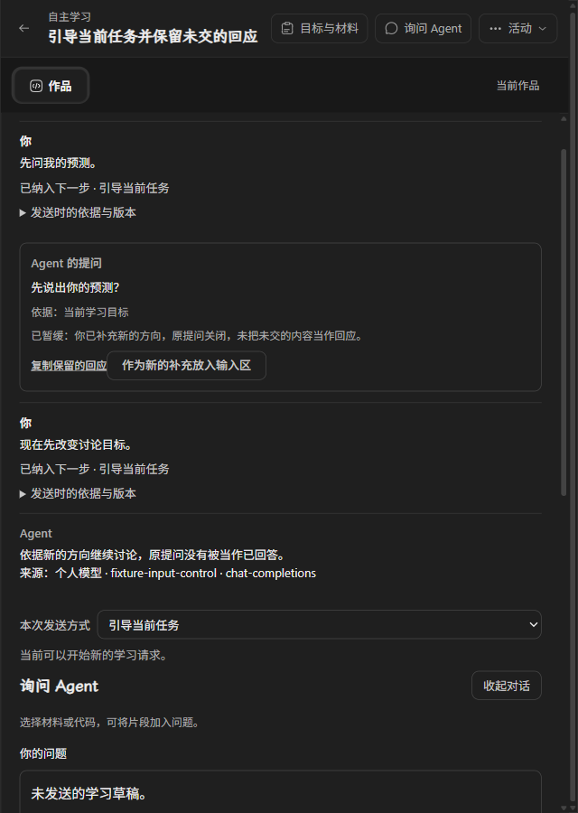

# 运行中引导、排队与暂停续接

来源：[运行中引导、排队与暂停后继续](https://github.com/paher-din/XunJie/issues/200)。本次在同一 `wp07` 分支实施，并整合远端 `7caf8c59` 的模型切换与累计预算；不新建 PR、不改 PR 元数据、不合并。Mac 和真实跨机连接的后续验收由独立 [Mac 交接 ticket](https://github.com/paher-din/XunJie/issues/210) 承接，执行者使用已有合格环境。

## 产品变化与原因

个人模型设置内增加真实主体隔离的 Agent 交互偏好，默认引导当前任务。原工作区输入区显示本次方式；发送时固定方式、当时偏好版本、引用与作品。改变设置只作用于之后发送的消息。

原对话中的每条输入区分“已收到”和“已纳入下一步”。待处理项可修改、移除或转为新的引导输入；已收原文保留，修改形成不可变版本。草稿先在本机保护，刷新、丢控制回包及消费竞争后都保留原身份和未生效的修改，不覆盖当前输入区。

引导进入原 Run 的下一允许步骤，不重写正在生成的请求或重置预算。未许可的旧工具调用按原 call ID 记录未执行；已许可的真实操作继续核对。长任务的接受、原 Wait、期限与结果分别保留，讨论不能使队列越过未结结果。失败、停止、预算或等待期限到期暂停剩余输入。可恢复暂停续原 Run；终态须选择输入建立关联后继，保留可追溯的已核实效果。

明确回应仍使用原提问入口并绕过普通队列。新引导可暂缓尚未回答的问题，旧入口关闭、未交中文回应可明确放入输入区另行补充。运行控制和输入控制共用可靠本机事务、原回执查询及所属事务顺序。

复用既有设置、工作区、对话、按钮和 DESIGN token；没有新增平行学习页面。影响是忙碌时可发送、对话增加处理状态和管理操作、暂停后增加选择入口。后台更新不主动移动焦点或滚动位置。

| 实际运行界面 | 修改前 | 修改后 |
| --- | --- | --- |
| 个人设置 |  |  |
| 运行中输入与原对话 |  |  |

## 工程与模型证据

生产 HTTP、Agent 公开输入/运行/查询、真实 PostgreSQL 18.6 与资源用于验证；只控制模型上游或实际操作回包的时点。实际 `read_work` 读取固定文件；长任务执行发布的 table-aggregation Wasm，均值独立断言为 `83.33333333333333`。

新增场景覆盖接收/采纳、FIFO、不可变修订/移除/转引导、回应取代、停止收尾竞争、失败后选择继续、配置恢复原 Run、模型切换后的已核实工具结果、等待到期、两个推进者、真实工具批次部分启动和提交确认丢失。原设置、修订与回执通过正式备份、隔离只读还原、权威接管和重启查询；旧命名空间不能继续写入。

| 工程检查 | 实际结果与范围 |
| --- | --- |
| 全量准备阶段 | 独立依赖副本完成全部类型检查、正式构建、14 个浏览器安全契约出口及文档检查；225 份 Markdown、2047 个本地目标，0 链接失败。 |
| 新输入控制原生文件 | 首轮 15/15；审查后定向 4/4，含新增提问过期、真实长任务结果与停止清理校验、显式选择续接和修订/转引导。批次重叠，不能相加为独立用例总数。 |
| 原学生回应原生回归 | 12/12，含完整 4000 UTF-16 中文回应、备份/只读恢复/接管与原身份回执。 |
| 设备→学校→独立 Agent | 1/1，同机三套真实安装，验证偏好主体隔离、控制转发、拒绝回执及模型切换；不算真实跨机。 |
| Web 全组单元检查 | 72 个文件、879 项通过。全量检查首次暴露旧设置页夹具缺少新增偏好接口与浏览器存储；补齐夹具后单文件 20/20、全组 879/879。 |
| 独立双轴审查 | Standards、Spec 修复后均剩余 0 项；见[审查记录](wp07-200-code-review.md)。 |

全量工程检查以 `343d41a1` 在独立 `npm ci` 副本执行 `node scripts/verify.mjs --jobs 2`，默认发现范围不含 `.runtime.test.*`；上述原生场景另行显式执行。不能把静态准备通过、定向通过或后续复验表述成首次全量通过。

完整一轮已于 `2026-11-06 18:30 UTC` 结束，约 125 分钟，退出码 1；166 个调度项中 149 通过、17 失败、0 未执行。Web 全组在此表中是一个调度项，不把调度项与用例数相加。原始结果没有因后续复验改写：

| 默认全量组 | 通过调度项 | 失败调度项 |
| --- | ---: | ---: |
| prepare | 4 | 0 |
| build:test | 1 | 0 |
| unit（含原始 Web 失败） | 23 | 5 |
| server | 86 | 2 |
| tools | 35 | 10 |

最后的独占连接回归 32/32 通过；旧传输文件 27 通过、2 项按既有设定在 Windows 跳过、0 失败，跳过不算通过。原始 17 个失败项的路径、复验、准确源码与未执行边界见[分项证据](evidence/wp07-200/verification.json)。

已定位的全量失败包括 Windows 创建文件软链时的 `EPERM`、旧本地通信测试的 `LOCAL_SOCKET_CONFLICT`、构建锁文件改名权限错误，以及旧开发工具的断言、子进程超时和连接错误；这些失败测试文件本次未修改。旧备份保留用例曾在清理临时目录时报 `ENOTEMPTY`，使用全量检查相同权限环境单独复验 1/1 通过；受限进程中的另一尝试先在目录结果断言失败，未算作通过。构建锁和发布脚本的环境复验仍失败，原始失败保留。

本工作区直接运行默认文档发现时，还会纳入原有未跟踪的 `.tmp/`、`docs/planning/` 与 `docs/tasks/` 资料：1126 份 Markdown、9764 个本地目标，252 个失效链接，未通过。没有为本票修改这些资料。隔离副本检查的受版本控制文档通过；本票实际改动的 7 份 Markdown 另行检查 171 个目标，0 失败。

DeepSeek 官方 `deepseek-flash` 三协议运行实测全部通过，各 4 次生成，共 12 次 HTTP 200，无自动重试。每次上限 2048 输出 token、30 秒。每条路线均在原生成期间接收 queue 与 steering，保留原请求、阻止旧未许可工具、实际读取固定文件，正常整轮后只启动明确 queue。重复历史查询没有新增生成。完整无密钥报告见 [真实模型证据](evidence/wp07-200/real-model-input-control.json)。

## 浏览器与部署

Windows 11 x64 `10.0.26200`，实际安装的桌面 Chrome `157.0.8103.38`，有头运行同一 `inputControl.spec.ts` 的五个功能场景。普通 Web 的 `apps/web/dist` 与新完整 `win32-x64 --profile full` 产品候选各 5/5 通过；完整包由包内 CLI 安装、启动并正常停止，使用包内应用和静态资源。合成上游仅控制时序，数据及工具仍走真实产品实现。

受影响的原对话和学生回应桌面 Chrome 回归另行 8/8 通过。其后保留合入远端 `dbea618c` 的 #208 Mac 模型切换验收与设置页操作，合并点为 `0f55e67f`；合入后再次完成 Web 类型检查与正式构建，并在这份实际构建上通过 Chrome 5/5，交付图已更新为此轮截图。本票 Mac 场景仍须由 #210 独立完成。

五项包含偏好持久化与固定方式、编辑跨刷新及丢回包、暂缓提问及中文原文另行补充、移除/停止/选择继续、明确回应绕过队列及编辑消费竞争/改为引导。深色和窄桌面实际页面已检查，焦点与未发草稿在后台推进后保留。Windows 桌面输入法验收曾打开独立真实 Chrome 页面，但桌面工具因无法可靠识别当前浏览器网址而强制停止；本轮没有发送系统输入动作，系统候选窗验收为未执行。程序填入中文不冒充真实候选验收。

Mac 不在本机搭建；[独立交接 ticket](https://github.com/paher-din/XunJie/issues/210) 要求已有 Apple Silicon/macOS 15+ 环境实测同样路径、完整包、真实输入法和获准的真实跨机连接。Windows 同机安装不算真实跨机通过。

## 维护与边界

保留已发布教学迁移 1—7，新增迁移 8；学习数据新增迁移 21。输入、不可变版本、控制、显式选择、Wait 观察及固定预算均归原 owner，参加同一关闸、保留、校验、备份/恢复与接管；新校验核对版本摘要、原请求、运行/步骤/事件关联和控制回执。旧已提交请求及继续回执保持可查；新无选择的旧式继续不能凭空制造“请继续”重试回合。

真实模型和浏览器成功说明工程路径可用，不代表学生掌握概念或教学效果提升。本次没有正式教学效果评估。失败记录与未执行平台不计为通过；只清理本票一次性运行、产物和临时稿，保留原工作区资料及审阅证据。

两个完整 Windows 候选的测试实例已正常停止，候选与实例已清理；独立全量副本在核对源码未变、进程退出、原始日志归档及摘要校验后清理。原有运行时、PostgreSQL 资源与缓存、七处原未跟踪资料保留。完整原始日志留在本机 `.verification/wp07-200/full-run-evidence/`，不提交。
